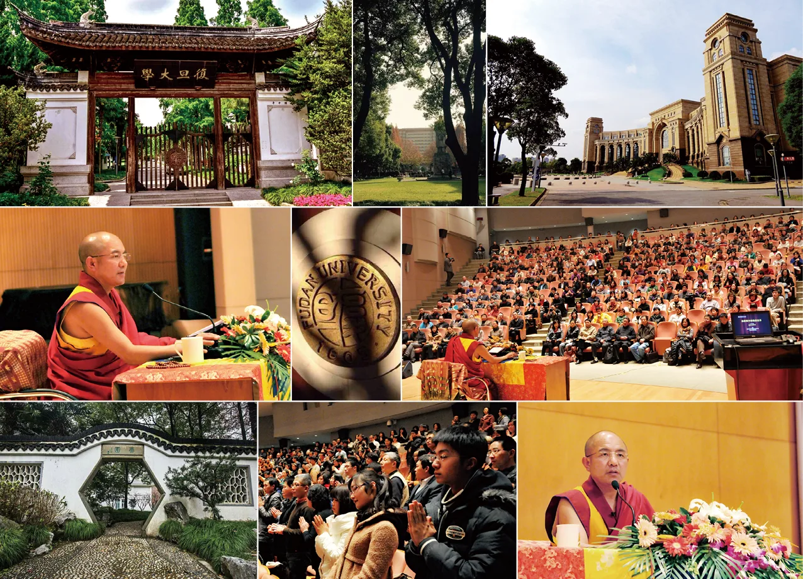
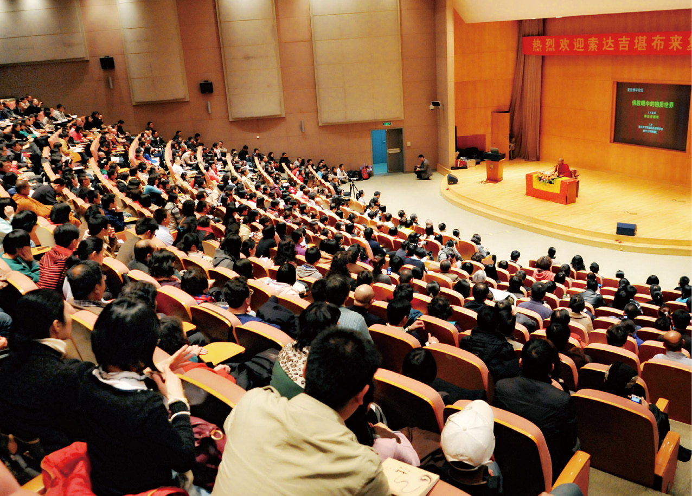
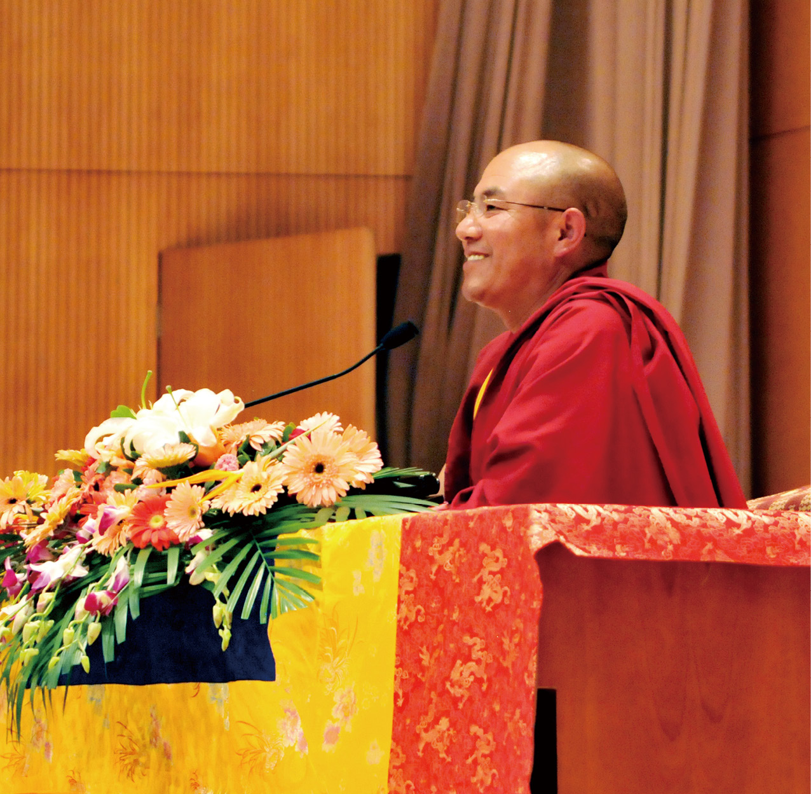

“空间、时间和物质，是人类认识的错觉。”

——爱因斯坦

第4场

复旦大学

Fudan University

中国·上海

2011 / 3 / 11

## 佛教眼中的物质世界

## The Buddhist View on Material World

主持人：

非常感谢大家今晚到这里参加这次殊胜的活动，今天的活动是复旦佛学论坛又一次盛会，我们的主题叫做“佛教眼中的物质世界”。

对每个人来说，每天都在接触这个世界，但我们是不是真的了解这个物质世界呢？它是如何形成的？我们所接触的世界是否真实？……今天非常荣幸地请到了藏传佛教的大德索达吉堪布，来为我们做这个开示。

对于藏传佛教，很多人都感觉很神秘，觉得它离我们很遥远。通过今天的演讲，相信大家会对藏传佛教有比较真实的深刻了解。

索达吉堪布，是四川甘孜炉霍人，生于1962年，曾就读于甘孜师范学院。1985年舍俗出家，前往色达喇荣五明佛学院，依止法王如意宝晋美彭措为根本上师，后成为学院的大堪布。1987年随法王及一万余僧俗朝拜清凉圣地五台山，自此开始摄受汉地四众弟子。堪布于显密教义通达无碍，二十多年来日不缺讲、夜不乏译，著作令人叹为观止，现已付梓的法本就有一百多本，而且数量还在不断增加。堪布常教诲每一个弟子：“如果能利益众生，哪怕只有一个人，想办法让他生起一颗善心，我们千百万劫做他的仆人也可以！”

今天，在我们面前的这位堪布，怀着一颗大慈悲心来到汉地，来弘扬佛法的真谛。请大家敬心恭请堪布来为我们作开示：

顶礼本师释迦牟尼佛！

在座的各位教授、老师、同学们：

晚上好！

今天有幸来到复旦大学，跟大家进行交流，我感到非常高兴。复旦是中国人自主创办的第一所高等院校，历来就有浓厚的多元文化氛围，及自由开放的学术特点。这次，应宗教文化研究所、国学社、禅学会之邀，我来到这里探讨“佛教眼中的物质世界”，愿将自己多年来对佛教的少许理解与知见，与大家一起交流、分享。

我们在切入主题之前，首先要知道何为佛教？佛陀在《别解脱经》中讲过：“诸恶莫作，诸善奉行，自净其意，是诸佛教。”也就是行持一切善法，断除一切罪恶，调伏自己的心，这即是真正的佛教。由此可见，世界上的宗教思想虽有许许多多，但为人类文明、为整个社会完全无我奉献的，才是佛教的精神。而今天我在此跟大家共同探讨的，也正是这种精神内涵。

## 一、梁启超眼中佛教的超胜之处

佛教的信仰是智信，不是迷信；是兼善，不是独善；是入世，不是厌世；是无量，不是有限——这四点，并不是我这个出家人的见解，而是近代著名政治家、史学家、文学家梁启超先生，在《论佛教与群治之关系》一文中提出的。

### 1．佛教是智信，不是迷信

佛教具有崇高的智慧、无上的大悲，是智悲双运的一种信仰。尽管信佛的个别人可能带有迷信色彩，但这不是佛教的过失，而是人的过失。佛陀从初发心到积累资粮，直至最终现前二身果位，在这个漫长的过程中，恒时都是以转迷成智为目标。佛陀还亲自告诫弟子：“不知佛而自谓信佛，其罪尚过于谤佛者。”因此，佛教的信仰并不是盲目的迷信。

### 2．佛教是兼善，不是独善

佛教不像有些人所理解的，只是烧香拜佛、搞些简单仪式。实际上，佛教的真正内涵是度化天下无边的一切众生，以大慈大悲的菩提心来摄受他们。这样的精神和行为，远远超过其他任何行善之举。而且佛教所体现出来的大悲心，其范围不仅仅只有人类，而是要将所有的生命，都当作自己的父母来对待。这种境界究竟有多伟大，通过与其他宗教或非宗教的高尚思想进行对比，就可以完全体会到。

### 3．佛教是入世，不是厌世

信仰佛教，并不是人生遇到了挫折，就对世间生起厌离心，万念俱灰、走投无路之下，才选择学佛乃至出家的。现在有些人认为学佛就是避世，这完全是一种误解。在大乘佛教的理念中，就算为了一个众生离苦得乐，哪怕付出自己最宝贵的生命，甚至入地狱感受无量痛苦也心甘情愿，那世间上的一点区区小苦，又怎么不能忍受呢？

### 4．佛教是无量，不是有限

佛教承认来世存在，不像唯物论所认为的，人死如灯灭，死后犹如火灭了、水干了、灯熄了一样，一无所有。实际上，生命在无边的轮回中会一直延续不断、不停流转，故我们要为了来世的长久安乐着想，不能只耽著眼前的暂时苦乐。当然，这个道理，大家要通过长期学习才会明白，不是我用三言两语就能让你恍然大悟的。

梁启超先生的这篇文章，我以前曾看过，今天之所以在此引用，是因为你们都是知识分子，拥有一定的学识和聪明才智，依靠他的这番话语，也许有人会重新思考佛教的真谛。

大家都知道，佛教的创始者是释迦牟尼佛，2002年，我在厦门用了五个月的时间，翻译过一部三十多万字的释迦牟尼佛广传——《白莲花论》，里面记载了佛陀无量劫来为利益众生而行持六度万行的整个经历。在那次翻译过程中，我深深感受到释迦牟尼佛在因地时，一次又一次付出头目脑髓，就是为了换取无上的智慧结晶，开启我们的智慧眼目。这一点让我从心坎深处，对佛陀生起了不可退转的信心。

现在有人觉得释迦牟尼佛跟印度的甘地等差不多，这是对佛陀生平一无所知的表现。其实这样的佛陀，不少世间上的名人也承认他无与伦比。比如，亚洲第一位获得诺贝尔文学奖的印度诗人泰戈尔（Tagore Rabindranath, 1861-1941）曾说：“我认为释迦牟尼佛，乃世上最伟大的圣哲！[^1]”鲁迅先生的朋友许寿裳，在《亡友鲁迅印象记》中也讲过：鲁迅从日本留学归国后，1914年开始大量阅读佛教典籍，努力研究佛学。这一年，他购买的佛书多达七八十本，其中有《释迦成道记》《金刚经》《大乘起信论》《瑜伽师地论》《大唐西域记》《玄奘法师传》《高僧传》《阅藏知津》等。有一次，他对许寿裳感慨地说：“释迦牟尼佛真是大哲！我平常对人生有许多难以解决的问题，而他居然大部分早已明白启示了，真是大哲！”

对鲁迅先生的这段话，我后来也思考过。虽然他的有些言辞，个别人恐怕不爱听，但真正有道理的语言，后人也不得不接受。尤其是物质文明高速发展的当今，他所预见的某些现象，以及对此提出的批评，确实具有深远意义。像这样的思想家、文学家，对释迦牟尼佛的悲心、智慧乃至整个学说，尚且都高度赞叹的话，那其他对佛陀一知半解的人，就更没有资格随意诋毁了。假如你实在不想承认佛教，那也需要进行研究，如果没有彻底了解，便没有权力去肆意评价。大文豪莎士比亚也讲过：“千万不可评论你所不知道的道理，否则，你可能会用生命的代价，来补偿你所犯过的错误。”

现在社会上有些人，对佛教毫无了解，就口口声声批评、否认。要知道，佛教的教理甚深如大海、广大如虚空，就算你是高等学校的老师或学生，想用一般的分别念去驳倒它，恐怕也是不可能的。古往今来，有无数哲学家、科学家、理论学家都交口称赞佛陀的功德，所以，佛陀的功德并不像有些人想象的那样肤浅。

前段时间我翻阅《大宝积经》时，看到几品着重宣讲了佛身不可思议、佛语不思议、佛智慧不可思议的功德。当了解到这些功德后，自己生起了极大欢喜心，只可惜许多人没听过这样的道理。此外，宗喀巴大师在《缘起赞》中，也通过阐述缘起空性的道理，间接赞叹了宣说缘起者的本师释迦佛，让我们明白在这个世间上，除了佛陀以外，任何人都难以开启这样的法门。

当然，对佛教不太了解的人，也许会以不解的眼光看待这个问题，认为佛陀不一定有如是伟大，他的教法不一定有如是深广。但不管你怎么想，我都希望你先潜心研究佛教之理，在此过程中，你自己就能找到答案，甚至会被佛法的甚深所折服。以前我看过一本书叫《幸福的蓝本》，里面就讲了一位雷斯·戴维斯博士（Thomas William Rhys Davids, 1843-1922），他是英国著名神父的儿子。最初他钻研佛教的初衷，是想证明相较于佛教，基督教所具有的“优越性”。后来他这个任务虽失败了，但却取得了比预期还要大的胜利——他成了一名佛教徒。通过长期的深入研究，佛教真理让他口服心服，于是他发心将巴利文佛典翻译成英文，令数以千计的西方人第一次接触到了珍贵的佛法，对利益众生做出了不可磨灭的贡献。

这样的人，如今相信也不在少数——为了破斥或推翻佛教，利用漫长的时间作研究，最后却臣服在佛教真理的脚下。所以，大家第一个应当明白的是什么？就是佛教的甚深广大之处。这一点并不是我们佛教徒自赞毁他，而是站在公正、客观的立场上，通过观察所得出的真实结论。

## 二、对三转法轮的认识与弘扬

佛教的教义，概而言之，可分为小乘和大乘。这二者之间，主要是以发心来区别：倘若你修行全是为了自己快乐、自己解脱，纵然学的是大乘净土宗、密宗，这也叫做小乘法；如果你闻思修行的最终目标，是为了利益天边无际的一切众生，让他们获得圆满正等觉的佛果，这就叫做大乘佛教。

现如今在世界各国，佛教虽有不同的传承，但其源流均可追溯至2500多年前佛陀所说的八万四千法门，而这八万四千法门归摄起来，则是第一转法轮、第二转法轮、第三转法轮。

### 1．第一转法轮

第一转法轮讲述了四谛法门，内容主要是人无我、因果存在、轮回存在等等。

### 2．第二转法轮

第二转法轮讲述了般若法门，抉择一切万法皆为空性。

空性实际上有两种：在具执著的众生面前，暂时承许一切万法不存在，这叫做单空，或者相似的胜义谛；而抉择最究竟的法性时，一切万法不是有、不是无、不是二俱、不是二俱非，远离四边八戏，这种境界叫大空性、大离戏，是第二转法轮所抉择的究竟意义。

当然，这些内容，需要经过长期闻思修行才能通达。现在个别人稍微学了几部经论，就自以为掌握了佛教的教理，断章取义地宣讲佛法，这种行为不太合理。如果你想真正了解佛法，前提必须要有次第、系统地进行闻思。

刚才所讲的第二转法轮，主要揭示了万法究竟为大空，而这方面的甚深道理，是通过中观来抉择的。中观的创始人龙猛菩萨，于释迦牟尼佛涅槃后出世，他通过撰著《中观根本慧论》，剖析了佛陀第二转法轮的究竟密意。之后，对《中观根本慧论》的观点，又有佛护论师造《佛护论》、清辨论师造《般若灯论》、月称论师造《入中论》和《显句论》进行了不同解释，并由此分别形成了中观自续派、中观应成派。

中观应成派，是针对利根者抉择空性的一种派别，直接指出一切万法为大空，而不是单空，相当于禅宗的顿门派，直指心的本来面目。对利根者来说，因为根基与善根已经成熟，故与中观应成派的教理十分相应，一下子就能契入这种境界。

而中观自续派，是先将一切万法抉择为名言中存在、胜义中是单空，然后再进一步将层次提高，慢慢趋入离四边八戏的大空性，与中观应成派的观点汇为一体。这相当于禅宗的渐门派。

在汉地，禅宗学修的几部经典，主要是《般若经》《金刚经》《六祖坛经》，这与第二转法轮的法脉比较相近。而在藏传佛教中，修持第二转法轮教义的，也有断法派、中观派等。

中观自续派与应成派之间的许多不同观点，藏地各大佛学院、寺院，历来就有十分激烈的辩论，其实这些最早是来自清辨论师和月称菩萨。不过，无论你持哪一种中观理论，实际上都源于世界上最早的佛教大学——现在不少学者承认，2000多年前有两所最早的佛教大学，一是印度南方的戒香寺，又名布扎玛西拉，这个现已不复存在，但里面曾涌现过不计其数的高僧大德；另一个是那烂陀大学，昔日汉地的唐玄奘法师去那里参学过，藏地的阿底峡尊者、静命论师也是出自那里。这些佛教大学流传下来的中观思想，到目前为止不但没有断绝，而且在藏传佛教的传承中非常兴盛。

我有时候去藏地很多寺院的辩论场，常会生起一种感觉：“要是汉地的高等学府，像清华、北大、复旦这些大学，也能开因明的辩论课该多好啊！”通过互相辩论佛理，就可以彻底遣除我们心中的疑团，真正认识到佛法的甚深奥妙。否则，光是口头上会说一两句佛法，却从来没有以辩论的方式对此产生定解，那这些真理不可能在心相续中坚不可摧、牢不可破。

现在清华、北大等各所大学，都设有一些佛教社团，但这些不能光停留在表面上，而应该系统地去研究佛教真理。其实，只要我们佛教徒能跟得上，佛教真理永远也不会落在历史后面，这一点完全可以证实。如今国外的耶鲁大学、哈佛大学、牛津大学、剑桥大学，都设有禅学社及辩论研究中心，并经常邀请藏传佛教的许多法师，进行因明和中观的研讨。所以，我们也不能把佛教只定位在慈善的理念上，或者简简单单的行为上。

当然，对文化不高的善心人士来说，将佛教的教理付诸实际行动，做些慈善、积些功德也无可厚非。但在座各位身为高级知识分子，一定要对佛教的真理生起定解。我们作为凡夫人，虽然很难生起登地菩萨那样不可思议的超胜境界，但对佛法生起不可退转的信心和智慧，应该没有太大问题。

就我个人而言，1985年到藏地最高的佛教大学——喇荣五明佛学院求学，一边学习一边授课，至今已有25年了。刚才我跟你们的王教授交流时，发现他也是1985年进入复旦大学，一边带宗教系的学生，一边潜心研究宗教的真理，如今也正好25年了。这25年的时间，对我们来讲，说长也长，说短也短。在此期间，我们都深深体会到佛教的甚深与微妙，并坚信要学习佛法的话，必须经过长期的研究，而且要有坚强的毅力，不能遇到一两个挫折就退失信心。

现在有些佛教徒，学佛只是三分钟的热情，刚开始时雄心万丈、豪气干云，说一定要有信心、有悲心，务必要看破一切，将家庭、单位统统都舍弃了。结果没过几个月，自己又重新一一捡了起来，学佛的热情也随之销声匿迹，这样的行为不太庄严。其实，释迦牟尼佛所宣说的佛法，对出家人有出家人的要求，对在家人有在家人的要求，并没要求所有在家人都像米拉日巴那样，将自己的一切全部放下。

有人经常问我：“佛教不是出世间法吗，我是不是应该像米拉日巴尊者那样做？”我告诉他：“米拉日巴那样的境界，是修行人中最高的层次。对普通人而言，佛教没有要求这么高。你们现在处于城市中，可以一边研究佛教、学习佛法，一边承担起作为在家人的责任，做自己该做的事。这样的话，生活与修行就不会矛盾。”

在佛教的历史上，其实也有许多大德显现上是在家人。听说复旦正在学《维摩诘经》《优婆塞戒经》，这都是佛陀给在家人开示的真理，让他们一边过世间生活一边修持佛法，最终也能获得成就。假如你不了知这一点，就会觉得佛教与生活格格不入、时时抵触，进而自己的修行无法增上，最终只能一无所得、一败涂地。

### 3．第三转法轮

第三转法轮主要宣讲了如来藏。这方面的道理，佛陀在《楞伽经》、马鸣菩萨在《大乘起信论》[^2]中都有叙述。第三转法轮的教义，实际上跟第二转法轮并不相违，若欲了达这一点，必须要学习《宝性论》。学了以后你就会明白，名言中每个众生都具足佛性，这也是佛经中所讲的“一切众生皆具如来德相”。

佛陀的这三转法轮，其实也可以作为一个众生的成佛历程：第一转法轮破实有的执著；第二转法轮破实有和空的执著；第三转法轮告诉我们，当“有”“无”的念头都真正消失后，剩下的不是像虚空一样什么都没有，而是存在一种用言思无法描述的东西，这就是一切万法的本体——如来藏。

这一点，各位若修过密法或禅宗，当内观自心时，就会完全明白。因为无论你生起贪心、嗔心或欢喜心，没有去观察这些分别念时，它会一直此起彼伏；而一旦你真正观察它，它就像波浪融入大海一样，当下消失。但消失以后，是不是变成虚空般空空荡荡、一无所有呢？也不是，它仍存在一种明明清清、不可思议的境界，这用语言或思维无法表达，就像哑巴吃汤圆一样，只有自己心里有数。这也是禅宗的最高境界。

第三转法轮所揭示的众生与佛陀的关系，达摩祖师曾用了一个很好的比喻：“众生与菩提，亦如冰之与水。”冰和水完全是一个东西，除了冰以外没有水，除了水以外没有冰，只是在不同温度下，才有了水与冰的各自显现。那么同样，众生与佛陀的本心同为如来藏，因为被无明遮障，就有了具烦恼的众生；一旦远离了无明的垢染，这即称之为佛。

不过在众生位时，无论迷乱显现如何起伏，它的本体也永远如如不动。从“如如不动的本体根本不存在”这一层面，佛陀着重宣讲了第二转法轮，依《大般若经》等抉择万法皆为空性；到了第三转法轮时，《法界赞》《如来藏经》中又揭示这种空性不是什么都没有，而是存在一种无离无合的光明。

当然，这种光明（又名大乐），并非像灯光一样，是种光亮的东西；大乐，也不是快乐无限，天天开心得不得了。有些人从字面上理解佛教名词，就像一个不懂企业的人，对企业的专用术语依文解义一样，结果只能是贻笑大方。其实佛教需要“专业人士”来讲，否则，就算你智慧再高，完全凭自己的分别念、想象力去揣测，也不一定明白佛教所讲的甚深道理。诚如《华严经》所云：“佛法无人说，虽慧莫能了。”

因此，学习佛法务必要依止善知识。而这位善知识，对佛法要有真实的修行，最好是已经开悟了，即使没有这种境界，理论上也要讲得过去，对佛教的教理多多少少曾串习过。这样的善知识给你开导之后，你自己再去思维、再去学习，效果就会完全不一样。

## 三、知识分子对佛教的责任

如今很多人自认为是知识分子，但实际上到底是不是也很难说。我看过一本书叫《公共知识分子》，里面就说“知识分子”在东西方的定义有很大不同。西方的知识分子是以知识为谋生手段、以脑力劳动为职业，具有强烈社会责任感的群体。而现在我们所谓的知识分子，譬如老师、医生、公务员，尽管也在从事脑力劳动，但对整个社会乃至人类，有没有“社会责任感”却不好说。这样的知识分子，由于没有使命感和责任心，到底能不能真正理解佛教、接受佛教，可能需要打个问号。

当前，我们佛教面临着一个很严重的问题——老年化。有些年轻人虽然口头上会说一点，但却没有时间去钻研，以至于连一部经典也没修学过。其实你如果想代表佛教说话，至少要系统研究过十到二十本经论，否则，只是听了只言片语，便认为那就是佛教，如此很难成为佛教的“代言人”。

所以，我今天在此呼吁：以后的佛教要步入年轻化、专业化、组织化、规范化，只有这样，佛教才有希望在世间得以弘扬！

你们复旦大学开设国学社、禅学会，对佛教的贡献应该说很大，但在此基础上，还必须要具备实质的力量，自身的修养和智慧方面要超胜别人。若能如此，你才会有能力引导更多人明白：佛教并不仅仅是到寺院烧香拜佛，以保佑自己升官发财。

那天我去龙华寺，见那里人山人海、热闹非凡，当时就有种感觉油然而生：“这么多的佛教徒中，真正通达佛法、真正按大乘佛教所讲的那样发愿度化众生、真正为了众生而求生极乐世界的，到底又有多少？如果只是以自私自利心来拜拜佛，或者研究佛教只停留在学术上，对佛陀所讲的缘起空性、大悲菩提心、如来藏不可思议的光明境界，一点都没品尝到的话，那也只是形象上的佛教徒罢了。我又该怎样将内心的感受、体悟，传递给每一个有缘者呢？”

当然，佛教的弘扬和维护，也不能只是靠出家人。试想，汉地一座大城市里有几百万、几千万人，出家人却是凤毛麟角。就算有个别的出家人，可能对佛法也没系统闻思过，这样的话，就没办法用佛法去利益众生。所以，如今当务之急是要培养一些对佛教有定解、责任心比较强的年轻知识分子，此举对今后的弘扬佛法非常关键！

## 四、佛教的世界观：宏观与微观

或许有人心存疑惑：“佛教的这些真理，到底能不能经得起真理考验？佛陀的思想会不会迟早被淘汰掉呢？”

这一点，你大可不必担心。2500多年以来，世界上涌现过无数的科学家，他们连佛教的一个理论也没能推翻过。因此，不管是宏观、微观哪个层面，佛教的真理始终都颠扑不破，站得住脚。

从宏观世界而言，佛教对整个世界的成住坏空有着详细的描述。尤其是《时轮金刚》《俱舍论》所揭示的道理，在天文学中也得到了一一印证。而且，佛教中早已发现的一些简单原理，科学人士绞尽脑汁长期研究之后，才推得出来。就拿天文历算来说，藏传佛教中有非常简单的公式，两三个人在黑板上写写算算，就能把一整年的日历算出来，包括出现几次日食、月食，时间具体是几月几日几点几分，全部都标得清清楚楚，不需要借助任何天文仪器。这种《时轮金刚》的历算方法，并不是这几年才有的，而是很早以前就推广于藏地，对天文地理有非常明确的分析。

还有从微观世界看，佛陀根据不同众生的根基，也开示了深浅不同程度的教言：

一、有部：认为外在的一切万法不存在，而是由无分微尘组成。他们抉择到最后时，必须要承许无分微尘存在，认为它是组成粗大物质的基础，就像物理学中的原子、夸克一样。

而观察心识时，认为粗大的心识皆由最微小的无分刹那组成。这种无分刹那不可分割，且实有存在。

二、经部：对微观世界的认识，基本上与有部一致。也认为粗大的物质或心识并不独立存在，而是由许多无分微尘或无分刹那组成，这两种极微都是实有。

三、唯识宗：对组成心识的无分刹那并未破斥，但对组成外境的无分微尘进行了否定。认为外在的物质世界并不存在，实际上都是内心的现象。

四、中观自续派或中观应成派：不仅外境不存在，而且自明自知的内心，本体也是一无所有。也就是说，不管外境还是内心，统统抉择为空性。不过，一切万法虽然是空性，但空性中却可以产生一切，正如月称论师在《入中论》中所言：“如是一切法虽空，从空性中亦得生。”这就是中观宗的最高理论。可见，这个世界的真相十分奇妙，圣天论师在《中观四百论》中也说：“世间诸所有，无不皆稀有。”

而人类随着科学发展，逐渐对此也有了一些认识。比如，爱因斯坦说过：“空间、时间和物质，是人类认识的错觉。”法国著名哲学家、物理学家笛卡尔，也曾深有感触地说：“我怎么知道我不是在做梦？我又凭什么将梦境和现实区分开呢？世间上包罗万象、形形色色的东西，虽然一个也不成立，但却能在眼前无欺显现。因此，完全可能有一个魔鬼，一直在欺骗我，让我不知道什么时候是真的、什么时候是假的。”他们所得出来的结论，在空性问题上往前迈了一大步，比经典物理学的观念更接近于真相。

以前经典物理学推广于世时，人们最初以为物质的最小单位是分子，后来又相继发现了原子、原子核、质子、中子……直到科学家盖尔曼发现了夸克，并以此获得1969年诺贝尔物理学奖，人们才知道还有更小的微粒存在。大家都觉得他发现了特别微妙的真理，却不知佛陀早在众多经典中对此就有过描述。

我有时候跟国内外的物理学家、数学家等知识分子交流时，常会深深感觉到，不管是讲哪一个领域的知识，实际上在佛教中都能找得到，这些知识并不太新鲜。我有时候在书店看到一些畅销书，比如《当下的力量》（The Power of Now）《秘密》（The Secret），翻开以后，发现这些所表达的都不离大乘佛教的教义。当然，也可能是我对世间比较孤陋寡闻，但至今为止，我所接触的包罗万象的各种知识，确实都可以摄集在佛教的理念中。

有些科学家发现一些现象震惊世界，大家就觉得不可思议。例如前几年畅销的《时间简史》（A Brief History of Time），是英国剑桥大学霍金博士（Stephen Hawking, 1942-2018）写的，当时可谓轰动一时，成为关于量子物理学与相对论最畅销的书。霍金博士还告诉我们：人类的肉眼只能看到三维的物质世界，但实际上宇宙还存在着多维空间，维数甚至可扩展至十一维。这就说明还有许多肉眼根本看不到的事物存在，我们如今的所见极其有限。这个道理，与《华严经》中提到的“芥子纳须弥，一念遍三千”“一尘中有尘数刹，一一刹有难思佛”，其实不谋而合。

此外，16世纪显微镜被发明出来时，人们惊奇地发现，水中竟有很多密密麻麻的细菌，对此深感稀有。却不知释迦牟尼佛早在《阿含经》中，就告诉过弟子：一钵水中，有八万四千虫。由于这些虫不是肉眼的对境，故即使我们喝了水，也不算是故意杀生。

诸如此类的许多佛教道理，希望大家去仔细研究。在研究的过程中，相信你会进一步认识到佛教的甚深与广大。

假如你想参阅一些佛教经论，那佛教的甚深之处，龙猛菩萨、月称菩萨进行了解释，后由寂天论师等作了更详细的阐述；而佛教的广大之处，则由世亲论师、无著菩萨等进行了宣说。印度的这两大传承，后来完整地传到藏地，并弘扬至今。现在包括西方的很多知识分子，对此深广法门也有特别强烈的希求心。

有时我遇到国外的一些老师和大学生，他们不管是安住的境界还是所学的理论，都非常高深，我在他们面前显得特别不好意思。在座的各位也同样是知识分子，所以不管你学佛还是不学佛，都应以公正的态度、客观的智慧，来观察佛教到底如何看待这个世界。

## 五、佛教对当前的现实意义

也许有人问：“佛教讲一切万法皆空，既然如此，那我们所作所为是不是就没有意义了？”

并非如此。佛教承许的一切万法皆空，是指在胜义当中；而在名言中，一切万法还是存在的。有些人对二谛的关系搞不明白，要么以为“一切皆空”，什么事都不必做；要么以为“一切不空”，对什么都去拼命执著。其实这是没有学过《二谛论》《解义慧剑》的缘故。倘若你学了这些论典，就会明白佛教在哪些场合提倡空性？这个空性的层面怎么理解？不空的话，是否意味着可以去执著？

那么，对我们而言，通达空性有什么必要呢？在现实生活中，虽然你可以过世俗生活，但若能对空性的道理有所了解、有所证悟，那不管遇到什么样的感情问题、家庭问题、工作问题，处理时都能迎刃而解；不管出现多大的困难，都不会看得太实有了。否则，你执著越大，烦恼、痛苦就越强。藏传佛教伟大的佛学家全知无垢光尊者，在众多论典中也讲过：对某个事物的执著程度，与它给你带来的痛苦成正比。因此，我们对空性法门应当有所认识，若能如此，不但可以处理许多实际问题，对行持善法也有极大的推动作用。

现在城市里的很多人，天天上班下班、忙忙碌碌，像蚂蚱一样漫无目的，根本不知道活着是为了什么。我曾看过一本书叫《本性论》，70年代非常畅销，书中就说：“人到了35岁才会反问自己：我活着到底是什么目的？”如今很多人不懂前世后世，对金钱贪得无厌，成天为了自我而奋斗，从来也没有想过对社会付出。这样的人虽然表面上看似快乐，其实内心的痛苦非常大。

听说英国有一对老夫妇，他们的别墅值一亿人民币，而且在法国还有一座庄园，每年光是维修的费用，就要两百多万人民币……即便如此，他们也过得一点都不快乐。实际上，七八十岁的两个老人，为了这样的生活而操劳，真的不一定有很大意义。不过，人一旦陷入这种境况，价值观被很多虚幻的东西包裹着，自己往往不容易察觉。就像现在不少人，为了房屋与钱财而奔波，一辈子都心甘情愿、乐此不疲。而在古代，尽管物质条件没有现在丰富，住的环境也简朴寂静，但他们内心的宁静愉悦，远远超过了现在很多人。所以，当今人们的价值观、人生观，确实值得反思！

在反思的过程中，我认为，佛教的理念对大家非常适合。尤其是当前社会，人们的分别念极其繁乱，思绪非常复杂，此时的佛教犹如甘露般，无疑是消除内心烦躁的一剂清凉。现代人总把金钱与成功画等号，认为谁有钱，谁最成功；没钱的人则一无是处，却不知这种判断标准完全是错的。许多高校老师可能都有这种感觉：喝一杯咖啡，看一本书，清闲地度过一天，就是人生的一种快乐。这种快乐，跟金钱的刺激不可同日而语。因此，反观人生的时候，大家也不妨问问自己：钱真的可以带来快乐吗？

明白此理后，我们理应寻找快乐的真正来源。佛陀曾告诉我们，了知前世后世、断恶行善才是快乐之本。倘若不知道后世存在，为了短暂的今生利益不择手段，那就会像《涅槃经》所形容的：“不见后世，无恶不造。”最终将自己带入痛苦的万丈深渊。

其实，我曾研究过很多论典和经典，也跟不少知识分子，包括对生命科学有贡献的学者进行过探讨，结果发现：没有任何理由说明前世后世不存在，却有确凿的证据足以证明前世后世存在。当然，这种存在不一定能马上展示给你看，且不说前世后世，就算是明天、后天的存在，给你看看也有一定的难度。然而，很多人就是因为证明不了来世存在，便肆无忌惮地大造恶业，最终下场特别可怜。

在座很多人都是大学生，你们大学里的生活比较单纯，每个人可能对人生充满了幻想、憧憬，对未来也有很多美好的计划。可是一旦你离开了校门，真正开始步入这个社会，到时就会发现，外面的天地并不像想象的那么美好，人际关系复杂、竞争极其强烈、金钱泛滥成灾、伦理日益不堪……你若没有充分的思想准备和忍耐力，恐怕很难经得起各种考验，到最后只好随波逐流，选择一些不道德的行为。所以，大家一定要提前用佛教的理念来“武装”自己。

## 六、以无常观对待生活

佛教的教义博大精深，倘若你无法一下子契入，那按照佛教的观点，尤其是藏传佛教嘎单派、宁玛派的传承，先了达无常之理非常重要。当然，修无常并不是让你厌离社会，而是以此来客观了达人生，对一切兴盛衰败、悲欢离合不要看得那么重。

我读过一本叫《哈佛心理课》的书，里面就讲了一位在哈佛大学商学院任教九年的杰教授，他后来离开学校时，学生们依依不舍、神情悲伤。于是，教授就给他们讲了一个故事：

“IBM公司的总裁汤玛士·华生（Thomas J. Watson Jr., 1914-1993），原本患有严重的心脏病。一次他旧病复发，医生要求他必须马上住院治疗。华生一听到这个消息，当下毫不犹豫地拒绝道：‘我怎么会有时间呢？IBM可不是一家小公司！每天有多少事情等我去裁决，没有我的话……’

‘我们出去走走吧！’医生没有和他多说，亲自开车邀他出去逛逛。不久，他们就来到近郊的一处墓地。

医生指着一个个坟墓说：‘你我总有一天要永远地躺在这儿。没有了你，你目前的工作还是有人接着做。少了谁，地球都照样转。你死后，公司仍然还会照常运作，不会就此关门大吉。’

华生沉默不语。第二天，这位在美国商场上炙手可热的总裁，就向董事会递了辞呈，并住院接受治疗，出院后又过着云游四海的生活。而IBM也没因此而倒下，至今依然是举世闻名的大公司。”

杰教授讲了这个故事后，所有的学生也都释然了。

其实，不管是集体还是家庭，皆难逃聚际必散的规律，最终必然要面对无常。甚至到了死亡来临时，就算是自己最珍爱的身体，也会万般不舍地留在人间，唯有一人随业力而前往后世。对于这一点，只不过有些唯物论的人持一种逃避的态度，不愿意接受也不愿意这样想而已。

他们这些人觉得学佛是在逃避，而我倒不这样认为。不承认后世，对下辈子没有任何打算，才真正是一种逃避。你这一世只有短暂几十年，死了以后多少万年、多少世的快乐和痛苦，都取决于这一生的业力——这么重要的事情，你能轻易忽略吗？因此，佛教最重要的就是要关心后世。

然而，现在的大多数人，对此没有任何概念，包括一些佛教徒，也把佛教看成是获得今生快乐的捷径、给内心带来安乐的手段，至于最关键的解脱大事，或者生生世世的快乐和痛苦，自己从来也没有考虑过。有时候看这个世间，就像月称论师在《中观四百论大疏》中所讲的：整个国家的人都发疯了，国王最初是清醒的，但众人看到他与众不同后，纷纷指责他是疯子。结果国王也不得不喝下毒水，跟他们一样变成了疯子。

对有智慧的人来说，其实学佛并不消极、也不落后，不管你承认也好、不承认也罢，前世后世都的的确确存在。既然它是肯定存在的，我们又岂能没有一个长远打算？现在不少人为了安度晚年，都要买医疗保险、养老保险，那你死后永远快乐的“保险”，不知道买了没有？当然，没有这种信仰的人，不想这些也情有可原，可有些人自称已皈依佛门多年，甚至是大乘佛教徒，对此都根本不考虑的话，这个问题就非常严重了。

如今很多西方的佛教徒，一提到“死”就退避三舍，给他一讲后世有轮回、地狱，他马上就捂着耳朵：“不要讲！不要讲！我害怕，还是快乐点好，我不愿意听这些。”此举无疑是掩耳盗铃、自欺欺人，但也由此可见，佛教信仰若想深入到每个人的见解中，确实还存在一段距离。

## 结 文

今天我也不算什么演讲，只是跟大家聊聊天，把自己的观点跟你们交流一下。

最后，我想引用中国科技大学前校长朱清时院士的一句话，作为今天的结束语。他有一篇文章叫《物理学步入禅境：缘起性空》，文字不多，但意义甚深，里面提到了20世纪最大的失误，就是唯物主义哲学成为许多国家世界观的组成部分，误导人们片面地追求物质，而忽略了精神的快乐。同时，他还从物理学的角度，分析了佛教缘起性空的合理性，并在文章最后一句总结道：“科学家千辛万苦爬到山顶时，佛学大师已经在此等候多时了！”

这句话，希望大家去深深思维。它并非出自我这个出家人之口，而是对科学有殊胜贡献的一位院士的话语。你们有时间的话，不妨去翻阅一下他的文章，看这个意义到底怎么样理解。

总之，今天我所讲的道理不算很深，也不算很广。佛教的教理浩如烟海、高深莫测，我所提的不到沧海一滴。大家如果对佛教有兴趣、有信心，最好能深入研究、系统学习，只有这样，才能揭开佛教深广境界的神秘面纱！非常感谢！

主持人：

感恩堪布的精彩开示！

在座的各位，无论您是佛教徒还是非佛教徒，无论您对佛教了解还是不了解，堪布都给了我们一个新的视角去看这个世界，让我们用开放的心态来思索。非常感恩堪布今天的开示！

接下来，有请复旦大学宗教系主任、复旦大学学源俱乐部禅学会会长王雷泉教授，致答谢词。

王雷泉教授：

二十多年前，当中国的宗教刚刚开始在一片废墟中复兴起来时，有两本书得到了广泛关注：一本是数学家王小徐的《佛教与科学》，一本是大学教授尢智表的《一个科学者研究佛经的报告》。这两本书于“文革”结束后中国佛教重建的过程中，在知识界引起了很大反响。因为它们本身是科学主义的产物。我们都知道，20世纪随着自然科学的发展，人们对科学极度崇尚，对物质进步非常崇拜，因此，所有的宗教传统思想都必须得到科学印证后，才能获得它的“合法性”。

那么今天堪布给我们的演讲，我注意到他引用了一位大学校长朱清时的话，说：“当科学家历尽千辛万苦登上科学顶峰时，佛学大师早已在此恭候多时了。”这是一种什么境界呢？这就是一种眼光。今天的题目叫“佛教眼中的物质世界”，其实我们照样可以用“佛教眼中的知识社会”“佛教眼中的日常生活”……所以关键是要有眼光。

王安石有句名诗：“不畏浮云遮望眼，只缘身在最高层。”在我们凡夫者眼中，看不到事物的真实，认为这个世界是破碎的、充满尔虞我诈的，之所以如此，关键在于我们的眼界低下。

佛门里有五眼之说：“肉眼”所辨认的世界，就是一个痛苦破碎、尔虞我诈的丛林社会，这是庸俗唯物主义眼中的世界。于是我们追求第二种更高的、充满神秘主义和巫术气息的“天眼”，不过这两种层次，其实都是凡夫的世界。所以，我们要寻找“慧眼”，用它来看世界的本质、看世界的空性。但是空性并不等于什么都没有，不是逃离、放弃我们对社会的责任，因此，要上升到菩萨的“法眼”，乃至最高层、最圆满、最清净、最透彻的“佛眼”。

今天，堪布就给我们讲到了这么一个层次。当我们世间所有的追求达到顶峰时，其实佛早在上面微笑着俯视着大家。所以，让我们一起来追求慧眼、法眼和佛眼。

正好我们禅学会的会刊叫《佛教观察》，它的英文名字就是Buddha-Eye（佛眼）。让我们一起用更高的眼界来观照自己、观照社会、观照整个世界。若能以这种眼光、这种心量来对待一切，那才能真正共建一个和谐的世界。

因此，能够宣讲真理、宣讲正法的，必然能大大地推进社会和谐、人类社会的进步。我希望这样的讲座继续举办，希望有这样高层次大师的演讲，推动我们学术的繁荣，推动中国社会的进步、和谐、祥和。

再次感谢堪布给我们的精彩演讲！

王雷泉教授：

我们非常荣幸也非常高兴地请到了喇荣五明佛学院的索达吉堪布！

谈到喇荣五明佛学院，最近30年在中国佛教的复兴和发展过程中，是非常有名的。关于佛学院的一切，我也是从学生那里听说的，在20世纪90年代，他们就去佛学院学习了，当时的感觉就好像是热血青年奔赴延安一样。

在当前佛教界的先锋里，索达吉堪布，在知识分子、自然科学工作者中享有非常崇高的威望。尤其是近几年在摄受知识分子方面，堪布不辞劳苦到处讲经说法，发愿要尽形寿竭尽全力，把他认为最好的佛教思想、佛教真理在社会上传播，并且在各大高校跟知识界、学术界进行对话。因为佛教既然是真理，就不怕辩论，也不怕辩驳。

今天，我们非常高兴请到了堪布。这个时间非常宝贵，复旦虽然成立宗教学专业已有51年了，但对藏传佛教的研究、教学一直相当薄弱。如今有机会请堪布来，就要把时间尽可能用于堪布给我们开示。大家等会儿有什么问题，可以近距离地请教。现在我们欢迎堪布——

尊敬的王雷泉教授，其他的教授、大德，同学们：

今天下午利用这个时间，大家有什么样的问题，都可以提出来互相探讨。

对我来讲，跟知识界、宗教界、科学爱好者进行交流，自身的学识也会有所提高。虽然我本人没有太高的知识水平，更谈不上什么特别深妙的证悟境界，但确实很喜欢跟大家交流。

我通过多年的学习研究，觉得佛教的教理不可思议，对它生起了不可退转的坚定信心，这种信心不会被任何外境所摧毁。这些修学中的点滴体会，我非常希望你们也能得到，并将毕生的精力用于探索真理、修学真理，这样的人生才有深远意义和崇高价值。否则，在当今物欲横流、金钱至上的时代，我们的观念、行为很容易被染污，堕入邪见的深渊。

当然，在希求真理的过程中，尤其是藏传佛教有非常完整的修行次第，包括因明、中观方面的辩论传统，足以摧毁每个人的各种邪见、怀疑。这方面，高等院校的知识分子，若能与藏地的佛学院、寺院经常沟通，就会揭开很多领域的神秘面纱，真正通达超乎想象的境界。

下面，也谈不上我给大家解答问题，就是彼此学习吧。对于你们的有些困惑，我可以说说我的看法，然后跟有经验的教授、老师、同学们互相探讨。

问：在佛教中，佛陀规定犯了什么戒条，就要惩罚多少多少劫，请问这该怎么理解？

堪布：佛教中之所以制定戒律，并不是非要去惩罚人，表面上它是一种约束，但实际上，这为每个人趋往解脱之路提供了方便。

就像马路上的绿灯、红灯，有了它的话，开车者似乎不太自在，但这却能极大保证他的生命安全。佛教中的戒律也是如此，通过强制性地规定行持善法、断除恶业，就能让众生顺利获得解脱，达到彼岸。

问：我以前是复旦大学的研究生，现在做老师。我知道您讲过《弟子规》，但有些人认为，学了佛的人不需要学这些，因为人生是无常的，没有那么多时间。请问这种说法对吗？

堪布：作为学习佛法的人，虽然要观无我、无常，但世间名言中做人的教言准则也不可缺少。对我而言，觉得汉地的《弟子规》非常殊胜，殊胜在何处呢？对我们为人处世、待人接物有非常大的帮助。现在很多高等学校的教科书，都缺少道德教育，而通过学习它，正好可以弥补这一点。

有些人口口声声说一切皆空、一切无常，但其实他散乱的时间特别多，说没有时间学《弟子规》，恐怕也只是一种借口而已。

对我来讲，这么好的论典，不但给很多有缘者传讲过，同时还将它翻译成藏文，藏地很多老师、学生学了以后，都感到受益匪浅。

问：藏传佛教的净土，与我们汉传中提倡念阿弥陀佛去西方极乐世界，有没有什么区别？

堪布：藏传佛教和汉传佛教的净土法门，究竟目标完全相同，可以说是殊途同归。

藏传净土主要讲发菩提心、念佛号、积累资粮，最终能往生极乐世界；而往生极乐世界的主因，则是阿弥陀佛的四十八愿。如此依靠自力和他力往生，汉传净土也是这样提倡，只不过个别传承上师教言的侧重点不同而已。

问：学习净土法门应当一门深入，还是博览群书？怎样效果会更好一些？

堪布：这个不能一概而论。有些人没有太多分别念，信心也非常具足，这种根基的人，即使没有能力翻阅千经万论，只要一心一意念阿弥陀佛，依靠自己的愿力与佛的加持力，最终也能往生净土。

那是不是每个人都会如此呢？也不是。有些人对佛教抱有怀疑，甚至经常生邪见，这种人就必须广闻博学，通过学习很多经论，才能遣除他们往生的障碍。

我看到很多弘扬净土的高僧大德，有时候为了相应众生的根基，就强调“一门深入”；有时候在不同根基的众生面前，也讲许许多多的经典和论典。

所以，这要具体问题具体分析。如果凡事都一概而论，佛陀就不用广传八万四千法门了，只讲一句“念阿弥陀佛”就可以了。但实际上并非如此，佛陀宣说了千差万别的法门，就是因为众生的根基不一样。

问：我是禅学会的会员，目前在国内百胜餐饮公司工作，今天很高兴有缘认识您。我有一个问题是：以前我念的是心理学，很强调自我实现，把个人潜能发挥到最大。但到了佛学领域，又听到性空缘起，似乎“我”只是个五蕴假合。从“有我”到“无我”，对我来讲是个很大的突破。

最近我看了一些您的文章，才知道原来佛教中有“如来藏”的观念。从这个角度来看，“我”又是怎样的呢？

堪布：所谓的“我”，佛教承认在名言中是存在的，故为了“我”的解脱要积累资粮，为了自度度他要发大愿、发菩提心。而你说的“我”不存在、是虚幻的，是以最究竟的空性法理来抉择时，我也好、他也好，乃至世出世间一切万法，都是不存在的。

这种不存在，不光是口头上说说、文字上写写，而是一旦学了空性法门，你就能深深地体会到——人们所耽著的“我”，其实只不过是一种分别念，假如真正从身体或心识上寻找，点点滴滴也找不到。这就是佛陀所抉择的空性。

胜义中尽管“我”不存在，但名言中还要为了“我”积资净障，或者过生活、赚钱、做事，这二者并不矛盾。现在很多人常把胜义的“无我”与名言的“有我”混为一谈，这样的话，就搞不清楚前面的路到底该怎么走了。

至于你刚才所提到的“如来藏”，不是三言两语就能讲明白的，必须要经过系统的学习。概而言之，如来藏有两种意思：一是我们的佛性，名言中每个众生皆具佛性、将来都能成佛的阿赖耶，就叫如来藏；还有一个，从究竟的角度来讲，如来藏是一切万法的本来面目，这个本来面目不是单单的一个空，也不是不空，这种境界不可思议、无法言表，释迦牟尼佛在第三转法轮中将其描述为如来藏。关于如来藏的道理，《如来藏经》等中均有详细说明。

总的来讲，我们对胜义和名言一定要分清楚。胜义中万法皆空，但胜义中空，并不代表名言中也不存在。所以，我们在名言中，该做的事情就要做，但做的过程中不能造恶业，否则的话，名言虽然是虚幻的，但你造了虚幻的恶业，仍要感受虚幻的无量痛苦，对此大家务必要注意！

问：新闻中说，在一个多小时前，日本发生了8.8级地震，并引起了大海啸。现在的灾难非常多，作为佛教徒，对此应当如何看待？

堪布：嗡玛呢巴美吽，嗡玛呢巴美吽……莲花生大士往昔有一个教言，说人类频频造恶业的话，四大的灾难会频频发生。

发生地震虽有诸多复杂的因缘，也不能完全说是造恶业的果报，但人类现在造的业，跟前几个世纪比起来，确实非常非常严重。所以，这些灾难应该是与恶业有关，但具体是什么样的因缘？因果本身深细难测，唯一是佛陀的境界，我等凡夫也不敢妄下断言。

总之，任何一次灾难和痛苦，都与众生的共业、受难者的别业有密切关系，但也离不开暂时的因缘。佛教并不像个别外道那样，认为一切全都是业力注定，而是承许发生任何一件事情，都是各种因缘聚合的产物。

问：我是复旦大学哲学系的学生。在佛教中，普遍以中观作为究竟见地，但藏传佛教对空性也有许多讨论，比如自空和他空。请问，自空与他空的主要立场是什么？彼此争论的差异是在什么地方？

堪布：藏传佛教中，从宗派上来讲，觉囊派被认为是他空派，宁玛派、格鲁派的部分论师被认为是自空派。

宁玛派全知麦彭仁波切的弟子堪布根华，在《定解宝灯论浅释》中曾说，自古以来，很多人在他空和自空的问题上争执不息，但实际上，二者的究竟观点是一致的。

为什么这样讲呢？因为所谓的自空，是将色法乃至一切智智之间的万法抉择为空性，也就是说，这些法自己的本体全部是空；而他空派承许，如来藏的本体虽然不能被他法而空，但它是一种不可思议的实有，远离四边八戏，不是分别念的对境。其实，自空和他空所宣扬的侧面，只是反体不同而已，本体上并没有什么差别。

自空派是抉择第二转法轮中诸法的本体为空性，他空派是抉择第三转法轮中的如来藏光明。我们认识心的本性也好、外在的万法也好，明和空都是无二无别的，这种境界就叫现空双运。所以，在这个问题上，二者的究竟意义并不矛盾，只不过侧重点不同而已。

问：我是复旦大学的学生，来自泰国。现在各种灾难发生得非常多，我们常说这是共业所致。请问，我们看到的都是恶业方面的共业，那在善业方面有没有共业呢？

堪布：复旦大学也有出家人是吧？一直在读博士？1999年我也去过泰国，只待了一个礼拜，感觉很新鲜，回来还写了一个《泰国游记》。泰国对佛教的信仰特别虔诚，当时我在几所佛教大学里，跟一些泰国的佛学博士交流过，包括跟副僧王也做过一些交谈。今天在复旦遇到南传佛教的法师，穿着这种亲切的僧衣，我觉得很好，希望以后藏传佛教、北传佛教的法师也能在复旦求学，这样应该非常圆融。

刚才这位法师所提到的众生共业，在恶业方面，常体现为地水火风等灾难。而在善业方面，比如可示现为众生居住的美好环境。我的一位师父，前几年三四月份时到了杭州，那时候藏地是天寒地冻，他到杭州以后，在电话中跟我说：“这里特别特别美，到处都是鲜花，他们享受这么美好的环境，应该是共同的善业所感。”因此，相当一部分众生感受快乐时，就可以理解为，是他们造了善业以后，共同所感召的福报。

问：我是复旦物理专业的学生。《金刚经》中说应无所住而行布施，不住于有无善恶二边之见。既然如此，为什么还要让我们行善业呢？

堪布：刚才我也讲了，胜义谛和世俗谛一定要分开。世俗谛中我们要布施，布施的时候，布施者、所布施的财物、布施的对境都是具足的；但到了最高境界时，这三者全是空性，又称为三轮体空。这不仅仅是《金刚经》中说的，月称论师在《入中论》里讲一地菩萨布施圆满时，也提到了这一点。因此，布施到了最高境界才称为三轮体空，但我们还没有达到这种境界时，还是要作世俗谛中的布施，不需要观那么高的境界。

《金刚经》完全是讲般若空性，所以我们一定要明白它所站的角度，是抉择胜义谛中最究竟的空性，并不是抉择世俗谛。而抉择世俗谛时，我们若行持那些善法，功德也是全部具足的。这一点必须要分开，否则就会自相矛盾！

问：佛教里有很多密咒，比如六字大明咒、金刚萨埵百字明、一切如来心秘密全身舍利宝箧印陀罗尼，佛说每个咒都有很大很大功德，要念多少多少万遍。那我在修行的时候，该选择什么样的密咒呢？

堪布：我对密咒从小就有信心，只是现在比较忙，念的时间比较少了。我们藏地有句俗话：“孩子会叫妈妈的时候，就会念观音心咒——嗡玛呢巴美吽了。”基本上每个藏族孩子都是如此，只不过现在在经济浪潮的冲击下，好多孩子到了外面的学校、城市以后，就不是特别争气了。

密咒的功德，佛陀在不同的经典、续部中都有阐述，至于你该选择哪一个，可能要分两种情况：一、这个密咒与你的传承上师、某些灌顶修法有密切关系，然后你应该发愿念诵。二、可以根据自己的情况，比如造业比较多，觉得业力深重，就念百字明和金刚萨埵心咒；如果要开智慧，想生生世世具足智慧、利益众生，就念文殊菩萨心咒；若想遣除一切魔众违缘，就念莲花生大士心咒……你觉得哪个咒语对自己非常重要，就可以选择这个咒语去念。

念咒语方面，藏地很多修行人确实与众不同。前段时间，我们学院有个老出家人圆寂了，他一辈子念了六亿咒语。而我的上师法王如意宝没有圆寂之前，曾把一生所念的咒语都统计出来，有些咒语像“阿”“吽”只有一两个字，有些咒语长达十几个字，这些长咒和短咒全部加起来，总共有九亿。上师是72岁时圆寂的，在此之前，他一辈子都手持念珠不断在念。

通常来讲，藏地的修行人随时随地都手不离念珠，不管是坐车也好、放牦牛也好、到农田去也好，甚至很多知识分子、干部在办公室里，也是拿着念珠，被领导看到还会挨骂。不过现在比较方便了，拿个计数器一直在念，领导也发现不了。其实，念咒语不说长远的功德，仅仅是暂时利益的话，分别妄念、痛苦烦恼也会依此而消除，让心安住于清净的状态中。所以，念咒语是非常有意义的！

问：阿罗汉是听闻佛陀教法而觉悟的，他会对别人说法。但辟支佛就很奇怪，他是自我觉悟的，而且不对人说法。为什么辟支佛不对人说法呢？是不是他觉悟以后有能力上的差别？

堪布：辟支佛，是在前期的如来教法已灭、后期的如来教法未兴之际，出现于世间的。他虽然口里不说法，但通过身体发光、示现种种神变，让众生见后生起信心，进而信仰佛教、趋入涅槃，这也是一种“以身说法”。

佛陀在《百业经》中讲过，凡夫人对神通很有信心，认为这比说法还重要，所以，辟支佛就给他示现神通，这也是一种善巧方法。否则，你苦口婆心说了半天，他不一定接受，甚至会生邪见，但如果有个辟支佛在空中飞来飞去，他马上就会信得五体投地，“咚咚”在地上开始磕头。

问：汉地认为一个人即便今生开悟了，还要修三大阿僧祇劫，要破一切无明，才能成就圆满佛果。但藏传佛教说即身成佛，我一直不是特别理解，这个即身成佛与圆满佛果有什么关系？

堪布：关于三大阿僧祇劫成佛，藏传佛教和汉传佛教没有什么差别。汉传佛教也强调明心见性，见性成佛，包括汉地的《法苑珠林》《妙法莲华经》的注疏中，一些大德也讲过即身成就的道理，跟藏地即身成佛的观点一致。

所谓三大阿僧祇劫，全知无垢光尊者在教言里说了，这要根据众生的根基、心力来安立。对心力广大的利根者来讲，一刹那便可圆满数劫资粮，因此不需要三大劫的时间。比如，从一地到成佛本来还需要两大阿僧祇劫，但显宗的《般若经》也讲了，证得一地菩萨的果位以后，如果愿意的话，七天即可成佛。

所以，在这个问题上，藏传佛教与汉传佛教不矛盾。汉地很多论师也认为，所谓的三大阿僧祇劫，只是依众生分别念的数目而安立的，如果不是这样，就无法解释《妙法莲华经》中龙女瞬间成佛了。

问：如果即身成佛的话，那成的是什么佛？他可以像佛陀那样断除一切无明，通达一切智慧吗？比如，他做计算机软件方面，必须要超过比尔·盖茨；建寺庙的时候，不能不懂怎么建设、怎么预算。

堪布：宗喀巴大师和个别论师认为，所谓即身成佛，是真正的成佛，但这种佛不一定像阿弥陀佛、弥勒佛那样，非要我们看到他的相好庄严、功德具足。在这个世界上，现前如来藏面目而成佛、然后在无量刹土中度化众生的，本来就非常多，所以不能否认它的存在。

还有一种说法，因为佛在梵语中是“布达”，意为觉悟，这种觉悟指一地菩萨以上的果位，故辟支佛也称之为“中佛”。

其实在这个问题上，汉传佛教也没有明显的说明。比如，禅宗讲的“明心见性”，到底是佛的开悟，还是菩萨的开悟？是菩萨的话，又是几地菩萨，一地、二地还是十地，或是没有得地？没有得地的话，到底是什么样的境界，是资粮道还是加行道？这在任何教言里也没有描述过。

问：我读《楞严经》时，记得释迦牟尼佛曾问波斯匿王：四大一切事物都是成住坏空、生住异灭的，那不生不灭的是什么？最后悟出来是佛性。然后我又读《成唯识论》时，讲一切事物都是依他起，包括八识也是如此，所以不可执著于八识，一切在胜义里都绝迹泯相，真实存在的只有由空而显现的理。从这里我就想到了《金刚经》“一切有为法，如梦幻泡影，如露亦如电，应作如是观”，也就是说，与一切假相对的最真，只有真如。

这是我对真如的理解，虽然没有修到这个境界，但理解上是这样的。特别希望上师给我一个开示。我知道八地菩萨是不退转，您已经达到了这种境地，所以请上师慈悲给我开示，在修行的路上也能像您一样不退转。

堪布：现在很多人认为，别人把自己当成活佛，是件很开心的事。我今天到了复旦，不但被认定为圣者，而且是八地菩萨，这对我来讲，扣的帽子太大了，哈哈！

其实《成唯识论》也好，《楞严经》也好，还有像《大乘起信论》里都讲了，清净的依他起，实际上是了义真实的阿赖耶，而了义真实的阿赖耶就是如来藏。当然，这种如来藏假如以分别心去揣摩，觉得它是一种量、是一种质，那肯定是盲人摸象，无法明白它的真实本义。

佛陀将万法抉择为空性之后，是不是一切都不存在了呢？并不是，它还存在一种明分。但明分与空性之间的微妙关系，最终还是不可思议，这种不可思议的究竟境界，则称之为了义如来藏。

这种了义如来藏，是一地菩萨以上的境界。但我不要说八地菩萨，连资粮道都没有入。对我们凡夫人而言，“现”的话无法“空”，“空”的话无法“现”，“现”与“空”是互相矛盾的。只有将第三转法轮所抉择的光明，与第二转法轮所抉择的空性结合起来，才能通达它的本来面目。所以，这要通过真正的研究和修证才能证得。

问：汉地有很多比丘尼，但藏传佛教中出家的女众不多，而且在藏地，妇女的地位很低很低。请问，藏传佛教怎么看待妇女呢？

堪布：藏地出家的女众还是蛮多的。在我们佛学院，男众出家人只有两三千，女众出家的却有五六千。

关于比丘尼的传承，藏传佛教中一直都没有。大概在20世纪末，国内外的一些藏地大德想把这个传承引进来，但由于各方面的因缘不具足，只好暂时作罢。但这并不是轻视女众，只是有些传承没有接上而已。

这种现象不但在藏传佛教中有，我去泰国的时候，看到男众可以短期出家，女众只能当八戒女，“不平等”似乎更加严重。不过，对女众来讲，确实有很多不共的过失，佛陀在经典中也明确讲过，这不仅在藏传佛教中有叙述，汉传佛教中也有很多。

然而，女众只要精进修行，还是可以成就的。藏传佛教的历代大德中，就出现过不少女性成就者，像益西措嘉空行母、玛吉拉准空行母。还有一个叫满莫的，《敦珠佛教史》中记载，她与两弟子一起会供后，三人犹如雄鹰飞空般，不舍肉身而直接飞往清净刹土。

而且，藏地妇女的地位，也不是像别人讲的那样低下。只是在有些习惯和传统上，女人的能力无法与男人相提并论，但她们的地位并不受影响。

问：我父亲身体不太好，经常头痛，母亲就每天早上在佛前供杯清水，诵几遍一切如来心秘密宝箧印咒，再把水给父亲喝，父亲顿时觉得头痛缓减了。但未经过上师灌顶的人，是不是不能轻易诵密咒？母亲这样做是否如法？

堪布：任何密咒，都最好是得过灌顶之后再念。但即使因各方面的原因，没有得到传承和开许，它的作用也是有的，持诵不会犯特别大的过失。

现在藏地也好、汉地也好，很多人念咒语不一定得过传承，但念了以后，还是会有感应、有加持的。

问：我现在每天做功课，也做了很多善事，但身体还是不太好，您怎么看这种现象？

堪布：念功课、行持善法，是不可能带来疾病的。你在修学中之所以如此，应该是像《金刚经》里所讲的，以往昔的罪业本来要感受非常严重的痛苦，现在可能是重罪轻报了。

问：如果别人劝我不要这样执著，应该随意一点，那我该怎么办？

堪布：不要管别人说什么，重要的是寻找一条真正的解脱之路，尽量保持自己的善念，然后在这个基础上随顺别人。

问：我看过您答济群法师的19个问题，读完以后非常感动，觉得佛法就应该这样，是圆融、统一的。但从历史和现实中，我常会看到一些宗派斗争，包括居士团体里无休止的争吵，对此深感痛心疾首。您怎么看待这些呢？

堪布：现在，不仅是我们学大乘佛教的，包括世界上的各个国家，也在往和谐的方向迈步，不像过去某些国家那样水火不容了。既然没有受过大乘教育的他们，都能以和谐理念为根本，那我们作为佛教徒，不管是汉传佛教、藏传佛教，就更应该和睦相处了。

其实，佛教的教义上并不存在争斗，以前没有，现在也不可能有。只不过个别佛教徒没有领悟到它“慈悲为怀”的宗旨，于是就制造矛盾，引发种种争论。若想改变这种现象，不能只靠一两个出家人或居士，应该是所有佛教徒的事。假如大家齐心协力、团结和合，依靠这种凝聚力，才能弘扬佛法，利益周围的许多人。

当然，你重视自己的宗派，这也无可厚非，但在此基础上还应团结其他宗派，甚至是世界上的其他宗教。这种包容心，国外就做得非常好。不过，这几年来，汉传佛教与藏传佛教之间、汉传佛教各大宗派之间，也做得比较不错。虽然极个别人会发生一些冲突，但这是个人矛盾，从大的趋势来讲，还是逐渐在往好的方向发展。

问：米拉日巴在修行时，碰到一位非常严格的上师，不停地刁难他，来消除他的业力。那您在佛学院中，如果碰到一个人很有潜质，是怎么教化他的呢？

堪布：我没有米拉日巴的上师那样的成就，也没遇到过像米拉日巴那样的苦行者。米拉日巴的上师当时也曾对他说：“我是特殊的成就者，你是非常有信心和坚忍力的弟子，故可以采用这种方法调化。但你以后摄受弟子时，不可再用如此严格的手段了。”

当然，按照佛教的传统，上师和弟子之间的差别，还是有的。不像个别学者认为，上师和弟子应平起平坐，老师和学生也应平起平坐，这种说法是一种极端民主。虽然从“众生皆具佛性”的角度而言，上师与弟子有平等的一面，但在某些层面上，还是应该存在高低。这种高低，也是传递真理时的互相尊重。

我们佛学院的传统，其实跟汉地寺院也差不多：各个班有法师讲经说法，之后再由具德行的法师辅导。在此过程中，大家都会恭敬谛听，若遇到一些实质性的疑惑，则可开诚布公地进行探讨，每个人都有言论自由——就是这么一个原则来教化的。

[^1]: 见泰戈尔《论佛祖及佛教思想》一文。
[^2]: 《大乘起信论》，中心思想为论证如来藏与世界万物的关系，并劝人信奉大乘佛教。该论据说为印度马鸣菩萨所撰。在藏传佛教中，可能没翻译过这部论典。
