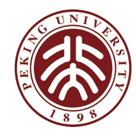
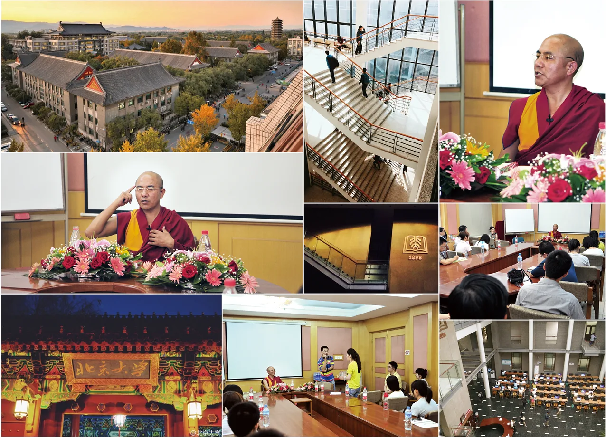

空性，

不等于“不存在”。

第1场

北京大学

Peking University

中国·北京

2010 / 6 / 24

## 佛教空性观

## Buddhist Philosophy of Emptiness

主持人：

今天非常荣幸能请到索达吉堪布，给我们讲一讲藏传佛教的思想。

堪布这次能来北大，是一个很殊胜的因缘。大家都知道，藏传佛教有许多非常优秀的东西，也有它的教育思想，可是当今学术界，对此研究得还不充分，在教学上有欠缺。而且，藏传佛教与藏文化有着深厚的关系，在这方面，我们了解得也不是很多。同时，堪布的修证境界非常高，若能从另一个层面上介绍佛学，跟我们这些大学老师讲述佛学，可能完全不一样。

北大历来推崇多元文化兼容并蓄，我们的学生在学术上也有一种包容和热爱，所以今天真的很荣幸能请到堪布到北大哲学系作一个讲演。这次的活动，很大程度上，是由热心于藏传佛教研究的一些同学发起的。他们的这种热情，我们一定要悉心爱护，这对我们老师也是一种鞭策。我们这些老师，基本上都是研究汉传佛教、印度佛教的，所以同学们的热情，鞭策老师们也要加强这方面的学习。下面，我们师生一起来听堪布的开示，掌声有请——

## 缘 起

今天，很高兴来到北京大学哲学系，跟老师和同学们一起探讨藏传佛教空性与如来藏方面的道理，并将自己的一点心得与大家分享。我本人而言，虽然跟你们的身份不同，但也是从事教育、当老师的，至今教书传法将近二十多年了。在座的各位教授、老师，大多数也一直在教书育人，从事伟大神圣的教育事业。所以，我们彼此之间共同研讨、共同学习，是很有必要的。

我是第一次来北京大学，发现这里的学习氛围很好，尤其是禅学社、耕读社等许多社团，对宗教的研究比较深入，所以这次跟大家交流，是十分有意义的。其实，人与人之间互通有无非常重要。我作为一名藏族僧人，除了研究藏传佛教以外，也需要学习汉传佛教，以及现在大学里有价值的科技知识；而你们作为高等大学的老师和学生，也应把目光放在藏传佛教及其他宗教的甚深领域上，通过这样互相了解、取长补短，对自己的人生观、世界观等都会有很大帮助。

所以，下面在交流的过程中，我一方面会介绍自己对佛教的了解，同时，大家也可以通过提问的方式，把心里的怀疑、不解说出来探讨。我们佛教徒有一种毛病：刚开始学佛时疑惑重重，但到了一定时候，就好像问题都没有了，最后什么也不想问，这种行为不可取。你们作为北京大学的学者、才子，相当有才华，智慧也很敏锐，因此，希望通过这次的研讨、沟通，每个人都能得到一些利益。

## 一、学习空性的必要性

大家都清楚，人类在如今的21世纪，物质文明达到了前所未有的高度，尤其在20世纪末、21世纪初，不管是科技还是经济都发展得极为快速。可是在这背后，人们的伦理道德却不断下滑。就传统文化而言，孔孟思想曾是汉地的主流思想，对道德规范起到了不可忽视的作用，然而，六七十年代的一场“文革”，却让它受到了历史性的毁灭，现在虽有许多有识之士想把它恢复过来，但就像奄奄一息的病患无法马上痊愈一样，仅仅靠几个人的努力，很难真正力挽狂澜。

因此，大家对传统文化的重视非常重要，而且，这些美德不仅要在理论上精通，更要贯彻到实际行动中去。否则，你连基本的人格都没有，为人处世、待人接物也不过关，那即使学问再高、智慧再尖锐，到了社会上也会举步维艰。

如今在这个物质飞速发展的时代，人们内心越来越空虚，精神压力越来越大，烦恼痛苦也越来越多。之所以如此，就是因为很多人没学过空性法门，对世俗中的东西有强烈实执。因此，人们要想获得快乐、安逸，就一定要对空性法门有所了解，不然的话，始终随着欲望而奔波，一辈子会成为欲望的奴隶。

而若要了解空性法门，最好是系统地闻思藏传佛教，因为它完整地保留了2500多年前佛陀的清净思想。这些思想虽经历了无数风风雨雨，但至今仍然完好无损。正因为如此，现在东西方的许多学者，都把目光或好奇心纷纷投向藏地，希望能一探其中的奥秘。

那么，佛教的思想究竟是什么呢？就是佛陀所宣讲的八万四千法门，归纳起来即是三转法轮的内容——第一转四谛法轮、第二转空性法轮、第三转如来藏法轮。其中，第二转法轮中宣讲空性的经典，最全面的是《大般若经》，它的内容相当深广，今天短短的时间内不可能三言两语就讲完，但我还是会用些简单的语言，尽量概括一下它的要义。

## 二、佛教怎样抉择万法皆空

你们若想通达般若空性，最好能先学龙猛菩萨的《中观根本慧论》，这部论典用非常甚深、精细的推理方法，抉择了一切万法皆为空性。藏传佛教虽分为格鲁、宁玛等不同教派，但实际上每个教派都要精通该论。而在汉地，尽管不像藏地一样，有广泛闻思中观法门的传统，但历代大德也要学习《中观根本慧论》《十二门论》等诸多论典。

其实，学习空性法门，靠的不是信仰或崇拜，而是智慧的观察。中观有许多推理方法，归摄起来有五大因，下面就对此做个简单介绍：

1．金刚屑因：是观察万法产生的“因”无自性，也就是说，一切法不是自生、他生、共生、无因生，进而抉择诸法是无生空性。具体来讲，倘若万法是自己产生自己，就会有无穷生的过失；若是依他而生，黑暗中也可以产生光明……这种推理方法，在月称论师的《入中论》中讲得很细致。既然万法的“产生”无有实体，那么它的“存在”也不成立，最后的“灭亡”也没有，通过这种金刚屑因，就可以抉择一切为空性。

2．离一多因：首先观察“一”是否成立，通过详细分析，就会发现根本没有“一”的实体，这样一来，由“一”组成的“二”等多体法也不存在。比如说，这里一个人也没有的话，便不可能有十个人，因为“十”是以“一”为基础安立的。

那么，“一”怎么不成立呢？就拿一个人——众生最执著的“我”来说，这只不过是虚妄分别念假立的，真正去剖析时，头不是“我”，手不是“我”，脚不是“我”……如此一一观察下来，根本找不到一个实有的“我”。这时你才明白，原来人们只是把五蕴聚合妄执为“我”，实际上“我”的本体绝不存在。依此类推，万法的本体皆可抉择为空性。这种推理方法，在麦彭仁波切的《中观庄严论释》中有广泛叙述，大家可以去参阅。

3．破有无生因：是抉择万法的“果”无自性。其观察方法是“有法不应生，无亦不应生”，也就是说，果若在因位时存在，就不必再生，因为已有之故；果若在因位时无有，则永远不能生，犹如石女的儿子。这种推理，在《中观根本慧论》中讲得比较多。

4．破四句生因：是同时观察“因”与“果”，在《中观二谛论》里运用过。其观察方法归摄起来有四种：一因能否生多果，一因能否生一果，多因能否生多果，多因能否生一果。通过这种方式观察，可以破除对因能生果的实有执著。

5．大缘起因：是抉择万法的“本体”为大空性，一丝一毫也不可得。此推理在《中观根本慧论》《宝积经》《楞严经》《华严经》中，都直接或间接提到过。我们平常所执著的身体、生活、感情及山河大地，虽然看似实实在在，但这只是迷乱显现前的假象，倘若用智慧去观察，包罗万象的一切法决定不存在。这种境界相当甚深，宗喀巴大师在《缘起赞》中也讲了，在这个世界上，唯有我等本师释迦牟尼佛才能通达并宣说。除此之外，外道虽然也讲了一些空性，但这种空性只是单空，而不是缘起性空，故并不究竟。

所以，大家在认识空性时，千万不要把空性等同于“不存在”，否则就会堕入另一个边。要知道，不管是有边、无边，皆为实有的执著，有了这种执著，就会产生痛苦而不得解脱。诚如《六十正理论》所言：“若许有实法，则生大贪嗔。”你只要承许一个法是实有，就会因此而产生贪嗔烦恼，进而依之造业，流转轮回。反之，假如你想获得解脱，息灭自他一切痛苦，就要希求空性法门，开启无我智慧，斩断任何执著，《入行论》中也说：“故欲息苦者，当启空性慧。”

## 三、现代科学对空性的探索

所谓“空性”，佛教大小乘有不同的理解。小乘认为，器世界的一切不可能无中生有，所以要有个最小的组成单位——极微，它是一种实有存在的色法。在他们看来，整个物质世界以极微而空，极微本身却不能空。因此，这种“空”并不彻底，小乘所证悟的空性，只是法无我的一部分。

现代物理学的理念，与小乘观点极为相似，他们也认为，物质的组成必须要有个最小单位。19世纪，人们认为最小的单位是分子；20世纪，发现分子可以再分为原子；随着高科技仪器的发明，依次又有了原子核、电子、中子、质子等概念；近年来，又发现了夸克、亚夸克等等。关于是否存在不可分割的最小粒子，当前物理学家分为两派：一派认为物质是无限可分的，夸克以下有亚夸克，亚夸克以下有亚亚夸克……另一派则认为，物质微粒的分割必有一个极限，到了这个极限，就没有更小的粒子了。

听说人们最近又在研究“场”，它包括电子场、量子场、磁场等几种。这种“场”看不见，也摸不着，只是一种能量，存在于真空当中。“真空”是一切都不存在的空荡荡的境界，当它瞬间积聚起足够能量时，便会形成物质的最小单位——粒子；当能量的密度不够时，粒子就会消失，变成不存在任何物质的虚空——场。因此，物理学家认为，“真空”和“场”互相起作用，是物质世界的根本来源。如果没有这个，就不会产生质子、中子等微粒，形形色色的物质世界也无从谈起。

总之，现代科学认为最小的单位必须存在，不然，最终什么都没有的话，就实在太可怕了。但从大乘佛教的角度来讲，只要懂得了缘起性空，解释万法的显现便没有任何困难。不过，现在的物理学家，尽管没有学过中观，但对物质的研究还是非常透彻，比前一代物理学家更接近空性。如法国物理学家笛卡尔（René Descartes, 1596-1650）说过：“我怎么知道自己不是在做梦？我又凭什么将梦境和现实区分开呢？世间包罗万象、形形色色的东西，虽然一个也不成立，却能在眼前无欺显现。因此，完全可能有一个魔鬼，一直在欺骗我，让我不知道什么时候是真的、什么时候是假的。”

其实，假如懂得了大乘教义，对此根本不会有任何担心、疑惑。正是因为万法的本体不成立，在空性中才可以显现；反之，倘若诸法本体实有存在，那实有的法是不能现前的。当然，这个道理相当甚深，要想真正通达它，研究中观空性十分重要。对我个人而言，在人生的诸多学问中，其他知识的价值与中观空性有天壤之别，只有明白了整个世界到底是物质构成的，还是缘起构成的，对自己一生才会有真正的利益。

此外，科学家爱因斯坦（Albert Einstein, 1879-1955）也说过：“时间、空间和物质，都是来自人类的错觉。”这句话，跟佛教“万法以分别念而现前”的观点如出一辙，《入中论》亦云：“如是一切法虽空，从空性中亦得生。”然而遗憾的是，科学家们绞尽脑汁研究的过程中，虽然也有一定收获，如量子力学的创始人玻尔曾深有感触地说：“谁不为量子力学感到震惊，那他就是没有理解量子力学！”但他们并没有认识到缘起性空。倘若他们学过《中观根本慧论》《华严经》，就能轻而易举通达万法的最甚深之处。因此，在座各位在研究中观的过程中，务必要了知万法抉择为空性之理。

## 四、佛教自身的超胜之处

在抉择空性的时候，佛教不怕他人驳斥，也不怕自己的观点建立不起来。佛陀在有关经典中讲过：“不管比丘还是其他人，都可以把我的话当成黄金，切它、熔它、提炼它，仔细检视我的法教，不要只因为尊敬我而接受它。”对于佛陀的教义，若只是一种崇拜或恭敬，那叫做信心，而不叫智慧。其实佛教经得起任何考证、观察，无论是世间的因果轮回理论，还是出世间的中观、如来藏思想，都千真万确、颠扑不破，不怕被任何人驳倒。

至今2500多年过去了，历史上涌现过千千万万的文学巨匠，他们对佛教的评价如何，大家应该也很清楚。比如1950年诺贝尔文学奖得主、英国哲学家罗素[^1]（Bertrand Arthur William Russell, 1872-1970），他在《我为什么不是基督徒》（Why I Am Not a Christian）中曾对基督教有所驳斥，在西方引起了极大轰动。他说：“无论从智慧或品德上看，我都觉得耶稣不像历史上传颂的那样高超。我看在这些方面，释迦牟尼佛和苏格拉底（Socrates, 公元前470-前399）的地位要比他高。”

当然，我们并不是说基督教不好，而是从公正的立场来看，佛教的智慧和慈悲确实超过其他宗教。从慈悲方面讲，尽管基督教也提倡仁爱，伊斯兰教也提倡平等，但他们所关注的范围，充其量只有人类，而不包括其他众生。对于动物，有些宗教认为可以杀戮，甚至对于异教徒，也号召用武力统统消灭。然而按照佛教的教义，所有众生都要平等关爱，哪怕怨恨的敌人要砍你的头，你也应以无尽的大悲心爱护他。所以，大家不妨想一想：在整个人类历史上，能够完全舍弃自我，一心一意、无有条件地利益所有众生，这样的宗教是否值得提倡？

而且从智慧上讲，我也看过世界上其他宗教的书，相比之下，佛陀的智慧实在无与伦比。在藏地，佛陀亲口宣讲的《大藏经》有108函，龙猛菩萨、月称论师等印度大德所造的论著有200多函，这其中都描述了万法的真相，看后令人大为折服。因此，我们崇拜释迦牟尼佛，并不仅仅是源于信心，毕竟信心分为迷信和正信，有信心不一定都正确。但如果你用智慧去观察，就会发现佛陀把真理揭示得清清楚楚，并且找不到任何过失，既然如此，那这样的佛陀为什么不去恭敬？

当然，佛陀最精华的思想，即是将万法抉择为空性。人们如果没有证悟空性，就会整天为了名利而忙忙碌碌，诚如志公禅师在《劝世念佛文》中所形容的：“有有无无都麻烦，劳劳碌碌几时闲，人生曲曲弯弯水，世事重重叠叠山。”所以，对空性一点都不了解的话，有时候看来，许多现象令人心生悲悯。其实人生如此短暂，几十年一晃就过，倘若一味耽著自己所谓的事业，到头来会得到什么？徒有一身恶业而已。因此，大家一定要对空性有所认识。

不过，如今很多人由于没有系统闻思过，始终对空性有一种误区。有些学禅宗的人认为：“既然万法均为空性，善恶就不必太执著了，放生等善行也不用做，因为这是一种执著。”这种观点大错特错。虽说一切法的本体是空性，但你还没达到这种境界之前，取舍因果、行持善法是很有必要的。

从前在藏地，汉地和尚摩诃衍来弘扬禅宗。尽管禅宗至高无上，从《唐高僧传》《宋高僧传》《续高僧传》的历史来看，许多利根者依此而一闻千悟，这样的事例不胜枚举，但当时他弘扬禅宗却不成功。为什么呢？因为他一开始就提倡什么都不执著，有些藏族人听信其言，致使寺内原有的供佛传统突然间断，佛像前居然断了供灯。（你们若去过布达拉宫等地，就会知道藏地供佛的传统由来已久、十分殊胜。）这种做法让许多有识之士难以接受，他们就遵照菩提萨埵的授记，从印度迎请了莲花戒论师来跟他辩论。最后，以摩诃衍失败告终，藏地又重新树立起了次第修行的传统。

因此，次第修行相当重要。虽在禅宗或密法的最高境界中，万法都是空性的，不能有丝毫执著，但我们尚未证悟之前，还是应当放生、念佛、读经、行慈善、做功课……这些一定不能断。否则，积累资粮的门如果堵塞了，将来则很难趋入解脱。所以，你们若没达到最高的境界，就不能间断行持善法，尤其是要以菩提心摄持，这一点千万不能忘！

## 五、空性并非为“无”，而是有光明如来藏

或许有人会问：“在究竟实相中，假如一切法皆空，那我们的起心动念、佛陀的功德庄严又从何而起呢？”是从空性中一种明清的部分产生，这个明清的部分就叫“如来藏”。

如来藏的见解非常甚深，它是佛陀第三转法轮的主要内容。关于这方面的教言，讲述最广的论典是《宝性论》，经典就是《如来藏经》；而密宗的《大幻化网》《喜金刚》等中，对此也有非常细致的阐述。

既然如来藏是存在的，那它跟外道所承许的实有又有什么差别呢？学过《入中论自释》的人都知道，这部论专门引用了《楞伽经》等教证，说明如来藏的实有与外道有何不同，与小乘宗有何不同。实际上，如来藏是一切万法的实相，也就是禅宗明心见性时所见的“本来面目”，它与空性无二无别。要想获得这种境界，显宗通过推理或禅宗教言可以证入；密宗则以修气脉明点、观想本尊等途径，很快就能获得这种状态，或者也可依靠最殊胜的大圆满修法，通过上师的加持和窍诀，迅速认识心的本性，现前如来藏光明。

假如以窍诀的方式来讲，不管是外在的器世界，还是你内在的心识，本体皆为空性，这是第二转法轮的教义；而在本体空性的同时，实际上它光明不灭，有一个明清部分，这就是第三转法轮的教义。当然，万法的本体也并不单单是一个空性，或者一个光明。这样的本来面目，如果以我们的分别念、语言表达，就像用小小的仪器测量整个宇宙，或者用小鸟的翅膀丈量无尽虚空一样，是根本不现实的。只有真正证达了那种不可思议的境界，你才会明白这是什么感觉，正如禅宗所言：“如人饮水，冷暖自知。”

如来藏的境界既然如此甚深，那我们在凡夫地时，有没有机会了解它、认识它呢？有的。全知麦彭仁波切、宗喀巴大师等高僧大德，都在各自的论著中，讲过空性和光明的相关教义。所以，我们现在虽不能像圣者一样完全通达诸法实相，但依靠上师和大德们的这些教言，还是可以逐渐认识心的本体。

那么，如来藏方面的教言具体有哪些呢？显宗中有《辩中边论》《辨法法性论》《宝性论》等弥勒五论，及龙猛菩萨的《赞法界颂》等。在此基础上，大家若想进一步了解，就要学习密宗的《大幻化网》，以及最殊胜的大圆满、大手印。

当然，你们作为北大师生，要一开始就直接通达大圆满的境界，可能有一定的困难。但即便你不能通达，也要知道世间最甚深的学问，就是空性和光明，亦即第二转法轮和第三转法轮的究竟教义。从窍诀上讲，它分别是由文殊菩萨、弥勒菩萨开显的。所以，现在的知识分子若想真正通达佛教，需要了解的教义特别多。但你仅仅是了解还不够，还要看能不能在生活中将这些用上。

在座的老师和同学们，有一部分人学过藏传佛教，也有一部分学过汉传佛教。你学过藏传佛教的话，就会知道它在中观和如来藏方面的论著相当多，我也翻译过一些，今后有机会、有因缘时，我们可以互相探讨。在探讨的过程中，你如果通达了般若空性，那解脱绝对没问题。相反，假如没有了悟空性，就不可能明心见性，获得阿罗汉、菩萨等任何圣果。因此，要想真正出离三界轮回，行持其他善法只是间接的因，唯有证悟空性才是直接的因。

## 六、对当代知识分子的点滴建议

### 1．培养利他的价值观

现在的世间上，不管是老师、大学生、企业家，都迷茫在实执中，沉溺在轮回的网里，所以，人们特别需要佛教的空性。只有证得了一些空性境界，他们对很多琐事才会看得淡，而不会无有限制地盲目追求，肆无忌惮地摧毁因果。

有时候看大城市里的人，跟我们山上修行人的目标完全不同，他们为了房子、金钱、感情、家庭，将难得的人身都浪费在这上面了。其实，人如果只为了生存而活着，就跟动物没什么差别了。现在很多人崇尚拜金主义、庸俗主义、享乐主义，不择手段地追求金钱，不要说关心自己的来世，就连今生中有价值的思想，他们也知之甚少。那今生中有价值的思想是什么呢？就是知足少欲、恭敬父母、希求智慧等美德，这对一个生存于世的人来说相当重要。

然而，现在好多大学生根本不求这些，我以前去过不少大学，见许多人进入校园之后，有一种放松感，成天泡在网上看些乱七八糟的东西，所作所为对今生来世没有任何意义，这是非常不应理的。实际上作为大学生，身上肩负着整个人类、整个社会的未来。国外有些国家对小孩子教育时，刚开始会告诉他们：“人类未来的希望在你身上。”以警策这些孩子要行为如法。同样，你们北京大学的学生们，也要经常这样提醒自己。且不说佛教中特别甚深的空性、如来藏的境界，仅仅是帮助众生、利益他人的美德你具不具足，每个人也应好好观察一下。

记得爱因斯坦说过：“人是为别人而生存的。我每天上百次地提醒自己：我的精神生活和物质生活都是以别人的劳动为基础，我必须尽力以同样的分量，来报偿我所领受了的和至今还在领受着的东西。我也相信，简单淳朴的生活，无论在身体上还是在精神上，对每个人都是有益的。”

可是，现在的大学生、公务员、老师、医生，一生的行为都为了自己，这很令人感到悲哀。当然，这种现象也跟如今的教育有关，我们从小就被灌输“为了财富、地位、名声而奋斗”的思想，那最后的结果是什么？只能是所有人都自私自利，口头上虽然提倡和谐社会，但实际上却唯利是图、言行相违。

要想转变这种风气，大家理应从自我做起，一点一滴培养利他的菩提心。我学习大乘佛教这么长时间了，其实大乘的教义归根结底，就是“利他”二字，除此之外，再没有更甚深的法了。要知道，藏地、汉地的佛教都属于大乘，但如果没有利他心，所谓的“大乘”只是徒有虚名而已。尽管空性、如来藏的教义非常殊胜，有缘分、有信心的人去研究也可以，但你若没有专业性的指导，光是随便看一两本书，则很难通达其中密意。因此，我们作为修行人，如今最重要的是什么？就是要培养利他心。甚至，就算你不是佛教徒，只是一个高等学校的老师或学生，利他心也必不可少。当你们这些学生毕业离开校门时，当老师们摄受一批又一批的学生时，若能始终存有一颗利他心，那做什么事都是有意义的。

### 2．认清前后世的存在

此外，我还想强调的一点是：现代人应当树立正确的人生观。所谓人生观，指对于人类生存目的、价值、意义的看法，它是世界观的重要组成部分，具体表现为苦乐观、生死观等。现在世间上的人，因为有不同的爱好、追求，故也有不同的人生观。但作为一个佛教徒，人生观务必要具备两点：第一要相信因果，第二要了知生死轮回。假如你有了这两点，那生活、工作的目标就会有原则性改变。否则，不相信善有善报、恶有恶报，也不相信前世后世存在，所作所为就会非常盲目。

因此，从现在开始，大家对人生观一定要有新的调整，应该像佛教一样承认善有善报、恶有恶报，以及前世后世存在。有人可能提出质疑：“佛教的人生观虽是如此，但所有人的人生观不一定都要这样吧？”然而，大家要明白，这种人生观对当前来讲相当重要，它可从根本上扭转社会的不良风气。有些人始终对前世后世不相信，但不相信并不能证明它不存在，除非你有充分确凿的依据。可是我看了古今中外很多书，到目前为止，还没发现一个人有这种能力。多年以来，对于这个问题，我也跟不少学者、博士、大学教授、科学家探讨过，有些人尽管也不承认，但却无法举出合理的理由来。

与之相反，承认前世后世的理论，却特别特别多，包括牛顿（Isaac Newton, 1643-1727）也说过：“人死了之后，有神识存在。”当然，他可能是受当时基督教的影响，才有了这一番言论。据有些资料记载，牛顿一生的著作中，80%以上与神学有关，科学方面的连20%都不到。由此可见，科学家也并非都否认前世后世。此外，慈诚罗珠堪布还造过《前世今生论》，我将其翻译成了汉文，很多人看了之后，发现个别人前世做过什么、后世却能回忆起来，而且找不出可以反驳的依据，通过这些非常有力的公案、教理，他们的观念也有所改变。

所以，你们作为高等学校的师生，首先一定要建立正确的人生观。否则，你的世间学问即使再好，但不相信前后世的话，在短暂的人生中就不会积福行善，反而可能毫无顾忌地摧毁因果，做出种种可怕的行为来。要知道，你今生若是造了恶业，就算果报没有当下成熟，但就像吃了毒药一样，迟早会给自己带来痛苦。因此，正确的人生观对每个人来讲极为重要，有了它，你做任何事情都会有意义。

## 结 语

今天跟大家交流，我也没做什么准备，只是以平时的经验随便讲的。总而言之，对一个学佛法的人来说，在见解上，了解中观很重要，了解如来藏也很重要，而这样的学习需要长期闻思；在行为上，则一定要利他，这些我在讲《入菩萨行论》时详细剖析过，大家有时间最好能看一看，这本书肯定会对你有帮助。同时，希望每个人对自己的人生观重新观察：“以前我在这个世间上是怎么活的？如果前世后世真的存在，那该怎么办？”这个问题务必要关心。

今天就大概讲这些吧！非常感谢哲学系的老师提供这样一个机会。下面若有什么疑问、想法，我们可以互相探讨……

现场互动

问：我是北京大学数学系的硕士。我有一个问题是：关于第二转法轮、第三转法轮，佛教中有很多很多经论，包括您翻译、传讲的著作也是汗牛充栋，非常非常多。但我们作为普通在家人，没有专门闻思的机会，您能否推荐一两部比较完整的经论，让我们能对佛教大中观的见地生起一种定解？

堪布：我刚才也讲了，第二转法轮方面，应该次第修习《中观根本慧论》。如果有时间，最好也学一下宁玛巴麦彭仁波切造的《中观庄严论释》，它叙述了唯识宗、中观宗合二为一的观点，说明一切法在胜义中皆为空性，世俗中如梦如幻地存在，这种存在怎么样转为道用。所以，若想对第二转法轮产生定解，最起码也要闻思这两部论典。

第三转法轮，最好是学习《宝性论》和《赞法界颂》。关于《宝性论》，麦彭仁波切曾为此造过注解，觉囊派也有一个注疏。法王如意宝一生中讲过两遍《宝性论》，第一遍已经圆满了，但在讲第二遍的中间，示现了圆寂。最近我们学院的法师也在讲这部论，因为它对第三转法轮认识得非常透彻。至于密法方面，你若得过一些不共的灌顶，自己也有时间修加行，则可次第性地了解《大圆满心性休息大车疏》《大幻化网总说光明藏论》，这些窍诀确实很殊胜。

我本人而言，虽对中观法门极有信心，但对大圆满的窍诀更有信心。为什么呢？因为佛教的教理浩如烟海，短暂的人生中不一定能全部了解，但依靠大圆满的殊胜窍诀，再加上自己的信心、上师的加持，这几个因缘聚合时，心的本来面目很容易了达，这对我们迷茫众生来讲特别珍贵。其实，人生几十年一晃就过了，若能在此期间播下解脱的种子，乃至得到胸有成竹的解脱把握，这才是最重要的！

问：我是外交学院刚毕业的研究生。我在学《中观庄严论释》时，看到麦彭仁波切反复讲“中观有无承认否”，说这是中观的一大难题，您讲课时也再三强调这个问题很重要。但很多人可能都不明白它为何这么重要，能否请您开示一下？

堪布：“中观有无承认否”，不仅在《中观庄严论释》里提及过，而且也是《定解宝灯论》的一个关键问题。为什么它被再再地强调呢？因为当时在藏地，中观法门非常兴盛，格鲁派、宁玛派、萨迦派的很多智者，对此持有不同观点，并产生了一些辩论，故麦彭仁波切才会在不同的论著中，反复剖析这个问题。

实际上，此处所讲的“中观有无承认否”，是指中观在最究竟时到底有没有执著。龙猛菩萨曾说：“我无承认故，我即为无过。”为什么这样讲呢？因为他在《中观根本慧论》中抉择万法时，“有”的承认也没有，“无”的承认也没有，因此，本来实相远离一切戏论，这种观点没有任何过失。

现在物理学家认为物质的最小单位是夸克或场，小乘宗承许微尘实有，唯识宗断言阿赖耶识不空，中观自续派认为名言中诸法的自相存在，其实这些只不过是语言上的承许而已，一旦真正去观察，其本体根本不存在。所以，诸法的实相用语言、思维无法描述，佛经中亦云：“不可言思智慧到彼岸。”

如果你对密法稍微有所了解，那用窍诀的方式观察心时，对这个道理也很容易明白。你看，心的本体不成立为“有”，但说它“没有”的话，还有个明明清清的东西，这一点用言思没办法表达，其实它就是万法的实相，也可以叫如来藏、佛陀的本来面目。

因此，在麦彭仁波切的诸多论著里，这个问题特别关键。中观在哪些场合承认存在？哪些场合不承认存在？自续派和应成派之间有许多尖锐的辩论。通过了解这些，能令人慢慢懂得心的本性一无所得。但一无所得并不是单空，这种境界相当甚深，超越了一切分别寻思。否则，假如实相只是分别念的境界，那我们每个凡夫人都能明白，也就没什么高僧大德或开悟者了。

问：我是北大教育学院的学生。我想请问您：丛林以上僧团的教育或佛学院的教育，和现在社会上的学校教育相比，您认为有哪些独特之处？这二者之间有什么可以相互借鉴的地方？

堪布：很好！我们作为从事教育的人，对于这个问题，还是很需要关心的。

刚才也说了，虽然我的身份是僧人，但多年以来一直是个“老师”。当然，我们当老师跟你们有点不同，你们的待遇也好、条件也好、名声也好，都远远超胜我们。我们只是在一个山沟里，以非常简单朴素的生活，完成了二十多年的使命。但我们所追求的，并不是通过教书得什么金钱、名声，而是希望将此甚深的佛法，尽量传给下一代，这才是最有意义的。为什么呢？因为人类的发展，并非仅仅体现在经济上、军事上，更重要的是，要看人们的思想有没有提升。

而寺院里的僧团教育，就是围绕着善良、利他、忘我展开的，这种教育跟学校教育有极大的不同。我曾看过小学、中学、高中、大专的很多教材，但里面主要是讲些故事，如小猫怎么样、小狗怎么样……德育的内容却比较少，这是相当遗憾的。所以，作为高等学校，理应学习古人的《弟子规》《三字经》《千字文》，注重培养学生的道德修养。

同时，我们的僧团、佛学院，也需要学习高等学校的科技知识。这些虽不必当成主课来抓，但也应该适当了解一些。否则，很多出家人乃至高僧大德，对当前发生的重要问题、高科技对佛教理论的印证，以及于人类有利的环保、慈善等理念一窍不通，只是成天一心念阿弥陀佛，那在这样具多元文化、合作性特别强、竞争非常激烈的社会里，要想将佛法弘扬开来，可能相当困难。

前段时间，我们在一个县城里，把有些知识分子和高僧大德召集起来，开了一个研讨会。通过这次会议，大家都得到了很大收获：有些寺院的出家人，平时缺乏对现代知识的了解，通过听取一些国内外的重大事情，让自己大开眼界；有些高等学校的知识分子，尽管懂一部分世间学问，但道德或佛学的教育却从未涉及，甚至连《弟子规》也没有学过。后来每个人依靠互相学习、取长补短，都获得了不同程度的利益。

所以，现在的学校对宗教研究非常有必要。听说你们宗教系的老师、学生，因为自己的信仰或爱好，在学习科技知识的同时，长期专心致志地研究佛教，这对人生来讲十分有价值。我本人而言，在有生之年，只要有因缘弘扬佛法，哪怕只有一个人听，也想每天讲一点课。为什么呢？因为思想的传播、经验的交流，确实是最有意义的！

问：我是北京大学哲学系的博士，刚才听您讲佛教很重要的方面就是利他，但佛教也讲自他二利，请您开示一下自利和利他之间的关系。

堪布：通常来讲，自利有两种：一是暂时的，一是究竟的。暂时的自利，就像《药师经》等经典中所言，依靠佛法可以求财得财、求名声得名声，所以佛教也并不是不提倡自利；究竟的自利，就像小乘行人在不损害众生的基础上，为了自己而一心一意希求解脱，这也是佛陀所开许的。

而大乘佛教，则是以利益众生为主，利他的同时，自利也能自然成办。就像世间的一个老师，利他心特别切的话，即使不会考虑自己，衣食住行也不成问题。

因此，佛教的大小乘中，自利、他利有明显的差别。

问：《金刚经》中有句话是：“应无所住而生其心。”但现在许多人只重视“无住”，比较容易忽略“生心”。请您从藏传佛教的角度给我们开示一下，无住、生心是什么样的关系？这个无住而生的心，又是什么心？

堪布：我原来讲《金刚经》时也说过，“应无所住”是讲空性，一切法在空性中安住，除了空性以外没有其他，即第二转法轮的意义；“而生其心”是讲空性的同时显现不灭，如来藏光明可以在空性中产生，即第三转法轮的意义。六祖在听《金刚经》时，为什么听到这一句便当下开悟了？原因也在这里。

所以，这段文字特别重要，你们方便时，可以看一看我那个讲记[^2]。它前面抉择了空性，后面抉择了光明，亦即我们所说的现空双运、明空双运。所谓明空双运，“明”就是心的本来面目，“空”是抉择它  
时找不到一个实质，这两者本体并不是分开的，而是无离无合、融为一体的。只不过众生没有了达这种境界，而《金刚经》恰恰谈到了这一点，因此，后来许多大德在读诵时，经常念到这里就开悟了。

你们对《金刚经》全部记不住的话，也要经常念这一句。它虽然是很简单的语言，但却完整诠释了心的本体空性、自性光明，大圆满中也是这样讲的。这种明空无二无别的本体，不论你起分别念还是不起分别念，都不会离开，但这种境界“如人饮水，冷暖自知”，不一定非要用文字来描述。

问：我是北大哲学系的学生，想请教您：《心经》中有“色不异空，空不异色”，单从字面上看，这两句话好像是一个意思，但又用不同的词语表达出来了，不知道它们在思想上、修证上是不是有很大不同？

堪布：“色不异空”，是指色法的本体是空性。关于这一点，理论上可用中观推理来抉择，窍诀上可让一个开悟者对你直指。像禅宗的话，有些上师对弟子狠狠地打一打、敲一敲，他马上就开悟了；像密宗的话，灌顶时依靠水晶的指点，也可以认识心的本性，在这个时候，很容易明白色法其实不离空性。

“空不异色”，这里的“空”并不是不放东西、空空荡荡的一个地方，而是指远离四边八戏的大空，也就是万法的本性。这种空性不离色法，所有的色法跟空性无二无别，此境界只有大中观才可以描述，世间人或小乘宗根本无法触及。现在很多人在抉择空性时，往往落入一个单空，比如碗里不存在东西，就认为这个碗是“空”的，但究竟实相若只是单空，这种境界连我们的分别念都可以缘取，佛陀又怎么会说它不可思议？

因此，“色不异空、空不异色”，指色与空在本体上无二无别，心和外境只不过是我们的迷乱显现。就像在做梦时一样，梦中虽有山河大地、苦乐感受，但这些全部都是幻相，一旦你醒过来，就会发现梦中的色法与空性没什么差别。同样，我们现在所感受的一切，实际上也跟做梦没有两样。通过梦境来认识色法与空性之间的关系，就会证达中观比较甚深的境界。

问：现在科学技术非常发达，通过克隆可以复制生命，通过鼠脑戈登可制作出有“生物脑”的机器人。那这样的生命出现之后，究竟在因果轮回上，这个账怎么算啊？

堪布：好，我给你算账！（众笑）

近年来，随着克隆绵羊等现象的产生，生物技术有了突破性进展，很多人以为现在人类不仅能制造机器，并且也可以创造生命了，但实际上，佛教并不认可这种观点。为什么呢？因为一个生命的出现，必不可缺的因素就是要有中阴身的加入。佛陀在经中也说了，我们周围的中阴身无量无边，充塞于虚空中、水里。有一次，阿那律尊者用神通看见水里挤满了中阴身，因此不敢再喝水。后来佛陀告诉他：“中阴身到处都有，你不应以阿罗汉的神通来观察，而应以肉眼所见，抉择某些行为的取舍。”

我以前去上海科技院时，在实验室里依靠显微镜，也看到了不计其数的生物。通过这样的观察，我深深体会到：肉眼看不到的东西，并不一定就真的不存在。进而对佛语生起不可退转的信心。

中阴身其实也是如此，它的存在一般很难被人们发现。既然空间里弥漫着无数中阴身，那在因缘聚合的情况下，它就可以进入某些细胞，从而产生一个生命。所以，这种用克隆技术降生的众生，必须要有中阴身介入，否则，即使有克隆的方法，也不可能培育出生命来。以前科学家尢智表讲过：“科学就是再怎么发达，甚至连一个小小的虫蚁，也不可能造出来！”因此，生命并不是科学所能创造的，只不过在精血、温度等因缘具足时，偶尔因为中阴身的加入，才会出现一个新的生命。

问：堪布，您刚才讲了克隆问题，我想问一下：在佛教十二缘起支中，克隆的众生有没有入胎的过程？

堪布：克隆的众生，不一定要经过胎生的十二缘起。它若是以胎生方式产生的，那可以具足十二缘起，但如果是湿生的话，就不会有入胎的过程。比如夏天的土粪中，因缘聚合时会出现一些昆虫，但你不能说土粪就是创造生命的因。佛陀在经里也讲过，众生有胎、卵、湿、化四种降生方式，例如顶生王就是在人的头顶上出生的。所以，世间上有各种各样的奥秘，佛陀在不同经典中都阐述过。

关于胎生的全过程，《大宝积经·佛为阿难说处胎会》[^3]中描述得特别细致。你看了以后，会觉得佛陀早在2500多年前，就对现代医学的发现洞见无余。当然，并非因为我是佛教徒就赞叹佛教，其实只要你详细观察便会明白，当今不管是医学、生理学，还是科学家所研究的宏观世界、微观世界，乃至整个缘起性空，在佛教里没有一个不提及、没有一个不包括的。因此，大家应该明白佛教的伟大。

问：随理唯识承认最后有个阿赖耶识，数论外道也认为有一个神我，对于这种实有的执著，麦彭仁波切等大德都认为不能解脱。既然如此，那随理唯识和数论外道的区别又在哪里呢？

堪布：随理唯识与数论外道的差别，当然是很多。麦彭仁波切所说的“承认实有阿赖耶识不能解脱”，意思是指这样的实执是轮回之因，但并不否认“在随理唯识的基础上，再进入中观的见解，就可以得解脱”。

一般来讲，要想获得解脱，必须要有万法皆空的基础。随理唯识由于执著阿赖耶识实有，故而与这一点相违，但也并不是说它跟外道没什么差别。

问：我是矿业大学的研究生，有个问题想请您开示一下：既然证悟空性的圣者都生死自在了，那为什么还要求生西方极乐世界呢？

堪布：往生极乐世界，是圆满利他方便的最好途径，就像你到社会上工作的话，先进入北京大学是非常好的桥梁。法王如意宝也曾讲过：如果有机缘往生极乐世界，自相续的所有功德会迅速圆满，此时再利益无量无边的众生，会轻而易举，不费吹灰之力。所以，很多高僧大德尽管已证生死自在，但还是发愿先到极乐世界圆满功德，然后再去度化众生。

问：我是对外经济贸易大学的学生。我们都知道，大乘行人的根本职责在于利益众生，这么多年来，您也一直在弘法利生，只要身在学院，不管多累都会给四众弟子讲课，弘法利生占据了您生命中很大一部分时间。那么，我想问的是：您个人如何平衡弘法利生和个人修行之间的关系？

堪布：我不敢说有什么弘法利生，但自己的的确确觉得，今生能遇到大乘佛法和上师们，是一辈子中最有价值的事。虽然我也去过一些国家，享受过世间的名声、待遇，但如今到了这种年龄，回顾自己的人生时，觉得这些都没有实义，最有意义的就是遇到了上师和大乘佛法。

所以，我平时在学院也好、出去也好，经常对自己有个要求：哪怕能帮助一个人，将这种佛法的智慧传递给他，也觉得收获特别大。要知道，帮助人的方法有多种，如果给别人一两万块钱，当时他可能很高兴，但这解决不了他的生死大事。只有将特别纯洁的佛法传给他，他的生生世世才会受益无穷。

当然，每个人的因缘千变万化，我以后会怎么样，自己也没什么底。但我的目标也不是很大，过去建立学会时就说过，即使只有20个人长期学习也可以。因此，只要我有一口气，就算把佛教的思想传给10个人、5个人，甚至1个人，我也觉得很有意义。这一点不是口头上说说，确实内心中是这样想的。

在这个基础上，我每天尽量起早一点、睡晚一点，抽时间做些功课、念些经。但我的念经、修行确实比较差，因为平时有很多事要做，又舍不得放弃翻译，又舍不得放弃慈善……总觉得人生几十年很短暂，稍微有点因缘做善事时，自己一定要抓住。当然，抓住的时候，并不像想象的那么容易，有时需要面对很多困难。但即便如此，我的心情也很快乐，不管事情成不成功，都会以欢喜心来面对！

[^1]: 罗素：英国人，20世纪最有影响力的哲学家、数学家和逻辑学家之一，1950年获得“诺贝尔文学奖”。
[^2]: 详见《金刚经讲解》。
[^3]: 又名《阿难入胎经》。
