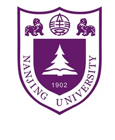
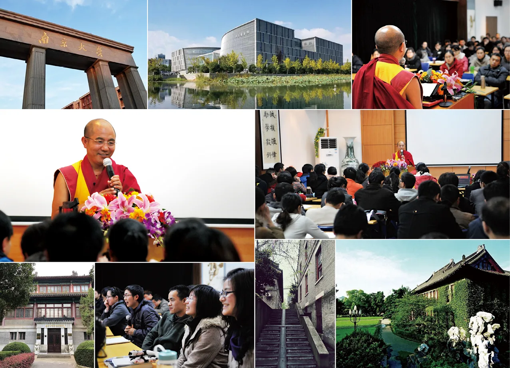
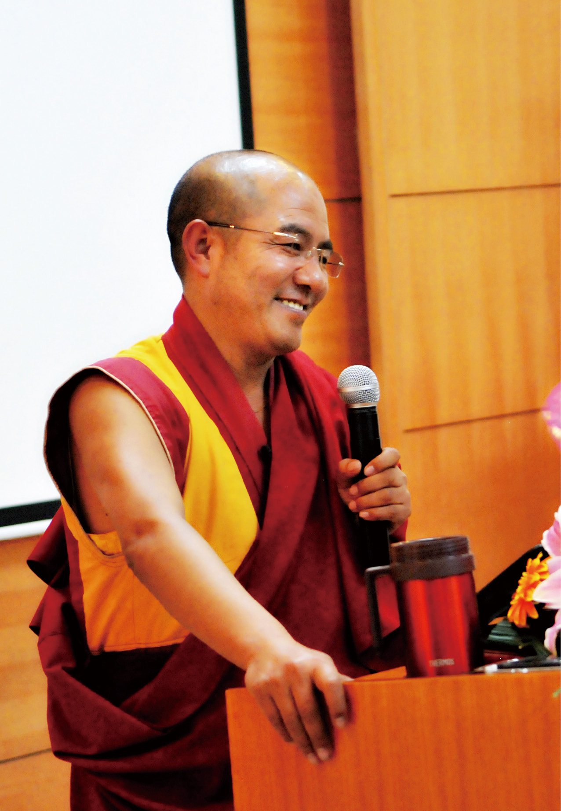

92%的科学家都有宗教信仰。

尤其是诺贝尔奖获得者中，

信仰宗教者占93.27％。

第5场

南京大学

Nanjing University

中国·南京

2011 / 3 / 14

## 佛法的生命科学观

## The Buddhist View on Life Science

主持人：

今天我们南京大学哲学宗教学系的博士论坛，非常荣幸请到了来自喇荣五明佛学院尊贵的索达吉堪布仁波切。仁波切今晚将会给我们开演“佛法的生命科学观”。在此之前，请允许我把尊贵的仁波切介绍给大家：

仁波切年轻时就读于师范学校，之后舍俗出家，追随根本上师晋美彭措法王实修佛法。仁波切深入经藏，通达甚深和广大的佛法法义。由于其悲心的推动，仁波切弘法利生的事业遍及海内外。这不仅可从他等身的著作中获得印证，也可以从他倡导并身体力行的种种社会慈善和爱心活动中得到明证。

能请到这样一位具足内证功德和广大慈悲心的仁波切来开演佛法，既是我们南大人的胸襟，也是南大人的殊荣。南大向来有“求真务实”的传统、“为己之学”的理念，我们相信，所有学问最高的究竟意义，在于获得智慧和生命境界的提升。南大有“知行楼”，南大人更有“知行合一”的传统和追求，所以，让我们以求实的精神和敞开的心胸来聆听佛法甘露，用自己的身心来真实体会书本知识是如何转为鲜活的生命体验，并从中产生智慧的。

下面，让我们以热烈的掌声有请仁波切——

各位老师、各位同学：

大家晚上好！很高兴与南京大学宗教学系博士论坛的师生共同交流。

我本人而言，早在十多年前，也就是1994年来过南京。因为以前读书时课本中有“南京长江大桥”，故当时还专门去看了这座桥，之后就一直没有再来这里。这次来了之后，发现南京有了很大变化，外在的物质、建筑上有了日新月异的发展，但不知道南京人内心的善良、宽容等道德方面有没有提升？不管怎么样，今天老师和同学们让我谈谈“佛教的生命科学观”，下面就跟大家一起探讨这个问题。

## 一、佛教的生命科学观是什么？

佛教的生命科学观，如果按照佛陀的智慧来抉择，即不管是任何一个生命，都有无量无边的前世后世，乃至灭尽轮回获得佛果之前，定会一直流转于六道当中。

要懂得这样的甚深道理，必须要经过长期的研究、思考、论证。不过大家既然都是知识分子，应该有开阔的眼界、深入细致的分析能力。那么，我们就先观察人到底有没有前后世。

这个问题对每个人来讲非常重要！如果我们没有前后世，这辈子过一天算一天也可以；但假如真有后世的话，你现在不为它做准备，以后必定会悔不当初。

那么，前后世究竟存不存在呢？通过长时间的详细研究，我们发现它确确实实存在，然而遗憾的是，许多世间人却对此一无所知。当然，没有学识的人不懂这一点也情有可原，可有些知识分子自认为智慧超群、广闻博学，也不承认前后世的话，这实在是人类的一种悲哀。

其实从历史上看，自古以来，前后世之说就一直存在于人类社会中。无论是古罗马、还是古希腊的哲学家，都承认前后世存在。比如柏拉图就认为，人死后灵魂依照生前所作的善恶，会转生为人或其他众生。而在中国古文化中，儒教思想也并没有否认它的合理性，曾有人问孔子：“人死后是什么样的？”孔子回答：“未知生，焉知死？”从文字上看，孔子因为提倡积极入世，故采取避而不谈的态度，对身后之事既不肯定有，也不肯定无。至于其他的宗教，大多数都正面承认前后世存在，例如道教向往长生不老；基督教和天主教认为，人死了之后，造善业者可上升天堂，造恶业者将堕入地狱……

可见，承许前后世存在，并不仅仅是佛教的“专利”。这种理念的涉及面实际上非常广，遍及于世界上很多宗教。如果你以前对这方面从未思考过，那有空时不妨翻阅一下古文化的典籍，看其他宗教或哲学中对此是如何分析的。

## 二、科学家们与宗教关系密切

不仅是古圣先贤承认前后世，而且近代对人类有重大贡献、对历史有推动作用的科学巨匠，绝大多数也信仰宗教，并承认这种观点。比如美国有位盖洛普先生（George Gallup, 1901-1984），曾对过去300年以来300位最著名科学家的信仰进行调查，结果发现其中242位信仰宗教，20位不信宗教，38位无法确定其对宗教的态度。换句话说，也就是92%的科学家都有宗教信仰。尤其是诺贝尔奖获得者中，信仰宗教者竟占93.27％。

如今不少知识分子认为，科学家是最理性的人群，不可能承认任何宗教。但这种想法，被上面的数据一下子就推翻了。不管是爱因斯坦、牛顿、伽利略、爱迪生，从传记中看，他们不但信仰宗教，而且非常热衷于此。即使佛教当时还没有传入西方，宗教主要是以基督教为主，但前后世存在的理念，仍被人们广为接受。

其实对一个人来说，倘若不承认前后世，就会觉得人生不过几十年，今宵有酒今宵醉就可以，不必去操心后世的事情。在这种世界观、人生观的指导下，他们的行为就没有任何约束，为了今生的利益肆无忌惮、为所欲为，就像《中阿含经》所形容的：“不畏后世，无恶不作。”

反过来说，西方的许多国家，因为信奉自己的宗教，道德准则与此大不相同。包括新总统在就职典礼上，也会手抚《圣经》，在神面前宣誓。这样的举动，或许在不信宗教的人看来是一种迷信，似乎多此一举，但实际上，人确实需要这样的道德约束。

那么，信仰宗教的话，对社会进步、人类发展会不会起到障碍呢？绝对不会，因为二者并不相违。美国发明大王爱迪生（Thomas Alva Edison, 1847-1931），就是一个有强烈信仰的人。他在自己的实验室曾立了一块石碑，上面刻着：“我深信有一位全智、全能、充满万有、至高至尊的神存在。”他一生的发明有两千多项，但他的信仰不但没有阻碍他，反而每当遇到难题时，他认为向神祷告是获得力量的源头。

现在有些人在单位或学校中研究佛经、阅读佛典，旁边可能就有人指指点点，说他“太迷了”或者“被洗脑了”。其实被洗脑也没什么不好，因为不少伟大的科学家，比他们洗得更透彻、更有智慧。

不过，很多人之所以对宗教不理解，在一定程度上也跟达尔文（Charles Robert Darwin, 1809-1882）的“进化论”有关。进化论完全否定了因果和前后世，一味提倡“物竞天择，适者生存”，认为任何事情的产生都是偶然的。这种学说当时轰动了全世界，达尔文也因此声名大噪。但据有些资料记载，他老年时经常有病，孩子也是白痴，最后他逐渐转向神学，并撰文对神表示了忏悔。73岁临终前，他说：“我观察这个世界，尤其是人类的物质，我不赞成‘世界是由任无目的的力量来支配’这种武断观点，我认为这个世界对于善和恶，必然有一个无所不在、巨细靡遗、遍及宇宙的定则存在其间。”

还有天文学家伽利略（Galileo Galilei, 1564-1642），历来就认为宗教信仰和科学信念之间并无矛盾。他通过望远镜发现了太阳黑子、木星的卫星、月亮上的山脉后，欣喜若狂地写下了一段话：“我惊呆了，我无限感谢神，他让我想方设法发现这样伟大、多少世纪都不清楚的事迹！”

所以，像这么多对人类有贡献的科学家，都坚信自己的信仰与科学不会冲突，那我们这些一知半解的人，就更不该去盲目排斥自己所不了解的甚深领域了。

其实不说别的，人类一旦没有信仰，就会丧失道德约束，所作所为非常可怕；而有了信仰的话，生起恶念便会加以对治，这不但对今生的精神快乐有帮助，对生生世世的解脱也有着重要意义。

因此，在座各位理应好好观察，看这个世界上到底什么样的学说最有价值。如果你想知道心的奥秘、宇宙的真相，就必须要借助宗教，尤其是佛教的智慧。否则，光是凭自己的分别念，研究多少年恐怕也不能解开迷惑。前几天我在一所学校里，就引用了中国科技大学前校长朱清时院士的一句话，他是怎么说的呢？“科学家千辛万苦爬到山顶时，佛学大师已经在此等候多时了！”这句话的意义相当甚深，你们信奉科学的人也应当深入思维。

我本人而言，虽说不是什么科学家，但却用了大量的时间，对古今中外许多书籍都涉猎过，对佛教不少经论也翻阅过。在对比二者的过程中，我深深被佛陀的智慧所折服，信心越来越坚定不移。现在世间上有很多人，看了一本佛书就宣称“佛教是迷信”，却不知自己这样轻易断言、妄下评论，才是真正的迷信。历史上有那么多的科学家、智者，都对佛教推崇备至、不敢蔑视，而你又凭什么对这样的甚深教义信口开河呢？

其实佛教所揭示的心理科学，在西方国家非常受重视。尤其是心理学家荣格，其影响力不低于同时代的弗洛伊德（Sigmund Freud, 1856-1939）[^1]，时至今日，许多心理学家对他仍有无与伦比的评价。那么，荣格对佛教持什么样的态度呢？几十年以来，他始终把《西藏度亡经》（The Tibetan Book of the Dead）带在身边，当作自己常年不变的伴侣。他认为自己许多富于启示性的观念和发现，全部归功于这部佛典，并曾热情地将此书推荐给弗洛伊德、爱因斯坦等学术巨匠。

那天我遇到一个剑桥大学的朋友，他还告诉我：荣格在离开人世前，曾谆谆叮嘱女儿：“我现有的谈论《西藏度亡经》的这些书，包括描述梦境的各种理论，过50年后才可以出版，不然，现在人们不一定能接受。”他这样做确实很有远见，因为当时的欧洲，并不像今天这样包容、自由、开放。不过他也很清楚，再过一段时间，东方的宗教将会在西方遍地开花，到了那个时候，他对《西藏度亡经》的研究，以及自己所体验的梦光明和濒死经历，完全可以得到印证。

在我们藏地，《西藏度亡经》可以说是家喻户晓，它不仅仅是一种佛教思想，而且已融入了人们日常生活的行住坐卧中。然而现在很多知识分子，完全把它当成一种迷信，用比较奇怪的行为对待它。这样的傲慢态度，跟往昔的许多智者比起来，确实有云泥之别。因此，这方面值得大家深思！

## 三、寻找前世的印迹

对每一个众生而言，实际上生命都是延续不断的，而绝对不会人死如灯灭。我们的生命分为身体和心识，其中身体分粗大的身体、细微的身体，心识也分粗大的心识、细微的心识。

粗大的身体，是由地水火风四大所构成，原本人们对此不太相信，但15世纪后通过化学分析，确实发现人体是由各种化学元素组成的。这个四大构成的粗大身体，在人死之后就会灭尽，灭尽后会变成什么呢？变成一种细微的身体，佛教称之为意幻身。它相当于我们梦中的身体，轻飘飘的，想到哪里马上就能到，跟现在的肉身有一定差别。

然后，粗大的心识分为眼识、耳识、鼻识等，这些逐渐融入一个阿赖耶识，这叫做细微的心识，它会不断在轮回中流转。关于这种细微的心识怎样延续，这辈子变成人，下辈子变成牦牛，再下辈子变成什么什么……在藏传佛教的《时轮金刚》中均有详述。

当然，前后世的存在，不一定非要让你眼睛看得见、耳朵听得到，若是这么简单的话，那也不叫心的奥秘了。但你如果想了解这些，要么可以依靠推理进行论证，要么可通过有些人回忆前世，或者濒死现象、灵魂出窍来证明。

### 1．依因明推理前后世存在

倘若通过推理来证实，就必须要借助因明学，尤其是法称论师的《释量论》。此论讲了不管人还是其他众生，都有一种明清的心识，这种心识之所以会不断延续，原因就是具足了“因”——光明的相续不会断灭。

当然，这个刚学起来，稍微有点难，但它却是非常完整的推理方法。尤其是哲学思辨能力强的人，最好能看看《释量论》，还有《量理宝藏论》、中观的一些论典。通过这些方式进行抉择，你最后会完全明白，众生的心不可能无缘无故断灭。因为心不像外在的无情法，比如外在的灯泡，摧毁了就没有了，而心相续与之完全不同。

这些推理在因明中特别丰富，且颠扑不破。尽管学起来不太容易，但你若想透彻地研究，就肯定要从复杂的方面下手。否则，只是简简单单看一两本书，就断章取义地说“佛教承认后世”不成立，恐怕不会那么简单；你若跟一位佛教大师进行因明辩论，最后也不一定有必胜的把握。因此，大家如果想从理论上了解前后世，就应该深入研究因明和中观，这样才能得出真实的结论。

### 2．回忆前世的现实案例

此外，现实生活中还有不少人能回忆前世，这也是一个非常有力的依据。毕竟那是他自己想起来的，这个谁也无法否认。就像我说自己想起了昨天的事，别人不可能说我在胡说八道。他不信是他的事，但我确实有这种亲身体会。

佛陀在《十地经》中也明确讲过，有些众生可以回忆一世、二世、三世，乃至无量劫的前生往事[^2]。当然，也不是每个人都有这种能力，对大多数人来说，入胎之后被胎障所蔽，就会忘记过去的一切。只有极少数的人，因为具有禅定的力量，或者特殊的因缘，才能保留一部分记忆。

当然，拥有前世回忆的人，也不一定非要学过佛。以前美国弗吉尼亚大学的史蒂文森博士（Ian Pretyman Stevenson, 1918-2007），经过四十多年的潜心研究，收集了来自不同国家的两千多个案例，用大量事实证明了前世存在的真实性。此后，他又从中选取了极富说服力的二十个案例，撰著了《二十个暗示转世的个案》（Twenty Cases Suggestive of Reincarnation）一书，每个案例的时间、人物、地点都标得清清楚楚。如果有人想去一个一个否认，恐怕“工作量”会比较大。

在我们藏地，有些高僧大德也能回忆前世。像我的上师法王如意宝晋美彭措，经常在传法的过程中，忆起自己在莲花生大士时期身为降魔金刚的经历。记得有一次在道孚某地，法王传讲《六中阴》（《西藏度亡经》的一部分）时，讲着讲着，突然显得非常悲伤，说自己回忆起往昔莲花生大士是怎么讲的，当时身边有哪些弟子，而今已经时过境迁，变成了这个样子……上师一边讲一边流泪。

还有一次，上师应邀前往藏地的第一座寺院——桑耶寺。在为该寺僧众传法时，昔日莲花生大士来藏地传授密法的场面，就像昨日发生的事情一样历历再现。法王一边讲述当时的情景，一边老泪纵横，显得非常哀伤。这是我亲眼所见的事实，而且像法王这样对佛教事业具有如是贡献的人，也没有任何必要随便说妄语。

除了这些大德以外，也有个别普通人天生具有回忆前世的能力。在我们佛学院附近的一个地方，就有个小女孩，大概五六岁之前，对前世的事都记得清清楚楚。家人很难理解她是怎么知道的，后来将她所讲的内容进行核实，发现全部能对号入座。在这些事实面前，他们也不得不承认前世存在。

此外，有个文学家叫狄更斯（Charles Dickens, 1812-1870），我们读书时还学过他的文章。他在一次郊外散步时，发现眼前见到的一切都非常熟悉，于是情绪激动，想起这是他前生被人谋杀的地方。

大文学家冷熟，也能清楚地记得自己在这世上已存在了无数岁月。在那些逝去的年岁中，他曾做过王子、奴隶、女人……而且未来还会一次又一次地重返人间。

还有苏东坡，能忆起自己前世是个出家人，名叫戒和尚。顺治皇帝也曾在《出家偈》中说：“我本西方一衲子，缘何落在帝皇家？”此外，《玉琳国师》的连续剧，尽管带有一些虚构情节，但却是改编自真实的历史。

所以，我们不能没有任何理由，就矢口否认前世的存在。倘若你对此心存怀疑，最好是看一些这方面的书。比如，慈诚罗珠堪布专门写过一部《前世今生论》，从科学、佛教两个层面对前后世存在进行了剖析，非常具有说服力。我读了之后觉得很好，就花了一两个月的时间，把它翻译了出来，并为学院的道友讲了一遍。

讲完之后，我跟很多知识分子说：“你们对于前世的存在，现在有没有推翻的能力？有的话，可以站出来。在真理面前，我们要以理服人，不能因为这是佛陀说的、上师说的，明明自己不信，却也不得不接受。真理必须经得起考验、经得起观察，这是佛陀一贯坚持的原则。”后来在互相辩论的过程中，很多人对前后世的存在，也真正生起了定解。所以，在座各位如果也有类似的疑惑，最好能系统学习这部论典。

另外，《西藏生死书》也很值得一读。1993年，我去法国时，见过索甲仁波切（Sogyal Rinpoche, 1947-2019）。当时他这本书是用英文写的，正准备要译成中文。他刚开始想让我翻译，我说自己一方面水平不够，另一方面时间特别紧，恐怕没办法，最好还是找比较出名的人。后来他找了台湾的郑振煌教授翻译中文，又请锡金的一位堪布译成藏文。但藏文版目前还没有看到，不知道进度怎么样了。当时我看那位堪布翻译到一半了，1993年离现在已有18年了，也许他还没有翻译完——有一个我熟悉的美国人，8年前他说正在写两本书。前几天又碰到他，他说还在写那两本书。所以，有些人也许是“慢工出细活”吧。

当时《西藏生死书》英文版的效果很不错，索甲仁波切就又将它译成德文，印了好几本书。恰好那天法王刚刚到他的道场，他观察缘起非常好，便将德文版的《西藏生死书》给法王一本，给我一本。但是我不懂德文，只好放在顶上加持一下。

索甲仁波切说当时西方很多人虽相信因果，但对前后世存在、面对死亡的概念比较欠缺，于是他就写了这本书，希望进一步提升他们的生死观。再后来大家也知道，西方人依靠这本书的引导，对生死确实有了新的认识。

因此，生死这么重大的问题，我们千万不能忽视。如果后世真的不存在，那今生得过且过，怎么懈怠都无所谓；但后世若是存在的话，你现在不为此积累资粮，就实在太愚笨了。就像一个人认为明天不存在，于是拼命睡懒觉、干坏事，对将来没有任何打算与规划，这完全是愚痴之辈。所以，对于这个问题，有没有必要经常去思维？大家不妨好好想一下。

### 3．承认前后世并非佛教一家之言

我们讲的前后世存在，实际上也不是佛教中才有。从历史上看，就算是没有佛教的地方，这种观念也经久不衰。比如，佛教还没有传入中国之前，大概在春秋战国、西汉时期，就记载了不少这方面的典型例子：《左传》中有齐公子彭生死后，变成野猪去报仇；《汉书》也讲了赵王如意在15岁被吕后杀害，死后化为苍犬扑杀吕后；《晋书》中还有宋士宗之母变为鳖等事例。

既然严肃的正史中都有这些记载，大家就不要一听到“前世后世”，就认为是佛教在搞迷信，而应当站在公正客观的立场上，仔细分析这些道理！

## 四、当前人们对此的困惑

佛教的生死观，其实是相当深奥的。约翰·冯·纽曼博士（Dr. John Von Neumann, 1903-1957）在量子学说内涵的哲学部分曾说：“人类具有一个非物质的意识力，能够影响物质的变化。”这个理论提出来之后，震惊了整个科学界，引起了大家的广泛关注。过去人们都认为“物质第一性”，物质可以创造一切，而到了如今，才发现佛教所讲的“万法唯心造”，与真相确实非常吻合。

人除了肉身以外，实际上还有生生不断的一种细微心识，它能产生不可思议的力量。这种力量，科学家恐怕暂时还没有触及，因为他们对心的探索仍是一片空白。现今科学所研究的对象，大多数是物质领域，而且必须要借助仪器。科学家虽然在物质方面，对人类有着巨大贡献，但心灵那块却是一片盲区。其实，他们若能研究一下佛教的《唯识论》《俱舍论》《阿毗达磨》，或者《华严经》《法华经》，就很容易揭开这个谜底。

以前我在学校读心理学时，一直被很多问题困扰着，有些迷惑实在解不开。有时候去请教老师，跟他们进行辩论，结果却招致老师的不满，认为我在故意刁难。（听说有些心理学老师，现在仍对我意见蛮大。）后来我遇到了大乘佛教的经论，通过学习这些教理，包括大圆满密法，自己有种豁然开朗的感觉，很快就找到了一直寻觅的答案——“哦，原来是这样！没有佛教引导的话，那些理论再怎么宣说，也像盲人摸大象一样，始终无法指明正确的方向。”

曾有一位物理学家叫布赖恩·戴维·约瑟夫森（Brian David Josephson, 1940-），是1973年诺贝尔物理学奖的得主。他每天都坐禅，以求进一步进入客观的内明状态。通过这种禅修，他发现了心的力量，并以此撰著成文，当时取得了多个奖项。我非常相信他的经历，如果依靠禅修认识心的奥秘，此时你应付外境也好、学术研究也罢，都会游刃有余、运用自如。反之，倘若你没有掌握这个最关键的问题，即使口头上再讲得天花乱坠，实际上也抓不到根本。

因此，大家平时要多观察自己的心，用佛教的一些窍诀、教言来对治烦恼。假如你能这么做，不要说来世的利益，仅仅是今生当中，面对生活、工作的各种压力时，心境也会大不相同。

有些知识分子心态非常糟糕，因为感情、工作、家庭不顺，经常想要自杀，但后来通过学习佛法，完全脱胎换骨、焕然一新了。这次我出来就碰到四个人，他们没遇到佛法前都准备自杀：一个是孩子在澳大利亚留学时，发生车祸成了植物人，她独自照顾，生活非常艰苦；一个是婚姻出现了危机；一个是因为工作和其他复杂的问题想不开；还有一个是秘密不能说。他们四个本来都不想活了，但因为遇到了佛法，心态得到了根本转变，事情虽然没什么变化，但自己从此不再怨天尤人，明白这一切都是因缘。

其实，这个世间就像《中观四百论》中所形容的：“于此大苦海，毕竟无边际，愚夫沉此中，云何不生畏？”沉溺在这样的轮回苦海中，作为凡夫人怎么可能不害怕？不承认前后世的人，暂时觉得生活很美好、很开心，可是当轮回的幻变在你身上一幕幕出现时，恐怕你不一定快乐得起来。

佛在《观佛三昧海经》中也讲过：“三界众生，轮回六趣，如旋火轮。”从这个教理可以看出，众生流转在六道轮回中，真的没有丝毫快乐，今生变成人，下一辈子就可能成了旁生，这样的无常变幻一直在上演。

前不久，我看了《中阿含经》的一则公案，看后对轮回产生了极大的厌离心。故事情节是这样的：有一天，佛陀去都提子家化缘，主人恰好出门了，他家养了一只白狗，正趴在珍宝装饰的床上，吃着金盘里的美食。白狗见佛陀进来，便跳下床，对着佛陀大声狂吠。佛陀怜悯地对它说：“你因过去造下恶业，今生堕落为旁生，如今怎么还不觉悟？”听了这个话，白狗闷闷不乐、不吃不睡，一直忧愁地蜷着。

都提子从外面回来，见白狗表现异常，就问家人：“我的狗今天怎么变成这样？”家人回答：“刚才佛陀来过。”都提子爱狗如掌上明珠，听到原因后火冒三丈，立刻跑去佛陀面前质问：“你干嘛无缘无故把我的狗弄成那样？”佛陀告诉他：“不要这样说，你的狗其实是你父亲都提的转世。如果不信，你可以回去问它前世埋藏的金银财宝在哪里。”

都提子满怀惊疑地回到家中，问白狗是不是父亲的转世，如果是，就请指示藏宝的地方。白狗即刻走到前世所止宿的地方，在床下用爪抓地，而且不断地吠着。都提子立刻亲自掘地，果然从地下挖出许多金银财宝。

都提子因此对佛陀生起无比的信心，于是前往佛陀那里请法。佛陀为他开示了因果规律，告诉他：“前世杀生的人，即生短命；前世放生的人，即生长寿；前世布施的人，即生获得财富；前世吝啬的人，即生变为贫穷；前世造善业的人，即生善心很容易增长；前世造恶业的人，即生恶分别念层出不穷……”（有些人常抱怨：“我的恶念太多了，恶心太重了！”这肯定跟你的前世有关。）佛陀讲了这些法之后，都提子得到了无上法喜，在佛面前皈依三宝成为居士，后来也获得了解脱。

这则公案，不信佛的人看来，可能认为是一个神话。但实际上它完全是事实，你自己不理解的话，并不代表不存在。以前有个美国人写过一本书，叫《与天堂对话》（Talking to Heaven），里面就介绍了很多他将亡魂从地狱或其他世界里召来，然后与在世亲人会晤的经历。刚开始不少人都不相信，于是他就先讲些只有生者和死者之间知道的秘密，让生者确信他想要见的亲人真的来了，然后再进行下一步沟通。这本书在西方引起了很大轰动，你们有空也应该看一下。

我还看过一个案例，说是在20世纪30年代的上海，有个法国人也能从地狱召来亡灵，并且不必借他之口，屋里就会发出亡灵的声音，可以与活着的亲人对话，语调完全跟死者生前一模一样。

包括在西藏，也有很多很多的还魂师，有时候他们会离开肉体一个星期，看起来好像死了一样，结果是去了中阴界，将一些亡者的口信带回来，然后转告给生者。在这个过程中，当然也有极个别是假的，明明自己没有这种境界，却装作得到了死者的讯息。但尽管如此，确实也有许许多多是真的，这种事例古往今来数不胜数。

## 五、大学生理应具有正确信仰

作为校园里的大学生，你们不少人可能对未来充满了信心，觉得毕业后马上就可以施展抱负，在社会上有一番作为。然而事实上，这个社会并不像你想象的那么美好，当你真正面对上上下下的关系时，才知道学生时代的悠闲、自在、纯朴是多么珍贵。所以，大家现在应提前做好思想准备，不然的话，到时候出现一点点磨难，自己就可能手足无措，觉得天崩地裂、日月无光，好像《2012》电影里的场景重现了。

那么，要做好什么思想准备呢？至少要有一种正确的信仰，有个思想寄托。否则，就算你以后在社会上特别风光，到了晚年时，内心也会孤独无依，极其凄凉。所以，我们不能只顾眼前、鼠目寸光，而应该站得高一点、望得远一点，以佛教的智慧来看待自己的生命、看待这个物质世界、看待整个伦理道德。若能如此，你会发现在佛陀智慧的衬托下，一切领域的知识都显得那么渺小。

现在世间有不少出名的畅销书，我每次听说后都很有兴趣，心想一定要看一遍。但我看了以后，说实话还是比较失望，因为这些道理在佛陀的经典中都描述过。这一点并不是夜郎自大、否认事实。我们作为佛教徒，无论是佛教的观点，还是其他宗教或非宗教的观点，只要任何人都没办法推翻，我们就应当承认并接受。不过，在对比了各种各样的知识后，我确实对佛陀的智慧越来越深信不疑。在座的各位不管对此信还是不信，都应当用自己的智慧加以分析。

今天跟大家讲的，基本上就是这些了。希望大家通过这次交流，懂得人生最重要的理念——前后世存在，并要为生生世世的快乐而积累功德资粮，最终趋往解脱之道！

还有一件事情是，大家都知道，最近日本发生了非常严重的天灾人祸，9级地震、海啸、火山爆发、核泄漏……看了电视的画面，我心里很悲伤。虽然南京人由于历史原因，对日本有一些怨恨，但我们大多数人都是学大乘佛教的，假如易地而处，设想自己被卷在波浪中、感受地震的恐惧，那会是怎样的痛苦？而且有些人生前造了极大恶业，现在突然变成中阴身，连忏悔的机会都没有，来世必定是堕入痛苦深渊。诸如此类的道理一想起来，就会觉得这些人很可怜。

所以，希望大家一起念100遍观音心咒，回向给日本所有的遇难者，愿亡者得以超度，生者消除痛苦。嗡玛呢巴美吽、嗡玛呢巴美吽……好，谢谢！

现场互动

问：我是辽宁北部一所普通高校的学生，学的是马克思主义原理专业。今天想问您一个问题：在多元价值观冲突的现代社会中，人们怎样才能保持一种祥和平静的心态去面对生活？

堪布：现在这个时代，确实是多元文化互相冲突，若想获得一种祥和平静的心态，我始终认为学习佛教最好。

因为佛教提倡放弃自我、帮助他人，以这样的精神与人相处、面对生活，必定是和谐的、快乐的。对此许多学者也很赞同，说全世界要想实现最大的和平、最好的和谐，应该从大乘佛教自他交换的精神入手。

问：我是南京大学商学院2010级的博士，学的是会计系。请问，在汶川地震的时候，王菲曾唱过一首歌叫《心经》，这首歌的要义是什么？唱出来的话，对众生有怎样的利益？

堪布：王菲唱的《心经》我也听过，并建议大家大力推广。《心经》主要讲了眼耳鼻舌身、色声香味触等一切皆空。我们这个社会有非常多的痛苦、挣扎，万法也有各种各样的不同形象，但这些追究到本源，其实完全是空性。所以，《心经》的主要精神，就是让我们对万法断除执著，这是一种至高无上、不可思议的境界。释迦牟尼佛在第二转法轮中，就讲了这种般若空性，而般若空性法中最根本的一部经，即是《心经》，这种智慧就像人的心脏一样。

在座的老师和同学，平时若能念《心经》、唱《心经》的歌，内心的各种分别念就会减少。我认识一位老师，她说自己心里特别烦时，念一遍《心经》，心就能安静下来，然后再坐一会儿，原来的痛苦便全部消失了。

问：您刚才给日本灾难回向的时候，用到了“嗡玛呢巴美吽”。有些大师说“嗡玛呢巴美吽”代表一种无上的智慧，到底这几个字代表什么意思？

堪布：“嗡玛呢巴美吽”的功德特别大，这在有关论典中都有描述。如果给死去的亡人念“嗡玛呢巴美吽”，他即使原本要遭受痛苦，通过这种声音的无上力量，马上也能获得快乐。尤其是现在灾难频频发生，我们若能祈祷观世音菩萨，念他的咒语，以这种力量就能最大程度地化解灾难。这方面有许许多多的教理可以说明。

总而言之，它不仅是一种无上的智慧，还是非常强大的无形力量。

问：我是中文系的博士，不信仰佛教也不信仰基督，属于那种没有信仰的人。我相信像我这样的人应该是大多数。但拿佛教和基督的弘扬来说，我是来自乡下的，如今在乡村里，我发现有越来越多的基督教堂，很多人特别是乡下妇女，每到周末的时候，就很早很早去虔诚地做礼拜。那么，您在弘扬佛法的过程中会不会遇到这样的困惑，也就是说，怎样才能让广大的没有信仰的人相信佛祖呢？

堪布：这位无信仰的博士，提的问题非常好！我不管到哪里去，都希望交流的对境不仅仅是佛教徒，因为人们的思想、文化背景各不相同，不一定非要千篇一律。

现在不信仰宗教的人确实非常多，尤其像中国、前苏联，信奉无神论的比比皆是；而在美国，95％的人都信仰基督，美国总统去清华演讲时也是这样说的，这跟一个国家的主流文化有关。在中国的清朝以前，像唐、宋、元、明等朝代，相当多的人都信仰佛教，但由于众生的共业、历史的变迁，现今信佛的人越来越少了。

其实你也说得对，如今基督教的弘扬非常广，不仅在农村，而且在城市中，甚至许多高等大学里，都有他们很多专职人员，通过各种方法来招信众，甚至也有强迫性的——刚才就有人给我打电话，说他们非要强迫她入教，她不知道该怎么办。

而佛教并不强迫一个人必须信佛，一切都是随缘的，让大家信佛也是希望你懂得人有前世后世，除了物质的执著以外，还应该追求精神上的快乐。鉴于此，我们在机缘成熟时，会给世间人尤其是无信仰的人，传达一些佛教的教理。

作为佛教徒，我们在弘法的过程中，若想像基督教一样把佛陀的思想弘扬于世间，应该需要组织性、年轻化、统一的管理、不同的途径，否则，恐怕很难让更多人接受。尤其在一些大学，建立佛教研究机构、禅学社很有必要。像哈佛大学、耶鲁大学，都有佛教的研究中心，包括北京大学和复旦大学，也设有禅学社，里面有些学生对佛法不仅有一种信心，而且有相当高深的见解。所以，通过这种方式来弘扬佛法，是将来非常有必要的一件大事，望大家务必记住！

然后，对于无信仰的世间人，因缘成熟的时候，我们应该因势利导，引导他们学佛并行持善法。但若实在没有这种缘分，那也没必要勉强。当年释迦牟尼佛在世时，所居住的城市中不信佛的人就占大多数，这也是众生的业力所致。因此，让别人学佛不能强迫，弘扬佛教是有因缘时抓住机遇，应机施教。

问：我是商学院的博士，对佛学也不了解。请问，从佛学的角度来看，有没有提过集体目标和个体目标？我们如何更快乐地实现个体目标？

堪布：讲起目标的话，佛陀在《阿含经》《毗奈耶经》中都提到过。个体目标分为暂时的目标、长远的目标，最长远的目标并不是这一生一世，而是无数世以后所获得的果位，这个好多人想都不敢想。而集体目标，则是僧众的利益、居士们共同行持善法等等。所以，在佛教当中，集体目标和个体目标早有提及。

那一个人如何更快乐地实现自己的目标呢？首先要懂得“随缘”。禅宗中常会提到这个词，也就是说，在实现目标的过程中，应该只问耕耘、不问收获，只要你努力了就没有遗憾了，即使途中的道路太曲折，一直跨不过去，也没有必要非常痛苦，而要学会随遇而安。有了这种心态，自己就会特别快乐。

此外，在做任何事情的时候，都要有明确的规划。如果漫无目的，一步步没有具体安排，则不可能实现最终的目标。

总之，在工作中、生活中无论你遇到什么违缘，都不要特别去执著它。如果越执著，事情的成功率就越低；看得越淡，成功反而会不期而至。

问：佛教中讲因果报应，我们起一个善念会有善报，起一个恶念会有恶报。那么，“善有善报、恶有恶报”到底是一种信仰，还是一个真理？如果是一个真理，能不能用逻辑或实验的方式证明它？

堪布：“善有善报、恶有恶报”的因果报应，实际上是一种客观真理。这句话不但在佛经中随处可见，包括中国的陈毅元帅，也曾说过：“善有善报，恶有恶报。不是不报，时候未到；时候一到，一切都报。”

如果你想用实验来证明它，应该也可以。比如你今生做一个善人，这对你只有帮助，不会有危害；来世虽然现在看不到，但当你感受果报时，定会丝毫不爽。想验证因果报应的话，也只有通过这种方式了。

而用逻辑证明的话，首先要建立佛陀是量士夫，然后确信他说的话真实不虚。如佛陀在《百业经》中讲过：“众生所造业，百劫不毁灭，因缘聚会时，彼果定成熟。”因此，你所造的善恶之业，最终会感召快乐和痛苦，这就像你播下妙药的种子，定会产生妙药的果；播下毒药的种子，产生的也是毒药的果。

问：我是南大中文系2010级的博士，之前学的是国学专业。我有很多同学是学藏传佛教的，去年暑假，我还跟他们去了塔尔寺、夏琼寺、拉卜楞寺，看到很多藏传佛教的大师。我想问一下：现在藏传佛教和汉地佛教的交流是怎样一个状况？是互相学习，还是会发生一定程度的争论？

堪布：现在藏传佛教和汉传佛教之间，可以说是彼此学习、彼此了解。在汉传佛教中，有许多值得藏传佛教学习的地方。比如自梁武帝以来，汉地出家人就一直吃素，这对保护众生的生命直接有利；还有，汉传佛教的禅宗有很多绝妙的教言、公案，净土宗也有专心致志念佛的精神；此外，我还经常跟汉地的高僧大德接触，学习他们弘扬佛法的精神等等。

而汉传佛教的很多大德，也经常到藏地，系统学习藏传佛教的因明辩论、中观修法，乃至密法的仪轨和窍诀等。如今就有不少汉地的出家人、在家人，历经千辛万苦去往藏地，在许多具传统修行经验的寺院中求学、禅修，而且历史上也有很多这方面可歌可泣的感人故事。

我觉得汉藏之间这样交流非常好，至今没有发现互相排斥、互相冲突、互相侮辱的现象。就算极个别人之间有一些思想争执，但从大的趋势来看，应该不会有这种担忧。

问：您日常是怎么修行的？能不能介绍一下。

堪布：我本人对修行十分有信心。以前刚出家时，不管是背书、辩论，还是自己讲课，在十来年中还是很精进，心中除了学习佛法以外，什么都没有，修行上也一直保持夜不倒单。

但后来修行就比较放松了，主要是因为要管理汉地来的很多修行人，需要给他们翻译。没有翻译的话，他们听不懂藏语；而要翻译的话，对自己精进禅修还是有一定的影响。

问：您在修行的时候，会不会有过怀疑或者动摇？您是如何克服的？您有没有开悟的体验？

堪布：我自己确实是个凡夫人，但对释迦牟尼佛有虔诚的信心，对生死轮回有不可退转的定解。如果别人说前世后世不存在，我绝对不相信，并且有千百个理由可以破斥他；如果别人说佛教不好，那怎么说是他的自由，但我不会有丝毫动摇，因为我从骨髓里对佛的诚挚信，在有生之年是不可能变的。这并不是一种简单的信任，而是通过二十多年闻思修佛法，点点滴滴积累起来的，最后变成了一种“固体”。在我的血液里，这样的信心“固体”不可能轻易融化。

不过，作为一个凡夫人，我看到很多好吃的东西，肚子饿了的话，心还是会动摇。这时候也觉得很惭愧，口口声声给别人讲空性，自己却做不到言行一致。

所以，说证悟的话，我不算什么证悟，更没有开悟，只不过对佛教有一颗坚定的信心而已。

问：我是文学院的。大师，我觉得您非常有智慧，您平时喜欢读诗歌吗？国外的诗歌也读吗？

堪布：我的诗歌写得不太好，但是喜欢读。尤其是国外的一些，譬如泰戈尔的诗、莎士比亚的诗，我还是觉得蛮好。

问：我是文学院的，想问一下您的休息时间。因为看您好像五点半就起来了，晚上也挺迟才睡。按照中医的说法，休息时间要有一定规律，但有些高僧大德甚至不睡觉。我很随喜，但根本做不到。请问，我们到底要不要遵循中医的规律？

堪布：以前我在学院里，早上起来、晚上睡觉各方面作息都很有规律，但后来事情比较多了，有时候白天一直在忙，到晚上功课还没念完，拖的时间就比较长，有时候也睡得晚一点。

但我可能身体跟别人不一样吧，从小就睡眠比较少。在读师范学校的时候，全校都很羡慕我，因为我是睡得最晚、起得最早的一个。他们全部都睡了，我还在看书；他们还没有醒来时，我已经在锻炼身体、看书了，以至于同寝室的人常怀疑我到底睡了没有。所以，我的身体对睡眠不是特别贪执，以前睡四个小时就可以，现在随着年龄增长，尽量让自己睡五六个小时。

不过，对大多数人来讲，最好是按照中医的要求，尤其是《黄帝内经》里讲的那样，晚上11点到3点之间保证睡眠，这主要是身体造血、排毒的时间。而我们佛教中，《毗奈耶经》也讲了修行人应在前夜、后夜行持善法，中夜的时候入眠。我觉得这样很好。

只不过有些人的习惯，可能略有不同。像巴尔扎克（Honoré de Balzac, 1799-1850），他每天只睡4小时，即晚上8点到12点，12点钟起来喝点咖啡，利用夜深人静的机会奋力写作，以至于他一生中写出了九十多部脍炙人口的作品。对他来说，晚上是最快乐的工作时间，所以这也要因人而异。

问：对我们来说，在没有成佛之前，世间法和出世间法同等重要，所以世间法也要学好，出世间法也要学好。但暇满人身这么难得，我们的时间实在有限，到底该把精力投入哪个方面呢？

堪布：作为在家人，在没有成就之前，一定要平衡好世间法和出世间法的关系。不能刚开始学佛特别精进，把世间法统统放弃；到了最后，生活遇到了各种挫折，又把世间法重新捡起来，把佛法全部放弃，这样的行为有点极端。佛陀在《优婆塞戒经》等经典中也讲了，在家人应该过正常的在家生活，但尽量将散乱的因素排除，挤出一些时间来修行。

其实，在家人学佛并不是没有时间，只不过他们把大量的时间胡花在散乱、睡眠、闲聊上了。假如你把这些时间利用起来，至少每个礼拜抽出一天半天，如此坚持学佛很有必要。

我在学院的时候，散乱的事尽管比较多，但每天下午都会把手机等全部关掉，尽量空出三四个小时，静下心来看看书，强制性给自己一些修行时间。你们作为在家人，这样做恐怕不现实，但早上起得早一点，晚上睡得晚一点，或者一个礼拜空出半天、一两个小时来修行，持之以恒地坚持下去，那么修行也不会耽误，自己该做的事也可以成办。

问：我是南京师范大学的硕士。放假回家时，妈妈给我杀鸡杀鱼。她虽然在杀生，但我知道她发心是好的，这样她也会造很大的恶业吗？

堪布：虽然一般来讲“心善地道善，心恶地道恶”，只要你发心好，造的业就会是善的。但像杀生这样的行为，直接威胁到众生的生命，那么这个时候，戒律中说心态不重要，物质重要。物质是什么呢？就是你真正断除了众生的生命。

所以，就算她对你的心很好，但由于断了其他众生的命，此举不但没有功德，反而肯定会有极大的危害。就如同你好心好意往别人的肚子捅一刀，别人死了的话，那么法律肯定会惩罚你的。

问：我是文学院2010级的博士，今天听了您的演讲很有收获。您主要讲了转世轮回、前世今生的问题，我想请教一下：您在修行的过程中，有没有接近过自己的前世？如果有的话，能不能透露一下？

堪布：我知不知道自己的前世呢？的确不知道。但是有一件事情，我之前没有跟任何人讲过：藏传佛教中有位一千多年前的修行人，他的名字我暂时不说，每次我在史书中一看到他的事迹，说他在什么山洞里，当时是怎么死的，我就一直流泪，已经好多次了。我自己都觉得莫名其妙，是不是以前曾当过他身边的一只虫，或是什么？除此之外，就像刚才讲的一样，我也不知道什么前世。

但通过多年的学习经历，我深信前世肯定存在，而且我前世应该是修学佛法的。为什么呢？因为我从小一看到佛经、佛像、出家人，就非常非常的欢喜，对杀虫、造恶业等却深恶痛绝。我当时住在非常偏僻的牧区，条件十分艰苦，为了维持生活，家人和邻居都要杀些小羊、小牛。这时候如果被我发现了，我会死命护住被杀的动物，恳求他们不要杀。我从小就有这样的“基因”，估计前世可能是个出家人，或者行持佛法的人，这方面的习气比较重一点。

问：我们身为普通人，有没有办法接近自己的前世？比如用催眠等等。

堪布：现在西方流行很多催眠术，其实这里面也有一些假的成分。以前中国就出了不少这方面的书，但有些内容也存在不实之处。

我们佛教中也有一些禅修，类似于西方的催眠术。比如乔美仁波切在修行记录中，就记载过一种方法，说是能让人进入一种睡眠状态，在这种潜意识的状态中，可以回忆起自己的前世。这种现象虽然比较多，但不一定每个人都能回忆自己的前世。

问：既然有转世轮回，那我们灵魂最深处的本我，是不是延绵不绝的？我前世的性格会不会有一个继承？

堪布：在转世轮回的过程中，我们的灵魂是不断延续的，前世的性格也会有一个继承。这方面，佛经中有相当丰富的理论和依据。

现在有些人行持善法、开发智慧非常非常容易，而有些人，尤其是前世做过牛马的，思维分析就特别愚钝。这些差异的根源，生理学中认为是“基因”，而在佛教中，则归于阿赖耶上的善恶习气。

当然，这些习气也是可以不断升华的，通过一世二世乃至无数世的努力，最终能净化一切恶习，获得佛菩萨的果位。我们每个众生都有这样的提升机缘。

问：我是南大天文系的。我知道佛学很注重逻辑性，但它更强调一种非逻辑、最高层次的证悟。我想问一下，这种非逻辑的方法是怎么样的？

堪布：我们佛教确实讲逻辑，而且这种逻辑极其严密。佛教的逻辑有两种，一是推理，一是教理。推理的话，主要是因明中的三相推理，这相当于西方哲学通过大前提、小前提来推出结论。

教理的话，是首先成立释迦牟尼佛是实语者，而且他的教言2500多年来任何科学家也没推翻过，由于很多甚深奥秘是释迦牟尼佛亲口揭示的，故肯定真实不虚。依靠这种方法，对比较隐藏的未知现象，我们完全可以证明。

你觉得佛教有一些非逻辑，其实不一定是非逻辑，用逻辑也能成立。要么用现量的证据，要么用比量的推理，以这两种方式都可以成立。

问：我还想问一下，关于这个世界必然性和偶然性的问题。比如在日本大地震中，如果我是那里的人，当天突然起一念想去海边玩，结果就被卷到海里了；但也可能我没产生这个想法，而是留在家中，因此躲过了一劫。那么，这件事情的发生是偶然的吗？

堪布：一个人在日本地震中被海水卷走，表面上看是偶然的现象，但实际上存在一种必然的规律。

就像你如果杀了人，恶因已经造下了，之后偶然在饭馆里吃饭，或者你不去饭馆，而是去了海边，或待在家里，这时就有警察来抓你。表面上看，警察在某某地方抓到你，似乎是一种偶然，但其实不管你在哪里，因为已经犯了法，警察肯定会出现在你面前。那么同样，众生一旦造了恶业，就势必要招致恶果。虽然你跟海浪没有结过恶缘，但今天被海浪卷走了，究其根源，则跟自己前世或今生造的恶业有密切关系。

所以，从对境的角度来讲，也许是有偶然性；但从自身的角度来讲，这是一种必然规律。

问：我是南京金陵科技学院刚毕业的学生，去年有机缘去学院听过您讲课，如今在学习《入菩萨行论》。在此过程中，我深深体会到上师一言一行、一举一动，都是为了利益众生。我想请教上师，我们如何才能有这样的广大发心，去利益有情、断除我执？

堪布：你说我一言一行都在利益众生，其实也没有。刚才我喝水就是为了自己，不是利益众生，呵呵！

我们无论是什么身份的人，多多少少产生一点一滴的利他心，这个很重要。尤其是现在这个社会尔虞我诈，好多人所作所为都是以自我为中心，故很需要大家发出一种利他的光。若能如此，不管你是公务员、老师、知识分子，对社会的贡献都远远超过物质价值。

现在很多城市里的人，只希求一些金钱财物，其实这并没有多大意义，只有拥有一颗帮助别人的善心，而且这个心持续不退的话，利益才是最大的，即使你今生没有因缘帮助别人，它的价值也会永远散发光芒。

问：您刚才讲现在每天只休息五六个小时，那怎么会有那么大的精力去看那么多书，翻译那么多论典，还要讲经说法、弘扬佛法？

堪布：我也没有故意去减少睡眠，只不过这个身体本来就不太贪睡。

平时我很喜欢看书，如果看到一些特别好的论典，汉地又没有的话，就很想让更多人懂得这个道理，这样他们可能会得到一点点利益，于是就会着手翻译。有些是平时给大家讲课后整理出来的讲记，收录在“课程系列”里，这也不算是我的翻译。

至于其他的，跟往昔大德或现在做慈善的人比起来，简直不到沧海一滴，也没什么可提的。以后会有什么样的因缘，我自己也很难固定，反正慢慢来吧！

问：我是文学院的博士。想问个最简单的问题：什么是对、什么是错？

堪布：这个问题可从两方面来回答：一是从个人角度来观察，符合自己心态的叫对，不符合心态的叫错。

若从客观角度进行分析，那么符合真理、不可推翻、经得起论证的叫对，犹如火的本体是热性，水的本体是湿性；而相反的，就叫错。

问：您说会在空余时间读泰戈尔、莎士比亚的诗，那您会读仓央嘉措的诗吗？您对他的诗怎么看待？

堪布：我很喜欢仓央嘉措的诗，在读的过程中有两种感受：第一种，仓央嘉措是非常伟大的一位诗人，他用浅显易懂的语言，以人们特别执著的感情为切入点，逐渐将我们引入看破、放下、自在的境界。

还有一种，从仓央嘉措的密传或传记来看，在当时的历史背景下、在那样的生活环境中，他仍洒脱地面对现实。当饱受各种挫折时，不但没有怨天尤人，被痛苦打败，反而还能写出那样的诗歌，描写心里最微妙的境界，如此高尚的情操非常值得赞叹。

仓央嘉措的情歌，实际上有外、内、密三层意思。世间人大多只懂外层的意思，觉得这适合在家男女的心意，却不知它里面还有更深的修行教言。

问：我是河海大学通信系的一位老师，今天特意到这里来听您开示。我有个困惑很久的问题：现在国家经济经过多年的发展，生活水平越来越高，但包括我自己也感觉到，好像人们内心却越来越痛苦，这是什么原因呢？

堪布：这不仅仅是一两个国家的问题，而且也是个全球问题。现在人们的生活越来越好，幸福指数却越来越低，包括2010年美国幸福指数的统计显示，跟十年前比起来，现在美国人的痛苦指数增加了两倍。所以，当人们把金钱或物质视为成功的象征时，道德观念定会越来越下滑，自己的欲望日益炽盛，内心也会越来越痛苦。

所以，我很喜欢藏地的生活，虽然有些地方比较偏僻，物质生活水平也非常低，但人们内心却自由自在、特别悠闲。而刚才在演讲开头我也说了，这里的建筑虽然越来越高，跟十年前相比，有截然不同的发展和变化，但人们内心的道德不知有没有提升？这也是在间接暗示，跟十年前比起来，有些人现在可能很痛苦。

人们之所以如此痛苦，关键是因为缺乏道德教育和信仰教育。有了这两者的话，在物质发展的同时，大家就有种满足感、知足心，到了一定的时候，会适可而止、随缘而转，而不会一直去拼命贪求。所以，若想消除当前人们的内心困惑，我个人觉得，儒教做人的道德和佛教提升智慧的信仰，都是不可缺少的！

问：我是南京大学社会学院的博士。请问，佛法有一个“空性”的概念，但现代与古代相比，已经发生了很大变化，那么在这样的时代中，空性观怎么很好地培养起来呢？

堪布：其实不管是哪一个时代，佛教的空性观都不受影响。

如果你真想培养佛教的空性观，我建议最好学习一下龙猛菩萨的《中观根本慧论》、月称菩萨的《入中论》、圣天论师的《四百论》。这三部论典学了之后，你对万法皆空会有一定的认识，在这种见解的前提下，面对现实生活是很有帮助的。

我经常在想，现在人们忙忙碌碌，如果对佛教的空性观能有所认识，那不管遇到什么挫折，也不会如此痛苦挣扎。所以，很希望大家在面对生活的同时，也学习一些加持非常大的空性教理。

问：我是南京大学哲学系的博士。我在生活中遇到一些问题时，通常是以包容别人而收场的，但对方往往不理解，反而认为我很傻，这样我就很郁闷。怎样才能在我包容别人与我不郁闷之间达到一种平衡呢？

堪布：这种现象在当今比较常见。包括有些人学儒教思想，懂礼貌的话，有些老师和学生就常欺负他。现在这个社会，大多数人对善良都带有蔑视态度，所以，极个别人行持善法、包容他人，不一定会受到认可。但即便如此，我们也不能抛弃自己的善良、包容。

藏地曾有一位伟大的佛学家，叫麦彭仁波切，他就说过：“纵然整个大地遍满恶人行持恶法，我也不会改变自己高尚的行为，要如淤泥中的莲花一样清净。”在这个过程中，即使别人认为你很傻、很蠢，你也会觉得问心无愧。只有这样，不管你自己还是这个社会，将来才有一点希望。

问：我是金陵科技学院的学生。佛陀当年根据众生的不同根基宣说佛法，可我们一般人没法单独见到上师，跟随在上师身边学习，只能听上师给很多众生宣说佛法，那怎样从中选择适合自己的修法呢？

堪布：最主要的是看你对哪个法有信心、有兴趣。如果你对《金刚经》《妙法莲华经》或者禅宗有极大信心，则说明你跟此法有殊胜的缘分，可以选择这样的法门来学习。

问：有时候上师讲的教言，我自己去做时，感觉力不从心，那该如何对待呢？

堪布：在学佛的过程中，常会有人感到力不从心，所以，我们提前要有思想准备，明白学佛修法的道路非常艰难。

同时，要经常祈祷上师三宝。一个人的修行要想圆满，其实也需要一定的福报。没有福报的人，不论是弘法利生，还是自己修行圆满，都会障碍重重，甚至有可能半途而废。所以，一旦发生这种情况，一定要祈祷诸佛菩萨加持。

还有，必须要有坚定的誓言，无论遇到什么违缘和挫折，自己一定要坚持下去。有了这样强大的心力，违缘魔众才无法摧毁你，也不会有可乘之机。所以，在行持善法的过程中，每个人应当发广大的誓愿，以一种坚定不移的心来摄持，这一点极为重要！

主持人：

感谢仁波切慈悲和智慧的流露！同学们也很踊跃地问了很多问题。

今天在这样一个众缘和合的晚上，我们有幸聆听了古老的智慧“佛法的生命科学观”，仁波切还以亲身经历和体验来启迪大家，相信各位内心都得到了佛法甘露的滋润。从长远来看，这对我们身心的和谐、生命的提升有很大裨益。同时，由个人身心的和谐而到家庭、社会的和谐，由此也可以有益于和谐社会的建造和世界人类的和平。所以，让我们再次以热烈的掌声感谢仁波切，并期待在不久的将来仁波切再次到来！

同时，也感谢今天在座的各位南京大学的老师和同学，以及来自其他学校的老师、同学和有心人士！因为大家善妙的众缘和合，圆满成就了这样一个非常有意义的夜晚。希望今天这样一个夜晚，可以开启我们今后人生的佛法之旅、智慧之旅、慈悲之旅、究竟安乐之旅。谢谢！

[^1]: 在心理分析史上，荣格的影响仅次于奥地利精神病学家弗洛伊德。甚至有人认为，他在丰富关于人性的知识方面，比弗洛伊德的贡献更大。
[^2]: 《十地经》云：“是菩萨念知宿命诸所生处，一世、二世乃至百千万亿那由他世；一劫、二劫乃至百千万亿那由他劫，其中诸劫无量成坏，于诸劫中所经因缘，悉能念知，我生彼处，如是种族、如是姓名、如是饮食、如是苦乐、如是久住；我于彼死，生于此间；于此间死，生于彼间，如是种种悉能念知。”
