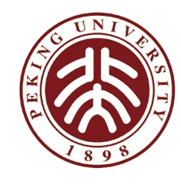
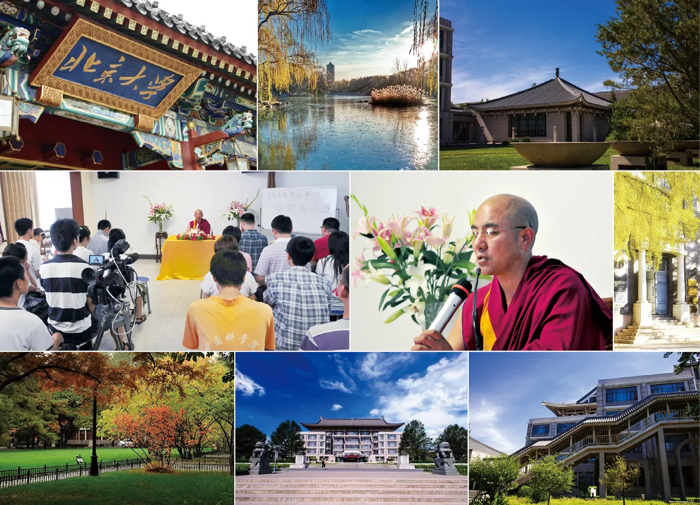

“千万不可评论你所不知道的道理，

否则，你可能会用生命的代价，

来补偿你所犯过的错误。”

第2场

北京大学

Peking University

中国·北京

2010 / 6 / 24

## 信仰与人生

## Spirituality in Everyday Life

各位老师、各位同学：

下午好！很高兴与北京大学禅学社、耕读社、医学社等许多社团的师生们一起交流。

我们集聚在这样的环境中，也是一种因缘，更确切地说，这是一种佛缘。按照佛经的观点，若没有各种因缘聚合，万法是不可能形成的。因此，我和你们能在这里共同探讨、沟通，确实是彼此之间的一种缘分。

今天要跟大家交流的，是“信仰与人生”的问题。那什么是信仰呢？略而言之，就是对某种主张、宗教或某人极度仰慕，并拿来作为自己行动的指南或榜样，它分物质信仰、伦理信仰、宗教信仰等许多种。正确的信仰，对整个社会来讲不可缺少，有了它，人们才会有道德的行为、良好的心态，否则，就会产生种种负面现象。所以，在当今时代，关心信仰问题十分有必要。

## 一、信仰≠迷信

信仰的内容虽有很多，但我个人是一名佛教徒，所以今天所讲的，主要是宗教信仰。

如今全世界有无数宗教，每个宗教都有各自的教义，但你不管信仰哪一个，都需要有理性的智慧。现在很多人的信仰，常常是种迷信，他们到一个寺院、见了一位上师，或者接触某个宗教群体时，身心得到宁静、安乐，就将它认定为自己的信仰。可这种信心是非理性的，很容易随外缘而转变。那什么样的信心比较稳固呢？比如你对佛陀、佛法、僧众有信心，这是依靠智慧长期观察、反复对比，最终完全明白三界最伟大的是佛陀，他所传的佛法极其殊胜。这样的信念并非只是心血来潮、人云亦云，也不是仅停留在口头上、文字上，而是发自心坎深处的一种体会，这就被称为不退转的信心。

在座的知识分子，务必要希求这种信心。否则，自己的信仰特别盲目，带有一种迷信成分，那一旦遇到不太顺心的事，就很容易对所信仰的对境产生邪见。因此，只有建立在智慧、正见基础上的信心，才是最为可靠的。

我本人而言，多年来一直从事翻译工作，同时也在给一些人讲经说法，在此过程中，自己深深感觉到，正确的信仰很重要。现在这个社会，只要拥有名声财富，就像有些球星、明星，成千上万的人便会去疯狂追逐。目的是什么呢？也不是自己想当明星，只不过想跟他说说话、拍个照而已。若用智慧进行观察，这样做又有什么意义呢？可能他自己也搞不清楚，只是糊里糊涂地去追随，这种行为就是源于不正确的信仰。

你们各位长期研究文科、理科等学术知识，智慧应该很敏锐。那么这种智慧——最初听受有关知识，然后再去领会、思索、观察，最终体验到那种意境，跟佛教中的闻思修也很相合。既然你们有这样的智慧，就应该好好观察自己的信仰，并树立一种正信，而不是迷信。若能如此，则无论对你个人还是社会群体，都是发展、进步的一种动力。

## 二、宗教与科学之间的关系

### 1．没有宗教的科学是瘸子

作为一名知识分子，对宗教的学习、研究不可缺少。记得爱因斯坦说过：“没有宗教的科学是瘸子，没有科学的宗教是瞎子。”这句话虽有不同解释，但我认为，前半句是指依科技所取得的发明、发现，如果没有宗教指导，则必定是盲目的。为什么呢？因为佛教、儒教、基督教等大多数宗教，都有导人向善的一面，科学若没有以此为前提，反而一味地急功近利、唯利是图，那最终会导致什么样的下场？只能是人类自己毁灭自己。

所以，现在的知识分子，尤其是从事科学工作的人，对宗教的希求必不可少。假如你没有正确的信仰，成天盲目地追求物质，那在这个社会上，也许你的事业、财富、名声、地位等很成功，但它所带来的不一定是快乐。如今，常听人说“某某高校的大学生自杀了”“某某成功企业家跳楼了”“某某高官领导服毒了”……据统计，这几年跟前十年比起来，人们的幸福指数越来越低，自杀率却越来越高。这是什么原因呢？就是因为人们缺乏信仰，除了维护自己以外，根本不在乎他人的利益，也不在乎整个社会的和谐，这样一来，即使外在的生活五光十色，令人眼花缭乱，但实际上，自己内心也非常困惑、焦虑、痛苦。所以，这个社会特别需要宗教信仰，不然，物质文明越发达，伦理道德就会越下滑，久而久之，人类必定自取灭亡。

我平时不管是一人静坐，还是跟别人交流的过程中，始终都重视信仰的作用。尤其对如今很多人来讲，若能多多少少接受一点佛陀的智慧，这的确很重要。否则，你得个人身却没与佛法结缘，就这么白白浪费掉了，就像在大海边渴死一样，实在特别可惜。现在不少人每天忙忙碌碌地追求，可是到头来，空空一世、一无所得，只有在后悔不已中撒手人寰。这种非常可悲的景象，在我们眼前已上演过无数次，故希望大家不要重蹈覆辙，而应将目光专注于佛陀无与伦比的慈悲与智慧上。

#### 1）佛教在大悲方面的不共之处

佛教的智悲，其实远远超过其他宗教。尽管其他很多宗教对人类的作用也不可小觑，尤其像美国等西方国家，正是由于基督教的引导，才让他们摆脱了诸多困惑，得到心灵上的慰藉。但不可否认的是，有些宗教的教义只提倡保护我们人类，却不涉及一切有生命的众生，这在大悲的广度上还不太够。那么，为什么要悲悯天下一切众生呢？因为它们的生命跟人类的一样宝贵，它们同样希求快乐、逃避痛苦。然而诚如《入行论》所云：“众生欲除苦，反行痛苦因，愚人虽求乐，毁乐如灭仇。”这些众生由于愚昧无知、智慧鲜少，以至于虽想解除自己的痛苦，却反而去造招致更多痛苦的因；虽想求得快乐，却将自己的乐因当成仇敌一样消灭了。

现在好多人也是如此，由于后天的生活、教育所致，追求快乐的因缘根本不知道。在座的很多大学生，在世间上你们是成功的，因为从无数的莘莘学子中脱颖而出，顺利考上了北京大学。但到了这样的学校后，你想过没有：追求快乐的因是做善事，避除痛苦的根源是断除恶业。倘若对此一无所知，连“善有善报、恶有恶报”的因果正见都没有，那即使世人再羡慕你，从某种意义上讲，你恐怕也不能列入“智者”的行列。

当然，这样的苦乐因缘，并非因为是佛陀说的，所以就必须要承认。造恶业必定受苦，造善业必定感受快乐，这是一切万法的真相。就像吃了毒药会损恼身心；吃了妙药的话，即使四大不调也会得以痊愈，这是一种因果规律，而不是因为佛陀是万能的，能主宰世人的苦乐。

#### 2）佛教在智慧方面的不共之处

除了悲心广大以外，佛教在智慧上也超胜一切，不管对胜义谛、世俗谛的诠释，都找不到任何瑕疵。就拿世俗谛来说，世间包罗万象的种种知识，如天文、地理、生理、物理、化学，释迦牟尼佛早已在经典中描述过。举个简单的例子，《时轮金刚》在没有任何仪器的情况下，将一年三百六十多天的太阳运行，包括日食、月食的具体时间，算得连一个小时都不差，并能准确说出银河系和太阳之间的深妙关系。这种发现，在天文学史上可谓前无古人，从而引起了当今学者的普遍关注。

还有，佛教的医学也非常先进，像现代西医和中医《本草纲目》等中所发现的东西，在藏地医学续部里早有明示。因此，文学巨匠鲁迅先生在阅读了《贤愚经》《瑜伽师地论》等佛教经论后，对佛陀的智慧感叹不已，他对朋友说：“释迦牟尼佛真是伟大的圣哲，我平常对人生有许多难于解决的问题，而他居然大部分早已明白启示了，真是伟大的圣哲！”

所以，在座的知识分子，对佛教应当深入了解、仔细观察。其实，知识分子的好处就是容易接受新事物，并依靠研究思维，所得出的结论不易退转；而知识分子的缺点，则是邪见比较重，怀疑心也经常产生。当然，怀疑也并非都一无是处，禅宗常说“大疑大悟，小疑小悟，不疑不悟”，假如你有大的怀疑，那在研究佛教时，所得的收获也许不同凡响，最终可将相续中的疑惑遣荡无余。否则，就像现在有些人一样，对佛教一无所知便信口开河、肆意诽谤，这种做法实在令人震惊，而且也十分不可取。莎士比亚（W. William Shakespeare, 1564-1661）在《仲夏夜之梦》中说过：“千万不可评论你所不知道的道理，否则，你可能会用生命的代价，来补偿你所犯过的错误。”

因此，你们研究任何一个宗教时，务必要站在公正的立场上进行观察。当然，佛陀也并没有说“必须接受我的宗教”，无论你是什么样的人，信仰宗教、不信仰宗教都有自由，信仰哪个宗教也可以随意选择。但在选择的过程中，你最好是依止真理，否则，追随愚笨者的说法而人云亦云、随波逐流，最终导致的结果可能不太美好。

所以，各位在选择信仰时，一定要依靠智慧观察，看其教义是否颠扑不破。比如释迦牟尼佛说“胜义中一切法皆空”，你对此若没有感受的话，那只是一种纸上谈兵，没有多大意义。只有依靠理论上的抉择，真正体会到空性的意义，你才会明白了然、明然、澄然或明空无别的境界。此境界无法用语言来描述，但你却很清楚地了知，在这种境界中，众生与菩提没有任何差别。达摩祖师在《悟性论》中也说：“众生与菩提，亦如水与冰。”众生与菩提之间只是一线之隔，正如《经庄严论》所言，觉了就是菩提，迷了就是众生。

当然，这个说起来简单，做起来却不那么容易。众生因为被无明、烦恼、分别所缚，自己的本来面目一刹那也没见过，始终在迷乱妄念的作用下，于六道轮回不断流转，在红尘俗世中不断奔波。所以，我们作为一个人，尤其是从事科学工作的人，务必要具有明辨取舍的智慧，而这种智慧，来源于正确的宗教信仰。如果没有这个，那么科学技术再发达，也只能成为毁灭人类的因。

### 2．没有科学的宗教是瞎子

反过来讲，宗教也需要科学的支持。任何一个宗教，若想广泛弘扬到世界的每个角落，趋入有缘众生的心田，就要适应当代社会，有一定的组织化、规范化，同时，科学也要能为其教义提供佐证，否则便很难为世人所接受。

以前汉传佛教中，太虚大师等人为了弘扬佛法，着重强调“人间佛教”。对于这种观点，我有两方面的看法：首先，“人间佛教”不能太过世俗化，否则，就会有损原始佛教的固有本质。比如对三宝的“信心”，你若用欢喜心、爱心等词来代替，便会扭曲它的意思，这样的人间化就不合理。但如果在其本意不变的基础上，尽可能地以现代用语解释佛教非常深奥的内容，例如把“众生”“有情”叫做“生命”，如此便于人们理解是很好的，这样的入世法也很重要。

## 三、当今的信仰迷失与道德沦丧

现代人不像古人一样，有研究的时间、思考的空间、分析的精力，他们由于功利心比较强，将短暂的人生都用在物质竞争上了。对此，有人曾用一个比喻来形容：每天一早，非洲的梅花鹿就想“我今天要用最快的速度跑，不然就会被吃掉”；狮子的话，则想“我今天要以最快的速度去追，不然就会饿死”。每个众生制定的目标虽不相同，但根本上都是为了自己。所以，现在不管是大学、商业界，包括一些公务员、老师、医生，有许许多多的黑暗面，原因是什么呢？就是因为缺乏慈悲心、利他心，否则，他们也不会时时耽著自己，多多少少都会考虑周围的人。

我以前看过一种说法，说是在电影院里看电影时，如果前排的一两个人站起来，后排的人因为看不到，也只好从座位上站起来，这样就形成一种恶性循环，其结果是：最终电影院里的所有人都站着，即使脚很痛也没办法。现在的社会就是这样，很多人只考虑自己而不管别人，由于自私自利、唯利是图，以至于很多工厂都在造“毒”品，根本不顾他人的健康和利益。这种现象究其根源，就是因为人们没有正确的信仰，不相信前世后世存在，缺少善恶有报的因果观。这样的心理危机，实际上远远超过经济危机。发生经济危机的话，其他国家还可以支援，本国自身也有应急措施，但人的思想上、心灵上若出现了危机，这是很难以挽救的。

因此，如今高校的知识分子与大乘佛教徒互相交流，对这个社会来讲，确实有很积极的意义。为什么呢？因为我们作为弘扬大乘佛法的人，虽然非常明白这些道理，但所说的话不一定产生什么影响；而你们这些知识分子，若能接受大乘理念，今后在不同岗位上发挥自己的作用时，尽管不一定能完全遣除自私自利，但最起码也会以利他为主，帮助别人是基本的人生原则。记得美国非暴力主义者、“诺贝尔和平奖”得主马丁·路德·金（Martin Luther King, 1929-1968）说过：“无愧的良心，是床上最好的枕头。”因此，每个人若想心安理得、获得快乐，是要无休止地索取，还是不间断地付出？相信大家都应该清楚。

现在这个社会上，善良之光已日益被遮蔽，黑暗的阴影越来越炽盛，甚至无法驱散。当然，也许我是太过悲观，但也许不是。放眼看看我们的周围，物质发展几乎到了极点，各大城市的享受应有尽有，而且不比国外任何国家逊色。可是人们满足吗？并不满足。快乐吗？不快乐。好多人都成了金钱的奴隶、房屋的奴隶、轿车的奴隶，为了自己升官发财，不惜损人利己、不择手段，但其结果往往事与愿违，最终与快乐的距离越来越远。

## 四、佛教对心灵的作用

相比之下，在我们藏地，生活条件虽然并不丰裕，气候条件也极其恶劣，可幸福指数却相当高，这几年统计下来，上百岁的人比比皆是。这是什么原因呢？很多科学家认为，这与人们的心理健康有关。而在藏地，唯一的心理调整方法就是大乘佛教，故汤恩比博士[^1]（Arnold J. Toynbee，1889-1975）曾说：“拯救21世纪人类社会的，只有孔孟之道和大乘佛法。”这也确实言之有理。

现在的人类要想从根本上解决某些问题，一则可以研究孔孟之道，尤其这对汉地来讲相当重要，有了它，许多大学生就不会遇到一点点挫折，便开始选择自杀了。二则可以修持大乘佛教，有了这种信仰的话，不要说一点区区小事，就算遇到非常大的变故，自己也有坦然面对的能力。

我这次去玉树赈灾，看见那里房屋倒塌、人员伤亡，种种惨状无法用语言来形容。但我们几百位出家人去了之后，对死者进行超度，对生者进行安慰，在此过程中很明显地发现，当地人由于有信仰，对死亡的来临早就有准备。他们遇到这样的自然灾害，并没有怨天尤人、痛不欲生，而是觉得理所当然，很多人都说“万法是无常的”“轮回就是痛苦”，所以在他们眼里，这并不是无法承受的打击。

当时有一名《中国新闻》的记者，我们在玉树赛马场和当地老乡商量事情时，他的感受相当强烈。他说：“我见过国内外许多灾难场面，包括汶川大地震，我也亲自到过现场，目睹了不计其数的惨状：有些人发现家人都死了，无法面对就自杀了；有些人见所有财富毁于一旦，精神上实在受不了也跳崖了，这种现象特别多。可是到了这里，却见到与预期完全不同的场景，这么多人在灾难面前，心态竟然非常安详，甚至有些人的家人全部死光了，他还在医院里一边拿转经轮一边念观音心咒，脸上带有微笑。我问他：‘你伤心吗？’他回答说：‘不，我很高兴。人终有一死，无常是免不了的，可这次有这么多出家人进行超度，死者实在非常幸运，我也替他们感到开心！’他自己也是遍体鳞伤，但他觉得这是前世恶业的果报，只有再去好好地忏悔，此外并没有任何怨言，也没有面对不了的事情。”

在这些问题上，我深深感到了信仰的重要。有了它，纵然面对天灾人祸、悲欢离合，乃至各种痛苦，你也不会束手无策。前段时间在我家乡，有一群小学生六年级毕业，离开母校之前，我带他们和老师去草原上玩了一天。当时，好多孩子一想到自己将要离开，就很伤心地哭了起来。我说：“这没什么可哭的。我跟你们讲个佛教道理吧，它虽然看似特别简单，但实际上意义很深奥。这就是《贤愚经》中所说的无常四际——聚际必散、积际必尽、生际必死、高际必堕。这是什么意思呢？

聚际必散：今天我们集聚在这里，但过一段时间定会各奔前程，所以，凡是集聚的，终有一天会分散。比如两个人原本感情非常好，但不到几年就离婚了；一家人在一起本来很快乐，可没隔多久却各奔东西了。倘若你懂得佛陀所讲的这个道理，到时候就不会特别痛苦了。

积际必尽：自己辛辛苦苦积累的财富，最后被怨敌抢走了，或者很不幸地全部流失了，这也是一种自然规律。懂得佛理的人，并不会抱怨老天不公平。

生际必死：人既有出生，就迟早会死亡。明白这一点的佛教徒，不管死亡降临到自己还是家人头上，都可以坦然面对，根本不会认为人永远不死，非要求医生想办法让自己多活一段时间。要知道，在这个世间上，古往今来没有一个人是有生而不死的。

高际必堕：任何高高在上的人，不管曾经多么不可一世，早晚有一天都会堕下来。包括一些雄伟的高楼大厦，终究也会变成一堆废墟，这就是无常的必然规律。

这个道理，大家或许觉得简单，但等你以后在人生中遇到这些现象时，若能想起这个教言，肯定会有很大帮助。假如你记性不太好，这些教言记不住，那还是要把它写在日记本上……”当时我是这样跟他们讲的。

所以，佛教的确非常殊胜，这一点并不是我们佛教徒自赞自夸，而是像《胜出天神赞》中所说[^2]，是站在非常公正的立场上，看谁的宗教中有真理，我们就依止谁。其实佛教的思想对生生世世有极大帮助，即使你不承认有来世，那今生在复杂混乱的环境中，它对身心调整也有相当大的利益。我常碰到一些大城市里的人，他们对佛教的道理了解之后，一旦发生猝不及防的违缘，就有面对的勇气、面对的能力。否则，《中观四百论》里也说了，大人物有大的痛苦，小人物有小的痛苦，整个世间都离不开痛苦。有些人表面上吃得好、穿得好，坐的是高级轿车，住的是豪华洋房，世人看了非常羡慕，但他们内心若没有调节能力，实际上是不会快乐的。

包括出家人也是如此。假如你对佛法有实修实证，那么遇到任何事，都会非常潇洒自在，根本不会耿耿于怀；但如果你没有看破、放下、自在的境界，不要说把头发剃了，就算把耳朵、鼻子都割了，内心的执著也丝毫无损。

所以，我们现在最需要什么？就是佛教思想的交流，这对当前来讲十分重要。然而在汉地，学习佛法的场所并不多，不像我们藏地，光是我家乡炉霍县，人口只有四万左右，寺院就有二十多座；五明佛学院所在的县城叫色达，人口也不到四万，但却有寺院近三十座。你们去过藏地的人也都知道，在那里坐车的时候，一会儿一座佛塔，一会儿一个寺院……这样的建筑数不胜数。而且，寺院大多都有讲经说法，孩子们从小就住在附近，每个月受八关斋戒等，在这种环境的影响下，对佛教的教理或多或少都有了解。可是在汉地，每个城市的人口有几百万、甚至上千万，寺院却寥寥无几、屈指可数，作为在家居士，就算有人愿意听闻佛法，但听法的地方几乎没有，传法的上师也少之又少。

所以，现在佛教的形式并不重要，放鞭炮也好、唱歌也好，这些都是表面现象，最关键的是什么？就是要懂得佛教的真理。佛陀涅槃之后，印度最伟大的弘扬佛法者世亲论师，在《俱舍论》的后文中曾说[^3]：佛陀的法有教法和证法两种，教法是落在文字上的，可让我们去听受、去学习；证法是将理论融入内心，通过修行以调伏贪嗔痴烦恼，除此二者之外，根本不存在其他的佛法。所以，佛教兴盛并不在于寺院金碧辉煌、大家做了一些慈善，这些只不过是种形式，如果你心里没有慈悲观，表面上即使做得再风光，也不能称之为“佛法”。

因此，在一切行为中，学习佛法最重要，只有这样，到了一定时候，你的人生观才会有所改变。当然，在座的人当中，有些可能也不是佛教徒，但你就算信奉基督教、伊斯兰教等其他宗教，也要懂得它的教义和思想。否则，光是天天敲锣打鼓、搞些仪式，我觉得意义并不是很大，到时你遇到一点点风吹雨打，信心就容易随外境而改变。所以，这种盲目的迷信一定要遣除。

总而言之，佛教对人类的作用，确实无与伦比。科学家爱因斯坦经过长期研究后，也说过：“如果世界上有一个宗教不但不与科学相违，而且每一次的科学新发现都能够验证它的观点，这就是佛教。”我刚看到这句话时有点吃惊：“爱因斯坦在科学方面虽然很伟大，但他对佛教会不会真有如是的研究啊？”于是就查阅了很多资料，最后在许良英等人翻译的《爱因斯坦文集》中看到过，英文中也是这样说的。所以，在这位科学家的眼里，一切宗教中完全经得起科学考验的，就是佛教。

## 五、“宗教是鸦片”被错解

现在有些人经常对佛教不信仰、甚至诽谤，究其原因，主要是马克思（Karl Marx, 1818-1883）说过：“宗教是鸦片。”这种观点，在“文革”期间出现得非常多——当然，你们比较年轻，没经过这样的十年浩劫，所以不一定很了解。在那个年代中，马克思的这句名言，成了很多人打击宗教的有力武器，他们将宗教斥为麻醉人的“毒品”，传教者统统是“毒贩子”，宗教信徒则是“鸦片鬼”……无数人听后也不加观察，盲目地用各种不恭敬的语言来攻击宗教。

实际上，马克思虽然说过这句话，但他的意思却被误读了。后来钱锺书也曾找过他的原话[^4]，发现马克思对宗教的比喻，并不是有些人所理解的那样。在马克思生活的19世纪，鸦片是一种昂贵的镇痛剂，它可以解忧止痛，息灭人们的痛苦，用它来比喻宗教，是就宗教功能而言的，并非指宗教的本质。而且这个比喻还强调，宗教有非常强大的吸引力，能使人们全身心地陶醉于其中，从而对世间事物渐渐丧失兴趣。只不过因为中国近代经历了鸦片战争，才将“鸦片”完全当作负面的理解，得出了“鸦片是毒品”这一认识。

其实，不管是马克思还是恩格斯，都对佛教的评价相当高。如恩格斯（Friedrich Von Engels, 1820-1895）在《世间论》中说：“人类到释迦牟尼佛时代，辩证思维才成熟。”马克思也说：“辩证法在佛教中已达到很精细的程度。”所以，他们对释迦牟尼佛的辩证思想非常赞叹，而且这种精神后经龙猛菩萨、法称论师等大德的努力，如今在世界上也遍地开花。因此，佛教智慧之高深显而易见，并不是想推翻就能推翻了，想说成迷信就成迷信了。

当然，你们信奉其他宗教的人，也不一定要改变自己的信仰，你信哪个教都可以，但前提是必须用智慧去观察，这一点非常重要。不然，没有任何宗教信仰的人，一辈子只追求金钱、地位、名声，那活在这个世间也不会有真正的价值。

今天能与在座的各位老师、同学共同交流，我从内心中确实很高兴。为什么呢？因为自己长期从事教育工作，虽然不希求发财、成名，但总觉得有种责任感，想把这么好的思想，在机缘成熟的条件下传递给别人，若能如此，它对人们的利益远远超过金钱上的帮助。试想，假如人人的心态都得以平衡、调顺，将对整个世界会有怎样的正面影响？因此，我们每个人就算没有太大能力，但得到这样的人身之后，也要尽己所能地为老母有情多做一点有意义的事。

接下来，你们若有什么疑问，对藏传佛教的也好、信仰与人生方面的也好，我们可以互相交流。我懂的地方，会尽量回答；不懂的地方，可以彼此探讨。谢谢大家！

现场互动

问：我是北京大学电子系的研究生，非常荣幸得到堪布的摄受，并聆听您讲法。我有个问题想请教：我感觉自己做事优柔寡断，但让勇猛心不断增上的话，又担心变得莽撞冲动、不计后果，给自他带来一些负面影响，这该如何用智慧去辨别呢？

堪布：我们做任何事情，首先都要用心观察：“做它的后果怎么样？做的过程中会不会出现意想不到的违缘？……”现在好多人没有这种概念，不管是办企业、做事情，只看好的一面，对不好的一面，却从来没有心理准备。甚至有些人连想都不敢想，比如自己死了怎么办？突然生病怎么办？这些表面上看起来不吉祥，但却是每个人必须要面对的，想逃避也是不可能的。

我们作为佛教徒，平时在处理问题时，不但会看事情的正面，对负面也考虑得比较多。这样一来，提前若有最坏的打算，将来一旦事情真正发生了，到时也有面对的勇气和能力。

因此，不论你做什么事，首先详细观察很重要。藏地著名学者萨迦班智达根嘎嘉村也说：“智者愚者之差别，事后观察即愚者。”一个有智慧的人，在事情发生之前，必定会冷静分析：“我成办这件事的后果如何？期间违缘大不大？用什么途径才能成功？最后的效益怎样回馈社会？……”诸如此类的问题要先考虑清楚。有了这个前提之后，做事既不会优柔寡断，也不会不计后果，而是会走中道。

问：我是北大哲学系的博士，今天听了您的讲法，感觉特别受用。我有一个问题是：中国的佛教、儒教、道教，都是向内求得精神安宁，对物质没有过多希求。但现在国际化的过程中，如果只有中国变得很和谐，凡事都能看破、放下，那其他国家拿飞机大炮掠夺我们怎么办？难道就对其听之任之吗？

堪布：所有的中国人全部看破、出家，这也是不可能的，也不需要这样。我所强调的角度是，在物质文明高度发达的这个时代，一定不能忽视伦理道德、传统文化。尤其是你们的传统文化，如老子、孔子、孟子的学说，现在了解的人越来越少，而在韩国、新加坡、美国、加拿大等其他国家，这些道理却被运用得极其成功，令无数人受益无穷。这对中国人来说是相当可悲的，因为它的来源就是中国。还有起源于印度的佛教，传入汉地、藏地及欧美国家之后，印度本土就被婆罗门教占据了，如今反而是藏地大德去那边弘扬佛法，这种现象也令人唏嘘不已。所以，你们一定要保护好自己的传统文化，否则再过几年，中国去请美国人、朝鲜人来弥补这个传承，这是非常可耻的事情。

当然，我并不是要求所有人都放下物质追求，任凭其他国家来肆意掠夺。你们作为在家人，生意可以做，钱也可以赚……但有一个前提是：不能采用非法、不合理的手段。不然，现在世界各国都在与时俱进，你们如果天天内观自心，什么都不做，那很可能就被时代淘汰了。可是在极力发展物质的同时，对内在的精神也要重视，不能将目标一味地盯在金钱上，而应在二者之间寻找个平衡点。

问：不同人有不同的信仰，但信仰在带给我们精神安慰的同时，不同信仰之间又会产生冲突，如中东那边的战争。您怎么看待这个问题？

堪布：不同的信仰之间互相冲突，甚至宗教徒跟非信仰者之间也有冲突，这些现象如今确实比较常见。但我作为一名佛教徒，多年来一直研究佛教，却从来没有发现佛教挑起过任何一场战争。

2009年，日内瓦“国际联合宗教会”召开了一个会议，会上世界五大宗教为主的各大团体，通过民主投票的方式，一致表决佛教是“世界上最好的宗教”。颁奖之后，有人对参会人员进行了采访，一位国际联合宗教会的研究主管说：对于佛教能得到这个奖项，他并不感到惊讶，因为在过去的历史中，并没有一场战争是以佛教名义而产生的，这是与其他宗教明显不同的地方。

所以，佛教是以非常广阔的心，平等对待一切众生。当然，有些佛教学得不好的人，也存在内在冲突和不如法行为，但这是他个人的过失，并不代表整个佛教。因此，不同信仰之间有冲突，只是少数宗教的行为，不能说全世界的所有宗教都是如此。

问：我是北大新闻与传播学院毕业的研究生，现在已经工作了。我想问您一个问题：在过去30年经济发展的过程中，中国人的精神领域十分荒芜，现在国家对个人信仰慢慢放开了，那么中国有十几亿人，就存在一个庞大的信仰市场。我看过一个报告说：此时几千种邪教也盯住了中国，并通过各种方式渗入进来，甚至很多书店都有他们大量的书在卖。那我们用什么简单的方法能较快地识别正教与邪教呢？

堪布：现在的中国，大多数人心理比较空虚，以至于许多宗教都想利用这一点，占据这些人的信仰领域。但一般来讲，如果是邪教的话，跟人们的心态不合、道德相逆，即使在你的生命中出现了，甚至已渗透到你的心灵中了，但它存留的时间也不会太长，最后注定会被人类历史所淘汰。

如今世界上的几大宗教，古往今来，一直在东西方文化中不断发扬。从大的方面来讲，这些宗教之间应当和睦相处，国外很多佛教大德也提倡这一点，不管是基督教、天主教、伊斯兰教、佛教，都应该尊重彼此的宗教仪式，这也是宗教信仰不断向前发展的标志。所以，宗教与宗教之间，不能互相抵触、互相排斥，假如你声称“只有佛教是正教，其他基督教、伊斯兰教都是邪教”，这是非常不合理的。

那么，正教与邪教该如何区分呢？概而言之，对人的生理和心理不起任何作用，甚至有害的这种教，就可以叫做邪教。然而，现在世界上很多宗教，不仅对人类没有危害，反而有特别好的向善作用。像儒教，对人伦道德有极好的规范；还有基督教，在各地建医院、修学校，做了很多福利事业，这都是值得赞叹的。我以前也讲过天主教的特蕾莎修女，她虽然是个非常平凡的教徒，但从12岁开始就帮助可怜人，短短6年时间中，便收留了6万多弃婴。这种行为非常不可思议，包括我们大乘佛教徒，有时在她面前也觉得很惭愧。

当然，各大宗教在互相团结的前提下，各自的观点没必要混用，同时，用教理建立自己的宗派也是合理的。我们藏传佛教就有很多派别，如宁玛派、格鲁派，都可以建立自己的观点，阐述正确的理论，而不能认为一个是真的、一个是假的。

在过去的历史上，由于人们了解、认识得不够，以致发生了很多丑恶现象，宗教徒之间互相排斥、杀戮，这都是智慧不够的表现。其实，凡是对人类有利的宗教，就是正教；凡是对人类健康、发展无利的，就是邪教，这一点是最根本的原则。当然，具体应当如何辨别，这要通过智慧进行剖析，不可能由我一人断言谁是正教或邪教。

问：我是中央民族大学大三的学生，在学佛的过程中，不知道是什么原因，自己的心越来越收缩，越来越紧张，没有以前那么活泼、放松了，我该如何对待这种现象呢？

堪布：那怎么办啊？这样我也有点紧张了。（众笑）

你的心之所以不能放松，可能有两种原因：一是因为前世的业力。《俱舍论自释》中讲过，假如你前世把小虫乱抛，让它在恐惧中死掉，那今生心态就会不正常，始终有一种恐慌之感。这种情况，看病、吃药也不起作用，让别人念仪轨也不一定起作用，因为有些业力必须要自己承受，依靠其他外缘则很难改变。倘若你属于这一种，就应该多念忏悔文，慢慢消除这些业力。

二是人随着年龄的增长、外境的变化，心情也会起起落落。这种现象不仅仅是你一个人，其实很多人都经历过：在一段时间内，自己心情很不错，但过了不久又特别低落。这种时好时坏的现象，通过调整生活也可以改变，若能如此，慢慢地，你的心态就会像以前一样放松、自在了。

问：我是北京大学软件学院的研究生，现已毕业，是某公司的软件工程师。我有一个问题是：我引导父母信佛的过程中，讲善恶有报、六道轮回的道理时，善恶有报他们比较接受，但六道轮回，他们却非常排斥，说这辈子过好就行了，不用去管下辈子。对此我十分苦恼，因为对父母最大的孝顺就是引导他们信佛，可我觉得自己的力量很不够，这该怎么办？

堪布：很随喜你的发心！确实，孝顺的儿女想对父母报恩的话，按照大乘佛教的观点，引导他们趋入佛门、行持善法是最好的方法。这跟世间人的想法大不相同，他们认为给父母买栋房子，令其吃穿不愁就可以，却不知这些用几年就没有了，所以，你用这种方法报父母恩，是非常令人欢喜的事。

你父母对善有善报、恶有恶报，虽然容易接受，但他们也许只承认今生的善恶报应，却不一定承认来世的。我以前曾分析过，中国很多娱乐明星、文学巨匠，他们说是信佛教的，但也只承认今生做点善事，马上就能得到保佑，而不相信来世存在，甚至觉得来世怎么样都无所谓，这种想法就不合理。为什么呢？假如你是“今朝有酒今朝醉”，只顾今天而不管明天，那为什么又去买医疗保险、养老保险，为自己的晚年做打算呢？因此，对来世根本不考虑的人，完全是一种鼠目寸光的做法。

当然，一下子要改变父母的观点，可能也有一定困难，但只要你长期努力、毫不气馁，相信迟早有一天可以感化他们。在我的印象中，有些儿女不仅仅用一年、两年，而是通过十几年的努力，最后让父母也成了非常虔诚的佛教徒。所以你要不断地努力，加油！

问：我在做技术工程时，发现公司在日本那边的网站，放了一些黄色图片，就跟同事说这会毒害青少年。但他们不认同我的观点，说日本人是不会被毒害的，而且这些可以吸引流量，流量就可以转变为钱。我不知道该怎样认识这个问题？

堪布：每个人的价值观都不相同，这可能也没有一定之规。但从大乘教义来讲，不管是日本人、中国人，这些都是众生，不应该厚此薄彼。上个世纪六七十年代，有些人特别痛恨美国人、日本人，那是因为国家之间发生战争，有这种心态也情有可原。但如今完全是国际性合作的年代，不论是哪个国家、哪个民族、哪种肤色的人，都应该用菩提心去平等对待。

我们佛教中讲的菩提心，其实这就是大爱。现在世间人的爱，只是一种小爱，仅仅局限于“我”的家人、“我”的同事……只有将这种爱慢慢扩大，遍及全世界的人类，乃至所有众生，这样的爱才会令人快乐。

现在科学家通过观察人脑，发现人脑的构造对利他最为适应，倘若传递一种自私的信息，则会给它带来痛苦。所以，帮助他人、关爱他人，对人类而言再合适不过了，如果谁有这样的心态，他始终会处于快乐中，即使所成办的事情不成功，但只要尽心尽力了，也会问心无愧。反之，假如你只是爱自己，动不动就觉得别人对你不公平、对不起你，这样的生活会非常不快乐。因此，爱是奉献给别人的，不是让别人来爱自己，你在公司的时候，也要尽量地帮助别人，要知道，不管是日本人还是中国人，谁都不愿意感受痛苦。

问：我是北大哲学系宗教学的博士，想请您简单介绍一下藏传佛教在汉地的发展，以及您对此发展形势的评价。

堪布：藏传佛教在汉地的弘扬，很可能会日益广大。因为佛教不是一种形式，如果只是形式上的话，那藏传佛教在汉地建寺院、搞活动，这些不一定被允许。但由于藏传佛教在闻思修上有不共特点，故汉地的高僧大德、知识分子在了解到之后，如今对它越来越感兴趣了。

我刚才跟有些同学聊天时也说，1987年法王如意宝来北京时，人们基本对藏传佛教一无所知，甚至我们穿这种衣服的人去百货商场，服务员都特别惊讶，全部放下工作看着我们，认为来了“外星人”。他们见到金发碧眼的外国人，尚且不会如此好奇，因为当时北京已对外开放，外国人都见怪不怪了。可我们来的时候，大家稀奇得不得了，觉得这是“罕见物种”，于是纷纷围观、指指点点。

但如今不是这样了，随着越来越多的藏地上师将佛法带入汉地，大家对藏传佛教有了一定的认识；再加上汉地大德、学人也不断入藏求法，彼此之间在学习佛法方面，有了很好的沟通桥梁。这种趋势将来应该会不断加强，了解藏传佛教的人也会逐渐增多，这是很值得高兴的事情。其实佛法是对人心的一种教育，人们若依此得到了快乐、得到了利益，这个地方佛法就会兴盛。所以，我相信今后通过光盘等科技手段，认识藏传佛教的人会越来越多，希望通过我们的努力，共同弘扬这样对人类有利的佛教！

问：现在汉地许多人在学习《菩提道次第广论》，请您介绍一下这部论在佛教中的地位，以及您对汉地众生学习这部论的一些建议。

堪布：《菩提道次第广论》是宗喀巴大师所造，以前法尊法师翻译过。法尊法师是汉地特别了不起的翻译家，入藏后翻译了许许多多论典。他在世时并不是广为人知，但圆寂之后，人们才渐渐认识到他对汉地众生的深恩。自从他将此论翻译出来之后，台湾的日常法师传讲过，我们佛学院的益西彭措堪布也传讲过，听说汉地许多佛学院、包括一些大学，如今都在学习。

这部论，把整个菩提道的次第讲得很清楚，学习它确实非常重要。我们宁玛派也有一部《大圆满心性休息》，与它的修法基本上相同，只不过多了一层密宗的次第。因此，对于学习《菩提道次第广论》，我个人而言十分赞叹。而且此论后面的胜观部分，宗喀巴大师在造的时候，觉得意义太深，可能无人了知，于是打算停笔不写。此时文殊菩萨亲自显现，劝勉他继续写下去，并说未来一定会有人通达。所以，该论的加持不可思议，大家若以其作为学佛的基础，肯定会有非常大的利益。

问：我是北京大学南亚学系梵文专业的博士，对大圆满法的修行比较有兴趣，祈请堪布进行介绍。

堪布：哎哟，不能传哦，呵呵。

问：那简单介绍一下吧？

堪布：行，就简单介绍。大圆满法，按照密乘观点来讲，是九乘次第中最高的境界。它的修法非常简单，而且特别适合现代人。

大家都知道，现代人工作非常繁忙，很难在短暂的人生中，闻思浩如烟海的佛教经论。法王如意宝去美国波士顿的某中心时也讲过：“大圆满最适合现代人，尤其是你们这样忙碌的城市人。”当时有个博士就问为什么，法王回答说：“你们要广泛地闻思大量教理，在短暂的人生中有一定困难。而修学大圆满的话，依靠自己不共的信心和上师的直指，有缘者当下即可开悟。就算你没有开悟，但通过这种简单的方法，认识了心的本来面目，此时就如同站在最高的山巅上一览众山小般，其他任何法都不在话下。”所以，此法对当前的人来讲，确实相当适合。藏地著名大德噶托度达也说过，末法时代五浊黑暗越厉害，大圆满加持的日光就越明亮、越炽盛。因此，现在的众生很需要殊胜密法，尤其是大圆满的窍诀。

问：我是北大哲学系毕业的博士，现今在读博士后。我想请教堪布一个问题：我们无论做任何事，在某些方面都很相似，不管做生意还是盖寺院，都需要聚合资源、做些判断，还要排除一切干扰。在这个过程中，怎样才能既把事情做好，又不增长贪心、分别心？

堪布：不管是做世间的事情，还是建造寺院等佛教道场，都需要积聚各方面因缘。许多人在做的时候，逢人便讲、滔滔不绝，这也说明他对自己的事业特别重视。但重视的过程中，尽量不要产生分别念、贪嗔心，这是一个基本原则，可实际上能不能完全做到呢？这要根据每个人的情况、人格而定。

比如在藏地，很多地方经常修造寺院，有些是以十分正当的途径，依靠有福报的大施主捐款建成；而有些则到处化缘，最终带来各种不愉快的现象，对神圣的藏传佛教也是一种抹黑，让人们都以为“藏传佛教是四处要钱的”。其实，佛教并非仅仅修个寺院、建个佛塔，有金碧辉煌的建筑物作为代表，如果是这样，那么佛教灭尽之后，这些道场依然存在，佛教教义有没有都无所谓了。要知道，外在的建筑只是提供一种条件，最关键的还是内在的思想。就像我们今天在这里聚会，并不是喜欢这栋房子，或者想看看我这个人，而是因为我在藏地修学了很长时间，你们希望通过这种交流得到一点收获。同样，我来北京大学也是如此，并不是想参观这里的建筑，或看看你们每个人长得什么样，而是想了解这里不同的思想氛围，这才是最为重要的。

正如刚才所说，藏传佛教有非常深的思想体系，这个没有了知的话，反而因有些人的不如法行为，对藏传佛教产生邪见，最终毁坏自他，这是十分令人惋惜的。所以，判断任何事情时，不能仅凭表面现象一概而论，理应一分为二地去分析，否则就会带来不良后果。

问：我去年去过一趟青海，发现藏族人和汉族人对待财富的态度很不一样。那么，藏地的人如何看待做事业积攒财富的意义？

堪布：在藏地，相当一部分人对财富的态度，不像汉地人看得这么重。尤其是很多老年人，他们的幸福是建立在信仰上的，所以物质条件虽然一般般，但依然过得很快乐。我曾去过很多牧民的家，他们生活十分清贫，你们有时候的一顿饭，抵得上他们十多个人几个月的吃穿，可是相比之下，他们心情上的快乐，却远远超过汉地许多有财有势的富人。

古人说：“有富不一定是福。”在佛教中，知足少欲才是最大的富翁，有了这种满足感，做什么都会比较快乐。可是现在许多人缺乏这一点，他们有一辆轿车想买两辆，有了两辆又想三辆，而且质量也要越来越提升……这些人只看到事物好的一面，却忽略了它的副作用，最终只能招致无尽的烦恼、痛苦。而我们藏地很多人，从小就信仰大乘佛教，内心有种满足感、利他心，因此，内心的快乐远远超过大城市的人。

当然，现在藏地也有一部分年轻人，由于信仰丧失的原因，走向社会之后，行为比汉地人更疯狂，经常去一些不正当的场合。对你们汉地人来说，毕竟有些事物已司空见惯，对此也看得比较淡，而这些人到了大城市以后，拼命地追求物质享受，天天耽著醉生梦死，这种现象如今也不在少数。

问：我是北京大学物理学院的博士后，研究生物医学工程专业，现在已经工作了。由于各种原因，我觉得佛教非常好，故不希望公司里的手下都只认钱，而应该有种信仰，崇尚良知和道德。但我又不可能让他们全部信佛，相信有轮回，那该怎么做才好呢？

堪布：不管在什么样的团体中，不一定非要用某个宗教的理论去灌输，只要能引导所有员工心地善良，以此作为准则的话，这一点人人都可以接受。我以前在云南、四川等地，看到一些企业家，他们对员工长期进行爱的教育，例如集体学习《弟子规》等，这样对人心肯定会有帮助。

问：我在搞生物医学工程期间，接触过一些比较黑暗的东西。举个例子来说，现在大家的车坏了就去汽修厂，但事实上，很多时候你的车并没坏，或者只是小毛病，结果修了以后，他把你的零件全换走，再给你一些旧的、失效的零件。还有，你的刹车本来没问题，但更换全套刹车系统很赚钱，修理工为了让你换刹车，就给你刹车油里灌进酒精溶解掉，这样的话，过段时间你的刹车肯定要坏。所以，现在高速公路上的车祸，很多就是这种原因引起的。但外行不太容易知道这些内幕。

再举一个例子说，我们搞生物医学工程的最初，对癌症接触比较多，老在谈怎么去检查、怎么去治好。但后来慢慢才知道，其实很多病是医生没法治的，因为我们日常食物中有大量致癌物，导致心脑血管疾病、肝肾衰竭的化工原料也被大量采用，而这些暂时又没办法控制。我说个数字大家就明白了：光是室内建材而言，据北京医院统计，几乎80%得白血病的少年儿童，患病前半年之内家里都作过装修。现在国家关于室内建材的标准，我也了解过一些，比如什么叫合格呢？即几年之内不引发重大疾病的，就叫合格。但人的寿命并不仅仅只有几年啊！

所以，现在的人单纯地追求经济效益、物质利益，好像到了疯狂的地步，完全置他人生死于不顾。在这种环境中，我们多数人毕竟不能完全出世，还是要入世修炼。为了团结大家的力量弘扬佛法，让人间变得更有佛性、更美好一些，我创立了非营利的公益组织——食品安全协会，尽量免费为团购检测一些农药等，以减少对大家的危害。但在此过程中，我们实际上做得很艰难，所以想请您明示一下：我们该怎么做下去，才能让这条路一直走得更远，而不是中途夭折？

堪布：很好！你还是考虑得比较周全，了解得也很有深度。

如今社会上的黑暗面，我们在座的人，尤其经历过许多事的人都比较清楚。这个原因是什么呢？就是因为人们没有正确的信仰，诚如《涅槃经》中所言：“不见后世，无恶不造。”很多人由于不相信后世，所以只为了眼前利益，为了赚更多的钱，医院可以开假药，学校也不考虑学生的将来，包括你刚才说的汽修厂、食品厂、建材厂，很多内幕都非常恐怖。但即便如此，厂家也可以昧着良心，打各种广告、买通各种关系、以各种方式来推销自己的产品，从而给人们身心带来不可估量的危害，这确实也是一种事实。

这样的社会潮流，个别人若想力挽狂澜，确实也有一定困难，但若借助公益组织的力量，或许可以多多少少起点作用。前两天我参加了“国际慈善论坛”，里面就有北京大学、北京师范大学、清华大学的很多教授，提出了自己的慈善理念，及对国家慈善立法的设想。其实，公益组织今后若向组织化、管理化、科学化的方向发展，这样影响力会非常大，否则，只是个别人偶尔捐点钱、做些善事，这种力量毕竟有限。

因此，包括北京大学在内的知识分子，我从经济等其他方面，没办法帮助你们；但在佛教的心理咨询、指导上，我毕竟在学院待了这么长时间，这方面我们可以共同合作。大家以后的目标，若能唯一就是帮助别人，除此之外没有个人希求，这样的组织对现在社会来讲非常重要。

以前因为各种复杂的原因，政府各部门可能比较害怕民间慈善。但现在步入国际化之后，中国基本上与以往完全不同，很多决策都是开放性的，在这样的气候和形势下，我们应该多建立像国外那样的慈善公益组织，以帮助那些精神上贫穷、物质上贫穷的人。

我经常都在想：人活着不是为了自己，而应该是为了天下人，若能为他们哪怕做一点一滴的事，也是我们义不容辞的责任。在此过程中，你不用担心个人会失去什么，这些不是很重要。如果你真想为他人做好事，也许暂时要面对各方面的误解、不理解，但是逐渐逐渐，你会像太阳从云中出来放出耀眼光芒一样，最终定能帮助无量的有缘众生。

问：我是北京大学医学部精神科的研究生。我前不久碰到一个小伙子，他失恋了，心态很悲观，我估计他要么会自杀，要么反社会，要么可能成为流浪汉。我很想帮助他，也尝试用心理引导的方式劝过他，但他很难听进去。请问堪布：我该怎样去点化这种人？或者，我这么执著地帮助他，是不是我自己的问题？

堪布：这不是你自己的问题，而是我们的问题！虽然他是一个失恋的人，但如果大家详细地思维，其实我们都有责任，这个社会中有无数的苦难者，都是我们应该帮助的对象。

关于心理咨询的作用，我在玉树的时候，见到全国各地、包括香港那边，来了很多心理专家。我也遇到过几位，但他们都说：“在汶川地震时，我们起了很大作用，不少人准备跳楼自杀时，通过我们的努力，都把他们成功劝住了。可是到了玉树，按理来讲，这么大的地震，那么多人家破人亡，应该也能起到作用。但我们一直找，却找不到需要安慰的人，这些人都不太痛苦，所以这次算是白来了。”

可见，在这个世间上，对感情、财富等实执特别重的话，自杀率才相当高。听说你们北大就有个未名湖，常有大学生在那里跳湖自杀，以前老舍等也在那儿投湖自尽了，这些都是对世间法特别执著的缘故所致。如果他们早一点听过空性法门，不要说是感情、名声、财产，一切万法都是生不带来，死不带去，又有什么可执著的？

不过，对现在很多人来说，一下子明白这个道理比较困难，有时候看到一些人的状况，确实也有点悲观。我们若以善心尽力帮助他们，也许逐渐会起到作用。但实在不行的话，那也没办法，毕竟佛陀这么伟大、断证圆满的圣者，都不能度无缘的众生，我们凡夫人就更不用说了。我常常也会碰到这种情况，实在是无能为力的话，只好念一些偈颂，默默地发愿：“我今生中确实没有办法了，但愿来世能帮助你……”

问：我是北京大学中国哲学专业的博士。之前报名参加这次座谈的几个理工科同学、一个德语系同学，临时有事不能来，所以他们有些问题想请我代问堪布。

1．学了佛法或传统文化之后，觉得自己的专业很没有意义、特别枯燥，这个矛盾该怎么解决？

堪布：许多人可能都有这种感觉：从幼儿园开始读到大学，算起来将近二十年时间，辛辛苦苦学了这么多年知识，但到了社会上的时候，大多数都用不上。比如数学里的几何、解方程，以及物理、化学等，在工作中基本都没有用。所以他们就特别困惑，觉得以前的时光都浪费了。

对此，其实可从两方面来分析：一方面，你读书时所学习的这些知识，工作时虽不一定用得上，但却可以提升你的综合素质，培养你的学习能力。这样的话，以后无论遇到什么知识，有了这种较高的智慧为基础，学起来就不会特别困难。比如受过高等教育的大学生、教授，在听受中观时，理解能力完全不相同。或者，你以前是学理科的话，现在转到文科的领域工作时，即便以前所学的用不上了，但由于你的综合素质不错，中间就不会有很大困难。

另一方面，大家也知道，在中国来讲，从80年代到现在，经济改革非常成功，人们的物质水平有了大幅度提高。然而，在教育改革方面，中国却“革”了传统文化的“命”脉，尤其是“文革”期间，通过“批林批孔”等运动，把孔子当作封建迷信的对象来批斗，以至于现在想恢复起来有一定困难。由于那种思想的影响，如今学校里所传授的知识，道德修养方面的比较少，很多课文要么是讲战争，要么是特别枯燥的理论，故而现在也有许多知识分子要求：尽量在课本里加一些对为人处世有用的学问。像我们藏地，从小就教孩子怎么做人、怎么凭良心来做善事，但现在的汉地，一下子要转变过来也不太现实，许多人就处于这种左右为难的境地之中。

2．怎样才能把外语的听说读写也变成修行？这个应该如何观想？

堪布：在我们密法中，不管是写字、念经、吃饭，都要以一种正知正念来摄持，安住于禅定的境界中不动摇。但这对一般人来讲很困难，比如你开车、走路、做事，始终都要处于禅的光明境界中，或者自己要做善事的状态中，这可能有点不现实。不过若能如此，那无论你在做什么，都是一种修行。除此之外，可能也没有一个单独的法让你边学外语边观修了。

3．怎么样才能证悟明心见性的境界，不知道堪布方不方便回答？

堪布：不方便，要保密。开玩笑！

禅宗的“明心见性”，也就是大圆满的“直指心性”，净土法门则称为“一心不乱”，这些词虽然不相同，但意义都是指达到最高境界。“明心见性”在禅宗很多大德的传记中经常出现，即通过特别简单的方便方法，认识心的本来面目，也就是光明与空性无二无别的状态。这种状态当你认识的时候，无法用语言来描述。

当然，要想证悟这种境界，方法有几种：一是次第性地闻思、修学显宗经论；二是依靠善知识的指点；三是阅读高僧大德传记，祈祷上师三宝，以了然通达心的本性。当你真正明心见性时，尽管无法用言语表达，但自己却清清楚楚、明明白白。这并不是偶尔的一种快乐舒适，而是非常稳固的境界，即便诸佛菩萨来到面前想转变你，你这种见解也不会动摇。以前宗喀巴大师的上师仁达瓦尊者，在《中论注释》的结文中就说：“纵然千百万个智者认为我的见解不对，我也不会有丝毫转移。”这说明他已证达了特别高的境界，故对此很有把握。

关于明心见性，汉地《高僧传》中有许多非常精彩的故事，你们有时间应该看一看。现在许多人喜欢看明星、歌星、舞星，其实这些没有什么意义，你们应该去探寻大德们是怎样开悟的，若能依此修行，生死大事就解决了，这才是最重要的！

4．我自己有个修行中的小问题：傲慢心、嗔恨心这两种顽固的习气，怎样才能从根本上断除，而不是等它暴露出来之后再去惭愧忏悔？

堪布：嗔恨心有两种对治方法：一是显宗的方法，在《入菩萨行论·安忍品》中讲得很清楚，它通过各方面的理论，详细剖析了嗔恨心是怎样被摧毁的。所以国外很多大德到西方国家时，若没时间讲《入行论》的全文，就会单独把《安忍品》拿出来给大家讲。而密宗摧毁嗔恨心的最好方法，就是当下观察它的本体。比如我对某人特别生气，此时就看看这个嗔恨心在哪里，是在肚子里？还是脑袋中？或是身体其他部位？这样一观察，就会发现所谓的嗔恨心只不过是分别念的假象，实际上本体一点都不成立。因此，对于嗔恨心，显宗、密宗各有不共的窍诀加以对治。

傲慢心的话，我以前也有这个毛病，觉得自己的记性、智慧、能力都超人一等。但后来一想：“其实我是众生的仆人，跟过去诸佛菩萨、高僧大德的无私付出相比，我自认为很了不起、很不错的这些，没有一点一滴值得傲慢之处。所以，我是所有众生中最卑贱、最可怜的，不应该有超越别人的傲慢心。”因此，只要比较诸佛菩萨的行为和发心，我们就会感到特别惭愧，自己明明我执那么重，自私自利那么强，烦恼、分别念如是强盛，凭什么还生起傲慢心？

问：我是北大哲学系的博士，学中国哲学，是研究佛教的。我有个问题请您开示：像我们学哲学和宗教的人，平时经典读得比较多，那佛教的理论学习和修行实践的关系是什么？

堪布：学习佛教时，理论与实践相结合很重要。我认识许多宗教系的学生、佛学院的讲师，他们理论知识很丰富，读过许多经典、论典、历史，可实际的修行、行持却比较差，佛法好像成了一种纸上谈兵，说的时候头头是道，什么都讲得出来，但实际上，自己从来也没有行持过，这样以后，理论与实践就会相脱离。

现在很多法师或修行人，就常犯这样的毛病。自己在理论上的辩论非常厉害，可是从未实地修行的话，内心并没有丝毫转变，那最后离开人间时，面对生死会束手无策。所以，大家在了解佛教的同时，也应该去实地行持。

像我们藏传佛教，理论和实践的修法是配套的。现在很多人之所以特别喜欢藏传佛教，也并不是一种盲目，而是因为它首先有理论的描述，然后有配套的修行方法，还有仪轨的辅助，这被称为“闻思修”，就像一件产品，一次性地全部包装好了。否则，你只是理论上了解得不错，但缺少修行的话，对自己起不到什么作用，对社会公益也起不到什么作用。所以，大家在学习佛法时，既要去研究，也要去实践，这一点非常关键。

问：请您从法、报、化三身的角度，谈一谈显教修行和密教修行的关系。

堪布：从法、报、化三身来讲，显宗与密宗实际上没有很大差别。显宗的《现观庄严论》中也讲过法、报、化三身的功德，以比喻而言，法身是万法的本性，就像是虚空；报身则如同虚空中出现日月；化身是日月发出的光芒。在这个世间上，本师释迦牟尼佛就属于化身，他如同日月所放射的光芒，跟无有阻碍的虚空、日月都有关系，有些经论是用这种方式观修的。

而在密宗中，心的本来面目是空性，这称为法身；空性妙力不舍弃的情况下，明明清清的这一部分，就称为报身；现和空不离不合、无二无别的境界，遍于所有众生，这个部分叫做化身。所以，法报化三身并不是各自独立的三种法，其实它们是一个本体，只是分别从本体空性、自性光明、在众生界中以不同形象利益众生三个角度安立的。密宗的这种说法，是就认识本性而言的，是一种比较深的境界。

问：但我听说禅宗是只修法身，密宗是法报化三身都修，不知道您怎么看待这种说法？

堪布：这可能没有真实的依据吧。因为法报化三身是无二的，一旦证悟了，这三者都可以现前。禅宗明心见性的本体，就是所谓的法身，即一切法的法界；这个法界在显现上有自利、利他的不同点，此即为报身、化身。所以，禅宗开悟时也是现前三身的，刚才那种说法不一定成立。

问：我是拉克斯教育基金会的工作人员，这个房间的隔壁，就是基督教的会所。身为一个佛教徒，我很明显地感受到他们有非常强烈的传教精神，以至于基督教铺盖面特别广，而佛教徒这一点却很缺乏。我想请教一下堪布：怎样才能增强我们佛教徒的这种精神，以更好地让佛法去利益更多的人？

堪布：基督教传教的精神、方法、途径各式各样，确实值得我们学习。据基督教的许多资料显示，他们计划在50年之内，尽可能占据汉地信仰市场，把相当一部分人变成自己的教徒。而我们很多佛教徒，不要说传教，甚至还内部不和、勾心斗角，诽谤这个上师、那个教派，这是非常不合理的。尤其是作为在家人，对于出家人的过失，尽量不要去传扬，因为这并不是你们的责任。

那么，佛教应当如何弘扬呢？一方面可以学习基督教的做法和行为，同时要清楚地知道，佛教精神对当前来讲不可缺少，我们挨家挨户地送妙药、送金钱，不一定对他们有帮助，但若将佛教的智慧传入千家万户，确实会产生不可思议的利益。这几年以来，我依靠现代科技等方式，为大家传授了《入行论》等法，通过这样的闻思，有些人真实得到了切身的利益，生活上有了改变，面对困境也有了勇气，这是特别令人欢喜的事。

所以，希望各位以后对弘法利生有种责任感，不要只是遇到地震、灾难，见到一个痛苦的人，就应急性地筹集资金支援一下，平时根本没有长期的利他打算。我们作为大乘修行人，许多人都会讲“要利益天边无际的众生”，但实际上，你若把佛教的伟大思想传给他人的勇气都没有，这是非常值得惭愧的。

我今天也说不出什么好方法来指点大家。但你们北京的学生团体中，最好是有一种组织，偶尔小范围地安排大家该怎样交流、怎样学习。当然，这没必要很高调，因为我们不需要名声，也不需要新闻宣传，而是想切切实实为众生做点实事，若能如此，这就是利益众生，也是弘扬佛法。

其实，你们不考虑的话，就另当别论了；但只要好好考虑，便会发现知识分子该做的事情特别多，而且很多事都要靠大家共同努力，不是一个人默默无闻就能成办的。现在的社会是信息时代，大家若能以组织性、合作性的方式来推广佛教精神，这样才会有光明的前途。

问：堪布您平时非常非常繁忙，各方面的事情特别多，在这种情况下，您怎样更好地调节身心，以勇猛精进地去承担自己的责任和义务？

堪布：我平时的生活确实很忙，但即便如此，只要自己有一口气，也想多多少少地帮助众生，这就是我的人生目标。同时在这样的环境中，我也担心身心逐渐会被社会各种恶习染污，所以在学院的时候，基本都是上午把该做的事情都做完，到了下午，就尽量空出时间来翻译和修行；早上起来时，也会念一些经文、咒语。

我处理事情时也常遇到困难、别人不理解，但我会让自己坦然面对，不要因一点点小事而痛苦半天、伤心很久，情绪始终调不过来。作为一个闻思多年的修行人，遭遇逆境、不顺是正常现象，我尽量把这当成是诸佛菩萨的加持，然后将其转为道用。比如别人给我制造违缘，我会尽量地给他回向，就算最终事情不成功，也认为是诸佛菩萨的加持，暂时看来是个违缘，但究竟是最好的一种修行验相。

不知道我以后有没有能力帮助更多众生？但有也好、没有也好，反正只要在有生之年，我都会把自己的少分力量，尽心尽力地奉献给老母有情！

[^1]: 汤恩比博士：英国著名的史学家。《美国新闻周刊》评论说“他已成为一位世界通哲，而与爱因斯坦、史怀哲、罗素并列。”
[^2]: 《胜出天神赞》云：“我不执佛方，不嗔淡黄等，谁具正理语，认彼为本师。”
[^3]: 《俱舍论》云：“佛之妙法有二种，教法证法之体性，持教法者唯讲经，持证法者唯修行。”
[^4]: 马克思说：“宗教乃人民对实际困苦之抗议，不啻为人民之鸦片。”他还在《哥达纲领批判》一书中指出：“每一个人都应当有可能实现自己的宗教需要，就像实现自己的肉体需要一样，不受警察干涉。”
