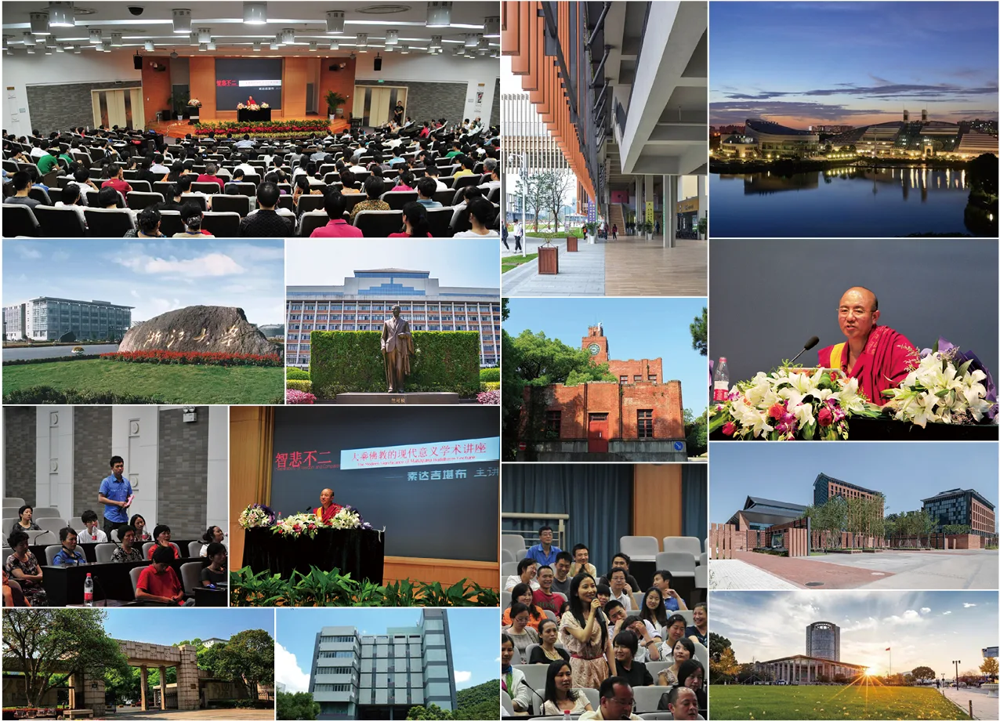
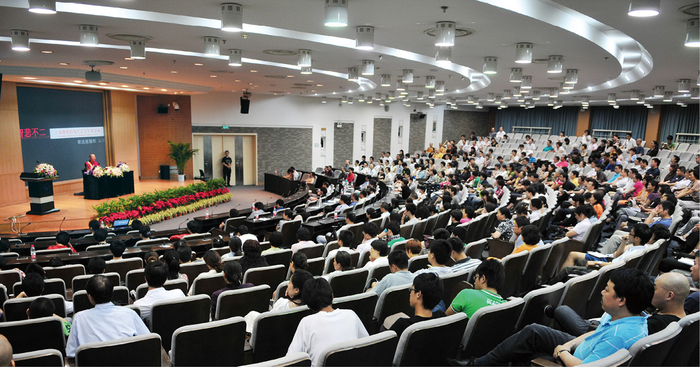

全心全意为众生服务，

大乘教义仅此而已。

第7场

浙江大学

Zhejiang Universit

中国·杭州

2011 / 6 / 8

## 大乘佛教的现代意义

## The Significance of Mahayana Buddhism in Modern Time

刘云教授：

浙江大学“成长论坛”第四次讲座现在开始！

浙江大学，是一个缀满了光荣和骄傲的品牌。在这个品牌中，凝聚着百年浙大人、百年求是学子的心血，也凝聚着百年浙大人的胸怀。浙大的校歌说海纳百川，所以，我们“成长论坛”以开放的心态、以宏广的远大理想，举办了一次又一次的人文讲座。

今天，非常有幸请到了索达吉堪布，这位在我们每个人心中像太阳一样的法师。现在迎请索达吉堪布入场——

（一片热烈的掌声，场内顿时响起《上师颂》的音乐：

捧一条洁白的哈达，献上我的敬仰；唱一曲嗡嘛呢贝美吽，送上我的赞扬。

无论多好的词语，表达不出我对您的感激，您让我认清了人生，把回家的路途指明。

感恩您啊，上师！您是离我最近的佛祖，是我灵魂的再生父母，您指引我走出轮回苦。

感恩您啊，上师！我愿生生世世追随您，和众生一起走过解脱的海洋。）

下面，有请浙江大学佛教研究中心执行主任张家成教授，介绍索达吉堪布——

张家成教授：

非常荣幸由我来介绍堪布！索达吉堪布，是喇荣五明佛学院汉僧部的主管堪布。“堪布”这个词，我们汉族人不是很熟悉，我简单地说一下：“堪布”是一种称号，藏传佛教中深通经论的喇嘛，而且担任寺院或佛学院的住持者，都可以称为堪布。一般来说，担任“堪布”需要非常好的学识和德行。

索达吉堪布，在国内外知名度都非常高，他不仅精通显密经论，而且用汉语撰著的书籍就有上百部，文字加起来有上千万之巨。堪布曾随晋美彭措法王远赴欧美、东南亚等多国弘法，如今还通过现代的网络技术，广传大乘精髓，为芸芸众生普降法雨。

在讲经说法之余，堪布2007年发起“启动爱心”的倡议，号召佛教徒不但要保护动物，也应该关爱周围的弱势群体。并以身作则，不遗余力地行持慈善事业，多次出席慈善方面的大型会议。

近些年来，堪布还应邀前往北大、清华、复旦、南大等高校演讲，与师生们做了深入广泛的交流，产生了很大的影响。

我的介绍就到这里，谢谢！

刘云教授：

接下来，让我们以无比崇敬的心情，以热烈的掌声，欢迎索达吉堪布仁波切给我们开示——

我是一名非常普通的僧人，来自海拔4000米以上的藏地雪域高原。很早以前，就听说“上有天堂，下有苏杭”，当时我觉得很神奇，也很向往。后来，我来过杭州几次。尤其是这次到了浙江大学，看到它偎依在西湖旁边，让人舒心悦意，觉得在这里不管工作还是学习，确实是一种享受，也是一种福气。

不过，当你拥有这样的福报时，应该想到身边甚至偏远地方没有书读的孩子。这几年来，我去了一些硬件和软件设施相当高档的国家一流大学，跟那里的知识分子——教授、大学生做过方方面面的交流；同时，也去了一些藏地和汉地非常偏僻的学校，那里的校舍破败不堪，教学质量也相当差，让人看了非常难过。

前不久，我就去了一所小学，当时正值藏地挖虫草期间，大多数学生都跑到山上挖虫草了，学校里只剩下七八个小学生，嘻嘻哈哈地在教室里玩。老师也有七八个，都在一个老师的家里打麻将、喝酒。看到这种状况，我觉得特别心痛……所以，在座的同学们，通过对比自他的不同环境，在你们快乐学习的同时，也应对其他的可怜孩子心生悲悯。

## 一、什么是大乘佛教

今天我们在这里交流的内容，是“智悲不二·大乘佛教的现代意义”。也许有人不知道什么是大乘佛教，那么，首先我就简单解释一下它的概念。

大乘与小乘之间，实际上有很多方面的差别，但最根本的是什么呢？就是大乘提倡无条件地帮助一切众生，而小乘只希求自我解脱。印度著名的佛学家阿底峡论师，曾言：“内道与外道以皈依别，大乘与小乘以发心别。”也就是说，大乘与小乘的根本差别，在于有没有菩提心。有菩提心的就是大乘，没有菩提心的则非大乘。这个最关键的问题，各位一定要掌握。

记得在七八十年代，不管汉地还是藏地，人们经常口口声声说“全心全意为人民服务”。这个口号，其实只强调了利益人类。若将此范围扩展至一切众生，变成“全心全意为众生服务”，那么，大乘的教义仅此而已。

如今知识界的很多人，对佛教的教义不熟悉，有些怀疑，有些生偏见、邪见，有些甚至大肆毁谤。当然，宗教信仰历来崇尚自由，佛陀在世的时候，也不要求所有人都信佛教，所以，我不会强迫任何人皈依佛门，甚至出家。但在这里，我要很明确地告诉大家：学佛并不是消极避世，佛教也不是一种教条主义，它揭示的完全是真理。

人类发展到现在21世纪，应该追求的是什么呢？就是真理。这样的真理，在佛教中展示得淋漓尽致，它犹如真金不怕火炼般，经得起历史的考验，也能经得起任何逻辑的推敲。作为一个佛教徒，我特别希望把这样的佛教教义，跟很多知识分子共同分享。你们作为高等学校的师生，进行文化传播、学术交流，本身也必不可少。所以，今天我们在一起探讨，真的非常有意义！

大乘佛教的教义，简单来说可归纳为一句话，就是《华严经》所讲的：“不为自己求安乐，但愿众生得离苦。”现在社会各阶层的人，如果有这样的崇高精神，社会和谐、国家稳定、人类和平则指日可待。相反，假如每个人只想着自己，拼命追求自己的地位、钱财、权势，而从不关心整个社会，不关心其他众生，那么，人类的衰败乃至灭亡，也就为期不远了。

## 二、了解大乘佛教有何必要

我本人而言，多年来一直对佛教潜心研究、认真思考，越观察、越探索，对它的真理越深信不疑。这种信心难以用语言来表达。今天在这里，我很想跟大家分享，希望你们每个人用智慧进行分析，看佛陀在2500多年前到底说了什么？这些历经风风雨雨，为何没有被任何世间学说所推翻，反而在人类历史上一直闪闪发光？

作为一名佛教徒，这样说并不是在“老王卖瓜，自卖自夸”，而是站在非常公正、客观的立场上所得出的结论。我自己曾用了大量时间，翻阅古今中外许多具有价值的书籍，接触过对人类有贡献的科学家、文学家，也与不少教授、老师、知识分子探讨过。在此过程中，我确实深深体会到：佛教的思想尤其是大乘的利他理念，在当今时代不可缺少。

佛陀早在两千多年前开示的真理，即便是科技日新月异的今天，也仍然没有落伍、过时，甚至有些境界，人类至今也望尘莫及。像美国的物理学家卡普拉（Fritjof Capra, 1939-），在《物理学之道》（The Tao of Physics）中就感叹说：“虽然人类的知识有了莫大的增强，但是两千年来并没有变得聪明多少。”他还说：“古老的佛教典籍《华严经》中所述，与近代物理学的模型和理论之间，有着最为惊人的相似之处。”从这些话中都可以看出，佛教的理念不但科学，而且超前。

要知道，释迦牟尼佛涅槃于公元前543年，他在世时所宣说的和平观、平等观、心灵奥秘，是后来不同时代的人们一直探寻、追求的。这一点，有智慧的人只要翻开大乘经典，翻开人类历史，进行对比就会一目了然。

所以，我很希望高等学校的师生们，有兴趣的话，就算自己不信佛教，也可以从学术、文化的层面了解它。在这个过程中，佛教绝对会给你带来前所未有的利益，甚至依靠个别经论、个别法师的教言，可令你的人生从此得以改变。

现在很多学生在校园里，只知道掌握一些知识，到了社会上面对各种压力时，常常束手无策、极其脆弱，我就遇到过不少这样的人。因此，你们在大学阶段，最好是利用一些空余时间，了解一下这方面的道理。毕竟大学是人生的转折点，毕业后你们就要迈入社会，面临复杂的人际交往了，所以提前一定要有心理准备。

说实在的，如今很多知识分子，确实应该学一学佛教，尤其是大乘的无私理念。佛陀在很多经典中也讲了，人一定要有利他心、大悲心，不然，许多行为建立在维护自我的基础上，最终只能害人害己，根本得不到什么利益。

《十住毗婆沙论》中就讲过四种人：自利者、利他者、共利者、不共利者。其中的共利者，即以慈悲心去饶益他众，从而间接圆满自利，这才是真正的上等人[^1]。不仅佛教中这样赞叹，世间上的以善心助人为乐，或者“先天下之忧而忧，后天下之乐而乐”，也是被人们争相传颂的美德。

可是现在，大多数人身上已经找不到这种“痕迹”了。他们盲目地追寻钱财、地位，满口大谈成功、发展，事业上虽然略有起色，但一直摆脱不了烦恼、痛苦。其实佛教中无常、无我的道理，正是对治这些烦恼的无上妙药。《华严经》中也说：“譬如伽陀药，能消一切毒，佛法亦如是，灭诸烦恼患。”可见，佛法犹如能解百毒的伽陀药，可以灭除我们的贪嗔痴等各种烦恼，及轮回中生老病死等一切过患。

如果不懂佛法，一个人再有钱、有地位、有才华，到了死亡关头，这一切也派不上用场。且不说别的，看看我们身边的人临终时，有多少荣华富贵可以带走，就不难明白这个道理。然而，许多人真的非常颠倒，用短暂的人生几十年，殚精竭虑地去追求这些，结果越执著越痛苦，越执著越得不到，这又是何苦呢？其实，这些身外之物生不带来、死不带去，有没有都可以，自己应以利他之心度日，这样才会快乐、自在，做什么事情也会很圆满。

## 三、大乘境界要在心中生起

大慈大悲的佛陀，给我们留下的这些教言，如果去深入了解，会有意想不到的收获。然后在日常生活中配以一些简单的大乘修法，自己的心态就会有很快的转变。

大乘境界若想在心中生起，《修心七要》等中有许多殊胜窍诀，但不管是哪一种，都要求我们先有大悲心。也许有人认为：“大悲心很容易，我应该已经具足了。”但实际上，生起大悲心并不是那么简单的。你看到一些病人、残疾人，光是觉得他们很可怜，生起一种悲悯心，这不叫大悲心。真正的大悲心，是要把天下无边的众生，平等视如自己的母亲。

试想，假如你的母亲年迈体衰、双目失明、精神失常、疾病缠身，正处于非常危险的悬崖边，马上就有掉下去的可能，在这种情况下你会怎么做？稍有孝心的子女，肯定会什么都不想，放下一切去救她。同样，世间上的任何一个众生，前世都当过我们母亲，她们如今没有智慧的双目，没有善知识的引导，无明愚痴、疯狂颠倒，在轮回的悬崖边，随时都有堕入恶趣深渊的危险，如果我不去救，那谁去救呢？倘若看见任何一个众生，都会想到这一点，这才说明你的大悲心已生起来了。

所以，我们不要轻易认为自己有了大悲心，或者完全具足了菩提心，其实这是相当困难的。如果你真的有了大悲心，那就有了成佛的种子。印度的月称论师在《入中论》中讲过：大悲心对成就佛果来说，初、中、后都特别重要。首先，要有大悲心，才能引发菩提心的种子；中间行菩萨道时，要有大悲水的滋润，菩提种子才不会枯萎，且日日增长；最后成就佛果时，要由大悲心示现报化身，才能让众生获得真实受用。[^2]

众生要想成佛，必须要具足菩提心，而菩提心的因是大悲心。大家如果对大乘佛教有兴趣，不妨在实际行动中修一下大悲心或菩提心。尤其是菩提心，在你心中哪怕生起来一刹那，这种功德也无量无边，无法用语言来形容。

当然，对一个不学佛的人来讲，可能觉得有点玄，但即使你不相信，事实也的确如此。就像跟一个不懂珠宝的农夫讲珊瑚、玛瑙、钻石，纵然他对此一窍不通，但这些珠宝的价值，也不会因为他不信而大打折扣。

若想生起这种菩提心，就要次第去修持自他平等、自他相换、自轻他重。倘若经常串习这些大乘精要，并贯彻于实际行动中，那你的生活态度定有极大改善，无形中会得到不可思议的利益。甚至原本是一个无恶不作的人，也会因此而脱胎换骨，有翻天覆地的变化。

以前有个人叫冼娜（Zina Rachevsky, 1930-1973），她是前俄国太子的女儿，母亲是美国最富有的女性之一。冼娜自幼在非常奢华的环境中成长，集万千宠爱于一身。在她的少年时代，已多次因吸毒、藏毒、酗酒、淫乱的男女关系而备受媒体关注。60年代，她还受过嬉皮士文化的影响。

后来，一次偶然的机会，她遇到了著名的大德——梭巴仁波切（Thubten Zopa Rinpoche, 1946-）及其上师耶喜喇嘛（Lama Thubten Yeshe, 1935-1984）。可能是前世的因缘吧，她马上对佛教生起信心，并皈依了三宝，从大乘菩提心开始，系统完整地了解佛教。经过九个月的学习，冼娜慢慢地由狂妄纵欲、处处受人迁就的刁蛮公主，变为一个开始为众生着想的人。

随后她受戒出家，在二十五个国家，为上师建立了上百个佛教中心，引导成千上万的西方人修行。据说她是格鲁派第一位出家的洋人尼师。我以前去西方国家时，看到过很多关于她的介绍。

## 四、大乘佛教对现代人类的意义

所以，现在很多知识分子不接受佛教，只不过是不了解而已。不了解的原因有几种：一是因为语言的隔阂，大乘佛教从印度传入汉地、藏地后，中间由于许许多多的原因，致使汉地很多人并没有了解它的意义。

还有一种是，现在不少人认为的佛教，实际上并不是真正的佛教。所谓的佛教，说实在的，是一种教育。而在寺院里烧香、拜佛、做功德，只是佛教的个别行为，不能完全代表佛教。寺院修得金碧辉煌、富丽堂皇，这也不是佛教，而是佛教的一个建筑。就像一所大学，校舍造得再壮观，也不是大学的核心所在。大学的核心是什么呢？就是它的教育理念。同样，我们佛教也是如此，这在藏传佛教中做得相当好，到目前为止，有系统、有次第的闻思修传统，仍是佛教的重中之重。

如今汉地有不少人，皈依佛门多年，只是见到佛像就拜拜，一直在边上打转，这样的话，你不懂佛教的真正教义，又怎么称得上是“佛教徒”呢？所以，汉传佛教的很多寺院，最关键是要有讲经说法；汉地许多大学的佛教研究中心，也一定要有佛教课程。

其实在汉地，不管是佛教历史、大小乘经论，都有足够丰富的千经万论，但遗憾的是，这些现在全部堆在藏经楼里。有时候我看到汉地的藏经楼，心里有种说不出的滋味：古往今来，那么多译师历经千辛万苦，翻译了如是多的珍贵教典，现在却无人问津，只是供奉在藏经楼中，整日与灰尘为伍。要知道，这些佛典中有无数的窍诀，足以对治众生的一切痛苦和烦恼，但你不去学习的话，就像干渴的人守着水却不愿意喝一样，再殊胜对自己也无济于事。

所以，不管是佛教徒，还是非佛教徒，现在应该把这些佛典拿出来，好好研究一番。佛教是无欺的真理，不可能被任何分别念所推翻。佛陀从涅槃到现在，已有2555年[^3]了，这么漫长的时间里，它是最经得起观察的一种学说。且不论佛陀亲自传讲的诸多经典，就算是佛陀的随学者，像龙猛菩萨、法称论师、月称论师、寂天菩萨、静命论师，所传下来的论典，义理也极为甚深。很多人去研究的话，可能也会雾里云里，很难一窥其堂奥。因此，佛教并不是有些人想的那样简单，大家若能对它稍有涉猎，得到的利益会不可言表。

其实，人类追求的是什么呢？就是幸福。但这种幸福不能只是眼前的，如果今天幸福、明天痛苦，或者今生幸福、来世痛苦，那就是一种鼠目寸光了。作为修学大乘佛教的人，不但会考虑自己的长远幸福，还会将这种幸福的范围遍及所有众生。关于此举的意义，佛教有足够的理论依据可以成立，并可通过辩论的方式，接受各种质疑。尤其在我们藏传佛教，寺院里历来保留着辩论的传统，依靠这种方式，会让你对佛教的道理越辩越明，将自己深层的智慧挖掘出来，从而引生的见解非常纯正，不会被任何邪见和怀疑所摧毁。

当今时代，人们对很多事物的追求，已与初衷背道而驰。孔子在《论语》中提到过一个词，叫“文质彬彬”[^4]，意思就是说，人类后天的文化，要与先天的本质相协调。文化一旦脱离了道德本质而盲目发展，必会将人类引入歧途。各位应该也有这样的感觉：自己待在学校里这么多年，但到了社会上，根本不知道怎么做人，最终离开人间时，心中也是茫然一片，这是什么原因呢？大家应该思考一下。

佛陀见我们这些沉溺苦海的芸芸众生，迷茫愚痴、相当可怜，就慈悲地宣说了解脱法要，指明了趋入幸福的正道。诚如《大集经》所云：“佛度生死海，慈悲故说法。”对于如此深恩厚德，我们实在难以回报。

在这个世间上，老师和父母的恩德非常大，但真正去观察的话，老师只教了我们今生的知识，让我们到社会上怎么赚钱、怎么生活、怎么扬名；而父母教给我们的，则是如何成家立业、如何灭敌护亲……就像《入行论》中所说，让我们永远脱离痛苦的方法，唯有大慈大悲的佛陀才揭示了，除此之外，世间的智者、婆罗门、国王、大臣、仙人、天人，都不能讲得出来。因此，佛陀的恩德超越一切。

佛陀如今虽然已不住世了，但许多善知识仍在世间，我们若能找到具有法相的善知识，得到一些出世间的真理，对一生也会有非常大的帮助。甚至有时候你遇到一两个人，送你一本佛经，介绍你认识一位大乘善知识，以此让你找到了人生的究竟目标，命运有了重大的改变，这些人也可以说是你的善知识。他们带给你的利益，是不能用金钱来衡量的。

现在很多大学生非常迷茫，知识学了却用不上；即使用得上，在工作中也不会待人接物，不懂得如何处理人际关系。过去自己在家时，被家人围着团团转，当成小公主、小王子一样，要什么就有什么；在学校时，校园环境也很单纯，自己活得非常自在、潇洒。可是一到了社会上，以前的世界发生了巨大变化，好多事情都不会顺着自己了，此时心理脆弱的人，遇到一点挫折就很容易自杀。所以，如今的大学生，特别需要佛法的智慧，断除我执和自私自利。

当然，完全断除的话，对我们凡夫人来说不太现实，但至少也要掌握一些对治烦恼的窍诀。佛教的智慧浩如烟海、博大精深，我们穷极一生也难以彻达，但最根本的几个道理，如《三主要道论》中讲的出离心、菩提心、无二慧，却不得不了解。这些就像打开宝藏大门的钥匙，可让我们尽情地享用里面的珍宝。

学了佛法之后，你会慢慢明白，自我的傲慢、自我的执著，是危害自他的根本因。印度论师寂天菩萨在《入行论》中也讲过：“自身过患多，他身功德广，知已当修习，爱他弃我执。”这一句话非常重要！我们过去处处以自我为中心，没想过对社会承担责任、对父母报答恩德、感恩一切与自己结过善缘和恶缘的人……现在明白了这些以后，就要扭转自己的心态，常常以利他为重，如此你为人处世就会非常得体、取舍有度。纵然个别人暂时不理解，最终也会被你的责任感、你的利他心所打动。

要知道，世间上最需要的，就是利他心。而这种利他心，正是大乘佛教的究竟精髓。现在学校里的老师，给学生灌输专业知识固然必不可少，但更重要的是，要用大乘佛教的利他理念，教导他们如何做人。有了这样的基础，这些学生将来无论处于什么环境，都会赢得众人的尊重，自己的人生也会活得丰富多彩。

## 五、通过智悲的修法断除我执

关于怎样断除我执、生起利他心，在佛教中有许多方法。假如有人觉得自己的利他心足够了，平时做人也特别慈悲，没有必要学这些，那不妨以此来衡量一下自己。

在修心的过程中，首先要修“上师瑜伽”——当然，这个名词你们也许不懂，但希求真理时不要怕这些，应该勇敢一点。就像第一个敢于吃西红柿的人，通过大胆尝试，才知道它到底是不是有毒。同样，任何真理都有一些专用名词，依此可开启未知领域之门，假如对此一直避而不谈，这也不是智者的选择。

修完上师瑜伽后，我们开始通过呼吸修自他交换：呼气时，观想自己的快乐、幸福、健康、荣华富贵变成白气，从鼻孔呼出，融入一切众生；吸气时，观想众生的痛苦、不幸、烦恼、疾病、魔障变成黑气，从鼻孔吸入自己的身体，融入心间的“我”。

听到这里，有些人可能就害怕了：“这样修，别人的传染病、痛苦会不会传给我啊？”这个时候，所谓的“我”很明显就跳出来了。一直认为自己修行不错的人，通过这个实验，也可以看看你们的“我”到底断除了没有。

以前，藏传佛教的有些瑜伽士在修“断法”时，认为自己的“我”已经没有了，于是故意到尸陀林中搞破坏，挖掘一些神山，或在非常严厉的对境前作种种损害。这些过分的行为，引起了护法或非人的极度不悦，致使天空突然出现打雷、下冰雹等异常。见此情景，他们心惊肉跳：“哎呀，这次我肯定完蛋了！”这时候，他们的“我”就原形毕露了。

那么，这样观修会不会真给自己带来痛苦呢？不会的。这一点，佛陀在诸多经典中再三地讲过，弥勒菩萨在《经庄严论》中也提到过。就像世间上的一位老师，天天帮助别人的话，他会不会很痛苦呢？绝对不会，反而他会有种说不出的快乐，社会也会对他非常认可。

如此修持自他交换，需要一个过程。通过再三的串习，当“我”的力量逐渐消失时，利他心的境界才会真正现前，这就是大乘佛教最精髓的东西。

除了这种修法，你还可以用智慧，观察万法的究竟实相。其实这个最简单，比如你学了中观的各种推理后，即可抉择万事万物是无我的、空性的。这种境界不是口头上说说，而要内心中生起牢不可破的定解。若能如此，你会深深感受到佛陀的伟大，追随佛陀的后代大德们，其智慧不是现在很多院士、教授、博导所能相比的。自己会有一种不同的感觉，这是用智慧抉择空性后得到的。

在慈悲方面，佛陀平等慈爱一切众生，2500多年前就有这样的精神，真的非常稀有。尤其是释迦牟尼佛出生于王族，贵为净饭王的太子，当时在种姓制度森严的印度，不同种姓之间差别很悬殊，但佛陀并没有因为自己是太子，就歧视别人，反而还以非常普通的身份，为一些病人、低贱的人服务。

相比之下，如今21世纪，人类关于平等、关爱、和平的理念，还没有达到佛陀所讲的万分之一。这一点不是我自吹自擂，你们可以用自己的智慧、用探索的眼光，去翻开《毗奈耶经》《长阿含经》，看看那时候的佛教思想成熟到什么程度。现在许多人都认为，古代的思想过于陈旧、落后。在物质上可能确实如此，当时很难与今时今日相提并论；但在思想上，尤其是佛教的慈悲和智慧，却远远把现代人甩在了后面。关于这些问题，你们如果深入领会佛教的奥义，相信一定会赞成我的说法。

总而言之，佛陀所传讲的妙法，不管是智慧方面还是大悲方面，都可以涤荡我们烦恼的灼热，遣除我们的一切痛苦。《付法藏因缘传》也说：“法为清凉，除烦恼热。”对这样的佛法若能经常听闻、全面了解，就会如《正法念处经》所言：“以闻智慧故，烧诸烦恼树。”依靠佛法的智慧火焰，可以烧尽无边的烦恼密林。

## 六、大学生需要注意的一些问题

现在世间上很多人，整天追求名闻利养，被贪嗔痴所缠缚，为了虚幻不实的目标，日日夜夜奔波忙碌。其实一个人今生拥有的名利再多，百年后也会舍弃一切而往赴黄泉。当你离开这个世间时，是不是“人死如灯灭”呢？绝对不是，对此我们有充分的理由。然而，“明明白白一条路，万万千千不肯修”，很多人对佛陀揭示的解脱道，怎么样都不愿意修，他们不信因果、不信轮回，以此错误的人生观，给自己、给社会带来了灾难性的破坏。

如今不少人觉得人生只是几十年，玩一玩就可以，这种想法特别低劣，跟畜生没有多大差别。萨迦班智达在格言中曾说，人若一心一意寻求今生的利益，从来也不希求解脱，那就跟畜生一模一样了——这不是我讲的，是几百年前的智者说的，他这样说并不是胡言乱语，有智慧的人应仔细思维。

很多人因为环境、教育的影响，一辈子只追求眼前利益。尤其是一些大学生，上了大学以后，智慧没有越来越大，傲慢却越来越大了。在大学里，各种乱七八糟的知识都学会了，对社会、家庭、个人有利的学问，却忘得一干二净。这样一来，没有良好的人格为基础，他们离开学校后，做很多事情都不顺利，与人相处也格格不入，于是天天抱怨社会不公、单位不好，从来没有一颗感恩的心——这就是不少大学生的现状，相信大家也有目共睹。

因此，汤恩比博士说：“21世纪能挽救人类的，就是孔孟学说和大乘佛教。”尤其是大乘佛教中忘我利他的精神，对当前来讲不可缺少。如果没有它，每个人都为了自己的利益不择手段，甚至伤害父母、老师也无所谓，那这个世间会变成什么样？可想而知。

现在有些大学生，一毕业就把老师的恩德抛之脑后，完全忘了他们对自己的付出。最近我跟浙江大学的很多教授交谈时，发现有些人名副其实是“人类灵魂的工程师”，他们二三十年来夜以继日、废寝忘食，为学生的未来劳心费神，这种付出既神圣又伟大，是世间上最有意义的。可如今很多忘恩负义的大学生，离开学校以后，见到老师连个招呼都不打，从来也没有想一下，自己的知识有多少来自老师？

作为一个人，理应懂得“滴水之恩，涌泉相报”。我本人而言，对出世间上师们的法恩无比感恩；对世间的小学老师、中学老师，也常念念不忘。每次想到自己如今有点滴智慧、点滴学识，都是他们的汗水、青春、健康换来的，就觉得老师恩深似海。不仅仅心里这样想，实际行动中也尽量地知恩、报恩，我始终都有这个原则。而现在很多大学生，考上大学就忘了老师的心血，这种人即使以后步入社会，恐怕前途也不一定光明。

所以，大乘佛教的教义，对现代社会来讲非常需要。这不是我夸夸其谈，而是自己确实从中得到了受用。为了让更多人了解大乘佛教，这几年我也一直依靠现代科技手段，弘扬《入菩萨行论》等大乘经论。汉地和藏地许多人通过学习，有了极大的改变，前后可以说判若两人。甚至有些人前世因缘成熟，很快能找到自己的归宿。

就像“三车和尚”窥基大师，据历史记载，当年唐玄奘去印度取经的途中，路过一深山老林，见到一茅屋紫气缭绕，知道里面定有异人。他进去一看，有位老僧在入定，头上、身上都长满了野草。玄奘伸手摸了摸他胸口，尚有微温，便用引磬使他出了定。

一问之下，才知道老僧在此入定，已千年有余，目的是等释迦牟尼佛来度他。玄奘告诉他：“释迦牟尼佛已涅槃了。”老僧说：“那就等弥勒佛出世吧，我跟他去弘法。”玄奘想了想说：“弥勒佛出世还须五十六亿七千万年，恐怕你又会错过时机。这样吧，不如你现在转世投胎，等我从印度取经归来，我们一起弘法利生，如何？”老僧点头说：“这样也好。”当下便按照玄奘的指点，去皇宫投胎做皇太子，结果他投错了地方，投到了当朝大臣尉迟恭的家中。

十九年后，玄奘从印度取经归来，不忘前约去找他，劝他出家。此时他已习惯了纸醉金迷的生活，坚决不肯。后来皇帝下旨：不出家就赐死！他没办法，只好同意，但提出条件，必须随行三个马车：一车金银财宝，一车美酒，一车美女。玄奘点头默许。

他勉勉强强来到寺院门口，一声洪亮的钟声传来，蓦然惊醒了他沉睡的记忆。他当即泪流满面，把三车都打发回去了，从此虔心皈依佛门，发奋修行，成为玄奘的座下大弟子，法号窥基，后来终成一代高僧。

可见，有前世因缘的人，善知识在旁边稍微提点一下，善根马上就会复苏。现在有些人到了寺院，听到佛法或看到佛像，不知不觉就流出眼泪，这也是前世的宿缘成熟。当然，我并不是要求你们所有人都出家，只是希望大家能正确认识大乘佛教。

法国有个人叫马蒂厄（Matthieu Ricard, 1946-），他出家后与身为哲学家的父亲有过一番对话，后编成了一本书叫《僧侣与哲学家》（The Monk and the Philosopher），又名《和尚与哲学家——佛教与西方思想的对话》。书中就讲了，作为知识分子，应该怎么样面对世间？学习佛法的种性苏醒之后，又该怎么样面对生活？这方方面面的道理，大家最好能了解一下。

## 结 文

总之，今天在座各位，应当有广阔的视野、开放的心态。听说浙江大学的校标是“求是鹰”，表现的是一种腾飞的个性。现代著名艺术家、弘一大师的弟子丰子恺，也曾任教于浙江大学。崇尚佛教的苏东坡还当过西湖太守，与杭州结下了不解之缘。所以，这里可谓“地灵人杰”，与佛教自古以来就有殊胜因缘。

据说浙江大学没有真正的门，从各个地方都可以进来，如此开放才会有发展，这也是人类未来的大势所趋。其实，不管什么样的学说思想，只要对人类有利益，都值得弘扬、值得提倡；而对身心无益的学问，千万不要去接触，这样才会给整个社会带来安定。

最后，我想留给大家一句话：美丽的杭州西湖孕育了百年辉煌的浙江大学，以及千年古刹的灵隐寺，这两处有来自五湖四海的知识分子与善男信女，熙熙攘攘、络绎不绝；每个人若能都有一颗包容心、利他心，相信会给我们的世界增添一分美好，给西湖带来一分宁静与祥和！

现场互动

问：我是浙江工业大学的，人文学院播音系。作为一名大学生，现在面临着很多压力，有家庭的、社会的。请问，怎样才能保持一种平和的心态？

堪布：作为大学生，有些可能没有想过自己的前途，天天在学校里得过且过；而有些会提前想到未来的工作、家庭的责任等，有很大的压力。在这种压力面前，自己一定要坚强，要学习，要有心理准备。

这个社会非常复杂，非常不公平。我就遇到过很多大学生，原本在学校里很纯洁，刚工作一两年时也不错，但后来慢慢就被环境染污了……所以，你们以后面临各种诱惑时，要坚持住自己的原则，对一些事物没必要过于追求。

济公和尚在《圣训歌》中曾说：“一生都是修来的，求什么？”以前灵隐寺就有这个，不知道现在有没有了？意思是，我们今生的地位、财产，都是前世修来的，前世不积福的话，今生再强求也没用。

当然，佛教并不是宿命论，认为一切都是命中注定，半点不能改。而是告诉我们，今生的一切与前世有关，有了前世的因，才有今生的果。否则，没有因的话，再怎么追求果也徒劳无益。

所以，从我们自身的角度来讲，努力虽然很需要，但同时也要给自己留一分余地，万一所追求的不成功，也不要太伤心、太忧虑了。我本人不管是弘扬佛法，还是做什么事情，都秉持这个原则：该努力的还是要努力，但不成功也没办法，应当一切随缘。

问：我是浙大医学院的。假设某个人为了自己的利益，伤害了你心爱的人，甚至是杀了他。这种仇恨，现在虽然可通过法律解决，但我心里的这个坎还是迈不过去，不知道佛教中怎么对待这种仇恨？

堪布：当然，作为一个凡夫人，遇到这种情况时，一开始确实很难对治。但按照佛教的教义，别人害你、对你不公平，这个时候要修安忍，这也是大乘的六度之一。

要知道，没有害你的怨敌，就没有因缘修安忍；没有修安忍的话，就不能圆满成佛的资粮。所以，从助己成佛的角度而言，怨敌的恩德与佛陀没有什么差别。

把害你的人当作善知识，这也是佛教的伟大之处。我们一般人尽管很难做到，但一定不能以牙还牙、进行报复。

问：我以前听基督教里有人说：佛教是违背自然的，因为佛教徒不能娶妻生子。对此，不知道您怎么解释呢？

堪布：佛教没有要求所有信徒都不结婚。佛陀在《善生经》里，就讲了丈夫爱护妻子、妻子承侍丈夫的很多道理。而且佛陀在世时，在家弟子也是大多数，出家弟子是极少数，佛陀还专门为在家人讲了《优婆塞经》等。

所以，佛教并没有提倡所有的人都出家。但个别人因缘成熟时，看破了世间的一切，这时候也允许出家。

主持人：我想假公济私问个问题：我没有皈依，但一直非常想亲近佛教。佛教让我们放下执著，可每个佛教徒都执著于往生极乐世界，这样的执著不是执著吗？

堪布：执著和不执著，其实要分二谛——胜义谛、世俗谛。讲胜义谛时，一切都是空性，不能有任何执著。就像《般若经》所言，此时包括佛智、涅槃、极乐世界全部是空性。龙猛菩萨在《中观根本慧论》中，也以大量推理论证了这一点。但在世俗谛中，极乐世界、地狱、人间、轮回都是无欺存在的，这时候一定要求生极乐。当然，真正通达二谛无别时，所有的执著就都放下了，也不会有这些分别。

月称论师曾讲过一个比喻：就像在梦中，有悬崖的恐怖，也有解脱的方法。当你醒了以后，恐怖也没有，解脱也没有；但还没有醒来时，解除恐怖的方法必不可少。所以，醒觉与梦境不能混为一谈，胜义与世俗二谛也是同样。

佛陀在经中也告诉我们，最根本是要懂二谛之别。当你已证悟诸法实相时，所有的善恶分别都可以放下。但还没有达到这种境界之前，善还是能对治恶的，那么一定要断恶行善，求生极乐世界。

问：那有没有一个特别简单的方法，能让我很快获得这种境界呢？

堪布：这就要看你自己了。如果你信心特别强，前世的善根相当不错，那应该可以。但若没有这样的基础，就像一个小学生想很快得到博士的学问，这可能不太现实。

因此，除非是有特殊因缘的人，否则有一定的困难。

问：我是浙江工业大学的学生，学的是广播电视新闻学。我刚接触佛教，所了解的就是因果论，还有教导人要心平气和，去接受以前的一些事物。但我是大学刚毕业的学生，要为未来的理想去努力、去拼搏、去奋斗，这又是另外一种感觉。这两者之间是不是一种矛盾？如果是的话，那应该怎么去解决？

堪布：不管你为了什么理想而奋斗，心平气和都不可缺少。假如心浮气躁、心不平静，在这种状态下做事，成功率不会很高。

那怎样才能心平气和呢？佛教中告诉我们，做事之前首先要观察自己的心，心善就可以做，心恶则不要做。什么叫心恶呢？指做事的动机是准备害社会、害别人，此时心肯定不平静。所以，你若要追求自己的理想、实现自己的目标，就应当朝利他的方向迈进，如此才能心平气和，这二者之间也不矛盾。

佛教对待生活的态度，其实不是有些人所认为的，完全是一种消极、一种逃避，不追求现世的成功。当然，追求成功也需要前世的福报，不然，今生中再怎么努力，最终也会事与愿违。

有些人经常抱怨：“我比别人付出得多，但别人已经成功了，为什么我不成功？”这说明你前世没有积福。积了福报的话，做什么都会如愿以偿，很容易成功。这个问题大家要懂，否则就会怨天尤人，总觉得社会对自己不公平。

问：我是浙江工业大学播音系的。刚才听您讲座的中间，身后有个小女孩在叫，我们很多人都被影响了。我就很想跟她爸爸说一声，把她带出去，但又担心妨碍她爸爸听法。最后小女孩确实出去了，可我一直在这个矛盾中难以自拔。请问大师，我应该怎么想才是对的？

堪布：我们在生活中，难免会常常遇到这样的小问题。这时候，首先要观察自己的心：心善，做的事就是善的；心恶，做什么都是恶的。你不管是关心大家，还是关心自己，若能提起这种正知正念，思想上的很多矛盾就会迎刃而解。

其实，不仅仅是听一堂课，乃至做任何一件事情，都要随时监督自己，观察内心的起心动念。我们藏地有部著名的论典叫《佛子行》，里面就讲了，在一切威仪中，要观察自心处于什么样的状态，倘若不如法就断除，如法就再接再厉，总之一定要成办利他，这是大乘行者的基本行为[^5]。所以，你刚才观察自己、监督自己，是一种很好的习惯。

问：我是浙大中文系的研究生。佛教提倡监督自己的内心，与孔孟思想中的“反求诸己”，也就是反省自我，有什么区别呢？

堪布：儒家思想中的反省自我，并没有佛教分析的这么深入。

佛教提倡监督内心，除了断除自利之外，还包括对自我的剖析，胜义中怎样断掉我执，这些在《入中论》《入行论·智慧品》中讲得很清楚。而孔孟思想，只强调了怎样在世间上做个善人，对仁义、报恩、孝顺等提得比较多，却没有像佛教一样，将万法抉择为空性，最后证悟远离四边八戏的境界。

问：我是来自中国美术学院的博士生。今天看到新闻上说：一位慈爱的母亲，亲手溺死了抚养13年的两个脑瘫孩子，然后她跳水自杀，结果被救起来了。请问，这是什么因果造成了这个悲剧？

堪布：不管是人与人之间，还是人与动物之间，互相残杀都源于前世的业缘。但这其中的甚深因果，连佛陀时代的阿罗汉都没办法完全了知，更何况是我了。

不过，用推理的话，也可以大致推测一下：这两个孩子的前世，可能杀过这个母亲，以此怨仇，即生中双方结成了母子。否则，虎毒不食子，母亲一般不会伤害自己的孩子。但因缘果报现前时，众生也是身不由己，没有任何控制能力，甚至舍弃自己的性命也无所谓。所以，通过推测，他们前世应该存在互相杀害的因缘。

问：这个母亲杀害孩子，是基于这样的考虑：她死了，两个孩子就没人照顾了，将会活活饿死，所以她宁可提前结束孩子的生命，然后自己也选择死亡。那么，作为一个正信的佛教徒，我们应该怎么看待这件事情？

堪布：虽然她很痛苦，但最好不要杀死孩子。

这个世间上，一直在不断上演各种悲惨的故事。倘若我们看过一些佛经，尤其是《百业经》《长阿含经》《杂阿含经》《毗奈耶经》，就会明白凡事都有前因后果，也会懂得在漫长的轮回中，众生之间是如何冤冤相报的。所以，大家最好是看一些佛教公案，这样才会了知其中的甚深意义。

问：我是浙江工业大学播音系的大学生。前段时间，有件事情对我影响特别大：我的一个好朋友得了红斑狼疮，是免疫系统的不治之症，这一切来得让人措手不及。我想知道通过什么样的途径，才能知道自己的前世、知道自己的因果轮回？

堪布：现在国外有很多催眠方法，可以让人追溯自己的前世。当然，催眠中有些可能是假的，但有些也非常真实。这是一个办法。

还有一个是，佛教中说：“欲知前世因，今生受者是；欲知后世果，今生作者是。”一个人前世造了什么业，看看今生就知道，如果今生非常快乐，一切应有尽有，那说明前世造了善业；至于你后世会变成什么样，凭今生造的业也可以推断，这是佛经中无欺的金刚语。

对我们一般人来讲，因为有胎障蒙蔽，很难看到自己的前世后世。但通过对佛教的系统学习，就可以相信前世后世的存在。伟大的法称论师在《释量论》中，用了很长的篇幅分析人有前世后世，通过明清心识不断延续的推理，便可以成立这种观点。

前段时间，我跟学院的一位法师接触时，他就说：关于前世后世，自己现在有充分的把握，面对世界上任何一位学者的反驳，他都愿意进行辩论。他越看这些论典，越觉得法称论师了不起。而现在人们对前世后世，有些是不明白，有些是怀疑，有些被邪见所蔽。因此，关于这个问题，大家需要进一步去探索。

主持人：我又想再问一个问题：佛教尤其是藏传佛教中，很注重依止上师。但现在传媒很发达，我们不了解佛教的人，常会听到对某些出家人的非议。在这种情况下，我们怎么来分辨，怎么才能找到自己的上师？

堪布：不论现在传媒是否发达，选择上师都要事先观察，这需要一定的时间。宗喀巴大师在《事师五十颂释》中也讲了，观察上师要6到12年的时间。

但现在很多人听说来了个上师，在对其一无所知的情况下，就匆匆忙忙去依止，这样的行为特别草率。不要说依止出世间的善知识，就算选择一位世间的老师，也要提前了解他的人格、学问。不然，你在街上随便碰到个自称为老师的人，就马上跟着他学习，这可能有一点危险性。

要知道，不观察上师就胡乱依止，这是你自己的过失，毕竟有些上师是善知识，有些却不一定是，只是冒充的。所以，在这个问题上，大家应当头脑清醒、细心观察。

当然，有些假冒善知识的人招摇撞骗，这是他个人的问题，并不是藏传佛教的过失。藏传佛教中一再强调，选择上师必须好好观察。可如今很多人却非常盲目，既然你的依止方法不对，那么后果就应该自负。

问：我是浙大医学院的学生。我有时候修禅定，可以把心暂时安住下来，但碰到外面纷繁复杂的世界，心马上又散乱了。请问，怎样才能把心一直保持在恒定的状态中呢？

堪布：我们在修禅定时，以前若没有经过长期串习，心就很容易随外境散乱。只有修行的时间越来越长、次数越来越多，心的力量足够强了，这种禅定境界才会比较稳固。所以，藏传佛教中经常强调，修禅定一定要长时间。

而且，刚开始必须依止寂静的环境，否则，五光十色的外境一旦出现，凡夫人的心就会被吸引，并随之而散乱。若能在寂静的环境中一直修行，时间长了以后，即使你身处人群中、忙于工作时，心仍可保持如如不动。这一点，从很多高僧大德的传记中，就可以看得出来。

问：我们在家居士应该怎样吃素？这是一个比较实际的问题。

堪布：汉传佛教自梁武帝以来，出家人就有特别好的吃素传统，包括一些在家居士，也有吃素的习惯。而斯里兰卡、缅甸等南传佛教国家，并没有特别强调吃素。我们藏传佛教，以前在这方面没有条件重视，但现在也非常提倡吃素。因为按照《梵网经》《楞严经》《涅槃经》等大乘经典的观点，佛教徒最好是吃素。倘若你实在做不到，在吃肉的过程中，也应该多念一些忏悔咒。

当然，佛教并没有千篇一律要求所有人都吃素。其实，佛教的思想非常包容，每个人可根据自己的情况，能做到多少就多少，不强迫你非做到什么程度；做不到的话，因果就会惩罚你，你会如何不吉祥，没有这样的。行持善法应当量力而为，这一点大家要记住！

问：我不是大学生，是个多年的游子。通过刚才听课和过去看您的很多书，我觉得您很殊胜，对您具足很大的信心。佛教徒的标准，是以皈依来衡量的，今天的因缘这么难得，我想在您面前忏悔生生世世的业障，同时想请您给我们皈依。

堪布：在座的很多学生，可能不知道什么叫忏悔。忏悔，就是通过一些方法，消除我们无始以来的罪业。尤其你今生中可能杀了不少生，不管你信不信佛，这种业都一定要忏悔。信了佛以后，你会明白为何要忏悔；即使不信佛，念“嗡班匝儿萨埵吽”忏悔也很简单。

我们佛学院正在开这个法会，今天下午灌顶，明天正式开始，八天中每个人念四十万遍“嗡班匝儿萨埵吽”。有些人一听，可能吓坏了：“啊，四十万遍！”不过，我这里不要求你们念这么多，念四遍就可以。或者，就算仅仅念一遍，这也有很大的功德。要知道，我们往昔造了许多恶业，如果业力特别深重，今生的事业就会有障碍，做什么事都不成功。所以，经常念此咒忏悔相当重要！

至于皈依的话，完全是靠自愿，你想皈依也可以，不想皈依也没什么，因为皈依不是一种强迫。

想皈依的人要明白，不是皈依我，我不能成为皈依的对境，而应当皈依佛、法、僧三宝，这有很大的功德和利益。然后，我给你们念一些皈依偈，你们心里观想“我皈依了”，发一个决心就可以。不愿意皈依的话，也不用捂耳朵，不要紧的，你听了不会有害处。

（堪布用藏语给大家皈依……）

可以！我本来也想给你们种个善根，但是不好意思说。（众笑）

问：今天晚上聆听堪布的教诲，受益匪浅，感谢浙江大学给我们这个机会！我是浙江大学的校友，曾经是九四级的学生，以前是医生，现在是律师。在三十几年的人生过程中，我有一些感悟：众生是平等的，但也有差异。众生高高低低的地位，实际上是由前世、包括今生的修行所决定的。这种想法对不对呢？

堪布：对。世间上的所有众生，正如你刚才所说，由于前世积累的福报不同，今生的相貌、财富、权力、地位、心态等都会有差别。这一点，佛陀在许多经中也讲得很清楚，尤其是学过《百业经》的人，越学越会觉得业力不可思议。

佛陀在了义经典中，虽然讲过“众生皆具如来德相”，从这个层面来讲，每个众生都是平等的。但因为他们各自造的善恶业不同，即生中也有这样的差距。

问：佛陀可以完全利他，像堪布您也可以做到这样；但作为芸芸众生则很困难，他们往往会先利己，利己之余再利他。我个人认为：从社会学来讲，人人若都利他，那社会进步的动力可能就没有了。当然，如果人人都是自利，也是不可想象的一种状态。不知道这种想法是否正确？

堪布：社会上人人都利他的话，那就没人打官司了。开玩笑！

作为凡夫人，确实利己的成分比较多，但我们也不要求每个人现在都变成菩萨，变成舍己利他者。不过，大家至少应当明白，人类最高的思想境界，就是利他。

现在这个社会上，许多人从小到大接受的教育，完全是以利己为中心，这样的社会肯定不会安定，出世间的成就更不用说了。所以，从这个层面来讲，佛教中提倡的利他精神，是最崇高、最无上的。

问：我是从事销售工作的。前不久听说马云跟李连杰办了一个太极禅文化公司，马云说太极可融合释道儒三家的思想精髓。成立这个太极禅，人们众说纷纭：有人觉得挺好，可让广大民众都来参与这个运动；有人觉得马云是事业做到了顶峰，现在想在思想界也独占鳌头。上师能不能对他们的行为作一个点评？

堪布：我在读书的时候，很喜欢太极拳，还专门弄了一个大沙袋，晚上在老师看不见的地方，跟一群同学拼命练。当时，是太极拳比较流行的时期。后来我了解到太极体现了人天合一，从理论上看，有其甚深的意义。不过在这方面，我也没有很深的研究。

其实每个宗教都有不同的窍诀，真正去行持的话，不管对社会、对自己的身体都会有利。只不过有些人没有完全领悟其精髓，而是以分别念进行揣测、编造，这样的话，有些教义就无法保持原汁原味了。

所以，我觉得若按照真正的理念或动作去推行，这应该很好。但具体怎么样，则要根据不同的情况来分析。

问：堪布您好，说实话我就是想皈依，已经犹豫好几年了，来之前也想过这事，但没想到今天这么顺利就皈依了。我想询问一下，以后怎么跟上师保持联系？还有，请上师赐个法名行吗？

堪布：赐法名的话，一个一个取可能有点困难。其实在灌顶或受大戒时，所有人都可以取一个法名，因此，我就给愿意皈依的人，共同取一个法名：圆利。今天我们讲的，本来就是大乘佛教，“利”益他人。我本人也觉得，哪怕能让一个人得到一点点“利”益，自己也愿意付出、努力。

至于以后怎么联系，我现在开了个微博[^6]，你们可以去看看。我刚发了一张“龙井茶田”的照片，很多人马上就猜到我来杭州了。（众笑）

问：今天得到您的开示，非常感激也非常激动！您今天跟我们讲了，人要怀慈悲心，要放下我执，要利他。关于利他的问题，我个人慧根比较浅，不知道是应该无时无刻都去利他，还是在利他和利己之间找到一种平衡，尽量地去利他？

因为我是个普通的凡人，在工作中、生活中，肯定会跟旁边的人发生利益上的矛盾。而且，假如我要做一笔小生意，如果完全利他，那就不赚钱了，但人都有私心，我赚的钱也不会用很多，可以去帮助需要的人。所以，应该怎样去真正利他呢？我觉得很困惑。

堪布：在佛教中，并不排斥为了自己的生计做一些事情，但在这个过程中，最好能过清净的生活。

利他的程度，对每个人也没有特定的要求，大家可根据自己的心态、能力，往利他的方向迈进，尽量放下我执，全心全意地投入。

现在有些老师或法师，日日夜夜一直想着别人，根本没有自己的空间。他们这种默默无闻的付出，也许很多人并不知道，也不一定能做到。其实无论是出家人、在家人，自我发展、自我提升的价值并不高，就算你再有钱、有地位，也没有什么意义。而对社会、对人类有意义的事情，不管自己的能力多大，都应该朝这个方向努力，能做多少就多少。

问：现在有不少放生活动，规模越来越大、越来越有组织，参与的人特别多，放生的钱财也特别多。我本人也会去放生，但总觉得这么多钱除了用于放生之外，是不是还可以拿去做公益，就像“慈济”那样？因为大家在这方面做得太少，而放生所用的钱财太多。

堪布：不能这样想。放生的话，救的毕竟是众生的生命。要知道，生命非常珍贵，任何人遇到生命危险时，只要能活着，其他一切都愿意付出。同样，那些被放的众生，生命也像我们一样宝贵。如果你对生命有一种平等观，就会明白放生的意义。

另外，人们用于放生的钱，必须专款专用，不能移作他用。如果想做一些公益慈善，应该另想办法，但放生的钱不能动。

主持人：我再假公济私问一个问题：做生意时，我们可能会做些不太好的事，这样才能赚很多钱。等我赚了钱以后，再去做很多善事，能不能弥补我曾经造的小恶？

堪布：我以前遇到过很多这样的人，说是赚完钱以后做善事。但他赚了钱以后，还想继续赚，善事等以后再做……这样到了最后，他该做的善事一直不做，钱却一直在赚。

问：那他赚钱后如果做了善事，是不是就可以弥补在赚钱过程中造的小恶？

堪布：这要分析他做了什么样的善事，造了什么样的“小恶”。如果涉及杀害众生，这样的恶业非常严重，可能就很难弥补。

问：没有这么大，比如经常撒点谎什么的。因为做生意肯定有欺瞒，我2块钱买的东西，卖出去10块，我肯定不告诉他成本，只说是8块买的。

堪布：做生意的过程中，华智仁波切在《大圆满前行》里也讲了，十不善业中除了邪淫、邪见，其他八种不善业都直接具足了。造了这些的话，假如罪业比较轻，通过忏悔可以清净。但赚来的钱，还是要做一些功德。

问：我是一个皈依弟子，想问一下：如何积累福德资粮，有利于我们的修行？

堪布：积累福德资粮的话，要修曼茶罗，平时多造善业，回向众生，发菩提心，时时刻刻都要修行。修行的时候，以利他和无我为根本。

问：谢谢堪布来到浙大给我们作演讲！我是浙大的毕业生，毕业九年了，以前是信电系的。我今年三十几岁，经常感觉自己一些不好的烦恼习气，把我塑造成这个样子。请问，如何快速去除自己的习气？

堪布：寂天菩萨告诉我们，若想最快速地救护自他众生，免除一切痛苦，就要修自他交换。你看看《入菩萨行论》，专门有这么一句话[^7]。

自他交换，即人们常说的换位思考，就是将自己与别人易地而处，站在别人的位置上考虑问题。如此一来，我们的很多习气就可以消除，这是最快的一种方法。

问：我家里没人信佛，只有我一个。我爸妈都六十几岁了，请问，怎么样快速地让他们接受佛教？

堪布：最快速的方法，是慢慢地给他们讲。慢慢讲、常常讲，他们就会很快接受了。（众笑）

主持人：

今天的提问就到此为止！下面有请刘云老师给我们讲几句话——

刘云教授：

感恩索达吉堪布！感恩来到我们会场的所有朋友！我们以共同的心愿，进行了一次修行；我们以共同的心愿，传播了一次思想的精髓。对于今天堪布的开示，我也想“假公济私”，谈一点我的想法。

也许任何一次仪式，都可以办得非常热烈，但这次仪式过去以后，它沉浸在我们心中的东西，却是不同的。我想今天在这儿听受堪布开示的每位朋友，内心深处都会因为各自因缘不同，而留下不同的印象。我非常感恩这个时空，能让我们聚集在这里，领略一次智者的开示。

十二万分地感恩索达吉堪布！今天讲座的题目是“智悲不二”，这是大乘佛教最为圣洁的境界。堪布以他的悲心体谅了我们，让我们每个无知的人，也能获得一分加持；堪布以他的智慧，给我们每个人种下了善根，全场的掌声和会心的笑，都让大家感受到了堪布的智慧。

大乘佛教的根本精神，是讲因果。今天的这个因，我想是一个善因，愿这个善因广大；今天的这个因，我想是一个智慧的因，愿这个因在我们杭城、在我们浙江大学、在我们国家、在我们这个地球上传播。

祈请堪布和我们共同作一次回向吧——

堪布：

所南德义檀嘉热巴涅 此福已得一切智

托内尼波札南潘协将 摧伏一切过患敌

杰嘎纳其瓦隆彻巴耶 生老病死犹波涛

哲波措利卓瓦卓瓦效 愿度有海诸有情

刘云教授：

愿以此功德，庄严佛净土，上报四重恩，下济三途苦。若有见闻者，悉发菩提心，尽此一报身，同生极乐国。

今天堪布的开示，是我们浙江大学思想传播的滥觞，相信今后会有更多的智者来到这里。让我们一起祈祷、共同祈愿：这些智者长久住世，广转法轮！

今天的讲座就到这儿了。热烈的背后，一定是一次沉淀，让我们跟着智者的脚步，走向心灵解脱的彼岸。谢谢大家！

[^1]: 《十住毗婆沙论》云：“世间有四种人：一者自利；二者利他；三者共利；四者不共利。是中共利者，能行慈悲，饶益于他。名为上人。”
[^2]: 《入中论》云：“悲性于佛广大果，初犹种子长如水，常时受用若成熟，故我先赞大悲心。”
[^3]: 1950年，“世界佛教徒友谊会”在斯里兰卡召开了第一次会议，会上决定：佛陀的出世年代虽说法各异，但为了证明这段历史，也为了便于大多数众生接受，统一规定佛陀降生于公元前623年，圆寂于公元前543年，并以此为标准制定了佛历。
[^4]: 文质彬彬：“质”指人类先天的本质；“文”指后天的文化；“彬彬”，指配合协调。原意是文化的发展要与人类的本质相适应，相协调。后被用来形容一个人文雅有礼貌，与原意已有偏离。
[^5]: 《佛子行》云：“总之一切威仪中，观心处于何状态，相续具足正知念，成办他利佛子行。”
[^6]: 索达吉堪布新浪微博：http://www.weibo.com/suodj。
[^7]: 《入行论》云：“若人欲速疾，救护自与他，当修自他换，胜妙秘密诀。”
