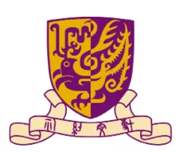
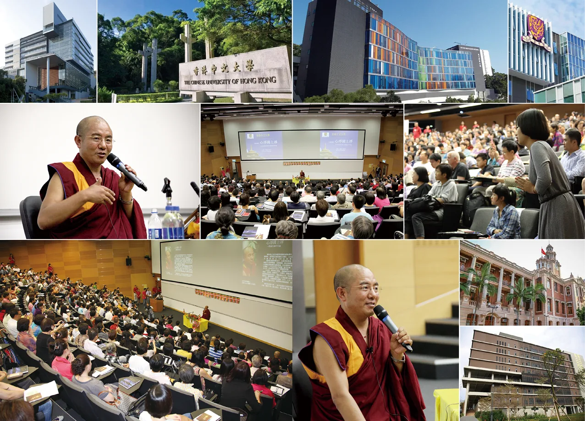
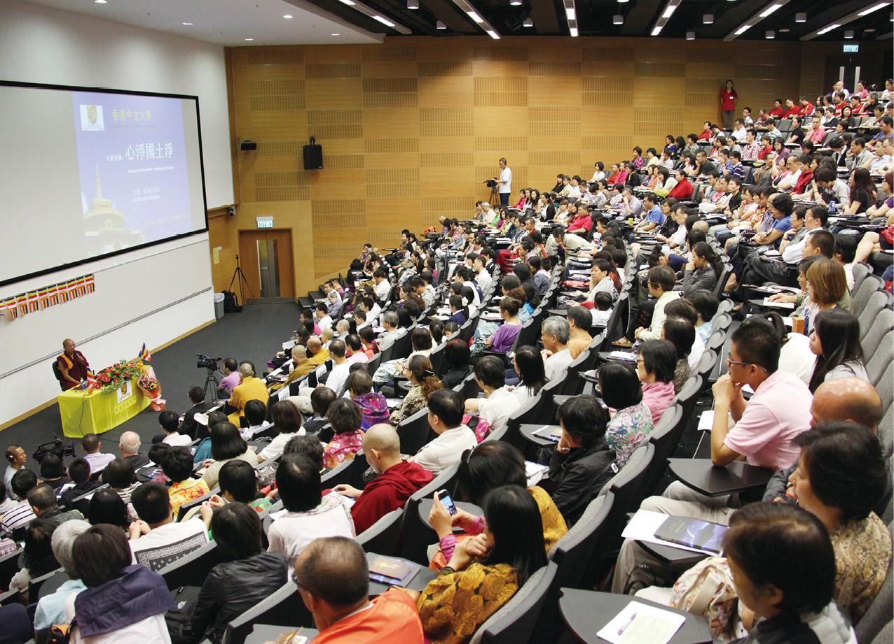

“众生国土，同一法性；

地狱天宫，皆为净土。”

第11场

香港中文大学

Chinese University of Hong Kong

中国·香港

2011 / 7 / 28

## 心净国土净

## Pure Mind, Pure Land

主持人：

请大家起立，热烈欢迎我们尊敬的索达吉堪布，和香港中文大学人间佛教研究中心主任学愚教授——

谢谢大家！请坐。今晚我们的演讲主题“心净国土净”正式开始。首先，有请香港中文大学人间佛教研究中心的学愚教授致辞——

学愚教授：

今天我们有缘聚会于香港中文大学，聆听索达吉大法师的演讲。我们都是慕名而来，这是一个难得的机会，用一句话来讲就是：千载一时，一时千载。

大家应该都知道索达吉大法师的简历，今天的因缘非常殊胜，我们抱着很大的求法欲望而来。在座诸位大善知识，首先请认真聆听大师的讲座，然后对不懂的地方可以询问。佛教中有句话是：“大疑大悟，小疑小悟，不疑不悟。”大师今天来这里传法，就是来解答我们疑惑的。如果你在生活方面、人际关系方面乃至佛法修行方面有困惑，都可以提出来。刚才我们在吃饭时，堪布也说了，不怕问题问得深，有什么问题，堪布都可以回答。

现在，请以热烈的掌声欢迎堪布给我们讲法——

大家好！今天很高兴来到中文大学。我高兴的原因，并不是自己能在这里讲话，而是看到这里的学术气氛很自由、很开放，非常便于大家探寻真理。

今天早上在学术研讨会上[^1]，中文大学文学院的熊院长讲了一句话，我觉得很受启发，她说：“在座这么多大学生来自全国各地，集聚在这里研讨佛法，是来之不易的；你们能有这样一个信仰，也是来之不易的。”确实，在当今社会，有正确的信仰并不容易。尤其在大学校园里，能有这样一个互相交流、互相研讨的机会，引导很多年轻人追求真理，这是相当难得的，对每个人的人生观，也会有不可磨灭的意义。

## 一、略讲“心净国土净”之理

今天我讲的主题是“心净国土净”。这个道理在有些人看来，可能比较浅显，只理解为真善美可以改善外在的环境。但若以大乘佛教尤其是密乘的观点解释，那就相当甚深了。

比如说你们中文大学，后面依山、前面傍海，被誉为全亚洲最美丽的大学校园之一，这是怎么来的呢？是师生们共同的福业所感。假如你们往昔没有积过善因，就不可能现前这样的环境。像最近非洲在闹灾荒，1100多万人面临着饥饿的威胁，从电视中也可以看到，好多人的生活就像饿鬼一样，非常可怜，这也是他们的共业所致。

那么，业力又跟什么有关呢？跟我们的心息息相关。佛陀在《华严经》中说：“众生心净故，得见清净剎。”世间上的万事万物，实际上都是自心的显现。在凡夫人的眼里，这个世界粗糙不堪、凹凸不平；但在一地菩萨看来，由于断除了遍计我执，所见何物皆无不净；到了八地以上，看到的会更为清净。关于这方面的道理，藏传佛教《大幻化网》中有深刻的剖析。若想真正通达，大家必须要花一定的时间。

大概在99年前，藏地有位非常伟大的学者，叫麦彭仁波切，他所造的《大幻化网光明藏论》中，就以显宗和密宗的观点，阐述了“心净国土净”的道理。十多年前，我也给部分知识分子讲过一遍，在讲的过程中我深有体会，感到“心净”真的是“国土净”。这一点，只有将大乘佛法的甚深理论，与实修相结合才会明白。当然，我并不是说自己有什么境界，只是想告诉你们，藏传佛教中确实有许多精髓，值得各位去借鉴、去学习。

昨天，学愚教授也讲了，他以前在日本、在哈佛大学，看到许多专门研究藏传佛教的机构，不少教授、博士长期致力于此，从见解上、修行上探索藏传佛教的奥义。像这次来自英国的斯万教授（Dr. Nick Swann），就对藏传佛教非常感兴趣，他本人是学萨迦派的，对很多道理讲得相当明白。尤其令我吃惊的是，他竟然能用流利的藏语跟我交流。作为一个英国人，对藏语的造诣达到这种程度，是相当不容易的。由此可见，如今很多学者对藏传佛教的研究，已不满足于仅仅只看几本书了。

藏传佛教为什么能吸引这么多人呢？关键在于它的逻辑性非常强，修行次第十分明了，再加上传承上师的窍诀、未经中断的清净传承等，许多方面散发着独特的魅力，被当今学者誉为世界文化的宝库。包括汉地许多大学的教授、研究生、博士生，近年来也都在研究藏传佛教的因明、中观、大圆满等。而且值得庆幸的是，青藏高原因为自然条件所限，无形中起到了保护文化的作用，这也是众生的一种福分，如此给全世界带来的利益无法估量。

或许个别人认为，藏传佛教的教义，只不过是灌顶、开光、洒净、加持、放生这么简单，实际上并非如此。假如你真想了解藏传佛教，就一定要进入藏地的佛学院，或者有规范管理、系统学习的道场，这样才能明白它在教义方面的严密性。

那么，灌顶、加持是不是藏传佛教呢？是它的一种形式，但并不是它的精髓。所谓的佛教，正如伟大的世亲论师在《俱舍论》中所说，唯一就是教法与证法[^2]。不仅藏传佛教是这样，汉传佛教也是如此。

现在许多佛教徒，只执著于佛教的表面形式，尽管自己皈依多年，却并不了解佛教的教义。包括研究佛教的一些知识分子，像这几天参加研讨会的二十多位大学生，有些只知道佛教的几个公案、理论上的一点皮毛，却并没有深入佛教的核心。其实，要想通达佛教的教义，不能只看一些资料就够了，而要像前辈高僧大德那样，通过长期的学习、研究、辩论、实地修持，才能真正获得。

尤其像“心净国土净”这样的道理，大家一定要潜心研究才能通达。它不仅在藏传佛教中反复提及，而且汉传佛教的《维摩诘经·佛国品》中也讲到过：舍利子曾认为释迦牟尼佛的刹土不清净，是个具五浊烦恼的世界。但从东方刹土来的螺髻梵王说：“在我的眼中，释迦牟尼佛的刹土清净无垢，宛如自在天宫。”可是舍利子不相信，说自己所见的，全是泥石瓦砾、丘陵坑坎[^3]。两人争执不下之际，佛陀以脚趾压地，顿时三千大千世界庄严无比、极其清净，呈现出无量的功德。舍利子见后叹为稀有，佛陀告诉他：“我的器情世界本来就是清净的，只不过你没有见到而已。”

汉传佛教的《圆觉经》中，也讲过：“众生国土，同一法性；地狱天宫，皆为净土。”所以，大家若想懂得“心净国土净”的道理，必须要学习《维摩诘经》《圆觉经》这两部经典。同时，最好再研究一下藏传佛教的“大幻化网”，以及大圆满中的“本来清净”。假如你依靠具有法相的善知识引导，然后去观察自己的心，就会慢慢体会到，“心净国土净”并不只是口头上说说，而是确实会有不可思议的清净境界纷然呈现。

## 二、心不净则国土不净

当然，这个法特别甚深，只用一堂课的时间，肯定无法揭示其中深义。因此，我今天主要给大家讲一个要点，那就是：心不清净的话，国土也不清净。

为什么这样说呢？打个比方，一个白色的海螺，正常人看来是白色；但在有胆病者的眼中，它却是黄色；对眼根毁坏的人来说，甚至连黄色也见不到，只能看到漆黑一片。可见，外境的清净与否，与自己的心有极大关系。

当今时代五浊横行，人们内心贪嗔痴充满，所造的恶业简直无法想象，如此势必会感召外境的一系列失衡。就算是再美丽的城市、再怡人的海岛，以后会变成什么样也很难说。美国前副总统戈尔（Albert Arnold Gore, Jr.，1948-），通过多年对全球暖化的研究，曾在一份报告中提醒世人：人类若再这样无节制地破坏大自然，那么用不了几年，许多沿海城市就会被海洋淹没。这种现象的真实原因，他倒没有揭示得很清楚，但古希腊哲学家柏拉图[^4]（Plato, 约公元前427－公元前347），在描述大西洲（亚特兰蒂斯）这个神奇国度的毁灭时，却讲得非常明白。

他在两篇著名的对话著作——《克里齐》（Critias）和《齐麦里》（Timaeus）中，详细记述了大西洲的存在。他说如今的大西洋那里，在一万多年前，有一片美丽富饶、高度发达的陆地，即大西洲。那里气候温和，森林茂密，国家繁荣富强，人民安居乐业，是一块得天独厚的乐土。当地人信仰海神，将其视为至高无上的主宰，时时加以供奉。后来，大西洲的人们开始腐化，邪恶代替了圣洁，贪财爱富、穷奢极欲代替了天生的美德。此举触怒了海神，降下灭顶之灾，在一次特大的地震和洪水中，整个大西洲仅于一日一夜便沉沦海底，消失于滚滚的波涛之中……

对于柏拉图笔下的大西洲，有人认为是天方夜谭，有人却对此深信不疑，只是苦于没有找到确凿的证据。几个世纪以来，众多考古学家试图证明它的存在，但都纷纷无功而返。直至2009年2月，英国媒体对外宣布：英国航空工程师巴姆福德，通过“谷歌海洋”软件查看三维海床地图时，震惊地发现在大西洋海底，竟有一块貌似城市遗址的海床。这一惊人发现，让全世界的考古学家兴奋不已，假如它真是一处城市遗址，那很可能就是传说中沉入海底的大西洲。

当然，我今天讲这个，并不是想说明它的存在，而是想告诉大家，众生造的业若日益严重，那么世界总有一天会趋向灭亡。像古罗马帝国，早期的人们崇尚纯朴、高尚，然而，随着它的经济势力不断强大，世风日坏，崇尚奢华、狂欢纵欲的现象到处可见。最终，道德精神的没落，成了古罗马帝国走向衰亡的起点。

诸如此类的事例，古往今来数不胜数，理应引起人们的反思。倘若再继续这样下去，迟早有一天，我们“明月松间照，清泉石上流”的人间仙境，会变成“千山鸟飞绝，万径人踪灭”的凄凉写照。对此，每个人务必要重视！

## 三、当前人类面临的两大问题

最近召开的学术研讨会，探讨了心灵环保与生态环保，这二者归根结底，其实都与人们行持善法、断除恶业有直接关系。倘若没有从这方面着手，那表面上喊了多少口号，也不一定能起到真实作用。

而若想行持善法、断除恶业，最根本应当注意两件事情。是什么呢？一是大多数人不承认前世后世；二是人们杀生非常严重。这两点是当前亟待解决的主要问题。

### 1．不知道前世后世存在

如今许多人对前世后世茫然无知，这是相当遗憾的。昨天我坐在轮船上，途经香港科技大学时，很多人给我介绍这所大学如何先进。从远处望去，它的建筑就像中文大学一样壮观，但我当时冒出来一个念头：“它里面培养的人才再好，但大多数若不承认前世后世，那还算得上先进吗？”当然，我对科技大学没有任何敌意，只是自然产生的一种分别念。

不仅仅是科技大学，包括我们中文大学，乃至全世界任何一所高校，都是如此。许多大学刚一进校门，见到学生们来来往往、谈笑风生，感觉非常不错。但若深入了解这些人的内心世界，悲悯之心就会油然而生。为什么呢？因为前世后世明明存在，他们却根本不承认，盲目以为人只有短短一世，这种人生观特别肤浅。有了这样的人生观，就不会有正确的价值观。许多人觉得既然自己只能活几十年，那人生的价值就在于享乐，于是绞尽脑汁地追求金钱，认为有了钱就有了幸福，这一点实在大错特错。不管你是什么学者、教授，假如有了这样的人生观、价值观，这是非常令人惋惜的。

按理来讲，人类的智商超过动物，但你若连自己有前世后世都不知道，甚至有些佛教徒也心存怀疑，这辈子只为了衣食而奔波忙碌，那就跟动物没什么差别了。现在很多人之所以做事不择手段，说到底就是因为不相信有来世。假如真的相信这一点，许多恶业自然就不敢造了，就如同明明知道是毒药，自己再渴也不敢喝。为什么呢？因为造了恶业以后，下一辈子肯定要受苦。

如今很多人因为环境、教育的影响，对来世的存在抱有怀疑，甚至根本不信，这一点，希望大家一定要去研究。其实这并不是很深，不像明心见性或证悟远离四边八戏的空性那么难，只要借助于法称论师的因明推理，我们就可以通达它。我曾翻译过藏地一位大德所写的《前世今生论》，里面就讲了很多这方面的道理，将佛教的论证与现代科学结合起来，完全可以建立前世后世的存在。

记得在2009年，美国也播报了一则轮回转世的案例：一个叫詹姆斯的美国小男孩，自称前世是二战海军飞行员，当年死于自己的飞机被日军击中。这个男孩从小只喜欢飞机玩具，对飞机结构有着惊人的了解，而且经常做些坠机噩梦。他能很详细地叙述自己的前世及死亡过程，有个二战老兵也证实了他的描述。后来，他还找到了前世的姐姐——90岁的安妮，二人一见如故，安妮确信他就是弟弟的转世。据说美国好莱坞导演准备将这个故事，拍成一部电影。如果真能拍得很好，相信会有不少人因此而受益，重新考虑来世是否存在。

当然，这种现象在印度、藏地，乃至世界各地，都非常非常多。可大多数人仍置若罔闻，不愿承认真有来世。甚至有些佛教徒，也只是口头上说有轮回、有来世，却从没有为此做过任何准备。因此，我今天再次强调这个问题，希望大家能引起重视。

### 2．杀害动物的现象特别严重

还有一点，刚才也提了，就是现在杀害动物的现象特别可怕。许多人认为，人杀人是不可容忍的，但人杀动物理所当然，甚至个别宗教也赞同这种说法，这是非常颠倒的。

如今21世纪，是人类残杀动物最严重的一个世纪。在各种欲望的推动下、在先进科技的支持下，海里的、空中的、陆地上的动物，都遭到了史无前例的灭顶之灾，长此以往，我们的地球母亲能否承受得了？这是应当考虑的问题。

有人可能认为：“人为什么不能杀动物？它们是低等的生命，本来就该给高等的人类吃掉。”这种想法非常不合理。动物的生命跟我们没有任何区别，我们喜欢活着、逃避死亡，动物也是如此。既然这样，我们有什么权力剥夺它们的生命？在人类历史上，20世纪爆发的第一次世界大战、第二次世界大战，分别使一千多万人、五千多万人离开了人间，这对人类来说，是一场鲜血淋漓的浩劫。而今21世纪，人类虽远离了这样的苦难，但更恐怖的灾难，却降临到了动物头上。

其实，高等与低等之间的不平等待遇，以往在人类身上也发生过。像几个世纪前的黑奴贸易，就根本不把黑奴当人看，他们被当成商品一样买卖，在码头上、在市场上，一天可成交无数笔这样的交易。这种黑奴贸易，延续了长达四百多年。《汤姆叔叔的小屋》（(Uncle Tom's Cabin, 又名《黑奴吁天录》）中，就真实地描写了黑奴在奴隶主残酷压迫下的悲惨命运。此书是19世纪最畅销的小说，畅销量仅次于《圣经》。在它发表的头一年，美国本土便销售了30万册。

那个年代，奴隶主眼中的黑奴，跟现在人们眼中的动物相仿。他们觉得奴隶是低等的人种，可以随便买卖、杀掉。而且在运输黑奴的途中，大量黑奴被塞在拥挤的船舱里，空气污浊，饮食恶劣，传染病猖獗。他们一旦身患重疾，就被立即抛入大海，葬身鱼腹，有时候几百个几百个被扔入海中……这种惨剧从15世纪到19世纪都在上演。直至1890年布鲁塞尔会议上，作出了废除非洲奴隶贸易的决议，黑奴贸易才算正式终止。

所以，在曾经的四百多年里，相当一部分人认为，高等的白人奴役甚至杀掉低等的黑人，可谓天经地义。后来，美国诺贝尔和平奖得主马丁·路德·金（Martin Luther King, Jr., 1929-1968），在《我有一个梦想》（I Have a Dream）中呼吁，白人必须对黑人实现民族平等。之后的南非前总统曼德拉（Nelson Rolihlahla Mandela, 1918-2013），也一直反对种族主义，提倡黑人与白人应享有同等的待遇。

同样，我们对动物也需要如此。在这个地球上，它们也有生存的权力，人类不应为了一己的口腹之欲，让它们付出最宝贵的生命——不过，每次我一提起人类的痛苦，比如汶川发生了地震、玉树发生了地震，很多人就泪流满面、感同身受。而若讲到动物的苦难，尤其是屠场上的惨不忍睹，好多人都没有感觉，表情也是一般般。

前段时间我参加“世界关爱论坛”，组委会提倡将每年的7月17日设立为“世界关爱日”，“7.17”意为亲一亲，这一天，每个人都应亲一亲身边的老人、孩子、亲朋好友。当时我就在会场上呼吁：这一天不但要亲一亲我们身边的人，还应亲一亲我们身边的动物，即使不能长期吃素、放生，这一天也最好尽量做到。但遗憾的是，大家对此反应平平，愿意为动物代言的人，实在寥寥无几。在西方，彼得·辛格（Peter Singer, 1946-）等个别学者，也曾提倡要解放动物[^5]，然而大多数人在行为上，也并没有引起特别重视。

其实，若想拯救地球、拯救人类，我们理应从培养慈悲心开始。倘若没有慈悲心，未来各种灾难定会频频发生。汤恩比博士说：“拯救21世纪人类社会的，只有孔孟之道和大乘佛法。”日本哲学家、思想家池田大作也认为，人的外在生活环境之所以出现危机，其根本原因在于人的心灵出现了问题，是人类人性深处潜藏着无穷无尽的“魔性的欲望”所致。

如今人们的欲望极其可怕，不管是天上飞的、水里游的、地上跑的，只要看到有肉就想吃，真是一种“魔性的欲望”。尤其是住在海边的人，觉得一天不吃海鲜就活不下去，从来没想过自己的快乐，是建立在众生怎样的痛苦之上。这样的人类，到底是进步还是落后？每个人都应当深思。

或许有人听后会提出抗议：“既然动物不能吃，那植物也不能吃，因为它也有生命。”这种说法不正确。佛陀在《涅槃经》中讲过[^6]，杀生的定义是什么？就是毁坏众生的五蕴。植物虽有生长、死亡的现象，在一些刺激下也有各种反应，但它并没有真实的五蕴，跟动物的生命完全不同。动物的生命，跟我们人类一样。我们怕死，动物也怕死；我们遇到生命威胁时，愿意付出一切，来换取存活的机会，动物也是如此。既然这样，我们对动物的生命，为什么不能平等对待呢？

汉传佛教历来提倡吃素，这一点非常符合大乘教义。我本人是学藏传佛教的，但也十分随喜这种传统，它不仅体现了大乘佛教的精髓，而且对如今推迟全球暖化，具有相当重要的意义。美国前副总统戈尔（Al Gore, 1948-）在《难以忽视的真相》（An Inconvenient Truth）中警告世人：对付全球气候变暖，我们只有10年时间。具体该怎么做呢？关键要提倡素食，因为肉食是全球暖化的主因。2007年诺贝尔和平奖得主——联合国跨政府气候变化研究小组（IPCC）[^7]的主席帕乔里博士（Rajendra Pachauri, 1940-），也曾公开呼吁“不吃肉、骑脚踏车、少消费，就可以协助遏止全球暖化”。

听说现在有不少大学生，对吃素很感兴趣，这是非常好的现象，此举对自己健康也很有帮助。常有人认为，不吃肉就会营养不良。其实牦牛吃草，猪也没有吃肉，它们都有足够的营养，为什么我们就不行？而且，假如你吃了动物的肉，它们身上的各种疾病，也会间接传染给你，难道你不害怕吗？

吃素除了可让我们健康外，对环境保护非常有益。曾有一份报告中显示：吃素一天，就等于种了180棵树[^8]。既然这么简单就能保护地球，我们又何乐而不为呢？今晚在场有几百人，如果每个人都吃肉，那好几头猪也不够我们吃一顿。或者按照你们香港的习俗，海里什么动物都要吃，那一顿饭要杀多少个生命？我们的生存，若建立在摧毁其他生命的基础上，那还不如早点死了好——也许我讲得比较过分，但事实上的确如此。假如我为了自己活着，而把你杀掉的话，这是非常不公平的。

有史以来，人类一直在追求世界和平。其实要想达到这个目标，就要明白世界上不仅仅有人类，还有动物。况且按照考古学家的观点，地球上先有动物，后有人类，这样的话，地球就不是人类所独有的，动物也应该有自己的生存空间。因此，人与人之间需要和睦相处，人与动物之间也应当如此。倘若我们肆无忌惮地杀害动物、乱砍滥伐、浪费资源，这个世界有可能和平吗？单单是各国之间不打架，彼此说说好话，这就是真正的和平吗？

## 四、若想实现“心净国土净”，理应从自他做起

因此，希望大家的一些观念，要从根本上改变。否则，再怎么提倡“心净国土净”，实际上也净不了。假如我们的内心都是害心、杀心，佛陀在《阿含经》中也讲了[^9]，这就是外物衰损的因，以此会感召天灾人祸层出不穷，诸多灾难此起彼伏。而且，我们死了以后，去向是哪里呢？就是地狱、饿鬼、旁生，这是谁都不愿意的。人活在这个世上，无非只有几十年，为了这么短暂的一期生命，而造下弥天大罪，给自己带来万劫不复的痛苦，这实在太划不来。

所以，一个人的将来是快乐还是痛苦，完全取决于自己一念间。藏地有句名言是“心善地道善，心恶地道恶”，也就是说，心善的话，前途是光明；心恶的话，前途是黑暗。佛陀在经中也经常说：“万法唯心造。”为什么呢？因为心善就会聚集许多“正能量”，投射的外在世界会非常美好；反之，倘若我们的心很恶，外境就会出现“负能量”，给自己带来无尽的痛苦。

这一点，在日本学者所写的《水知道答案》（Water knows the answers）中，也有很充分的说明[^10]。有些人认为这不可信，实际上并非如此。假如你去深入研究，就会发现心对外境真的会起到很大作用，这个世界美好与否，跟人们的内心有直接关系。对此，东西方的许多哲学家和心理学家都承认，佛教的《大乘起信论》中也说：“三界虚伪，唯心所作。”

因此，要想我们的国土清净，就先要净化我们的心灵。只有心地善良、行持善法，才会让世界变得更美好，阳光更灿烂，花朵更鲜艳。否则，人人都在造恶业的话，绝不可能带来外境的舒适安宁。所以，这个世界需要我们每个人来维护，你也好、我也好、他也好，都肩负着这个使命！

现场互动

问：这个世界很不清净，因为我们有贪欲、无明。但无奈的是，有时不是因为我们的烦恼障，而是因为智慧有限、所知不多——就是所知障的问题，事情就发生了。在这种情况下，怎样才能真正去感悟“心净国土净”呢？

堪布：严格来说，烦恼障在七地末才会断掉；而所知障是从八地开始断除，到十地末才会断尽。这在弥勒菩萨的《宝性论》等诸多论典中，都有详细说明。因此，所知障是一种极细微的障碍[^11]，我们凡夫人什么粗大的障碍都有，还根本提不上所知障。

当今这个世间，正如佛陀早在经中所预言的，越来越末法、越来越恶浊了，人们的见解也越来越低劣，烦恼越来越炽盛，在这样的环境中，确实“心净国土净”很难呈现。但即便如此，万法的本体也是清净的，我们若能用短短几十年精进修行，到了最后，清净的境界就可以完全现前，这从历代大德的身上也能得以印证。

所以，只要遵照佛陀的教诲好好修行，我们的烦恼就会慢慢减轻，这个世界从自现的角度来讲，也会变得越来越美好。

问：我是香港中文大学通讯工程系的。请问，传统的生命分类是动物、植物、微生物，那微生物中的细菌和病毒是不是有情呢？如果是，我们吃药、消毒是不是也成了杀生？应该怎么样对待和处理？

堪布：传统认为植物也有生命，但我刚才讲了，植物并没有五蕴所组成的生命。现在很多人、甚至一些法师也声称，植物不能吃，它的生命与动物一模一样。若是这样承许，佛陀在《楞严经》中说了，这是外道的说法[^12]。

至于肉眼看不到的细菌、微生物，我们若是损害它，有没有过失呢？没有过失。往昔，佛陀的弟子阿那律在喝水时，用阿罗汉的天眼看到水中全是众生，于是他就不敢喝了。佛陀告诉他：不应以天眼观察，而应以肉眼为准[^13]。所以，微生物并不是我们肉眼的对境，损害它不会构成杀生的罪业。

对于这样甚深的因果道理，我们不能凭自己的想象去判断，而应以佛经的依据进行取舍，这才是智者的选择。

问：我是香港中文大学哲学系的学生。我们现在身处的娑婆世界，是释迦牟尼的清净刹土，可在我眼中却是满目瓦砾。如果我通过今生的积累功德和修行，带业往生到西方极乐世界，因为我的我执并没有完全断除，到时是否依旧会满目瓦砾呢？

堪布：不会的。今年我传讲了净土宗的一些经典，前不久刚讲完《阿弥陀经》，如今正在讲《无量寿经》，用的版本是菩提流志翻译的《大宝积经·无量寿如来会》。

经中就讲了，娑婆世界的众生可以带业往生，到了极乐世界之后，依靠阿弥陀佛的愿力和自己的信心力、发愿力，黄金为地、七宝为池等种种清净现象，会顿时呈现。听了极乐世界的法音之后，有些人当下就证得一地菩萨的果位，有些则需要一段时间。但不管怎么样，只要到了那里，就会断除我执，成就不退转的果位。

问：佛陀第三转法轮讲了明空无别，“明”到底是怎样的境界？既然是明空无别，为何又要一名以“空”、一名以“明”？

堪布：明空无别的境界，是指在究竟胜义中，明即是空、空即是明，相当于《心经》所讲的“色不异空，空不异色”。

但“色不异空，空不异色”，只侧重于佛陀第二转法轮的教义，并没有深入剖析“明”的部分。直到第三转法轮，尤其是密宗《时轮金刚》中，才揭示了“色”其实是光明的显现，在真实的境界中，明与空是无二无别的。但这种明分，我们用语言无法表达，用分别念无法想象，是一种不可思议的境界，文字上只能这样来描述。

问：我是中文大学经济系的硕士。刚才您提到了环境保护，我也很关注环保。所以，我想请教您一个问题：佛教中对环境保护持什么态度？

堪布：你的问题很好！环境保护在当前非常重要，今天有位中文大学的老师说：假如释迦牟尼佛还在世的话，他也会站出来关心这个问题的。

如今不少人非常关心环保，我个人来讲，对保护环境、保护生命，一直就有兴趣。作为佛教徒，在这方面也应当略尽绵力，真正做一些事情。

有些人可能认为，佛经中并没有强调环境保护。这是不正确的。早在2500多年前，佛陀就意识到了环保的重要性，因此在一些出家戒律中规定：不得染污净水净地，不可挖地割草，有条件的情况下适当种树，等等。这在佛陀对小乘行人开示的《毗奈耶经》中，就有很明确的说明。所以，佛陀不但要求我们保护动物，而且还提倡保护环境。

自古以来，佛教与大自然就有密不可分的关系。比如，佛教很多寺院都建于幽静的青山绿水间，令人一进去就感到特别清净、放松，一颗疲惫不堪的心能得以休息。还有，从释迦牟尼佛的一生来看：他降生于蓝毗尼园的无忧树下，六年苦行于尼连禅河畔的树下，成道于金刚座的菩提树下，初转法轮于鹿野苑的林中，涅槃于娑罗双树下。所以，佛陀从最初降生到最后涅槃，全部都与大自然有关。正因为这样的缘起，印度、藏地、汉地的历代高僧大德，大多都在特别寂静的森林中、山洞里，获得了无上成就。

因此，佛教中重视环境保护，应该有很多的依据。

问：有些人之所以造了很多业，关键是不知自己有前世后世，所以你劝他不要造业，他根本不听。就好像一个糖尿病人，告诉他不要吃糖、不要吃香蕉，可他就是不接受。其实不管对亲人还是陌生人，我都真的很想帮他，但有时反而会引起对方的不愉快或苦恼。这个时候，我不知道是该坚持，还是“再，斯可矣”，也就是说，我跟他讲第二遍就够了，接不接受是他的事？

堪布：从你的表情来看，确实承认有前世后世，而且很关心周围的人，想用佛法去饶益他们。

可现在大多数的汉族人，跟我们藏族人不同，你们身边的亲朋好友几乎都不信佛，劝他们相信因果，真的非常费力。而我们藏族，尽管如今个别年轻人被西化了、被汉化了，但99﹪的人仍然信因果，家里有一个出家人的话，也觉得十分光荣。

但即便如此，你在看到别人造恶业时，也不能劝了两次没用就不管他了。释迦牟尼佛在因地时，曾有一世为了调化一个人，就用了千百万年的时间。一个人，用了千百万年啊！当时人的寿命也特别长，不像现在只有一百岁左右。所以，我们为了利益众生，一定要不断努力，若能如此，总有一天他会被你感化的。

包括在我们佛学院，有些人刚开始也不信佛，他的孩子读了大学后去学院出家，他特别特别反对。但后来他的孩子再三跟他讲道理，两三年以后，他自己也跑去出家了。这样的事例非常多。

有一个人，就蛮有意思的。最初她孩子在学院出家，她拿着刀子追去威胁：“你今天敢出家的话，要么我杀了你，要么我自杀。”当时我们很多人一直劝她，她才不甘愿地放下刀子，勉勉强强回去了。结果过了五年后，她竟然也来学院出家了。现在，她和她的孩子都是非常清净的出家人。

所以，有些人的见解和行为，其实是可以改变的，只不过需要一定时间，故我们不能轻言放弃。

问：我是香港中文大学经济系的学生。在当今商业经济当道的社会中，您如何看待环保与消费之间的对立矛盾？

堪布：这个问题，其实我也思考过。现在这个社会，生活节奏越来越快，工作压力越来越大，与此同时，人们的消费也越来越高。在这种情况下，消费与环保之间，有时候是对立的。

不过，我们佛教提倡一种生活观：不能特别奢侈、挥金如土；也不能极度拮据、衣食无着，若像乞丐一样，也会寸步难行。而应当保证基本的生活条件，在此基础上知足少欲，不要纵容自己的欲望，也不要为了竞争而活着。

如今大多数人，购置大量东西并不是因为需要，而是源于竞争。看到他人的房子不错，自己就非要买一个；瞧见别人的轿车很好，自己也要买辆好轿车。否则，就觉得在别人面前抬不起头来。这样的人活得很累，所以，我们应该随遇而安，根据自己的福分来维持生活，如此才会活得比较开心，自己的消费与环保之间，也不会有很大冲突。

此外，我们平时还要有环保的概念，电水应该节约，不要随便浪费。我以前去新加坡时，他们在这方面就做得很好。但最近在香港，我看到晚上所有高楼的灯几乎都亮着，两三点钟也是如此。其实，这时候很多人都睡了，这些电白白地浪费掉，好像有点可惜。当然，也许是有人要上“夜班”。但很多问题值得我们思考。

问：我是香港理工大学电子系的。我和另外一位居士在色达见过您，一直很关心您，请问您现在身体好不好？

堪布：好好好，身体蛮好的，没事。

问：我之前问过您一个问题，您的答案是帮助这个世界。我希望也能像上师一样帮助这个世界，不过不知道该怎么做。比如我是学电子的，不知道钻研科技是否有帮助。如果有，科技带来的有利也有弊；如果没有，那怎么做才能对这个世界有益？

堪布：要想帮助这个世界，是钻研电子还是其他科技，这些都是次要的，自己的心才是主要的。

如果你心里有因果观念、帮助众生的愿望，那无论是在家、出家，随时都可以通过各种途径，去行持利他之举。但若自私自利的心特别强，希望每个人都围着自己转，一直想方设法宣扬自我，那即便是披着袈裟的出家人，也只是一种形象而已，根本利益不了什么众生。

你以后的路该怎么走，我并不清楚。但一个人无论生活在世界哪个角落，最有意义、最有价值的，就是要有一颗利他心。倘若时时刻刻将利他放在首位，自己的前途自然会光明。否则，每天只想着自我的话，久而久之，社会对你也不会认可的。

问：我是香港城市大学会计系的毕业生。我是佛教徒，但回答不了身边朋友的问题。朋友曾问：“佛教徒用很多时间作经忏，认为念经可以帮助别人，但为什么不将时间实际用于帮助别人？念经究竟如何帮人，只是口头念念就有功效吗？”我该如何回答呢？

堪布：你虽然学了佛，但我觉得还要继续深入佛法，这样的话，对非佛教徒的问题才可以回答，这是我的一个建议。

你那个提问题的朋友，对佛教不一定很了解。其实，佛教中并没有说，念经后什么事情百分之百都能解决。就像现在的一些中医，并不敢说自己的药能包治百病，但我们不能因此就认为：“你既然不能包治百病，那干嘛还要当中医？不如亲自去帮助众生。”要知道，每个众生的病是不同的，对于有些疾病，中医是可以治的。同样，佛教徒用很多时间念经，也可以从某个角度帮助到众生。

这一点，我自己就深有体会。比如，我平时生病了，或者出现违缘了，就赶紧交钱请僧众念经。也许不信佛的人认为这是迷信，但我却对此深信不疑，因为念了经以后，很多事情马上就有好转了。如同药本身有治病的功效一样，念经的话，依靠诸佛菩萨的加持力，与自己清净的发心力，自然也会产生一种不可思议的作用。当然，念经为什么有这种力量？必须要深入经藏才能彻底明白。

问：我信仰佛教，觉得爱情是无常的，对恋爱也没有太大兴趣，那我要不要为了结婚而结婚？婚姻的基础一定是爱情吗？

堪布：要不要结婚，最好由你自己决定，我作为一个出家人，来决定可能不太合适。（众笑）

但婚姻也好、爱情也好，刚开始是会有一种感觉，大多数年轻人也非常向往，觉得这是通往幸福的阶梯。但从我们佛教的眼光来看，一旦你结婚以后，自由的钥匙就交给对方了，从此之后，你就被困在无自由的空间里了……

当然，世间人也有另一种解释方法。这种解释方法，尤其是一些老年人都有经验，可以让他们来回答。

问：我在上海社会科学院宗教研究所工作，如今在香港中文大学崇基学院访学，从事近代藏传佛教的传播研究。能否请您简要介绍一下现在汉藏佛教的交流情况？

堪布：从20世纪20年代开始，汉地就有很多高僧、学者远赴藏地求法，在一些寺院里钻研藏传佛教。随后的90年代，藏地也有不少大德来汉地交流。我第一次随法王来香港是1990年，后来1993年去美国时也途经香港，当时住在白玉中心。那个时候，香港比大陆开放很多，经常接待来自尼泊尔、印度的藏地大德，此处也建立了很多道场，大家都在互相学习，让人看了非常随喜。后来，汉地的宗教政策恢复后，藏地也有许多出家人，去北京高级佛学院进修，甚至在北京大学等高校读书，彼此间在佛教方面的交流日益密切。

如今随着科技越来越发达，人与人的距离越来越近了，佛教各大教派之间，也有了很好的条件互通有无、取长补短。像这次中文大学举办的学术研讨会，就涉及南传佛教、藏传佛教、汉传佛教，而且其他文化体系的人也共襄盛举。那么，以后有机会的话，我们还欢迎基督教、天主教、道教等其他宗教人士，也都能前来参加。

我自己虽然是学藏传佛教的，但对佛教的其他宗派都很尊敬，对其他的宗教和传统文化，也非常有兴趣。毕竟人类不同的文化，就有不同的价值，所以，这次看到中文大学以非常包容、开放的心态，传播世界文化，真的感到由衷欢喜。

关于汉藏佛教之间的交流，我的上师——法王如意宝晋美彭措就很有远见。他老人家在1987年，首次提出去汉地五台山。当时藏地大德来汉地的，应该说根本没有，不像现在这么多，现在有些是好的高僧大德，有些则打着藏传佛教的旗号，行为不太如法。以前我去台湾时，就听说有“好仁波切”“坏仁波切”之分，如今汉地的城市里，也开始有了这种说法。不过，这种现象不仅在藏传佛教中有，汉传佛教中也有；不仅在佛教团体中有，包括基督教等其他宗教，以及世间的政府机构中也有。所以，只要有人类的地方，好人、坏人都会存在。

当年法王去了五台山之后，就有许多汉地佛教徒纷纷前往藏地求法，参访我们五明佛学院为主的各大道场，两地学者之间，也开始有了互相交流、学习的机会。其实这是非常有必要的，不管是哪个宗派的人，若能以开放的心态博采众长，对自他都会有很大的利益。否则，只认为自己的最好，一味地闭门造车、排斥他宗，那自宗也不会有什么发展前途。

在我们藏传佛教中，对显密各大教派都非常欢迎。这次中文大学的研讨会，以及星云大师的“人间佛教”理念，也无不体现了这一点，这都是十分值得赞叹的！

问：我是北京大学哲学系的博士生。您讲显宗、密宗对“心净国土净”的理解，有极为甚深的含义，可否请您简要地开示？

堪布：若想“简要地开示”，我刚才在第一段中已经讲了。但要再次补充的话，关于“心净国土净”，藏传佛教有一部论典叫《定解宝灯论》，里面就通过比喻进行了阐述。比如同一杯水，在业感不同的六道众生看来，显现也会各不相同：地狱众生看到的是铁水，饿鬼看到的是脓血，旁生和人类看到的是能止渴的水，天人或持明者看到的是甘露，八地菩萨以上看到的是非常清净的一种光明，而佛陀看到的则是远离一切戏论的大光明。

究竟而言，这杯水的本体是清净的，但因为众生心的清净程度各有不同，所见也有清净、不清净的差别。不过，从接近实相的角度来说，上者所见为正量，下者所见为非量。比如，地狱众生业障最重，所以看到的就是铁水；而饿鬼的业障稍轻一些，故看到的是脓血。二者相较之下，饿鬼看到的是正量，地狱众生看到的就是非量。这样一层一层往上推，佛陀所看到的，则是最清净、最真实的正量。

不但对一杯水可有不同的认识，我们对这个世界的认识也是如此。就拿香港来说，一个修证不好的凡夫人，正处于嗔心大发时，会觉得这里的治安非常乱，看什么都不顺眼；而若是心地特别清净的人，看香港就是一片净土，完全没有娑婆世界的任何烦恼。

所以，外境的清净与否，与自己的内心有很大关系，这是将显、密理论结合后所得出的结论。尤其是密宗方面，有大圆满的独到见解，有了这个见解的话，不需要太多语言，通过自心对外境的认知，就能觉察到它的本体到底如何。

问：可否请您用佛学来解答一下生命的起源？

堪布：以前学过达尔文“进化论”的人，会觉得生命是突然冒出来的，就像草地里突然长出蘑菇一样，而人最后死时，犹如火灭了、水干了一样，什么都没有了。这种观念，对我们的生存意义和价值观有很大损害。据基督教的有些人说，达尔文在晚年也意识到了自己的错误，并撰文表示了忏悔。

在我们佛教中，按照十二缘起的观点，生命应起源于无始以来。从久远开始，众生就漂泊在轮回中了，所以生命的流转没有起点。而当你想终结这种轮回时，可以通过修行获得成就，最终犹如种子被烧焦了不会再发芽一样，这种生命会转化成一种智慧，这在《成唯识论》中称为“清净转依”。

问：我是台湾大学法律系的毕业生。倘若我暂时不能去学院追随您出家，在台湾台北这样的大城市里，又找不到藏传佛教的大僧团可以依止共住。就算是一些藏传师父，自己也住在公寓大厦里，跟世俗人相处很密切，环境没有那么清净。这样的话，我要如何护持别解脱戒？如果违犯了别解脱戒，没有僧团可以作羯磨来忏悔，那犯了戒要怎么忏悔呢？

堪布：你想出家的话，一定要再三考虑。毕竟出家是“终身大事”，不能凭一时冲动，而要长期地观察、抉择。在大城市里，其实以居士身份也可以受别解脱戒，像三皈五戒等，这都是菩提心的基础，也是佛教四众弟子的一类。

当然，想出家也非常好，历史上有很多了不起的高僧大德，都示现为出家身份。据我了解，现在台湾也有许多藏传佛教的法师，像图登诺布仁波切等，在佛教方面跟大家交流得非常好。

作为一个大学生，能生起这样的出离心，我身为出家人非常随喜。我以前也是刚从学校里毕业，自己想来想去，觉得在世间娶妻生子，过这样一种生活没有多大意义，然后就跑去出家了。

当然，一些知识分子想出家的话，我每次都会劝他们要深思熟虑。一旦真的考虑清楚了，以后就最好不要改来改去。

问：对于被杀的动物，我每天如果记得，都会给它们回向，希望其再投生时也能吃素。请问，这种回向有意义吗？还有，回向给它们往生净土好呢，还是让它们投生为人，生在有佛法的地方好呢？

堪布：回向的方法有多种，但最好能像《普贤行愿品》《入菩萨行论·回向品》等回向文中所念的一样，而不是自己非要让它吃素，让它必须什么什么……不然，万一它哪天实在没办法吃素，又吃肉了，你可能会很伤心。（众笑）

其实，如果回向让它“离苦得乐”，范围会比较广，《普贤行愿品》的内容皆可涵摄于此。至于它以后会获得什么样的快乐、什么样的果位，则应该随缘而去，这样可能好一点。

问：我是来自深圳的居士，在广东粤北的一个城市工作。当地的山很多，我希望能在那里多挂些经旗，要怎么样挂才如法呢？

堪布：挂经旗，很多人也许并不了解它的意义。在我们藏传佛教中，挂经旗对亡者非常有利，比如有人因车祸而横死，若能在出事地点挂经旗的话，亡灵就不会在那里再再感受痛苦。因为一般来讲，人横死之后，还要在死亡的地方，五百次反复感受死时的痛苦。但这里如果挂了经旗，亡灵就可以避免此种恐惧和苦难。还有，家人若想为亡者做些善事，那么挂经旗也很有功德。

另外，对生者来讲，若想消除自己诸事不顺、身心不健康等，挂经旗也会起到很大的作用。

当然，具体挂的地方，要视自己的情况而定。但不管挂在哪里，都应选择比较清净的地方，不容易被人践踏，也不影响环境美观。在我们藏地，挂经旗在神山随处可见，而在汉地，可能就比较困难了。你好不容易挂上了，别人又把它扯下来，统统扔进垃圾桶，很有这个可能性。因此，对这个问题需要再三考虑。

主持人：

这里有一位国外的听众，他给上师写了一句话：Thank you for the inspiration. 就是感谢您给他带来的灵感。让我们再次以热烈的掌声，感谢上师给大家的开示！

现在进入最后一个环节：有请香港中文大学的学愚教授总结，并赠予索达吉堪布纪念品——

学愚教授：

不知不觉两个多小时已经过去了，我想我没什么可总结的，只是谈谈自己的体会。在这两个多小时里，我们真实体会到了“心净国土净”。为什么这么说呢？堪布在给我们讲法，我们的心在聆听，我们的心都净下来了，那这个地方就是清净的国土，清净的国土就在这儿。然后把它扩展至我们的家庭、社会、国家，乃至整个世界，那这个世界就是一个和谐的世界，这个世界就是一个清净的世界。

所以，今天我们很高兴，非常的法喜充满，也感谢堪布给我们带来这种清净的世界、清净的心灵。好，再一次感谢堪布！

主持人：

今天晚上的演讲到此结束！相信大家听了索达吉堪布的演讲，都会收获良多。如果大家对堪布传授的佛学课程有兴趣，可以去香港国际菩提学会咨询。大家手上的简介，都有它的联络方式。谢谢大家！

[^1]: 堪布此次应邀参加第六届青年佛教学者学术研讨会，主题是“佛教的生态环保和心灵环保”，由香港大学、佛光大学主办，北大、南大、南开、武大、香港中文大学等多所高校的佛教学者发表论文，并邀请国内外各大高校的知名人士作为评委，其内容涉及汉传、藏传、南传三大佛教体系。堪布是负责藏传佛教内容的主要评委。
[^2]: 《俱舍论》云 ：“佛之妙法有二种，教法证法之体性。持教法者唯讲经，持证法者唯修行。”
[^3]: 《维摩诘经》云：“尔时，螺髻梵王语舍利弗：‘勿作是念，谓此佛土以为不净，所以者何？我见释迦牟尼佛土清净，譬如自在天宫。’舍利弗言：‘我见此土丘陵坑坎，荆棘沙砾，土石诸山，秽恶充满。’螺髻梵王言：‘仁者心有高下，不依佛慧，故见此土为不净耳！舍利弗！菩萨于一切众生，悉皆平等，深心清净，依佛智慧，则能见此佛土清净。’”
[^4]: 柏拉图：古希腊哲学家，也是全部西方哲学乃至整个西方文化最伟大的哲学家和思想家之一。他和老师苏格拉底、学生亚里士多德三人，并称为“古希腊三大哲学家”。
[^5]: 彼得·辛格：澳大利亚和美国著名伦理学家，曾任国际伦理学学会主席，是世界动物保护运动的倡导者，其代表作是《动物解放》一书。
[^6]: 《涅槃经》云：“众生佛性住五阴中，若坏五阴名曰杀生。”
[^7]: 2007年度诺贝尔和平奖，授予美国前副总统戈尔与联合国政府间气候变化专家小组（IPCC）。
[^8]: 每吃素一天，每人就可减排二氧化碳4.1千克，相当于180棵树一天吸收的二氧化碳量。
[^9]: 《增一阿含经》云：“世尊告诸比丘：由十恶之本，外物衰耗，何况内法？”
[^10]: 书中通过实验的方式说明，“善良、感谢、神圣”等美好讯息，会让水结晶成美丽的图形；而“怨恨、痛苦、焦躁”等不良讯息，会出现离散丑陋的形状。水能受到心念的影响，而产生不同的结晶，善的结晶美丽，恶的结晶则丑陋。
[^11]: 《宝性论》云：“三轮虚妄分别心，承许彼为所知障；悭等虚妄分别心，承许彼为烦恼障。”
[^12]: 《楞严经》云：“十方草木，皆称有情，与人无异。草木为人，人死还成十方草树……是人则堕知无知执，婆咤霰尼执一切觉成其伴侣，迷佛菩提，亡失知见。是名第四计圆知心，成虚谬果，违远圆通，背涅槃城，生倒知种。”
[^13]: 《根本说一切有部百一羯磨》云：“阿瑜率满阿尼卢陀以天眼观水，遂便分明，于其水内覩见中有无量众生。世尊告曰：不应以天眼观水。”
