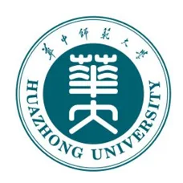
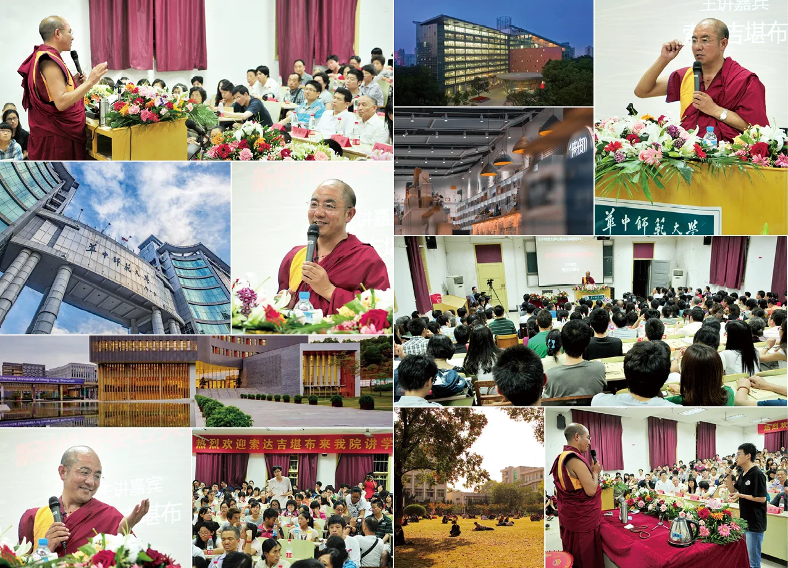

“教育，

就是当一个人把在学校所学全部忘光之后

剩下的东西。”

——爱因斯坦

第8场

华中师范大学

Central China Normal University

中国·武汉

2011 / 6 / 10

## 新时代需要心灵的教育

## The Modern Necessity: Education of the Heart

主持人：

我代表华中师范大学政法学院研究生会，向索达吉堪布此次来我院举办讲座，表达诚挚的谢意以及热烈的欢迎。

本会的主要领导和嘉宾有：华中师范大学政法学院心灵与认知研究中心的创始人高新民教授、刘亚琴女士，华中科技大学哲学院院长张廷国，华中科技大学哲学院书记唐琳。同时，也感谢华中科技大学、武汉纺织大学、湖北美术学院各位领导、老师的莅临参与。

在这里，请允许我向大家简单介绍一下索达吉堪布：

索达吉堪布，四川甘孜炉霍人，生于1962年，曾就读于甘孜师范学院。他于1985年前往色达喇荣五明佛学院，依止法王如意宝晋美彭措为根本上师，后成为喇荣五明佛学院汉僧部的主管大堪布，在国内外享有极高的知名度。先后随晋美彭措法王前往国外弘法，并被推任为美国纽约喇荣显密中心导师，兼任上海慈慧公益基金会的名誉董事长。

上师所从事的慈善事业，有智悲慈善基金及智悲小学等。上师所在的炉霍，是个群山环绕、地处高寒的地区。那里的孩子了解外面世界的窗口，只有学校，但捉襟见肘的教育资源，以及贫困的家境，使很多孩子过早地离开了校园。正是基于这种现状，上师立志于慈善，他曾说：“年少时求学的艰难，以及之后的人生经历，让我由衷地感觉到，当尽绵薄之力，从家乡做起，使更多的孩子重回校园，改变藏区的落后状态。”

堪布还说：“悠悠寸草，虽没有苍松翠柏的高大挺拔，但只要根植于大地，只要还在接受阳光雨露的哺育，就一定会将春意散播开去。”这就是上师从事慈善事业的根源所在。

下面，请热烈欢迎上师为大家开始讲座——

尊敬的诸位教授、老师，还有同学们：

晚上好！很高兴跟各位一起交流。我今天所交流的内容，是“新时代需要心灵的教育”。关于这方面，我所讲的，主要涉及佛教的一些调心方法，同时也想将自己对社会、对人生的少许感悟，在此与大家做个分享。

站在这个讲台上，我也谈不上有什么深奥的知识，只不过特别愿意跟你们交流。当今时代，很多人在学校里虽然学了各种知识，但有些到了社会却用不上，为什么呢？就是因为我们对人生没有正确的认知。活在这个世间上，人生态度非常重要，所以，你们作为大学生，在学校里应该学些这方面的知识，它对一个人来讲，价值远远超过金钱财富。而作为老师，对学生也不能只是灌输知识，更重要的是要教他们怎么样面对生活、面对人生、面对社会，怎么样为人处世、待人接物。这些问题非常重要。

## 一、正确认识佛教的作用

在座的知识分子，有些可能信仰佛教，有些也不一定信。当然，信不信仰完全是你的自由，我一直都这样提倡。但作为有智慧的人，对佛教最好还是有点研究。

佛学是非常深奥、非常广大的知识，这种知识对每个人来讲，有百利而无一害。你若真的了解了，对自己的工作和前途，我相信百分之百有利，绝对不会因为学了佛以后，产生很大的危害。

我本人从小就信仰佛教，将自己的青春也都用于修学佛法方面了，在这个过程中，越深入研究佛教，越觉得它确实非常好。这种好，并非因为自己是佛教徒、出家人，就以贪执自方的心自卖自夸，而是站在非常公正的立场上，客观评价学佛到底对我们有没有利益。

其实，佛教并不像个别人想的那样神秘，一接触它，要么就到深山老林里出家，要么看破一切舍弃红尘，绝对不是这样的。佛教针对每个人的不同根基，要求也是各不相同，就像世间的教育，从小学到博士后之间有不同层次，不可能对人人都一概而论。但不管你是什么样的人，了解佛教的智慧都必不可少，倘若你能掌握它，生活中肯定获益良多。

如今，不少人在面对痛苦时，内心特别脆弱，就算你再有钱、再有地位、再有才华，可在种种痛苦面前也不堪一击。不仅仅是他们，纵然是历史上的文学巨匠、历史学家，一旦面临生老病死之苦，也仍然一筹莫展、束手无策，甚至选择自杀来逃避。在这种情况下，学习佛法其实是最好的解决之道。

我这样说，并不是劝你们都学佛，好让佛教的队伍庞大起来，我个人可得到什么利益。而是确实认为，如果你能懂一些佛教道理，便会明白很多事物的真相，这样一来，即使遇到挫折，也不会那么忧愁、伤心、焦虑了。

就拿佛教中的“无常”来说，现在许多人根本不考虑死亡，不考虑地位、财富、身体都会无常，一直想得特别圆满美好，却不知它是有变化的。而佛教中，用“高际必堕”“刹那无常”等特别简单的词语，就将人生剖析得极为透彻。然而，不明白这个道理的人，为了自己所谓的前程，耗尽人生几十年的时间，倘若出现一点点违缘，产生的痛苦就无法想象。

因此，作为高等学校的老师，在引导学生求知的同时，不能忽略心灵的教育。华师大这边有“心灵与认知研究中心”，我听说之后很高兴，觉得老师对学生们是负责任的。如今的教育不能没有这一块，否则，读大学若只为了以后多赚钱，那么没有福报的人，努力了一辈子也不一定能如愿；有些人即使如愿以偿，人生也不一定真正快乐。所以，我们的教育不能天天围着金钱转，否则，是非常不明智的。

## 二、当前教育存在的问题

记得2006年央视的《对话》节目中，邀请了中美两国的顶尖高中生，做过一次价值取向的考察。当时，主持人给出智慧、权力、真理、金钱、美这五个选项，美国学生一致选择了真理和智慧，他们解释说：“如果拥有智慧、掌握了真理，相应我就会拥有财富和其他东西。”而中国高中生，除了一个人选择美以外，没有一个选择真理和智慧，有的选择了财富，有的选择了权力。

我对这个结果，印象还是很深的。当然，我也不是说美国所有的都好，中国所有的都不好，凡事应当一分为二来看待。但如今中国学生道德退失的现象，说实话，的确非常严重。假如大量人才的生活取向和价值观，都建立在金钱和物质上，建立在外在的发展上，从来也不注重内心的道德，那他们的未来令人担忧。

我刚才进来时，看见校园里有块大石头，上面刻着“求实创新、立德树人”，心里自然而然产生一种敬佩。不过，它也许只是放在那里而已，学校对道德有没有真正重视呢？我也不清楚，毕竟我第一次跟大家接触。假如你们对道德真的非常重视，那么将来培养的学生，绝对会对社会有利，对他们自己也有利。

现在的这个社会，大多数人盲目地追求金钱，致使很多大学生毕业之后，始终觉得生活压力非常大，而且没有安全感，活在世上似乎没有意义，甚至有人选择了一些不明智的行为。不仅大学生如此，包括一些小学生，也都觉得压力大。前几天，我跟浙江大学的一位老师交谈时，她说自己的孩子因为老师逼，家长也逼，各种压力都堆在他的身上，他实在受不了，就在作业本上写下“地狱”两个字，以示抗议。

其实，如今的物质条件跟以前相比，已经有了大大改善，饮食住处对一般人而言也不成问题，但为什么这么多人没有感到满足，仍然觉得压力大呢？就是因为他们的心灵很迷惑，一味地跟着潮流跑，没有得到正确的引导。他们在学校里，从小就只重视分数，没有树立正确的价值观，以至于很容易就被浮躁的现实同化了。

这一点是相当遗憾的。本来在汉地，虽不像我们藏地一样全民信佛，藏传佛教一千多年来已融入藏民族的方方面面，与生活习俗、文化传统等水乳交融，但汉地的儒教思想，对人们内心、行为的约束，还是相当不错的。然而可惜的是，因为种种历史原因，现在已经变成这样了。

## 三、老师身上肩负的责任

在汉地古代，老师的神圣职责是“传道、授业、解惑”，即要传道德、授知识、解除学生的疑惑。但如今很多老师的任务，只是“授业”，从小学到大学，就是给学生讲课本知识，但这些知识在生活中如何运用呢？对此老师并没有提，也没有深入细致地去剖析。若是这样，学生一旦步入社会，就会没有任何经验，毕竟社会跟学校完全不同，学校里十分单纯、舒适，而社会上尔虞我诈的现象相当多。所以，有些学生遇到点滴的磨难，就觉得苦不堪言，最后变得极其脆弱、冷漠，这对自他都不利。

我认识一个北京中医大学的人，她离开校园很多年了，但仍特别感激自己的大学老师。她以前在读大学时，有个老师是教高等数学的，但在九十分钟的一节课中，他经常用六七十分钟，为学生讲述自己对人生的解析，对各种社会问题如何看待，让大家明白怎么样面对社会，怎么样面对生活。虽然他讲的内容大多与教学无关，有些同学也不太理解，但他们到了社会上以后，才发现这位老师对自己的影响非常大，从他身上所学到的，自己一辈子都难以忘怀。

学生一旦进入了社会，对很多老师的印象就会日趋淡漠，但个别老师确实永远也忘不了。当然，忘不了的情况有两种：一种是印象好的，一种是印象不好的，比如老师天天打人、骂人，一直喝酒抽烟。前不久，我去了一所偏僻的学校，在教室门口，结果看到老师在喝啤酒，里面的学生打架哭闹，对此他根本不理不睬，在那儿迷迷糊糊的……

我读小学时，也遇到过一位这样的老师，至今他的形象也时常浮现在我眼前。他特别喜欢喝酒，每次只要喝了酒，一进教室就拿大棍棒打全班的人。所以，我们整天心惊胆战、如临大敌，一听说老师喝酒了，一个个都特别害怕，因为等一会儿不需要犯什么错，他也会打我们的。如今二三十年过去了，我有时候见到他、想起他，心里还是有种不同的滋味。这种老师，在很多学生的一生中，留下了永远也无法愈合的伤痕。

而有些老师，却让学生在有生之年，乃至生生世世万分感激。因为通过他的苦口婆心，通过他的言行举止，让学生们的人生态度，有了非常大的变化。这样的老师，在佛教中，就称为“善知识”。

藏地非常伟大的学者岗波巴大师，曾告诉我们，好老师的条件归纳起来有三点：第一，少贪欲，不会整天为了名利地位，不替学生着想，只考虑自己的利益；第二，具有智慧，老师若没有深邃、敏锐的智慧，根本不可能教导学生；第三，有关爱心，老师时时处处要关心学生，毕竟自己是过来人，熟知社会上的各种问题，故应该对学生循循善诱，告诉他们以后该如何工作、如何生活，这个过程中，最需要的是什么？最关键的是什么？……在灌输智慧的同时，理应给学生教些特别有用的知识，让他们明白方方面面的道理。

## 四、怎么样展开心灵教育

在座的师生，都是从事教育工作的。学校里安排的各种教育，固然相当重要，但更关键的是应该让学生接受心灵教育。若能如此，他以后面对社会问题、感情问题等时，即使遇到一些挫折坎坷，也有坚强面对的能力。用佛教的话来说，在生活中就不会迷失方向，就算外境的诱惑特别严重，他也会以正知正念摄持，始终观察自己的身心，有一种智慧来守护。

佛陀在《诸法集要经》中曾说：“诸有具智人，心不随境转。”具有智慧的人，心不会随外境而转。但若是愚者的话，就会“于苦妄为乐”，把痛苦误执为快乐。所以，为了帮助学生明辨今后的人生方向，让他们知道到底什么是该追求的、什么是不能追求的，作为老师，应当发挥自己的作用，从正确的方向引导他们。

当然，在引导的所有方法中，我个人而言，觉得最好的莫过于大乘佛教。为什么呢？因为大乘佛教提倡无有任何条件地帮助一切众生，这种精神在古往今来都相当难得。如果有了大乘佛教的理念，不管你是什么人，都会对你有利，因为不想自己、只想别人的大乘精髓，正是这个社会最需要的。

现在，个别人不了解佛教的涵义，觉得在寺院拜佛烧香，或者念念经就是佛教了。其实，这只是佛教的个别行为，真正的佛教并非如此简单。古印度有位特别了不起的智者，叫世亲论师，他在《俱舍论》中说[^1]，佛教是教法与证法。教法，是指三藏十二部中的佛教理论，如汉地和藏地的《大藏经》和论著等；证法，指修行人所具有的出离心、菩提心、信心、悲心、智慧等境界。这两方面的内容，才是真正的佛教。而如今有些人，光是穿着出家衣服，这是不是就代表佛教呢？不一定。

真正的佛教，是一种善的教育，是一种心灵美的教育，这种教育在任何一所高等大学，都非常需要。有了这样的教育，心地善的话，一切才会光明。我曾听一位北大教授说：“只要是善的方面，我们都愿意参与。”我觉得这句话挺好，不管老师还是学生，都应尽心尽力地行持善事、杜绝恶行。不过，现在的大多数人，造恶业比较擅长，干坏事很有兴趣，而且因缘具足、毫不费力，但行善的话，力量却相当薄弱。可是作为有智慧的人，即便环境如此，我们人生的定位也应该是做善人。

如今这个社会，有不计其数的诱惑和欺骗，无有价值的东西也多之又多，但我们千万不能随波逐流，而应当尽量做些慈善，帮助可怜的众生。我在一些慈善论坛上也讲过：现在很多人都认为，做慈善是有钱人的专利，普通老百姓与此无缘。但实际上，慈善不是金钱，而是人心。如果人人都心存善念、日行一善，哪怕每天产生一个善念，想自己做好事帮助别人，或者见别人做好事而由衷随喜，这也非常有意义。

我们佛教一直强调，人的心、身体、语言要趋于善法，“诸恶莫作，诸善奉行”，这就是佛教的究竟意趣。那么，是不是所有佛教徒都会做善事呢？也不一定。真正的佛教徒，绝不会干坏事，但若是徒有佛教形象的人，行为就很可能不如法。当然，这种人无论出家、在家，都不能代表佛教。

佛教是纯正的、清净的，但佛教徒的层次却有高有低，水平也是良莠不齐。现在许多人，见到某某佛教徒行为很差，就一概而论说佛教如何如何不好，这种做法是不对的。就像在一所大学里，大多数学生都不错，但有一两个药家鑫的话，不能以此就否定所有大学生。要知道，药家鑫并不代表所有大学生，而只代表自己，由于他的道德问题，加上佛教所说的前世业力冤冤相报，各种因缘一旦聚合，才会发生那种行为，玷污了大学生的形象。

佛教徒也是同样，极个别人的行为不好，并不能怪到佛教头上。佛教到底怎么样？鲁迅、爱因斯坦（Albert Einstein, 1879-1955）、荣格（Carl Jung, 1875-1861）、梁启超等历史伟人，都有过正面的评价。然而遗憾的是，这些伟人没有通达中观、密法等更深层的境界，我看过他们的很多文章，发现他们对佛教只是略知一二，像四法印等甚深道理，也没有深入研究过。其实，若是能够了解这些，他们定会感到无比兴奋，因为这些可带他们彻底领悟人生的真相。

这几年来，我通过各种方式推广学佛，很多知识分子、科学工作者，学了《入菩萨行论》《中观根本慧论》等论典后，确实得到不可思议的利益。有些人觉得自己过去非常傲慢，做了不少错事，人生态度也极不明智，后来通过大乘佛教的引导，才慢慢找到了人生的方向。

当然，我给大家讲这些，并不是要求你们都学佛，都当居士，甚至都出家，而是希望你们对佛教要有个正确认识。佛教中一直强调，行善是智者之选、造恶是愚者之行，所以，多存善心、多做善事是健全人格的唯一途径。我们都生活在一个彼此关联的社会中，帮助他人也就是成全自己，了达这一点对你们的将来，真的非常有用！

## 五、大学生需要正确的引导

### 1．衡量一个人成才的标准

2007年6月7日，毕业于哈佛的比尔·盖茨（Bill Gates, 1955-），曾应邀前往哈佛大学毕业典礼演讲。他去了之后，很坚定地告诉学生们：“我以前在哈佛读书时，学了很多经济学、政治学的新思想，也了解很多科学上的新进展。但后来才发现，人类最大的进步并不来自这些。如今世界上的各个角落，有许多病人、读不起书的儿童、特别困难的穷人……为了解决人类的这种不平等，我们一定要关心弱势群体，真正为他们做些实事。希望你们30年后再回到哈佛，想想自己所做的一切。我希望，在那个时候，你们用来评价自己的标准，不仅仅是专业成就，而是为了改变这个世界深刻的不平等，所作出的努力。”

当然，这种不平等，有些是你自认为的，有些是前世业力造成的，但不管是哪一种，大家在步入社会后都可能遇到，所以提前一定要有心理准备。在这方面，很多老师有非常丰富的社会经验，知道人生是怎么熬过来的，本来自己的能力、智慧很不错，但因为种种原因，待遇一直不公平，以至于无法施展任何抱负……用自己的这些经验来教导学生，他们应该非常受用。否则，有些学生十分幼稚，想得特别美，觉得到了社会上可以大展身手，可真正处于那种环境中时，才发现自己眼高手低、高分低能。

现在高校招收学生的标准，唯一只看分数，但分数根本看不出一个人的能力。很多分数高的人，自以为是、目空一切，但他道德水准特别低的话，将来也不会有太大作为。

2009年，长沙市一中的学生马天之，被美国宾州州立大学等美国9所名校同时录取。原因是什么呢？他16岁时，只身赴汶川救灾，是最年轻的湖南志愿者。美国各大名校正是看上了这一点，觉得他的社会责任感、奉献精神很强，所以都纷纷录取他。

但我们现在，却与之相反。今年某城市有招收老师的考试，有个人曾到很多偏僻地方，当了5年的志愿者，而且专业水平相当高。原本十几所学校都想要她，但就是因为她去过偏远地方当志愿者，大家都担心她心理有点问题，最后谁都不敢要。

现在不管是招老师还是招学生，基本上都只盯着分数看，除此之外，对个人素质、道德修养并不关心。过去孔子强调的孝顺、仁义，如今提都不提，这实在是当前教育最大的缺憾。假如不提倡道德的话，一个人分数再高，又有什么用呢？现在好多人考上研究生、博士生，就好像已经成佛了一样。其实，倘若自己人格不好，对父母不孝顺，对社会不关心，对众生没有悲悯心，那到了最后，也会变成“废品”的。

也许这些语言，个别人不一定爱听，但我确实是把所看到的现象，直言不讳地说了出来。假如你觉得不对，可以在提问时，直截了当地反驳，我一般不会生气的。我们藏传佛教有个特点，那就是辩论。在辩论的过程中，什么事情都可以说，但说了以后，对方进行驳斥时，自己要有一种承受能力。虽然我辩论不是很好，但还是想把现存的某些问题说出来，这样一来，很多同学就知道今后要关心什么了。

爱因斯坦曾经这样定义“教育”——“教育，就是当一个人把在学校所学全部忘光之后剩下的东西。”可见，教育不单单是知识的累积，更需要心灵的教育、爱的教育。如果没有这个，教育就丧失了它的灵魂。即使外面的高楼大厦修得一年比一年高，也不会让人们感到满足，反而内在的欲望、攀比、嫉妒、痛苦会越来越大，道德水准越来越下滑，最终离快乐越来越远。

要知道，快乐并不是建立在物质上的。像我们藏地，因为保留着非常清净的佛教文化，人们的生活虽然不是那么富足，没有特别高级的轿车或房屋，但大家却有一颗知足少欲的心，尽情享受着大自然的快乐。所以，内心的充实，有时候比拥有什么都重要。

### 2．人类在21世纪的新方向

汤恩比[^2]（Arnold Joseph Toynbee, 1889-1975）跟池田大作[^3]（Ikeda Daisaku, 1928-）之间，曾就人类社会和当代世界的问题，有过一场著名的对话，后被人编录为《展望21世纪》（The Toynbee-Ikeda dialogue），并译成中文、日文等多国文字。书中记录，汤恩比博士认为：19世纪是英国人的世纪，20世纪是美国人的世纪，而21世纪将是中国人的世纪。中国统治全世界，依靠的不是军事扩张，而是以大乘佛教和儒教思想，引导人类实现精神方面的大同。每个人若能有一分爱的选择，加在一起将会是整个世界的选择。为了实现这个目标，汤恩比博士早在三十多年前，就具有远见地指出：中国必须保持自己的价值观，如果全盘西化，则势必给世界带来灾难！

不过，令人痛惜的是，汤恩比根本没料到，在他去世后没几年[^4]，中国随着改革开放的发展，放弃了自己的传统文化。有些历史学家也说：汤恩比博士若还在世，看到如今的现状，可能特别伤心。为什么呢？本来他对中国抱有很大希望，希望儒教思想跟大乘佛教在21世纪，可以在全世界遍地开花，并视其为拯救人类的唯一妙药。然而如今的中国，已经背弃了他所寄予厚望的历史使命。人类如果没有精神的归宿，只是拼命地追求外在物质，到了最后，很有可能自取灭亡。

当然，也并不是说只要是古代的，就全部非常好，毕竟有些传统也不一定适合当代。但是，我们也不能认为古代的全部不好。藏地著名历史学家、旅游家根登群佩曾言：“认为过去的传统都是魔鬼造的，应当舍弃，而新来的应通通接受，这种想法是不对的。”所以，古代心灵方面的教育，比如感恩、惜福、节约、孝顺等理念，我们还是要重视起来，并继承下去。

在心灵教育方面，除了儒教文化、西方心灵哲学、其他宗教以外，我个人经过多年的学习体会，觉得更好的应该是佛教。听说在座很多大学生，在一些老师的带领下，举办过七天的禅修夏令营，这非常好。如今人们在追求名闻利养之余，更需要一份心灵的宁静，哪怕只有短短七天，也是一种享受。当然，这种享受的背后，还有更深的一些境界。

要知道，人之初，本性都是善的，但因为后天恶知识、恶劣环境的影响，染污了我们的本来面目，才出现了种种颠倒迷惑。所以，大家有时候应该到清净的寺院去调整心态，通过禅修的方式，来认识心的本性；或者通过学习佛教的因明和中观，用自己的智慧去分析万法是不是空性？

佛教中提到的空性，并不是说空就空了，它有一套严密完整的逻辑推理。你们作为大学生，有些人自认为很聪明，那你不妨用最尖锐的智慧，观察万事万物到底是不是空？这样一观察，就会发现很多物理学家的观点，与佛教非常相合。尤其是量子力学，会让你觉得最终全世界都空了，连自己都不敢相信。国外也有位教量子力学的老师说：“任何一个人，学完量子力学若不感到困惑、震撼，那说明他没有学懂量子力学。”

其实，不管是人类学、社会学，还是自然科学，从方方面面来看，在佛教浩瀚如海的经论中都能找到答案。只不过现代人被各种妙欲迷醉了，认为眼前有了钱财、地位、工作，就以此而满足了，根本没兴趣知道万法是不是空性，人到底有没有前世后世。也正是因为不懂这些道理，他们才敢肆无忌惮地造业，从来也不担心因果。

不过，不相信有前世后世，很大一部分原因，也是源于达尔文“进化论”的误导。实际上，“进化论”完全是一种猜测，并没有确凿可靠的依据。但很多人听它这样一说，就认为人死如灯灭，没有前生来世，死后一了百了；于是就在几十年的短暂人生中，不择手段地追求享乐，对今生的行为无所顾忌，以此毁坏了生生世世的善根。

当然，我也不是要求每个人必须承认前世后世，但如果你想驳斥它，就要有非常可靠的依据，不能只是口头上不承认。昔日，非常伟大的法称论师，在《释量论》中用了大量丰富的理论，建立前世后世存在的合理性。这些深奥的知识，假如你没有花一定的时间研究，仅仅听了只言片语就想否定它，这是一种愚痴的行为。

所以，我平时喜欢跟知识分子交流，希望更多的人懂得人生真理。其实，这些关键问题，你也不得不掌握。比如说，你只承认今天，不承认明天，只顾现在的挥霍，不管晚年的窘迫，那就太目光短浅了。同样，你也不能只承认今生，却不承认来世存在，假如你不行善法、天天作恶，将来长劫感受恶趣之苦时，必定会后悔莫及。

这些问题，大家一定要善加思维，要为了来世多积累资粮。只有这样，你的善业慢慢成熟后，才会感受到真正的幸福。一个人要想幸福，只谈今生而不管来世，是不明智的；人类要想发展，只看外在的物质，不管内心的道德，也不会有进步可言。

因此，发展的话，要内、外一起发展；幸福的话，要考虑今生、来世的幸福；教育的话，要兼顾德、才二者。当然，这方面有很多内容可谈，我今天只是抛砖引玉，象征性地简单提一下。大家若想深入了解，可以学习佛教的诸多经论，从中你定会发现具有价值的“珍宝”。

其实，我以前也读过师范，对当老师很有兴趣。在座的很多人，有些现在是老师，有些将来是老师。作为一名老师，务必要注重心灵教育，自己也要言传身教，以美德去感化他人。希望我们这一颗善心、这一刻的心灵交流，能为整个社会、整个人类增添一分色彩！

现场互动

问：我是华中科技大学哲学系的，我完全是在佛教之外，但一直有心想学点东西。您刚才说到大乘佛教，我想知道小乘佛教当今是什么样的情况，有没有继续流传？

堪布：小乘佛教主要提倡不做恶事、自我解脱，如今在斯里兰卡、缅甸等国家非常兴盛。不过，小乘佛教不太愿意说自己是“小乘”，而认为自己是“声闻乘”，这样讲比较喜欢听。

小乘佛教实际上也非常了不起，他们视三界轮回犹如火宅，一心想从中获得解脱。他们有些人修的苦行，远远超过我们大乘行人，而且帮助别人的行为、发心也十分广大，所以我们很佩服真正的小乘佛教。其实，藏传佛教的所有戒律，都离不开小乘别解脱戒的基础。

问：您提到您是属于藏传佛教的，我想知道藏传佛教跟汉传佛教之间有什么差别？

堪布：汉传佛教和藏传佛教，都是从印度传过来的。传入汉地、与汉地生活融在一起的，称为汉传佛教；传入藏地、与藏地生活融在一起的，则叫藏传佛教。

藏传佛教有非常完整的闻思修、讲辩著体系，对传承也一直相当重视，从来没有间断过，并且要求次第修学。尤其是藏地的寺院非常多，比如我所在的色达县，人口不到五万，寺院就有二十几座。这些寺院都有法师讲经说法，周围的老百姓也经常去听。

而汉传佛教，相比之下，一个城市里的寺院比较少，就算有几座，讲经说法的现象也不太多。其实，现在很多佛教徒特别虔诚，但佛教中到底讲了什么道理，大多数人却不明白。因此，我很希望汉地以后不仅寺院里要有讲经说法，在家的大学生团体和居士团体中，也要真正学习佛教。佛教的道理，是我最有兴趣的，如果不了解它，真的特别可惜！

问：我刚才注意到一件事，如果不恭敬的话，请您原谅。就是您在讲课没几分钟时觉得热，大家就去把风扇、空调打开。我当时就想：您热，我们不一定热，不知道您当时是怎么想的？

堪布：你说我热而你们不一定热，但我从表情上看，好多人开了风扇以后，感觉就比较舒服。包括你刚才脸上也在出汗，如果不是热出来的汗，也许是冷汗吧。（众笑，掌声如雷）

问：我是华中科技大学的老师，我相信宗教对社会来说有非常根本的意义。但如今佛教和西方的基督教相比，有一个很明显的区别：西方的教堂都建在社区里头，对社会的参与度也非常大，而佛教基本上都在深山老林。所以，佛教是不是应该向基督教学习，对社会的参与更积极一些呢？

堪布：这位老师提的问题很好！佛教的寺院虽然不完全都在深山里，但不少确实建在比较寂静的地方。

现在，基督教在一个城市里有好多教堂，有些是经过批准的，有些并没有，只是以一种家庙的方式存在。他们在慈善、医疗、教育、卫生、环保等很多方面，积极地融入社会，这方面可以说超过佛教。

所以，前段时间，我也呼吁佛教团体要奉献爱心，不能只是个人主义，烧香拜佛求自己解脱，从来不去关心社会。当然，并不是所有的佛教徒都是如此，但许多人确实存在这个问题。刚才这位老师提得也对，我们佛教徒今后应该关心社会，要有一种组织性、规划性，同时对社会负起责任。要知道，佛教的利他精神无与伦比，可我们佛教徒的行为远远不够，这方面还是需要提升。

也正因为如此，藏地有些寺院原来建在山沟里，现在开始靠近城市了。去年有些人问住持：“你们出家修行不是要在寂静的地方吗，怎么现在搬到路边来了？”住持回答：“我们要随顺世间，摄受更多的众生。如果在山里的话，交通不方便。”所以，我们藏地也有这样的情况。

问：我想问一个大家比较关注的问题：相信很多人都看过《了凡四训》，它告诉我们应该如何改变命运。我的问题就是，人有没有命运？如果有的话，怎么突破？

堪布：命运是有的。关于改变命运的窍诀，显宗和密宗的说法各有不同[^5]，《了凡四训》中也讲了很多。

其实，佛教并不是宿命论，不是说一切全是命中注定，永远不能改变，但也不是说所有的命运都可以改变。就像世间的法律，如果你犯罪非常严重，必须要判死刑，那怎么搞关系也无济于事；但若没有那么严重的话，有些事情是可以商量的，还有一些缓和的余地。佛教中讲的命运也如此，有些命运通过你做善事，一定可以改变；而个别极为严重的恶业，果报必定要现前，做善事有一些缓减作用，但却不能完全消除。

这个问题，在《俱舍论》的“分别业”这一品中，有非常细致的描述，大家可以了解一下。总之，按照佛教的观点，命运是存在的，但并非一切都是命中注定，而且做善事是可以改变命运的，即使你必定要感受某些痛苦，做善事对它也绝对起作用。

问：我是华中师范大学文学院的藏族大学生，说藏语可能大家听不懂，那我就用汉语说吧。

刚才堪布也讲了，我们藏族有辩论赛，有些事情可以直言不讳地讲出来。那么，第一位华中科技大学哲学系的同学，他提的第三个问题，我心里特别的不舒服。

堪布今天来华中师范大学，我们要尽地主之谊，作为他，为什么要问那样的问题？试想，假如你把这当作非常严肃的场合，会这样说吗？这位同学你有很多朋友吗？他们到你家直接从冰箱里拿饮料，你也会兴师问罪吗？

你那个问题虽然简单，但到底体现了什么？对我们华师人来说，出于一种尊敬、出于一种友好，给堪布打开风扇，这个不算什么——

堪布：等等，你现在不是在提问吗？要问什么？

问：我其实有很多问题要问，但不是说直言不讳吗，我觉得我首先需要提出——

堪布：到时候我们单独谈好吗？不然，很多人一直急着要提问的。（众笑）

问：我也是一名藏族的在校大学生。我们藏族学生，初中、高中、大学都在内地读书，教育与内地接轨让我们自身开阔了视野，但也导致了对母语教育的忽视、宗教意识的淡薄化。目前，实施双语教育仅限于小学。对于这种现象，我个人不做评论，想问一下堪布的看法？

堪布：如今确实存在这样的问题。很多藏族学生从小就学汉地的教科书，就算有一些藏语课本，里面也大多是汉地的故事，比如雷锋的故事、英雄黄继光的故事，这些译成藏语之后，再让学生学。我曾经也跟相关部门提过：一方文化养一方民族，藏地有自己的传统思想，若以这个为基础的话，可能比较好一点。

而且，不少藏族学生到了汉地，自己的习惯、语言、传统都弃之不顾了，好多行为跟汉族人一样。尽管这也没什么不可以的，但比较可惜的是，藏族人原有的虔诚信仰、对父母的孝顺恭敬、人与人互相关爱的优良传统，这些也一并淡漠了。

很多大学生回到藏地之后，有些特别不争气，有些还比较不错。不管怎么样，希望大家要记住：在任何地方，爱心都是一样的，不论是汉族人、藏族人，爱的传播都没有限制、没有隔阂，所以，我们的传统文化不能丢！

总而言之，你们无论在哪里，一是自己的语言、文化不要舍弃，同时，也应当学习其他民族的先进知识。

问：今天在座的大部分藏族大学生，来自华中师范大学，是未来的西藏人民教师。他们即将毕业，请问您想对他们说点什么？

堪布：别的可能没有什么。我非常重视爱心，寂天论师告诉我们，爱他人要像爱自己一样。古人也说：“己所不欲，勿施于人。”这是人生最大的美德。所以，希望你们到了社会各个岗位时，务必要用一颗爱心来对待别人！

问：我是华中师范大学心灵与认知研究中心的老师。现在人们对“幸福”的问题谈得比较多，有人说幸福是关爱他人，也有人说幸福是建立在别人的痛苦之上。请问上师，您是如何来评判幸福的？

堪布：我们的幸福，千万不能建立在别人的痛苦上。不仅仅是别“人”的痛苦，包括别的“众生”的痛苦也不行。

西方曾有一位哲学家说：“人类若把自己的幸福，建立在残杀其他生命的基础上，那末日的来临将指日可待。”如今很多人在过年、结婚时，杀害许许多多动物，自己最开心的那一天，却让大量动物付出了宝贵生命，这是非常残忍的。

我们作为人，追求幸福也无可厚非，但一定不能损害任何众生。否则，你把幸福建立在动物的痛苦上，那么同样，别人也可以把幸福建立在你的痛苦上。到了一定的时候，每个人为了自己的幸福而不择手段，甚至可以把别人杀了、把别人抢了，这样的社会不可能文明，这样的幸福也没有价值可言！

问：您刚才在演讲中，提到汤恩比说21世纪是中国的世纪，并说是中国文化的世纪，而不是中国人统治的世纪。如今外国人对中国文化很有信心，觉得它对西方文化有种互补作用，反而在中国，我们自己的国家内，传统文化日益衰落。所以，很多人认为，中国可能先要西化，有了自由的环境后，宗教自由或传统文化才可以发展。法师您怎么看待这个问题？

堪布：汤恩比博士在《历史研究》中，对中国文化有过详细的分析。他研究历史，并不是单单记录一些年代或人物，而是以自己的智慧，对很多国家文化的灭亡，包括宗教信仰带来的作用等，做了一些细致入微的解读。

他说21世纪是中国的世纪，前提是不能全盘西化。但中国现在把传统文化完全丢掉，不加拣择地吸取西方文化，这显然已违背了他的意愿。

西方文化中的民主、和平理念，当然我们可以接受，这也是人类未来的发展趋势。马丁·路德·金曾说“我有一个梦想”，白岩松去美国耶鲁大学时，也用了这样一个口号，提到自己的中国梦想。所以，人类将来步入民主和自由，这应该是迟早的事情。

问：您刚才也讲了药家鑫，他刚刚被执行死刑了。他被判处死刑时，全国少数法学家在网络上有一些辩论，讨论是否应废除死刑，但绝大多数中国网民，对他们持有不理解的态度。我们现在的人权状况，可以说非常糟糕，大家急切地想要改变。这样的现象您怎么看？

堪布：药家鑫被判死刑，人们确实有不同的呼声。但也有人认为，任何一个民族、任何一个国家，要想真正实现民主，必须以民众高素质为前提，这样作出的思考才比较成熟，否则是很难成功的。

就我而言，关于药家鑫，前面也讲了，他一个人不能代表所有人，有时候我们把道德变成政治化，变成其他性质来判断，问题就复杂了。我们今天的交流，完全是道德和宗教方面的研究，因此，有些复杂的问题，我并没有特别深地去思维它。

问：我是华中师范大学政法学院思想政治教育的大一新生。如果人有前世、今生和来世，地球上的人口会不会增加？

堪布：实际上，人类不只是地球上有，按照佛教的观点，以及现在天文学家的说法，宇宙中有无量无边的星球，有无量无边的众生，也有其他不同的人类。佛教的《俱舍论》和《大楼炭经》中也讲了，这个世界不仅仅是我们所看到的这样，除了地球上的人类以外，还有其他众生的存在。

而且，我们今生是人，来世却可能变成地狱有情、饿鬼、旁生、天人等，因而不会有你所担忧的过失。

问：按照这种观点的话，现在的人口增加，应该是六道中哪一道的众生减少了，转生成了人类？

堪布：对，是这样的，佛教经论中对此有过专门的描述。比如说，往昔造过善业的地狱众生，一旦恶业消尽、善业成熟，就可以投生为人。

其实，三恶趣的众生数量非常多。地狱众生像晚上的星星一样多，饿鬼像白天的星星一样少；饿鬼犹如晚上的星星，旁生则像白天的星星……以此类推，人类的数量实在微不足道。这些三恶趣的众生，感受完痛苦之后，有些可以转生为人。所以，人类的数量并不是一个固定数字，它可以增加或者减少。

问：我从历史上看，中国有三次外来文明的植入：第一次就是佛教，从东汉明帝开始，历经几百年，最终成了中华民族文化的一部分；第二次是基督教，当然失败了；第三次是马克思主义，现在成败与否，我不好作定论。我想问的就是，佛教为什么有如此大的能力，可融入中华民族的文化中来？

堪布：佛教中不管是哪个教义，都不会被任何思想所推翻。为什么呢？因为它就是真理，真金不怕火炼。

佛教至今有2500多年的历史了[^6]，在这个过程中，涌现过无数的思想家、政治家、文学家，他们在不同程度上都研究过佛教，但到目前为止，没有一个人可以推翻它。

在这方面，希望你们知识分子研究一下，这样的话，才会明白为什么说佛教是真理，为什么它能与中华民族的文化相融合。

问：我是生命科学学院的藏族大学生。本来我是没有胆子站起来的，但刚才有个藏族学姐站起来提问，大家都嘲笑她，我心里很不爽。

我的问题跟我的专业有关：这学期天天要解剖活鱼，但在我们藏族的佛教中，鱼是圣物，所以我心里特别痛苦，就像刀割在自己身上一样，甚至比这个更痛苦。每次解剖时，我就不参加。同学们问我原因，我说我信仰佛教。有的同学很理解，有的同学却说：“信仰佛教是一种迷信，信这个干嘛？”我很愤怒，但只能默默无语地坐着，觉得没必要回答。因为那里只有我一个是藏族，我再怎么说，他们也听不进去。请问上师，信仰是一种迷信吗？

堪布：藏地的女孩子，胆子普遍比较小，今天你能勇敢地问这个问题，我很高兴！

关于解剖动物，确实，对没有佛教信仰的人来讲，可能觉得无所谓；但对有信仰的人而言，这是非常痛苦的事。

认为信仰佛教是一种迷信，这种说法是不合理的。我前段时间在复旦大学，引用过近代著名文学家、思想家、史学家梁启超的一段话，他认真剖析了佛教的信仰不是迷信、是正信，原因也讲得特别清楚。

所谓“迷信”，是指不符合实际道理的一种信心。如果你有确凿的理由，能证明佛教是迷信，可以拿出来我们互相探讨。但英国哲学家罗素（Bertrand Russell, 1872-1970），1950年诺贝尔文学奖得主，他曾说：“世界上所有宗教中，我所赞成的是佛教。”他赞叹的是什么呢？就是佛教的思想。

因此，有些学生也好、老师也好，假如不了解佛教，最好是先研究一下。否则，作为知识分子，未经观察就随便断言，这并非明智之举。莎士比亚也讲过：“千万不可评论你所不知道的道理，否则，你可能会用生命的代价，来补偿你所犯过的错误。”

问：有的同学告诉我：“在科学面前，谈不上信仰。”这是真的吗？您是怎么看待的？

堪布：真正的科学，是很严谨的治学态度。自古以来，很多科学家对未知领域的探索、判断，秉持的是公正、客观的理念。

现在很多人自己不信仰佛教，这也情有可原，我们理解他的选择，毕竟每个人的环境、教育都不相同。但若以科学的名义来抹杀真理，这是不合理的。

但不管别人怎么说，你们没必要痛苦、愤怒，如果实在没办法而造了业，要多念“嗡班匝儿萨埵吽”忏悔，这个咒语可以清净罪障。同时，对任何同学也好、老师也好，不要有不高兴的态度，大家应当互相尊重、开开心心，这样来相处比较好。

问：我是华中科技大学哲学系的老师。您刚才提到了无常，请问，无常和心灵教育有什么样的关系？

堪布：心灵教育，当然有很多解释方法，我今天主要侧重于大乘佛教的利他理念，以及传统文化的儒教思想。我们今后的教育，应当从这个层面来考虑。

关于无常，不仅会发生在外在的物质上，还会出现在我们的身心上。《俱舍论》中说，除了无为法之外，无常其实涉及一切有为法的万事万物。尽管这一切是无常的，但我们也要从中汲取真理。

要知道，无常的所有法中，有些没有实在意义，并不值得我们希求；有些却非常宝贵，这是心灵教育一定要接受的。

问：作为老师，我们现在应当怎么去做心灵教育？能否请堪布说一下里面有些什么内涵？

堪布：我这里讲的心灵教育，主要是指道德方面，我们的心需要自我调整，也就是佛教所说的“自净其意”。这种境界，现在好多老师、大学生都比较缺乏，面对种种诱惑时，随波逐流，非常脆弱。所以，大家今后要有一个正确的方向，不能天天为了自我奋斗，而应该关心这个社会、关心身边的人，这也是大乘佛教的理念。

总之，今天所提到的心灵教育，简单来说，就是要利他，帮助他人、助人为乐。

问：《大乘起信论》中说，真如不守自性，忽然念起，名为无明，并说无始以来就有这样一个无明。那么，为什么会有无明呢？

堪布：无明是从真如中忽然出现的，《宝性论》说，就像乌云在虚空中突然出现一样。

从虚空的层面来讲，乌云不是长久的；但从乌云的角度而言，对于组成它的水分子，若依次推究其前因，确实可推至无始以来。因为时间极为漫长，故可称之为“无始以来”，但若跟真如比较起来，它只是偶尔出现的。

因此，用虚空和乌云的比喻，就可以了解真如与无明之间的关系。

问：我是一名理工科的研究生，对哲学和佛教都有兴趣，但没有太多时间读这方面的书。禅宗说“不立文字，直指心性”，理解佛教的很多东西，应该是靠修行，不是靠文字。但我看书都没时间，更不用说修行了。再说看书也不可靠。那么，我应该怎么做呢？

堪布：不立文字，是禅宗比较高的境界。我们现在作为凡夫人，没有时间看书就想要“不立文字”，这无疑是自欺欺人。

了解佛教道理的正确次第，应该是闻、思、修，即先听闻佛法，再看书思维，最后修行。假如你连前面的闻和思都没有，去修行就是盲修瞎炼。

要知道，不立文字的境界很高很高，自己还没有达到之前，一定要通过漫长的时间学习。所以，我一直强调要闻思修。

[^1]: 《俱舍论》云：“佛之妙法有二种，教法证法之体性。”
[^2]: 汤恩比：英国著名历史学家，被誉为“近世以来最伟大的历史学家”。美国《新闻周刊》曾评论：“他已成为一位世界通哲，而与爱因斯坦、史怀哲、罗素并列。”
[^3]: 池田大作：日本人，被誉为世界著名的佛教思想家、哲学家、教育家、社会活动家、作家、国际人道主义者。1983年获联合国和平奖。1999年获爱因斯坦和平奖。
[^4]: 汤恩比于1975年离开人间。
[^5]: 比如，显宗中有些特别严重、无法忏悔的罪业，在密宗中通过不共的方法可以忏净。
[^6]: 今年2011年是佛历2555年。
