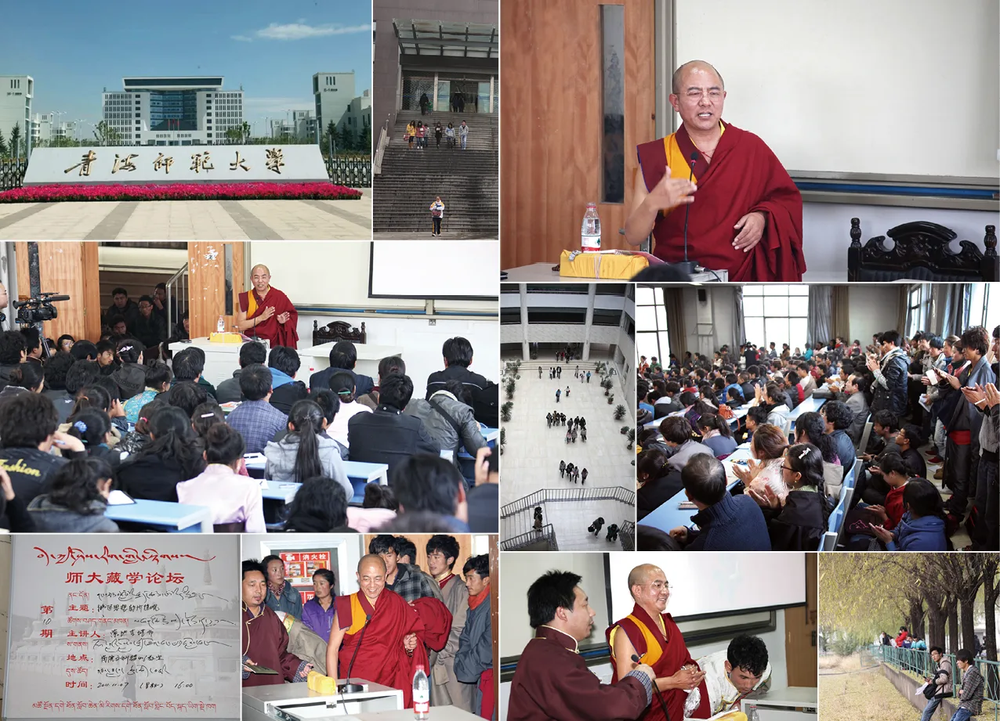

“生命是无常的，

如果能把每一天都当成生命里的最后一天，

你将在某一天发现，

原来一切皆在掌握之中，

包括死亡。”

第14场

青海师范大学

Qinghai Normal University

中国·西宁

2011 / 11 / 7

## 佛教文化的价值观[^1]

## Core Values of Buddhism

顶礼句：

酿吉钦布奏旦涅咪扬 大悲摄受具诤浊世刹

宗内门兰钦波鄂嘉达 尔后发下五百广大愿

巴嘎达鄂灿吐谢莫到 赞如白莲闻名不退转

敦巴特吉坚拉夏擦漏 恭敬顶礼本师大悲尊

今天能有机会与青海师范大学的各位老师与同学一起共同学习研讨，我感到非常高兴！

高兴的第一个原因是：青海师范大学，曾是泽丹夏忠尊者等诸位前辈大德倾注关爱精心培育、扶持的学校，加之该校诸位老师兢兢业业、孜孜不倦地教书育人，目前已经取得了可喜的丰硕成果。时至今日，该校已经成为藏族民众心中具有良好口碑与声望、综合实力极强的大学。

高兴的第二个原因是：我们这些身着佛陀袈裟的出家人，能融入这样的校园中，与各位同学一起促膝互动，平等交流“佛教文化的价值观”这一课题，的确令人欣喜。

我今天的发言主要包括以下三个内容：我的感受、佛教的价值以及我的希望。

## 一、我的感受

现状已经告诉我们，藏族知识分子群体，也即受过大学以上教育的老师与学生们，都应该重视佛教与文化这两大主题。

### 1．传承藏文化势在必行

首先，我们藏族的语言与文化，在某些程度上，正面临着日益衰败的局面，想必在座诸位心里都很清楚。如今藏族人的群居区域，主要分布在一个自治区、十个自治州与两个自治县。具体为：西藏自治区，青海省的海南、海北、玉树等六个自治州，甘肃省的甘南藏族自治州，四川的阿坝藏族羌族自治州与甘孜藏族自治州，云南的迪庆藏族自治州等十个自治州，以及甘肃的武威天祝自治县与四川的木里藏族自治县。这些地方，被统称为藏族集聚地。

但遗憾的是，这些地区不懂藏文与藏语的人，却为数众多。按理来说，无论是藏族自治县也好，自治州也好，还是自治区也好，用藏文来完成日常事务，用藏语来沟通交流，是理所当然、天经地义的。但在目前的一个自治区，十个自治州与两个自治县中，包括政府工作人员、学校老师以及各个行业的从业人员在内，能运用我们自己的母语来工作、学习、生活的人，实在是少之又少。

不仅如此，你们也很清楚，在很多藏族聚集地，藏文与藏语也在逐渐被人们遗忘，并大有退出历史舞台之态势。

以这个地方为例，此处虽与宗喀巴大师的故乡——塔尔寺毗邻，但据说这一带的人都只会说汉语，而不会说藏语。昨天一位出租车司机就告诉我：“塔尔寺的有些僧人，虽然念经发的是藏音，却根本不知道自己所念内容的意义。寺院附近的藏民，也都不会说藏语。”

与之相仿，我们甘孜藏族自治州，自古号称有“十八嘉绒部落”等众多藏族群居地。从得荣的泽让顿珠撰写的历史看来，这十八部落的领地，大多遍布于如今超过甘孜州十多个县的区域。但现在逐一观察，有些地方已经完全汉化，有些地方除了还保留着熏烧桑烟、供洒龙达等少许藏族风俗外，藏族的文化，特别是藏语言，大多已经从基础上彻底退化。

作为藏民族的子孙后代，我们将来的命运与前途，实在令人担忧。如何才能寻找到一个万全之策，是每个人都应该深思的课题。

我不得不担心，再过十年、一百年或者两百年，恐怕我们藏民族所在的很多地方，就会流传着这样的说法：“这个地方曾是藏族人的聚居地，如今已经是其他民族的生活区了……”这种忧虑并不是空穴来风，而是可能性极大。

事实上，作为宗喀巴大师故乡的原住居民们，已经退化成了不懂藏语的人，这又怎能不让人哀伤、遗憾？随着历史演变等因素的影响，这一趋势大有越演越烈之势。

像清朝，曾是一个横跨200多年之久的朝代，当时的统治阶层，掌控了从公元1636年，直至辛亥革命之间的国家大权。整个大清王朝，都是由满族人执政。当时的政府公文，也全部用满文撰写。

但在辛亥革命之后，政权又回归到汉族人手中。在辛亥革命爆发的1911年，孙中山建立了新的政权，至今（2011年）已整整有100年的历史了。在这100年间，众多清朝的王权统治者，包括顺治、雍正、康熙等皇帝统领的所有王朝沿袭下来的满族文化，也从根基上彻底坍塌。尽管当时的政务公文与文化领域等，一律弃用汉文与蒙文，而唯独使用满文，却仍然无法阻挡满文彻底走向衰落的结局。

如今，黑龙江省文史部门，保存了大量的满文文档，却找不到可以看懂其中内容的人。据2009年一项调查报告显示：目前认识满文的，仅有几个七老八十的老年人。这一现状，已经是全球公认的事实。

满族人口数量有1000万之多，远远超过了藏族人口数量。但他们的语言文化，却仍然会遭到近乎灭顶之灾的变异。所以，希望在座各位都能独自静下来好好想想：再过100年之后，我们藏族的语言文字，还能像现在这样完好如初吗？

如今存在着一个奇怪的现象：虽然在藏族地区生活工作的汉族人不计其数，但他们却丝毫没有藏化的迹象。以我所在的地方喇荣五明佛学院为例，在喇荣修学藏传佛教长达二十多年以上的汉族僧尼与居士不在少数，但其中却没有一个人变得只懂藏语，而不懂汉语。而在汉族地区学习的藏族大学生，或仅仅在内地城市工作五六年的藏族人，却在回到家乡之后，变得完全不会说藏语，或即使会说一点点藏语，也是不伦不类、半藏半汉、语言混杂的非标准口语，根本不会说一口标准流利的藏语了！

在我看来，在座的大多数师生，都应为本民族文化地位的流失，承担一份责任。这的确是值得我们深思的一桩大事！

如今很多存留于世的清朝文档，也因为缺乏认识满文的人而一直藏在“深闺”。最近，日本一个研究中心在研究现存的大量清朝文档时，需要将这些文稿翻译成其他文字，但据他们说：即使100个人一起翻译100年，也不可能完成这桩浩大的工程。

试想，如果按照藏文化目前的发展趋势进一步演化下去，我担心恐怕有一天我们的《甘珠尔》与《丹珠尔》等珍贵文化宝藏，也会因语言不通的障碍而沉睡在史料库中，最后不得不求助于美国、日本等国家的救援。

在座的大多数，是师范学校的学生，你们将来都会成为学校的老师。在老师的队伍中，既有令人终生难忘的出类拔萃者，也混杂着不少误人子弟的败类——不仅将学生引入歧途，自己也没有一点点世间的人伦道德、知识学问，更不要说出世间的种种功德品行，只是装腔作势地欺骗学生而已。

今年夏天，我偷偷去了一趟我们当地的学校。为了不被人认出，我用披单蒙着头，所以别人也毫无戒备。尽管那天是星期五，但所有老师闲散地待在草地上，一边喝着啤酒，一边打着牌。所有学生则留在教室里，其中有一些正坐着抽烟。全体师生们就是这样打发着时光，消耗着生命。他们的言行举止，真是让人打心底里感到失望！

### 2．重视藏传佛教是当务之急

另外，在如今的许多藏文大学或大学的藏文系中，对佛教或藏传佛教有所研究的人，真是少得可怜。在我看来，他们非常有必要在此方面投入一些心思。

因为“佛教是无与伦比的如意宝”，这是世间公认的比喻。正如“儿子不用父亲夸赞，而应由仇家夸赞；女儿无须母亲表扬，而应由婆家表扬”的说法一样，虽然我也认为我们藏族自己的藏传佛教有着鲜明的特色与优点，但这却无须由我们自吹自擂，王婆卖瓜式地向外人兜售藏传佛教的特长。很多汉族人、美国人以及日本人等世界许多其他民族的人，已经亲自从中尝到了甜头。他们通过学习、钻研与修持，都使心灵获得了极大的收益。

与之对比鲜明的是，如今我们藏族的大学教师们，却并没有对藏传佛教加以重视。随之而来的，是所有学生对佛教的一知半解乃至茫然无知等现状，这怎不叫人备受打击、遗憾之至？

作为藏族大学的师生们，我们应该明白一个道理：藏文化的根，就是佛教。如果没有很好地精通佛教，对藏文化的了知，就只可能是不够透彻、全面，无论深度还是广度，都有所欠缺的。虽然在短暂的一生中，很难对佛教有一个全面的认知，但了解其中的一部分或哪怕一点点，却是很有必要的。

最近，我去了内地的很多大学，那里的师生们确确实实对藏传佛教，有一定的学修、研究与修持。在他们询问问题与相互研讨的过程中，就能深切地感受到他们那种令人称叹的觉知与体悟。反过来，我们藏区一些学校中的知识分子与广大领导们对佛教的认知，却远远达不到如此水准。这都是因为“文革”期间，很多人公然叫嚣“佛教是迷信不是真理”之类的口号，并恨不得除之而后快的余毒延续至今的后果。

事到如今，个别学校的人不但自己不学修佛法，还进一步攻击、污蔑佛教，认为“佛教是荒唐的迷信”之人，也不在少数。

虽说言论是自由的，如果理由、论据充分，提出反对意见也无可厚非。但假如详加观察就可以得知，他们自说自话的那些言论的根据，都是不符合事实与真理的胡言乱语。因为他们对佛教既没有机会加以研究，更没有时间长期抉择，既没有兴趣，也不懂真理，只是一味地信口开河而已。

我本人在长期修学佛法的过程中，深深地感受到：你们作为藏族青年，若能从年轻时代，就开始各自利用自己的母语，来认真修学佛法真理，寻求、感悟、体会父辈们传承下来的清净传家宝，不会有其他民族的人学习佛法那么大的障碍，至少消除了语言这个难以逾越的鸿沟。

如今国外的很多人，正艰难地克服着种种难以想象的艰辛，努力地修学着藏传佛教。以我所在的佛学院为例，美国等许多国家的大教授、博士生、博士后以及研究生等，正纷纷涌向这里，他们都情不自禁地对藏传佛教的种种特色与优越性交口称道。其中有些人甚至在这里削发出家，并留居至今；有的人则选择在这里住上两三年，其间刻苦学习钻研藏传佛教。

我不止一次地想过：如果我们本民族的知识分子们，却反而对自己本土所有的甚深妙法，一无所知、毫无感受，确实是让人深感遗憾！

事实也是如此。除了一些藏族出家人以外，在智力、能力与名望等方面，大学校园中的大学生与工作人员，应该算是藏族人中的佼佼者了。然而，这个群体成员的佛教水平与言行举止，却让旁观者在亲眼看见之后，心里会掠过一丝不快，偶尔甚至会生起一股悲悯之情。

尽管我们这些藏族出家人中的一部分，会稍许对藏传佛教有一些闻思修学，但这毕竟只是整个藏族人口的九牛之一毛。虽然在各个藏区的农民与牧民中，有着手里拿着转经筒与念珠、口中念诵着观音心咒等优良传统，但却没有什么人能从内心出发，以通达教理的方式进行全面系统的学习与修持。

在座的老师和同学们，都像商船的船长、商主一样，肩负着扭转、引导藏民族如今与将来去向与走势的光荣使命。但如果我们自己心里，都对藏传佛教没有一点真实的见解与体悟，那就真的有点令人大失所望了。

我今天不是来给你们说漂亮话的，我真诚地恳请大家能扪心自问、再三反思。如果我说的有什么不妥或有失周全的地方，也请大家能直接给我批评指正。我想，我也绝对不会恼羞成怒或刚愎自用的。

就像藏药没有被藏族人自己善加利用，而很多其他民族的人却对此兴致勃勃一样，在我看来，佛教这味疗治心疾最有效的灵丹妙药，也正面临着“墙内开花墙外香”的命运。如今在世界上的其他民族中，已经开始掀起一股信仰、修学藏传佛教的热潮。正如前面所说，虽然我们藏民族没有什么人实地修学藏传佛教，而其他民族的人却正在将其不断地发扬光大。譬如美国哈佛大学、耶鲁大学、哥伦比亚大学等十八所院校，都设立了藏传佛教研究中心。不但这些学校的老师们在研究藏传佛教，他们的学生也在学习藏传佛教。

譬如，哈佛大学教授杰妮特·嘉措（Janet Gyatso, 1950-），她曾任国际藏学研究会（IATS）主席，哈佛大学世界宗教研究中心的纳玛达教授，之后担任美国社科院佛教分院负责人。长期以来，她一直坚持为学生讲解《前行引导文·普贤上师言教》。不仅自己学习并修持，同时也为其他人宣讲智悲光尊者、全知无垢光尊者等前辈高僧大德的窍诀。她撰写了《西藏妇女现在与过去的命运》（Women in Tibet: Past and Present）一书，还翻译了大量珍贵文献，其中很多内容，在网络上都可以查询。其实，以美国为主很多国家的不少高等院校，都设立了佛教研究中心。

我不禁要问在座听众一个问题：“你们学校有多少正在学习佛法的老师？你们学校有学习藏传佛教的中心吗？”我想，你们的回答只会是：“我们学校没有佛教中心，学习佛法的人也寥寥无几。”

事实上，目前开设了藏文化专业的大学，也仅有青海省的青海师范大学、青海民族大学，甘肃省的两所大学，四川省的西南民族大学与北京的中央民族大学。但在这些学校中，学习佛法的场所与人员，也是寥若晨星。而其他学校也最多会学一点《入行论》和《前行引导文》，此外再没有更进一步广泛深入学习的内容，这实在太让人灰心丧气了！

我真诚地期望所有师生们将来能在研学佛法方面，多下功夫，多投入一些精力。身为研究藏文化的教师，应该在佛法方面，对学生有一些引导或指引，否则是说不过去的。

而在我们的学生当中，虽然有些人会念诵《普贤行愿品》、《极乐愿文》、《宗喀巴大师祈祷文》以及《度母赞》等，但如果问他们念诵《普贤行愿品》和《度母赞》的利益，他们的回答无非是：心里会感到很舒服，祈祷三宝可以帮助自己消除违缘等，除此之外，就不会有更好的答案了。如果要向他们询问《度母赞》中“顶礼至尊圣度母”与“顶礼怨魔之怨敌”等句子的意思，包括很多老师和学生，都答不上来。同样，仅仅给《普贤行愿品》的颂词意义，做一个字面上的解释，也几乎无人可以胜任。与之相反的是，如今内地的老师学生等非藏族人士，却能头头是道地说出并解释很多佛法的道理。

要说藏区的农民和牧民不懂佛法，还情有可原，毕竟他们中的大多数人，根本没有最基础的文化知识，很多甚至连字都不认识。可是学历较高的知识分子，若对此都解释不来，那就值得我们好好反思了。

据有些文史资料记载：“文化大革命”让藏地的七千多所寺院毁于一旦，所有寺院的泥塑、石刻等佛菩萨像，都遭到了毁灭性的打击。但在我看来，这些损失并不是致命的。我们都清楚，假如人们心中仍存着佛法的见解，则外在的建筑、塑像很容易恢复如初。但事到如今，“文革”时期播种的邪见与诽谤习气的种子，却已经在生根发芽，并结出了丰硕的果实。“文革”余毒的破坏作用正在日益扩展，欲以污蔑诋毁等伎俩置佛教于死地的人，也风头正劲。

虽然并不是所有的藏族人都必须信仰佛教，但至少诸如无中生有地对佛教说三道四、吹毛求疵的做法，却是毫无道理的，所以不应该有市场。

我个人认为，在未来的大学校园中，没有佛教的研学机构，是十分不合理的。如今在内地，像南京师范大学与北京的中国人大等学府，都设有佛教的研究中心。尤其值得一提的是，中国人大本是为政府部门培养高精尖人才的摇篮，但该校却本着开放的态度，聘请了国外很多上师到该校任教，并长期坚持保留着大小乘佛教的讲学、修习与研究工作。清华大学与北京大学，虽然没有专门的藏传佛教研究机构，但也都有着许多佛教的研学机构与社团，那里的很多老师，也正在修学佛法。在为数不少的内地其他大学中，也设立了佛教的机构与专业，很多师生们也在勤奋地学习佛法。

然而，正如前面所说，我们藏族的知识分子阶层，却像喝了“惊魂水”，总是杞人忧天地恐惧、担忧如果修学或弘扬佛法，会不会影响乃至毁坏自己的地位和前程等等，所以一直战战兢兢、畏缩不前。如今的藏族年轻人，不仅不信仰三宝，也对佛教一窍不通，这都是因为在唯物主义与无神论的环境中熏陶培养、逐渐成长的必然结局。

不要说在大学校园中，即使在出家人的队伍里，也混迹着身穿僧衣，口中却声称“杀生没有太大过失”“为了我们的繁荣富强，杀生也是有必要的”“佛教是社会前进道路上的绊脚石”等言论的败类。

佛教是不是社会进步的绊脚石？的确值得大家思考。其实，佛教应该是真正的内心科学。如果内心科学都不存在，仅凭外在的科学与金钱，是不可能有什么好处的。事实证明，世上有很多人尽管家财万贯，却无法获取今生来世的快乐幸福。众所周知，最近，“苹果”手机创始人乔布斯，年仅五十便离开人世。有些新闻中说，他拥有逾700亿美元的家产，但在临死的时候，除了佛法以外，其他任何身外之物，都没有给他带来一星半点儿的帮助。

他曾只身一人前往印度及很多地方修持佛法，并获得了“不畏死亡”的境界。他说：“生命是无常的，如果能把每一天都当成生命里的最后一天，你将在某一天发现，原来一切皆在掌握之中，包括死亡。”像他这样全球首屈一指的富豪，在临死的时候，万贯家财都无济于事，唯有内心的佛教修证，才是唯一的依靠和救星。由此可知，即使繁荣发展，也应该建立在内心强大的基础之上。

你们也许听说过朱清时教授的大名，他曾担任中国科技大学校长多年，他的很多话让我钦佩不已。他曾用了八天时间前往藏区，参拜了众多高僧大德。回去之后，发表了一系列公正客观的言论，其中最主要的意思是：佛教是内心世界的科学，对人类有着极其深远的意义。

他还曾说过一句著名的话：“当科学家千辛万苦爬到山顶时，佛学大师已经在此等候多时了！”这些内容不是凭空捏造，你们可以很容易地在互联网上查找到。

他身为科技大学校长，长年从事科学研究工作，对科学的结论，自然也是承认的。但他都能对佛教做出正面的高度评价，我们是否应该好好思维一下像他这样公正诚实的学者们所说的话呢？

不过，我们藏族中的个别人，却像格言所说：“如同老狗狂乱吠，群狗亦是随声奔。”在来不及观察、智慧极端匮乏的情况下，人云亦云地重复着“文革”时期的论调，大张旗鼓地批驳佛教。这不但没有任何价值，甚至会成为让自己来世感受痛苦的因。

综上所述，在第一个问题中，主要阐述了在目前的很多大学校园中，几乎没有研究、修学佛法的机会。我们应该在各大高等学府中，极力提倡研学佛法的风气，并制定出相应的考核办法。

本来，诸如《前行引导文》《菩提道次第广论》《缘起赞》《入行论》等论著，都属于藏地的传统文化，理应认真研学。既然内地与其他地方都在兴致勃勃地学习上述论典，我们为何反而对其兴致索然呢？这其中并不存在什么违反有关政策的危险！

作为大学生，你们不能以为：所谓佛法，仅是口中念诵观音心咒，手里摇着转经轮。佛教的核心精髓，是对见修行、业因果等的诚信不疑与坚定信念，这一点是非常重要的。

## 二、佛教的价值

### 1．以公正的态度寻找真理

诸位若想了解佛教的价值，也并非轻而易举之事。包括世间规律也是如此，若想知道某件事或某个物质的价值，也是比较困难的。但如果真想对佛教一探究竟，首先要抱着公平正直的态度，不能说自己是佛教徒，对方是唯物主义和其他宗教，所以一概否认。而必须本着公正的立场善加观察，以寻求真理的态度详加决断。这，是佛教的关要，我们也一直坚持在往这个方向走。

正如《胜出天神赞》所云：“我不执佛方，不嗔淡黄等，谁具正理语，认彼为本师。”我不会顽固地执守佛陀的宗派，也不会以嗔恨的心态反对淡黄等外道宗派，谁的见解符合真理，我就将其认定为本师。我们也应该这样，无论汉族、藏族，科学家、唯物主义者，还是美国、日本、德国等任何地方的任何人，只要他的言辞符合客观真理，我们就拜其为师，并洗耳恭听其教诲。反之，如果谁的说法明明不符合真理，我们就不能黑白不分地硬说他的观点正确，并盲目崇拜恭敬。这才是寻求真理的态度。

寻求真理，一直都是佛教的主要特色，所以，我们应该本着实事求是的态度详加抉择。哪怕是佛陀的言教，也应该观察。包括佛陀的后学者怙主龙猛菩萨与具德月称菩萨等前辈论师的学说，也应该加以观察。佛经中也说过：“比丘或智者，当善察吾语，如炼砍磨金，信受非唯敬。”也即是说，即使身为出家人或在家智者，也应当首先观察、抉择、研究佛陀的言教，并作出决断，之后再认真修持。文殊怙主萨迦班智达也说过：“不询不辩于学者，不知学识之深浅。”对任一所学论典，都能以此观察，是十分重要的。

当然，我不知道在座的同学们，是否有条件在短短的时间内做到明察细审，但如果身为教师，则不能不仔细审验了。因为众多学生未来的前途和命运，都与老师们的认真负责息息相关。可悲的是，如今大多数老师与同学，已经将全部的精力，都投入到金钱财富上面了。如今的社会，不是文化教养挂帅的社会，而是政治经济大行其道的社会。谁要是稍有一点点政治地位，即使没有文化、品行恶劣，也会受到大众的恭敬谄媚；即使没有其他本事或长处，只要有钱，就能获得别人的阿谀奉承。在这种社会风气的带动下，很多学生未来的“远大志向”，不是“我要如何服务大众，利益众生”；整日的心思，都在盘算着“我将来能得到什么样的地位、权利等好处”，等等。

最近，据一所学校的统计资料表明：所有大学生，都面临着三座大山的压迫。其中第一座山，是男女感情的大山，所占比重为32%；第二座山，是人际关系的大山，所占比重为27%；第三座山，是担心未来生存就业的大山，所占比重为25%；剩下的部分，则来自其他压力。前段时间，我去了内地的某所师范大学。该校大多数汉族人询问的问题，也无非是“我将来能找到什么样的工作”“我能买得起房子和汽车吗”等。这都是因为内心有这样的惶恐，才会问出来的。

如今的社会，真可以说是物质财富的社会。但即便如此，我们也应该像格言中所说“虽此大地满恶人，然当自持高尚行”，好好地自我掂量一下，看看自己能否往高尚与贤善的方向迈进。就如前面所言，像冶炼、切割、打磨金子一样观察抉择佛法，也是十分重要的。这样观察后就能发现，其他学说与佛法二者相比，后者无疑更为超胜。如《殊胜赞》云：“越发深思维，外道诸论典，越于怙主您，信心更增胜。”的确，越是观察外道等的论典，越能凸显出佛教论典的优越与特长。

就我个人而言，以前在学校里学习心理学、物理学，乃至量子力学等时，产生过各种各样的疑惑。后来学习佛教理论以后，佛陀独特的思维模式，不但让我以前积攒的所有疑虑迎刃而解，同时，也让我对佛陀生起了坚定的信念与无比的信心。

### 2．以万法皆空来抉择佛教为真理

有人总是会心存疑虑：“佛教到底是真理还是谬论？”诸如此类的问题，始终难以排解。

在我看来，虽然建立佛陀为量士夫等很多渠道，都可以解答这些疑团。但其中最主要、最能以理服人、最颠扑不破的理由，是一切万法为空性的理念。这是证明佛法为正量、为真理最有效的一招。正如圣天论师在《中观四百论》中所说：“若于佛所说，深事以生疑，可依无相空，而生决定信。”若对于佛陀所宣说的前世今生、业因果、心的奥秘、宇宙的形成等隐蔽深奥之法，存有真假与否的怀疑，则首先应从剖析空性入手。通过缜密细致的层层推敲，不但可以将上述问题一扫而空，同时也能发现：除了佛陀以外，其他任何世间凡夫，都永远不可能阐释出如此精妙周全的学说。自然而然地，你不得不对佛法生起坚如磐石的信心。大智者根登群培也说过：“愈近物本性，智者更难诠，诸法微妙性，远离言思境。”越是靠近物质实相，即使是才高八斗的智者，也难以表述，因为一切万法的实相，本来就是超离语言与思维之境的。正如《罗睺罗赞般若颂》所云：“不可言说智慧到彼岸，无生无灭虚空之体性，各别自证智慧之行境，顶礼三世诸佛之佛母。”

尽管万事万物的法性，超越了语言与思维，但无论在座的老师与同学们中谁愿意去修持，都绝对可以一窥其隐秘、甚深之堂奥。如今内地很多的知识分子，对修学中观、菩提心等法门颇有心得。要了知万法实相，就必须有修学的体验。指导修学最主要、最可靠的教材，是怙主龙猛菩萨的《中观根本慧论》。

前苏联科学院著名教授舍尔巴茨基（Th.Stcherbatsky, 1866-1942）就说过：“龙猛菩萨的中观缘起空性，与黑格尔辩证法之间，具有重大、亲切的类似。”听到这种说法之后，我想黑格尔的学说一定很不错，所以花了一些功夫潜心钻研黑格尔的论著。结果发现，黑格尔的思想不过是龙猛思想法海中的一滴水而已，因为他连龙猛思想的部分皮毛都没有通达。

的确如此，《中观根本慧论》一开始两个偈颂的顶礼句“不生亦不灭，不常亦不断，不一亦不异，不来亦不去。能说是因缘，善灭诸戏论，我稽首礼佛，诸说中第一”，就已经告诉我们，这部论著，已经广泛地阐述了中观的大缘起因。

一般来说，抉择诸法空性，会用到观察因的金刚屑因、观察果的破有无生因、观察本体的离一多因，以及观察整体的大缘起因等。

关于离一多因，对雪域藏区有着不可比拟之恩德的大堪布静命论师，就在《中观庄严论》中写道：“自他所说法，此等真实中，离一及多故，无性如影像。”意即：所有轮回、涅槃、器世间、有情世间所摄的一切万法，都没有自性。无论一体还是多体，都无法成立，就像影像一般。这就是以离一多因的方式抉择空性。

可以毫不夸张地说，即使是世间最聪睿超凡的科学家，也无法深入全面地领会上述意义。尽管爱因斯坦等人在量子物理学方面，提出了很多相似于佛法的理念，爱因斯坦本人也成了世人心目中当之无愧的大智者，但我想，即使是他也很难如实地彻证上述甚深之义。至于一般的知识分子，恐怕就更难理解佛法深广精妙的空性之义了。

记得几年前，被世人称为“爱因斯坦第二”的英国剑桥大学教授霍金（Stephen W. Hawking, 1942-2018），就曾以量子力学为主题，在清华大学做过精彩的演讲。出乎他意料的是，他刚讲了一会儿，台下的很多师生就已经睡着了。霍金见此情景，懊丧、伤心至极。他不禁感叹道：“想不到在如此著名的学府，我这些不为常人所道的关于量子力学的深奥学说，不但不能被人理解，而且会枯燥无味到成了催眠曲的地步！”霍金哪里知道，他那些接近于佛法的弦理论、多维空间等理念确实太深奥，一般的世间智慧又怎能与此一拍即合？所以，如此伟大的科学家，也不得不遭受曲高和寡的命运了。

同样，若有人想尝试着在藏区的大学生中，宣讲佛教的大缘起因与离一多因，也绝对会让听众不明就里、心思恍惚、倦倦欲睡。但如果有什么影视歌舞大明星驾到，想必这些追星族们会一下子兴奋异常、欢喜雀跃。

此外，观察因的金刚屑因，在月称论师的《入中论》中，以“彼从彼生无少德，生亦复生亦非理……尽生死际唯种生”破自生，“火焰亦应生黑暗，又应一切生一切”破他生，“计从共生亦非理，俱犯已说众过故”破共生，“无因不待他，应成恒有无”破无因生等推理，进行了抉择。若能对此深入思维，任何人皆会受益匪浅。否则，只是将《三十颂释·善说如意树》《精要明镜论》等正字、诗学方面的典籍，当成了藏文化的全部，认为通达了这些便通达了一切，这实在是大错特错。

曾有一次，某个大学的学生对我说：“佛陀讲的有些道理也不对。就拿《心经》来说，里面讲‘无有眼耳鼻舌’，可是我们明明有眼睛、有鼻子，这岂不是自欺欺人吗？”

听了他的这番“高论”，我只是笑笑回答：“你如果好好学习佛法，将来自会明白的。”此外也并没有驳斥他的错误观点。为什么呢？因为他对佛教一无所知，我若跟他讲“这些在胜义中没有、世俗中有”，他根本分不清何为胜义、何为世俗。在他的眼里，佛陀连基本常识都不懂，这样的智慧浅薄无比，甚至连他身边的老师、同学都不如。

其实，一个人若想观察他人如何，自己至少应具备一定的智慧。否则，“爱观察之寻思者，悉地距己万里遥”，自己的小聪明，只会成为危害自己的因，就像我们藏地有些人爱耍弄刀枪，他们自以为这是一门学问，却忽略了武器在伤人的同时，也很容易反噬自己。贡唐江博阳就曾说过：“具双刃之慧剑，若是过分挥舞，有断自头之险。”所以，一个人所掌握的知识，本来是对自己有利，但若没有用得恰如其分，到头来也可能害了自己。

总而言之，在座的各位老师、学生，对于以上介绍的空性意义，去学习、实修是相当重要的！

### 3．佛教可解除我们的痛苦

当然，印度圣境内释迦牟尼佛及其追随者所传下来的教典，以及藏地雪域萨迦、格鲁、宁玛、噶举等各派大德所撰著的论著，可以说浩如烟海、堆积如山。在当今五浊横行的末法时代，我们利用短短的一生，想圆满学完这一切经论，真可谓难如登天。但即便如此，若能尽量抽出时间，学一些让自己临死时不会后悔的善说，这也非常有必要。

对你们在家男女来说，真正学习的机会少之又少，如今不管是外在的环境，还是内在的身心，所带来的痛苦经常此起彼伏。诚如圣天论师所言：“胜者为意苦，劣者从身生，即由此二苦，日日坏世间。”有权势地位的富人，内心时时被忧苦所扰；缺衣少食的农民、牧民，身体常常要饱受苦楚。所以，不管是什么样的人，不为痛苦所恼的，一个也没有。智者根登群培也说过：“高官心里有大苦，小民身上有小苦。”

既然机会如此难得，你们在学佛的过程中，一方面要总体上修学佛法，同时，尤其要修学菩提心和空性。若能在寺院的上师、格西面前，首先听闻一些这方面的教义，之后通达其中的内容，并对别人进行引导，这才是最有意义的。

一般来讲，藏族人从小就对三宝很有信心，可是如今，许多年轻人尤其是学生，在这方面却比较差。像你们青海这边，对藏文化倒是非常关注与热爱，可是对佛教的认识，却还有极大的空间有待提升；而康巴、拉萨那一带，对佛教有着不共的信心，然而传承藏文化的理念却相当薄弱。尽管在每个藏族人的心目中，佛教的地位无与伦比、不可取代，但是具体应该以什么方法来修行，不少人还是懵懵懂懂、不甚了了。

其实，且不说别的，单单就是为了自己的利益，修行佛法也非常关键。如今美国有许多大学，对佛教的禅修极为重视。他们做过一些试验，让个别人在7天中修大悲心等，然后对禅修前后的状态进行对比。结果，令人惊讶地发现：一个人在禅修之后，性格柔和、心情快乐、身心无有疾病等，跟以前比起来，确实有了明显的改变。

如今汉地和很多国家，都已认识到了藏传佛教的价值，并对此越来越感兴趣。之所以会这样，也是他们的身心由此得到了真实利益，而并不是一味地人云亦云。毕竟，他们也是有智慧的人，假如从藏传佛教中一无所获，又怎么可能对它盲目地崇拜？

因此，卫藏、安多、康区等地的藏族人，无论在家还是出家，都应齐心协力继承和弘扬藏传佛教。俗话说得好：“众人拾柴火焰高。”只有依靠大家的共同努力，未来才有可能出现令人可喜的成果。

与此同时，我们对藏文化也必须要竭力保护。上师如意宝曾说过：“如意宝自拥有时，务必用其成大事，一旦落入怨敌手，此时后悔也无用。”六世达赖仓央嘉措也说过：“如意宝自拥有时，务必充分利用彼，一旦落入他人手，追悔莫及令心伤。”这些教言，确实非常契合当今的现状。

所以，我们藏族人理应学习自己的文化，对此产生一种信心和定解，而不要将保护藏文化只停留在一些口号上。一个人若看不出珠宝的价值连城，就有可能将其卖给别人；同样，对于藏文化，我们一定要先懂得它的价值，如此才能真正去重视它。

以上是我对佛教价值观的一些浅见。

## 三、我的希望

最后，我对各位有三点希望：

### 1．活到老，学到老

大家在一生中应不断学习，这一点非常关键！不论是你们已经有工作的，或是还没有工作的，都不应该放弃广闻博学。萨迦班智达曾说：“即使明早要死亡，亦应学习诸知识，今生虽不成智者，来世如自取储存。”可见，学习知识，对我们的今生、来世都有极大利益，大家对此一定要铭记在心。

其实，单单从世间层面来讲，学习也是不可缺少的。美国作家海明威有一部小说叫《老人与海》（The Old Man and the Sea），在撰写的过程中，他曾反复校阅过200多次，并最终以此获得了1954年诺贝尔文学奖。尽管如此，他仍非常谦虚地说：“我要学习写作，当个学徒，一直到死。”

如今有些领导，获得了地位以后，就把一切书本束之高阁，对学习基本上没有兴趣了，如此下去极不合理。故希望大家能活到老、学到老，最好不要放弃学习。

### 2．世间正见不可缺

具有世间正见，也是极为关要的。龙猛菩萨说过：“世间之正见，谁人若具足，彼于千世中，不会堕恶趣。”那么，何为世间正见呢？简单来说，即是承许前后世、业因果。

然而，现在许多藏族人，对于杀牛无动于衷，甚至有些年轻男子以抢劫为生，年轻女人以卖淫度日。诸如此类的很多人，逐渐堕入了与以往藏族清净、高尚的特质完全相悖的丑恶深渊，这就是没有世间正见所致，故希望大家一定要了知前世后世，懂得因果取舍。

当然，因果是极为甚深的，有些虽然暂时用肉眼看不到，但看不到不一定就没有。大持明者晋美朗巴在《功德藏》中告诉我们：“高空飞翔金翅鸟，虽暂不见身影现，然与其身无离合，因缘聚合定现前。”意思是说，当金翅鸟翱翔在高空中时，它的影子暂时看不见，但是并非没有影子，最后无论它降落在哪里，黑乎乎的身影就会出现在此处。同样，今天你所造的任何恶业，虽不一定立竿见影、马上受报，但是到了来世，乃至来世的来世，苦果不可能不降临到你的头上。

《俱舍论》中也讲过，业果有顺现法受业、顺次生受业、顺后受业等诸多分类。所以，一个人就算造了业，果报也不一定马上现前。可是一旦它真正现前了，即便是佛陀的妙手，也无力回天。佛经中亦云：“诸佛无法水冲罪，众苦亲手亦不除，自之证悟非移他，说寂法性令解脱。”

然而，有些人的心邪见蔓延，就算听到佛陀的语言，也嗤之以鼻、不以为然，这样的人实在难以调化。正如弥勒菩萨在《现观庄严论》中所言：“如天虽降雨，种坏不发芽，诸佛虽出世，无根不获善。”天王虽然降下妙雨，但被烧坏的种子不可能长出庄稼；同样，被邪见所左右的人，不管出家还是在家，都很难得到佛法的真实利益。

这种人常以嗔恨心诽谤佛法，造下了弥天大罪，可是一旦死亡来临，对大多数藏族人而言，不管昔日曾做过什么，此时仍会向佛法求救，不皈依三宝的极其罕见。因此，希望有些人还是应尽早醒悟，从现在开始，精进地修学佛法也为时不晚。

常言道：“自己都不救自己，岂望别人来救护？”又云：“瑜伽士乃自调伏，牛尾巴为自甩动。”佛陀也说过：“自为自怙主，他人焉能怙，造恶抑或善，自为自见证。”因此，自己就是自己的怙主，也是自己的老师，造恶或行善的唯一见证，除了自己，没有别人。

所以，在座的各位以后选择善还是恶，这完全由自己决定。若想老师、父母一辈子都守护你，这是不可能的。每个人的人生轨迹，只能是自己去走，故望大家在弃恶从善方面，务求谨慎、小心翼翼。

总而言之，慎重取舍因果、护持世间正见，是我的第二个希望。

### 3．尊重每一个生命

我最后的一个希望是：不管老师还是学生，都应懂得佛教的价值，尤其要以慈悲心维护一切众生，并做到不害物命。这一点极为重要！

如果我们对生命价值方面的知识，经常了解、学习、研究，就会懂得如何关爱地球上的生命。尤其是若能将心比心、易地而处，就会明白损害其他众生极不应理。佛陀在经典中曾说：“以自身为例，切莫害他众。”寂天菩萨也说过：“除令有情喜，何足报佛恩？”

对我们自身而言，一根小小的针扎在身上，都会痛得极其难忍。那么，用刀去割断众生的脖子，剥夺其生存的权利，它又会有怎样的痛苦？可想而知。

因此，身处屠场待宰的动物，乃至蚂蚁以上的生命，都应该值得我们爱护，万万不可随意杀害。大智者根登群培也说过：“佛教的特点，是一群具有悲心的比丘，以连蝼蚁都不杀害的行为，感动了整个世界的东西方。”

然而，如今藏地的个别人，去饭店吃饭时，动辄就点杀鲜活的鱼、虾、蛇，然后肆无忌惮地大快朵颐。还听说有些长胡子的人，在吃虾时狼吞虎咽，胡须和虾须都混在了一起——当然，这种现象是不是真的，我也无从考察。但不管是真是假，大家都要清楚，这是非常不好的行为。

所以，我们一定要有良知，通过学习《入菩萨行论》等论典，培养自己的菩提心。若能如此，就算没有修成其他善法，也不会有什么可遗憾的。诚如华智仁波切所言：“修心修心修自心，若以菩提心修心，无有身语其功德，获得解脱无有余。”这里就讲到了，菩提心如果修成了，即使身语等其他善法一无所成，其结果也是除了解脱以外，不会有第二条道路。

萨迦班智达也说过：“若失菩提心之要，他法妙亦不成佛。”倘若失去了菩提心的要点，纵然其他的法再高、再妙，也很难依此而修行成佛。

当然，假如你们对菩提心，实在难以通达并修持，那至少也应具有一颗善心，经常想着：“我如果能利益这些众生，该多么好！”如此也非常善妙，令人称道。宗喀巴大师就曾说过：“心善地道亦贤善，心恶地道亦恶劣，一切依赖于自心，故应精勤修善心。”

所以，恒时尽己所能地生起善心，并尽量饶益自他一切众生，是我最后的一个希望。

## 结 语

今天因为时间关系，这场讲座就到此圆满了。

往昔，宗喀巴大师曾以无上发心，将佛法如意宝从东海弘扬至西方的那兰达热之间，并发下宏愿：“了知佛法于佛生信者，恒常遍及一切十方界。”同样，今天我也在此祈愿：愿人们能真正通达佛教的真理，并对佛陀的功德生起无谬的信心，愿这样的智者遍于广阔无际的一切世界。

吉祥如意！感恩大家！

现场互动

问：我是该校的一名老师，想请教您一个问题：在当今这个经济时代，我们藏族无论老少，心灵正在被日益侵蚀。尤其是年轻一代的身上，几乎看不到尊老爱幼的美德，高尚的行为也化为了乌有。请问，这是什么原因导致的？对于他们这些不好的心行，您有什么方法可以挽救？

堪布：这个问题在当前来讲，的确很现实！现在许多藏族年轻人，性格上有了很大的变化，究其原因，一方面是跟教育有关，另一方面也跟他们的信仰有关。

就拿汉地来讲，往昔曾有无数令人称道的美德善行，尊老爱幼的优良传统，也自儒教的孔子、孟子、荀子起，数千年来一直源远流长。可是如今，这种美德却被盲目的平等主义取代了，许多人打着“平等”的旗号，声称长辈与晚辈要平等，老师与学生也要平等，尊师重道反而被视为一种落后。所以，在我们藏地，也不可避免地受到了这种思想的波及，现状确实令人担忧。

当然，这种现象，跟“文革”的余毒也有很大关系。当年，人们认为古代传统是统治阶级剥削、压迫劳动人民的工具，进而对其恨之入骨，通过长期的阶级斗争，恨不能将古代传下来的东西，全部都斩草除根，统统不留。这种错误的观念，其破坏力非常之大，如今在汉地、藏地也仍有市场，不少人还将此奉如圭臬。除此之外，唯物论所宣扬的理念，也在藏族年轻一代的心中日益扎根，致使他们对三宝没有信心，对长辈缺乏孝顺，对造恶无惭无愧等等。

那么，如何才能改变这种现状呢？

我觉得，首先，教育的导向至关重要。你们作为老师，理应用藏族的传统文化，正确引导学生的人生；我们作为出家人，也应对以僧团为主的有缘众生，进行这方面的教育。同时，我们还要前往其他地方，在农牧民的群体中，广泛弘扬藏族的传统文化，以及相关的人生格言、佛法教义等。只要我们坚持不懈、持之以恒，很多人的心就会逐渐改变，慢慢生起信心、慈悲心、善心。以此，藏族才会成为真正的藏族，并能长久留存于世。

否则，环境的影响是非常巨大的。一般而言，弱小的民族被强大的民族所同化、吞并，这在全世界来讲，也是不可阻挡的一种趋势。假如我们不珍惜本民族的文化，到了最后，自己的传统荡然无存，内心的慈悲点滴不剩，这不仅仅是藏族的悲哀，也是全人类的悲哀。

当然，若想扭转这种命运，对我而言，就像佛教的一个比喻中所说，犹如失去双臂的母亲，眼睁睁看着独子被河水冲走，自己却无能为力一样；看到藏文化日渐衰退，我虽然清楚地知道这也不对、那也不对，却找不到一个行之有效的措施，可以真正地力挽狂澜。正如刚才的比喻中所言，断臂的母亲因为缺乏双手，自己明明心急如焚，却对落水的孩子无可奈何；同样，我们由于内外的各种因缘所致，如今想要一下子改变人们的性格，也可以说是难如登天。

但无论如何，大家也不能就此放弃，而务必要竭尽全力。我们身为出家人，尚且能不顾一切艰难困苦，前往各地弘扬藏文化，甚至为此举办一些扫盲活动，你们在家师生就更应当义不容辞了。同为藏族人，我们有着同样的血脉，所以，藏族未来的命运，每个人都应该放在心上，并力所能及地做一些事情。哪怕你只有十来个学生，也要想方设法引导他们往好的方面发展，把他们不好的习性改变过来，这一点极为重要！

问：我代表在座的各位，对堪布为我们的演讲，表示衷心的感谢！我的问题是：关于佛教，藏地、汉地、国外的许多智者，各有不同的说法：有些说是唯物，有些说是唯心，有些说是有神论，有些说是无神论。那么在您看来，这四种说法中，佛教到底属于哪一种？为什么？

堪布：从究竟的层面来讲，无论认为佛教是有神论、无神论、唯物、唯心，都不能完全成立。月称论师曾说过：“彼观名言亦非理，汝所计生由何成？”在胜义中，轮涅所摄的器情世界万法，皆无有自性，既不属于任何一派，也远离了一切承认。正如龙猛菩萨所言：“我无承认故，我即为无过。”故而，大乘最究竟的见解，不偏堕任何一方，佛教不属于这四者中的任何一种。

但暂时而言，根据众生根基不同所安立的不同层次的教义，与这四种说法也各有相似之处。比如，有实宗承许实有之法存在，可以算是一种“唯物”；唯识宗认为万法皆由心造，可以算是一种“唯心”；胜义中，一切圣尊、咒语都不存在，可以称之为“无神论”；世俗中，一切圣尊、咒语都真实不虚，又可以叫做“有神论”。

这些观点彼此互不相违，因此，你上面提到的四种说法，跟佛教有一定的相似之处，但并不能完全涵盖佛教。以此也可以了知，佛教的智慧能够涵摄一切学问。

问：我是本校的一名老师，首先代表今天在场的各位朋友、老师，乃至其他部门的人，由衷感谢您这次所带来的演讲！在我们藏地民间，有很多人信仰佛教，这方面也有大量的仪轨，内容多为修持护法、本尊等。当然，修这些也是佛教的一种行为，但在您看来，这些是不是真正的佛教呢？

堪布：这位老师问得很好！从藏族以前的传统来看，大多数人都认为，佛教只是念经、祈福、做佛事等等，这也是漫长历史所留下来的习俗。然而，以仪轨来诵经祈福，实际上只是佛教的一部分，却不是它的根本。

真正的佛法，诚如世亲论师所言：“佛之妙法有二种，教法证法之体性，持教法者唯讲经，持证法者唯修行。”佛法分为教法、证法两种，其中，文字上的三藏教典叫“教法”，内心中生起信心、菩提心等三学功德叫“证法”。依靠闻思修行，证达了佛法的真实境界，则称之为“受持正法”。

我们平时念诵仪轨，供修护法、本尊，不能说这不是佛教，但也不能说佛教就仅限于此。真正的佛教，需要了知佛陀的功德，并对佛法生起理性的信心。就拿皈依而言，至少要懂得皈依的功德、皈依的方法；发菩提心的话，也要精通菩提心的功德及其理论。

你们老师和学生当中，有些人也经常念经，这个习惯非常好。不过，念经若只是为了心情舒畅、办事顺利，这还远远不够，而一定要懂得观修方法，及其前行、正行、后行等道理。当然，这其中最关键的，还是要从心坎深处皈依佛陀，并对此生起理性的信心。

因此，修学正法，才是佛教的核心。如今汉地有许多信徒，常常到寺院烧香拜佛，但是不懂佛理的话，学佛只能停留在形象上，很难触及佛法的本质。所以，真正的学佛，必须要懂得佛教的教义，这对出家人、在家人来说，都不可缺少。否则，仅仅是佛教的个别行为，这些不能称之为正法。

鉴于此，近几年来，我们一直呼吁各地的在家男女、出家人，务必要修学正法。毕竟佛教的意义相当深奥，没有系统学习的话，不可能轻而易举就通达。像世间的学问，尚且要依次读完小学、初中、高中，花费十多年的时间，一直学习课本知识，那么佛教的教义更为甚深、广大，不去学又怎么可能明白？所以，大家一定要系统学习，如此才会懂得佛教到底是什么。

问：很感谢您不辞劳苦地来到青海师大，为我们宣讲“佛教文化的价值观”，我实在是感激不尽！今天您所演讲的内容，主要是藏文化的现状及其价值、特点，并告诉我们如何保护它，尤其谈到了佛教的价值观，这些都值得每个人深思。其中，您说到佛教是心灵科学，请问，佛教与科学之间关系是怎样的？将来社会发展的过程中，科学重要还是佛教重要？

堪布：佛教，如今被称为内在的科学。像著名的心理学家荣格，在研究多年心理学之后，接触了藏传佛教的《西藏度亡经》，发现它对自己的心灵有极大帮助，于是认定佛教是一种心灵科学，并对此给予极高的评价。同样，科学家爱因斯坦也认为：“如果有一个能应付现代科学需求，又能与科学相依共存的宗教，那必定是佛教。”

佛教，或者说佛法，实际上是佛陀照见万法真相之后，抉择并加以宣扬的。一般而言，“法”有十种涵义，如古籍中云：“法乃所知道，涅槃及意境，福德寿典籍，未来定境规。”而佛法中的“法”，则是指佛法的精要，正如佛经所言：“诸恶莫作，诸善奉行，自净其意，是诸佛教。”也就是说，提倡不造恶业、行持善法，这即是佛教的本意。

如今的科学，对于外在的物质，可以说有诸多观察，然而对于内心世界，却是一筹莫展，只能无奈地在门外徘徊。而佛教的教义，淋漓尽致地揭示了这方面的真相。因此，著名院士朱清时认为，佛教是当之无愧的心灵科学。

所谓的“科学”，其实除了社会科学、自然科学以外，还有一种，叫做心智科学，或心灵科学。在我看来，人类只要生存于世，并想不断发展，心灵科学就不可或缺。这种内在的科学，与外在的发展只会相辅相成，而绝不会成为它的绊脚石。

倘若没有心灵科学，随着物质生活的不断提升，人们的内心只会越来越空虚、苍白。就像如今美国和汉地的很多富翁，纵然拥有数亿家产，却感觉不到丝毫快乐，始终被痛苦的大山压得喘不过气来。可见，外在的物质再怎么富足，也无法带来内心的安乐。他们不像我们藏族，基本都相信前后世存在，也有许多对治痛苦的调心方法。对这些人而言，假如今生根本不快乐，那一切的发展都没有了意义。

现在汉地个别地方，有些信仰佛教，有些也不相信。但对没有信仰的人来说，人生往往缺乏归属感，随着社会的发展，内心的欲望会越来越大，有了一套房子，还想要一套；有了一辆车子，还想要一辆……如此，一辈子都沦为金钱的奴隶，许多现象看起来令人非常伤感。所以，对这些人来讲，我觉得，心灵科学显得尤为重要。

问：我是青海师大2011年的研究生。如今前往汉地城市的藏族喇嘛，叫做“汉喇嘛”。其中，有一部分是真正续佛慧命的，用佛法饶益了无数弟子。但还有一部分，没有任何修证，只是依靠打卦算命等方式来敛财，甚至盗用一些高僧大德的名称，四处搜刮钱财，最终让自己腰缠万贯。从佛教教义的层面来看，这样做是否合理？我们应当如何对待这一现象？

堪布：我本人而言，应该算是最早的“汉喇嘛”了。1987年，法王如意宝前往五台山时，汉地从来也没见过“汉喇嘛”，以至于我们去一些商场时，售货员见到我们都不卖东西了，一直围着我们指指点点，好像发现了外星动物。当然，现在可不会这样了。

正如你所说，在“汉喇嘛”当中，有些是真正的高僧大德，他们前往很多城市，并不以金钱为目的，而完全是以佛法利益大众，引导很多人皈依佛门，为他们种下解脱的善根，并创立非暴力的和平妙道，给无数人和动物带来了今生来世的快乐。但也有一些人，假借佛教和寺院的名号，穿着袈裟，前往汉地，各种行为特别恶劣、令人发指。

不过，让我们一口咬定谁是真、谁是假，这非常困难。从历史上来看，昔日阿底峡尊者来到藏地之前和之后，印度也有很多人入藏，有些是为了骗取金子而来，但也有些是为弘扬佛法而来。因此，我们不能一开始就急着断定好坏，而应当通过细致的观察，去粗取精、去伪存真。

问：您刚才说佛教是非常稀有的文化，但如今，佛法教义与信教群体之间有很大的距离，这一点相当遗憾。我自己希望将来因缘成熟时，成立一些组织，对大众虽不能传授很深的佛法，但至少让他们树立起正确的理念。毕竟，无论是哪个民族的宗教或政治，都是以民众为基础的，佛教未来若想被广泛接受、护持、弘扬，需要民众的大力支持和发挥作用。在这方面，请问您有什么想法？

堪布：如今，价值连城的如意宝般的佛法，跟世间俗人的心之间，确实有很大的距离。不过，这个问题，短时间内也很难解决。以后最好是各地成立一些组织、团体，从扫盲开始，次第让大家学习一些简单教言，以及皈依、发心等佛教基础知识，这样久而久之，才会让更多人认识到佛教的殊胜。

此外，学校师生也应提升自己的佛学水平，否则，自己的佛教觉悟太低了，则根本无法品尝到藏文化的美味。同时，我们各大院校还应建立一些佛教的研究机构及其他各种组织，并通过考试的方式，学习《菩提道次第论》《普贤上师言教》等经论，以此来提高自己的佛学水平。若能这样，将来逐渐改变藏民族的命运，也并不是什么难事。

以前我们藏地，缺乏在大众中广弘佛法教义的传统。不过这几年来，许多上师往赴各地弘法利生，如今的成效也比较显著，一些连字都不认识的农民、牧民，都懂得三殊胜、观修金刚萨埵了，甚至水平完全超过一般大学生。如果大家能这样共同修学佛法，这在一切行为中，是最重要的行为。只要依此不断努力，我相信，佛法与人心之间的距离会日益缩短，人类的未来也会更加美好。

问：您刚才说，学习藏文化与学习佛教应同时进行。那么，对一个学生而言，在学习知识的同时，积累福报有何必要呢？

堪布：作为学生，首先，学习知识是很关键的。然后在此基础上，若能行善积福，这是十分明智的选择。

前世没有福报的人，今生一切都会不顺利，运气也非常差。所以，古籍中说：“精勤如山王，不如积微福。”只有精勤地积累福德，做任何事情才会事半功倍，否则，仅仅是依靠精进努力，不一定就能如愿以偿。

就如同有些学生考试，福报不够的话，平时学习成绩再好，结果也考不上。所以，积累福报非常重要。佛陀也说过：“具有福德者，所求皆如愿。”

对你们学生而言，倘若造了很好的福德，即使没有特别勤奋，学业也会很容易成就，同时依靠福德力，心中的智慧能够自然开启。一般来说，有了前世的福德之果，再加上今生的努力学习，人生的前途就会很美好。同样，依靠这样的因缘，自己的上半生、下半生，乃至未来的生生世世，也会非常幸福快乐。

因此，长期护持这样一颗善心，以及上供下施的善举，并如理如法地行持，这一点极为关要，请大家牢记！

[^1]: 这场交流是索达吉堪布用藏语演讲，之后又根据藏文讲稿译成汉语。
