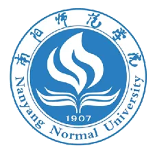
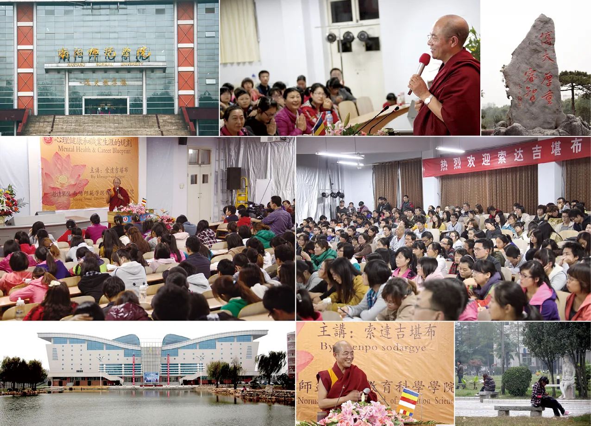
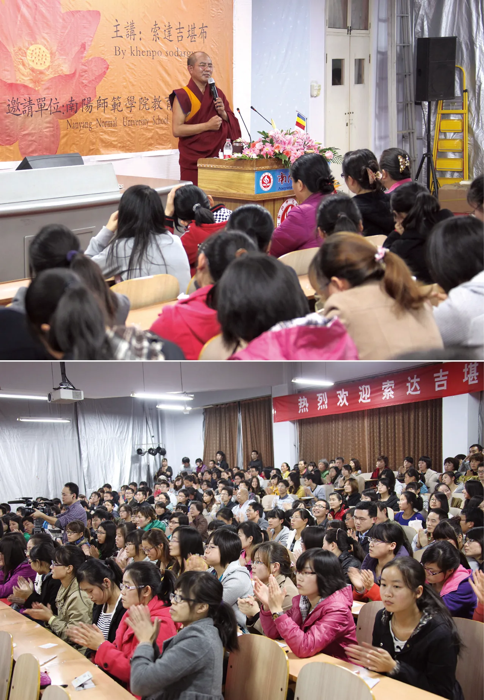
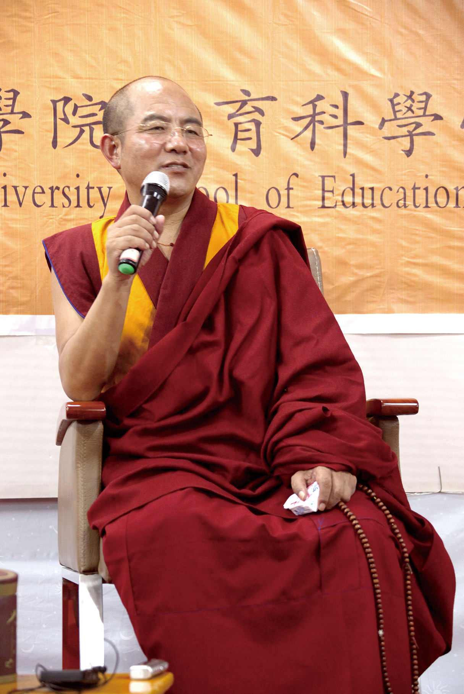

心都是无常的，

身体也是无常的，

万事万物都是无常的，

变化也在情理之中。

第13场

南阳师范学院

Nanyang Normal University

中国·南阳

2011 / 11 / 3

## 心理健康与职业生涯规划

## Mental Health and Career Blueprint

主持人：

欢迎大家来参加我们本次的讲座！

南阳师范学院建校百年以来，秉承“博大、厚重、睿智”的办学风格和大学精神，吸引着大批的学生前来求学。在这里，我们收获了知识，成就了梦想。那么在我们成长的过程中，如何积极乐观地面对人生的挑战，确定自己生活的方向，过一种有意义的生活呢？今天我们有幸请到了藏传佛教大德索达吉堪布，来为我们作一场精彩的讲座。

下面先请我们教育科学学院包华教授致辞——

包华教授：

可能有人上过我的课，但你们并不知道我是多么热爱我的学生。我曾经多少次设法帮助他们复习、考研、联系家教、参加竞赛等等，甚至包括他们找对象、谈恋爱。但是我后来发现，我的这些帮助，只能给他们带来暂时的利益，只能照亮他们生活中很短的一段路程，不久之后，新的烦恼就会滚滚而来。所以，我经常生气地拷问自己的良心：我拿什么奉献给你们？我的孩子们啊！

有人说：“送人黄金，不如送人点金棒。”我特别认同这句话。的的确确，有时候暂时的一些物质帮助，给我们带来的利益非常有限，也是微不足道的，真正能让我们终身受益的，是正确的人生目标和价值观，是良好的生活方式、生活习惯和优良的学习方法。

今晚我们有幸请到了伟大的上师索达吉堪布仁波切，他曾经用他的弘法利生，给无数人带来了解脱和安慰。今天晚上，他将以渊博的学识、高尚的人格，给我们带来佛法的利益，给我们带来终极关怀式的人生指导。希望大家得到真实的利益，祝福大家！

下面，让我们以热烈掌声有请索达吉堪布——

很感动包老师对学生们的关心，看来她的的确确很关心你们，包括方方面面！

这次我到了南阳，感觉很好。为什么呢？因为我还没有出家前就爱看《三国演义》，那时候非常崇拜诸葛亮的智慧。前段时间有人说南阳请我举办讲座，本来我这次的行程比较忙，但后来看刚好是诸葛亮的故乡，以前也听过与他有关的很多精彩故事，于是就产生了一种兴趣。

同时，南阳跟我们佛教也有甚深的渊源。这一点，或许在座80后、90后的同学不一定非常清楚，但汉传佛教中大名鼎鼎的“慧忠国师”，就曾驻锡于你们南阳。这个慧忠国师，小的时候很奇妙，跟谁都不说话，像哑巴一样。到了16岁，家里来了一位禅师，他远远望见就开始礼拜，并乞求双亲让他出家。出了家以后，他在六祖面前依止11年，最终明心见性，成为六祖门下“一花开五叶”的五大宗匠[^1]之一。

之后，他来到南阳白崖山，在那里修行四十多年，道誉甚高。唐玄宗在位时，迎请他往京城长安应供。后来发生了“安史之乱”，慧忠禅师离开长安，隐遁山林。随后，唐肃宗又迎请他到长安，封为国师。

有一次，肃宗问他：“您在六祖那里到底得了什么法？”他回答：“陛下看见天空中一片云吗？用钉子钉着它、悬挂着它，就是我从六祖那儿得的法。”肃宗听不懂，又问了几个问题，禅师答了，他仍茫然不解，禅师就不理他了。肃宗面子上有点过不去，说：“朕好歹也是大唐天子，您怎么连看都不看一眼？”禅师反问他：“皇上知道有虚空吗？”“知道啊。”“那么虚空可曾眨眼看过陛下？”肃宗听后若有所悟。（这段话中有特别甚深的道理，不知在座同学对禅宗的了解如何。）

肃宗之后，唐代宗也召请慧忠禅师入宫传法，待以国师之礼。当时禅师极受尊崇，僧俗弟子超过万人。禅师圆寂之后，在南阳造了他的遗塔，后来康熙、雍正两代皇帝都修缮过。但可惜的是，“文化大革命”期间，也就是1972年被毁，如今已不复存在了。慧忠禅师，在历史上又称为“南阳国师”，但南阳的年轻一代，很多人对此一无所知，对如此有意义的禅宗渊源视而不见，这是相当遗憾的。

除了南阳国师以外，禅宗还有一位著名的大德，也出自你们南阳。这位大德，就是香严智闲禅师。他最开始依止百丈禅师，什么经论一学就会，总能讲得头头是道，但却没有明心见性。百丈禅师圆寂以后，他转投到师兄沩山灵佑门下，被沩山一句“父母生前，如何是你的本来面目”问得无言以对，纵将平时看过的经论都搬出来，从头到尾仔细翻阅，也找不到能应对的答案。

他几次去找沩山，求他告诉自己，但都遭到了拒绝。沩山说：“如果我给你说破，你以后会骂我的。我说的，终是我证的，跟你没有任何关系。”绝望之余，智闲挥泪告别沩山，发誓以后不再学禅，只是当个混饭的和尚。

后来，他来到南阳慧忠禅师的旧址——香严寺，觉得这个地方不错，决定住下来终老于此。一日，他在田中清除杂草，锄头碰到了一块瓦片。他捡起来随手一扔，瓦片击打在田边的竹子上，发出一声清脆的响声。击竹之声入耳，智闲一下子愣在那里，由此而大悟。他忙回屋沐浴焚香，遥遥地礼拜沩山，赞道：“和尚大慈大悲，恩德超过父母。倘若你当日为我说破，岂会有今日之事？”

他还作了一个偈子：“一击忘所知，更不假修持，动容扬古路，不堕悄然机。”意思是什么呢？听到瓦片击打竹子的声音，能取、所取当下忘得一干二净，从此不需要借助外相上的修行，行住坐卧都是佛菩萨的生活，不会再堕入名相里头了。之后，他就驻锡于香严，教化一方。

历史上，香严寺分为上寺、下寺两部分，二者相距约15公里。不过，下寺在20世纪60年代末，因南水北调而被淹没，高达十几层的两座唐代琉璃塔，也在水库淹没时全部炸毁，目前仅有上寺尚存。

以前我听到香严禅师的故事时，心里非常向往，觉得听一个声音就开悟了，这多让人羡慕啊！如今这个世界可谓苦多乐少，但即便如此，谁也都喜欢快乐、不喜欢痛苦。现在你们有各种各样的压力，若能达到开悟的境界，那什么烦恼都会荡然无存的。

## 一、现今心理染污

### 1．当前各种压力

如今许多年轻人，考上了大学以后，按理来说应该很快乐、很满足，可是通过一些调查发现，他们也有不为人知的很多痛苦。简单来说，大学生的压力主要来自三方面：感情、人际关系、就业。曾有个大学对在校学生的心理进行了统计，结果表明：因恋爱而产生压力的占32%，因人际关系而产生压力的占27%，因就业而产生压力的占25%，剩余的则是其他方面带来的压力。

很多大学生在大一、大二时，还抱有崇高的理想，可在大学待久了以后，逐渐就发现，现实并没有想象中那么美好，于是开始自甘堕落、浪费青春。甚至上了大学以后，没学到什么有用的知识，反而学了不少坏东西。如今在很多大学里，大部分女生将电脑当成了影碟机，大部分男生把电脑当成了游戏机。他们整天在“玩大学”，而不是在“读大学”，这样混了几年之后，毕业出来的肯定不是人才，自己找不到工作的话，也没有资格抱怨学校、抱怨社会。

### 2．拜金现象严重

现在这个时代，许多年轻人非常拜金，不管是读书也好、毕业也好，唯一的愿望就是赚大钱，心里除了钱以外，再没有更大的追求了。这种人如同佛陀在经中所说：“心为境所牵，愚者则迷乱。”自心被外境所牵的话，将来做什么都会十分迷乱。

其实，特别特别爱钱的人，往往也不容易赚到钱。一个人欲望越来越大时，得到的满足也定会越来越少。其实，我们一生中不需要有太多钱，毕竟自己离开人世时，钱再多也带不走一分一毫。就如同“苹果”的创始人乔布斯（Steve Jobs, 1955-2011），前不久他刚刚去世，有资料说，他生前身家七十亿美元，但死后又能带走什么呢？

有些同学可能想：“我有这么多钱的话，带不走也不要紧，活着的时候可以好好享受。”但实际上，你也享受不了多少，最多是买几栋豪宅、几辆名车而已。现在很多真正有钱的人，如比尔·盖茨、乔布斯，在生活中反而最不看重钱。乔布斯曾向自己保证：做事从不被金钱影响，也绝不让钱毁了自己的人生。这种做法，确实相当有智慧。

但现在许多人没有这种境界，他们对钱财一味地妄想着、贪婪着，白天做事也好、晚上睡觉也罢，所有的心思全部放在人民币上，从来没想过回馈社会、帮助弱小。这样的人，已经没什么希望了，就像一句俗话所说：“有些人死了，但他还活着；有些人活着，但他已经死了。”

不过，愿意正视这个问题的人，如今可能寥寥无几。诚如鲁迅先生在《论睁了眼看》里所说：中国人对于社会的很多问题，向来就没有太多正视的勇气，先是不敢看，后是不能看，再后来，就自然视而不见了。他们一天一天地满足着，也一天一天地堕落着，却还把这当成一种光荣……这些话，确实值得我们深思。

### 3．道德不断下滑

当今这个社会，道德下滑的趋势相当严重。究其根源，主要是“文革”的十年浩劫，尤其是“批林批孔”大行其道，中国传统文化遭到了史无前例的灭顶之灾，当时孔夫子的像被毁了，佛教寺院也夷为平地了，最重要的是，珍贵的宗教思想被践踏得一文不值。

近年来，我曾去过很多大学，不管老师还是学生，大多数都对佛教和孔孟思想一无所知，对基本的孝道、人伦、礼节等也嗤之以鼻。正因为如此，如今道德败坏、人性冷漠的事情层出不穷，前两天发生的“小悦悦事件”，就可以说是其中一例。

大家都清楚，前不久，广东佛山一名2岁的女孩小悦悦，走在路上时，被两辆车先后碾过。让人难以置信的是，七分钟内在她身边经过的18个路人，有骑三轮车的，有骑摩托车的，还有走路的，竟然对此不闻不问，没有一个去救她。后来，一位捡垃圾的阿姨把她抱到路边，并找到了她的妈妈。不过，事后经过医院的全力抢救，小悦悦仍然离开了人间。

一个小孩被车撞了，这种不幸和意外并不罕见，但小悦悦真正悲惨之处，在于路人的见死不救。现在很多人极端自私，从小在家里、学校里学的，就是怎么样维护自我的利益。见义勇为、乐于助人的精神和美德，不知从何时起，已在我们身边悄然褪色，现今人们更推崇的信条是：多一事不如少一事。

日本在报道这个事件时，认为中国过于追求经济的高速发展，忽视了社会道德的建设，才导致了小悦悦悲剧的发生。中国要想成为世界强国，光有物质财富是不行的，更需要强大的精神文明。

然而遗憾的是，如今小学到大学的课本里，强调应懂得为人处世、待人接物、尊老爱幼、互敬互爱的，可以说屈指可数。北大教授张维迎也发出感慨说：“中国整个几十年的教育是失败的。这个失败在于，教育在培养人时，没有注意培养人的自主创造性，没有注意培养人的道德。”

正因为如此，前不久，新闻上还出现了“13亿人扶不起一个老人”的悲哀。说是一个88岁的老人在离家不到100米的地方，面朝下摔在地上，他想站起来，但力气不够。他躺在地上一个小时，围观的人越来越多，但就是没人敢上前扶一把。直到老人的家人获悉后，才送往医院救治，但老人终因呼吸窒息死亡。

那么多的旁观者，为什么不上前去帮他呢？就是因为他们害怕。现在新闻时常报道，某某老人摔倒之后，有好心的人去扶，结果不是他撞的也赖上他了，最后还要打官司赔钱，所以，谁都不敢再向老人伸援手了。

面对这种现状，北大副校长吴志攀站出来，对北大学子说了一句话：“你是北大人，看到老人摔倒了你就去扶。他要是讹你，北大法律系给你提供法律援助；要是败诉了，北大替你赔偿！”短短的这一段话，立即就红遍网络，引发了各种响应和支持。不过也有些人觉得，如果我们缺乏应有的良知，凡事都要依赖法律的保护，那实在是这个社会的悲哀。

对此，清华大学继续教育学院教授、国际传播研究中心研究员丁兆林也认为：“13亿人扶不起一个摔倒的老人，这是一个社会的悲哀。套用一句不大合适的话说，中国民族到了最缺德的时候。在这种可怕的冷漠中，所有人都是失败者。”

尽管他这样说，但现在人们还是面临着同一个问题：如果看见一个老人摔倒了，自己去扶还是不扶？今天在座的各位，以后若是遇到这种情况，你们愿意扶的请举手——

不愿意扶的人，当然也有自己的理由。正如刚才所说，假如你去扶了，也许被他反咬一口，甚至到了法官那里，法官也说：“不是你撞的话，干嘛要把他扶起来？”曾经出现的这种糊涂判决，带来的负面影响无法想象，这也恰恰是当今道德沦丧、信任危机的一种体现。

## 二、构建心理健康

### 1．“健康”不单指身体，更重要的是心灵

现在很多人都喜欢健康，但真正的健康，不仅仅是身体上的，更需要是心理上的。联合国世界卫生组织曾提出一个响亮的口号：“健康的一半是心理健康。”并解释说，健康不仅指一个人没有疾病的症状，而且是一个人良好的精神以及社会适应状态。理查德·格里格（Richard J. Gerrig, 1959-）是美国纽约州立大学的心理学教授，他在《心理学与生活》（Psychology and Life）中也说：“心理学是一门与人类幸福密切相关的科学。”可见，健康的心理，与幸福息息相关、密不可分。

当然，若想获得健康的心理，我个人认为，最好能学习一些佛法。今天在座的大学生中，有一部分可能是学佛的，有一部分既不学也不关心。不过，你若没有正确的信仰，一辈子都特别现实，只要有钱就可以了，找个好对象、好工作就满足了，那以后就算自己有了这些，内心也会非常空虚。

我经常看到一些老年人，退休之后身心日渐衰朽，整天浑浑噩噩的，过一天算一天，特别可怜也特别可悲。试想，假如他们有一个信仰，就不会如此无所事事了，肯定会抓紧时间为来世做些准备。所以，一个人有信仰真的非常有必要！

### 2．树立正确的人生观

有了信仰之后，还应树立正确的人生观，有一颗无我利他的心。当然，讲佛教的“菩提心”“慈悲心”，你们也许不太熟悉，但可以换句话说，只要不是天天想着自己，而想去帮助身边的一切生命，这就是正确的人生观。若能如此，不但你自己会是快乐的，对周围乃至整个社会，也能产生很好的影响。

假如你是家长，对孩子会有非常正面的引导；假如你是老师，对学生能起到为人师表的作用；假如你是领导，对下属也会带来直接或间接的利益。这样一来，仅凭你一个人的力量，就能波及很广的范围。哪怕你的文凭不是很高，今后也仍能有一番大的作为。

曾经就有个教授叫金克木，他只有小学文凭，后来却成了大学教授。他小时候因各种原因而失学，后来去了北京求学，利用一切机会博览群书，依靠自学掌握了英语、法语、德语、世界语等多种语言。1941年，他到印度担任一家中文报纸的编辑，同时学习印地语和梵语，然后去了佛教圣地鹿野苑，跟随印度著名学者法喜教授[^2]学习梵文和巴利文，钻研释迦牟尼佛三转法轮的教义。1946年，他回到中国，应聘为武汉大学哲学系教授，1948年又在北京大学任教。2000年因病逝世，他临终的遗言是：“我是哭着来，笑着走。”

所以，一个人的人生态度，对毕生成败会起着主宰作用，相比之下，有时候文凭也就显得不那么重要了。尽管在当今，文凭高的话，比较容易谋得一份好差事，但你若是人格不好、做事不努力，时间久了，也不一定能得到领导重用。

当然，在积极努力的同时，我们也不能急功近利，而要学会一切随缘。随缘，并不是一种消极的态度，而是一种积极的人生。假如你什么都无所谓，每天只是得过且过，这叫做消极；但若能做到全力以赴、尽心尽力，同时又不是特别耽著结果如何，这才是真正的随缘。

### 3．培养道德观念

有了正确的人生观后，还要培养自己的道德观念。那么，怎么样培养呢？最好能从古圣贤的智慧中汲取。像传统文化的话，应该多学习《弟子规》《论语》《大学》《中庸》等等；另外，佛教中对人生的认识，如因果观、大乘教义等，对自己也特别有好处。很多大学生学了以后，确实受益无穷。若是以前没有遇到佛法，他们遇到无法解决的痛苦时，可能早已经崩溃了，而今学了这些甚深法要，比如从头到尾学了一遍《入行论》以后，利他心自然而然就产生了，对自己也没有那么执著了。

人若是有了利他心，时时刻刻想到别人，一点一滴都是为别人着想，这样的人生绝对会迸发出美丽的火花。从前就有个非常感人的故事：一个印度的年轻人乘火车去往孟买，上火车的时候，他不小心把一只鞋掉到了站台上。当时人群拥挤不堪，根本无法去捡那只鞋。火车缓缓驶出，他迅速把另一只鞋脱下来，朝第一只鞋掉下去的地方，毫不犹豫地扔了下去。有人问他为什么这样做，他回答说：“如果一个穷人正好经过那里，就可以捡到一双鞋，这双鞋或许对他很有用呢。”

这位年轻人，就是后来的甘地（Mohandas Karamchand Gandhi, 1869-1948）。在印度，他被人们尊称为“圣雄”。

这个故事文字虽然少，但意义却发人深省。试问，假如我们不慎掉了一只鞋，会马上想到利益他人吗？放眼当今社会，很多人的心充斥着自私自利，一有机会就自我吹捧，这样的人也许刚开始受人欢迎，但最后必定会原形毕露。所以，这也是我对各位的一个忠告吧，希望你们以后一定要有帮助别人的这颗心。

刚才我讲“小悦悦事件”时，问你们看到老人摔倒了，会扶还是不扶？或许有人在心里嘀咕：“你让我们都举手了，那你自己遇到会怎么做呢？”对我而言，肯定毫不犹豫去扶。扶了以后，倘若被别人冤枉了，跟我打官司要医药费；甚至他死了，要我给他偿命，那我也认了。这是做人的基本良知，我们不能因为自己的利益可能受损，就置他人的生死于不顾。

记得美国伟大的总统罗斯福（Franklin D. Roosevelt, 1882-1945），一次他家中被盗，丢了许多东西。朋友写信安慰他，他回信说：“谢谢你的来信，我现在心中很平静，因为：第一，窃贼只偷走了我的财物，并没有伤害我的生命；第二，窃贼只偷走一部分东西，而非全部；第三，最值得庆幸的是，做贼的是他，而不是我。”故事的重点在最后一句——是他，不是我。所以，不管别人对我们怎么样，我们也不能做有愧于良心的事。宁可自己受伤害，也不让别人有危险，无论在任何情况下，都不能舍弃善良的品质。

现在这个社会，存在着很多复杂问题，人们之所以不敢扶老人、不敢救孩子，也是因为一些新闻媒体的误导，为了吸引大众的眼球，他们大肆宣扬个别的恶性事件，以至于如今人人唯求自保，个人主义泛滥成灾，人们一看到类似的事件，马上就避而远之，生怕一不小心会惹上麻烦。但我们作为有良心的人，尤其是学了大乘佛法的人，见到这种情况时，必须要去救！

在我们藏地，现在好像还没有这么糟，不管在哪里，只要见到有人遇难，旁边的人都愿意伸出援手。前段时间，我在路上看到一个五十来岁、骑摩托车的人，因为雪大路滑而摔断了腿，伤势特别严重，流了很多很多血。当时，路上的十几辆车全部停下来，大家都不走了，为伤者忙前忙后：有些人拿出衣服给他御寒，有些人开始包他的脚，有些人准备送他去20公里外的医院……我看了以后非常感动，觉得“小悦悦事件”在藏地，暂时应该不会发生。为什么呢？因为他们心里有一种信仰。

你们很多年轻人可能不知道信仰的珍贵性。有了信仰的话，人生就会有一种方向。要知道，我们来到这个世间，并不是无因无缘的，像蘑菇从草地突然冒出来一样；离开这个世间，也不是死后如灯灭，可以一了百了。我们的生命，从无始以来就漂泊在这个轮回中，这一世随业力变成了人，下一世会变成什么样，完全取决于今生的善恶。

但是，很多人对此根本不懂，认为人生只有几十年，死后的事从来不考虑，如此目光短浅实在不应理。其实，你们有空的话，最好能翻阅一些佛经论典，看看里面是怎么描述的。我们将来流转轮回的话，也不是短短的一世两世，今生若造下了一些恶业，就算暂时看不到果报，来世也必定会无欺感受。

本来，文化不太高的人不懂这一点，也情有可原。但大家都是大学生，按理来讲，因为受过了正规教育，知识水平比农民、牧民要高，可你们若是也不懂这些人生真理，不知道“善有善报、恶有恶报”的因果规律，那就真的太遗憾了！

现在大学有些老师，讲完课就走人，从来不管学生的心态。但也有些老师，特别特别关心学生，很希望引导他们找到人生的方向。若是这样，就需要从这些方面入手，帮他们建立正确的人生观。

## 三、成功必备的要素

当然，我今天讲这些，并不是劝你们皈依佛门，只是建议大家有兴趣的话，最好研究一下佛教。若能如此，相信你从中得到的价值，肯定会远远超过金钱。

佛教，是有史以来人类文明的精华，古往今来无数人依靠它，内心都获得了真实的安乐。对一个人来说，心灵若没得以调伏，光是用财富、感情等来寻求快乐，恐怕不太可能。你们有些人对未来的生活充满幻想，觉得它是通往快乐的阶梯，可是真正到了那个时候，或许你更怀念现在的学生时代。为什么呢？因为届时会比现在更麻烦、更痛苦、更复杂，需要面对的问题更多。

当然，以后生活中发生的各种事情，能否成为你痛苦的因，取决于以什么心态去面对它。而在佛教中，就有最完美的调心之法，可惜的是，很多人却对此弃之不顾。著名心理学家荣格（Carl G. Jung, 1875-1961）也说，现代人心理疾病的增多，与宗教的衰落有极大关系。他在《寻求灵魂的现代人》（Modern Man in Search of a Soul）一文中就提道：“一种有人引导的宗教生活，比起一种缥渺的生活，要好得多、丰富得多，而且健全得多了。”

如今大城市里人特别多，到处是车来车往、络绎不绝。可在这些人当中，大多数都追求钞票、享受、肉体的接触，真正为来世准备的，则如凤毛麟角。当然，来世的存在，也许你们并不认可，但不认可的话，我们可以互相交流。在这个问题上，大家不能自以为是，而需要一定的理性。

人类总认为自己比动物聪明、睿智，但实际上，有些人对自身的问题一无所知，这也比动物好不了多少。比如说，本来“我”不存在，你反而去执著“我”——这一点，没有学过空性的人，或许无法理解：“怎么会没有‘我’？‘我’不就在这儿吗！”但佛教里专门有一种观察方法，剖析所谓的“我”在何处，这样观察下来，“我”的确是了不可得。这对有些同学来讲，可能是一个新知识，但我特别希望你们能种下“空性”的种子，以后善根成熟时，就很容易通达这个真理。

还有佛教中讲“万法无常”，我们眼前的东西，刹那刹那都在变化。若能明白这个道理，在你未来的生涯中，一旦遇到突如其来的意外，比如感情出现不顺了，就用不着想跳楼自杀、吃安眠药。这时候你会明白，不仅仅是自己的爱人，所有人的心都是无常的，身体也是无常的，万事万物都是无常的，变化也在情理之中。反之，假如你没有这方面的思想准备，面对挫折就会非常脆弱。

现在有些大学生，毕业到了社会上以后，一两年找不到工作，结果就精神崩溃了。其实找不到也没有什么，倘若你明白因果的道理，就会知道这是自己前世没有积福，所以才会出现诸多不顺，故没必要去怨天尤人。

而且，目前大学生的就业形势，也并不乐观。据说2008年的应届大学毕业生是560万，找到工作的只有不到三成，也就是说，还有七成约400万是“待就业者”。这边尚未解决，那边2009年的毕业生马上也要走出校门了，这次人数更多，610万！所以，就业问题确实空前严峻。正因为如此，才有了北大才子成了养猪的；苏州公开招公厕管理员，46名大学生去报名应聘……

因此，你们不要认为找不到工作，就活不下去了。假如你是个佛教徒，尤其是有一点修行的话，不管遇到了什么问题，都比较容易想得开，知道这一切是因缘。这种因缘，又跟自己的前世、今生有关。若能懂得这个道理，面对什么都会有一种勇气。

所以，大家学会调整心态非常重要。汉地的《宗镜录》中也说：“心若正，万法皆正；心若邪，万法亦邪。”心若是摆正了，一切现象都会摆正；心若是颠倒了，所作所为也会变得颠倒。现在有些人因为求职不顺利，就开始搞各种违法活动，给他人带来了极大的损害，这也是源于他们错误的心态。因此，大家以后就算无法做到百分之百的好人，也千万不要随波逐流。

在座各位都是师范学校的，将来很可能会做老师，所以，你们拥有一个正确的心态，对以后的学生非常重要。而在所有的心态中，以慈悲心无条件地帮助众生，这一点最为关键。如果没有这样一颗善心，光是注重分数的竞争，这绝对不是真正的教育。

如今的教育，就比较欠缺这一块的内容。看一个孩子是否成才，只是以分数的高低来衡量，从来不管他做人怎么样。这样，他们到了社会上以后，肯定很糟糕。我就遇到过不少硕士、博士、博士后，单看他们的文凭，是某某名牌大学毕业的，应该特别了不起，但跟他们接触了一段时间后，好多事情都让人非常失望。

所以，香港中文大学的郎咸平教授曾建议：现在的年轻人不要读研究生、博士生。包括他对自己的儿子，也只要求读完大学就可以了。这种观点，我虽然并不完全认可，但它从某个侧面，也正说明了现今教育存在的一些问题。

现在很多年轻人，满脑子只是怎么赚钱、怎么享受，读了一辈子的书，却不知在生活中怎么运用。他们经不起任何磨难，遇到一点点事情就想不开，工作中不愿意吃苦，也不愿意看别人的脸色，这样的话，就算你学问再大、学历再高，也不会有成功的本钱。所以，大家在读大学的过程中，不但要好好学习文化知识，同时，对心理的训练也一定要重视！

## 四、回顾当地佛教历史，展望未来教育方向

你们河南，回顾历史的话，尤其是南阳、洛阳这一带，文化底蕴相当深厚，与佛教也有千丝万缕的联系。比如洛阳白马寺，就是中国的第一座寺庙，佛教当年正是从这里开始传入了汉地。

当时的皇帝，是汉明帝。公元64年的一个晚上，他梦见有位闪闪发光的金人，身体有圆光环绕，从远方飞来，降临到了他的皇宫。第二天上朝，他把梦告诉群臣，询问这是何方神圣。有个大臣博学多才，告诉汉明帝：“听说印度有位得道圣人，号称为佛，能飞身于空中，全身放射光芒，您梦见的大概是佛吧！[^3]”

于是汉明帝派18名使者去印度，访求佛道。三年后，他们遇到印度僧人迦叶摩腾、竺法兰，迎请他们前往洛阳，并带回了一批经书和佛像。皇帝非常高兴，命人在洛阳建造第一座佛教寺院，以安置印度高僧，此寺就是今天的“白马寺”。据说从那个时候开始，皇宫殿堂的建筑模式，就与寺院基本上相同。

迦叶摩腾和竺法兰来到汉地之后，翻译了第一批佛经，其中就有《四十二章经》。他们二人圆寂后，就葬在了白马寺，至今寺中仍有他们的坟墓，去年印度总统还到墓前献了花。我想问一下你们：这是不是最早那个墓？一直没有毁坏吗？（下面没人知道，很多人说没去过。）你们没有去过啊！很可惜，还是应该去一下。你看从东汉开始到现在，历史这么悠久，离这儿又这么近，没有去过的话，实在有点遗憾。

离白马寺不远的地方，还有一座著名的“焚经台”。当年佛教传入汉地后，迅速在各地传播开来，引起道教极度不安。在白马寺建成的第2年，690名道士联名上表汉明帝，痛斥佛经的“虚妄”，声言要与佛教一比高低。汉明帝就准了众道士的请求，让佛道两家在白马寺前筑台比试。先是辩论两个时辰，道教败北；接着比试的是焚经，道教大堆经卷化为灰烬，而佛经在烈火中突然“光明五色，直上空中，旋环如盖，遍覆大众”，由此佛教声名大振。据史记载，当时就有1460多人出家。

另外，大名鼎鼎的龙门石窟，也位于你们河南。这个石窟从北魏就开始雕凿，一直雕到北宋年间。在长达400多年的时间里，造像共有10万多尊，数量之多位于中国各大石窟之首。尤其在唐朝，雕刻的佛像是最多的，约占总数的60%。

当然，讲这些是在你们面前班门弄斧，但我真的很仰慕这些佛教胜迹，也很佩服古人的智慧。他们给子孙所留下的，确实有非同寻常的意义。可如今这个时代，我们又给后人留下了什么呢？且不说精神文明的层面，单单是资源方面，很多人就不断挖掘不可再生的地下矿藏，不像美国和日本，他们很聪明地把本土资源保护起来，为了子孙后代一直留着，需要资源时就从外国进口。而我们有些人，为了赚钱就拼命开发、大肆浪费，从来也没想过百年后的子孙用什么。所以，现在存在的许多问题，值得大家好好思量。

总而言之，你们河南自古与佛教就有着密不可分的因缘，人类最宝贵的文化遗产，相当一部分也都在这里，大家应该去了解一下。现在的河南，虽不像北京、上海一样是政治中心、经济中心，但它却蕴含着丰富、深厚的古文化，这些更有探索的价值，迟早会引起人类重视的。

通过今天的交流，我希望能对同学们有点启发，也希望大家尝试去了解一下佛教的慈悲、智慧，以及不可思议的加持。若能如此，你所学习的知识，最终一定会造福人类，对自他都有利。

毕竟，我们不管做什么事，心都起着主导作用，它指引一切行为的方向。当你的心很善时，一切都会变得善；当你的心很恶时，一切也会变得恶。正如法国作家雨果（Victor Hugo, 1802-1885）所言：“思想可以使天堂变成地狱，也可以使地狱变成天堂。”

现场互动

问：我是南阳师范学院教育学专业的大四学生。我一个朋友今年31岁了，但是还没有对象，她想建立一个佛化家庭。如何才能忏悔业障，感召一个如意的眷属呢？

堪布：她想找一个理想的伴侣，最好能念一下《地藏经》。若是没有前世特殊的业障，那么念了《地藏经》、祈祷地藏王菩萨的话，就会求什么得什么，甚至求子得子、求财得财，一切愿望都能如愿以偿。

确实，建立一个佛化家庭，妻子也学佛、丈夫也学佛，夫妻之间就没有太多冲突了。否则，妻子学佛，丈夫不学甚至反对，那么天天都会热战、冷战不断，自他也会特别痛苦。

但她能不能实现自己的愿望，还要看自己的因缘和福分。当然，通过祈祷也能解决一些问题。

问：在生活中，我们经常会看到，有些人做了很多好事，却没有得到相应的善报；有些人做了很多坏事，却没有受到恶报。于是许多人就认为：善有善报、恶有恶报，只是一种心理安慰、精神鸦片。那么，因果报应真的不存在吗？

堪布：因果报应肯定存在，对此我是深信不疑。

但为什么行善得不到好报，造恶得不到恶报呢？因为不管是什么样的业，并不是造了马上就会成熟。就像一个贫穷的农民，他以前没有种庄稼，所以如今特别贫穷；但现在他勤勤恳恳地种地，以后尽管不会再穷了，可还没到秋天收割之前，他的生活仍然改变不了，但我们不能因此就说他种庄稼没用。

佛教里也专门讲了，我们所造的业要成熟，需要一定的时间。有些业力会现世现报；有些业力在下一辈子才感受；有些业力要再过好几世才现前。所以，因果并不是那么简单的，它是非常复杂的一个概念，必须通过系统的学习才能了达。

当然，你产生这样的怀疑也很合理。但就如同你们学生上学，就算现在很爱学习，也不一定马上会出现它的果，它有一个时间在里面。

问：我是教科院应用心理学专业的大三学生。刚才听见您讲，随缘分积极、消极两种，我们怎样才能做到积极随缘？如果把它放在学业上或事业上，应该怎么理解？

堪布：“随缘”这个词，禅宗里也经常讲，世间人也经常说，但不少人都误解了它的定义，以为随缘就是什么都不用做，只等老天来安排一切，这样的话，你就会错过许多机会。真正的随缘，是需要全心全力的付出，但对结果如何却不太在意。比如，你想得到一份特别满意的工作，在一番努力之后，却没有被录取，这时候你心里若有“随缘”的概念，面对失败就不会特别痛苦。

包括你们对自己的感情，也应抱着这种态度。假如刚开始希望特别大，最后却没有像预期那样美好，也用不着痛不欲生、万念俱灰，甚至想不开非要自杀。在这个时候，你应该要懂得随缘。

要知道，在这个世上，凡事不可能都一帆风顺、尽如人意，任何一件事情的成功，背后都有着错综复杂的因缘。这一点，大学的课本里几乎没讲，但你如果学了佛教的《俱舍论》《百业经》，就会明白自己这辈子的成败，不但有今生的原因，也有前世的原因。若能懂得这个道理，就很容易想得开、放得下，以坦然的心态面对一切，这就是一种积极的随缘。

问：假如有人对一些事情很抱怨，想法也很执著，怎么样才能让他放下呢？

堪布：有些人常对外境有诸多抱怨，这是不太合理的。为什么呢？因为当他在抱怨时，总是盯着别人的毛病看，却从来没有反省过自己。一件事情不成功了，他就拼命地埋怨别人；而一旦成功了，又觉得全是自己的功劳，很多人都有这样的习气，这个特别不好。

其实，我们应该反过来想：当这个事情成功了，都是别人的贡献；失败的时候，则是自己的过失。我们藏地就有一句著名的格言：“亏损失败自己接受，胜利利益奉献他人。”这种精神非常伟大，理应成为我们为人处世的准绳。许多人之所以在生活中跟别人合作时，常常出现一些不愉快的现象，也正是因为这句话没有做到。当然，这一点做起来并不容易，但即便如此，我们还是应该朝这个方向努力。

至于你想让他放下执著，这不是说放下就能放下的，他必须要先懂得道理，然后经过一定的修行，才能做到“收放自如”。要知道，生活中的任何一件事情，当自己特别执著时，肯定放不下来。只有通过各方面观察，发现它也不过如此，放下才会易如反掌。

问：我是教育科学学院的大四学生。我过去遇到感情上的挫折，一直困扰着现在的心情，该怎样摆脱呢？

堪布：在我们藏地，很多年轻人因为有信仰，也懂得佛教的无常观，所以在遇到感情问题时，一般不觉得这种痛苦特别大，但汉地的人好像不是如此。

其实，爱一个人，往往是建立在占有的基础上。一旦他对你不好，或者他变心了，自己无法再拥有他了，这时候才特别痛苦。假如你对他的爱无有条件，只要他好你就觉得幸福，那彼此之间的关系再怎么样，你也不可能受到刺激或创伤。所以，爱情到底是爱自己，还是爱对方？这个需要好好观察一下。

爱情虽说是年轻人很难过的关，但你再过10年、20年回顾人生，可能就会一笑置之。现在你对感情的执著，相当于孩童时代对玩具的执著一样，小时候玩具一旦被别人抢了，自己就哭得天崩地裂，可当你长大之后，回想当年的幼稚无知，就会觉得特别可笑。所以，随着年龄的成熟，或当你有了正确的信仰时，这种执著就会越来越淡，慢慢地，便不会再受它的困扰了。

如今很多年轻人，一直陷于感情的迷网中，无力自拔，非常可怜。其实你们再过一段时间，有一些人生历练之后，就会觉得这真的没什么，只是某个年龄段的一时迷惑罢了。

问：我是一名大四的学生，请问宗教信仰和迷信有什么区别？

堪布：信仰任何一种宗教，不管是基督教、道教、儒教或是佛教，假如你不懂它的道理，只是流于表面形式，这很容易变成迷信。比如，有些人为了升官发财，就到寺院里烧香拜佛，这虽然也算一种信仰，但你若不知道这样做到底有什么作用，佛和神有什么差别，只是把佛陀当成求财工具，这就成了一种迷信。

如今很多寺院里，天天都有人拜佛，我虽不敢说所有的人都是如此，但有些人确实带有迷信色彩。为什么呢？因为他们连自己为何要拜佛都弄不清楚。真正的信佛，是通过自己的智慧，看一些前辈大德的文章或书籍，知道释迦牟尼佛曾来过这个世界，他所说的一切符合真理，对解除自他痛苦、解决人生问题有不可磨灭的作用，然后从心坎深处对他诚信不疑，这才是真正的信仰。反之，假如只是表面上信佛，实际上迷迷糊糊的，并不明白其中道理，那就算你是个佛教徒，也仍是一种迷信。

所以，烧香拜佛不一定是真正信佛，若不知道它的功德，单单是外在的一种崇拜，有些人为了打渔也会这样做。我以前去南方时，就看见很多老百姓出海打渔前，都会去庙里烧香，让佛保佑他多捕一些鱼，此举完全是一种迷信。梁启超曾在一本书中，也讲了迷信与正信之间的差别，说佛教的信仰是智信而非迷信。但你不懂佛理的话，就很可能不是智信，而是迷信了。

问：大家都知道，出家人不能喝酒，也不能吃肉，但为什么济公活佛会说“酒肉穿肠过，佛祖心中留”？

堪布：这句话的后面，济公和尚紧接着还说了一句：“世人若学我，如同进魔道。”

济公和尚是历史上公认的成就者，他“酒肉穿肠过”的话，可以做到“佛祖心中留”。如同一些前辈大德，修行境界特别高时，肉和菜、酒和水对他完全没有差别。古印度就有一位大成就者，喝完酒以后，酒可以变成水，从指尖流出来。同样，济公和尚也有这种非凡的境界，喝酒、吃肉对他并不会有障碍。但我们作为普通的出家人或修行人，千万不能盲目地去模仿。

如今很多影视作品里，经常断章取义，只取这段话的前半部分，以此作为自己可以吃肉喝酒的佐证。甚至好多根本不懂佛法的领导，喝酒时也喜欢把这句话挂在嘴边。我在藏地就有一个朋友，天天喝得烂醉如泥，别人去劝他时，他总拿这句话来搪塞。实际上，当他醉得人事不省时，留在心中的肯定不是“佛祖”，而是“酒肉”。所以，不管是出家人、在家人，最好不要说大话，你还没达到济公和尚那样的境界之前，切莫用这种话来为自己造恶业找借口。

问：刚才听了您的演讲，我感觉很受启发，但心中还是有很多困惑。您说心理学是一门教人幸福的学科，我本身就是心理学专业的，但很不幸，我感觉自己并不幸福。

二十多年来，我生活一直不顺利，很小的时候家庭变故，当时没有什么感觉，但现在想想，还是对我的影响很大；学业上从初中、高中之后，也是几经磨难才进入大学；现在我都大三了，也憧憬过在大学谈一场恋爱，但截至目前，我追过五个女生，却没有一个愿意答应我。

这些不知道是否可以称为“磨难”，但面对它，我没有想过自杀，也没有试过自杀，一直都是耐心忍受的。可我心里一直都不快乐，觉得最大的困惑，就是我不知道为什么来到这个世上，难道只为了经历这些磨难吗？只是为了受苦而来吗？

按照佛教的说法，这应该是我的因果报应，今生经历了这么多磨难，也是自己前世造了很多孽。但我怎样才能在现世就得到一些好报，消除这些磨难给我的负面影响？

堪布：你说心理学无法给你带来幸福，但其实荣格的心理学，尤其是佛教中探索心灵的内明学，如果你学了以后，肯定能逐渐找到幸福感；你说自己从小到大，生活中频频发生各种不如意，但我从你的描述中发现，有些也不一定不如意，只不过它好的一面被你忽略了而已。

不过，正如你刚才所说，你今生所经历的一切，都跟前世的业力有关。这一点，在座的同学也要好好记住。毕竟有时候由于前世的业力，即生中的努力可能会付之东流。比如，有些人成绩非常好，但往往在考试时不成功；有些人的人品不错，但常常被很多人误解；有些人社会关系很广，但仍然无法做一番事业。业力就相当于一个大网，它广阔无边、遍及一切。如果你们懂得因果的道理，一旦自己遇到很多磨难，就应该好好地忏悔，这样才能弥补前世所造的恶业。

当然，生活中的顺与不顺，也不可能一成不变。只要你心态调整过来了，不顺就可以变成顺缘；但若心态不对的话，就算是顺缘，也可以变成违缘。比如有些人从小历经了各种打击，这种人生看似很苦，却可以让他的内心不断强大起来；有些人从小就被当成小皇帝、小公主，要什么就有什么，生活无忧无虑，但到了社会上以后，特别特别脆弱，一丁点委屈也忍受不了。

因此，我们生命中的苦难，不一定都是不好。若能把它视为磨炼自己的机会，你的人生就会越来越有价值，将来也才会有出息。

问：您说的这个道理我懂。我之前也读过很多佛学故事，都说不管遇到什么事，要耐心忍受，然后放下、看淡。但我现在的问题是，可能因为自己修养不够，就是放不下、看不开，这个怎么办呢？

堪布：放下，并不是那么容易的，不是说放下就能放下的。你必须要先懂得道理，然后经过很长时间的修行，才能慢慢放得下来。

就像一个患有胆病的人，明明知道眼前的海螺是白色，可在病没有好之前，看到的一直是黄色。同样，你说很多道理自己都懂，但实际上这不叫懂，只是字面上理解而已。如果你真的懂了，面对任何磨难都不会执著、痛苦。所以，理解和通达还是有一定的差别。

问：我是教育学专业的大四学生，今天非常荣幸得到您的摄受，感觉受益匪浅。请问，佛教中讲的“皈依”是什么意思？

堪布：所谓皈依，简单来说，需要通过一定的仪式，自己决定从现在开始，投靠依止佛、法、僧三宝，遵循佛陀的教言去做。广而言之，皈依还有共同皈依、不共皈依，以及密宗特殊的皈依等许多分类。

问：那么慈悲的堪布，您能不能现场给我们作一个皈依？

堪布：皈依的话，在座的有些人可能愿意，有些也不一定愿意。但我可以念诵一个皈依偈，你们不想皈依的也不用怕，不会受影响的。

皈依的发心有大乘、小乘之别。最上等的皈依，是发心为利益天下一切众生而皈依三宝。下面我就开始念皈依偈，想皈依的人可以这样观想——

（堪布用藏语和梵语念皈依偈……）

问：我是新闻与传播学院的大二学生。我想问一下，您如何看待社会上的一些算命？

堪布：算命，在河南这个地方，应该有一定的历史（大禹时代的“洛书”即出于此）。在我们佛教中，也有这方面的道理。不过现在很多算命的，可能是为了挣钱，不是很正当。但我们也不能因此就认为所有算命都是假的，实际上有些还是特别准。

对于算命、打卦等神秘现象，我们不能一概否认，认为统统是迷信；也不能说算命的都很准，毕竟有些完全是骗人。所以，这要一分为二地去详细观察。

我个人是这样的：对算命也感兴趣，但也会注意。

问：那您会看相吗？

堪布：我会看，但今天不看。

问：我来之前关注过您的微博，对藏传密宗也做过一些简单了解。我特别感兴趣的是，佛教徒应以慈悲为怀，为什么密宗很多法器都是用人骨做的？为什么非要用那些东西？

堪布：咦，这跟我的微博有什么关系啊？人骨法器，我微博上从来没有用过的。（众笑）

在密宗中，并不是所有法器都是用人骨做的。只是比方说修断法时，有一定境界的修行人才会用人骨吹号；或者修一些特殊的密宗仪轨时，才会用到人骨做的手鼓、念珠等等。

现在许多人对人骨法器很好奇，觉得它非常好，于是不少做生意的人就把它当成商品大力推广。其实，使用这些特殊法器，对外一般不能公开，是需要保密的。可现在这个社会，人们有种猎奇的心理，很多汉人看到这些，就以好奇心请回去，于是托巴（头盖骨）等很多人骨法器，就堂而皇之地出现在我们面前了。

当然，这也不等于佛教不慈悲，因为所有法器用的人骨，都是人死以后的骨头，并不是故意去杀个人，然后把他的人骨拿来。所以，这跟慈不慈悲没什么关系。

问：作为佛教的诞生地——印度，为什么佛教不是非常发达，反而印度教却很昌盛？

堪布：这就是我刚才讲的无常。像你们河南的洛阳，是中国佛教的发源地，但这里的佛教也不是那么兴盛，包括很多大学生对佛教都不懂。所以，这是一种因缘，到了一定的时候，它就会时过境迁。

不过，现今印度的佛教，也并非那么不兴盛。来自世界各国的佛教徒，经常在印度的金刚座等四大圣地举行法会。我大概在1990年也去过印度，那个时候，佛教还是非常兴盛的。尤其是藏传佛教，在印度比较有影响力。

问：我是美术系的学生，大四了，也是南阳《入行论》学习小组的学员。以前只能从电脑上看到您，今天看到了真人，觉得特别激动。我想请教您：我马上要毕业了，面临着很大的就业压力，那么我现阶段应该把所有精力都放在学习知识上，还是拿出一部分确保每周的共修？哪个对我将来的人生更有意义？

堪布：这个可能要根据情况。一方面学习不能落下，你们作为高年级的大学生，很快就要面临人生的转折点了，辛辛苦苦学了这么多年，到最后应当融入社会、回馈社会，此时最好不要因为学佛，就放弃了自己的学业。

我也经常跟一些小组的学员讲，学佛不要影响自己的正常生活，不要为了完成既定的共修量，就耽误学业和工作。假如你暂时不能完成的话，等以后各方面有条件了，这些可以再补上。

问：我是经管学院的大二学生。现实社会中，我们因欲望产生很多虚荣心、攀比心，往往忘记了自己是谁，自己真的需要什么。如何才能做到寻求自我、反观自我？

堪布：现在的人们，虚荣心确实特别强，不管学生还是大人，攀比心也很厉害。在这样一个社会中，我们的内心要想安宁，必须有一种正确的信仰。否则，你就会盲目地追求物质，有一辆车还要买两辆；有一栋房子还要买两栋，甚至买了好几栋也不满足，还要到国外买房子……如此欲望无有止境，是绝不会有快乐可言的。

如今有个口号是：“要满足人们的生活需求。”但实际上，“需求”是满足不了的，人心就像是填不满的无底洞，假如不懂得知足的话，想用物质来满足是很困难的。

今天短短的时间里，我无法让大家一下子明白佛教的殊胜，但特别希望在座的莘莘学子，在迎接人生美好未来的时候，除了追求必要的物质以外，也不能忽视内心的安宁。而若想做到这一点，唯有在释迦牟尼佛的教法中，有最完美、最究竟的答案。

看大家的表情，可能还有很多同学，有好多问题要问，心里也都准备好了。可因为时间的关系，恐怕我无法一一回答。假如你们对这方面感兴趣，现在的网络非常方便，大家也可以各种途径来了解佛教的甚深法义。

我个人而言，并没有太大的智慧，但自己毕竟学过一些佛陀的经教，长期研究过这方面的道理，所以，我今天将自己所了解的与你们分享，希望大家能得到一点点利益。谢谢！

主持人：

整个提问环节到此结束！

今天晚上，我们度过了一个如此美妙的夜晚。美好的时光总显得太过短暂，有时候一个偶然的机会，就能为我们带来人生的改变。相信今天堪布的讲座，无疑就是这样一种难得的机会。

下面让我们用掌声再次感谢堪布！请大家起立恭送堪布—

[^1]: 五大宗匠：慧忠、行思、怀让、神会、玄觉。
[^2]: 法喜教授曾在印度的大学教书，后被聘为哈佛大学教授、列宁格勒大学教授，他因为不适应严寒气候而回到印度。许多人慕名而来，向他学巴利语、学佛教，但从没有人找他学梵文。金克木是他唯一的梵文学生，他倾全力将自己的学问传给了金克木。
[^3]: 《周书异记》中有一段记载：周昭王即位二十四年甲寅岁四月八日平旦时分，所有江河泉池忽然泛升高涨，四处的井水也溢出来，狂风大作，宫殿、房舍、山川、大地也都震动起来。到了夜晚，有五色光芒入贯太微，在西方遍布成青红色。当时，昭王问太史苏由：“这是什么祥瑞？”苏由回答说：“西方有大圣人诞生。”昭王问：“对天下有何影响？”苏由答道：“此时没有，一千年后圣教被及此土。”于是昭王即派人把这件事情镌刻在石头上，埋在南郊的天祠前。以年代计算，刚好就是汉明帝在位时期。故大臣推测，金人想必就是佛陀。
