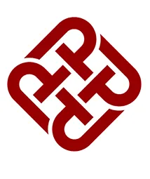
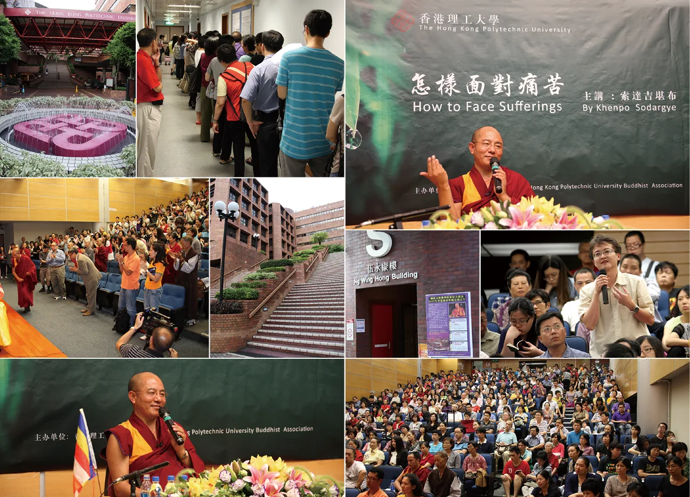
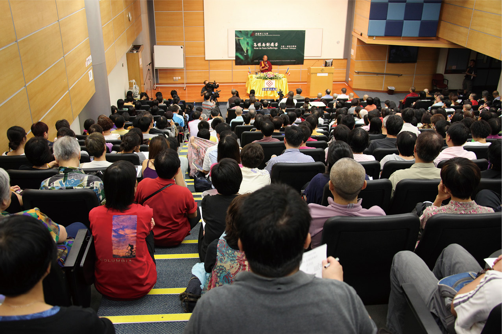
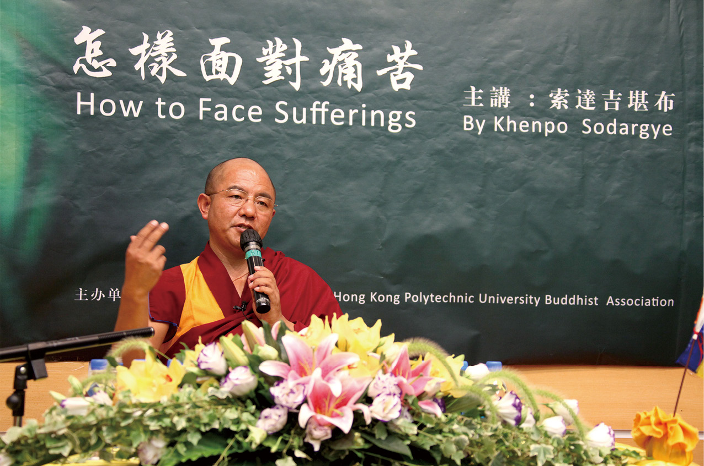
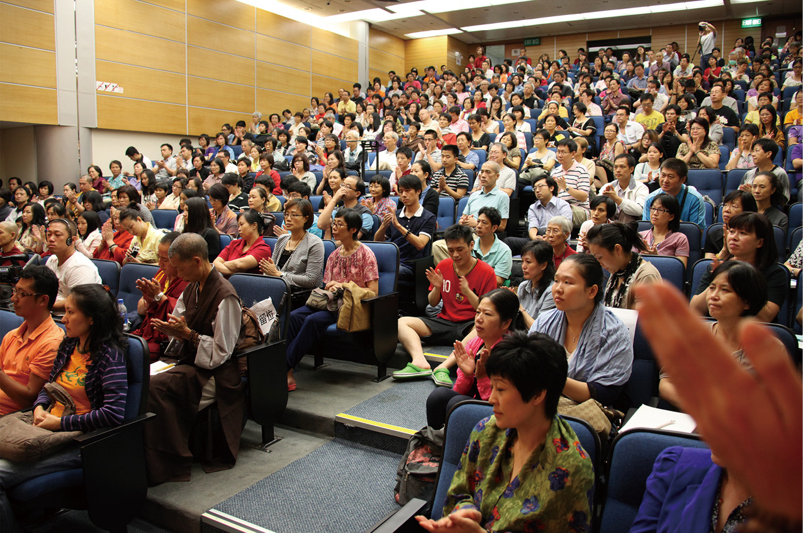

我们的快乐，

就像一块蓝布上的小白点，

只是偶尔的点缀，

却不是人生的底色。

第12场

香港理工大学

The Hong Kong Polytechnic university

中国·香港

2011 / 7 / 29

## 怎样面对痛苦

## Working with Suffering

主持人：

下面简单给大家介绍一下今天的演讲嘉宾索达吉堪布：

索达吉堪布，依止根本上师法王如意宝修学多年，不但承担着佛学院汉僧的教学与管理工作，同时，也努力将藏传佛教的智慧宝藏，传播到汉地乃至全世界的华语地区。

堪布现已出版的著作与翻译作品，多达一百多本，目前仍旧笔耕不辍。近年来，堪布还通过网络、视频、微博等现代科技手段，广泛地传播佛法、接引善信，同时身体力行地投入办学、助老、护生等慈善活动。堪布常说：“我不知道自己能活多长时间，但只要有一口气，哪怕只有一个人听法，我也会尽心尽力用佛法饶益他。”

这位慈悲的堪布，现在就在我们场内。请全体起立，以热烈的掌声欢迎堪布——

请大家就座。首先有请我们理工大学佛学会的甘耀权会长致欢迎辞——

甘耀权会长（粤语）：

用什么话讲？他们喜欢听广东话。首先欢迎索达吉堪布来到香港理工大学讲座，更加感谢各位嘉宾，不论是我们学校的朋友，或是外面的朋友，如果没有你们，堪布也没办法讲法，所以你们很重要，要感谢大家。

其实堪布的著作很多很红，多年前我在国内就有机缘接触，并请了不少法本。堪布的著作、演讲，我们都看了很多、听了很多。今天我很高兴，终于可以见到堪布本人，大家也有这种感觉是不是？

（甘会长为了便于有些人听懂，又用国语表达了一遍。）

不行，长话要短说，不希望把时间耽误在我这边。不然的话，我叫他们录影了，拿回去放给国内朋友看的话，他们不晓得这个佛学会长在干嘛。

我再次谢谢各位来听演讲，也谢谢堪布来给我们演讲，我的讲话完了。好，下面请堪布为我们正式演讲——

大家好！很高兴来到香港理工大学。刚才进了你们校门，在甘会长和几位老师的带领下，我参观了一下这里的建筑。看完之后，觉得非常亲切，为什么呢？因为这里建筑的风格、颜色跟我们寺院十分相似。听说它拷贝于英国剑桥、牛津的建筑模式，带有工业革命时代的气息，给人一种开放包容的感觉，也喻示着这所大学的人文精神。

佛教中常讲“诸法因缘生，诸法因缘灭”，世人也喜欢说“有缘千里来相会，无缘对面不相识”，因此，我们能在这里聚会，并不是无因无缘的。这种因缘，应该是源于在座师生对佛教的信心与敬仰，所以才衍生了今天的交流主题——“怎样面对痛苦”。

痛苦，是我们每个人都不陌生的字眼。在这个世间上，痛苦可谓多之又多。我本人虽然也没有出离痛苦，给你们夸夸其谈不一定合适，但毕竟自己从小对佛法就有兴趣，多年来依止善知识，在学习、研究、修行上下过一番功夫，所以从某个层面来讲，也可以简单汇报一下自己的心得。

## 一、人类痛苦的分类

三界六道中，痛苦的分类比较多。拿我们人类而言，就有苦苦、坏苦、行苦这三大根本苦，以及生、老、病、死、求不得、爱别离、怨憎会、五阴炽盛等八大支分苦。

印度伟大学者圣天论师，还将人类的痛苦归摄为两种：身苦与意苦。如颂云：“胜者为意苦，劣者从身生，即由此二苦，日日坏世间。”意思是说，上等人的痛苦，是心理上的苦受，比如工作压力、竞争忧虑、“高处不胜寒”的辛酸等；小人物的痛苦，则是身体上的苦受，比如缺衣少食、超强度劳动等。由此两种痛苦，恒时不断地损恼着芸芸众生。所以，世间上有钱的也痛苦，没钱的也痛苦。

过去，不少人以为有钱就会带来快乐，但后来有了钱以后才发现，快乐并没有如期而至，痛苦却反而层出不穷。对此，美国盖洛普民意调查所就用数据作了证明：按100分为满分的话，中国消费者在1994年的幸福指数是69分；1997年最高，达到71分；十年后2004年却降到了67分。这说明了什么？说明在过去的十年里，随着经济的不断发展，人们刚开始觉得很幸福，但过不了多久，幸福指数就日渐下挫，最后还不如没钱的时候幸福。

不说全世界，仅仅是中国的话，据统计每年就有28.7万人死于自杀，200万人自杀未遂，相当于每两分钟就有一人自杀身亡。可见，现在许多人虽然穿得漂漂亮亮，看起来也开开心心，但实际上，他们内心中一直被许多痛苦所迫，压得喘不过气来。

## 二、认识三界皆为痛苦的本性

不过，人生在世，苦多乐少也是难免。假如你不相信，可以看一下《中观四百论》的前八品，里面就专门讲了世俗谛中的各种痛苦。看完之后你就会明白，人生的苦可谓无处不在，诚如佛陀在《法华经》中所云：“三界无安，犹如火宅。”

当然，有些人可能不太赞同：“谁说人生皆苦？我就过得很快乐。”以前有个特别爱喝酒的人，就跟我说：“你们讲轮回痛苦，其实不苦，我天天喝酒特别舒服。”但你酒醉后产生的快乐，是一种疯狂失常的颠倒意识，根本不算是真正的快乐。

美国史学教授达林（Darrin M. McMahon），曾写了一本书叫《幸福的历史》（Happiness: A History）。他花了六年的时间，引用大量历史资料，去研究人类的幸福到底是什么，到底什么能给我们带来幸福。最终他得出来什么结论呢？“如同神话里盛过基督宝血的圣杯一样，极致幸福也可能只存在于我们的想象当中。”换句话说，真正的幸福是得不到的。这种观点，可以说与佛教中讲的“三界无安”不谋而合。

所以，人生本来就充满痛苦，这一点大家必须要认识到。否则，很多人甚至是一些佛教徒，遇到一点挫折就怨天尤人，抱怨老天不公平，“为什么我这么倒霉，所有的不幸全落到了我的头上”，却不知轮回的本性即是如此。

也有人认为：“轮回中并非全是痛苦，应该也有一些快乐。”话虽不错，但实际上，这些快乐都是暂时的、无常的，随时可以变成痛苦。所以，我们的快乐，就像一块蓝布上的小白点，只是偶尔的点缀，却不是人生的底色。

此外，还有人认为，快乐存在于感官之上，比如身体的接触、悦耳的声音、漂亮的东西，这些都可以带来快乐。但这种快乐特别肤浅，有时候通过药物也可以获得。真正的快乐，其实来源于内心，要想离苦得乐，就必须从内心下手，用大乘佛教的良药，彻底拔除痛苦的根本。

## 三、人们解除痛苦的不同方法

那么，具体怎样拔除痛苦呢？

### 1．低劣的世间方法

首先讲一下世间人除苦的错误方法。有些人在特别痛苦时，拼命地酗酒、抽烟、吸毒。我就认识一个佛教徒，他说自己的烟酒戒不了，为什么呢？因为他心里很烦躁时，就会躲到咖啡厅里吞云吐雾，再去舞厅借酒消愁。他觉得一醉可以解千愁，但真的能这样吗？并非如此。这只会让自己越来越愁，一旦清醒过来，事情仍然要面对，想躲也躲不掉。

还有些人，心情不好了就去邪淫，或到卡拉OK乱吼，或者打麻将、花天酒地，这些无疑都是一种逃避。

还有些人，把痛苦的事都写在纸上，然后点火烧掉，看着纸上的字一点点灰飞烟灭，感觉痛苦也随之消失。但这相当于迷信，也没有多大意义。

还有些人，到山谷里大喊大叫，或者用头使劲撞墙，甚至把家里的锅碗瓢盆全部砸烂，这样发泄一通才觉得轻松。

更有甚者，还会以杀人取乐。前不久在美国，一个17岁的孩子就把父母杀了。在双亲遗体仍在房内的情况下，通过Facebook邀请40到60名青少年来到家中，通宵喝酒狂欢。

或者，有些人失恋以后，要么自杀，要么把爱人杀了，如果实在找不到爱人泄愤，就找些样子相似的人代替。听说某地就有个大学生，因为自己失恋了，就专门杀一些穿红衣服、长发披肩的女学生，以此来报复前女友对他的无情抛弃。

### 2．中等的世间方法

稍微好一点的人，在遇到痛苦时，则会游山玩水，或者找有智慧的人聊聊天，或者做一些心理咨询，或者看看《心灵鸡汤》（Chicken Soup for the Soul）等励志的书。

《心灵鸡汤》是个美国人写的，前几年比较轰动，里面讲了很多哲理小故事，看的时候比较舒服，但看完以后，不像佛教那样有特别深的窍诀，可以根除自己的烦恼。不过，这也是一种方法吧。

通过这些方法，就像吃了止痛片一样，可以暂时压制痛苦，让它不再折磨自己。但这终究治标不治本，要想从根本上解决问题，最好的方法莫过于学佛。

### 3．最殊胜的佛教方法

所以，我今天想将自己所了解的佛法，与你们分享，大家通过这些方法，很容易消除内心的痛苦。即使有些习气根深蒂固，无法一下子完全断除，但只要持之以恒经常串习，痛苦也迟早会离你而去。

什么方法呢？下面就介绍几种：

#### 1）利益众生，断除自利

当你特别痛苦时，首先要认识到痛苦的来源是我执，也就是自私自利的这颗心。相信各位都很清楚，一旦你遇到困境而痛不欲生时，为众生痛苦的应该寥寥无几，为自己痛苦的可谓比比皆是。所以，要想断除一切痛苦，就先要斩断它的来源；而要想斩断它的来源，大家理应学习一些佛教经论，以大乘的无我精神改变自私自利的心态。

以前就有不少这样的人，刚开始因为各种事情特别苦恼，但后来学了大乘佛法以后，经常做些有利于众生的事情，比如搞慈善、做义工，原来的痛苦不知不觉就消失了。所以，第一个断除痛苦的方法，就是要利益众生。假如你有大乘的慈悲心、菩提心，那是再好不过了，但即使没有，至少也应具有仁爱的传统道德，它也是挽救人类的妙药之一。

1988年，曾有75位诺贝尔奖获得者，在法国巴黎召开了一次历史性的会议，探讨了21世纪科学的发展与人类面临的问题。最后，他们共同建议了一个宣言：“如果人类要在21世纪生存下去，必须回到2500年前去吸取孔子的智慧！”

然而遗憾的是，国外对中国文化抱有很大希望，但这个时候的中国，孔孟思想却遭到了史无前例的破坏。记得在我小时候，大概是1974年，全国就开展了“批林批孔”运动。为了防止否定“文化大革命”，害怕某些人以儒教思想来复辟反党，四人帮对孔子的思想进行了批斗。尽管这个运动不到半年就结束了，但它的后遗症却相当严重。从那时候开始，中国的传统文化便一蹶不振，即使现在许多有识之士想力挽狂澜，但它就像个奄奄一息的病人，想完全恢复过来非常困难。

昨天在中文大学的研讨会上，我看到很多年轻人，除了对佛教感兴趣之外，对弘扬传统文化也有一定的积极性。为什么呢？因为这些传统文化，如今在别的国家被推崇备至，而在自己的国家，却备受冷落。像“孝顺父母”“尊敬师长”，这方面的美德往往都看不见了。好多老师自己都没有受过这种教育，想教学生更是难如登天。如此一来，这些学生在什么样的教育中成长，他们的下一代也会受到什么样的影响。

所以，我们现在的教育内容，需要再三地完善，不能只追求一个分数就够了。如今各个大学录取的标准，只看分数的高低。其实，一个人考了多少分并不重要，他的人格才决定一切。有些人就算再聪明，但人品特别差的话，对社会也不会有利，反而贻害无穷。所以，培养人才一定要将“德”放在首位。

我就遇到过有些大学生，肚子里明明没什么内涵，但傲慢心却如山王一样大，对佛教的态度非常轻视，口口声声加以批评。其实，佛教并不怕人批评，它所揭示的真理完全经得起任何观察。可你若对佛教一窍不通，就断章取义、信口开河，这只能暴露自己的浅薄无知，对佛教却不会构成任何危害。

所以，教育一定要教学生怎么做人，要培养德才兼备的人才。在中国古代，一个人到底能否得以重用，不但要看他的学问，更要观察他的德行。假如他人格高尚、众望所归，即使学问不是很高，也会被委以重任；反之，倘若他没有慈悲善良的心，纵然才高八斗、学富五车，或者精通佛教的三藏十二部，也不一定对天下苍生有利。

因此，大家一定要明白“德”的重要性。如今联合国总部的大厦中，就挂着孔子的一句话：“己所不欲，勿施于人。”然而，很多人懂不懂这个道理呢？当你受到生命威胁时，往往会贪生怕死，而你天天吃的动物，它们又何尝不是如此？所以，断除自利、利益众生，并不是口头上说说而已，自己能否真正做到，这需要从很多方面观察。当然，假如你真的做到了，则必定会断除各种痛苦。

#### 2）苦乐皆转为道用

我们遇到很大的痛苦时，佛教中还有一种方法，可以将它转为道用。也就是说，本身这个事情是一种痛苦，但你可以不把它当作痛苦，而把它利用起来。

比如，无著菩萨在《快乐之歌》中讲过，我们生病也可以，不生病也可以：生病的话，以此可消除往昔的很多业障；不生病的话，用这个健康的身体可以多做善事。我们没钱也可以，有钱也可以：没钱的话，可以断除对财物的耽著；有钱的话，可用它来上供下施、积累资粮。有些出家人对钱没什么贪执，自然就有很多钱了，这时你也不必特别苦恼：“有钱了，我怎么办啊！”佛陀在《毗奈耶经》中讲过，倘若你前世的福报很大，今生不需要勤作就腰缠万贯，那就算是一个出家人，所住的房屋价值五百金钱，也是允许的；所穿的衣服价值一亿金钱，也是可以的[^1]。所以，无论发生什么事情，苦也好、乐也好，我们都应该快乐。

其实，一个人若想获得成功与辉煌，经历各种痛苦也是必需的。爱因斯坦说过：“通向人类真正伟大境界的通道只有一条——苦难的道路。”所以，真正有智慧的人，根本不会畏惧痛苦，反而会将生活中的每一次磨难，都转化成通往解脱的基石。

曾有个故事，就讲了这个道理：从前，一个农民的驴子掉到了枯井里。农民在井口急得团团转，就是没办法把它救出来。最后农民断然决定：这驴子已经老了，这口枯井也该填起来了，不值得花太大精力去救驴子。于是就把所有邻居都请来，开始往井里填土。

驴子很快意识到发生了什么事，起初，它在井里恐慌地大声哀叫。不一会儿，令人不解的是，它居然安静下来了。农民忍不住朝井下一看，眼前的情景让他震惊：每一铲砸到驴子背上的土，它都迅速地抖落下来，然后狠狠地用脚踩紧。就这样，没过多久，驴子竟然把自己升到了井口，在众人惊讶的目光中，纵身跳了出来，快步跑开了……

实际上，生活也是如此。纵然许多痛苦如尘土般降临到我们身上，我们也应将它统统抖落在地，重重地踩在脚下，而不要被这些痛苦掩埋。若能这样，到了最后，我们定会像驴子逃离枯井一样，从轮回的苦海中彻底脱身。

关于将痛苦转为道用的方法，藏传佛教的噶当派中讲了很多很多。我有个同学就学得不错，他是一个领导，有次在竞选某个职位时，他无动于衷，好像跟他没关系一样。旁边的人见了都着急，劝他赶紧去做做工作。他回答：“没事。万一没选上也很好，我正好有空精进修行；万一选上了也很好，可以有更多机会利益众生。不管结果如何，我都很快乐。”

但可惜的是，现在很多人不懂这个道理，经常患得患失，觉得这个不行、那个不行，有时候把顺缘也变成了违缘。假如你能换个角度看问题，那什么违缘都可以成为顺缘，这就叫把痛苦转为道用。贝多芬（Ludwig van Beethoven, 1770-1827）也说：“最杰出的人，总能用痛苦来换取欢乐。”

#### 3）修持自他交换

观修自他交换，对消除痛苦也很有帮助。比如，当你重病在床、名声受损、穷困潦倒时，可以发愿：“轮回中也有许多感受这样痛苦的众生，愿他们的一切苦难都成熟于我身上。”然后当自己向外呼气时，观想自己的所有安乐，犹如脱下衣服给众生穿上般，完全布施给他们；当向内吸气时，再观想把众生的所有痛苦全部吸入体内，由自己来承受，以此他们都离苦得乐。

这是大乘佛教中甚深的修心教言。我们在遭受痛苦时，若能经常这样观修，所受的痛苦就有了价值，对自我的爱执也会日益减少。

#### 4）以空性观面对

假如你有空性见解，这是最好不过的了，以此可从根本上解决问题。为什么呢？因为我们的一切痛苦，都是从分别念而来，而分别念则可依靠空性见断除。圣天论师在《四百论》中也说：“虚妄分别缚，证空见能除。”

当然，所谓的空性，不一定非要证悟一地菩萨那样的境界，但至少也要对“万法皆空”稍有了解，所以，希望大家多学一下《中观根本慧论》《四百论》。尤其是有些年轻人，皈依佛门十几年了，对佛教的道理却一窍不通，只是随便看几本书，这样的话，不一定是名副其实的佛教徒。

如今佛教徒有两个误区：一是很多知识分子研究佛教，不像藏地寺院的修行人那样，在讲辩著、闻思修上花很多时间，而是认为得个佛教硕士、博士的头衔就可以了。如此一来，他们对佛教的认识相当肤浅，写的很多论文也没什么实在意义，可内心的傲慢却与日俱增。二是有些信众比较迷信，到处求灌顶、求加持，以为解脱有捷径可寻。

其实作为佛教徒，若想真正深入佛教，必须要一步一步、踏踏实实地修学。现在世间的义务教育都要九年，读完后也只是初中毕业，那么博大精深的佛教，就更不可能用短时间通达了。要知道，佛教远远超过世间任何学问，假如你没有系统地学习，光是办个皈依证、求个灌顶，就自称为佛教徒，这只是虚有其表、徒有其名罢了。

因此，佛教不像有些人想的那么简单，它既要实修，也要闻思，二者缺一不可。刚才我跟甘会长交流时，彼此都有一种共识：对于佛教，只是理论研究并不行，还要有实际修持；只是盲修瞎炼也不行，还要有理论依据，这两者，任何人都值得下一番功夫。

话说回来，刚才也讲了，假如你想消除自己的痛苦，就要对空性有所了解，闻思一些中观方面的道理。尤其像《中观根本慧论》，学了以后，百分之百对你有帮助。当年将佛法广弘于人间的，就是这部论的作者——龙猛菩萨。以前我看过世间、出世间的许多书，但看了它以后，的确能对佛陀生起不退转的信心。

所以，你们若想了解空性，最好是从《中观根本慧论》入手。此论开头的第一句就是：“不生亦不灭，不常亦不断，不一亦不异，不来亦不去。能说是因缘，善灭诸戏论，我稽首礼佛，诸说中第一。”短短几个字，便将万法的真相揭示得淋漓尽致。不管是我们心的本性、痛苦的本性，还是外在万法的本性，确实不生不灭、不常不断、不一不异、不来不去。对此，龙猛菩萨从第一品到二十七品之间，进行了逐一剖析，任何一个科学家都没办法驳倒。

昨天中文大学有个教授问我：“对现在的大学生讲一些佛教故事，他们不相信怎么办？”我说：“不用讲故事，不然的话，他们听惯了神话、看惯了动画，很容易把佛教故事当成这些。若想引导他们认识佛教，就一定要从中观和因明下手，先把他们的傲慢摧毁了，再讲这些故事，他们才能体会到佛教的伟大。”

2009年7月，日内瓦“国际联合宗教会”召开了一个会议，会上世界五大宗教为主的各大宗教、200位宗教领袖，通过投票的方式，一致表决佛教是“世界上最好的宗教”。在投票过程中，很多宗教领袖并没有选择自己的宗教，而是把唯一的一票投给了佛教。为什么呢？因为在过去的历史中，没有一场战争是以佛教名义发动的；同时，佛教的慈悲提倡无偏利益一切众生，它的智慧对万法研究得极为透彻，这些都是佛教的不共特点。

我以前在复旦时，就引用了中国科技大学前校长的一句话，他说什么呢？“科学家千辛万苦爬到山顶时，佛学大师已经在此等候多时了。”的确，不管是哪个领域的学问，在佛教中都揭示得极为圆满。当然，有些佛教徒对此不了解的话，这只是他个人的问题，并不是佛教的过失。

尤其是佛教中的空性见，通过剖析“我”不存在，能彻底断除一切痛苦。怎么样断除呢？大家都知道，感受痛苦的“我”与所受的痛苦之间，是一种互相观待的关系，离开了一者，另一者必然不存在。《中论》也说：“离法何有人？离人何有法？”现在有些人天天叫苦连天，但痛苦的“我”到底在哪里？所受的痛苦又在哪里？通过中观正理一一观察，最后就会知道，痛苦根本不存在，只不过是自己的虚妄分别而已。

所以，我们如果没有证悟空性，就很容易追名逐利，将各种虚妄耽著为实有。一旦你能像很多高僧大德那样，依靠空性断除了我执，那一切痛苦都会烟消云散，开悟的境界会给你带来不可言说的快乐。

#### 5）修持安忍

我们在感受痛苦时，还可以修一下安忍。安忍，就是世间人所说的坚强，有了它的话，面对痛苦就不会轻易屈服。

像美国总统林肯（Abraham Lincoln, 1809-1865），终其一生都在面对挫败：八次竞选、八次落败，两次经商、两次失败，甚至还精神崩溃过一次。好多次他都可以放弃了，但他并没有这样做。也正因为这种坚强，他才成为美国历史上最伟大的总统之一。

还有，美国著名的盲聋女作家海伦·凯勒（Helen Keller, 1880-1968），也用她坚强的一生，缔造了不可思议的奇迹。

居里夫人（Maria Sklodowska-Curie, 1867-1934）曾说：“我的最高原则是：不论对任何困难，都决不屈服。”她的传记中也记载，当年她在求学时非常贫穷，经历了许多常人难以忍受的苦行。因为营养不良，她一次次地晕了过去；天冷的时候没有被子，只好把所有衣服都盖在身上，最后冷得把椅子也压到身上取暖。

藏传佛教历史上，有一位伟大的祖师叫龙钦巴。他当年在桑耶修行时，生活也非常清苦。他的全部家当就是一个牛毛口袋，每当下雪时，他就钻进牛毛口袋里。这个口袋，不但是他的被子、坐垫，还是他唯一的衣服。

提到“唯一的衣服”，我想起了护生短片中的一只小狐狸，它说：“我有件美丽的衣裳，一年四季穿身上。我一辈子只有这么一件衣裳，是妈妈生我的时候送我的，我从此天天穿着它，晚上睡觉也不脱。人呀，我的衣裳只一件，而你的衣橱已满又满。我的衣裳是我的毛皮，失去毛皮，我只有血肉一团。你的衣服可以一天三换，我衣服脱下，就命丧九泉。”

确实，人类如果不穿动物皮，实际上还有很多衣服可穿；如果不吃动物肉，也还有很多蔬菜可吃。有些人吃一块肉不觉得什么，但你可曾想过，这只动物只有这一块肉，你吃了的话，它就会因此而丧命？现在西方国家有不少保护动物组织，我们这边虽然不多，但每个人最好能从自己做起，真正去关爱所有的动物。比如，你以前特别爱吃肉的话，以后尽量少吃一点，这也算是一种“安忍”。

#### 6）麦彭仁波切的“心情愉快法”

藏传佛教中还有个实修法，可以消除我们日常生活中的痛苦，让我们保持心情愉快。

方法很简单：首先双目直视虚空，不执著一切而自然放松，心胸尽量放大，在这样的境界中坦然安住。然后念诵“达雅他 嗡 措姆迷勒那 德卡踏m索哈”，这个咒语念7遍、108遍都可以。如此观修，有助于我们天天好心情，人际关系趋于改善，许多不顺迎刃而解。

这个修法，我也修过一段时间，效果确实非常好。当然，你没有信心的话，效果也不一定很明显，毕竟修任何一个法，信心都特别关键。有些人认为这不理性，其实你如果过于理性，许多甚深领域就难以涉入；而太过感性的话，这也是一种极端。有些搞学术研究的人，对“信心”“加持”统统否定，一提起来就嗤之以鼻，除了自己的分别念，什么都不相信；而有些人又太过盲目迷信，对理论从来不去研究，这也是不合理的。所以，若想认识这个世界的真相，我们应当住于中道，不堕两边。

刚才的修法可以让我们心量放大，如果换个视角看问题，就不会死执于一点了。以前有一位画家，他在白纸上画了个黑点，然后装在相框里。许多人看后众说纷纭、莫衷一是，不知道这究竟代表什么。其实它的意义很深刻：众生执著于一点时，往往会忽略很多很多，全然不觉还有大片的空间。

比如说，你今天被人骂了、无端遭人诽谤，可能会一直耿耿于怀，午饭都吃不下；或者你父亲死了，感情遇到了挫折，就觉得天崩地裂、日月无光。其实在这个世间上，本来还有许多事物能带来快乐，但你若只执著这一点，围着这个黑点团团转，没有发现大片的白纸，就会感到痛苦万分、难以释怀。

原来我认识一个人，因为家庭出了点问题，她就不想活了，于是在成都包了个车，跑到了壤塘的大草原。这个草原特别广阔，十几公里都看不到边，她下了车以后，打发司机走了，就在那里大声叫喊，发泄内心的痛苦。结果喊着喊着，她看看天空无边无际，草原如此广阔，心也随之开朗起来。她觉得自己就像一只小蚂蚁，拼命执著一个小小的窝，这有什么意义呢？明白了这一点后，她当下就放下了，痛苦也销声匿迹了。所以，内心的执著是一切痛苦的来源，一旦把这种执著看破了，痛苦也就不再束缚自己了。

对于痛苦，古往今来很多大成就者，并没有当作一回事。《入行论》中也讲了，这件事情尚有转机的话，你用不着痛苦；没有转机的话，那痛苦也无济于事[^2]。这个道理说得非常好，比如你父母死了，如果有办法让他们活过来，那你没必要痛苦；倘若已经无力回天了，你再哭又有什么用呢？不过，真正能这么想的人，现在可能没有几个。

当然，我并不是说自己就是这样的人，在生活中遇到什么都能坦然面对。但我通过长期学习大乘佛法，现在看到家人死了，跟以前的心态完全不同。这一点，在你们这么多人面前，我也不会说妄语。所以，希望大家以后遇到痛苦时，最好也能从佛法中寻找解脱方法，没有必要去自杀，或者吸毒、吃摇头丸。这些乱七八糟的东西，吃了对你身体不好，不要尝试用这种方式逃避，而应该看一些佛书，听一些真正的高僧大德的开示，深入了解佛法的意义，如此才能治本，而不是治标。

现在不少人也有这样的体会：原来自己没有学佛时，做的很多事情非常无聊。但学了佛以后，才明白人到底为什么而活着，以此解决了很多现实问题，内心也感受到了快乐。这一切，都是金钱无法带来的。

在座的很多老师、同学，你们当中，也许有佛菩萨的化现。如果有人真是圣者，那就另当别论了；但若是像我这样的凡夫人，建议大家还是依靠闻思修佛法来对治痛苦，若能这样，我敢保证，你的痛苦一定会消失无踪。

#### 7）略说密宗不共的认识觉性

最后再介绍一种方法：密宗大圆满的修行方法。当然，它的具体修法，你们要受过灌顶、修过加行才能听。不过，以我个人体会的话，这个方法是最简单、最直接的，不需要用中观理论去观察、分析，只依靠上师的一个窍诀，就可以认识痛苦的本性，当下将烦恼转为菩提。

《六祖坛经》中也说：“烦恼即菩提。”这是禅宗、密宗中最深的窍诀，有信心的人才可以得到，而分别念重、邪见大的人，连法本都不让看。现在有些人偷偷去看，但没有上师接引的话，你看了也看不懂，只能看到一些表面文字，至于其中的甚深内涵，根本不可能触及。

综上所述，我刚才所讲的解除痛苦的方法，是方方面面的，你们不一定要全部都用，毕竟每个人的根基不同，选择适合自己的就可以。就像生了病以后，有些人吃中药能好，有些人用按摩也行，有些人还可以打针，但不管选择哪一种，目的都是为了断除痛苦。

要知道，痛苦是由心而生，故也要由心而灭。若想靠金钱等外在物质来除苦，肯定解决不了问题。只有通过佛法“自净其意”，也就是调伏自心，才能从根本上拔除痛苦。最后，希望我们今天的交流，能给各位稍微带来一点利益，哪怕让你减轻一瞬间的痛苦、获得一瞬间的快乐，我觉得也值得了！

现场互动

问：我是香港大学教育学院的学生。现代脑科学发现，特定的脑区，与情绪、记忆等有种种关联。所以，很多人认为心识只不过是大脑的产物，大脑死了，心识也就不存在了。请问，如何遣除此种疑惑？

堪布：现在所谓的脑科学，只是对大脑的部分结构作了一些分析，至于心与脑之间的真正关系，科学界对此仍是一片空白。到目前为止，包括荣格的心理学在内，也没有透彻观察到内心的本质，且不说大乘密宗中揭示的道理，就算是小乘《俱舍论》讲的心与心所之间的关系，他们也没有弄得比较明白。

其实，“大脑死了，心识也就不存在了”，这种说法并不正确。没有大脑却能存活的人，目前已发现有数十位之多。以前六世达赖在传记中也说，他还亲眼看见过一个没有头的人活着，深感众生的业力不可思议[^3]。

正好，昨天晚上我也梦到一个人，头放在这里，身体在那边，而且还会说话。当时我就跟旁边的人讲：“这个病人非常严重，赶快送到医院去救。我可以出点钱，出多少都可以，毕竟事关一个人的性命。”早上醒来以后，不知道这是什么意思，但至少我在梦中没有生恶念，而是产生了一个利他心，还是挺不错的，自己也比较欢喜。你今天就恰恰问了这样的问题，可能是一种预示吧。

问：仁波切您好，我代表一位美国朋友问一个问题。请问：佛法的传承为什么很重要？现代有先进的科学记录手段，还需要强调传承吗？

堪布：佛法的任何一个传承，包括戒律的传承，都非常重要。

像我们藏地，比丘尼戒的传承就历来没有，只有沙弥尼戒的传承，所以女众出家的话，便无法受比丘尼戒；而在汉地，这个戒律的传承一直都存在。不过在藏地，《大藏经》和论著的传承，始终完好无损地代代相传，这是相当稀有的。

那么，这些传承有什么作用呢？可以起到加持承接的作用，也就是说，它能将佛陀的加持无有间断地传给我们，这对修行人来说至关重要。

其实，不单单是佛教强调传承，包括世间也是如此。比如他们美国的总统，第一个是华盛顿，到现在是奥巴马，这也算是一种传承。既然世间的传承都十分重要，那佛教的法脉就更不用说了。

问：您刚说烦恼就是菩提，感受痛苦时要想到别人，不断地发愿、回向，以此培养慈悲心，这样就不再有痛苦了，对不对？

堪布：这要看每个人的修行功夫。

问：但这样也会非常痛苦啊。比如看上师生病了，希望上师能够马上康复。

堪布：《宝性论》里说了，真正的圣者超离了生老病死，身体上是不会有病苦的；但在众生面前，出于某种利他的需要，上师也可以显现生病等[^4]。所以，弟子为上师生病而痛苦，是凡夫对圣者的一种担忧。

问：那么说，上师生病是为了度化我们，就像维摩诘居士一样？

堪布：如果上师是大成就者的话，是；但若上师是凡夫人，那也值得弟子关心。（众笑）

问：动物是有生命的，吃它是一种不好的行为。但植物也是有生命的，我们吃了的话，会不会也像吃动物一样不好呢？

堪布：这个问题，我昨天在中文大学那边也讲过。佛在《涅槃经》中说：“众生佛性住五阴中，若坏五阴名曰杀生。”所以，五蕴聚合的生命，才有真正的痛苦。动物就有这样的生命，而植物，虽在外境的刺激下会产生某种反应，比如动摇、生长、死亡，但它并没有真实的五蕴。假如认为植物也有动物或人一样的生命，那佛在《楞严经》里说了，若许“十方草木，皆称有情，与人无异”，则堕入外道，“迷佛菩提，亡失知见”。

现在很多人觉得植物与动物完全一样，这样的观点大错特错。包括有些大学老师也分不清楚，这是相当遗憾的。以前郭沫若翻译过一部很厚的书，叫《生命之科学》，我也曾看过，里面就讲了很多生物学的知识，但也没有把动物和植物的生命分开。

按照我们佛教的观点，你今天割一根草，跟杀一头牛有很大差别。杀牛是摧毁了有情的生命，这有极大过失；而割草的话，并没有杀生的过患。

有些人可能会说：“佛教里不是讲了吗，对动物不能损害，对草木也不能损害。”这种说法虽然是有，但意思并非完全相同。就像你去杀人和砍伐森林，尽管二者在法律上都不允许，但定罪还是有天壤之别。同样，我们杀了动物的话，必定会堕入地狱；而砍一棵树的话，则不会堕入地狱，只是有轻微的过失。

所以，在这个问题上，大家一定要弄明白。为什么我一直强调佛教徒必须要学习佛法？原因也在这里。现在很多人都认为“我吃肉也有过失，吃蔬菜也有过失”，对过失的轻重并没有分。这样的话，你偷金子也有过失，偷针也有过失，所有问题都一概而论的话，这是不合理的。

问：我是香港中文大学的。佛陀当年正是看到众生的苦，为了想办法解决，才出家修行，最终成就了佛果。那我们学了佛以后，尽管也期望有一天能成佛，但现在的心力不像佛陀那么大。在这个过程中，经常遇到痛苦怎么办呢？

堪布：经常遇到痛苦的话，容易生起出离心，把它变成一种成就的动力，这就叫将痛苦转为道用，此举对我们修行人来讲非常重要。

在藏传佛教中，很多大德并不希望成天顺顺利利，否则，修行就没什么进步了。作为大乘修行人，一旦遇到敌人、生活中出现不顺，绝不会像世间人一样痛苦，而是像拾到了如意宝般开心，以此可检验自己的修行境界如何。犹如高明的医生，能将山上所有的草，都配成良药，同样，真正有修行的人，不管遇到什么样的痛苦，都可以把它转为道用，变成解脱的一种助缘。

问：我来自香港大学医学院。我身边有个很亲近的人，我执很厉害。我也问过自己的上师，上师说她属于串习比较重的，各种习气很难一下子改变。但我还是希望能从佛法上帮助她，请问我应该怎么做？是放任她而自己继续修行，还是尽量用佛法去引导她？

堪布：怎么样去度化她，应该是你跟你上师两个人的事情，让我来说有点不合适吧。不过，我建议即使她的习气很重，不能一下子就改过来，你也不应该听之任之。

倘若翻开佛陀的传记、大德的开示，我们就会明白，度化众生并不是那么容易的，只有通过长期的劝说，有些人才会逐渐生起信心、出离心、智慧。因此，你对她不应该放任不管，而需要不断地努力。

作为一个大乘佛子，实际上身边会有很多这种人，你说了一次两次可能不起作用，但只要持之以恒，迟早他会被你感化的。有些人认为：“跟这种人怎么讲都没用，简直是白费口舌。”其实并非如此。人分为三种：一种是顽固不化的，谁说了都不听，就算佛陀来了也没用；一种是不用别人去劝，他自己就觉醒过来了；还有一种是，如果经常去引导他，他就有善根苏醒的机会，但你若是不努力，那就没办法了。《百业经》中也有很多故事说，某某众生若没遇到佛陀，就还要在轮回中流转五百世，但遇到了佛陀以后，即生就获得阿罗汉果，解脱了一切痛苦。

所以，度化众生不能避重就轻。其实，你如果有菩提心，就肯定愿意度化众生，将这种境界传给身边很多人；但你若对此什么感觉都没有，那可能就无所谓了。因此，作为一个佛教徒，居士也好、出家人也好，关键看你有没有这种境界。有的话，就不可能独吞这种精神食粮，而会很愿意跟众生分享，让他们也摆脱一切痛苦。

现在的人类，确实很需要佛法来拯救，而且如今弘扬佛法非常应时，因缘很成熟，时机也相当殊胜，我们应该要多利益一些众生。再过几十年，你我都不一定在这个世上了，很多人也灰飞烟灭了，有些往生到极乐世界了，有些堕入地狱了。所以，在今生这个短短的时间里，每个人一定要好好把握，用佛法的智慧去利益别人，真的远远胜过金钱上的帮助。

问：现今这个繁忙的社会，人们的生活和工作压力很大，特别像香港这样一个国际化都市，竞争非常激烈，怎样才能平衡各方面的压力，获得幸福感呢？

堪布：按照佛教的观点，最好要学会知足少欲。若能如此，寂天论师说了[^5]，这种远离贪欲、自由自在的快乐，就连帝释天王也很难享受到。

现在这个世界，很多人整天奔波忙碌，并不是真的缺少什么，而是为了面子、为了名利。每个人都不择手段地占有很多，以至于社会上的大部分资源，最后只流入极少数的富人手里，这是一种非常大的浪费。

其实，一个人有了权力、有了财富的话，应该用于回馈社会，让更多的人共同分享。若能有这样一颗心，自己的压力肯定会减少，幸福感也会与日俱增，整个社会才能真正体现出一种和谐。

问：我本人信佛多年，但从来没有系统学习过佛法。您能否给一个概括的指引，让我们全面接触到您所讲授的佛法？

堪布：我讲授的佛法，香港有个国际菩提学会，近两年来，对我所讲的《入菩萨行论》《大圆满前行》《藏传净土法》，以及般若方面的道理，每个星期天都在学修。今天在场穿着红衣服的，好多都是国际菩提学会的。你如果希望系统地了解佛教，可以跟他们一起学习。我只有这个办法了，否则，亲自给你讲的话，我也没有这个时间，你的各方面因缘也不一定契合。

昨前天我看了一下，香港国际菩提学会的人比较少，但不管人多人少，我都是随缘的。如果你想次第学佛，可以跟他们取得联系。以后我会给大家长期提供法本、光盘等，而且一般不收钱。

我们这个学会的原则，不是以募捐为主，不是以挣钱为主。当然，我也不是说弘扬佛法不需要钱，但之所以成立这个学会，主要是想让大家清净地学习佛法。我的发心也很清净，不管到哪里去，都只有这个想法。而我们学会的原则，也是给大家提供一个学习的机会，并没有其他任何目的。所以，如果你愿意学习，可以跟他们联系一下。

问：我是香港城市大学的。5年前我断了韧带，一直很痛苦，这几年没有敢运动。几个月前，我再做运动时，竟然又断了同一条韧带。为什么我这个身体这么弱，好像经常都有病，我该怎么解决呢？希望您可以给我一点建议。

堪布：任何一种病，都要依靠中医或西医来治疗，这是佛教也很提倡的。然后在这个基础上，再应该调整一下自己的心态。

我个人而言，10年前得过强直性脊柱炎，很多医生都说这没办法治，一辈子会非常痛苦，同时我还有肝炎、慢性胃炎。曾有一个医生，看了我的检查报告后说：“你这个人很倒霉！这么多难治的病，全部出现在你一个人身上。”如果我没有学过佛，可能心里会非常痛苦。但因为学了大乘佛法，说实话，我并没有把这些当回事，觉得这个身体再怎么保养，迟早也会腐朽的，不管自己能再活多少天，都应该做些有意义的事情。

所以，当医生看了我的报告后，说我可能活不了很久时，我就赶快在厦门找个地方，以闭关的方式翻译《释迦牟尼佛广传》。这部论没有译完之前，我很担心中途会离开世间，如果能善始善终的话，我就没什么遗憾了，这些我在日记《旅途脚印》中也写过。结果过了这么多年，这几个病奇迹般地全部好了，现在就没有什么了。

所以，我们作为病人，不要老想着自己痛苦怎么办，不要太把它当回事。正如我刚才所说，生病也可以，不生病也可以。假如这个病总好不了，那是自己前世的业障，以此可观想代众生受苦。平时有这种心态的话，遇到什么都会快乐。甚至到了一定时候，你的病会不药而愈。退一步说，就算它好不了，这个世上也不只有你我会死，所有的人最后都会离开。没办法，轮回就是这样。

问：我是香港理工大学的毕业生，也是宁玛巴佐钦传承的。请问，立断跟顿超有什么分别呢？

堪布：立断、顿超，实际上是大圆满的两大修法，又名本来清净、任运自成。本来清净，主要讲了心的本体空性；任运自成，则是讲了光明部分。修大圆满时，这两个要诀不可不知。但我们在具体修之前，必须要得过灌顶、修过加行。

关于这二者的区别，我在口头上也会讲，毕竟自己用了人生一半的时间，经常思维这些道理。但今天在座的人当中，有些对密法不一定有信心，有些连灌顶都没得过，所以可能没办法说。但我以前翻译过很多这方面的书，你最好是私下了解一下。

问：弟子非常喜欢法王如意宝，希望他很快乘愿再来。可否请您传一下他的祈请文，让我们祈请他快点回来？

堪布：法王如意宝曾经也来过香港，当时他老人家去美国、去印度时，回来都经过这里，住在白玉中心。刚才我路过理工大学的门口，他们给我指了一下白玉中心。本来我比较熟悉这条街，但现在香港变化太大了，我都不认识了。刚才来的时候，我心里也非常伤心，想当年法王如意宝还健在，现在却离开了这个世间。

不过，法王如意宝离开时，只是说“暂时”不转世，并没有说“永远”不转世。所以，我也非常希望他老人家尽快乘愿再来，度化无量无边的众生。

下面，我念一下法王的祈祷文：

涅庆日俄再爱香克思自大圣境五台山

加华头吉新拉意拉闷文殊加持入心间

晋美彭措夏拉所瓦得祈祷晋美彭措足

共机多巴破瓦新吉罗证悟意传求加持

巴美特这多杰德炯杰莲师心子降魔金刚尊

哲波南若利饶朗波嘎化现列绕朗巴游舞身

芒图隆当热波华吉协多闻教证功德悉圆满

晋美彭措夏拉所瓦得晋美彭措足下诚祈祷

特杰功博辛拉酿拉耶意传密意加持入心间

特耶吉德这巴辛吉洛心意融合一味祈加持

谢谢！

问：我是香港公开大学工商管理的硕士毕业生。我每年只有几天时间，在深圳、广州与上师会面或开法会，从上师那里学密法的机会非常少，这是一种痛苦。如果您是我的上师，会怎么处理这个问题？

堪布：如果说、假设说我是你的上师，那么我可能跟你悄悄地商量，看怎么办。（众笑）

不过，你的这个问题，现在也比较普遍。尤其是有些上师的事业越来越大了，弟子亲近他的机会就越来越少。你一年中跟上师在一起的时间，如果只有几天的话，就不能把所有希望，都寄托在与上师见面上。

其实，与上师见面并不是很重要，修学上师所传的法，经常看一些上师的法本、教言，这才是最关键的。亲近上师固然好，但上师只有一个，弟子却成千上万，上师肯定很难让所有人都满意。因此，作为一个合格的弟子，应该不断学习上师的教言，同时要精进地修行。

问：去年我恭请上师在广州为约十个香港弟子讲授佛法，共四个星期六、日，这样做对吗？是否应该主动向上师要求传授密法，或者放生等？还有什么可以做的？

堪布：你们举办法会，具体情况怎么样，我也不是很清楚。但现在不管开什么样的法会，千万不要做对佛教影响不好的事情，比如整天募捐，弄些不如法的形象，这样不但对上师不利，对整个佛教也不利。

我们每个佛教徒，都应该对佛教负责任，对上师负责任，对自己负责任。有些行为在不信佛的团体中行持，假如很可能对将来弘扬佛法不利，就应该尽量地制止；而对弘法利生真正有利的，我们哪怕遇到生命危险，也要尽心尽力去做。

以前在“文化大革命”时，法王如意宝为了护持佛法，再危险的境遇也坦然面对。所以，法王如意宝传承下的很多弟子，在弘扬佛法、利益众生方面，还是有很坚强的意志。

我非常希望在座的佛教徒，也能做到这一点。现在的学佛环境这么自由、开放，大家一定要好好珍惜，不但自己要对佛教有正信、正见，同时也应让世人真正了解佛教的本来面目。这是每个佛教徒的责任，大家务必要在这方面下功夫！

问：我是香港中文大学的学生。作为汉地弟子，皈依上师时，无法像藏地弟子般，有多年的观察，更多是随缘皈依。倘若上师传法皆如理如法，弟子就会对上师深具信心；可有时候，一些弟子知道上师置豪宅等事情后，就会有损对上师的信心。面对如此情况，我们应当怎么办？如何判断上师的显现？

堪布：我觉得，汉地弟子应该也有观察上师的条件。你们有时间，也有各种因缘，藏人有的，汉人为什么没有？

现在汉地很多人，听说来了个上师，不经观察就马上依止、接受灌顶，这是很草率的。世间人选择终身伴侣的话，也不可能在街上随便抓个人就去结婚，而需要经过几个月或一年的调查，至少了解一下他的家庭背景、性格如何。那希求生生世世的解脱比这更重要，观察上师就更是必不可少了。所以，汉地弟子以前不观察上师的做法，是很不合理的，今后大家应该像藏地弟子一样，对于想依止的上师，要经过多方面的观察。

如果你上师是具德善知识，真正对弘法利生有利，那他对豪宅、财富肯定不执著，而会视如粪土，就像以前蒋扬钦哲旺波的故事一样[^6]。我就遇到过一位上师，他在一个城市里，别人供养了很好的房子。我跟他开玩笑说：“你现在有车有房子，跟世间人没什么差别了。”他笑笑回答：“说实在的，我对这栋房子的执著，还不如对我那个牛粪棚[^7]的执著大。”我认识这个人，他并不是在说大话。所以，对有些上师来说，不管他有多少钱财，根本不像世间人那样贪执，只是把它当成石头一样。像这种人的话，豪宅再多也无所谓，这个并不是很关键。

但有些所谓的“上师”，根本不具足法相，比一般世间人还差，整天都在为钱财而蝇营狗苟，各种行为完全不是在弘扬佛法。对于这种人，大家就一定要远离。

如今汉地很多城市里，有许多好的上师，令大家有皈依、学佛的机缘，倘若没有他们的话，很多人会永远沉溺在轮回当中；但也有一些不好的上师，到了最后，他们的劣迹会暴露无遗。所以说，这个世间鱼龙混杂，许多现象要擦亮自己的眼睛去观察。

问：我是噶举的弟子，参加网上学习可以吗？不同传承有没有冲突呢？如果参加网上学习，要遵守哪些密乘戒律吗？

堪布：可以参加网上学习。网上的这些课程，只讲了《入菩萨行论》《大圆满前行》等，并没有讲到密宗的不共修法，故没有涉及密宗戒律。

佛教各派，不管是噶举、萨迦、宁玛、格鲁，都是圆融一味、互不相违的。以前在香港，有些不同宗派的弟子，包括一些佛教中心之间，互相都有冲突，这是很不好的。不管你学哪个教派的法，首先都要发菩提心，中间积累资粮，最后成就佛果，这些理念完全一致，并不分什么你我。

所以，大家在学佛时，心胸应该放大。甚至对于其他宗教，也不能随意排斥。我们修自己的就可以了，用不着去诋毁他宗，彼此间应当求同存异、和睦相处。

问：我是香港理工大学的职员。我刚出来工作不久，工作很忙，又要静修一些佛法，总觉得时间不够用。请问上师，是不是我学佛的诚意不够呢？您有没有什么好的建议？

堪布：就算我们平时特别忙、有一些生活压力，至少也应该在早上起来时，对上师三宝磕几个头，念诵百字明等简单的咒语；白天不管做什么事情，哪怕没有修行和念经的时间，但坐车也好、出门也好，一切行为都应以一颗菩提心摄持，尽量想到利益众生；然后到了晚上，可以反省一下今天的所作所为，看有没有害过众生？有没有一颗善心？有的话，就把这个功德回向一切众生。这即是大乘经常讲的“三殊胜”教言。通过这种方式，即使你工作再繁忙，慢慢日积月累的话，功德也会积少成多、水滴石穿。

问：我是香港理工大学的博士生。我们这个世界，是释迦牟尼佛的刹土。佛的刹土一般都很美好，但我们这个世界并不美好，甚至充满了痛苦，这是否意味着释迦牟尼佛在因地时没发好愿呢？

堪布：不是。《白莲花论》中讲了，释迦牟尼佛在因地时，发下了五百大愿。当时在一千位发愿者中，释迦牟尼佛和另一个人发的愿最殊胜。为什么呢？因为其他发愿者都选择了清净刹土，而释迦牟尼佛看到浊世众生非常可怜，于是就选择了这个特别恶浊的刹土。佛经中专门有一部《白莲经》，就记载了这些白莲花般的发愿，说释迦牟尼佛的五百大愿超过了千佛的大愿。

对我而言，经常都会忆念释迦牟尼佛的恩德，若不是他发愿摄受浊世众生，我们这些末法时代的人，又岂有机会得到度化？所以，我们一定要感恩大慈大悲的释迦牟尼佛！

问：我是香港理工大学的学生。谢谢您刚才与我们的精彩分享，您可否再同我们分享一下，到目前为止，您人生中遇到的最大痛苦？然后您是怎么面对它的？

堪布：我是1962年生的，现在快50岁了。回顾自己的人生，我小时候读书很晚，15岁才开始上小学，之前一直是文盲，天天放牦牛。当时我弟弟不肯去学校读书，家人害怕被罚款，实在没办法，就把我送去替弟弟读了。到现在，弟弟也常跟我开玩笑说：“我对你的恩德很大，否则，你一辈子只是山上的牧童，不会有读书的机会。”

我没有上学之前，一直都在放牛，有时候牦牛丢了，或者被狼吃了，我就不敢回家，心里非常的痛苦。

之后，我在学校里读书时，没有评上什么，或者因为一些摩擦，跟别的孩子打架输了，这个时候也很痛苦。

后来，出了家以后，到现在二十多年的时间里，我把全部精力投入学佛，一直看书、一直禅修。在这个过程中，我好像想不起来有什么痛苦。

我在1985年出家，2005年我们师范的同学开了个同学会，在所有的同学中，只有我们两三个出家人。当时每个人讲了自己这20年的经历，有些同学结婚了，有些离婚了，有些结婚了但儿子死了，丈夫死了……这样那样的痛苦特别多，好多女同学都是边哭边讲的。但我们几个出家人，确实没有特别强烈的痛苦，到目前为止仍是如此。

我自身的话，一出家就依止法王如意宝系统闻思，明白了中观空性和大乘佛教的利益，再加上周围的环境也很清净，所以记不起来有什么痛苦。后来，虽然我父亲死了、亲戚死了，但这些在我的人生中，好像没有感觉是一种痛苦。所以，佛教真的对消除痛苦非常有力，这并不只是口头上说说。

问：往生极乐世界，是不是一定要证悟空性智慧呢？带业往生，是否也要证悟空性？

堪布：不一定先要证悟空性才能往生。依靠阿弥陀佛的发愿力，带业往生之后，可以在极乐世界证悟空性，然后获得菩萨的果位，度化众生。

问：我平时看了很多佛教的哲学，对四法印也有一些了解。但我在工作中被人批评、感到压力时，这些道理有时候用不上，怎样才能使我的情绪不会过多被环境影响呢？

堪布：平时你在工作中，受到领导批评或别人谩骂时，可以把它当成一种空谷声，这在《虚幻休息》以及阿底峡尊者的教言[^8]中都有讲。

或者，也可以把别人的谩骂，当成赞叹自己的语言，这也是一种境界。以前在释迦牟尼佛面前，有人赞叹他、有人诽谤他，但佛陀对所有的毁誉都一视同仁，并不会被环境所转而感到痛苦。

尤其是你不能全部学完《入菩萨行论》的话，学一下其中的《安忍品》，也是很好的。国外许多大德在讲《入行论》时，经常只讲一个《安忍品》。你若能学一下这里面的内容，以后遇到什么样的痛苦、不公平的待遇，都可以忍受；在这个充满五欲六尘的世间上，也会活得比较开心。

同时，我希望大家学佛的话，不能只停留在名相上。有些人虽然是佛教徒，但对佛教的道理没有怎么去修，这是不合理的。你要当个佛教徒的话，还是要有一点实质，不能完全是一种空架子。

假如你想修持佛法，就应当从皈依、发心等加行开始修，这些简单的法修好了，再修高深的法才比较稳妥。然而，现在很多人不是这样，他们非要先求高深的法，然后进入简单的法，就如同先读博士、再去读小学一样，顺序已经搞错了。

主持人：

因为时间的关系，今天晚上的现场提问就到此结束！

相信大家一定感到很有收获。倘若你意犹未尽，可以通过网站或微博，继续与堪布沟通、交流。如果你对堪布传授的佛学内容感兴趣，可以学习国际菩提学会的课程。大家手上的简介，就有堪布的网址和国际菩提学会的联络方式。

最后，让我们起立，再次以最热烈的掌声感谢索达吉堪布！欢送堪布离场——

[^1]: 《根本说一切有部尼陀那》云：“佛言：汝等若以信心投我出家情求涅槃修净行者。此诸苾刍所著衣服直一亿金钱。所住房舍直金钱五百。所啖饮食具足百味。如是等事我皆听受。汝并堪销。”又《根本说一切有部百一羯磨》云：“佛言：我今听许。诸有发心求涅槃人。来诣我所。修净行者。所著衣服价直百千两金。所住房舍价直五百。所啖饮食六味具足。此等供养悉皆销受。”
[^2]: 《入行论》云：“若事尚可改，云何不欢喜；若已不济事，忧恼有何益？”
[^3]: 六世达赖仓央嘉措的秘传中记载：“有一天到一户人家里歇脚，在他家中我看到了一个无头之人。向其家人打听原因，他们告诉我说，此人原先就患有颈项病，后来头就断掉了。这种情况已持续了三年，现在他依然活着。面对这个无头人，我的悲心不可遏制地源源不竭生起，我就一直用悲悯的目光注视着他。不大一会儿，就见他开始用手捶打前胸，我便问他的家人他要干什么。有一人回答说此人饿了，要吃东西。这个无头人尽管已没有了头颅，但他脖子上还留有两个管道，家人就将用瓶子盛装的糌粑汤顺着管道倒下去，那汤已经调好，既不冷也不热亦不寡味。他们倒一会儿就得停下来等上片刻，因倒进去的汤水会泛起泡沫。过了一会儿，当泡沫消散后就又接着往下灌，就像我们平常倒水那样。慢慢地，瓶中的糌粑汤就给倒完了……”
[^4]: 《宝性论》云：“菩萨如实知佛性，解脱生老病死等，离生等贫由证因，悲悯众生示生死。”
[^5]: 《入行论》云：“离贪自在行，谁亦不相干，王侯亦难享，知足闲居欢。”
[^6]: 华智仁波切曾以乞讨的方式四处云游，他有一个木碗，伴他同甘共苦，他十分喜爱它。一次，华智仁波切去拜见上师蒋扬钦哲仁波切，见上师周围眷属云集，房间富丽堂皇，里面装满了金银财宝，心想：“原来上师也很喜欢财物，这满屋的珍宝，他一定很执著吧！”上师以神通照见了他的心思，一语中的地高喝道：“华智，不要想得太多！我对这室内室外财宝的执著，远不如你对那木碗的执著大！”一句话使华智仁波切恍然大悟：修行人并不一定要过苦行僧般的生活，最重要的是要放下执著。
[^7]: 在藏地，冬天取暖一般是烧牛粪，堆积干牛粪的木棚就叫牛粪棚。
[^8]: 阿底峡尊者在《菩萨宝鬘论》中云：“若闻逆耳之语时，当视犹如空谷声。”
