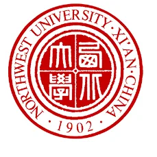
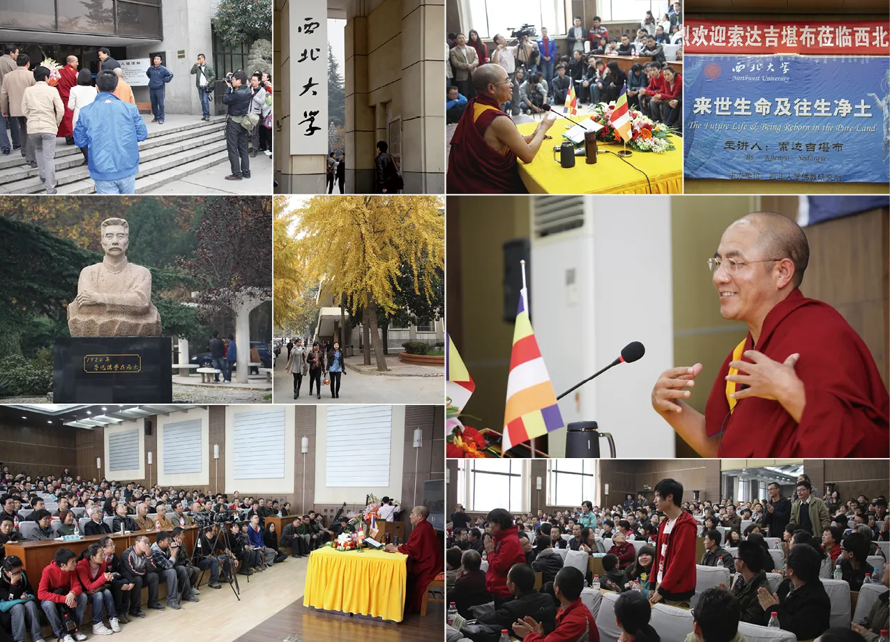
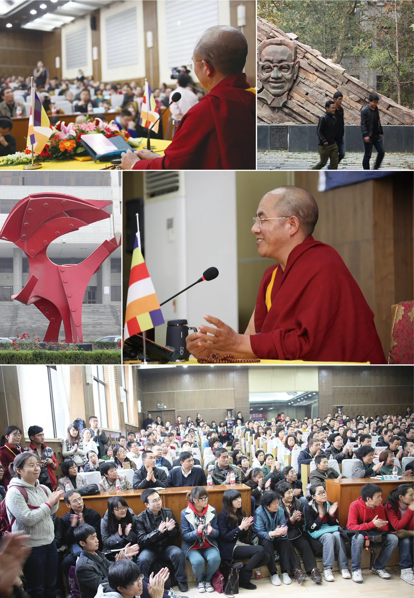

“人到底有没有来世”，

这个问题极为重要。

如果来世真的没有，

我们现在随心所欲、

为所欲为也可以，

但来世若是存在怎么办呢？

第16场

西北大学

Northwest University

中国·西安

2011 / 11 / 10

## 来世生命及往生净土

## Rebirth and Pure-land

主持人：

首先，我代表西北大学佛教研究所，欢迎索达吉堪布来到我们学校演讲！

“索达吉堪布”这个名字，对稍微接触过佛教的人而言，可以说是如雷贯耳。我今天就不占用太多时间介绍了，如果您还不熟悉，只要打开网站，所有信息都会蹦到您的眼前。在这里，我想说的一点是，堪布虽然身现出家相，但同时还是一个大学者，著作超过上千万字，在海内外有非常广泛的影响。此外，他也是社会慈善事业的推动者，不遗余力地做了许多慈善公益活动。

我们西北大学，有佛教研究所，也有宗教研究中心，在座的许多老师和同学，都是从事宗教研究的，尤其是宗教的生命关怀研究，是我们的主打项目之一。宗教关注的，是人类的终极问题，这和生命息息相关，但生命是什么？生命有没有未来，有没有延续？如果有延续，是以一种什么样的方式？关于这些，学术界众说纷纭，许多学者也有极大疑惑。

然而，对此问题的理论和实践，佛教界却传承了2500多年。尤其是藏传佛教，它源自印度的大乘佛教。据唐玄奘的《大唐西域记》记载，大乘佛教最辉煌的阶段，就是印度那烂陀寺时期。而那烂陀寺的教法，在藏传佛教中得到了最完整的保存。今天来到这里的索达吉堪布，作为藏传佛教的传承者，他愿意把自己所掌握的佛教智慧，与所有热爱生命、对生命来去感兴趣的人们分享。

这一路走来，堪布从北大、清华、中大……如今，走到了我们西北大学的课堂。我想，今天的演讲，将不仅仅是简单而充满理性的学术讲座，也将是对我们充满启迪性的一个开示。所以，在有请堪布上台之前，请大家做一个深呼吸，以轻松的身心，聆听这场关于生命可持续性以及生命实相的演讲——

我和大家今天交流的，是来世生命和往生的问题。这个内容，我在其他学校也做过一些开示，基本上讲了一些道理，原本打算换个题目，但学校这边说最好还是用这个。后来我就想了想，觉得对此进行再次剖析，也未尝不可。

## 一、对来世存在的不同态度

“人到底有没有来世”，这个问题极为重要。如果来世真的没有，我们现在随心所欲、为所欲为也可以，但来世若是存在怎么办呢？

经常听到有种说法是要“关心下一代”，其实不仅仅要关心下一代，我们还要“关心下一世”。假如从不考虑这个问题，所作所为就会非常可怕，正如佛陀在经中所言：“不见后世，无恶不造。”

如今有很多人，对佛教理论讲得头头是道，但实际上，他们往往耽著一些名相，最重大的切身问题，反而彻底给忽略掉了。要知道，人的来世非常非常漫长，它不是只有一百年、两百年，或者千年、万年就能终结，而是长得令我们无法计算。既然时间如此之久，每个人又怎能不做任何准备呢？所以下面，我们就来世是否存在的问题，好好地做一番深入分析。

当然，今天的交流很自由开放，按照国际上的方式，我坐得最低，你们坐得很高，每个人都可以观察我，这样就不会觉得我高高在上，不管说得对不对都非要接受了。现在是21世纪了，无论是藏传佛教、汉传佛教，还是学术界的各位人士，都应以非常公正、客观的态度来分析问题，所以，倘若我在讲的过程中，语言上和内容上有什么毛病，等一会儿你们可以直接点出来。

关于前世后世的存在，汉文中也有一些相关文献，但藏文、英文中的资料更多。在我们藏地，大家普遍承认前世后世，假如一个人声称它不存在，人们就会觉得他的思想有问题。而在汉地，情况却与此恰恰相反，倘若一个人认为有前世后世，大家反而觉得他的精神有毛病，进而指指点点、议论纷纷。

对于前世后世的态度，你们在座的人可能分三种：认为必定存在；认为可能存在；认为绝对不存在。在这三种人当中，你自己属于哪一种？可以扪心自问一下。一般而言，我们学佛多年的出家人，有非常充分的理由，坚信前世后世决定存在；而对宗教一知半解的人，尽管了解这方面的内容，却并没有细致地去研究过，所以就容易半信半疑；至于支持无神论、唯物论的人，则肯定不承认它的存在。

假如你是第一种人，那么听了今天的演讲，只不过有点提醒作用而已，可进一步坚定自己的信念；如果你是第二种人，在听受的过程中，怀疑也许会当下遣除，但也许更加疑惑重重；倘若你是第三种人，听了以后，最好能重新考虑一下：“前世后世绝对不存在的理由，到底是不是颠扑不破？”

下面，我既不站在佛教的立场，也不站在非佛教的立场，而是客观地与你们研究一下这个问题。通过这一堂课的交流，看大家对前世后世能不能有个新的认识。

## 二、怎样证明来世存在

关于来世存在的问题，大多数人也许并没有思考过，因为受环境、教育的影响，从小就盲目相信人只有一世，莫名其妙地来到这个世界，再莫名其妙地离开，人死了就一了百了。尤其是17世纪机械唯物主义[^1]、19世纪庸俗唯物主义[^2]的相继问世，给人类带来了非常大的危害。一个城市倘若遭受原子弹、氢弹的攻击，充其量是几十万人、几百万人丧生，毁坏的只是一部分人的今生。但若是不符合真理的思想传遍全世界，所有人都疯狂地追随，开始无恶不作，那摧毁的就是人类的生生世世了。

其实，来世假如真的不存在，我们佛教徒也不会非要坚持它存在。但我通过多年的学习、研究、思考、辩论，发现前世后世决定会有，谁想否认的话，肯定拿不出确凿可靠的依据。现在世间上也有许多人不承认来世，可是到目前为止，也没有一个人能举出令人信服的理由来。

关于来世，我并不是今天才开始研究的，而是研究了将近20年。这个问题对人类来讲相当关键，当然，我如果用佛经中的故事进行论证，很多知识分子会认为那是神话，心中可能不以为然，所以我今天就换一种方式——你们不是对科学工作者非常信任吗？那我们就看看他们是怎么说的。

我下面所举的一些案例，当然，你不承认完全可以，但我希望每个人还是要思考一下。假如你连思考都不愿意，“不管别人怎么说，反正我就是不信”，而且又讲不出任何反驳的理由，那就有点不理智了。

现代人对前世后世的研究，的的确确特别不够。学术界在佛教方面虽然经常开会、经常讨论，可是对最根本的问题——人类来世存在与否，没有深入探索的话，这就有点舍本逐末了。其实，不承认来世就跟不承认明天一样，对于绝对存在的东西矢口否认，这只能说是人类的悲哀。我有时候看人类到了21世纪，各方面确实非常先进，然而该承认的真相却不承认，这到底在进步还是倒退？恐怕也值得每个人反思。

### 1．史蒂文森博士研究的转世现象

近些年来，国外许多人都在研究来世的问题，史蒂文森博士（Ian Stevenson, 1918-2007）就是其中一例。他是美国弗吉尼亚大学的生物化学和精神病学教授，也是国际著名的轮回研究专家。他生平所调查的转世案例，如果你不承认也不要紧，但是他严肃的态度、严谨的作风，却值得在座的知识分子进行思考。

他是怎么研究的呢？在40多年的时间里，他从印度开始，然后到斯里兰卡、巴西、黎巴嫩等国家，后来又在欧洲，搜集了数千个轮回转世案例，并进行了详细的调查。1966年，他从所调查的大量案例中，选取了最有说服力的二十个案例，出版了一本书叫《二十案例示轮回》（Twenty Cases Suggestive of Reincarnation），当时在美国引起极大轰动。

最初他接触这个领域时，完全是因为好奇心，当时依靠某基金会的资助，他去印度调查一个小孩的转世情况，并打算在那里顺便度假。可是到了印度以后，没想到小孩记得前世在印度是稀松平常的事，他刚到不久，手上的案例就发展成了30个。于是他在印度停留了六个星期，亲自访问所有的一手证人，包括当事人和家属，记录了大量数据，从此就一发不可收拾。

他从39岁开始就涉足轮回转世的研究，一直到2007年离开世间，终其一生都在以客观、谨慎的态度，对来世的存在进行求证和探讨。2001年，他从弗吉尼亚大学的性格研究所退休，但仍继续研究与写作。2004年，他写了最后一本书叫《欧洲典型的转世案例》（European Cases of the Reincarnation Type），这本书也非常出名，只可惜现在没有汉文版。

史蒂文森博士一生中写了很多书，总共搜集了2500多个案例，全部都是真人真事。对此，他并不是道听途说、捕风捉影，而是一个一个去亲自调查，获取第一手资料。鉴于现在许多人对纯粹的佛教说法不一定认可，所以，我想专门了解一下他的观点。

今年，我们佛学院来了一批美国的博士，有些出家了，有些没有出家，还有些其他国家的留学生，大家一起共同发愿：要为世人揭开生命的真相。我们建立了一个“智悲翻译中心”，如果各方面因缘成熟，准备把英国、美国等关于前世后世存在的书籍，十几年之内翻译出来一部分[^3]。

### 2．塔克尔博士坚信人有来世

史蒂文森博士还没有去世时，弗吉尼亚大学的塔克尔博士（Jim B. Tucker, 1960-），就跟他一起研究了几年转世现象，并于他退休后继承了这项研究。

塔克尔博士刚开始也怀疑转世，但在读了史蒂文森博士的著作后，对此研究产生了极大兴趣。最近，我跟他也有一些联系。他的工作态度跟史蒂文森博士一样严谨，但不同的是，史蒂文森博士研究的主要是亚洲儿童，而他的研究重点是美国儿童。他认为，东方国家像印度、斯里兰卡、缅甸，能回忆前世的儿童特别多，后来英国也出现了，为什么美国就没有呢？于是他把研究方向改为美国，结果发现了特别多的案例。

2010年，塔克尔博士接受记者采访时，就讲了印象比较深的一例：一个美国儿童从4岁起，就开始讲述他的前世。他提起自己在好莱坞的生活，家里有个大游泳池，在舞台上跳舞，当演员，当经纪人，坐船周游世界等等，听起来有点像是幻想。他妈妈为了引发他更具体的记忆，就找来一些好莱坞老电影的书。当他翻到其中一页时，指着上面的照片说：“这个人就是我！”

于是塔克尔博士经过多方联系，搜集到了他前世的资料，发现他在进入好莱坞当演员之前，的确是在舞台上跳舞的。后来，他确实有个带大游泳池的别墅，也做了成功的经纪人，坐船周游了世界。

塔克尔博士跟记者说：“原本我根本不信人有前世，只不过是以好奇心跟史蒂文森博士一起工作。但后来开始半信半疑，现在是深信不疑了。”——当然，这些资料如今在汉文中没有，我是把“智悲翻译中心”所翻译的内容，引用了一部分告诉大家。假如你懂英文的话，看到的资料会比这更详细。

塔克尔博士希望量子力学能对转世现象作出解释，也就是如果能证明意识存在于物质以外，那意识可以传递到另一个身体的可行性就变大了。他认为，因为观察的行为破坏了波动方程，所以意识不应该是大脑的副产品，而应该是与物质分开、可作用于物质的独立存在体。他还用了一个比喻：就像电视机和电视传送，电视机可以解码信号，但并不能产生信号。同样，大脑也许是意识表达所必需的，但并不是产生意识的来源。

这个问题，希望大家也考虑一下。机械唯物主义和无神论始终认为，意识依靠身体而产生，若是如此，这在逻辑上是说不过去的。其实，我们这辈子是人，下辈子变成另一个众生，决定转生为什么身体的主因，就是自己的心。法称论师在《释量论·成量品》中讲了，心识有延续下去的功能，倘若没有遇到特殊因缘，比如获得了阿罗汉果，那心识肯定要不断延续。所以，心识是独立于身体之外的，这与塔克尔博士所讲的比喻完全一致。

此观点有非常严密的逻辑性，大家应当好好思维。其实，“意识是大脑的产物”这种说法，很早以前就站不住脚了，倘若它真的合理，那无头众生为什么还能活着？在20世纪40年代，美国就有一只被斩掉头的鸡，它18个月都没有死。主人觉得特别稀有，每天通过滴眼药水的小瓶，以牛奶和水混合物等喂养它，结果到它死之时，体重还增加了8磅多。起初，许多人认为这不过是骗局，为此，主人还把它带到位于盐湖城的犹他大学检查，证实这并非谎言。

不过，对于这类现象，现在科学工作者有一个通病：固执己见，纵然自己的观点漏洞百出，也不愿意承认。这样肯定是不合理的。实际上，如今汉地是比较缺少搜集这方面资料的人或组织，若是有的话，相信这样的案例也不在少数。你们西北大学有非常出名的佛教研究所，以后若能在这方面深入研究，必定会对人类的未来很有意义。

而且，今天在座的人当中，如果要采访的话，可能个别人也能回忆自己的前世。前几个月，我在喇荣佛教大学办了一个大学夏令营，你们这里的几个学生也参加了。当时有200多名大学生，其中好几个不但对前世存在深信不疑，而且自己身上也有不少奇特的经历，你们去过的同学应该都清楚。

记得我当时还说：“大学生一般非常理性，不可能描述出这样的情节来。你们这群大学生里不信佛教的，或许会觉得这是迷信，但事实上并非如此，只不过你们因为后天教育的影响，一下子很难接受罢了。”

以上我所讲的事例，也没有让大家必须相信，但希望你们对国外的一些研究，还是应该思考一下，如果没有思考的话，恐怕是不负责任的态度。对谁不负责任呢？对自己不负责任。因为假如来世真的存在，你今生却什么都不准备，没有好好地积累资粮、行持善法，甚至做了许许多多坏事，那临终时后悔也来不及了。

你们西安，在历史上佛教相当兴盛。尤其是唐代，几乎所有皇帝都崇信佛教，因此，下至百姓、上至高官，并不会认为信佛是一种迷信。据我所知，西安是世界上第一个达到百万人口的城市，公元664年唐玄奘圆寂时，也就是距今1300多年前，送殡队伍就超过了100万人，足见当时的佛教多么兴盛。可是在1300多年后的今天，这个城市里的大多数人都不信佛教；即使表面上信一点，实际上也不承认前世后世，这是相当可悲的。

其实，你们有时候也可以想想：假如前世后世真的存在，但无数人却不知道，这是不是一种悲哀？我们获得这个人身，特别特别不容易，倘若一辈子都忙忙碌碌的，被无有意义的事情耗尽了，从来没有为漫长的来世做丝毫准备，这岂不是太可惜了吗？

### 3．历史上的投胎转世实验

也许个别人会说：“你讲的这些看似有理，我一下子也无法驳斥，但我就是认为来世不存在！”其实这样想的，古往今来也大有人在，多罗那他所造的《印度佛教史》中，往昔就有一个人持这种观点。

记得当年在古印度，有位月官论师非常出名，他与中观宗的月称论师之间，曾有一场长达7年之久的精彩辩论，令后人津津乐道。

月官论师的前世，也是一位博学的佛教大师。有一次他跟顺世外道辩论时，所举的每个道理都无懈可击，外道徒最终一败涂地。不过，外道徒仍不承认前世后世，他说：“你们这些善辩的人，没有道理的也能讲出道理，我只是辩才不如你罢了。但就算你辩赢了，也不代表前世后世存在，除非能拿出有力的证据来。”

这位佛教大师想了片刻，点点头说：“好，我将死掉，并刻意以某种方式转世，来证明轮回是存在的。请国王来作证吧，你可以得到想要的证据。”

于是佛教大师要求国王，将他的尸体保存在密闭的铜棺内。之后，他在自己的前额用朱丹做个记号，口内含了一颗珍珠，躺下来瞬间就辞世了。

由于完全了知生死的幻象，这位佛教大师立刻如他所愿，转生为当地一位班智达的儿子。幼童出生时有许多吉祥的征兆，其中包括：婴孩的眉间有朱红的记号，而且口中含有珍珠。

这一神奇的现象，引起了人们的注意，并转告国王。国王唤来那位外道徒，命人将密封的铜棺当面打开。结果，珍珠已从圆寂的佛教大师口中消失，朱丹的记号也不见了。外道徒完全信服了，带领他的弟子皈依了佛教。

或许一般人对此难以相信：“这怎么可能！他嘴里的珍珠，怎么跑到那个母亲肚子里的？”但实际上，这种现象的来龙去脉，在佛教《四百论》的讲义中，就有详细的解释[^4]。

几年前，泰国也有一女子带着护身符转世。她的前世在临死之前，右手紧握着护身符，并告诉家人她将拿着这个转世。她死后大约半年，她的妹妹怀孕了，胎儿出生时，右掌紧紧握着一个东西，打开一看，正是她的那个护身符。这种现象，按照佛教的观点，是一种不可思议的缘起。因缘具足的时候，什么都可以发生，证明人有前世后世也特别容易。

### 4．催眠对来世存在的佐证

此外，通过催眠的方式，也能帮助有些人回忆前世。

耶鲁大学的医学博士魏斯医生（Brian L. Weiss, 1944-），曾写过一本书叫《前世今生》（Many Lives，Many Masters），这本书目前已发行了200多万册，被译成二十几种文字，成为国际畅销书。最初魏斯医生是坚定的无神论者，他对轮回一无所知，也毫不相信。但后来他治疗凯瑟琳的过程，彻底改变了他的人生。

凯瑟琳当年27岁，患有多种恐惧症和忧郁症。魏斯医生对她进行了18个月的传统治疗，可是病情依旧。魏斯医生认为她的心理疾病，可能源于被抑制的童年记忆，于是建议她通过催眠回想这些记忆，并释放当时的负面情感，以治愈她的心理疾病。

然而，令魏斯医生始料不及的是，在催眠疗程中，他一个指令“回到你症状开始的那个时间”，使催眠中的凯瑟琳的意识回到了公元前1863年。那时的她，有着与现在不同的身体和名字，她记得自己当时死于洪水，而她的孩子，则被大水从她的怀中冲走……在这次治疗之后，凯瑟琳对溺水和窒息的恐惧消失了。

在以后的治疗中，凯瑟琳又回忆了十几个栩栩如生的前世，重新经历了造成她今生各种恐惧的久远原因。随着她回忆的前世越来越多，没有使用任何药物，她的一个个病症也相继痊愈了。

治愈凯瑟琳后，魏斯医生对轮回的观念有了巨大转变。这件事情过去4年之后，他终于鼓起勇气，冒着被同行讥讽和影响学术地位的风险，写出了第一本关于轮回转世的著作《前世今生》，告诉人们生命的不朽和意义。我看过这本书的汉文版，现在不少明星也特别喜欢看，包括宗教界、知识界、文艺界的有些人，对此非常感兴趣。

2002年，钟茂森博士在美国德州大学教书时，还跟魏斯医生通过电话。魏斯医生告诉他，自己迄今为止已作过了两万多个这种病例，都是用催眠的方法，帮助他们回忆前世……

## 三、端正态度探索未知领域

不过，个别人即便听到这些，也是要么把它看成一种神话，要么看成一种传说，完全以这种态度来对待。如此一来，不要说前世后世的案例，就算是现在社会上发生的许多事情，你也可以统统不承认。

从历史上看，人类总是不情愿接受新观念，即便已累积了相当多的证据，他们也连看都不愿看一眼，因为这与他们原先的信念相抵触。但是，假如你要彻底否定这一切，就必须要有可靠的理由。倘若没有任何理由，光是说“我不承认，因为前世后世看不见”，那就实在太浅薄了。毕竟，我们看不见、听不到的东西特别多。

现在有些人智慧十分超群，但如果没有正信引导，这种智慧也叫邪见。诚如佛经中所云：“信若无解，信是无明；解若无信，解是邪见。”意思就是说，信心若没有以智慧来辅助，很容易变成盲目的迷信；智慧若没有以信心来摄持，就会成为一种邪见。

在这个世间上，很多人总爱拿科学作为衡量一切的标尺，认为科学说前世后世不存在，那它就绝对不存在。却不知当今科学只是对物质的一种研究，对心灵领域可以说一片空白。纵然偶有涉猎，也只是略知皮毛，好多科学工作者自己都迷迷糊糊的，又岂有资格对不了解的现象妄下断言？

我以前看过一个有趣的小故事，说是第一次欧战结束后，某个国家想用科学的方法宣传无神论，于是政府在广场上筑台，邀请三位博士进行演讲。

第一位上台的是天文博士，他上台解释了许多无神的理由，最后大声喊着：“我用望远镜观察宇宙20多年，从来没有看见过神，所以一定没有神。”由此博得观众不少掌声。

第二位上台的是医学博士，他讲了许多人类绝没有灵魂的道理，结尾说：“我曾解剖尸体100具以上，仔细观察各部分，从来没有发现灵魂寄托的地方。它是在心脏中呢？在脑中呢？还是在血液中呢？我都解剖检验过，数十年来根本没有见到，所以一定没有灵魂。”又是掌声雷动。

第三位上台的是位女博士，伦理学家。她告诉大家：“人死像灯灭。死了死了，一死就了，绝对没有天堂地狱。我曾遍读古今中外的各种书籍，都没有发现这种记载。”大家又是一片欢呼。

讲完之后，主持人向众人宣告：“无论什么人，如果对这三位博士所讲的，有不满意的地方，或是要辩论的话，可以公开提出来。”等了许久，没有人提出反驳。

正要在胜利声中结束这场大会时，突然有一位乡下老太婆进到台前，对主持人说：“我可以提出几个反问吗？”主持人说：“欢迎之至。”

老太太问第一位博士：“你用望远镜望了二十多年，你望见过风吗？它是什么形状？”博士说：“用望远镜怎能看见风呢？”老太太说：“这世界上有没有风呢？你用望远镜尚且看不见风，难道能用望远镜望见神吗？你用望远镜望不见神，就能说没有神吗？”博士哑口无言。

老太太又转向第二位博士问：“你爱不爱你太太？”博士回答：“爱。”老太太说：“请把解剖刀给我用用，我要把你肚子剖开，看看你爱你太太的那个‘爱’在哪一部分？在肝里呢？在胃里呢？还是在肠子里呢？”众人哄堂大笑。

老太太再转向那个女博士问：“当你在母腹里时，如果有人告诉你：‘不久你要生在地上，有日有月有山有水，还要吃饭穿衣。’你能信吗？而如今你不只是信，还生活在这样的环境中，所以，不要因为你自己不知道，就轻易否定一切。”

这个故事虽然很短，但里面三位博士的“科学”观点，却代表了现在大部分人的认识盲区。那天就有个佛教徒，说要去寺院里朝拜，消灾延寿。他父亲不信佛，连声阻拦说：“你要相信科学，不能去！”他父亲并不知道什么叫科学，所谓的科学，并不是裹足不前的，而是需要对未知领域不断探索。假如科学对某些现象暂时解释不了，就一概否认这种现象的存在，这反而是最不科学的。

要知道，我们眼、耳、鼻、舌、身、意所认知的范畴十分有限，佛陀在《三摩地王经》中也说，倘若一味地用这些去衡量所有事物，认为这些就是正量，那圣道又有什么用呢[^5]？可是现在有些人，真的特别可笑，他们对自己不理解的，就统统嗤之以鼻。比如，魏斯博士的那本《前世今生》，有人就反对说：“催眠可以回到公元前1863年吗？哪有这么长的时间！”单凭自己有限的知识，就怀疑一切、否定一切，这又岂是智者所为？

尤其是现在很多人，认为心识依靠身体产生，身体死了，心识也就消失了，这是特别可怕的谬论。说实在的，假如身体真能生心，那人死以后，尸体是完整无损的身体，为什么不能产生心识？假如你说因为它不具足一些外缘，那这些外缘又是什么？身体归根结底是地、水、火、风四大元素，假设身体可以产生心识，那外境的地、水、火、风中，为什么不能随时产生心识？……这里面有很深的一种逻辑，表面上看来似乎简单，但实际上你必须要长期学习，才能真正了解其中深意，而不是听了一堂课，或者学了一部论典，怀疑立刻就荡然无存了，马上承认来世存在，不是这么简单的！

以前我认识一位知识分子，他刚开始对前世后世也是完全不信，还跟我辩论过很多次。到了中间，因为他不是不讲道理的人，实在举不出理由时，也会慢慢去听、去思考，并查阅很多资料，找很多人询问。到了最后，他就完全相信了。他说：“我找不到前世后世不存在的可靠依据，而前世后世存在的依据，不管是回忆前世的案例，还是佛教的教证、推理、公案，以及现在科学家的各种论述，都有许许多多、不胜枚举，对此我还不承认的话，那不是特别愚笨吗？作为一个研究哲学的人，这种治学态度也说不过去。”

可见，一个人的正确见解，可以通过正确途径来培养。今天在座也有不少人，可能也有同样的疑问，希望你们能花些时间去反复研究，而不要盲信权威的说法。前不久，我在《百家讲坛》中看到一位专家说：“按照迷信者的说法，人的前世后世存在，因果报应存在。”当时他在电视屏幕上，我也没办法跟他辩论，不然，我确实很想跟他交流一下，看他对前世后世的问题研究过没有，为什么轻易就下这种结论？

当然，现在这样的人不是一两个，而是非常非常多。你们听了今天的演讲，也不一定马上就要承认前世后世，但至少应该思考一下：“这个出家人讲的道理有没有依据？”没有依据的，你可以反驳；如果有依据，则不妨好好思维，同时，多翻阅一些古今中外的书籍，若能这样，你以后就不会犯很多错误了。不然，对自己所不了知的道理信口开河，就会如莎士比亚所说：“你可能会用生命的代价，来补偿你所犯过的错误。”

其实不管是什么身份的人，领导也好、专家也好、大学教授也好、出家人也好，如果讲的不符合真理，那就是错误，这个没什么可辩解的。所以，人类最好能早一点醒悟，不要再迷足深陷了。我特别希望在座的知识分子，以后能跟佛教界多一些交流，这样你们肯定会受益良多。

前段时间，我看到中国科技大学的原校长朱清时去藏地8天后，回来跟一个书法家朋友的聊天记录[^6]。他讲的还是很公正，但遗憾的是，他只遇到几位藏传佛教的大德，这些大德可能因时间关系，并没有给他讲深一点的道理。但即便如此，他还是觉得到了藏地以后，自己的心灵得到了很大净化。

所以，希望大家也应全面认识自己的生命，同时要观察一下周围人的困惑。现在很多人非常可怜，每天披星戴月地拼命挣钱，人生短短几十年，就这么无有意义地打发了，实在是可惜。你们在座的大学生，有些对未来也充满憧憬，可当你真正步入社会，就会发现人生还是苦多乐少，所以，现在希望也不要太大了，不然今后会很失望的。

其实，如果对人生不了解，对佛教不了解，对真理不了解，在学校里也没有学过如何做人，就算是名牌大学的大学生、研究生、博士生，毕业后也不一定有太大价值。为什么呢？因为你根本不知道怎样为人处世，怎样帮助众生、回馈社会。若是没有这样的理念，整天只为了“我”的快乐、“我”的家人而奔波，那你再有钱，再有地位，再有才华，恐怕也没有多大意义。

也许我的语言不太好听，你们在座师生又没得罪过我，为什么我一开口就咄咄逼人？其实，我也可以说一些好听的，但这解决不了什么问题。倘若通过我的这种提醒，让大家看清这个社会的本来面目，可能事先会多一分思考、多一分准备。

说实话，有时候我看到现在人们有吃有穿，自己也觉得非常开心；但有时候看到他们成天浑浑噩噩、得过且过，心里有种说不出来的苦恼。为什么呢？他们连来世存在都不知道，还自认为很了不起、很聪明，真的太可怜了！——当然，这也许是我的邪见吧。

## 四、略述往生净土的意义

若是有了承认前世后世的基础，那么，往生净土就不会遥不可及。尤其在汉传佛教中，历来对净土法门特别有信心。不过，俗话说：“念佛不在嘴，参禅不在腿。”只是在嘴上念念佛，虽然也有功德，但这并不是很关键。最关键的是什么呢？就是心里要信仰阿弥陀佛，并发愿往生极乐世界。有了这样的信愿，然后长期修持的话，按照《观经》最后一品的观点，我们每个人都有希望往生净土。

要知道，极乐世界的安乐与庄严，是无法用语言来形容的。我们这个娑婆世界，再怎么快乐、再怎么幸福，实际上也离不开痛苦。就算你有高楼大厦，有别墅轿车，但若不懂得知足少欲，欲望的坑始终都填不满的话，内心的空虚也会与日俱增。

所以，现代人特别需要佛教的精神。尤其是藏传佛教，其究竟教义与汉传佛教并无二致，但之所以在汉地、在国外非常受欢迎，主要是它有比较直接的修心窍诀和利他行为，可以直接回馈社会。当然，藏传佛教中也有好的修行人，也有不好的修行人，这在任何宗教中都很难免。但是它殊胜的教义、传承大德的窍诀，对如今的人们来说，确实行之有效、非常实用。

因此，大家应以开放的心态来认识这个领域，研究生命科学，这对你们个人来讲很重要，对社会来讲也很重要。其实，如果想维护社会安定，人们肯定要有因果观念。有些人对“善有善报、恶有恶报”不承认，原因就是自己今生做了好事，今生却没有得到善报。至于来世有没有果报，自己从来也不管，这种想法就非常肤浅。

现在大多数人去寺院拜佛烧香，也是只盯着今生的利益，求佛保佑自己生意顺利、早生贵子、平平安安、家庭顺利、不要吵架……这是特别狭隘的一种发愿，在佛教中连最下乘都算不上，更不要说往生极乐世界了。所以，大家以后要好好了解佛教的真谛。

当然，我讲这些，也并不是劝你们要学佛，信仰是自由的，你信也可以、不信也可以。但你如果真想学佛，就应该具有正见，不能只停留在形象上。而若想获得正见，首先要对佛教的道理，花一定的时间系统学习、系统研究，这样最后才能明白其中奥义。

总而言之，希望大家能以正见来摄持自己。倘若你真正懂得了前世后世存在，那么，发愿往生极乐世界也会指日可待！

主持人：

人们关心下一代，但是否关心下一世？堪布从这个角度切入主题，从西方研究、佛经文献、推理、实证等层面，论述了下一世的生命，相信每个人听后都有不同的收获。

下面，就有请我们西北大学佛教研究所的所长、维摩学院的教授、博士生导师李利安教授，来为今天的演讲做总结——

李利安教授：

今天非常开心，有缘能在这个时间、这个地点，非常欢喜地见到敬爱的堪布，跟大家欢聚一堂聆听开示。今世有缘，也是我们前世修福，所以应该珍惜这个时刻。

刚刚主持人让我做个总结，其实我不敢总结，只是想谈一点自己的体会。今天这场讲座的题目，是我提出来的。如果按照一般人的兴趣，可能不会提这个，更加理论、更具有学术意义的话题，或许会更吸引人。但是我比较特殊，多年来一直对此特别感兴趣，前两年组织“雁塔论坛”时，也连续多次请人来讲轮回、来世等话题。因为我觉得这个话题，对于佛教的信仰太重要了，对人类探索未知世界，特别是探索生命奥秘太重要了。所以，当我提出这个题目之后，堪布表示很愿意接受，当时自己非常欢喜。

今天下午听了堪布的开示，实在是大开眼界。因为堪布的讲法，和过去学术界具有理性色彩、论证式的讲座不太一样，他的讲座纵横古今、驰骋东西，既有西方学者的观点，又有我们中国人的看法；既有学术界的探索，也有佛教界法师们的修行体验。更多的是堪布本人站在佛法角度上，对来世生命及往生净土这一问题的深入思考。我觉得非常流畅，非常有灵性，非常有启发！所以在这里，我代表西北大学佛教研究所，向堪布的慈悲开示表示衷心的感谢！

我经常都在思考一个问题：生命到底从哪里来？到哪里去？今世在一定时空下所存在的生命，到底有没有更高级、意义更长远的存在？这些问题，每个人只要有时间静下来思考，都将会是一个问题，而不会不是问题。

我们西北大学的佛教研究所，在全国是最早成立的，但我们对生命的探索，其实还做得远远不够。西北大学这个地方，在唐朝属于太平坊，当时这里有个寺庙叫实际寺，实际寺的住持就是善导大师。他是武则天和唐高宗特别欣赏的一位人物，洛阳龙门石窟中最庄严的大佛，建筑总设计师就是他。而净土思想真正在中国扎根，被我们中国人接受，也是从善导大师开始的。

所以，西北大学这个地方严格来讲，在探索生命的意义、生命的归宿、生命的价值，特别是最终超越这一点上，有其殊胜的历史传承。今天在这样一个地点，这样一个时间，堪布非常慈悲地于百忙之中来作开示，给我们讲解来世生命及往生净土的话题，与善导大师昔日在这里住持弘法，是遥相呼应的。所以，我觉得因缘特别殊胜，再次对堪布的精彩开示，表示衷心的感谢！

现场互动

问：我是陕西省社科院的佛教研究者，也是佛教研究所毕业的博士生。我想请教堪布，我们生生世世不断轮回，到底有没有最早的第一世呢？

堪布：我们的生命，可以说有结尾（指解脱轮回），但开端因为极其漫长的缘故，相关佛学资料中经常说是“无始以来”。

关于“无始以来”的解释，不同论典有不同的说法：有些认为，众生最早处于一种无记法的状态，这种状态类似于虚空，但又不完全一样；有些认为，最开端是没有的，因为是无始；还有些认为，众生应该有个开端，但这个开端没有历史记载，由于时间过于漫长，才叫做“无始”。

但不管是哪种说法，正如一位大德所言，我们最早怎么样不是很重要，走好眼前的路才是关键。

问：我是西北大学的本科生。好多人总是在生命的尽头，回顾人生，才明白自己的遗憾。那我们今世的人生，主要任务是什么呢？怎样才能拥有真正的人生意义？

堪布：确实，不仅仅是普通人，包括历史上的一些著名人物，也会在临死时，才发现一辈子做了很多错事。在生命的长河中，有些人能及时反省这种错误，而有些人从来也没有这种机会。但不论是哪一种人，如果你真想对自己负责，就应该学会善待生命。

善待生命有几种方式：上等的，是用自己的一生为一切众生造福；中等的，为了自己而行善积德；下等的，不做损害其他众生的事，毕竟所有的生命都同等珍贵。以这些方式，可以弥补往昔所造的很多罪业。当然，这些罪业，还可以通过佛教中的忏悔得以清净。

问：人生是由谁决定的？为什么有些人的人生是快乐的，有些却是苦难、充满困惑的？

堪布：世间有些宗派认为，人生的苦乐由上帝赐予，或者由大自在天决定。但按照佛教的说法，人生的主宰就是自己，并不是别人来掌控的。否则，真有一个造物主的话，他让谁快乐，谁就快乐；他要谁痛苦，谁就痛苦，这是很不公平的。因为我没有做任何坏事，他就平白让我受苦；我没有做什么好事，他却让我天天快乐，这样的话，造物主可能会常常被大家埋怨。

其实，我们的人生之所以快乐，是由于过去做了善事；之所以痛苦，是因为往昔造了恶业。这个概念乍听起来，恐怕有些年轻人不接受，但它对每个人来讲至关重要。就好比你播下毒药的种子，结出来的果只能是毒药，绝不会是妙药。同样，一旦你造了恶业，未来只能成熟苦果，而不会招致快乐。因此，种瓜得瓜、种豆得豆，这是亘古不变的真理。

所以，如果你想今生快乐、来世快乐，乃至生生世世都快乐，就尽量不要造杀生等诸多恶业。否则，只要造了恶业，它要么会在你今生成熟，要么会在来世成熟，迟早都要感受这种痛苦。这就是为什么有些人的人生充满快乐，有些人却饱尝痛苦，这一切苦乐其实都是自作自受。

藏传佛教有位大德叫智悲光尊者，他对因果曾有一个很好的比喻：就如同大鹏在空中飞翔时，影子虽然暂时看不到，但只要它一落地，影子马上就出现了；同样，一个人造了业的话，这个业力便会一直跟着他，只要因缘成熟，痛苦或快乐即会当下现前。这是非常深奥的因果道理，希望大家能经常思维。现在很多人没有因果观念，只要肚子填得饱，日子过得舒服，其他什么都不顾，这种社会现象是特别可怕的。

问：我是佛教的业余爱好者，读过一些佛经，对轮回转世特别感兴趣。因为一方面来讲，轮回转世和我们息息相关，到底有没有轮回？有没有来世？这关系到每个人的切身利益。再一个就是，轮回转世的理论，对佛教来讲是个基础，如果没有轮回转世了，佛教的其他理论也就变成空中楼阁了。

关于轮回转世的证明，刚才您也讲了一些案例。但现在的证明，好像都是基于案例。案例总是有限的、不普遍的，就算搜集了上万个案例，跟人类总数相比，也只是少数。所以，单凭案例很难让大部分人心悦诚服，可能需要一些理性方面的证明，来弥补这个不足。请问堪布，您在这方面有没有开示？

堪布：我们建立任何一个理论，都需要两种方式：一种是理证，也就是逻辑论证，在藏传佛教中叫“因明”。因明中对轮回转世的证明，最尖锐、最根本的一种推理，就是死时心的最后一刹那延续存在[^7]。如果你对这个不能反驳，那不需要其他的，这个理论就已经成立了。

第二种方式，即是案例。实际上，如果你没有能力推翻这些案例，那这个理论也是成立的，我们不得不承认。

要知道，一个理论能否成立，不是看多少人愿意接受它，而应该看它是否站得住脚，用因明术语来说，就是看它有没有所害。假如只是用人数来衡量，唐朝西安有100多万人，大部分都是学佛的，不可能不承认前世后世。而如今21世纪，大多数人不信仰佛教，肯定也不承认轮回转世。但若是一国之君推崇佛教，许多人又有可能一下子转变过来。所以，以人多、人少来判断一个理论是否成立，这不一定很正确。

再说了，如今所谓的科学，也是极少数科学家揭示的，并不是人人都能发现。世间上的纯金非常难得，同样，甚深的真理也很难发现，如果因为不能被很多人发现，就否认它的合理性，这也是说不过去的。

其实，有些人若实在不承认前世后世，可以空出一定的时间，找些藏传佛教的格西，面对面地进行理性辩论，这样比较容易生起真实的见解。

问：我是西北大学思想文化研究所的研究生，平时对佛教也感兴趣。佛教中讲二无我，没有人我，也没有法我，如果执著有“我”，就是痛苦的来源。但在轮回学说中，轮回有一个“我”的存在才能成立。前边这个“无我”和后边这个“有我”，这两者是不是矛盾？如果不矛盾，怎么协调？

堪布：这一点都不矛盾。释迦牟尼佛在第二转法轮中，说“我”不存在，万法都是空性的；但在第一转法轮中，又说“我”要解脱，因为“我”是痛苦的，痛苦的根源是烦恼，烦恼通过智慧可以断除。这两者实际上并不相违，至于具体原因，大家要系统学习才能明白。不过，我在这里可以大概讲一下：

万法的实相，是我和我所都不存在，这叫做胜义中不存在；但没有证达这样的境界之前，“我”是存在的，包括轮回痛苦、解脱、极乐世界，也全部是存在的。就像你正在做一场梦，梦没有醒时，梦中的一切都有，有快乐也有痛苦，为了获得梦中的快乐，需要断除梦中的痛苦；可是当梦醒了以后，一切就荡然无存了。所以，你梦中的“有”与梦醒后的“无”，这二者根本不矛盾。

佛教中空性与显现的关系，大家要学习一段时间后，才会比较容易明白。而且这个道理特别重要。比如佛说眼耳鼻舌身没有，这些真正去观察，确实是找不到的。这种找不到，并不是它明明有却找不到，而是用月称论师、龙猛菩萨的中观正理去剖析，它的本体点滴不存。但在迷乱显现中，它又无欺存在。

如果学了中观、《俱舍论》等论典，你们就会完全明白“有”和“无”一点都不矛盾，而且这样说非常合理。若不这样说的话，很多问题就说不清楚了。

问：往前推几百年或几千年，地球上可能只有十亿人，但当今已经六七十亿了，如果轮回学说真的成立，为什么人会越来越多？多出来的灵魂是从哪儿来的？

堪布：我们这个地球上的人类，最近刚公布达到了70亿。人类虽然有这么多，但在六道轮回中，并不仅仅只有人类，还有无量无边的其他众生。

佛教的宇宙观，跟世间的宇宙观还是有一定差别。按照佛教的观点，世界有无数的世界，众生也有无量的众生。其他世界的有些众生，因为行持善业获得了人身，就会被业力所牵，转生到我们这个世界来。我们这个世界倘若有一天毁灭了，人类又会转生到其他世界去。

如今人类最熟悉的，就只有地球和月球。但佛教中说，我们这个娑婆世界，包括了三千大千世界，这是非常庞大的数目，里面的生命也是不计其数的。

问：我有一个朋友，她去了拉萨，转经轮转反了，回来碰到很多违缘，然后她对佛法就很敬畏。请问，转经轮转反了该怎么办？

堪布：转经轮一般都要顺时针转，逆时针的话，确实有很大过失。如果她想要弥补，逆转了多少遍，再顺转多少遍就可以了。

问：现在泰国在发洪水，那是一个佛教盛传的大国，怎么还会感受这种痛苦？

堪布：泰国虽说是佛教圣地，但是出现一些灾难，这也是正常现象。往昔释迦牟尼佛在世时，释迦族也被琉璃王灭族，即使佛陀亲自劝阻，也无济于事。原因是什么呢？在久远以前，释迦族人当渔夫时，捕杀了大量的鱼。而这些鱼，正是琉璃王及其军队的前世。当时，佛陀也显现头痛，因为他当渔夫的儿子时，看见捕来的鱼在辗转翻跳，禁不住地笑了起来，以此业力，成佛后仍示现头痛。所以，因果是丝毫不爽的，不管是谁，造了业就必定感受果报。

泰国，我以前也去过，确实那里佛教很兴盛，但遗憾的是，除了一些高等大学的博士和出家人以外，民间很多人对佛法教义并不太懂。他们只是信仰佛教，经常拜出家人、拜寺院，可是对信心、智慧、出离心、菩提心的了解，还是比较欠缺。就像现在汉地的很多地方，每逢佛教节日、开法会，寺院里都人山人海，但你真正问他对佛教的认识，许多人连“诸恶莫作、诸善奉行”都不知道，甚至一边杀蚊子一边开始拜佛。

现在泰国发洪水，应该也是往昔的业力成熟所致，而他们现在信仰佛法、护持三宝，这对将来会非常有利。要知道，因和果并不是同一时间发生的。包括有些人好心没有好报，这也应该考虑前世的业力。只要以前造了恶因，今生出现恶果是在所难免的。

问：怎么样正确分辨佛教跟邪教之间的差别？

堪布：最关键是要学习佛法。现在很多人对佛教的了解相当不够，我经常跟一些研究宗教的博士生、研究生讲：“你如果要发表佛教论文，一定要尽量客观公正。不然，你明明对佛教的理念不是特别精通，却打着佛教博士生、佛教研究生的名号，这样的话，你所讲出来的语言，很容易漏洞百出、误导他人。”

若想分清佛教和邪教之间的差别，就一定要提高自己的佛学水平。如今人们对佛教的误解特别多，觉得这个不对、那个不对，全部都是邪见，正见非常少。所以，大家对佛教要多方面地学习和了解，这样以后，才能树立正见，辨别真假。

问：我是善导慈善的一名成员。佛陀在《阿弥陀经》中，讲述了极乐世界的无量清净庄严，但经中又说“不可以少善根、福德、因缘得生彼国”。那么，什么样的善根是多善根，什么样的福德是多福德，什么样的因缘是多因缘？什么样的行动和方法，才是往生极乐世界的正因？

堪布：这在《观无量寿经》中讲得比较清楚[^8]。首先，我们应该有虔诚的信心，然后在此基础上，孝养父母、行持善法、不杀生、修慈悲心等，这些都是往生的正因。

藏传佛教的净土法门中也说，最根本是要发无上菩提心，自己愿意往生极乐世界，然后观想阿弥陀佛的万德庄严。以这样的信心，一日到七日之间，一心不乱地念佛，最终即能往生净土。

表面上看来，这好像特别简单，只要闭关七天就能往生了。但实际上，这要看每个人的根基如何。假如没有好好地忏悔，就算你念了七天，也很难达到一心不乱。因此，藏传佛教的大德特别强调忏悔的重要性，如果能清净往昔所造的罪障，这就是特别好的一种往生善根。

其实，汉传佛教、藏传佛教在净土法门方面，若能互相对应、互相学习，对净土宗的弘扬肯定相当有利。原本在往生极乐方面，我还有很多话要讲，但今天因为时间有限，只好把重点放在分析前世后世上了。

要知道，我们的生命十分短暂，所以求生净土有非比寻常的意义。在汉地，依靠前辈大德们的恩德，有“五经一论”这么珍贵的法本，大家一定要重视，不但要从理论上学习，更要去实地修持。若能一边念阿弥陀佛，一边发愿往生极乐世界，平时也经常观想阿弥陀佛，当我们离开这个世间时，有缘者一定会往生的。

这一点，对每个人来讲比什么都重要。因为我们死时一切都带不走，而生前所造的业力，却如影随形、寸步不离。因此，我们一定要多积累善法功德，就算不能往生极乐世界，也千万不要堕入地狱、饿鬼、旁生，不然的话，实在太痛苦、太可怕了！

问：我是一个初学者。汉传的禅宗讲见性成佛，藏传讲即身成佛。但我们离藏地比较远，学习藏传不是特别方便，如果修汉传的禅宗等宗派，是否有机会在这一世成佛？如果我们发愿这一世成佛，是不是只能修净土法门，往生极乐世界后再修行成佛？

堪布：记得以前藏地的米拉日巴尊者，在依止上师的第一天，就跟上师说：“请您恩赐衣食与正法，愿我这一世成佛。”上师回答：“衣食和正法不能全部给你，二者只能任选其一。如果你选择我赐予正法，这一世能否成佛，主要还是靠你自己。”后来，米拉日巴选择了正法，一生中历经千辛万苦，特别特别精进，最后获得了金刚持如来的果位。

所以，你能不能这一世成佛，关键还是看自己。假如你把世间的一切抛之脑后，精进修持的话，一定会得到不同程度的成就。这一点，看看古往今来很多大德的事迹就知道了。

其实，不管是密宗、禅宗、净土宗，其究竟教义是完全一致的，没有什么差别，都是要最初发菩提心，中间积累二种资粮，最后现前色身和法身的果位。尽管祖师大德所开创的法门不同，但结果都是殊途同归。

对现代人来说，佛教的真理无懈可击，对人类的很多困惑，也有非常圆满、非常完整的答案，不学就太可惜了。当然，大家在学佛的过程中，也不能把它当成一种消遣，或者用自以为是的眼光去研究，而应该先把自己内心的错误思想倒空，然后再装进新的知识，这样才能对佛教有全面、真实的了解，而不会被很多邪见污染。

问：您没有正面回答我的问题，我需要正面回答。这一世是先修净土往生，然后再修行成佛；还是可以直接发愿今生成佛呢？

堪布：呵呵，我刚才不是说了吗，这要看你啊。解脱依赖于自己，我已经正面回答了，但你没有正面理解我的意思。（众笑）

问：我是西北大学应用心理学专业的研究生，很高兴能抓住最后一个机会提问。如果我们用催眠等方式，知道了自己的前世，那么这些前世对今生的意义是什么呢？

堪布：在这个世间上，每个人的习性爱好都不相同。有些人从小就特别喜欢音乐，有些人从小就酷爱写作，按照佛经中的观点，这都是他们前世的习气所致。马克思辩证唯物主义也说，对任何一个事物而言，内因主要起决定作用，而外因，则是起到一定的影响。

包括你们在座的每个人，今生选择什么样的专业，在哪个行业中可以发挥自己的才能，都跟前世的业力有关。那么同理可推，你们今生中所作的善法、恶法，对来世也会起决定性的作用。

所以，我特别希望大家能树立正确的见解，来对待万事万物、生命现象、宇宙世界等。若能如此，每个人今生中会了知取舍，来世也会非常快乐！

[^1]: 机械唯物主义认为：1．世界的存在就是机械运动。任何的存在物，包括人、动物等一切，其规律就是机械规律。2．人的个性不同，是由其身体决定的。3．独立的心理实体是不存在的，心灵只是机械运动在人的身体上的一种现象或结果。
[^2]: 庸俗唯物主义把意识直接归结为物质，或认为人的精神活动能力只不过是脑物质的分泌物，或认为思想就是脑髓质的位移。他们对自然界和人类社会的解释，具有强烈的机械论和社会达尔文主义倾向。
[^3]: “智悲翻译中心”翻译的一些文章，在智悲佛网“佛教观察”之“佛教资讯”中已陆续公布。
[^4]: 详见“若有宿生念，便谓我为常，既见昔时痕，身亦应常住”一偈。
[^5]: 《三摩地王经》云：“眼耳鼻非量，舌身意亦非，若诸根为量，圣道复益谁？”
[^6]: 详见《从藏传佛教到认知科学的崭新链接——朱清时院士对刘正成先生畅谈藏传佛教》。
[^7]: 这样说的理由，在《释量论》中有细致入微的剖析。
[^8]: 《观经》云：“欲生彼国者，当修三福：一者、孝养父母，奉事师长，慈心不杀，修十善业；二者、受持三归，具足众戒，不犯威仪；三者、发菩提心，深信因果，读诵大乘，劝进行者。如此三事名为净业。佛告韦提希：汝今知不？此三种业乃是过去未来现在，三世诸佛净业正因。”
