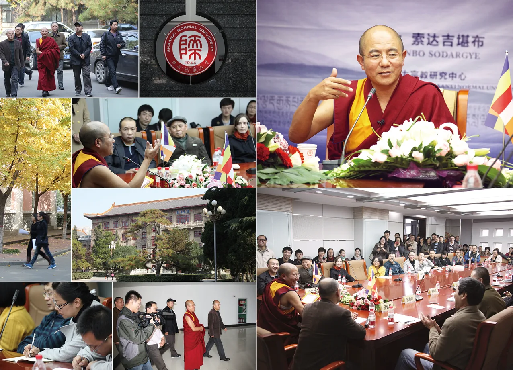
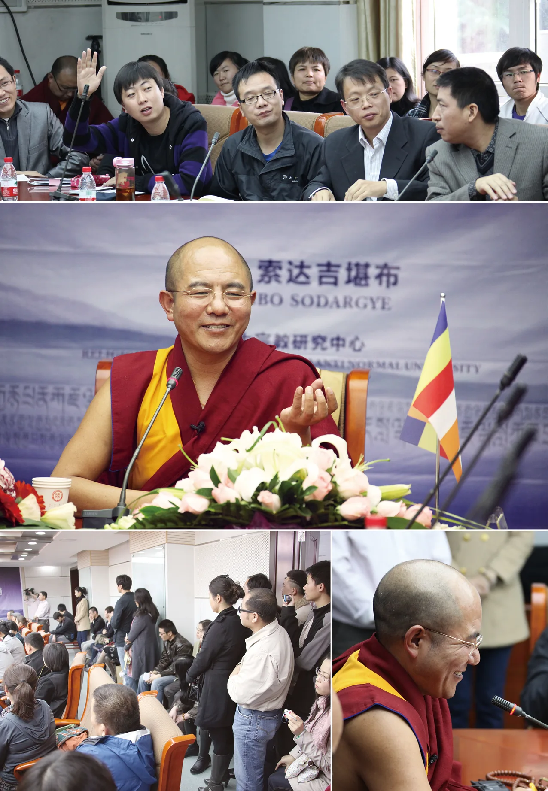

纯粹以学术研究写的书，

与内心有所证悟写的书，

可以说有天壤之别。

第15场

陕西师范大学

Shaanxi Normal University

中国·西安

2011 / 11 / 9

## 藏密的特点及思想精髓

## Essence and Quality of Tibetan Esoteric Buddhism

今天，你们师范大学的师生开这个学术研讨会，我本人而言，虽然说没有什么智慧，也谈不上是什么智者，但非常喜欢参与这样的活动。当然，我不是在这儿故作谦虚，而是有一点自知之明，很清楚自己有什么样的学问。但尽管如此，跟你们进行佛学交流，在这方面我还是有很大的兴趣。

学校这边让我讲一下“藏密的特点及思想精髓”。不过这个题目太大了，我想了一下，也不知道从哪个地方入手。毕竟藏密的教义浩如烟海、博大精深，只用短短1个多小时的时间，肯定无法一一道尽。所以，下面我只能简单介绍一下，让你们有个大致的了解。

## 一、略述藏传佛教的历史

不少人认为，藏密就像唐密一样，只是昙花一现、兴盛一时的教法，如今都已退出了历史舞台。这种想法不太正确。藏地从有佛教开始到现在，尽管经历了不同朝代的风风雨雨、兴衰变迁，但藏密不管是历史、教义、仪轨、修法等，至今仍完整无损地保留着，而且非常圆满，所以它跟唐密不能画等号。

还有人认为，藏族喇嘛是学密宗的，故藏密又称为“喇嘛教”。这种说法也不合理。所谓的“喇嘛”，有出家人的意思，但学藏密的并不只是出家人，在家人也可谓比比皆是。

其实，藏传佛教是世界三大佛教体系之一，跟南传佛教、汉传佛教同属于正宗的佛教。往昔印度的佛教传入藏地之后，融入藏民族的文化中，成为特别庞大的宗教体系，这就称为藏传佛教；而佛教传入汉地，融入汉族的文化中，则形成了汉传佛教。所以，藏传佛教并不是藏地土生土长的宗教，也不是只有密宗这一部分。

当然，在座很多人都是研究历史的，对此应该比较熟悉。藏地最开始时也没有佛教，大概在公元三百多年，藏王拉托托日年赞的王宫上，佛像、《宝箧经》等佛经、佛塔从天而降，并有授记：“经过五个朝代以后，会有人知道经中的教义。”这标志着藏地正法的开端。

但也有史料说，这些三宝所依并非从天上降下，而是印度班智达带过来的。这种历史问题，如今我们很难给它个确切定论。毕竟学术界只承认一些考古依据；可我们佛教徒不单单承认这些，还承认非常神秘的各种现象。而这些现象，以学术眼光来看的话，是完全无法理解的，所以，历史学家有时也难以得出正确的结论。

藏地过了五个朝代之后，观音菩萨的化身国王松赞干布出世，他迎娶了汉地的文成公主、尼泊尔的赤尊公主，她们分别带来释迦牟尼佛12岁、8岁的等身像，现供奉于拉萨的大昭寺和小昭寺。历史上说，文成公主特别精通风水，观察整个藏地的地势之后，她不仅要求修建大昭寺，还在不同地方修建了镇肢寺、镇节寺等。此时，佛教的经论虽说没有正式传入藏地[^1]，但佛教在雪域高原已经开始扎根了。

又过了几个朝代，汉地另一位和亲公主——金城公主，生下一个儿子叫赤松德赞，他13岁就继承了王位，在他统治藏地期间，佛教达到了史无前例的兴盛。赤松德赞在很小的时候，就读过汉地传来的《十善经》《稻秆经》《金刚经》，对佛教生起了很大信心。长大之后，他从印度迎请了莲师、菩提萨埵等很多班智达，并派藏地的译师去印度培训，以翻译佛经、广弘佛法，当时的佛教可谓盛极一时。

后来，在莲师离开藏地、菩提萨埵圆寂之后，赤松德赞又从敦煌请来一位禅宗大德玛哈雅那入藏弘法。不过，玛哈雅那所弘扬的禅宗，与藏地教派在观点上出现了很多分歧。玛哈雅那声称：就像乌云能遮蔽太阳，白云也能遮蔽太阳；或者说，金链是束缚，绳索也是束缚一样，无论做善事、做恶事，这一切都是执著，应该全部放下来。因为受此种观点的影响，很多人开始不取舍因果，不断恶行善，甚至桑耶、大昭寺的佛像前长年供奉的灯都断了，藏传佛教内部一片混乱。

这时，赤松德赞想起菩提萨埵生前的授记：“以后教法如果出现混乱或不和，可从印度迎请莲花戒遣除争议。”于是他派人请来莲花戒[^2]，以平息这一场“顿渐之争”。

据历史记载，莲花戒主要从比喻上击败了玛哈雅那。玛哈雅那认为自己的见解最高，善恶什么都不执著，就像大鹏翱翔于天空，无有任何阻碍。莲花戒就问他：“大鹏是否从地上腾空？最后仍落于地上？”对此，玛哈雅那也不得不承认。莲花戒继续说：“以此足以说明，最高境界必须以取舍因果为基础，最后还是要落到不离取舍因果的行为中。”通过这样的辩论，玛哈雅那以失败告终。鉴于之前藏王曾规定，谁败了就必须离开藏地，玛哈雅那只好返回汉地。

不过也有人说，玛哈雅那离开时，一只鞋子掉在了藏地。后人认为这是一种缘起，因为修宁玛大圆满、噶举大手印的个别人，也提倡修行最初就何者都不执著[^3]——这遭到萨迦派很多论师的驳斥，以此表明玛哈雅那的部分见解仍留存于藏地。

当然，什么都不执著，这种见解也并没有错，无垢光尊者在《龙钦七宝藏》中说：“玛哈雅那的观点，寻伺者未能接受，但从实际意义来说，其密意完全符合正法。”可是对大多数修行人而言，由于自己的根基不够，倘若一开始就不取舍善恶，如此修行很容易误入歧途。我之所以讲这些，也是因为现在藏地学密宗、汉地学禅宗的许多人，包括学术界都认为，修行就是什么都不执著，根本不管自己的基础打得怎么样，这样是相当危险的。

总而言之，藏传佛教起源于印度，是非常纯正的佛教。在朗达玛灭佛之前，它为藏地历代君王所守护、所弘扬，一代一代传承非常清净，并不是一块小地方的一个小小宗教。

## 二、藏密与汉地皇室的渊源

藏传佛教从古至今，除了在雪域这片土地上广利有情以外，跟汉地也有特别深的因缘。

唐朝时，藏王赤松德赞勘校《大藏经》的过程中，就迎请了很多汉地大德前来参与；藏地的预试七人[^4]出家时，也请了汉地的高僧来作见证。

元朝时，藏密在皇宫内院尤为兴盛。最早从成吉思汗开始，藏传佛教就极有影响。大家都知道，成吉思汗在位期间，曾多次发动对外征战，他既要统治汉地，又要统治藏地，还想攻占印度。为了攻打印度，他派出大批军队路经藏地，当时很多寺院面临着危险，大家都特别害怕。不过有种说法是，成吉思汗遇到了萨迦派的扎巴嘉村上师，从他那里求了一些法，之后便打消了侵占印度的念头。

后来，在蒙哥当皇帝时，噶玛巴被封为国师，获赐一顶金边黑帽。忽必烈即位后，也极力推崇藏传佛教，派人迎请宁玛派的伏藏大师释迦光，结果他没能来，但把莲师的长寿水伏藏献给了皇帝。以此忽必烈对前后藏的密咒士提供各种宽厚待遇，赏赐许多土地用于修建寺院，同时封释迦光为“巴谢”，其地位与国师相等。之后，忽必烈又封萨迦派的八思巴为帝师。而且，此前的萨迦班智达，也当过阔端的经师，后圆寂于甘肃那一带。

元朝总共有十五位皇帝，尽管他们都是蒙古族，但无一不信仰藏传佛教，皇宫里也经常举行各种佛事活动。记得有位宁玛派大圆满的修行人叫雍顿多杰华，元武宗就曾把他请进皇宫，观看金刚舞，给皇帝、皇后为主的有缘眷属，传授大圆满的灌顶，讲大圆满的修心窍诀。

到了清朝，格鲁派的班禅大师、达赖喇嘛等高僧大德，也备受皇帝的礼遇，与汉地来往比较密切。例如，顺治皇帝曾派人邀请五世达赖喇嘛进京，尊者在清朝官员的陪同下，率随行的三千眷属，自拉萨启程前往汉地。

尤为值得一提的是，格鲁派的章嘉国师，与清朝皇帝素有极深的渊源：章嘉二世是康熙皇帝的国师；章嘉三世是雍正皇帝、乾隆皇帝的国师；章嘉四世是道光皇帝的国师；章嘉五世是同治皇帝的国师；章嘉六世没有明确记载；章嘉七世是光绪皇帝的国师。

由于这些皇帝的大力扶持，藏传佛教尤其是密宗的时轮金刚、喜金刚、大圆满等，在全国上上下下得到了极高的尊崇；各个教派的上师们，皇帝也赐予各种封号，如“大宝法王”“达赖”“班禅”“巴谢”等，甚至明朝有一个明武宗，先后封授了八位法王。

所以，我们以回顾历史的方式，来了解藏密很重要。否则，现在极个别人对密宗的认识，远远不符合真相。自“文化大革命”以来，大家都清楚，佛教遭到了历史性的打击和毁灭，此前发生的许多令人敬佩的事迹，由于政治、历史等种种原因，人们心目中对它的评价，与真相差距特别远。甚至现今影视剧中对藏密的描述，大多数也是在误导大众，故意扭曲藏传佛教的形象。

其实，不管你是什么样的人，以公正的态度，原原本本把历史真相说出来，这是非常重要的。假如你有一些个人目的，那就另当别论了，但如果没有的话，作为学术界的知识分子，理应从方方面面，客观认识藏传佛教的历史与现状。其实不仅仅是藏传佛教，包括汉地的有些历史，也不一定像后人刻画的那样丑恶。譬如元朝的许多皇帝，并不像有些人形容的那么残暴[^5]，他们也有许多值得借鉴的地方，值得宣扬的东西，但很多人往往并不了知。

同样，如今很多人对藏传佛教的评论，也不一定就是事实。他们声称藏密如何修双运、如何杀生、如何吃肉，一直到处这样诋毁，这是相当可怕的。当然，藏传佛教因为地理、气候等原因，素食观确实不如汉传佛教，这也是我们承认并值得学习的地方。不过，我以前在《藏密素食观》里也提到过，藏地很多修行人并不完全吃荤，非常多的高僧大德也都提倡吃素，这是有据可查的。所以，大家若想认识藏传佛教，一定要通过深入、彻底的研究，如果没有这样，就随意揣测、妄加评论，肯定与真相有一定的距离。

当然，藏传佛教分各大教派，各大教派有许多甚深教义，这些甚深的教义，我今天也不可能一一阐述，你们若想完整地了解，最好是通过理论、实修两种途径。其中，理论上的了解，除了看些历史书以外，还应当系统学习藏地佛教的五部大论，以及密宗中事部、行部、瑜伽部、无上瑜伽部的教义，这就相当于你在高等学校学习知识一样。而实修上的了解，是在掌握理论的基础上，与传统修行结合起来，去体悟理论所讲的那些境界。只有这样，你才能真正触及藏传佛教的核心，否则，光是看了一两本书，是很难一窥其全貌的。

## 三、无上大圆满与汉地的渊源

比如说宁玛派的大圆满，实际上就特别特别殊胜，然而这种殊胜，在文字上几乎看不到。包括我们藏地以十七大续部为主的密续，都没有编入德格的《大藏经》，而是单独有一个续部。为什么这样呢？就是害怕泄露秘密。当然，并不是因为它有很大的过失，才担心被别人知道，而是由于其教义过于甚深，根基不够的人一般接受不了。

像大圆满的一些教言，你光是从书本上看，似乎跟唯识、中观差不多，可能也看不出来什么。但你若按照密宗的传承，如理如法地依止上师，遵循上师的教言长期实修，很容易就能证悟一些不可思议的境界。

昨天我来西安时还在想：你们这里跟大圆满的源流，还是挺有因缘的。我们大圆满跟唐密一样，历来都相当重视传承。像唐密的话，最初由毗卢遮那佛传给金刚萨埵；之后龙猛菩萨打开南天铁塔，从金刚萨埵处得受此法；然后他又传给龙智；龙智再传给善无畏、金刚智。后来，善无畏、金刚智、不空在唐朝来中土弘扬密法，史称“开元三大士”。

而我们大圆满，刚开始是普贤王如来传给金刚持，金刚持传给人间的嘎绕多吉（极喜金刚），之后嘎绕多吉传给蒋华西宁，蒋华西宁传给西日桑哈。而西日桑哈，实际上是汉族人，具体是什么年代呢？应该是唐朝初年。他曾去印度依止了蒋华西宁，得到大圆满的窍诀，此后又返回汉地，住于清凉尸陀林[^6]。

当时，在印度某个城市中，布玛莫扎和嘉纳思札（益西多）共同学习五明。一天，他们二人去金刚座旁的一个花园散步，突见金刚萨埵在空中授记：“你们虽曾五百世转为班智达，却尚未获得果位。若想即生解脱，应前往汉地清凉尸陀林。”听到此话，布玛莫扎立即动身去汉地，依止了西日桑哈，得到很多大圆满的窍诀，并将其中的一部分，藏于你们西安的吉祥门[^7]。

他返回印度后，将自己的经历告诉嘉纳思札。嘉纳思札也前往清凉尸陀林，请求西日桑哈摄受。他依止的时间比较长，最后得到了大圆满的最高境界。当西日桑哈圆寂时，将《七钉窍诀》传给嘉纳思札。然后，嘉纳思札从吉祥门取出所有经函，回到了印度，住在巴桑尸陀林中。

此后，布玛莫扎去拜见嘉纳思札，请求摄受。当嘉纳思札圆寂时，将《四安住法》的窍诀传给了布玛莫扎。后来，布玛莫扎将其传给莲花生大士，莲花生大士又传到了藏地……这就是我们大圆满的源流。由此可见，大圆满的传承始于普贤王如来。当然，释迦牟尼佛住世时，也传过一些密法，如《时轮金刚》《文殊真实名经》等，这些都是佛陀亲口所说。但也有一些密法，是佛陀圆寂后出现于世的。

然而，对历史和特殊传承不了解的人，可能会有各种想法和说法，这一点也情有可原。就好比密宗传承中的“持明表示传”，一般人就无法想象。其实它跟禅宗心心相印的方式很相似，在禅宗中，依靠上师的一个表示或一个话头，有缘弟子即可当下开悟。同样在密宗里，比如莲花生大士对弟子直指虚空在哪里，有缘者也能马上明心见性，这就叫持明表示传。但作为学术研究的人，要想搞明白其中的奥秘，了解他们的证悟境界，可以说望尘莫及、难如登天。因为学术都建立在六根的基础上，可是超胜的境界，没办法以六根触及，假如你没有一种信仰、没有一种信心，那再怎么研究也只是盲人摸象。

现在经常有人说：“传承有什么用？念经有什么用？这些都是多余的！”他们只看外物，不讲内在，其实是不合理的。以前弘一大师就举过一个例子，说明了内在有时候比外在更重要。他说用一块普通的布做成国旗，当升旗的时候，人们需要恭恭敬敬向它行礼。这种行为能否说是迷信呢？肯定大家不会承认。同样，对于一般文字写成的佛经，用学术眼光来看它，似乎跟世间文章没什么差别，但它确实有一种不共的加持，对此我们只能用心去感受，肉眼是根本看不出来的。

## 四、虹身成就与汉地的渊源

还有，像藏密中的“虹身成就”，很多学者也无法理解和接受。但即便如此，它也是真实存在的，而且在汉地还曾发生过。

比如，中国第一位比丘尼净捡，是晋朝人，她70岁要圆寂那天，就不舍肉身直接飞往清净刹土，跟虹身的最高境界完全一样。这是非常真实的事，后被梁代高僧宝唱编入了《比丘尼传》[^8]。以前隆莲法师讲《心经》时，也引用过这个公案。假如有人说藏密的虹身成就不合理，那么这段历史又当如何解读呢？

还有，中国第一位比丘朱士行，我前段时间讲《般若摄颂》时也提过，他千辛万苦翻译的《放光般若经》，又被称为《虹化经》的简本。他本人经过多年的修学，深刻领悟到此经蕴含的虹化圣义，后来圆寂时出现的许多瑞相，也说明他在虹身方面有所成就。

## 五、怎样通达藏密的思想精髓

因此，有些人对藏密的诸多误解，一定要尽可能遣除。假如你想深入了解藏密，则可以通过两种方式：一是文字上的，一是修行上的。当然，后者依靠有次第的修证，内心对密宗精髓的体会，远远超过了前者的字面理解。

你们在座的有些人，若想修持藏密的话，首先应该从加行开始修。按照大圆满的传统，加行分为共同加行、不共加行两种。共同加行是观修人身难得、寿命无常、轮回痛苦、因果不虚，这些道理，要靠依止善知识才能通达。而且，修行最关键是要有一种信心，否则，就算你精通了千经万论，道理讲得夸夸其谈，内心也不会有真实收获，反而很容易变成“法油子”。

在藏地，一般人都明白，纯粹以学术研究写的书，与内心有所证悟写的书，二者可以说有天壤之别。就像有些高僧大德，因为前世的善根非常深厚，今生不需要苦思冥想、殚精竭虑，自然就能流露出很多智慧法语，这是一般人无法企及的。我的上师法王晋美彭措，即是如此。我依止他老人家接近20年了，他是我一生中最佩服、最敬仰的人。我虽然也遇到过国内外不计其数有智慧、有悲心、有才华的人，但上师的境界确实无与伦比。我这样说，并不是故意赞叹自己的上师，而是站在非常客观的立场上，以公正的态度来评价的。我们很多人写书时，需要翻阅大量资料，构思很长的时间，而他老人家根本不用做这些准备，写什么都是短短的时间中一挥而就，智慧犹如源头的活水般源源不绝。

记得1990年上师去印度时，当时显现上眼睛不好，看不了任何文字。但他老人家给高级佛学院演讲时，引经据典信手拈来，包括《华严经》《法华经》的很多教证，也是一大篇一大篇地背下来。讲完之后，我们几个弟子对照原经文，发现竟然完全一模一样。这种智慧，普通人再通过怎么样的勤修，也不可能短时间就获得，它在藏传佛教中叫“意伏藏”。不知道你们研究过没有，伏藏是藏地最殊胜的一种法要，特别特别稀有。以前美国波士顿、华盛顿有几个博士，专门研究藏传佛教的伏藏法，但可惜的是，这方面的汉文资料现在不是很多。

其实所谓的“伏藏”，是往昔莲花生大士为利益后世众生，将许多珍贵无比的佛法，以神通隐藏在神山、湖泊、虚空等中，并授记后来的某些大德进行开启。这些大德到了授记的时间，就会前往埋藏伏藏的地方，直接取出一些小小的宝箧，通过空行文字的提示，他们便能打开自己的意伏藏，心中自然流露出许多仪轨、法义，用文字写下来的话，足足有好几函，用现在的话来讲，有好几十本书的内容。这些读起来，绝不像分别念所写的东西，而且里面的修法极为殊胜。所以，具有证悟的人所体会到的佛法境界，跟学术研究的人截然不同。

刚才我也讲了，假如你想真正了解藏密，就要先修持加行，从人身难得、寿命无常修起。修完了这些共同加行后，还要修不共加行，即皈依、发心、忏悔、供曼茶、上师瑜伽，以及破瓦法。这些加行需要修很多年，等自己生起了稳固的境界，才能再进一步修持更高的密法，如生起次第、圆满次第，玛哈约嘎、阿努约嘎、阿底约嘎等等。

这些甚深修法，我以前翻译过不少，尽管一再强调过不能公开，但有些地方还在偷偷地卖。不过卖了也不要紧，没有得到传承尤其是没有信心的人，就算手里拿到了法本，也会觉得跟其他法本一样，并没有什么特别之处。就像《六祖坛经》，人人都可以看，但没有缘分的人看了，觉得跟《道德经》《圣经》没多大差别，而有缘者看了之后，有可能当下就会开悟。

尤其是宁玛巴的大圆满，我多年来通过长期研究，觉得它确实能够直接断除烦恼，直截了当地揭示了佛陀的密意。这样的法门在末法时代，的的确确难遭难遇。你们想要修持的话，必须先得过灌顶，并修完了加行才可以。有了这样的基础，在具德上师的指导下，依靠自己的信心和精进，很容易就能通达甚深境界。

这些年来，由于语言、交通、历史等原因，很多大学生对藏传佛教尤其是密宗的误解特别多。前不久我去香港中文大学，在点评一些佛教论文时，就直言不讳地说了：“现在很多大学生有这样的信仰，对这方面感兴趣，非常好。但有点遗憾的是，你们对藏传佛教认识得还不够，了解得还不深，文中描述的唐卡文化、尸陀林、人骨法器，只是以一种好奇心来看待，并不明白它背后的甚深涵义。”

藏传佛教中的任何历史、任何修行，实际上都完全经得起推敲，它是被无数典籍和前辈大德所印证过的，绝不像民间一些神神道道的宗教。大家若想真正通达，不能知道了一点点就自以为是，而需要各方面的深入了解。

今天我也没做什么准备，想什么就说什么了。下面看大家有什么问题，我们可以互相探讨一下！

现场互动

问：我是历史文化学院的博士后，经常看您讲的《入行论》和《藏传净土法》，很荣幸有机会向您当面请教。

现在汉地和藏地弘扬净土都很广，汉地净土宗的教典是“五经一论”或“三经一论”，请问藏地净土宗的教典主要有哪几部？这些是不是完备呢？

堪布：你的问题很好！我们藏地净土宗的依据，主要也是净土经。汉地的“五经一论”是《阿弥陀经》《无量寿经》《观无量寿经》《大势至菩萨念佛圆通章》《普贤行愿品》，以及《往生论》。这是汉地个别大德归集的，藏地虽然没有这种说法，但我对“五经一论”还是很有信心。

我们这个人身很难得，所以在短暂的人生中，我很想把“五经一论”讲一遍。到目前为止，我已经讲了《阿弥陀经》《无量寿经》《观经》《大势至菩萨念佛圆通章》，还剩下《普贤行愿品》和《往生论》没讲。如果没有死的话，这两个一定要完成。

藏文的《大藏经》中，实际上也有《无量寿经》《阿弥陀经》，但可惜的是《观经》没有。假如因缘具足的话——尽管我翻译得不一定很好，但不管怎么样，为了自他将来能往生净土，创造这样一种因缘，我准备把《观经》译成藏文。

藏地的很多大德，修净土主要依于《无量寿经》和《阿弥陀经》。宗喀巴大师、麦彭仁波切，以及萨迦派、噶举派的诸位祖师，都有各自的修法仪轨，这方面的理论和窍诀也相当多，包括一些伏藏品中比比皆是。因此，藏地、汉地在往生的依据和方法方面，并没有太大的差别。

问：净土宗的目标就是往生，但往生的条件，很多法师讲得不一样：有人说要念到一心不乱，念到一心清净；有人说往生没有条件，阿弥陀佛平等救度，只要相续称念就能往生。不知道哪种说法正确，您怎么看待这个问题？

堪布：关于往生的条件，在藏地也可谓众说纷纭。但我在讲《观经》的过程中，发现最后提到“九品往生”时，佛陀讲了往生需要的不同因缘。我看了“下品下生”之后，觉得条件并不是很高[^9]，好像自己也有一种把握，还给很多藏族人都讲了。所以，我很想翻译这部《观经》，谁好好念佛的话，应该都有这个机缘。

当然，藏地也有一种说法，往生极乐世界必须具足四种因：观想阿弥陀佛及清净刹土、积累资粮净除罪障、发菩提心、发愿回向。也有极个别大德要求一心不乱，但若想达到印光大师说的那种“一心不乱”，作为凡夫人来讲有一定的困难。

我自己认为，按照《观经》后面所讲的条件，既然造了五无间罪的人，都有往生的机会，那我们很多人只要好好地念佛、好好地发愿，应该也能如愿以偿。

值得注意的是，“念佛”并不是有些人认为的，只要口里念念“阿弥陀佛”就行了。“念”字的结构是“今”加“心”，也就是指当下的一念心，所以它跟心有一定的关系，心里观想是最关键的。我看汉地的很多经论中也说，念佛不仅要口念，更要心念，若能如此，积资净障后一定可以往生。

问：有个大德开示说：念7遍阿弥陀佛心咒，等于诵了1000遍阿弥陀佛名号。这个有没有经典依据呢？因为汉地“五经一论”中都讲名号，好像没有说过心咒比名号还殊胜。

堪布：你这个问题应该问他，因为是他说的，应该请他来回答。（众笑）

我个人的看法是，这种依据没有看到过。尽管许多经论中讲了念名号有什么功德，念心咒有什么功德，但并没有说念心咒的功德更大。当然，我没看到也不一定就没有，所以最好能找他问问。

问：我是宗教研究中心的硕士。您刚才讲到，学术研究和修持所得的结论不一样，那么请问，学术研究能不能与修持很好地结合起来？

堪布：二者是可以结合的，在我们藏地，这叫做闻思修行。“闻”就是先听受道理；“思”是再思维其中意思；“修行”是将所了解的意思于实际行动中行持。学术研究应该包括了“闻”和“思”两方面，不过后面的“修行”，很多人却没有。

比如藏密修法中讲的“寿命无常”，不少人认为这非常简单，甚至已经学佛很多年的人，也觉得没什么可修的。但你若去真正观修，才能感受到一刹那、一刹那的无常，这并不是口头上说说、文字上写写，而是发自内心的深刻体会。

在学术方面，历史性的东西，一般也没什么可修的，知道这件事就可以了。但有些窍诀性的修法，比如宗喀巴大师讲的出离心、菩提心、无二慧，这是学佛最根本的，你必须要长时间修行，才能完全通达。所以，佛教的有些教义若想彻底领悟，没有一定修行是不可能的。

问：我看到很有名的一本书叫《西藏生死书》，但翻了好几遍，始终都看不进去。我想得到您的一些指点，或者您对那本书有什么看法？

堪布：《西藏生死书》（The Tibetan Book of Living and Dying），你实在看不进去的话，我也想不出什么好的办法。

这本书，实际上在国内外受到很多人的欢迎，我也看过它的汉文本，看了之后的感觉是什么呢？这就是莲花生大士的中阴窍诀，然后再加上作者与根本上师的对话、某某西方人得癌症的故事，穿插一些现代人喜欢听的、比较关心的道理在里面。

大家都知道，中阴窍诀在西方非常受欢迎。因为他们很多人身体不舒服、心情不舒服，尤其是最后面对死亡时，都有一种恐惧感，而中阴窍诀所揭示的道理，正好可以消除这种心态。鉴于此，索甲仁波切把中阴法门的某些内容，与现代人的心理结合起来，然后编成了这本书。

《西藏生死书》，我认为有两个特点：第一，作者对上师有非常大的恭敬心，处处提到了他今生所得到的知识，全部来自上师的恩赐，从头到尾都在感恩上师，这是最感人的地方；第二，它将佛教的原始教义，融入当前的生活中，然后展现在有缘者面前，这也是相当难得的。所以，如果你不是特别困难，最好还是能再看看，也许慢慢就看进去了。

问：我是陕西师范大学教育学院的博士后。对于佛教这一块，坦率地说，我是门外汉，所以借这个机会我想请教您：从藏密的视角出发，当前中国教育的主要问题表现在哪里？该如何来解决？

堪布：从藏密的视角出发，对教育没有什么太多的看法；但若从佛教的思想出发，当前教育的的确确存在一些问题，究其原因，主要是没有注重道德培养，像前不久刚发生的“小悦悦事件”，以及“13亿人扶不起一个老人”，都足以说明这一点。

在古代，教育非常重视“德才兼备”，一个人要先立“德”，再培养“才”。而现在的教育，光是重视一个分数，忽略了教育的核心是做人，以至于学生们学了十几年以后，从来没想过怎么样服务社会，怎么样孝顺父母。包括有些老师，有时候连做人的基本原则都没有。这些应该是源于“文化大革命”的影响，以后进行一些改革是很有必要的。

这种改革，其他改不了也不要紧，但至少应把德育放在首位，这样的教育才有希望。我作为佛教徒，始终都是这样认为的；老一辈懂传统文化的人，应该也会这样想。所以，现在很多人对教育还是比较关心的，只是有时候也无可奈何。

问：我是宗教中心硕士三年级的学生，学的是宗教学理论专业。今年我在兰州开会时，有个学者说：当今世界宗教传播有一个趋势，就是“天基东渐、藏密西行”，即天主教和基督教向东方国家传播，藏密向西方国家传播。我想请问一下，藏传佛教在阿拉伯国家的传播情况怎么样？

堪布：藏传佛教在20世纪时，就传播于西方国家。汤恩比博士曾说：“将来后人回顾20世纪的发展，会发现比任何事项更轰动、更有意义，其重要性甚至超过原子弹、氢气弹及科技的，那就是佛教传入西方。”这是他的原话，从这段语言来看，西方本是基督教非常兴盛的国家，但由于藏传佛教的调心方法相当好，所以在那里受到了极大尊重。

其实，一个人不管名声、财富怎么样，终究也躲不过生老病死。很多科学家和政治人物，最后面对死亡时，一切身外之物都派不上用场，在这种情况下，唯有佛法才是最需要的。

至于藏传佛教在阿拉伯国家，到目前为止据我所知，弘扬得并不是很广大。而前苏联、蒙古、新加坡、马来西亚、澳大利亚等国，如今在各大院校中却可以经常见到。前不久我看了一下美国各所大学，发现耶鲁、哥伦比亚、哈佛等17所大学，都设有藏传佛教的研究中心。我们佛学院也有美国的博士后出家，我问了一下，说是根本不止17所，凡是他们去过的学校，都有不同层次的研究机构。

所以，这些国家对藏传佛教的研究，并非等闲视之，而是相当重视。但在阿拉伯的话，也许有一些中心或仁波切，但不知道具体情况怎么样。

问：我是宗教中心的硕士。藏密有很多护法神，在一些学术著作中，他们的记录、分类很详细，但在原典的查询中，出处和起源等记载却很少。请问，护法神是怎么回事？关于他们的记录，平常都出自哪里？

堪布：护法神的话，其实在汉地的佛教历史中也有，就像伽蓝菩萨等。而在藏传佛教中，尤其是伏藏品里特别多。包括昔日莲花生大士初来藏地时，受到当地很多妖魔鬼怪的阻碍，莲师一一加以降伏之后，他们在莲师面前承诺要护持佛法，从此也变成了佛教的护法神。

当然，这要在信仰的基础上，才比较容易接受。有了信仰的话，你会发现藏地的护法神特别特别稀有。比如，从历史上看，第五世达赖喇嘛圆寂之后，第司·桑吉嘉措秘不发丧，把这件事保密了15年之久，一直到第六世被认定出来，这即是遵循了护法神的指示。

而且，我自己的切身体会中，也有不少这样的经历。以前我随上师去不丹时，紫玛护法神降临在一个人身上，那个人本来不懂藏语，但护法神降临之后，他可以用非常流利的藏语来跟我们沟通。那时我就在旁边，上师给护法神灌顶时，我身体也有特别多的感应。当然，这些感应给没有信仰的人说，他们会觉得我是在说谎，但你认可也好、不认可也罢，事实就是这样。

关于护法神的出处、记录，藏地有大量的护法典籍，但现在译成汉语的不太多。

问：我是硕士三年级的学生。印度的大乘佛教中，中观与唯识虽有不同，但后期二者有汇流的趋势，形成了中观瑜伽派。可这些后来传到藏地，据我有限的了解，像宗喀巴主要是站在中观的立场上；近代的时候，记得内地的法尊法师也是如此，甚至对唯识思想有驳斥的倾向。这几年国外研究中观的学者，似乎也受这方面的影响。那么在您看来，整个藏传佛教到今天为止，对唯识思想是什么看法？

堪布：藏传佛教并不是对唯识不满或排斥。当年唐玄奘在印度依止了好多唯识的上师，他把佛法带回汉地之后，汉地历来对唯识都比较重视。表面上看来，好像汉传佛教重视唯识，藏传佛教重视中观，互相会不会有一些矛盾？但事实上并非如此。

在藏地，宗喀巴大师在有些论著中，尽管对唯识有一些破斥，但并不是破掉它的教义，只是对随理唯识和随教唯识的有些观点，比如观察胜义谛时，还承认有一个明心不空进行了驳斥。

当然，若按照第三转法轮如来藏的本来面目来说，承许有个明心也是可以的。但唯识宗显现上并没有这么说，只是说在胜义中明心真实存在，这样一来，通过中观正理一观察，这种观点就站不住脚了。

不过，这种破斥也是在胜义中破的；而世俗当中，包括宗喀巴大师在内，谁都承认万法唯心。就像《十地经》《成唯识论》中所说，一切法确实是唯心所造。

问：您个人对中观、唯识之间的关系，又持什么样的态度呢？

堪布：我个人认为，唯识和中观之间，没有任何冲突，没有任何矛盾。

前几年，我翻译过麦彭仁波切的《中观庄严论释》，在这部论典中，就揭示了中观与唯识互不相违的密意。唯识和中观是大乘佛教不可缺少的理念，这一点在《中观庄严论释》里讲得特别细致、清清楚楚。

希望你们有时间也看一看，尽管《中观庄严论释》中一些细微的理证比较难懂，但学习了以后才知道，中观是站在什么角度来建立自己的理论？唯识又是站在什么立场来建立自己的观点？二者的不同点和相同点，可以说一目了然。

问：我是来自青海的藏族学生，是宗教研究中心的博士。在我的家乡——青海省海南州同德县，有个妇孺皆知的事情，就是当地香池寺的大堪布才旺仁增，在1958年被带去批斗的路上，直接不舍肉身，飞往清净刹土了。对于这一现象，我们不知道是怎么回事，想听听您的看法。

堪布：我们藏地确实发生过这样的事情：堪布才旺仁增，他是佐钦派的，1958年时，同德县要召开一场批斗大会，批斗的对象就是堪布本人。从监狱到批斗现场要绕过几座小山坡，因为腿脚不方便，堪布被捆得结结实实，坐在一头牛的背上。但在去的途中，令人难以置信的是，突然出现一阵狂风，堪布一边念咒语一边飞起来，在空中飞得越来越高，最后竟然飞走了。

原本我对此不太相信，包括我们学院的大堪布——慈诚罗珠堪布，也怀疑这到底是真是假。有一次，我从美国还是新加坡回来，给他买了一块SEIKO手表，这个牌子当时在国外比较好。过了一段时间，他的手表就不见了，我问他：“你把手表扔哪儿了？”他说：“我把它换成路费，包了一个车，专程跑到青海去调查才旺仁增喇嘛的事了。”

当时，当地有几个见证人还活着，他们有些不敢说，不敢接受堪布的采访；有些还可以，因为政府方面的人已经退休了。堪布就一个一个去访问，并将此作了摄像、录音，结果证实这的的确确发生过。当年押解才旺仁增堪布的那些人，目睹了这件事后特别惊讶，但到了批斗大会上，他们也不敢说出真相，只好说堪布在路上死了，而且尸体已经埋了。

慈诚罗珠堪布回来之后，还专门写过一篇文章[^10]，希望你们好好地看一下。当然，这在一般人看来，确实不可思议、难以想象，但就像我刚才讲的净捡比丘尼的故事一样，大成就者的示现并非凡夫人所能揣测。其实藏地还有很多这样的故事，有位大成就者叫阿尼满莫，她和她的眷属也是不舍肉身，直接飞往了清净刹土。这样一讲，不少人可能不相信，但不相信也没办法，它的确是这样的。

问：在汉地，昔日伴随着《金刚顶经》的流传，唐密也在不断地发展。那么在藏文经典中，不知道有没有这部《金刚顶经》？您能不能简单介绍一下唐密的修法？

堪布：密宗分为外密和内密，从修法来观察，唐密应该属于外密。外密指事部、行部，主要是在自己前面观想佛陀发光等。唐密的许多观想和仪轨，基本上都是这样，与内密的修法不太相同。

《金刚顶经》，是唐密重要的一部经典。我曾查了藏文的《大藏经》，没有找到这部经。不过也许是有的，可能不在“经典”中，而是在《大藏经》以外的“续部”里面。

问：我是宗教研究中心硕士三年级的学生。藏传佛教中强调依止上师，这是否与佛陀要求的“依法不依人”相违？您是怎么看的？

堪布：并不相违。佛经中讲“四依”时，是提到了依法不依人。表面上看来善知识是人，好像不能依止，但实际上不是这个意思。

藏地的麦彭仁波切，曾造过一部论典叫《解义慧剑》，我以前也翻译过，里面对“四依”就讲得比较清楚。其实，依法不依人的意思是，我们在修行的过程中，关键要依止佛法所讲的内容，比如修出离心、菩提心。如果一个人的名声不错、很有财富、粉丝也多，但他讲的却与经论不符，那要听他的还是听经论的呢？肯定要听经论的。

当然，若想真正“依法”，首先要依止一位具法相的善知识，这是必需的一个前提。否则，就会像《华严经》中所说，假如没有善知识的引导，你再怎么样有智慧，也不可能精通佛法的真谛[^11]。那么如此一来，有没有依人不依法的过失呢？是没有的。因为甚深的佛法若不依靠上师指点，单凭自己的智慧，肯定无法揭开它的神秘面纱。

现在有些人说：“藏地修皈依时，还要皈依上师。我们汉地就不需要，只是皈依三宝就可以了。”这种说法不合理。其实汉地也有四皈依，像唐朝的《瑜伽集要焰口施食仪》里，就清清楚楚提到了“皈依上师、皈依佛、皈依法、皈依僧”。

汉地不少人皈依以后，特别喜欢办皈依证，我们藏地一般没有这种传统，只要是三宝弟子就可以了，并不需要办什么证。你皈依的对象，可以有三宝总集的上师，也可以直接是三宝。但不管是哪一种，我们都应该明白，佛教就像世间的大学，它的教学内容很重要。这个内容相当于佛法，而佛法依靠谁来指导呢？就是上师。如果没有上师，相当于学校没有老师一样，它的教学内容再好，也没办法让很多人接受。所以，这之间的关系应该这样来了解。

问：就我个人浅见，藏密任何一个修法都是系统性的，譬如会有一些前行，还要依据各种各样的经典。那么，藏地传来的金刚萨埵修法，它要求的前行是什么样的？

堪布：金刚萨埵的修法，有简修和大修两种。如果你修的是简修，则可像唐密那种观修方法一样，观想一尊单身的金刚萨埵，在他面前好好地念忏悔，然后他发光照射自己，消除自己的一切罪障。这不需要灌顶和很多前行，直接修就可以了。汉传佛教中也有这种情况，像楞严咒的话，就是念咒语、观想佛陀。但你若要更深层地观修，就必须依照《前行》中所讲的，先打好人身难得、皈依、发心等基础。

通常而言，我们藏密的每一个仪轨，前面都有皈依、发心，然后正式修行，最后要作回向，这就是它的系统性。因为要修这个法的话，首先应该是皈依三宝、对佛教有信心的弟子，然后还要为了一切众生而发心，在这基础上才可以修。

问：我是这所学校的老师，对藏传佛教非常尊敬，觉得它是神圣的宗教。我这里有一个问题：时轮金刚的教义，是什么时间、从什么地方传到西藏的？在西藏是如何发展的？

堪布：时轮金刚，是释迦牟尼佛涅槃的前一年，于藏历的3月15号，在印度南方的米积塔，为有缘眷属传讲的。有人总认为佛陀没有讲过密法，实际上，时轮续部就是佛陀亲口所说的密法。

米积塔特别大，我在1990年去朝拜过，印度政府一直保护着这个地方。昔日龙猛菩萨为了保护它，也曾用石头修了一个围墙，但后来印度的佛教被回教所毁，这些石墙就基本不复存在了。

在我们藏地后弘时期（距今984年），时轮金刚的法要，被一些译师译成了藏文。时至今日，格鲁派、宁玛派、觉囊派等教派，关于时轮金刚的灌顶、修法、续部，仍保存得相当完整。尤其是觉囊派，对时轮金刚的修法特别重视。我们宁玛派的全知麦彭仁波切，也造过一部一千多页、上百万字的《时轮金刚大疏》。我的上师法王如意宝，1986年还为好几千人作过时轮金刚的灌顶，当时大家都特别欢喜。

时轮续部，主要是将人体内在的气脉明点与外在的器世界结合起来，圆满宣说了人和宇宙之间的关系。在藏地，时轮金刚弘扬得特别广泛，各个寺院都有它的法本、修行、仪轨等。包括它的标志，各家各户的门口也都挂着。

问：我是心理学的硕士，后来又读了哲学的博士。原先我很喜欢西方哲学，把德国黑格尔的小逻辑，作为自己的指路明灯。但自从进入佛教因明这个世界后，有很强烈的一种亲近感，并仔细研读了《因明正理门论》和《因明入正理论》这两部著作。

现在国内有些学者，尤其是学术界，只承认因明中的现量和比量，顽固地不承认圣教量的作用。对此我也写了一些文章，对他们提出很多质疑，有些已经发表了。其实，如果细细研读《正理门论》，就会发现圣教量一定是占有很重要的位置，而且与现量、比量是一致的，不能分开来看。请问上师，对于圣教量，您的观点是什么样的？

堪布：很好！你们这个教育部直属的高等院校，还是很有特色的；大家研究佛教后提出来的问题，也是经过思考的，很有意义和价值。你刚才提的这个问题，确实值得我们思考！

一般来讲，逻辑推理有胜义、世俗两种。胜义的逻辑推理，就是龙猛菩萨的观察方法，这跟你讲的黑格尔的辩证法也有相似之处。前苏联的著名学者舍尔巴茨基（Th. Stcherbatsky, 1866-1924），就曾说：“在黑格尔辩证法和龙猛菩萨的辩证法之间，可以发现亲切的类似。”不过，我也喜欢翻黑格尔的一些书，发现他跟龙猛菩萨相似的，只是某个层面上的，他并没有契入更甚深、更究竟的万法本质，不可能达到龙猛菩萨《中观根本慧论》的那种深度。

关于藏传佛教的因明思想，历来在藏地就特别活跃。其实，学习因明并不是为了吵架，也不是为了争个我赢你输，而是通过辩论来净化人心，从根本上遣除内心的一些疑惑。现在汉传佛教也好、南传佛教也好，好多佛教团体若也能有因明的基础，很多问题就不会模模糊糊了。

在学习因明的过程中，不少人认为只有比量、现量合理，却根本不承认圣教量，这种观点确实不对。其实圣教量是比量的一部分，但若想让对方接受圣教量，就一定要学习《释量论·成量品》。最近我正在传这部论典，里面一一论证了为什么说释迦牟尼佛是量士夫？为什么说佛讲的都是对的？怎样证明佛是真语者、实语者、不诳语者？

当然，这个论证方式有两种：一是格鲁派大德阿拉夏丹达，他很早以前专门写过一部论典，叫《证成世尊为量士夫》，先证明释迦牟尼佛的佛法是真理，之后以此来成立佛陀为量士夫；或者也可像《成量品》中所讲的那样，先将释迦牟尼佛成立为量士夫，然后推出他所讲的完全是真理。但不管是哪一种论证，都将《集量论》的顶礼句“敬礼成量欲利生，大师善逝救护者”，作为成立释迦牟尼佛为量士夫的依据。

所以，若想让别人承认圣教量，先需要通过一些推理来论证。否则，你光说佛陀是真语者、实语者，信仰佛教的人可以承认，但不信佛的人就很难接受了。

问：我是德国曼汉姆大学的老师。藏传佛教在西方特别有吸引力，在德国的传播，特别是80年代比较成功，为何它这么容易就能被大家接受呢？

堪布：藏传佛教如今在德国、英国等西方国家，确实很有吸引力。究其原因，主要是藏传佛教的教义非常实用，它并不完全停留在理论上，也不是搞一种学术或形象化，而是依靠前辈大德的窍诀，有很多断除烦恼的方法，比如修菩提心、大圆满的直指心性，又简单又易行，所以传播的速度比较快。

我那天看了一下，单单在美国波士顿这一个城市，藏传佛教的中心就有三十多所。由于藏传佛教清净的传承、殊胜的窍诀、简单的仪轨，再加上对闻思修行特别重视，故而很容易被人们接受。

相比之下，现在不少地方的佛教，完全成了一种形象。很多人经常问我：“磕头是不是佛教？烧香拜佛是不是佛教？”我说这只是佛教的一种形象，并不是它的真正教义。它的教义是什么呢？就是修菩提心等。学佛要从心上安立，不是表面上办个皈依证，就自认为是佛教徒了；形象上穿个僧衣、剃个光头，就自认为是出家人了。

如今很多人也不是什么傻子，他们是真实受益了，才愿意接受藏传佛教。包括汉地有些大学生，他们之所以愿意学佛，也是发现佛教对自己真正有利。否则，没有一点利益的话，只是给他们讲些故事，那谁都不需要。

我们作为一个人，难免要面对烦恼、痛苦，倘若通过藏传佛教的菩提心等修法，在生活中切实起到作用，任何人都不会拒绝它的。就像一个包治百病的灵丹妙药，相信没人愿意将它拒之门外。

校方代表：

由于时间关系，今天就到这儿吧！

刚才，我们听了索达吉堪布讲的“藏密的特点及思想精髓”，主要是围绕大家比较关心的一些问题展开的。堪布对藏密的概念、历史、形成，尤其藏传佛教跟汉传佛教之间的交流，吐蕃的印度僧人跟汉地僧人的顿渐之争，这些都做了系统、清楚的介绍。另外，对于宁玛派的教法，尤其是大圆满的传承，也给我们作了很好的开示。

讲完以后，大家又提了很多问题。这些问题的涉及面很宽，有的是纯学术问题，有的也非常尖锐，堪布对此一一作了很好的解答。假如大家以前对藏密的概念不太清楚，那么今天之后，应该就变得清楚了。

堪布这次的开示，对我们来说，是一个精彩的报告。每个人肯定各有各的收获，请以热烈的掌声再次表示感谢——

我们宗教研究中心，从今天也可以看得出来，对藏传佛教非常重视。以前在这方面，我们研究得不是很多，我自己稍有涉猎，但没有更多地深入。那么，这次有这样一个机缘，希望以后在藏传佛教研究方面，得到堪布的支持，得到在座各位法师、居士，尤其是学者们的支持。

如今藏传佛教在西方非常流行，它有一套严密的佛学体系，尤其在因明逻辑、般若中观等方面，保留了印度佛学的精华。咱们内地自唐朝以后，就中断了佛学的传承，但它在西藏，却保存得相当完整。不管从学术方面，还是现实中发挥宗教积极作用的方面来看，研究藏传佛教确实很有意义，希望大家也共同参与、支持，把藏传佛教这块学术领地好好研究一下。

今天非常感谢堪布的这个报告。本来是两个小时，现在已经两个半小时了，堪布非常辛苦了，真的很感谢！

[^1]: 有些历史记载，松赞干布在位期间，跟唐朝的一些和尚也有往来，并在佛法方面有过交流。
[^2]: 莲花戒：又名嘎玛拉西拉。与菩提萨埵都来自印度的那烂陀寺，皆为中观自续派的论师。
[^3]: 真正懂大圆满、大手印教义的人，并不会这样做，而会先打好基础再次第修持。
[^4]: 预试七人：赤松德赞时，为观察藏人能否守持出家戒律，命试从静命论师依说一切有部出家的七人：巴·色朗、巴·赤协、贝若扎那、杰瓦却阳、款·鲁益旺波、马·仁钦却和藏勒竹。藏传佛教史籍中，对预试七人名字不同的说法颇多。
[^5]: 清代启蒙思想家、政治家、文学家，提出“师夷之长技以制夷”的魏源，就曾评价元朝的皇帝们，个个英武沉毅，虽然大多命数不长，却都豁达大度，颇有君主之气。如云：“元有天下，其疆域之袤，海漕之富，兵力物力之雄廓，过于汉唐。自塞外三帝，中原七帝，皆英武踵立，无一童昏暴缪之主。”
[^6]: 清凉尸陀林，据说在现在的五台山那边。
[^7]: 由于年代过于久远，如今在汉地文献中，很难查到吉祥门的具体位置。只有从历史和许多大德的教言中了知，此处应该位于现在的西安。
[^8]: 《比丘尼传》，梁代高僧宝唱撰，是晋、宋、齐、梁四朝著名的比丘尼六十五人的传记。《比丘尼传》云：“晋竹林寺净捡尼传一：晋土有比丘尼亦捡为始也。当其羯磨之日，殊香芬馥，阖众同闻，莫不欣叹加其敬仰。善修戒行志学不休，信施虽多随得随散，常自后己每先于人。到升平未，忽复闻前香并见赤气，有一女人手把五色花自空而下。捡见欣然，因语众曰：好持后事，我今行矣！执手辞别，腾空而上。所行之路有似虹霓，直属于天。时年七十矣。”
[^9]: 《观经》云：“下品下生者，或有众生，作不善业五逆十恶，具诸不善，如此愚人以恶业故，应堕恶道，经历多劫受苦无穷。如此愚人临命终时，遇善知识种种安慰为说妙法，教令念佛。彼人苦逼不遑念佛，善友告言：汝若不能念彼佛者，应称无量寿佛。如是至心令声不绝，具足十念称南无阿弥陀佛。称佛名故，于念念中，除八十亿劫生死之罪。命终之时见金莲华犹如日轮住其人前，如一念顷即得往生极乐世界。”
[^10]: 详见《光天化日、众目睽睽之下的肉身突然飞空失踪——对一桩发生在44年前的肉身神秘消失事件的调查》。
[^11]: 《华严经》云：“佛法无人说，虽慧莫能了。”
