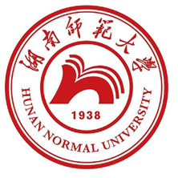
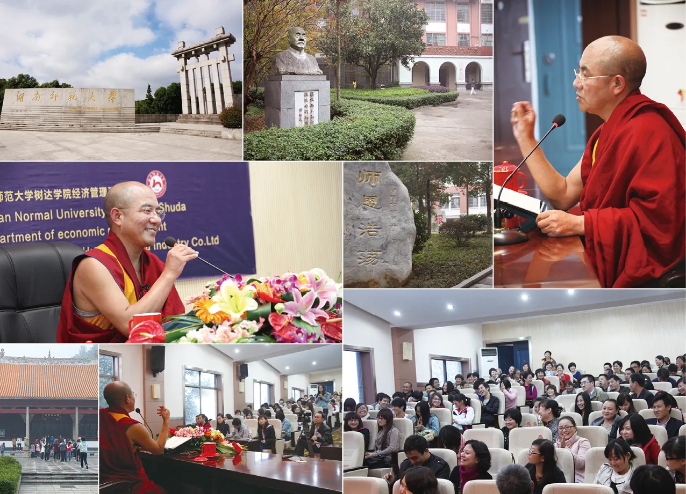
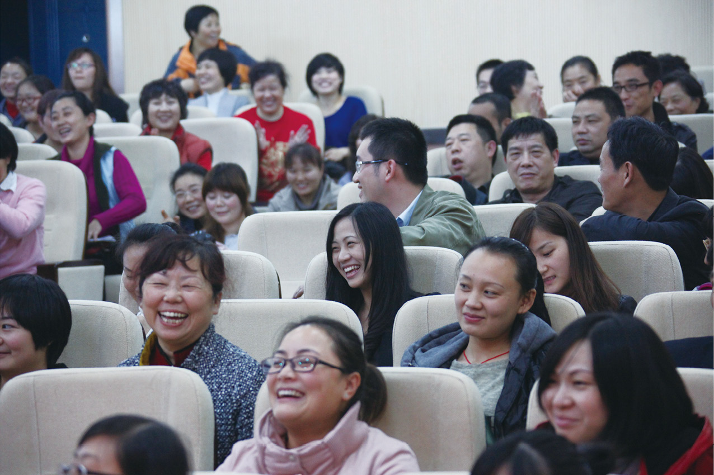
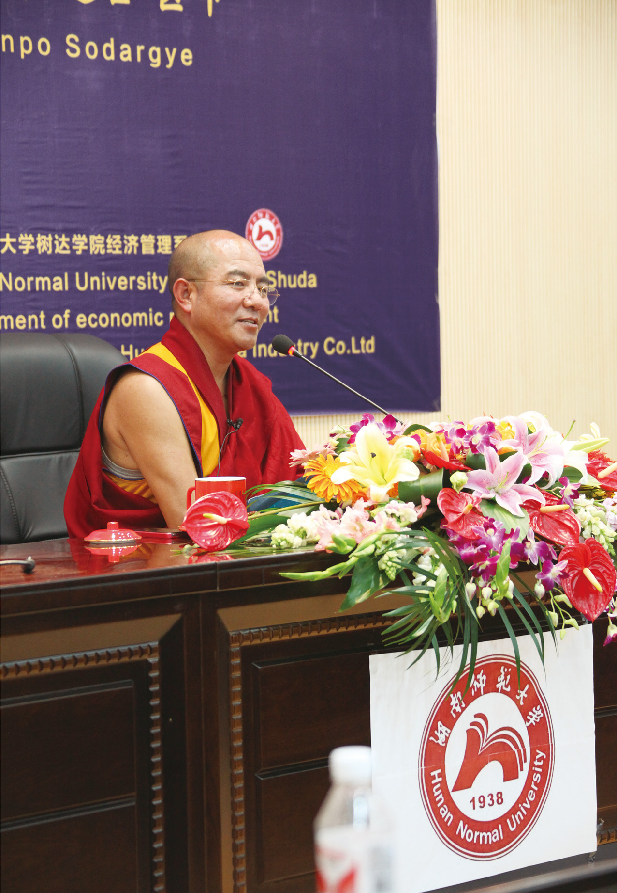
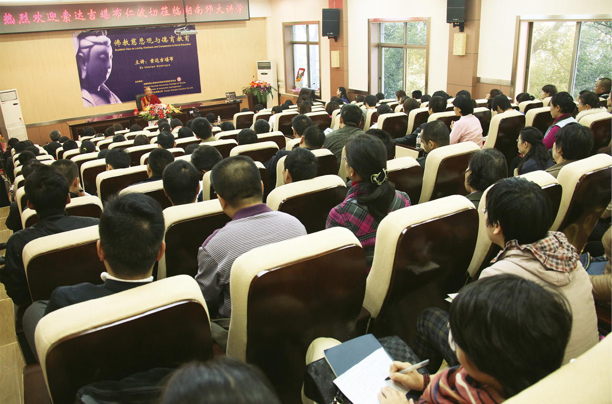

“培养一个人的心智而忽略道德，

无异于给社会树敌。”

第19场

湖南师范大学

Hunan Normal University

中国·长沙

2011 / 11 / 18

## 佛教慈悲观与道德教育

## Compassion and Ethics in Buddhism

主持人：

下午好！今天是个非常难得的日子，初冬的小雨，洒在湖南师大的校园，尊贵的索达吉堪布仁波切将为我们作一场关于佛教慈悲观的开示。

慈悲观，是大乘佛教的精华，为了让世界变得更加和谐美好，人人都需要慈悲观的道德教育。慈悲是无私的爱，慈悲是广博的包容，慈悲是人间最美好的礼物，慈悲是心灵最圆满的幸福。

下面让我们以热烈的掌声，欢迎尊贵的堪布仁波切为我们开示——

很高兴来到湖南师大的生命科学院，跟大家一起交流。今天的话题，是“佛教慈悲观与道德教育”。

## 一、当前急需佛教的慈悲观

在座的很多人，对佛教也许了解，也许不了解。其实，不说佛教中更深的道理，单单是它的慈悲观，就是当前必不可少的。

如今的人们，对科技手段的掌握日新月异，聪明才智也是远远超过了几十年前。然而遗憾的是，好多人特别缺少一样东西，是什么呢？就是慈悲的心态。

你们在课堂上曾学过许多知识，但是有没有学过怎么样做人，怎么样饶益社会，怎么样帮助一切生命呢？你们生命科学院，经常做各种动物的解剖，来研究生命的本质，可是大家有没有想过每一个生命都是平等的，都渴望快乐而不愿感受痛苦呢？

曾有一段名言说得好：“注意你的心态，它会成为你的语言；注意你的语言，它会成为你的行为；注意你的行为，它会成为你的习惯；注意你的习惯，它会成为你的人格；注意你的人格，它会影响你的命运！”

所以，一个人的心态，会直接决定未来的命运。如果没有慈悲的心态，人生难免会以悲剧告终。

那么，到底什么才是“慈悲”？对此，龙猛菩萨在《大智度论》中解释得非常清楚。他是这样讲的：“大慈，与一切众生乐；大悲，拔一切众生苦。”也就是说，“慈”是给一切生命带来快乐，“悲”是让一切生命远离痛苦。当然，这里的“一切生命”，不仅仅是人类，还包括所有的动物。

然而，现在人们非常缺乏这种理念，一看到动物，第一个念头往往就是：“它的肉能不能吃，皮能不能穿？”不但对动物如此，包括对于人类，有些人也打着“人不为己，天诛地灭”的旗号，为了一己之利，不惜损害许许多多人的健康。

比如，一些药厂通过不正当的手段，制造各种假药害人；食品行业经常有耸人听闻的内幕曝光，大家对此也司空见惯；医院里的“白衣天使”，不知从何时起，救死扶伤的光环已悄然褪色，变成了人们口中的“黑白无常”；还有一些老师，原本是“人类灵魂的工程师”，现在也沦为了误人子弟的元凶，甚至前不久杭州有个女老师，提出“宁可为妓，绝不为师”的口号，引起了国内外一片哗然。

在这种大环境的影响下，有些高校培养出来的天之骄子，也开始纷纷放弃底线，为了钱什么都肯干。听说有个北大才子毕业后，由于找不到工作，就以卖猪肉为生。当地县委书记觉得太屈才，特意给他安排了一个好工作，可是他不太会做人，与人交往的能力特别差，跟谁都合不拢，最后实在没办法，只好又回去卖猪肉了。

现如今，人们的伦理道德日损，这不仅跟社会风气有关，跟学校的教育也有极大关系。假如学生平时耳濡目染的，都是赚钱的好处、发财的方法，除此之外，对大众没有任何责任感，对自己没有任何道德约束，那人类的未来只会越来越可怕。美国总统罗斯福也说过：“培养一个人的心智而忽略道德，无异于给社会树敌。”

## 二、佛教的慈悲遍及动物

鉴于此，我们很有必要了解一下佛教的慈悲观。

一个人如果没有慈悲心，内心只有对物欲的贪婪，就会不择手段、损人利己，到头来不但害了别人，也会害了自己。正如佛经中所言：“贪爱毒之过，能害一切人。”而要想真正生起慈悲心，最好是从佛教中汲取。

为什么呢？因为佛教的慈悲范围最广。像儒教，虽然提倡“仁”，认为在仁、义、礼、智、信中，“仁”是最高的境界。但他们的“仁”也仅限于人类，为了父母等，也有杀鸡捕鱼的现象存在。相比之下，佛教的慈悲，跟其他宗教不同的是，它不会伤害任何生命，包括动物在内，诚如《大庄严论经》所言：“佛法大慈悲，终不伤害物。”

特别伟大的圣天论师，在《四百论》中亦云：“如来所说法，略言唯二种：不害生人天，观空证涅槃。”也就是说，释迦牟尼佛所宣讲的一切法，概括来说有两种，一种是通达万法皆空的智慧，一种就是不害任何众生的慈悲。

这种慈悲，不单单是一种口号，而且淋漓尽致地展现在佛教的方方面面。就拿藏传佛教中的“藏医”来说，从古至今，从未做过动物的活体解剖；藏药里所有的动物成分，都是在动物死后才入药的。藏医的治病理念，是给予众生安乐，但绝不把人的安乐与杀生画上等号。

其实，不杀生，并不代表不能治病。唐代“药王”孙思邈，在《千金方》中就非常反对杀生，他曾一针见血地指出：“杀生求生，去生更远。”意思是什么呢？为了保全自己的生命，而去杀害动物的生命，只会让自己离“生”越来越远。

现在有些人，为了所谓的营养，就炖鸡鸭、吃鱼虾，并习以为常，从来没有想过有什么不对。其实，你吃这些动物，不但不会延年益寿，反而会给自己的生命带来极大危害。这是一种因果规律。

当然，对动物要心怀慈悲，并不只是佛教徒才这样提倡，如今越来越多的爱心人士，也完全支持这种观点。今年11月，在英国伦敦街头，著名的电视节目主持人、演员萨拉·霍尼韦尔，上演了一次反对肉食的行为艺术。她半裸着躺在一个巨大的盘子上，周围摆放着假的薯条和青豆，盘子旁边是善待动物组织[^1]的标语：“设身处地想一下你盘中动物的处境。”她的这种行为艺术，就是希望激发人们对盘中动物的同情心。

印度伟大的和平主义者“圣雄”甘地（Mohandas K. Gandhi, 1869-1948），也曾说过：“从对待动物的态度上，可以判断这个民族是否伟大、道德是否高尚。”这句话可谓意义深刻，理应引起我们每个人的重视。

有些年轻人听了，可能不信这一套，难以接受这种理念。但等你年纪慢慢大了，有些道理通达了，就会体会到生命的珍贵，明白每一个生命都值得我们尊重。

昨天，我们在一个公园组织放生，有一位大学老师也参加了。她说自己差不多二十年前，就在这个公园办过婚礼，当时由于不信佛，婚宴上杀了很多生命。如今，她对往事非常后悔，希望多参加放生，也算是对当年的一种补偿。

所以，真正的慈悲，不仅仅是对人类，还应包括我们身边的动物。

## 三、出家对父母是不是一种不慈悲

或许有人提出疑问：“既然佛教如此慈悲，那为什么让人出家，弃父母于不顾？如此不孝，岂不是与慈悲直接相违？”

其实这是一种误解。由于一些电影和媒体的错误引导，如今很多人对出家的认识，都是负面的居多，根本不知道出家是最大的孝顺。

要知道，人的生命不仅仅是这一世，对父母的孝顺，也不是给他们一些钱，经常去看看他们，就可以了。从长远来看，以金银财宝、饮食衣物供奉，不能圆满报答父母的恩德，唯有引导他们行持正法，才是真正报答了双亲之恩。就像《不思议光菩萨所说经》中所言：“非饮食及宝，能报父母恩，引导向正法，便为供二亲。”

莲池大师也讲过：“亲得离尘垢，子道方成就。”只有让父母彻底离苦得乐，子女才能成就孝道。莲池大师还把孝分为三种：孝、大孝、大孝之大孝。其中“大孝之大孝”，就是令父母永远离开痛苦、获得快乐，这才是最值得追求的，也是出家后可以给父母带来的。

因此，作为子女，自己一定要多行持善法，同时，尽量劝父母不要杀生、行善断恶，这样对他们生生世世的安乐才最有利。所以，从各方面来了解佛教，这一点很重要！

## 四、国外对佛教慈悲观的尊重

现在汉地很多学校，由于各种原因，基本上没有重视佛教的理念，这一点特别可惜。在国外，像泰国，把佛教跟学校教育合为一体：许多学校的顾问或主要负责人，都是佛教徒、出家人，学校的教学内容也与佛教有关，并且每个礼拜要参禅、念经等，甚至高等学校还有更深一层的教学内容。这样久而久之，绝对可以引发大众的慈悲心，让越来越多的人懂得关爱众生。

还有英国，前几年已立法规定，将佛教列入中小学课程。他们认为，佛教以缘起法、四圣谛为基石，符合当今科学，易为西方人所接受。而且，佛教倡导五戒、十善、四摄、六度，又主张慈悲、和平、非暴力，对提升社会道德、维护社会安定，起着极其重要的作用。

可见，佛教的慈悲观，对现代人来说不可缺少。它虽不像很多时髦的东西那样吸人眼球，但就如水和空气，淡得让人察觉不到它的存在，可在任何一个环境中，离开它都不会活很久。

## 五、慈悲观是真正的道德教育

当然，你们也许特别想听：怎么样保养身体？怎么样让自己快乐？修什么法马上减轻压力？……而一听到所谓的“慈悲观”，不少人就兴致索然、昏昏欲睡。

其实，你们将来在社会上不管做什么，最需要的，就是今天所讲的内容——慈悲。如果没有慈悲的心，没有关爱他人的心，整天不顾一切追名逐利，那你就算拥有再多的物质财富，对社会也是有百害而无一利。

大乘佛教的慈悲，提倡关爱一切众生，这对很多大学生来讲，可能太高了，恐怕很难做到。但即便如此，起码你也应具有一颗善良的心。俗话说：“人之初，性本善。”善良，实际上是每个人的天性，有些人的善心就算暂时被蒙蔽了，但只要后天的方法得当，也可以让它慢慢苏醒过来。

尤其在大学里，如果对佛教的慈悲观有一些了解，比如，慈悲还包括缘众生的慈悲、缘法的慈悲、无缘的慈悲，并将它的教义深入挖掘，同时多学习一下《大智度论》等大乘论典，这对大家来讲，肯定有很大的利益。

退一步说，假如你实在对慈悲没兴趣，也可以先认识一下佛教的智慧。佛教虽然起源于2500多年前，但如今最尖端的天文学、地理学、宇宙学、量子力学、医学、生命学、社会学等，这些内容无不涵摄，而且从中都能找到最准确、最究竟的答案。

所以，佛教的高深莫测，当今许多知识分子需要了解。若能如此，你得到的只有利益，而不会有任何损害。

现在有些人喜欢胡思乱想：“我对佛教不能学得太深了，不然，以后会不会出家了？”这一点，你大可不必担心。在佛教中，有对出家人的教言，也有对在家人的教言。佛陀并没有要求，每个人只要一学佛，就必须看破红尘，到山里去出家。因此，希望以后大家对佛教，不要有这么多的误解，而应正面学习一下许多经论的教义。

这个社会，如果人人有一颗慈悲心，多为他人着想，其实很多悲剧就可以避免。前几天，甘肃有一辆幼儿园的校车被撞，事故原因是严重超载，只能载9个人的车却装了64个人。这起交通事故，造成了21人死亡，43人受伤，引起了人们的广泛关注。事发后，当地一些领导被停职调查，全国各地开始高度重视校车的安全，很多新闻被炒得沸沸扬扬……

如此亡羊补牢，虽然也很有必要，但如果人们心怀慈悲，经常关注孩子的安全，把别人的孩子当自己的孩子看，许多危险就可以防患于未然。所以，这个社会真的需要慈悲，人人若都有这种理念，把慈悲当成理所当然，就算不能杜绝一切恶行，至少也会减少很多悲剧的发生。

所以，今后的学校教育，理应把培养慈悲心这一块放在首位。不然的话，我曾看过一本《道德发展论》，里面就讲了，无论是任何国家与民族，如果完全抛弃了道德观念，个人利益与社会利益就会经常发生冲突，最终导致天下一片混乱。

你们在座的师范学生，以后有些人肯定会当老师，在这个过程中，你的想法与行为，必会潜移默化地影响你的学生，所以，大家不能成天只想着自我，而置社会的利益于不顾。现在不少大学生，只想自己找个满意的对象，组建一个舒适的家庭，钱再赚得多多的，这就是一辈子追求的目标。至于社会需要自己做点什么，压根从来就没想过。相比之下，以前完全不是这样，古人读书是“为天地立心，为生民立命，为往圣继绝学，为万世开太平”，可是现在的学生们，谁有这样的万丈豪情？

其实，就算你日日夜夜为了钱奔波，不惜一切代价只想发财，可最终能得到什么呢？揭开外表的繁花似锦，只剩下了内心的“压力山大”。对一个人来说，身体不健康了，可以到医院去治疗；而如果教育缺“德”，从而导致了心理不健康，那到任何一个医院去，都无药可救。

所以，在座的各位，今后对道德教育不得不重视。无论你从事什么教育行业，都应想办法教学生怎样做人，灌输一种善良的教育，同时也应让他们懂得孝顺。这方面，可以学习《弟子规》《三字经》《千字文》《孝经》《论语》等传统文化，也可以学习《善生经》《盂兰盆经》《父母恩难报经》等佛教典籍。

通过这样的学习，很多人的善心就会慢慢涌现，哪怕帮别人一点点，或是孝顺自己的父母，也完全是出于一种自觉，而不是被动的，这样的社会才有希望。不然，人人眼里只有自己，就像开车时人人都往前冲，最后只会令交通堵塞，谁也过不去。如此，受害者到底是谁？就是你自己。

因此，利他就是利己，无私的慈悲心，是世间上最好的礼物，能带我们步入快乐的坦途。希望在座的每一个人，以及你们将来培养的每一个人，可以将慈悲的阳光遍洒于整个世界，开启芸芸众生的幸福心莲，让每个人绽放出美丽的微笑！

现场互动

问：我是来自长沙大学的老师。最近在看一位法师的弘法讲座，他说：“佛经是一半骗一半劝。骗是为了劝，开始都是骗大家，让大家产生敬畏之心，但最终的目的，是劝大家断除贪嗔痴慢疑。”对于这句话，您是否赞同？

堪布：他说佛经一半是骗人的，这个我肯定不承认。我学习佛法、研究佛法这么多年，没有一刹那这样认为过。

只不过，佛经有了义、不了义之分。所谓的不了义，是为了接引根基不够的众生，暂时给他讲一些特殊法门，到了最后，待他的根基成熟了，再慢慢宣说究竟的法义，引导他进入更深一层的境界。如果把不了义认为是“骗”，用词可能不太恰当。

要知道，语言有贬义词、褒义词之别。作为佛教徒，对佛经的金刚语，应该有正面的评价。为什么呢？因为佛陀确实是真语者、实语者、不诳语者，纵然大海离开了波浪，佛陀也不会欺骗众生，这是前辈大德异口同声赞叹的。佛陀所讲的每一字、每一句、每一个道理，都是颠扑不破的无价之宝，不论过了多少时代，也都经得起推敲与观察，所以，这并不是一种欺骗。

问：我是酒店管理专业的。请问，佛教慈悲观对当代大学生最重要的作用是什么？

堪布：佛教慈悲观对当代大学生的作用，是方方面面的。现在很多人追求金钱，但实际上，就算你拥有很多钱，可以买车、买房子，百般享受也随之而来，你也不一定真正快乐，钱财也很难陪伴你一生。而你心里若有一种慈悲观，这种“财富”就会用之不尽，无论你在人生中遭遇什么，面对它都可以游刃有余，同时还能帮助身边许许多多的人，这样的生命非常有意义。

所以，希望大家能渐渐意识到，真正的幸福，并不是建立在物质上。现在人们提倡“低碳”生活，而我们佛教中提倡“低贪”生活，只有贪心越来越少，才能减少不必要的欲望，以随缘心来面对一切。这样的人不管在哪里，即使住的是露天郊外、吃的是粗茶淡饭，也会感到心满意足。否则，一辈子都在贪心的驱使下，拼命地往前追、往前赶，到了死时，才发现人生竟然如此苍白，这时候叹息也没有用了。

问：作为一个大学生，怎么样才能生起这种慈悲观呢？

堪布：慈悲观的产生，不可能一蹴而就，而需要一个长期的过程。在这个过程中，不但要有善知识的引导、好友的鼓励、家人的影响，以及经常翻阅大乘经论，更重要的是，还要有自己与生俱来的善根。

没有善根的人，听了多少佛教的慈悲理念，也一点感觉都没有；反之，前世若是修学过大乘佛法，即生中上师稍微指点一下，哪怕只听了一次短短的讲座、看了佛经中的只言片语，自己的善根也能马上苏醒过来，从此人生有着巨大的改变。

在佛教中，这被称之为“福报”。有福报的人，经常会有一些佛缘；没有福报的人，总是遇到各种魔缘。所以，每个人的根基和因缘不相同，生起慈悲观的程度也不一样。

问：我是历史学专业的学生。请问，佛教对生死持什么样的观点？

堪布：佛教对待生死，跟世间人完全不同。世间人一般认为，一个人的出生，如同大地上长草一样，突然就冒出来了；一个人的死亡，如同灰尘被风吹走了一样，说没有就没有了。但事实上，每个人并不是只有这一世，无始以来，我们在生死中流转了无数世，只不过现在不记得了而已。而且就算我们这一世死了，生命也一直会延续下去，并不会以此而中断。

所以，佛教中为什么劝人要多做善事？就是因为如果你没有做善事，经常杀生造恶业，也许今生中果报没有现前，但是在来世，它一定会成熟在你的身上。一切苦乐皆自作自受，故望大家不可不慎！

问：我们作为宇宙中的一粒尘埃，应该怎样对待生死？

堪布：要永远行持善法、永远断除恶法。“诸恶莫作，诸善奉行”，这就是佛教对我们行为的基本要求。若能如此，将来你无论转生到何处，都会感召快乐。

也许有人觉得：“不可能吧，从小到大，老师就没有这么讲过，父母也没有这么讲过。”其实，有些真理，老师和父母也不一定懂，毕竟他们的成长环境跟你相似，不明白这些也不足为奇。尽管他们在某些层面上，对你的人生有诸多指点，但在生死大问题上，他们却跟大多数人一样茫然无知。

其实，我跟你们年轻人交流，只有一个想法，就是希望更多人懂得生命的这种延续，明白“善有善报、恶有恶报”。这样的真理，在佛教中讲得特别清楚，并不因为我是佛教徒，想拉拢你们，就拼命地自卖自夸，说佛教如何如何好。每个人都有自己的缘分，信不信这些，完全是自己决定。但大家不要因为是大学生、是大学老师，未来似乎有美好的前程、有丰厚的待遇，就以傲慢心来掩盖一切。

你们以后有时间的话，还是应研究一下大乘佛教，看里面到底对生死是怎么讲的。古来许多高僧大德都强调“生死事大”，生死，确实是最应关注的终身大事。很多人认为找个对象，一辈子相依为命，就叫做终身大事。但实际上，这也不是什么大事，夫妻两个人一起生活，最多只有几十年，然后就没什么感觉了，而只有生生世世的快乐和痛苦，才是每个人最需要重视的，才是你们的终身大事！

问：现在有个慈善家叫陈光标，捐出的善款已达几亿人民币。但他做慈善非常高调，比如，他会砸掉自己的大奔，要求员工和他一起骑单车上下班，以此提倡低碳环保；或者他本人五音不全，却办了一场个人演唱会，给参加演唱会的农民送猪、送拖拉机、送红包……如今不少舆论都抨击他是在作秀。不知道在佛教里，是否赞成这种高调的慈善行为？

堪布：关于他的有些报道，我也看过，但具体情况是怎么样，我没有详细了解过，所以不敢妄自评论。

总的来讲，假如自己所做的善行，真的对别人有利益，就算高调一点也无可厚非。像比尔·盖茨、巴菲特，他们举办的慈善晚宴，也都比较高调，在很多公开场合，也常常宣扬慈善理念，这一切不但不值得抨击，反而理应随喜。

当然，一个人的善行若是表里不一，有很多漏洞的话，慢慢也会被人们发现的。如今中国的慈善，还有很多不完善的地方。前不久，创立“壹基金”的李连杰就说：“中国的慈善，若想达到美国的标准，起码还需要三十年。”的确，如今慈善缺乏相应的立法，因此，有些慈善家的慈善行为，确实还有待规范化。

不过，按照佛教的观点，一个人的善举只要对众生有利，哪怕高调一点，也没什么大问题。毕竟别人一般不敢出头露面，他却顶着众人的攻击，为了利他而不顾自己，这种精神相当可贵。当然，也有些人打着慈善的旗号，为了自己而大肆敛财，种种行为特别恶劣。所以，这些方面很难下定论，大家需要睁开智慧的眼睛，然后细致地作取舍。

问：我是经管系自然环境与城乡规划管理专业的。一直以来，我很崇尚佛教的慈悲观等教义，但近年来，当我出入一些旅游景点，发现宗教逐渐被商业化时，觉得很愤怒、很痛心，甚至会敬而远之。请问，您如何看待现在宗教商业化的问题？正统的佛教，未来在这个物欲横流的社会中，应当怎么样立足？

堪布：你这个问题很好！你的感觉跟我有一个地方相同，就是看见许多宗教场所被商业化时，自己很痛心、很伤心。但不同的是，我并没有特别愤怒，也没有对谁生气，因为这种现象的产生，可以说是众生的共业所致。

当然，你提的这个问题，确实是个问题。现在汉地许多寺院，都在卖门票，人们花了很多钱进去以后，基本上听不到佛教的教义，只是看到一些佛像。这些佛像在他们眼里，好像也跟美国白宫旁边的华盛顿塑像，没有什么区别，寺院完全变成了一个旅游景点，这种现状令人悲哀。

其实，我在极个别寺院也讲过，现在有些寺院，根本不需要很多钱，该造的殿堂已经造完了，出家人也没有用过这些钱，那么，供养三宝的钱都哪里去了？大家应该好好观察。作为当地政府，最好不要把寺院当成赚钱的工具。如今很多寺院没有自主权，好多决策都是政府在操控。游客去寺院买门票的钱，大多数也落到了政府手里。就算是为佛像贴金、对佛像作供养，钱也不一定100%都能用上。

而我们藏地，除了极个别的大寺院以外，到目前为止，许多寂静地方的寺院，并没有沦为旅游景点。有人去那里朝拜的话，不用买门票，而且有法师讲一些佛理，让大家回去时内心满载而归，原来对佛教不懂的地方，这次终于恍然大悟了。可是在汉地，据说有些老板把寺院全部买下来，让一些人假扮成和尚，花言巧语地骗游客，让这些人掏很多钱求保佑，结果钱却落入了他们的腰包……

这种现象特别可怕！作为一个佛教徒，我再次呼吁：佛教道场跟旅游景点要分开。旅游景点，可以让旅游局来管理；而佛教道场，谁都可以去，不用买门票。进了佛教道场以后，大家不仅可以朝拜佛像，同时，还要有法师给他们讲经说法。

如今想了解佛法的人特别多，包括大学生等年轻一代，也对佛教非常感兴趣。然而，现在最缺的是什么？就是传法的人。假如出家人把佛教最简单的慈悲观、利他观，经常给大众灌输，那么别人去寺院哪怕只有一次，也能对他的一生都有帮助。

问：我是服装设计班的学生，是个无信仰主义者，今天的问题若有冒犯，还请您谅解。现在科学证实，动物蛋白质可使人体更强壮，但佛教却不主张杀生；科学认为，人的生命是从一个受精卵开始，而佛教认为生命是在不断轮回。那么请问，您觉得科学发展与佛教文化怎么样共存呢？

堪布：我特别喜欢非佛教徒的问题！你们的提问，有时候对我似乎更有价值。

佛教与科学，并不是截然分开的。科学分为三种：自然科学、社会科学、心智科学。其中的“心智科学”，在20世纪以前，科学家研究得很少，直至20世纪末、21世纪初，西方才开始关注这一领域。像如今的哈佛大学，在研究生命真相、前世后世存在、轮回的科学性等方面，就有着前所未有的一些突破。

你说现在科学证实，动物蛋白质可使人体更强壮。但这种观点，并不是每个科学家都支持的。像著名的科学家爱因斯坦，当年就反对肉食而提倡素食[^2]。

现在人们常常听到“科学证实……”，有时候也不一定就是科学，而是一些广告。好多营养品，明明对人体不利，却打着“科学”的旗号，堂而皇之地走进千家万户。而在西方，许多营养学家和医学家，从来不吃这些营养食品，因为谁也不敢保证里面添加了多少有害物质。

此外，你说科学认为人体源于精卵结合，这是以前的一种观点。现在很多公认的科学家，也正在探索生命是否可以延续、前世后世是否存在等问题。这些方面的案例，我在其他学校也引用过，希望你有机会的话，可以详细阅读一下这方面的书。

问：我是树达学院的一名老师。佛教讲“上报四重恩”中，就有一种恩叫父母恩。但现在很多学生对父母有想法，平时对父母的伤害，也往往最大。请问，我们应该怎么样对待父母？

堪布：报答父母的恩德，对每个人来讲非常重要。按照佛经的观点，即使将父母扛在自己的肩上，转绕整个宇宙，也报答不了父母之恩。很多佛经中，都提到了对父母要报恩，当年虚云老和尚三步一拜朝五台山，也是为了报答父母的大恩。

现实生活中，有些孩子跟最亲近的父母，往往冲突最大，这种现象不太好。《弟子规》中讲过，父母哪怕不小心做错了什么，也应以柔和的语言跟他们沟通，不要惹他们生气；如果他们特别生气了，这时候就不要说，等他们心情缓过来了，再慢慢跟他们讲；假如实在讲不通，作为子女，也要尽量随顺。

有些子女可能因为前世的因缘不好，整天跟父母吵吵闹闹，对此，自己一定要忏悔，并要学会理解父母，这样就能化解一些。不管怎么样，父母显现上再不对，子女也不能太过分，而应以一种感恩心来对待他们。

问：我是酒店管理专业的。利用暑假课余时间，我偶尔会参加一些公益活动，见到了许多需要帮助的孩子。如果有两个孩子同时需要救助，一个治愈的希望大，一个希望小，而一笔资金只能帮助一个孩子时，许多人就会选希望大的孩子。但我认为生命是平等的，这对另一个孩子不公平。请问，如果从佛教的慈悲观出发，您会做怎样的选择？为什么？

堪布：这个难度比较大啊！我以前也碰到过。有一次，我遇到两个病人，一个说是癌症晚期，没办法救了；一个还有活下去的希望。当时，施主只能资助一个人的治疗费，他们就问我怎么办。

其实，从生命的意义上讲，每个生命都是平等的。但当时医生已下“病危通知书”了，说那个人病入膏肓、无药可救，把钱花在他身上也是杯水车薪；而另一个人，医生说还有一分希望。后来，我们经过共同商量，决定把钱用在另一个人身上。

从个人的角度讲，我们跟这两个病人非亲非故，对他们完全是平等的。可是若以医生的语言为依据，为了把钱花在刀刃上，不辜负施主的一番托付，我们只好作出了取舍。的确，没过两天，癌症晚期的病人就去世了，万一钱用在了他身上，希望也不是很大。

在我们的人生旅途中，常常会遇到这种情况，此时，一定要跟大家共同商量。佛教中也讲民主，世间人“少数服从多数”的原则，跟佛教的羯磨仪轨比较吻合。不然的话，让我一个人做主，也害怕担不起这个因果。所以，在这些问题上，大家还是要有民主意识，跟相关人员来商量决定。

问：我是旅游管理班的。您刚才说“善有善报、恶有恶报”，那么，我们在做善事时，如果为了追求一个善报，是不是体现了人性自私的一面？

堪布：佛教中做善事，层次是不相同的：

最低的层次，行善是为了追求善报，今天我供养佛陀、做善事，是想自己未来获得快乐。

中等的层次，是把我做善事的功德，回向给天下无边的众生，让众生得到快乐。

最高的层次，是明白所做的一切如幻如梦，我做的“善事”和“我”全部不缘，安住于远离四边八戏的空性中，这叫做三轮体空。

当然，也有人连想获得善报的概念都没有，只是随顺别人做一个善事而已。

所以，做善事有很多种，并不只是为了求一个善报。

问：当今全球面临严重的精神危机，到处都存在着“压力山大”，我们个人也要面对生活上、工作上的许多压力。我想问一下，这些大到全球、小到个人的压力，佛教中如何来化解？有人说要放下，但压力不是说放下就不存在了。

堪布：压力太大了，往往是由于欲望太大了。所以，即使大家不能完全放下，至少也要懂得知足少欲，生活上一切随缘，不要让心中的贪欲过度膨胀。

假如你们对生活的要求特别高，一定要买几套房子、几辆车子，一辈子当房奴、当车奴，到死也没有还完债，这样的人生，压力肯定特别大。所以，佛陀告诉我们，应该降低贪心、减少欲望，尽量地知足少欲。同时，还要懂得谅解别人，不要稍有一点点不开心，就马上怨天尤人，抱怨社会、抱怨父母、抱怨身边的人。

其实，按照佛教的因果理念，你这一世若有福报，财富便会不求自得；没有福报的话，再怎么样拼命追求，也只会让自己越来越穷。所以，希望大家能明白一些佛理，以随缘的心来面对一切，如此才能活得自在，这也算是一种放下。

问：我是一名老师，听了您的演讲，我们很受启迪！慈悲心对个人、家庭和社会，确实非常重要。但在生活中，我跟朋友聊慈悲心时，有个朋友曾反驳说：“你在高校里当老师，面临的压力没有那么大。我在公司里，竞争特别激烈，如果发起慈悲心，就没有立足之地了，甚至连饭碗都没了。”我自己学得不好，不知该如何回答他，请您开示。

堪布：对于大乘慈悲观，别人不了解也是正常现象。因为这是非常深奥的一种境界，有些人以前从来没听说过，所以，不能接受也情有可原。

但这种思想，对人类社会十分有利，因此，我们不管遇到什么挫折，也应全力以赴地给别人宣讲。有些人就算一开始接受不了，但慢慢地，也会从误解到了解、从了解到通达，最后，假如他从中受益匪浅，就愿意把这种精神传递给相关的人了。

真理，本来就掌握在少数人手里，不一定人人都能明白。但只要我们以一种对社会负责、对人类负责的善心，将此传授给有缘的人，久而久之，他们应该会接受的。

问：我还有个想不明白的地方：慈悲心有没有国界呢？

堪布：真正的慈悲心，不分国界、不分民族、不分地域、不分信仰。只要众生受苦受难，我们有能力的话，就应该无有任何偏袒心，去救济他们、帮助他们。

当然，慈悲心的范围，还要包括动物在内。现在我们最缺的是什么？就是对动物的慈悲。昨天我上飞机时，看到托运行李的几个工作人员，在搬行李箱时，见到有几箱兔子，就故意一个个使劲扔，看见兔子的惊慌失措，他们开心得哈哈大笑。当时我特别不忍心，但也没有办法，只好在飞机里默默念观音心咒。其实动物也是生命，从这小小的行为中，也能看出来有些人的残忍。

所以，我们的慈悲心，一定要像阳光一样，遍及动物和其他人的身上。阳光的普照，不分什么国家、什么种族，同样，我们对所有的众生，也务必要一视同仁。

问：我十几年来深受精神障碍的困扰，我有一种强迫症，或者叫恐惧症，是从小就与生俱来的。我一直觉得自己是世上最不可救药的，根本没有自信，不可能得到救赎。虽然现在学佛后好了很多，但在全国，像我这样的病例非常多，医学却没办法治疗。请问上师，如何才能消除这种痛苦？

堪布：假如今生患有一些恐惧症，按照《俱舍论释》的观点，是前世故意乱抛一些小生命，让它产生恐惧心所招致的果报。若能经常念药师七佛的名号[^3]及《药师经》，对遣除这样的痛苦和疾病很有帮助。

倘若你有更高的境界，还可以观想：“世间上有许多像我这样的受苦者，愿他们的痛苦我来代受，我的快乐回向给他们。”如此修持自他相换，也能迅速减轻自己的痛苦，并逐渐获得康复。

问：请问，您有兄弟姐妹吗？

堪布：有。

问：如果您没有兄弟姐妹，您会出家吗？

堪布：会。

问：为什么呢？因为中国文化强调“不孝有三，无后为大”，如果您是独生子女，那么，您这个抉择算不算不孝呢？

堪布：你问得很好！很多人担心我答不上是吧？呵呵，我遇到过很多，没问题啊。

以前我出家时，家里还有一个弟弟、三个妹妹，但并不是因为有了他们，我就可以放心地不管父母了。藏地和汉地的文化背景有些不同，一般在我们藏地，家里出一个出家人，是无比光荣的事情。即使父母没有人养，他们晚年也可以到寺院附近，过安详的生活，不会有任何怨言。

其实，刚才在演讲中我也提过，按照莲池大师的说法，真正的大孝，不一定是给父母房子、财物，而是应该对他们的生生世世负责。表面上看来，出家后似乎无法对父母尽孝、承欢膝下，但实际上，子女出家修行的功德，对父母绝对是有利的。

在我们佛学院，有些汉族人出家，刚开始时父母也很不理解。但到了后来，这些父母接触了佛教后，慢慢开始学习，甚至自己也出家了。

所以，我的回答很简单：无论我是独生子，还是有其他兄弟姊妹，由于明白了佛教可以给众生带来什么，所以都会选择这一条路。而这种选择，可以真正报答父母的恩德。

问：通过媒体，我们常看到一些僧人开宝马，手里拿iPhone、诺基亚。虽然这也是很正常的，但我想问，这些东西是怎么来的呢？

堪布：这种现象，可能要从两个角度来理解：一方面，佛教徒不一定全部是好的，里面也有一些“腐败分子”。像有些出家人，把信众做功德、做慈善的钱，自己偷偷拿去享用，该做的功德却没有做，这种因果报应非常可怕。

还有一种情况是，对于有些上师，为了方便弘法利生，施主供养他一辆车，或者其他财富。按照施主的意愿和要求，这个东西必须他用，这样也是可以的。佛教的《毗奈耶经》中讲过，倘若你前世福报很大，今生不需要勤作就腰缠万贯，那就算是一个出家人，所住的房屋价值五百金钱，也是允许的；所吃的东西具足百味，也是可以的[^4]，这些都不算违背戒律。

现在是21世纪，出家人不一定都要穿破烂的僧衣，个别人有能力的话，也可以享用自己的福报。但若是通过不正当的手段来敛财，那么“好花不常开，好景不常在”，迟早会受到今生或来世的各种报应。

所以，这个问题不能一概而论，需要一分为二地去分析。

问：我是刚学佛不久的一个佛子，接触佛法之后，我觉得爷爷奶奶非常可怜，因为他们年纪很大了，特别害怕死亡，但又没有信仰，每天都在等死的心态中度过。而藏族的老人非常有信仰，每个人都很快乐。请问，汉地老人应该怎样学佛，才能断除对死亡的恐惧？

堪布：你说得很对！我经常也有这种感觉，在我们藏地，很多老人从小就念佛，死时也念佛，所以大多数对死亡并不害怕，只是把它当成换一件衣服而已。而汉地的很多老人，由于没有信仰，到了临终时，特别恐惧、无依无怙，许多现象看起来非常可怜。

在座年轻活泼的学生们，其实在不久的将来，也会面临这样的痛苦。那个时候，不知道你有没有一点把握？假如大家在年轻时、在有精力思考时，懂得了生老病死的真相，到了那时，内心就会有一分坦然。

当然，你们因为环境的影响，可能完全没有这种概念，一下子转过来也比较困难。但即便你不信佛教，也可以思考一下佛教所讲的道理。假如它确实言之有理，那你为什么不接受呢？不接受的原因，是教育导致的，还是因为它不是真理？……若能这样多方面观察，并逐渐深入了解佛教，那么在以后面对死亡时，就不会特别无助了。

否则，一旦等你们老了，才让我讲一个道理，叫你马上就不怕死，这有一定的困难。所以，希望大家对死亡还是要尽早准备。

问：我是中南大学西南分院的职工，请上师慈悲摄受。我看到一个不学佛的人对佛法萌生了兴趣，就给他推荐您大学演讲的书来看，这对他很有启发。请问，您经常不辞辛劳地去许多大学演讲，这是源于什么初衷呢？

堪布：不管是佛教徒、非佛教徒，许多人都有一个美好的愿望，就是希望全人类得到快乐。今天我来到这里，虽不敢说自己内心一尘不染，但也是因为看到现在许多年轻人思想很空虚，自己虽说做不了什么事情，但作为一个出家人、作为修学大乘佛法的人，还是想尽心尽力为大家指一些方向，希望每个人能找到真正的人生之路。出于这种发心，我经常去往不同的大学，在力所能及的范围内，跟大家交流一些真理。

在交流的过程中，我既没有站在佛教徒的立场，也没有站在非佛教徒的立场，而是站在客观公正的立场上，跟你们一起探讨真理、寻求真理。

在座的每一位学子，可以说人生才刚刚开始，如果开始的路就走错了，那么，今生也会苦，来世也会苦；如果一开始就找对了方向，那即使以后没有得到很多的财富、很高的待遇，至少也对得起自己的良心，对得起老师和父母，对得起整个社会。

我们今天的聚会，看似是一个偶然，实际上也是一种必然的因缘。对于有些人，我们以后可能还会见面；而有些人，今后就再也见不到了。不管怎么样，这些都不重要，最重要的是，希望你们以后能想得起来：每个人都有生老病死，为此一定要早做准备；人需要大慈大悲心，有了它，无论在生活中扮演什么角色，都会非常有意义，它给自己带来的价值，远远超过金钱、超过一切。对此，大家一定要再三思维！

主持人：

非常感恩索达吉堪布仁波切为我们带来的精彩开示和慈悲解答！

两个小时很快就过去了，相信在座每一位都有不同程度的收获。让我们再次以热烈的掌声，向堪布仁波切致以诚挚的感恩！

接下来，有请树达学院经济管理系学生会副主席致答谢词——

学生会副主席：

尊敬的索达吉堪布仁波切，敬爱的老师们、同学们：

大家下午好！我是湖南师范大学树达学院学生会副主席，非常感谢索达吉堪布仁波切的精彩开示！堪布的演讲和对大家问题的解答，给了我们很多收获和启示，让我们认识到佛教的慈悲观是多么美好，多么珍贵。

的确，如果整个社会缺失了慈悲理念，人与人之间的关爱、人与自然之间的和谐，将不复存在；如果我们心灵失去了慈悲，内心就会变成干涸的沙漠，不但迷失了人生的方向，甚至会连最基本的幸福和快乐都不能获取。

当代大学生，不缺乏才华，不缺少智慧，最缺少的是高尚的道德教育。可以这么说，我们的世界观、人生观，在经济全球化和网络信息大潮的冲击之下，价值取向越来越趋向于个人主义的功利化，社会责任感日益淡薄，自我意识愈发突显，道德认知与日常行为脱节，越来越多人求职和学习的目的，是奔着追求金钱和地位而去的。

这一切问题，在大乘佛教里，原来有着最圆满的解答钥匙。堪布仁波切为我们解释了何为大慈大悲，以及对人的慈悲、对动物的慈悲。他为我们点燃了慈悲的烛光，给我们浇灌了慈悲的甘露。这一刻，我们内心充满了佛法的滋润，也让我们产生了深刻的思考。

相信堪布今天的演讲，对我们而言只是一个开始。佛法如此博大精深，值得我们深入探索。树立慈悲观和学习慈悲，并非一蹴而就的，而是在我们的心中、在行动中，一点一滴地去努力、去探索，唯有如此，人的心灵幸福、整个社会的平安和谐，才能够得以实现。

再次感谢堪布仁波切为我们带来的精彩开示！这是一个非常有意义的下午，值得我们深深铭记，它将开启我们今后的佛法探索之旅、心灵慈悲之旅。

愿以此功德，庄严慈悲观，

上报四重恩，下济三途苦。

若有见闻者，悉发菩提心，

尽此一报身，同生极乐国。

让我们一起祈祷、共同祈愿，愿这些智者长久住世、广传佛法。热烈的背后，必定是一次沉淀，让我们跟着智者的脚步，向心灵解脱的彼岸前进！

谢谢大家！

[^1]: 善待动物组织PETA，拥有超过二百万名会员，是全球最大的维护动物权益组织。
[^2]: 1930年爱因斯坦写过一段话：“虽然因为外界环境的限制，我不能成为一名严格的素食者，但在理念上，我一直都是素食支持者。”
[^3]: 药师七佛的名号：南无善名称吉祥王如来、南无宝月智严光音自在王如来、南无金色宝光妙行成就如来、南无无忧最胜吉祥如来、南无法海雷音如来、南无法海胜慧游戏神通如来、南无药师琉璃光如来。
[^4]: 《根本说一切有部尼陀那》云：“佛言：汝等若以信心投我出家情求涅槃修净行者。此诸苾刍所著衣服直一亿金钱。所住房舍直金钱五百。所啖饮食具足百味。如是等事我皆听受。汝并堪销。”又《根本说一切有部百一羯磨》云：“佛言：我今听许。诸有发心求涅槃人。来诣我所。修净行者。所著衣服价直百千两金。所住房舍价直五百。所啖饮食六味具足。此等供养悉皆销受。”
