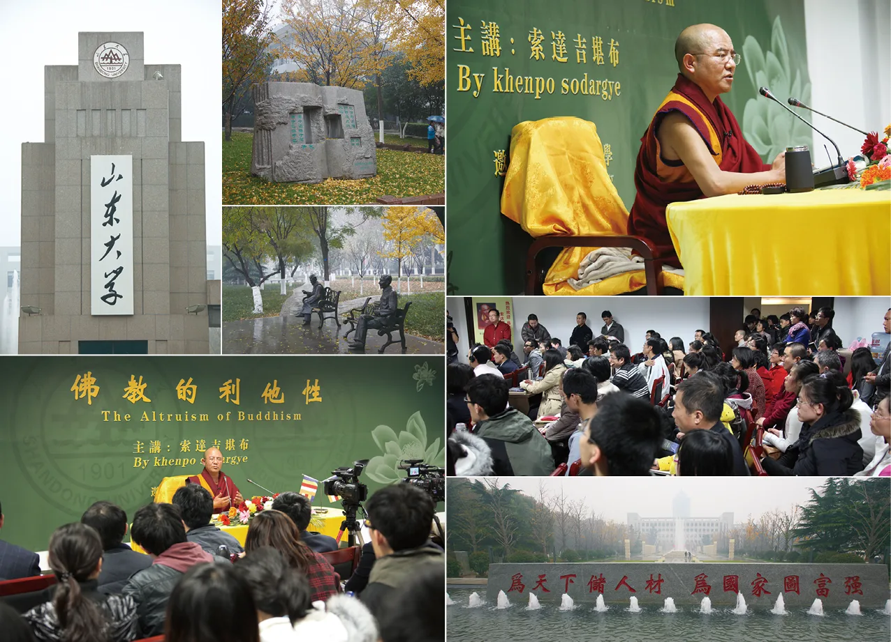
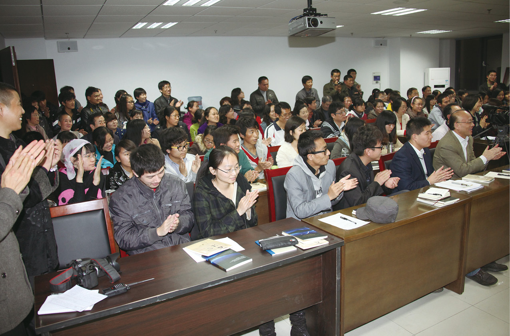

这正是古人所担忧的

玩“物”丧“志”。

第18场

山东大学

Shandong University

中国·济南

2011 / 11 / 16

## 佛教的利他性

## Altruism in Buddhism

陈坚教授：

这次特意邀请了喇荣五明佛学院的索达吉堪布，给我们讲讲佛学方面的道理。

索达吉堪布，是四川甘孜人，年轻时在甘孜师范学校读书，出家以后，专业是藏传佛教。堪布对儒学、道家等中国传统文化，也非常了解。近几年去过很多著名的大学，像北大、人大、复旦、南大，并作过很多讲座，深受学生们的欢迎。

索达吉堪布所作的学术工作，一方面是把藏传佛教的很多佛典，翻译成汉语——对我们汉传佛教而言，最初翻译过西域的佛经，后来又翻译了印度的佛经，接下来的一个潮流，可能就是翻译藏传的佛经了。这是我们了解藏传文化的重要途径，也是堪布做的一个工作。另外一个工作，就是堪布还传播儒学，讲过《弟子规》，在汉藏交流层面做了很大贡献。

今天要讲的是“佛教的利他性”。利他性，是大乘佛教的根本特征之一。下面，让我们听听堪布是怎么诠释的。好，现在把时间交给堪布——

陈教授多年来带佛教的研究生、博士生，自己也读过佛教博士，我非常佩服！我曾在1999年去过泰国，那里的很多大学都有佛教博士，也有许多佛教的博士生导师。我看了以后特别羡慕，觉得“汉地知识界对佛教若也有深层的研究，该多好啊”，当时有这样一种向往之心。

而现在，汉地很多大学都开设了宗教系，对佛教有各方面的研究和学习。听说你们山东大学，除了对佛教研究以外，对其他宗教，如基督教、道教等也均有涉猎，这是非常好的。任何宗教，只要对众生有利，我们都应当尊重。

我个人而言，只是一名普通的出家人，对儒教等很多思想比较有兴趣，但没有什么更深的研究。你们山东，可以说是“孔孟之乡，礼仪之邦”，是儒教的发源地，孔子、颜子、孟子等儒家五圣[^1]都出自这里。儒教所提倡的“仁爱”，与大乘佛教的“利他”也有不少相似之处，所以，下面介绍的“佛教的利他性”，相信大家并不会特别陌生。

## 一、佛陀与历史伟人不同

在座各位研究生、博士生，对佛教应该都比较了解。我本人多年来研究佛教，得出来的结论是什么呢？所谓的佛陀，并不是传说或神话中的人物，而是在人类历史上实实在在出现过的。这一点，不仅是我们佛教徒认可，现在的学术界也不得不认可。

大家都知道，最近佛牙舍利在缅甸供奉时，该国举行了隆重的恭迎仪式，缅甸副总统等2000多人，先是到机场列队恭迎；随后，缅甸总统率6000多名政府高官，在佛牙舍利的供奉地恭迎。在缅甸供奉48天中，每天会有多少人虔诚朝拜，应该也不难想象。以前佛指舍利被迎请到台湾时，短短的11天中，每天的朝拜者都超过十万，前后共有百万人前去瞻礼……

现在是21世纪了，人们有很强的辨别能力，不可能盲目信仰一种东西。那么，仅仅是佛陀的一节指骨，为什么就有这么多人尊重呢？这肯定有一定的原因。前段时间，我去西安法门寺时，也瞻礼了佛指舍利。听说国家为了保护佛指舍利，投入12亿修建地宫及合十舍利塔。当时，我一边顶礼，一边生起无比的信心。

人类发展到今天，曾涌现过许多著名人物，但他们有没有受到后人如此崇拜呢？大家应该有目共睹。像牛顿的话，他死后安葬于英国皇家教堂——西敏寺（Westminster Abbey）的“诗人之角”，在那里，还有莎士比亚（William Shakespeare, 1564-1616）、达尔文（Charles Darwin, 1809-1882）、丘吉尔（Winston Churchill, 1874-1965）等名人的墓碑。

还有爱因斯坦，他生前在遗嘱中要求，把骨灰撒在不为人知的地方，不建坟墓。但一个叫哈维的美国医生，却偷偷把他的大脑切了下来。为方便研究，他将爱因斯坦的大脑切成240块，分别装进10个储存切片的盒子里和2个大广口瓶中，精心保管。这件事曝光之后，没有给哈维带来任何荣耀，反而令他一直背负“盗脑者”的恶名，遭到很多人唾弃。他为此不得不辞去职务，并一度失踪。42年后，他才正式把爱因斯坦的大脑，交给了普林斯顿大学医院保管，让它回到了爱因斯坦逝世的地方。尽管后人对这个大脑作了一些研究，但在人们的心目中，它肯定没有佛陀遗骨那样的加持。

当然，也许因为我是佛教徒，以偏袒心对佛陀有一种敬仰、赞叹。但客观来讲，大家应该需要思考，看世间上被这么多人崇拜的事物，到底是不是一种迷信？佛陀为众生广开八万四千法门，藏地、汉地的《大藏经》中有那么多经、律、论三藏教典，它究竟有什么样的内涵？

在座的很多学生，听说也研究过佛教的《金刚经》《大乘起信论》。你们在学习的过程中，可能会发现佛经与世间文字有极大差别。我们都受过一些学校教育，小学、中学、大学的课本学了以后，不一定需要永远学习、永远供奉。而佛经却与之不同，短短一部《心经》，不管是谁看了，都有无穷的回味，都能获得无比的加持、无尽的利益，这就是佛陀不可思议的威德力。这一点，有智慧的人无法否认，这个事实谁也抹杀不了。

因此，我们首先要知道，所谓佛陀到底是什么样的？他的前世虽有许多精彩公案，但更重要的是，这一生在我们人类面前，他示现一个什么样的形象，扮演一个什么样的角色？

今天在座的很多人，有些真正信仰佛教，有些也不一定，但不管怎么样，我们都应该去了解它、研究它，因为它不单单是一种信仰，更是一种智慧、一种教育。

在佛教中，除了出世间法以外，对世间的天文、地理、人文等知识也涵盖无余。假如它是一些落后的教条，又岂会有如此超越的智慧？就拿天文学的部分内容来说，当时佛陀不依靠任何仪器，就将宇宙的运行规律揭示得淋漓尽致，这种智慧令后人实在无法想象。

## 二、佛教精髓唯有利他

大家都清楚，由于一些历史原因，传统文化受到了史无前例的重创，这对人类有非常大的损害。如今这一代人，无疑就是首当其冲的受害者。为什么呢？因为在他们的人生信条中，除了追求金钱、地位、美色以外，什么道德理念都没有。

当然，我也承认，极个别的古代传统是比较落后，不一定适应当今的国际化潮流。但人类对于道德的崇尚与重视，却不应该弃如敝屣，而应当尽早恢复起来。

我不太清楚你们这边对传统文化的研究怎么样。其实，在古人的教育中，尽管没有佛教那样高深莫测的理论体系，但对为人处世、孝顺、仁义、礼仪等方面，还是有相当殊胜的教言。

现在很多人可能因为环境的影响，对好坏、善恶的分辨能力特别差，甚至有些人对“厚黑学”津津乐道，宣扬脸皮要厚如城墙、心要黑如煤炭，这样才能成为英雄豪杰。他们以为，只有变得越来越坏，才能活得越来越好，在这种观念的引导下，开始肆无忌惮地损人利己，这样的结果，只能是南辕北辙。不想痛苦，痛苦却一个接一个降临；想要快乐，快乐却像仇敌一样被灭掉了。

其实，若想真正获得快乐，佛教中早已告诉了我们答案——唯一就是利他。《大乘四法经》中也说：“世间明慧者，应发菩提心。”世间上有智慧的人，应该发起利他的菩提心。

不知道各位对“菩提心”陌不陌生？假如你们对它有个全面的认识，将来的人生之路，必定不会走得很艰难，不会一直困在自我的圈子里，看不到更广阔的天空。当然，作为世间人，爱自己、爱自己的家庭，这也无可厚非，但若一味如此，从来也不关心他人，这种爱就没有太大的价值可言了。

那么，什么叫菩提心呢？从究竟意义上讲，是愿天下一切众生离苦得乐，获得圆满佛果的发心。这是最上等的发心，非常难以生起。就算有些人一生研究佛经、修行佛法，口头上会这样讲，可是不要说对一切众生，仅仅是跟自己关系不好的人，不说去利益他，就算是想让他快乐的心，也生不起来。

今天的这次交流，大家如果记不住其他内容，只要记住了“菩提心”，也就不枉此行了。虽然“菩提心”是佛教的专用名词，但如果不懂这个，对大乘佛教根本无法研究。我遇到过很多研究佛教的学者，他们口口声声会说“菩提心”，但实际上不要说修行，连字面意思也解释不来。菩提心是大乘的根本，假如不了解它的深意，只是把它看得特别表面，跟慈悲心、善心、慈善等混为一谈，这是相当遗憾的。

所谓的菩提心，分为愿菩提心、行菩提心两种。愿菩提心，是发愿要利益天下一切众生，令其获得佛果；而行菩提心，则是在此发愿的基础上，于实际行动中真正去做，去行持六度万行。

这样的菩提心，理论上了解了之后，还要付诸实际，不能只是嘴巴上会说，可是一刹那都没有修过。如果你真的修过了菩提心，不但有助于世界和平、众生安乐，而且对自己身心各方面，也有特别大的利益。如《涅槃经》中云：“何人一刹那，观修菩提心，彼之诸福德，佛陀不能量。”意思是，哪怕只修了一刹那的菩提心，它的功德之大，连佛陀也无法衡量。

这个说起来可能太大了，你们不一定马上能懂，但即便无法一下子发起菩提心，也可以从慈悲心开始修。如今哈佛大学、普林斯顿大学、剑桥大学，都建立了一些禅学社，专门修慈悲心。据我了解，国外的大学教授，甚至是小学教师，经常让孩子修慈悲心——慈心，是愿所有的生命获得快乐；悲心，是愿所有的生命远离痛苦。这样的慈悲心，上午修十分钟，下午修十分钟，一两个礼拜以后，再通过仪器检测，就会发现他们的心很柔和、很调顺。即便是以前脾气特别暴躁的人，心情也变得极其开朗、轻松了。所以，国外的许多医院管这个叫“轻松治疗法”。

我们的一些高等大学，研究佛教时，对此也可以借鉴一下，不能只停在理论上，否则很容易变成“法油子”。现在许多研究佛教的博士、博士后，在文字上会写、口头上会说，但内心与大乘佛法完全没有挂钩，甚至越学越有成见，对佛陀、对佛教历史、对最甚深的佛理，经常带有一些诽谤之词，这是非常不合理的。若想真正领会佛教的精神，至少也要修一下慈悲心、利他心，不然，什么滋味都没有品尝到，是很难评论其好坏的。

## 三、高僧大德的利他心

### 1．阿底峡尊者的开悟

关于利他心，我特别喜欢一个故事，讲的是藏传佛教中噶当派的创始人阿底峡尊者。这个故事对我的启发很大，在此也想跟大家分享一下：

阿底峡尊者，是公元11世纪印度最伟大的班智达。他原是东孟加拉国的王子，需要继承王位。有一次，度母在梦中告诉他：“你已当过五百世的班智达，解救众生脱离轮回苦海是你的使命，不可以半途而废。”他醒来之后，认清了自己过去的愿力，于是离开王宫，舍弃红尘出家为僧，依止当年印度著名的罗侯罗尊者为师。在上师的教导下，他很快就精通了三藏，并对诸多佛典过目不忘。

有一天，他在看书的时候，突然产生一个怀疑：“直接通往开悟，哪一条路是最迅速的？如果遵循大乘菩萨道，必须在无量劫中救度他人，才可达到涅槃彼岸，那么，我有可能达到开悟吗？”

他为此去请教上师，上师告诉他：“你太关心自己的成就了。长养菩提心，忘却自己的利益，多关怀他人的福祉，才是解脱的唯一途径。执著自我是痛苦的根源。”

此后不久的一天，他去转绕佛陀成道地——菩提迦耶，看到两个非常美丽的女子在对话。其中一个问：“什么是达到开悟的最好修行方法？”另一位回答：“无我的菩提心是成佛的大道。”

第二天，他又去佛塔及塔旁的菩提树绕行，听到一个老乞妇告诉一个麻风病人：“菩提心是超越苦海、获得开悟的最好方法。设身处地多为他人想想，放弃自私自利的想法。”

他听了以后，心想：“这里的每一个人，从最高雅到最卑贱，似乎都知道开悟的最好方法，和我上师说的一模一样，只有我一个人还迟疑不定。”

第三天，他手持念珠缓缓转绕圣殿，看见一只小鸟栖息在观世音菩萨像的膝上，佛像开口对小鸟说：“具备舍弃自己、爱护他人的菩提心，是圆满证悟的最好方法。”就在这一刻，他所有的疑惑都烟消云散了。

了知菩提心的重要性后，他前往印度尼西亚，依止金洲大师12年，唯一修持菩提心，最终获得了开悟。

后来，藏地因朗达玛灭佛，佛教遭到了毁灭，为了重振佛教，国王智慧光多次派人迎请阿底峡尊者。尊者祈祷度母，请求指引。度母告诉他：“如果前往藏地，你可以利益无量众生，但寿命会缩减20年，原本能活到92岁，去了藏地的话，将于72岁圆寂。”尊者为了众生，义无反顾地去藏地弘扬大乘佛法，并开创了噶当派，撰著了《菩提道灯论》——众所周知，《菩提道次第论》即由此而来。

阿底峡尊者所讲的菩提心修法，一直到现在，在藏地也保存得完好无损，所有传承教言、修行次第不但在寺院里随处可见，在世间上也广为流传。我个人对汉地、藏地的很多文化比较了解，相比之下，藏地在菩提心方面的窍诀，确实有不共的优势。这方面，阿底峡尊者功不可没。

如今，国内外有很多学者，对菩提心的教言十分感兴趣。可是在研究的过程中，单单从理论侧面来了解，是远远不够的。比如像“万法无常”，这个道理谁都会讲，可你若没有真正修过，面对生死大事时，光会说也派不上用场。所以，佛教中的很多道理，尤其是利他心，需要在实际中去运用，平时的所作所为，应该经常想着利益别人。

现在很多人，不管在什么工作岗位，目光总是盯着金钱，一天90%以上都想着自己，从来没有想过怎样尽己所能地帮助社会，为天下苍生做些有意义的事情，这是特别不好的。当然，完全不管自己的衣食住行，作为世间人来讲，恐怕也做不到。但你越是想着自己，越得不到很多利益；越是心里装着别人，自己的利益反而会不期而至。

### 2．华智仁波切与寡妇

近年来，常有媒体报道一些道德沦丧的现象，让人听了以后，感觉现在的人心大不如以前了。在我们藏地，一个人如果在路上被车压了，我可以拍着胸口保证：99%以上的藏人肯定会马上停车，全力以赴地抢救他。不要说是一个人，就算一头牦牛，大家也会想办法去救它，或者给它念经，不可能对众生的痛苦视若无睹。

在19世纪，藏地有一位鼎鼎有名的大成就者，叫华智仁波切，他的名声可谓家喻户晓、人尽皆知。一次，他徒步去石渠举办法会的途中，遇到一位寡妇带着三个孩子，也准备去参加法会。他见孤儿寡母十分可怜，便背起第二个孩子一路同行。有时尊者背着孩子去化斋分给大家，有时女人抱着小孩子去乞讨一起分享，有时大孩子去讨饭共同享用，人们都误以为他们是乞丐一家。后来一直到了目的地，女人才知道他就是华智仁波切。

这个故事虽然很短小，但我们也可以此来观察一下，自己在生活中遇到可怜人时，会不会出手去帮助他？对大多数人来说，自己的亲朋好友遇到困难时，伸出援手肯定义不容辞，但素不相识的人受苦了、遇难了，甚至是一些动物被杀了，自己往往不屑一顾，这就是没有利他心的表现。

前段时间，我跟一些知识分子探索生命价值的问题时，刚开始他们因为后天教育的影响，总觉得人类的生命才有意义，其他生命不值得关爱。但后来通过互相讨论、辩论，他们渐渐意识到了，每个生命对苦乐的感受都一样，都喜欢快乐，不希望感受痛苦。这一点，不仅仅是人类如此，其他动物也是同样。所以，对于这个问题，大家也值得好好思考。

## 四、利他心对我们极有利益

其实，我们佛教的核心，就是希望天下一切众生离苦得乐，这在其他宗教或学说中是没有的。或许有人认为：“这根本做不到，所以这种精神不一定很伟大。”但实际上，且不论这能否做到，仅仅是生起这样一颗菩提心，它的功德如果有形色，整个虚空也容纳不下。如《宝积经》中云：“菩提心功德，若有色方分，周遍虚空界，无能容受者。”而且，有了菩提心的话，可以治愈众生的一切心理疾病，施与他们最究竟的安乐，诚如《无畏授所问大乘经》所言：“菩提心功德，是胜妙良药，一切病能治，施有情安乐。”

这些经典的字句，希望各位要细细体会。其实，研究佛经并不是那么简单的，表面上看来，《心经》《金刚经》《地藏经》的文字不是很多，但它里面的甚深涵义，很多人穷尽一生绞尽脑汁也难以领悟。

也许有些人会问：“佛教如果真有这么好，为什么很多人都不信？”其实，任何一种高深的学问，不管是科学知识，还是佛教道理，能接受的人肯定只是少数，不可能人人都完全明白。就像懂得珍宝价值的人，在世间上也是如凤毛麟角，一般人很难分清真伪——不过，如今信佛的人也为数不少，据统计，中国13亿人口中，信仰佛教的就有1亿多，那么若算上没有统计的，应该会更多。

你们作为大学生，将来如果想研究一些古文化，了解佛教是不可缺少的，不然，写出来的文章会没有味道。因为佛教涉及宇宙、人生的方方面面，若不具足这种更深更广的智慧，研究一些事物会非常肤浅、非常表面。

尤其是每个人在这一辈子中，都要面对死、面对病、面对各种苦难。在这个时候，若能掌握大乘佛教的一些调心方法，比如自他平等、自他交换、自轻他重，还有阿底峡尊者传下来的知母、念恩、报恩等修法，不要说来世，今生的人生态度和观念，也会有极大的改变。

有些人可能想：“不能学得太深入了，不然的话，最后会不会出家，跑到山里去了？”这种想法在汉地比较常见，尤其是一些佛教徒的家人，非常担心学佛会毁了他的前途。其实这完全是杞人忧天，每个人的缘分不同，学佛不一定都要出家。从佛教历史来看，就算是释迦牟尼佛在世时，学佛的大多数也是在家人，出家人只占少部分。正因为如此，佛陀为在家人所讲的经典，数量是非常丰富的。

在西方国家，研究宗教和历史的人，最能得到人们的尊敬，而学经济贸易的，反而不一定很受重视。可在中国恰恰相反，再加上因为八九十年代的一些电影，误导了人们对佛教的看法，大多数人都认为出家是走投无路下的逃避之举，正常人不可能出家。

其实，一个人不管是否出家，至少也应具备一种信仰；即使没有信仰，也应该了解一下利他的教义，这样对人生、对社会才会有利。现在特别缺乏无条件利益别人的精神，而这一点，正是大乘佛教的精髓所在。

很多人都知道佛教中的“菩萨”一词，其实菩萨又名菩提萨埵，意思就是勇敢的心。为什么勇敢呢？就是他敢于放弃自己的一切，万难无畏地投入利他事业中，这是一般人根本做不到的。有些人总以为，菩萨只是寺庙里的塑像，实际上倒不一定，若能在生活中为了利他而不顾自己，这才是活生生的菩萨。

我们在日常生活中，若有一颗利他心，就算暂时受到了各种不理解、侮辱、挖苦、蔑视，自己也问心无愧，每个人做事应该凭良心，这比拥有任何金钱都珍贵。青海那边就有一位出家人，听别人说，他是真正的菩萨。为什么呢？因为他自己的生活特别简单，平时只要是别人的事情，就愿意去帮忙，哪怕被人冤枉了也无所谓，他一生中都是如此。我们的社会，特别需要这样的人。现在的教育总是教我们怎样成功，怎样获得地位、财产等，许多学校也从来不讲利他心，假如长此以往，人类的未来会怎么样？真的不难想象。

当然，利他心的内容非常非常多，今天在短短的时间里，让大家完全明白它的重要性，也比较困难。但总的来讲，利他心就像一颗珍宝，它随时都可以散发光芒，遣除自他内心的愚痴黑暗，给我们指明人生的正确方向，故大家不可不重视！

现场互动

问：我是山大哲学系的老师，搞西方哲学的，但对佛教特别感兴趣。我有一个困惑：比如我走在路上时，遇到一个人需要帮助，但我又有特别紧急的事要去做。如果我帮他，就会耽误非常重要的事情；如果不耽误事情，就没法救他，这该怎么办？

堪布：这位老师问得很好！在这种情况下，关键要看自己的利他心重不重。

尤其当别人遇到生命危险时，假如你的利他心特别重，那么即使自己的事情耽误了，也会想方设法去救他。反之，一个人利他心不重的话，就算没什么要紧的事，也会前前后后顾忌很多，不愿意伸出援手。

所以，应该怎么去抉择，这个很难一概而论，要视每个人对他人的爱重程度来定。

问：我还有个困惑：现在骗子特别特别多，假如在路上遇到乞丐要钱，我是给他还是不给呢？

堪布：佛教中并没有要求，作布施时连是不是骗子都不必观察，就一定要把财物都给他们。一般而言，布施的时候，需要用智慧来抉择：被施者是否真的贫困。假如遇到的是骗子，也可以不给。

但有些人，因为自己比较吝啬，便把所有的可怜人都看成骗子，这不太合理。有些乞丐是真是假，基本上也看得出来。倘若实在看不出来，就以自己当时有没有慈悲心为准。

问：我是山大生命学院的研究生。请问，对于菩提心，我们应该怎么修持？

堪布：菩提心的修法特别多，有愿菩提心、行菩提心的修法，也有自他平等、自他交换等修法。具体在《三处三善引导文》《前行》等中都有介绍。

简单说的话，你在任何地方都可以观修：把自己的快乐奉献给众生，众生的痛苦自己代受。

有些人觉得这太可怕，别人有传染病的话，会不会因此而传给自己了？实际上并不会这样，大可不必有此担忧，反而依靠菩提心的强大力量，你可以获得不可思议的利益。

问：我们怎么寻找正确的人生方向？

堪布：人并不是只有这一辈子，生命会延续至生生世世，所以，我建议大家了解一些佛教的理论，这对你们不会有任何危害。

我本人翻阅过《大藏经》，以及古今中外很多典籍，通过对比，发现佛教对我们的人生，确实有难以想象的指导作用。因此，从佛教中寻找人生之路，我觉得是最明智的。

问：我是山大中医专业的学生。请问，利他就要放弃自我，那放弃自我之前，是不是先要找到真我，就像爱他人就要先学会爱自己一样？如果是这样，怎样找到真我、找到自我？

堪布：若想找到真我，完全可以通过利他这一途径。

按照佛教的观点，执著自我，实际上是一切痛苦的来源。大家也可以想一想，自己往昔所流过的眼泪，到底是为了自己，还是为了利益众生？一观察就会发现，人生中的一切痛苦、烦恼、不安，根源统统都是自我——为了“我”的工作，我们辛辛苦苦；为了“我”的感情，我们患得患失；为了“我”的身体，我们殚精竭虑；为了“我”的待遇，我们怨天尤人……

只要执著自我，痛苦就会如影相随、挥之不去。而只有放弃自我、选择利他，证悟了无我的境界后，才能找到真我。这一点也是佛教中最深的地方。

如今很多年轻人，生活的压力、世间的竞争特别重，若能通过学习佛法，得到一定的境界，很多问题也就迎刃而解了。所以，对当前来讲，佛法是特别宝贵的精神妙药。

问：我是山大中国哲学专业儒学方向的，很荣幸见到您。听了您讲的菩提心，我受益匪浅！请教您一个问题：儒家讲的“仁”和菩提心，相同之处在哪儿，不同之处又在哪儿？有没有一个境界的高低？

堪布：我对儒教典籍很有兴趣，也学习过一些，它的理念对当前来讲不可缺少。不过，儒教的“仁”，范围只涉及关爱人类，时间也仅限于今生。而菩提心的范围，包括天下一切生命，从时间来讲，是生生世世。

现在很多人没有专门研究这些领域，以至于概念上有点模糊，觉得二者好像一样。但实际上，佛教是非常甚深的，不管你研究《法华经》《华严经》，还是中观、唯识的思想，都很容易体会到这一点。当然，有些人如果没有公正的态度，对此只是一味地排斥，那就另当别论了。但你若是有兴趣，进入这样的领域后，就会发现它确实不可思议。

所以，儒教的“仁”和菩提心的相同点，是对人类都有一种仁爱之心。但在爱的广度和深度上，二者之间有一定的差别。

问：我是山大佛教专业的研究生。您能否通过在汉地、藏地的所见所闻，比较一下汉藏佛教之间有何不同？

堪布：以前，汉地对藏传佛教的认识非常少，直到1987年，法王如意宝前往五台山，汉地很多人才开始慢慢接触藏传佛教。

汉传佛教历来推崇吃素、参禅、念佛，这方面比藏传佛教做得好。而藏传佛教中提倡辩论，以此可消除对佛法的各种疑惑；同时，它有系统的修学次第，就像现在的高等教育，从小学到大学之间，一层一层的知识学习，所需时间约十到二十年；此外，藏传佛教还有很多修行人，通过长期的讲法、辩论、造论，以及各方面审核，具备合格的法师资格。

总体来讲，汉传、藏传都是大乘佛教，没有太多的差别。不过，希望汉传佛教今后不仅要在寺院里弘扬，还应该在老百姓中、大学里，传播佛法的教义，尽量创造这样一个机会。

如今汉地很多人特别虔诚，但有点偏于形象化，到寺院里去只是拜佛、烧香、办皈依证，却不明白自己为何要皈依、皈依的好处是什么，这样的话非常盲目，也不是真正的佛教。

还有许多佛教徒，别人问他学的是大乘、小乘，他很得意地说是大乘。但以什么来衡量你是大乘佛教徒呢？很多人却一无所知。其实，大乘与小乘的区别，唯一要看有没有利他的菩提心。若没有度化一切众生的这颗心，即使你天天修庙，天天做很多很多善事，也根本谈不上是大乘佛教。

所以，现在形象的东西比较多，真正通达佛理的却非常少，这是比较遗憾的地方。

问：请您介绍一下藏地现在的宗教状况。比如说，佛教以外的宗教，与佛教有没有一些冲突？藏传佛教内部也有许多宗派，彼此之间有没有矛盾呢？

堪布：在我们藏地，除了佛教以外，历来很少有其他宗教。近几年虽然也有极少数的，像我的家乡，信基督教的可能有几户，但现在基本上没有了；还有甘肃那一带的藏族人，也有信伊斯兰教的，但也不是特别多。所以，到目前为止，其他宗教在藏地并不兴盛。

而佛教，是从公元333年起，兴盛于藏地的。时至今日，尽管它经历过风风雨雨，像历史上的朗达玛灭佛，但佛教的清净传承仍保存完好，并吸引了国外很多学者前来求学。

藏传佛教的内部，分为格鲁、萨迦、宁玛、噶举、觉囊等八大教派。过去极个别地方因为教派不相同，稍微有过一点不和，但如今各教派之间非常和睦，都承认修行之道是最初发菩提心，中间积累资粮，最后获得佛果。所以，各派教义在大的方面，应该说没有任何冲突。

问：我们是山东大学的藏族大学生。非常感谢堪布能来这里讲法，也非常感谢学校提供这样的机会，我们心里特别激动！

学校里有九十多个藏族人，今天下午才知道您来，所以来的比较少。我也是上课时才听说的，我平时不太会骑自行车，但今天骑着自行车就“飞”过来了。本想到宿舍拿哈达，可是时间来不及，所以没拿。

认识您，我们主要是通过网络，您的放生等好多视频，我们看了都感同身受，也经常学习您讲法的视频。请问，我们在内地读大学的时候，应该注意些什么呢？

另外，我们藏族大学生，对在网络上学习佛法非常热心，也很认真、很积极。可否请堪布在网上多弄一些藏文方面的视频，让我们来学习。要不然，我们学习的方式太少了。

堪布：你们为了求学，来到人生地不熟的异乡之地，非常不容易。在这里，大家应该好好希求真理，学习汉地的优良文化，不要虚度时光。

刚才也讲了，山东是儒教的发源地，而儒教，数千年来一直是汉地的主流文化，就像我们藏地的佛教一样。前不久，我在青海的一个大学里提到过，现在藏族的很多大学生，对自己的传统文化——佛教，不是特别重视；而我去了汉地很多学校，那里的不少老师和大学生，却对藏传佛教极有研究。这一点是值得惭愧的。

所以，希望你们在读大学的同时，既要研究汉地特别优秀的文化，也不能舍弃藏传佛教。

同时，还有一点要提醒的是：现在很多藏族大学生到汉地读书后，把母语忘得一干二净，回家后基本上不说藏语了，对此我觉得很可惜。就算是汉地的学生去国外留学，回家也会讲特别流利的汉语，而不会跟父母沟通时，满嘴都是英语，那我们藏族大学生为什么要这样呢？

好多藏族孩子可能是赶潮流吧，包括我以前资助过的一些大学生，到了汉地某某大学以后，四五年就把自己的语言文字全忘光了，这一点相当遗憾。因此，特别希望在座的藏族大学生，以后应该引起注意。

关于藏文的音频、视频、著作，在“智悲佛网”的藏文版块，以及我的藏微博、藏博客中，都有一些资料。以后因缘成熟的话，我还想开个单独的藏文佛网[^2]，一方面弘扬藏传佛教这一传统文化，另一方面，将现实问题与佛教结合起来，做一些适合年轻人看的东西。

问：佛教有句话叫“看破、放下、自在、随缘”，那么，是不是我们需要先了解一下宇宙人生的真相，再去放下，才能做到自在、随缘呢？

堪布：不了解佛教的理论，一开始就想看破、放下，是不太现实的。而且，“放下”也不能一概而论，比如行持善法、断除恶法，这些就不能放下，否则，很容易变成善恶不分，误入可怕的歧途。

其实，看破、放下，是修行比较高的一种境界。如果真达到了这种境界，对世俗完全看破了，那出家也可以、不出家也可以，一切都自在随缘，没有任何执著。

但如果是一个初学者，没有系统地学过佛法，也不知如何对治自己的烦恼，光是喊这样一个口号，在日常生活中却是烦恼、执著一大堆，这可能会有点矛盾。

所以，能否做到这一点，需要分个层次。

问：我虽然读了一些佛教书籍，但在生活中，经常第一念想的还是自己，到头来还是以自我为中心，对此我感到挺苦恼。请问上师，怎样才能真正将菩提心运用到日常生活中呢？

堪布：将菩提心运用到日常生活中，是非常非常困难的，但即便如此，慢慢训练自己也很有必要。

我个人而言，学佛那么长时间了，但也经常第一个念头就是“我”，对此感到特别惭愧。所以，我们应经常看些像阿底峡尊者等前辈大德的传记，一点一滴学习他们的行为，逐渐减轻对自我的执著。刚开始的时候，我们可能会天天想着“我”，但通过了解利他的重要、自我的毒害，对“我”就不会那么看重了。

当然，这不是一天两天或者一年两年，就能修成的。只有循序渐进、持之以恒，最终才会做到无论在何时何地，都能自然而然想到众生，而不是“我”。

其实，古往今来许多大德都是如此。包括我们学院的一些大德，最初也是下了很大功夫，长期训练自己不管是说话也好、做事也好，时时把利益众生放在第一，久而久之，菩提心的境界才能运用自如。

问：佛教讲用利他心来指导我们的行为，明显强调行为的动机，这样是否对行为的后果不够注重呢？

堪布：做任何一件事情，“因”才是最关键的。“因”好了，“果”自然就好；“因”不好，“果”也不可能好。就像农民种庄稼，种子颗粒饱满的话，才能结出沉甸甸的果实。同样，行为的动机正确了，行为的后果才会圆满。

所以，佛教中强调动机，并不是不注重后果，而是最有智慧地注重后果。当然，有时候自己发心非常好，但事情却没有成功，这不是对结果不重视，而是由于因缘不具足。

问：我是学传媒的，今年已经毕业了。我学佛吃素两年了，正在学《大圆满前行讲解》，每天也会磕大头、念经、观修等。我真心希望所有众生都好，自己能今生成就来度化他们。

我一开始还能每天五点半起床，坚持念经、磕200个大头，但过了一两个月，内在的惰性、厌烦心就慢慢生起来了。我看您的法本里说：“一个好的修行人，一生的修行都像一天一样固定。”但我的心力真的是不够，特别特别自责。

我师兄说：“应该是这个样子，因为你发心越大，违缘越大。”我很想知道，为什么发心越大，违缘就越大呢？

堪布：首先，很赞叹你的修行精神，但我不承认发心越大，违缘越大。

虽然是有“道高一尺，魔高一丈”这种说法，世人也常讲“树大招风”，一个人的事业越大、修行越成功，遭遇的违缘就可能越多。但这并不是千篇一律的，也有些人修行越来越好时，一切违缘反而统统消失了。

所以，刚才你那个师兄的说法，我不太认可。现在有些人宣扬的道理似是而非，甚至有时候不懂装懂，别人听了却特别相信，把他的话当成金刚语一样对待，这样可能不太合理。

有时候，的确有些人刚开始非常精进，慢慢就有一些懒惰之举。但只要懂得了修行的重要性，学佛给自己也带来了真实的利益，此时你不会放弃的。

当然，作为一个大城市里的人，经常有说不尽的烦恼，这也是在所难免。但我相信，只要你的修行越来越精进，违缘就会越来越少，成就也会越来越快。

问：我是山东中医药大学的学生。常看到校门口或路边有卖鳖、鱼的，我本想拯救这些生命，但俗话说：“没有买卖，就没有杀害。”放生也是一种“买卖”。所以，我就对这种行为产生怀疑、自责，甚至更极端地想，会不会有一种人专门去捉来为了你放生。对此我该怎么做才对呢？

堪布：所谓的“买卖”，不一定都会带来“杀害”，就像放生便是如此，所以，有时候需要具体问题具体分析。

当然，有些人为了我们放生，是会专门去捕捉一些鸟、鱼，但即便如此，生命也是最宝贵的，不管在什么情况下，都应把救护生命放在首位。

同时，我们在放生的时候，需要注意一些问题，例如不一定非要定期放生，否则，有些人就会摸准规律，专门在初一、十五或者佛的节日里，抓很多动物来高价出售。因此，我们应避开这样的时间，随时都可以放生。毕竟放生是一种偶尔的行为，一个月中随机放一两次，别人也猜不出你的计划，不会为了你放生而去抓。

所以，对于放生的行为，有些人可能需要考虑，若能如此，你所担忧的问题也就不存在了。

问：请上师开示，您有什么样的成就？

堪布：我没有什么成就，只是始终觉得佛法是真理，多年以来自己坚定认真地学习、修行，得到的收获非常大。这种心灵的财富、智慧的财富，很想跟世间上不同角落的人，尤其是苦难深重的人分享。只有这么一颗心，除此之外，没有任何所谓的“成就”。

问：我是山东大学的博士生。佛教中提倡利他，但我主动去帮助别人，别人会不会因此而欠我的，被动接受了这种因果？这会不会与利他的观点冲突呢？

堪布：佛教中提倡的利他，是无条件的，不希求任何回报。在这种情况下，别人所接受的帮助，将来是不需要还债的。就像一个东西，我借给你，你以后要还；但若是送给你了，你就不用还了。

问：我是山大文学院的学生。我没有皈依佛教，有很多疑惑。请问，在佛陀之前，应该就有世界的存在了，那这个世界是怎么来的？是由谁创造的？

堪布：无论在任何场合，我都很高兴跟非佛教徒进行交流！按我们佛教的观点，在释迦牟尼佛之前，就曾有无数的佛陀出世，所以，这个世界并不只有释迦牟尼佛。

在佛陀之前便已存在的世界，不是由神或上帝创造的，佛教认为，这个世界是因缘而产生的。不仅仅是这个世界，包括春夏秋冬的植物、千奇百怪的动物等，也无一不是如此。这方面的道理，在《俱舍论》、《瑜伽师地论》以及密宗的《时轮金刚》中有详细阐述。

[^1]: 儒家五圣：儒家学派创始人孔子、颜子、曾子、子思、孟子的合称。
[^2]: 2012年6月18日，恰逢全知麦彭仁波切圆寂100周年之日，藏文智悲佛网正式推出http://www.zhibeifw.com/Tibetan/。
