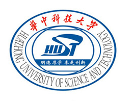
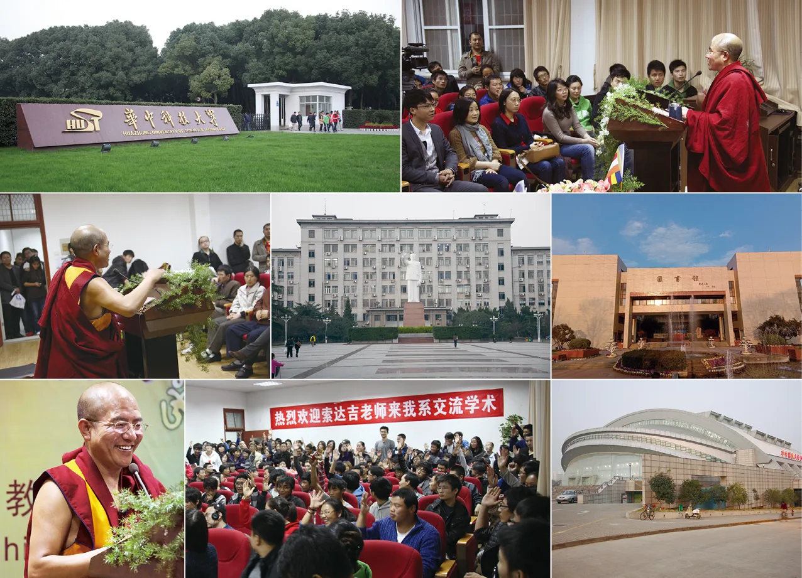
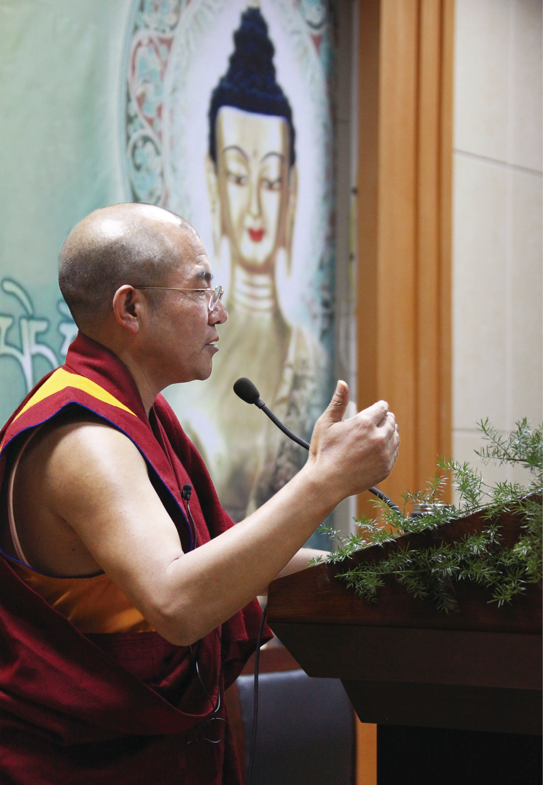

人们都认为，

今天的“我”就是明天的“我”。

实际上根本不是这样。

第20场

华中科技大学

Huazhong University of Science and Technology

中国·武汉

2011 / 11 / 20

## 佛教的真理观

## Buddhism: The Search for Truth

雷瑞鹏老师：

首先，非常荣幸能邀请到五明佛学院的国际著名佛学理论家——索达吉堪布老师，亲临华科大哲学系，为我们作这样一次高深而精彩的佛学讲座。

今天，有这么多同学光临这个讲座，也说明了大家对佛学的热情，以及对索达吉堪布老师的仰慕。

在此我就不再赘述了，也不占用更多的时间，下面把时间交给堪布，让我们一起聆听大师的精彩演讲，亲身感受大师的智慧。好，热烈欢迎——

今天很高兴来到华科大，跟老师、同学们一起交流。当然，我讲的可能既不高深，也不精彩，但很愿意跟知识分子探讨、沟通，通过这种方式，和你们一起共同寻找真理。

在座的各位，都非常年轻，而且，对知识的欢喜心、对真理的希求心，也非常强烈。每个人都有远大的目光，也有自己美好的理想，但与此同时，在佛教所讲的这个“娑婆世界”中，自己肯定会遭遇种种苦难，经历无数挫折，这些经常让我们感到迷茫。

因此，今天就一起来探讨：人活在这个世界上，到底需要希求什么样的真理？这种真理，从什么样的哲学思想中能挖掘出来？我想，这也是很多老师和同学都愿意关注的。

## 一、我们要怎样观察真理

在希求真理的过程中，我们应该认识到，现在这个社会，尤其是年轻人，非常需要心灵的开启、佛法的教育。如果你懂得了一些佛教的知识和理论，将会对自己有莫大的帮助——不仅有力量去面对工作和生活的“压力山大”，还能渐渐找到生命的归宿。

当然，佛法是非常甚深的，想在短短的一堂课中，就把它讲得特别清楚，这也不太现实。不过，即使大家只明白了一点点，也会对今后的生活和人生，有非常明显的指导作用。

今天我们讲的是，佛教所揭示的宇宙人生的真相。它之所以被称为世间唯一的真理，可以从两方面来成立：一方面从佛学本身证实，另一方面，也可以从现代科学的层面证明。但不管从哪个角度，都必须站在公正的立场上。

印度著名学者德雪达波曾说：“我既不偏执佛陀，也不嗔恨淡黄仙人等，谁具有符合事实的真理，我就认定谁为导师。[^1]”我们今天在此希求真理，也应该有这样的态度：既不贪执自方，也不诋毁他方，而是以客观的事实，判断什么才最值得追求。

大家都知道，这个世界上有很多神秘的知识，而要了解这些，现有的科学不一定够用，往往还需要靠另一种学说，比如用佛法来进行论证。当然，在论证之前，首先需要观察佛法的可靠性。这一点，印度伟大的佛学家圣天论师，就给我们留下了很好的教言。他在《中观四百论》中讲过：“若于佛所说，深事以生疑，可依无相空，而生决定信。”如果对佛陀所说的最甚深隐蔽之理生起疑惑，那可以先依佛陀所说的一切法无相空性，从而产生决定的信解。这一句话非常重要！

也就是说，你在探索真理的过程中，遇到佛陀所讲的很多眼睛看不到、手摸不到的现象，比如前世后世、六道轮回、业因果等，如果觉得无法理解，或无法直接证明，这个时候，建议大家先研究一下佛教的般若思想，比如看看唐玄奘翻译的《大般若经》。若是通达了般若空性，你就会明白，如此甚深的道理，不是一般世间人能抉择的，应该是具有无比智慧的智者，才能揭示得清清楚楚。以此，对佛陀会生起真实的信心，从而对佛陀所讲的其他神秘道理，才会愿意慢慢接受。

按照公认的说法，今年（2011年）是佛历2555年。在2500多年前，佛陀就把哲学、天文学、物理学、心理学、医学等各个领域的知识，描述得清清楚楚了。而在那个时候，西方的哲学思想还没有成熟，因为苏格拉底、柏拉图、亚里士多德（Aristotle, 公元前384-前322）等西方圣哲，是公元前400年左右才出现的。

因此，佛教的确值得在座很多人去研究。通过研究，你们会感叹佛教的博大精深，和佛陀智慧的无与伦比。

国内曾有一位学者说：“儒家是中国人的粮店，道家是药店，佛家是个百货店。”意思是什么呢？我们不能没有儒家文化，否则，就没有精神食粮了；假如自己生了病，就要从道教中寻找解决方法；佛家则像个大百货公司，里面什么都有，而且是人生必需的东西，也是每个人不可缺少的。

当然，在佛教的百货公司中，肯定也包括了药店和粮店。为什么呢？因为佛教的知识包罗万象，没有一个领域是不涉及的。这一点，并不是我们佛教徒自吹自擂，而是历史上的很多智者，以及东西方的一些科学家，都异口同声承认并证实的。

你们大多数的老师、同学是研究哲学的，所以在这个问题上，更需要去仔细思考。在此过程中，有些人千万不能认为：“我是哲学系的大学生，对一切无所不知。”有了这样的傲慢心，就会遮蔽自己的智慧。对每个人而言，不管你有什么样的学问，都应以谦虚的态度继续探索真理。

实际上，如果佛教确实是真理，就根本不怕被观察。伽利略说过：“真理就是具备这样的力量：你越想攻击它，你的攻击就愈加充实和证明了它。”

佛陀也曾说：“你们不管是出家人、在家人，都不要因为我是佛陀，就以恭敬心接受我的佛法，而应像十六次提炼黄金一样，用你最深细的智慧，对我的教言进行观察。如果它讲得合理，你可以接受；如果不合理，就可以放弃。”

可见，佛教对真理的态度非常明白：不管是佛陀宣说的哪个真理，般若空性也好，业因果也好，都应该用智慧去观察它，用逻辑去推敲它。当然，这些也肯定经得起任何观察与推敲。

## 二、迷失了“我”的现代人

这个时候，或许有人会想：“佛法经得起观察倒是好事，但这跟我的生活有什么关系呢？”

现在很多人，只关心自己的生活。我去过很多学校，发现好多老师和同学，既不想听佛教的甚深道理，也不想听科学方面的知识。他们特别关心、天天忙碌的，只是自己的工作、感情、生活等；他们特别喜欢听的，也是能当下解决这些问题的教言。

但实际上，如果我们对人生真理，拥有非常正确的见解，那么工作、生活等基本问题，肯定可以迎刃而解；反之，假如一开始就把人生的目光定在钱财上、地位上，真正的“我”都丢失了，那又何谈“我”的幸福？

每当我到大城市里，面对一些颠倒的社会现象，经常有种触目惊心的感觉；看到迷茫的人群，也自然会产生悲悯之心和悲恸之情。为什么呢？因为现在的大多数人，天天都在奔波忙碌，费力地做着各种事情，可他们所做的一切，只是为了今生的生活，为了眼前的养家糊口和短短几十年的享受，而不关心周围的社会和生存环境，也从不考虑自己来世会怎么样。在忙碌的过程中，他们常常会迷失自己，追求了一大堆没用的东西，却不知道“我”丢到哪儿去了。

以前汉地有一个故事：一位公差押解一名犯人去京城。犯人是一名犯了戒规的和尚。路途很远，负责任的公差每天早晨醒来后，都要清点身边的几样东西：第一样是包袱，他们的盘缠、衣服都在里面，当然不能丢；第二样是公文，只有将这份公文交到京师，才算完成任务；第三样是押解的和尚；第四样是自己。公差天天都清点一遍：“包袱还在，公文还在，和尚还在，我自己也还在。”这才开始上路出发。

日复一日，偏僻的小路上经常只有他们两个在行走，很是寂寞，免不了闲聊几句。久而久之，彼此互相照应，关系越来越像朋友了。

有一天，风雨交加，他们饥寒交迫，赶了一天的路，就投宿到一个破庙里。和尚对公差说：“不远处有个集市，我给你打点儿酒，今天好好放松一下。”公差心思松懈，就给和尚打开枷锁，放他去了。

和尚打酒回来，还买了不少下酒菜。公差喝得酩酊大醉，沉沉地睡了过去。

和尚一看机会来了，就从怀里掏出一把刚买的剃刀，将公差的头剃得精光。然后，他将公差的衣服扒下，自己换上，又将自己的僧衣裹在公差身上，连夜逃走了。

对于发生的这一切，公差浑然不觉，一觉睡到第二天日上三竿。他醒来之后，舒舒服服伸个懒腰，准备清点东西，继续赶路。一摸手边，包袱还在；再看公文，也在；找和尚，竟然不见了。公差抓挠着头皮想：“和尚哪儿去了呢？”突然发现自己头是光的，再低头一看，身上穿着僧衣，于是恍然大悟，原来和尚也在！

前面三样都在，第四样就该找自己了。公差又在庙里庙外四处找，怎么也找不着，心里就纳闷儿了：“和尚还在，可我到哪儿去了？”

现在世间上的很多人，也像这个公差一样，没日没夜地忙着各种琐事，不知不觉中，将自己变成了囚徒，结果“我”却找不到了。

就像如今的有些学者，一辈子都在研究这个课题、那个课题——听说有的老师找不到课题，就给学生施压，让他们去搞研究、写体会，最后把学生的论文变成自己的研究成果。很多学生都被逼得没办法，但又不得不做。

还有一些人为了名声、地位、金钱、感情，也是一辈子都在费心竭力。比如，为了感情，他们倒下去一次，又站起来；再倒下去，又站起来……如此一直不断地重复，这也是大家有目共睹的事实。

那么，人们追逐这一切，到底是为了什么呢？就是为了“我”。但实际上，他们这样做，不一定真的对“我”有利，反而可能适得其反。因为当自己死的时候，拥有再多的荣华富贵，也是生不带来，死不带去，而只有生前所造的善恶业，才会如影随形，和自己紧密相连、永不分离。

这一点极为关键，然而遗憾的是，好多人却对此一无所知。

## 三、重新解读“无神论”

究其原因，这也跟历史有很大关系。现在整个社会都主张无神论，对于无神论，当然我也不完全排斥。因为如果去分析无神论产生的背景和初衷，就会发现，马克思所提出的无神论，并不是完全错误的，也不会成为追寻真理的绊脚石。

为什么这样说呢？大家都知道，马克思（Karl Marx, 1818-1883）出生于1818年，1848年他和恩格斯（Frederick Engels, 1820-1895）在比利时，欧洲爆发了资产阶级民主革命，他们投身革命。革命失败后，他到英国伦敦写了200多万字的《资本论》（Capital）。后来，他的思想得到前苏联与中国的推崇，成为社会主义国家的主流思想。我们从小接受的，就是马克思的哲学思想和无神论的教育。

但马克思提出的无神论，和佛教是没有冲突的，也不是针对佛教的。虽然马克思精通多国语言，也研究过很多宗教，但在那个年代，佛教并没有在欧洲传播开来。当时最兴盛的是基督教和天主教，他们主张神或上帝是万物的创造者，这也是资产阶级政权的理论基础。马克思认为，正因为有了这样的基础，资产阶级才能在社会上占据主导地位，如果要发动无产阶级革命，推翻资产阶级政权，首先要建立与有神论相反的哲学思想，因此马克思就提出了无神论。

其实，马克思提出的无神论，跟佛教的观点也有共同之处，因此并不能说：无神论完全违背了佛教教义。因为佛教也不承认万物都是神创造的，不承认佛是创造万物、主宰一切的神。

那么佛是什么呢？佛教的本师释迦牟尼佛，诞生于2500多年前，是印度净饭王的王子，他出家并悟道后，创立了佛教，成为贤劫千佛中的第四佛。在印度，佛陀降生的地方、成道的地方、转法轮的地方、涅槃的地方，至今仍留存于世，这都是发生在公元前五六百年的事。因此，这是一段真实的历史，佛陀并不是人们虚拟的一个神。

佛陀在2500多年前留下来的思想，不论你是大学生，还是政府官员，都值得去学习。倘若没有深入学习，就不可能了解其甚深含义；而只有深入研究了，从佛教这一东方神秘思想中，每个人才会得到不同的收获。毕竟，现代科学家的很多发现，也是从佛教等宗教思想中延伸出来的。

## 四、佛教的真理能不能被否认

现在很多人，从小到大被束缚在教科书的知识体系内，从来没有去认真观察和思考：这个世界到底发生了什么？人类探索真理的步伐，进行到了什么程度？而东西方的很多科学家，以公正的态度研究佛教后，惊讶地发现，佛教中竟然蕴含这么多的真理，而且这些真理，早在2500多年前就宣讲了。

拿心理学来说，学过佛教唯识宗的人都明白，唯识宗把人的情绪说得清清楚楚，让现代心理学望尘莫及。比如烦恼方面，分为根本烦恼和随眠烦恼，其中根本烦恼包括贪心、嗔心、痴心等六种，而随眠烦恼则有十九种。其中的嗔心，也可以分为嗔、怒、恨等；善心方面，则有信心、悲心等很多分类。可以说，佛教对现代心理学所谓的情绪，分析得特别细致和清晰。

公元前五六百年的这些思想，已经超过了人类21世纪的研究成果，这让很多学者觉得特别稀有。因此，现在不少科学家开始运用佛教的道理，探索心理学、生命学，以及整个宇宙的宏观世界和量子力学的微观世界等方方面面。因此，对于佛教的正确性，如果你还坚持不承认，那我也无话可说。

可能有人认为：“佛教不一定是真理吧，因为现在这么多人不承认佛教所说的前后世等。”其实，大多数人不承认，并不能以此就否定真理，因为真理本来就掌握在少数人的手里。

不仅是佛教真理，世间的科学也是如此。以前藏地有一位了不起的智者叫萨迦班智达，他曾说过：“珍宝的价值，牧民根本不能了知，同样，世间的真理，一般人也无法通晓。”

所以，你们不要认为：“在熙熙攘攘的大街上、在人来人往的学校里，无数人都不信佛教，不承认前世后世存在。既然如此，佛教应该不是真理，我也不承认。”其实不应该这样。你翻开历史就可以看到，历史上有许多国家，为了稳固政权、发展经济等需要，对一些宗教和真理做过负面的宣传。因此，大多数人不承认的，并不一定就不是真理。

面对佛教真理，有些人常常说：“反正我就是不信！”他不信成了最颠扑不破的理由。其实你不信，根本证明不了什么。对真理的不信，只会显露出自己的愚痴，对真理却无有任何损害。

有些人经常说“我不信佛教”，认为这是一件很了不起的事，自己因此而变得伟大；他的不信，似乎成了这个世界的真理。其实，任何人如果不信真理，那在东西方的哲学思想中，只会被认为是一种个人的愚痴，除此之外，不能说明任何问题。

当然，如果你有充分的理由，能说明佛教不合理，那么不信也没问题。法律上也说，信仰是公民的自由，信也可以，不信也可以。但若有些事对自己明明特别重要，比如前世后世确实存在，这是谁也无法推翻的事实，可是这些却被故意抛之脑后，从来没有为此做过任何准备，这对你来说，难道不是非常可惜吗？

或许有人会说：“假如人存在前后世，为什么我一点都想不起来？”其实，不要说你的前世，就算是今生中的很多事，比如孩提时代的经历，想不起来的也不胜枚举；不要说你的后世，就算是明天发生的事情，你现在也无法亲眼看见。所以，不能因为自己想不起来，或者自己看不见，就把前后世的存在统统抹杀。

关于前后世，公元前400多年，柏拉图（Plato, 公元前429-347）在《理想国》（The Republic）中就描述过，但很长一段时间里，西方哲学家无法解释这到底是怎么回事。后来，东方神秘主义思想传入了西方，尤其是1927年《西藏度亡经》被译成英文，在西方世界引起了轰动，从那时开始，西方的哲学家、心理学家通过催眠等方式，对人死后的中阴现象以及转世问题进行研究，得出的结论与中阴教法竟然不谋而合，所以，很多人感到特别震惊。

而这些道理，在藏地却早已家喻户晓。人有前世后世，善恶到头终有报，故而要为了来世积累善根，这些都是天经地义的事，对他们来说已经司空见惯。

可是在汉地的大城市，假如一个人信了佛教，身边的人就开始怀疑：“他是不是遇到什么挫折，想不通了？会不会出家啊？”子女学佛的话，父母也整天提心吊胆，觉得这种行为不正常，甚至大学的哲学系开设佛教课，他们也担心：“老师会不会把我孩子带到山里出家了？如果所有人都出家了，这个社会怎么办哪？”

前两天我在一个大学里演讲，有个学生就提了这样的问题，但因为时间关系，我当时没有细致地回答。她语重心长地说：“堪布，您想一想，如果所有人都像您一样出了家，那我们的社会谁来种地，谁来养活大家？”她对学佛显得特别担心，害怕学了佛之后，所有人都会出家。

其实这完全是杞人忧天，根本不必有如此顾虑。因为出家是一种崇高的追求，并不是人人都有这种境界。当然，我也不是说所有出家人都了不起，现在也有一些假冒的出家人，故意用出家的形象来败坏佛教。但真正看破世间的出家人，在这个世间上，确实是非常难能可贵的。

就像当大学老师，是十分受人尊敬的职业，那会不会所有人都当大学老师了，而没有农民、工人了呢？根本不会，这种担忧没有必要。因为大学老师也不是什么人想当就当得了的，它同样需要很多的资格和条件。

现在不少人对佛教有各种误解，这在很大程度上，也要归咎于媒体的片面宣传，以及一些不懂装懂之人的错误引导。倘若你们通过学习，对佛教有了正面了解，那么这些误解和怀疑，全部就会烟消云散。

其实，在学生时代，每个人单纯得就像一张白纸，老师无论在上面画什么，都会影响学生的一生。一个好老师，在你心的白纸上画下善良、包容，那么，你的人生就会因此而灿烂；一个不好的老师，在你的心上画了很多丑恶，或许你从此会变得阴暗，人生渐渐背离光明。但不管老师怎么画，你自己也要有一种人生态度，否则，从来没有思考这个问题，一直都是人云亦云、随波逐流，那今后的生活也不会有正确的方向。

## 五、对年轻人的一些肺腑之言

### 1．苦谛：认识痛苦

现在这个社会，学生们背负着很多压力——从小学一直到高中毕业，天天都面临考学的压力；大学毕业以后，又面临着就业的压力。所以，在大学期间，算是人生最开心、最快乐、最无忧无虑的时光了。

前不久我就遇到一个年轻人，他以前在你们武汉上大学，毕业后到了其他城市工作。六七年后回到武汉，他深深地感觉到，大学时代的生活是多么快乐、自在，对此非常非常怀念。

可是现在很多大学生，在上学时却不懂珍惜，一直期盼着、憧憬着：“我什么时候能走出校门，摆脱老师的约束，在社会上大显身手，自由自在地干我喜欢的工作，做我想做的事情？”其实，等你真正步入了社会，就会发现许多意想不到的东西，在各种光鲜、微笑的背后，常会隐藏着丑恶的行为。此时，你如果没有信仰，没有心理准备，一旦这些落到了自己头上，你可能就会很难接受。

大家也清楚，如今的自杀率越来越高，甚至在大学中也屡见不鲜。为什么会这样？就是因为人们的压力过大。比如，上学时有各种竞争，毕业后面临着就业困难，走上社会还要承担工作、感情、家庭等许多责任……在这种情况下，你若没有信仰的力量，面对起来就会力不从心。

此时，如果你能认识到：轮回本来就是痛苦的，但这种痛苦，依靠佛陀宣说的方法可以解除，这样一来，你的人生就会有离苦得乐的希望，遇到一些不顺时，也会想到这可能是自己业力现前，今生再怎么样努力，恐怕也没办法弥补。如此学着调整心态，遇到一些挫折时，就不会钻牛角尖了。所以，依靠佛法，能解除我们的很多痛苦。

佛陀曾告诉我们：“三界无安，犹如火宅。”人生在世，原本就是苦多乐少，这即是“苦谛”。这一点，你们过去可能没有发觉，但现在不妨算一算：从早到晚一天当中，你开心了多少次，痛苦了多少次？或者在这一辈子中，让你开心的事有多少，痛苦的事又有多少？

有些人总以为，有财富、有名声、有地位就会快乐。实际上也不一定。伊丽莎白·泰勒（Elizabeth R. Taylor, 1932-2011）说过：“在这一生中，我拥有美貌、名声、成功和财富，但却没有拥有幸福。”为什么呢？一个人若没有知足少欲的境界，没有“善有善报、恶有恶报”的理念，单单依靠外在的一切，根本无法抵挡轮回的痛苦。

有些人现在不一定能明白这些，但等你以后进入了社会，就会懂得苦才是人生——在单位，要面临同事间的竞争；回到家，又要面对家人的抱怨；出门时，有一路堵车的苦闷；平时也是一会儿心情不好，一会儿身体不好，一会儿看别人不顺眼，一会儿心里无缘无故产生烦恼……

我自己也经常想：佛法对我的帮助，确实是金钱、地位等无法带来的。如果没有学佛，我也会以凡夫的心来面对生活，一定会有许许多多的痛苦。比如，当我跟别人发生矛盾时，实在想不开，很可能想要杀了对方，或者记恨一辈子。但是学了佛以后，大多数的痛苦，都可以通过佛陀的教言进行对治，很多时候，身心马上可以得到调整。即使有时候对治的效果不一定立竿见影，但我也知道痛苦的来源，应该跟自己的业力有关。这样一来，心里就能欣然接受、坦然面对，而不至于沉溺其中难以自拔。

### 2．集谛：找到苦因

其实，痛苦的根源，就是业和烦恼。若没有认识到这一点，在遇到痛苦时，把一切都归结于外境和他人，这是非常颠倒的。现在很多人碰到一点不顺心的事，就采取特别过激的手段，甚至把性命都丢了，这种行为极其愚痴，非常不值得。

不过，我们从小到大，这方面的教育非常欠缺，虽然在老师面前上过无数的课，学过无数的知识，可是遇到痛苦时，仍然一筹莫展；走上工作岗位时，仍然不知如何与人相处；在家庭中，仍然不懂怎样孝顺父母、养育子女……

当然，这也不能全怪老师，老师也是受教育体制所限，很多时候身不由己。从佛教的角度来说，这应该是众生的共业所致。现在的社会问题，一天比一天多，有学识、有远见的人，包括许多老师，也发现了这些弊端，但却无力扭转，只能无奈地接受现实。不过尽管如此，我们面对这些现象，也不能一直听之任之、麻木不仁，而要通过各种方式去尝试转变。当然，这个过程并不是很容易的，可能会面对种种磨难，但不管怎么样，我们都要勇敢地面对。

所谓的勇敢，并不是遇到看不惯的，就举起拳头跟人打架。真正的勇敢，是敢于接受前后世、业因果、轮回痛苦的真理，并用这些去改变自己和他人。不论在世人看来，我们的见解和行为多么另类，自己也不要畏惧、退缩。如果没有这种勇气，且不说改变社会，就算在世间上生存，生活的能力也极其脆弱。

现在社会上，很多单位都非常缺人，整天到处招人。与此同时，找不到工作的人却比比皆是，大学生就业都特别困难。我看了一些大学生就业的报道后，感到特别震惊，每年竟有那么多大学生找不到工作，对他们而言，毕业就等于失业。

为什么人才供需双方无法对接呢？因为用人单位需要的是德才兼备的人，首先要有一定的修养，诚信、善良，擅于处理人际关系；其次，要会做事情，要实干，而不是有张文凭，或者口才好就可以。毕竟，文凭不等于效率，口才也不等于人才。古人提倡的仁义礼智信，现在很多大学生都不具备，所以用人单位需要的人才，经常都找不到。

而很多大学生的话，又把目标定得过高，还没有开始工作，就想买房、买车、买这个那个，一直给单位提要求“每个月的工资不能低于多少，否则我不干”。自己的贪婪和欲望极其强烈，从不考虑自己能为单位带来什么。

这样的现象，如今在藏地也存在。因为藏地老师比较少，很多学校都非常需要。但一些师范院校毕业的学生，当老师的首要目的，不是好好地教书，而是多多地赚钱。如此一来，他不会把心思放在学生身上，也不会好好地上课。这样的老师对学校来说，没有很大的意义，学校也不需要这种人，因此又互相脱节了。

诸如此类的问题，等你们迈出校园后，可能都会遇到。其实，一切的痛苦，归根到底源于自己的业和烦恼，这就是佛教所说的“集谛”。

### 3．道谛：断除苦因

痛苦的根源找到了，那么该怎样断除呢？刚才也讲了，要通过佛陀教给我们的方法，才能断除业和烦恼，这就是“道谛”。

你们即使不能像出家人那样，把毕生精力都用于修学佛法，但如果通过学习，掌握佛教的一些简单窍诀，并去训练和实践，久而久之，痛苦和烦恼也会得以减轻。

### 4．灭谛：究竟安乐

一旦完全断除了业和烦恼，从根本上解除了痛苦，就会现前永恒的快乐，这即是“灭谛”。

以上所讲的认识痛苦、找到苦因、断除苦因、究竟安乐这四个步骤，弥勒菩萨在《宝性论》中用一个比喻，也进行了很好的说明：犹如一个人得了严重的疾病，特别痛苦（苦）；医生通过诊断，找出了他的病根（集）；医生开出药方，病人按医嘱服药（道）；最后完全康复了（灭）。这四个过程，就是释迦牟尼佛初转法轮时，为我们宣说的四谛法门——苦集灭道。只有依此而修行，我们才有可能彻底根除痛苦。

或许有人会问：“佛陀既然如此伟大，那为什么没有讲过现代的这些科技？”

要知道，对一个人来说，最重要的并不是研究外境的形形色色，而要从生死轮回中获得解脱。关于这一点，《法王经》中有个很好的比喻[^2]：一个人身中毒箭、剧痛无比时，若及时把箭拔出，疼痛会很快消失；但若不把箭拔出来，只是一味追究箭杆出自何山的竹子，箭尾出自什么鸟的羽毛，箭是谁射来的……这样一一观察下来，人早就活不成了。同样，我们在短暂的人生中，了脱生死最为重要，如果把这个弃之不顾，而去详细研究宏观世界、微观世界，那穷尽一生也不够用。

我经常看到有些西方的旅行家，一辈子拿着照相机和摄像机，天天盯着一只动物看，研究它怎么猎食、怎么睡觉、怎么繁殖后代……研究了几十年，当他死的时候，所了知的动物特征和习性，对他一点帮助都没有，只能随业力而离开这个世间。

在座的很多老师和同学，研究感兴趣的学问非常好，但最关键的是，从长远来看，务必要想方设法获得解脱。否则，将短暂的人生都耗在轮回的知识上，临死时对解脱没有做好准备，那其他知识懂得再多，也用不上，到头来只能迷失了自己。

## 六、怎样证明佛教是真理

### 1．从空性观等方面证明

一开始我就讲了，佛教是世间上唯一的真理，这一点可从两个角度来证明。首先，从佛教本身的话，着重以空性观来证明佛教是真理。

佛陀告诉我们，对自我的执著，是社会最大的祸害。不仅如此，每个人的痛苦，也是因为执著自我而引生的。大家可以想一想，你不舒服、不快乐，是不是因为爱惜“我”而产生的？如果你每天心情不好，那可能是对自己的执著太大了，这样的话，哪怕遇到一点点不顺，比如待遇不好、成绩不好、身体不好，也会感觉痛苦不堪。

但所谓的“我”，用佛教的空性观来抉择时，本体是绝对找不到的，只不过是一种错觉而已。比如说，人们都认为，今天的“我”就是明天的“我”。实际上根本不是这样，今天的“我”和明天的“我”，不可能是同一个，否则，今天的“我”要过明天的日子，明天的“我”要过今天的日子，刚出生的“我”就已上大学、坐在这里听讲座等等，有很多过失。

还有一种错觉，认为身体就是“我”。其实，身体由很多部分组成，哪一部分是“我”呢？头发是“我”，还是指甲是“我”？头发剃了，指甲剪了，是不是“我”就没有了？如果认为整个身体是“我”，那么身体缺了一部分，比如一只手没有了，是不是“我”就不完整了呢？

当然，这是佛教中特别细致的观察方法。虽然刚刚接触这些道理时，你不一定能马上接受并打破我执，但只要去深入学习，就会发现里面蕴含了甚深的智慧。通过这种智慧，能打破我们的很多颠倒妄执。

比如说，你觉得一个人好看而生起贪心，就可以用这种方法观察一下：这个人有没有值得贪恋的地方？人体外面是皮肤，里面是肉，肉里就是骨头，那到底是他皮肤好看，还是肉好看，或者骨头好看？皮肤、肉一一割下来，放在你面前时，你还会对他生贪心吗？所以，对一个人的身体爱恋不已，完全是一种错误的执著。

佛教中有许多诸如此类的智慧，用这些去观察时，人生就像做梦一样，无论是自己还是外境，都没有一个真实的。可是，大多数人却往往把梦，耽著为坚不可摧的实有，执著如梦如幻的一切，甚至有些行为特别过分，给自己和他人带来非常大的痛苦。

当然，真正的无我空性，是大圣者所证悟的境界，并不是依靠几个推理、几个例子，就能马上通达的。但你若通过修学，懂得了苦、空、无常、无我的道理，就会逐渐断除自己的痛苦，明白佛教所说的千真万确。

### 2．从科学研究方面证明

有些人可能想：“佛教所讲的这些，只有佛教徒才承认吧。现代科技这么发达，科学家对佛教的道理，会不会认可呢？”因此，下面就从科学研究的角度，来分析佛教是不是真理。

对于科学的研究成果、科学家们的语言，如今很多人兴趣索然，对自己眼前有利的，才愿意去听；而没有利益的，则不愿意了解。但作为追求真理的人，对科学家所讲的任何道理，都应该值得思考。

这方面，我有很多的理论和案例，但因为时间关系不广说，我只举一个例子：

杨振宁教授，大家都知道，他在1957年获得了“诺贝尔物理学奖”，现在八十多岁了。据说现在有人对他有些看法，因为他娶了一个比较年轻的妻子，我作为出家人，不谈这方面的问题。但让我最佩服的是，他作为科学工作者，能以非常客观的态度对待佛教。

他曾写过一篇文章，文中说，就像牛顿、爱因斯坦等科学家所提出的学说，必须具备三个特征，才能被世人广泛接受，并成为科学理论，同样，佛教也完全具备这三大特性。他还说，佛教是智信而非迷信，是智慧者的信仰，现在有些人对佛教一知半解，就信口指责佛教不科学，其实，这些人对科学也不够了解，缺乏真正的科学精神。

1985年9月12日，他专程到纽约大乘寺参加玉佛塔的落成典礼。当时他讲道：“佛教是世界上伟大的宗教之一，两千多年前传入中国后，对中国文化产生了深远的影响……”他还强调，自己向往佛法中大同、宁静、无私的境界，并在科学研究和讲授之余，坚持修禅定。

像他这样的科学家、学者，现在可以说非常非常多。此外，英国、美国、法国的许多科学家，如今对佛教真理的认识，也有各种各样的理论。因此，有些人若以科学的名义来否认佛教，说要尊重科学、相信科学，认为佛教是一种迷信，这是非常不合理的。

当然，在七八十年代，这样的舆论比较盛行，但现在公开大肆诽谤佛教的现象，比较少了。因为现在的大多数人，既不关心什么是科学，也不在乎什么是佛学，只知道钱财、地位、名声，白天奔跑着追赶这些，晚上甚至做梦，也想的都是人民币，除此之外，再没有更高的追求了。

甚至一些老师搞科研，也是为了过关而已，根本不考虑它是否对人类有意义。许多大学生也不爱学习，在大学里就是混日子，做些乱七八糟的事情。毕业的时候，该学的知识没有学好，不该学的坏毛病、坏习气反而都学会了，带着一大堆垃圾走上社会。这些垃圾接触谁，就会染污谁，这样的人给社会、家庭、个人，只会带来恶劣的影响。

当然，也并不是所有老师和学生都是如此。现在也有极个别老师，不愧为“人类灵魂的工程师”，他们夜以继日、废寝忘食，只希望把学生教育好，让他们无论在什么领域中，都能把自他带入今生来世快乐的境地。但这种老师，毕竟为数不多，这也是当今时代的一种缺陷。

## 七、以开放的心态面对真理

总的来说，希望大家能以公正的态度，对佛教有个正面的了解。尤其是藏传佛教，如今吸引了越来越多的人，这并非因为我是藏族人，就在这里毫无根据地吹嘘。确实，现在很多知识分子，包括一些西方学者，都觉得藏地有特别丰富的文化遗产，藏传佛教中也蕴含着无与伦比的真理。这些真理，有些已翻译成了各国文字，有些虽然还没有，但在雪域高原却完好无损地保存着。

因此，希望今后有更多的智者通过各种途径，真正去了解藏传佛教经论的意义，和历代大德以毕生修为留下来的智慧结晶。这些都是人类的心灵妙药，是现在社会最为需要的。

要知道，物质财富和经济发展，不能从根本上解除人类的痛苦。二十多年前，中国和欧美比并不发达，物质上也贫乏得多。但在短短的时间里，经济上就有了长足发展，许多人对此欣喜若狂。其实，这也不一定是好事，配套的道德水平如果没有提升，人们越富裕，只会离幸福越远。

这个时候，你们如果有一定的能力，应当想方设法恢复传统文化、宗教信仰等；倘若没有这么大的能力，起码也要从自己做起，用正知正念来观察自心，而不要被污浊的外境所转，迷失了自己、丧失了人伦。

每个人的未来会怎样，就掌握在自己手里。愿大家在追寻真理的道路上不断努力，心与真理不再有隔阂，人生越来越趋向光明！

现场互动

问：通过今天的讲座，我对人生有了一些新的思考。听说西方很多科学家，正在试图从逻辑的角度来解释佛教真理。请问，有没有可能通过对物质世界的逻辑思考，解开佛教的奥秘并解释佛教真理呢？

堪布：其实，西方科学家不仅仅是通过物质研究与逻辑推理，来证实佛教的正确性。很多人还通过修行和体验，来了解佛教真理。

作为一名学者，要证实佛教的真实性，理论的支持固然不可缺少，但在此基础上，更多的还是要实际修行。因为，现在很多人通过理论研究考证真理时，得出来的结论是完全错误的。为什么会这样呢？佛经中讲，我们的眼耳鼻舌身意都是非量，是不可靠的。这一点，科学家也承认，比如当多维空间的概念出现时，就会知道我们的感官所认识的世界，并不是真实的。

所以，爱因斯坦说过：“今天的科学，只能证明某种物体存在，而不能证明某种物体不存在。”

按照一些哲学家的观点，人类探索真理的规律是否定之否定，也就是说，通过不断探索并否定前辈的观点，从而不断地接近真理。如果是这样，那有没有依靠逻辑推理而最终证成真理的时候呢？恐怕是个未知数。

但通过修持来体验真理，则完全不同。比如，佛教中有认识心性的法门，自己依靠这些修法，可以完全通达心的本性。那个时候，即使成千上万的智者来到你面前，说你通达的心性是错误的，你也丝毫不为所动，他们也根本无法否定你的见解。

这一点，从禅宗和密宗的很多公案中，就看得出来。看了历代大成就者的事迹，我们会明白佛教的神秘和世界的可笑。但是，这些道理，在不信仰佛教的人前面，说一百遍、一千遍，可能也没有任何意义。

因此，要真正认识佛教真理，通过自己的实修实证来了解是最彻底的。

问：我是藏族人，请问，辩经是不是藏传佛教的不共特点？

堪布：辩经确实是藏传佛教的一大特点，依靠这种方法，能解除我们内心的疑惑，生起真正的智慧。当然，藏传佛教还有很多不共的特点。

其实在大学里，非常需要真正的辩论。但我看到，有些大学生的辩论是吵架，说着说着，就开始骂人了，这不叫辩论。真正辩论的过程中，即使双方辩得再激烈，也不会脸红，不会生气，不会痛苦。当然，这需要长期的磨炼，没有经过训练的人，刚参加辩论时，一被对方反驳，心里就觉得不舒服。

同时，大家在辩论的时候，一定要运用真实可靠的逻辑推理，这样才能通过辩论解除疑惑、生起智慧；而不是一味地胡搅蛮缠，非要争个高下，这并不是辩论的目的。

问：我是东莞学院的研究生，也是藏族人。我的研究方向是公共问题，包括人们非常关心的食品安全。

现有解决公共问题的模式是，学者们通过研究，向政府提出建议，然后政府制定法律，通过执行法律来管制社会。但这种完全依靠政府行为的管理模式，似乎并不奏效。比如说食品安全方面，地沟油、劣质奶粉等不道德事件层出不穷。还有最近发生的小悦悦事件，这些都让人感觉整个社会的道德水平在不断下降。

请问，我们应该怎样运用佛教思想去教育人们，乃至改变政府管理的理念和模式呢？

堪布：关心社会还是很重要的。你刚才提到的小悦悦事件、地沟油事件，在全国范围内都引起了极大轰动。从一些新闻报道中看，制作地沟油的那些老板，非常明目张胆，自己还特别得意……这些确实在一定程度上，反映了整个社会的道德水平。

不过，这些事件，以及前不久网络上的“13亿人扶不起一个老人”，也有一定的炒作成分在里面。有些媒体为了吸引大家的眼球，就特意把某个角落的一件事扩大化，让全世界都知道。人们看了之后，觉得所有人的良心都被狗吃掉了一样。但实际上，也没有那么严重。我们这个社会上，还是有好人好事的，比如，前几天沈阳一位女大学生坐公交车时，看到歹徒正在对一个人行凶，她冒着生命危险去救他……但现在很多媒体，对于好事不宣扬，而一点点坏事，就开始添枝加叶地疯狂传播，这是一种不好的现象。

当然，我在不同的场合中也说过，佛教徒若遇到小悦悦这样的事，一定要去救，不论别人怎么看，当事人会不会反咬一口。其实你去救了之后，也不一定所有人都会诬陷你，因为不是每个人都那么坏。

而食品安全的监管，包括杜绝地沟油，政府也在想一些对策。我以前了解到，有的国家像日本，政府高价回收用过的油，进行处理，做成燃料；德国对地沟油的流向，则有一套严格的立法。但不管怎么样，最重要的还是要加强人们的道德教育。在这方面，大乘佛教的利他观非常关键，它主张无条件地帮助所有人乃至所有生命，这样的理念，在当前来讲确实不可缺少。

因此，我特别希望，很多人能通过各种途径，了解佛教的利他观，同时，自己也应积极投入到一些慈善活动中。若能如此，这个社会就不会变得那么可怕了。

问：我是华中科技大学电子信息工程系的学生。我们汉地很多人是“闲时不烧香，急时抱佛脚”，信佛带有一种功利性，并不是真正的信仰。请问，什么才是真正的信佛？

堪布：信仰有迷信和正信两种。所谓的迷信，是别人说什么，自己不加分辨，就盲目地相信和崇拜，最终自己也找不到方向。

现在汉地许多人信佛，就带有迷信的成分，烧香拜佛是为了保佑自己健康、平安、快乐……像做生意一样。这种信佛跟信神没有什么差别。

那什么是正信呢？当你以一种科学的态度，用自己的智慧去研究佛教时，你会发现，佛陀觉悟了万法的真理，并用这种智慧给迷茫的人们点亮了一盏明灯，为众生离苦得乐指明了方向。所以，佛陀非常伟大，他的智慧无与伦比。有了这样的认识，你的信心就不会退失。

当然，要想获得这种信心，必须要长期、系统地学习佛法。若只是浅尝辄止，稍微了解一点，这是远远不够的。所以，非常希望寺院、佛教道场，包括高等学校，能深入学习一下佛教，认识佛教的真理和佛陀的智慧。这样一来，佛教的信仰就不会成为迷信，知识分子对佛教也不会盲目地下结论。

在这个世间上，知识分子的层次是很高的，但是，如果已经获得了极高学位的博士，对一门并不了解的学问随意诋毁、妄加评论，这是特别愚痴的行为。我也遇到过一些博士、博士后，他们评论佛教的语言，让人觉得非常可笑，就像不懂科学的人，信口去批评科学一样。因此，希望很多人以后在这方面，最好是不要闹笑话，不要让自己变成闹剧的表演者。

问：我是一名藏族人，父母都是佛教徒，在父辈的影响下，我从小就会背诵一些经文，例如《二十一度母赞》、莲花生大士教言等。我认为，一个人年轻的时候，在不影响学业和工作的情况下，背诵一些经文，是种很好的习惯。请问，您对此有什么看法？

堪布：现在藏地很多年轻人，从小就会背诵百字明、《三十五佛忏悔文》、《二十一度母赞》等，这是藏地的一种传统。如果在自己的人生中，随时随地多念这些经咒，无形中就会化解许多危难，增上各种吉祥。

前段时间，我去了一些藏族大学，看有些大学生早上起床后、晚上睡觉前，都会念一些经咒，就像佛教徒的早晚课一样，这种习惯很重要。

不过，与此同时，许多藏族人最缺少的是什么呢？就是没有了解这些经文的意义。如同汉地很多人去寺院只是求保佑，对佛教的真理却一无所知。同样，藏地也有很多人，包括一些知识分子，从小就信仰佛教，可是让他解释一下《二十一度母赞》，好多人都讲不来，这一点是非常遗憾的。

而我去一些汉地大学时，却发现很多老师和学生不仅对藏传佛教的教义十分熟悉，而且对中观、唯识，包括密法的教义，也一直不断地在修持。可是，我们藏地的很多知识分子，不要说汉传佛教，甚至对藏传佛教也并没有特别了解。

今天这个场合，来了不少藏族的大学生。你们藏族的学生有多少，举个手吧——哇，那么多！我特别希望你们，以及藏族的其他知识分子，从多方面学习藏传佛教，通过藏文或汉文来了解佛经的意义。

总之，我们学习佛教，不能只停留在理论上，也不能只会念念经。汉地有些老太太很会念“南无阿弥陀佛”，我们藏地人也会背《二十一度母赞》，这些听起来很舒服，但如果不解经义、不懂内容，就会与真正的佛法相隔千里，根本无法一窥其堂奥。所以，理论与修行结合起来学习佛法很重要。

问：我平时会翻阅一些汉文的佛经，请问，您有没有看过《楞严经》和《法华经》？我认为这两部经典非常适合末世众生学习，不知道藏传佛教里有没有这两部经，或观点类似的经典？

堪布：我看过汉文的《楞严经》，但在藏文《大藏经》中没有这部经典。据说法尊法师曾把汉文的《楞严经》翻译成了藏文，《大藏经》对勘局也准备把它列入藏文《大藏经》中。

而《法华经》，在藏文《大藏经》中也有。

所以，这两部经我都看过，里面的内容非常殊胜。

问：我也是一名藏族学生，现在已经大四了。我很庆幸，由于父母都信佛，我从小开始就崇奉藏传佛教，而且从自己的人生经历来看，佛法确实让我受益匪浅，尤其是当遇到生死坎坷时，让我得到很大的安慰。

但如今，在现实生活中，我面临着很多竞争，如果完全像佛教所说的那样忘我，在面对机会时，我就不会努力争取，而是会选择放弃。但若总是如此，可能无法在社会上立足。您对这个矛盾怎么看呢？

堪布：如今的社会竞争特别激烈，在不害竞争对手的前提下，你积极地争取机会、把握机会，做好自己该做的事情，并不违背佛教的教义。

有一位大德也说过：“每个人的机遇很难得，因此，在不损害众生的基础上，可以积极地去面对。”

问：作为藏传佛教的信徒，大家会在特定的日子戒肉，就像斋戒一样，您对此有什么看法？

堪布：从历史上看，戒肉并不仅是藏传佛教的一个传统，而是整个大乘佛教的行为。因为从佛教的角度来讲，吃肉跟吃生命没什么差别，是需要严格遮止的。与汉传佛教比起来，藏传佛教以前在这方面做得不太好，但这几年来，藏传佛教的很多寺院和出家人，也都开始纷纷提倡素食。

今天中午，我为了找个地方吃饭，转了好几圈，结果发现武汉的餐厅里全部是肉食，一直找不到素食，最后实在没办法，很伤心地吃了几个水果。

如今很多人真的特别可怜，吃一顿饭就要杀那么多众生，被杀者很可怜，吃者更可怜，这种命债需要多少时日才能补偿！作为佛教徒，如果能完全戒肉，长期吃素，当然是最好的。如果实在做不到，至少也是不要点杀。否则，吃一顿饭就要杀那么多生命，按照佛经的观点，自己会用许多世的生命来偿还，这是非常可怕的！

问：一个人若看到社会的丑恶与人生的痛苦，于是选择信佛、出家，以寻求解脱。但与此同时，他没能尽到赡养父母的责任。这在世间来说，是一种不孝。请问，您如何看待这个问题？

堪布：有些人是为了逃避而出家的，不一定有真正的出离心，即使出了家，也不一定有很大功德。若因此而没有尽到赡养父母的责任，那确实是一种不孝。

还有一种人，是看破世间而选择出家，并通过修行来报答父母的恩德，这是佛教里讲的大孝。汉地的莲池大师也说过：“亲得离尘垢，子道方成就。”意思是，只有让父母脱离了轮回，获得了究竟的解脱，子女才算成就了孝道，是真正报答了父母的恩德。

毕竟，给父母提供一些财物，让他们吃得好、穿得好、住得好，虽然这辈子会过得好一点，却不能解决他们的生死大事。甚至，如果你为了父母而天天造业，反而会让他们来世堕入恶趣，感受无量无边的痛苦。因此，这种孝顺并不是真正的孝顺。

相反，倘若自己真正看破世间，选择出家修道，虽然父母暂时会有些痛苦，但从长远来讲，对父母的解脱和安乐是有利的。

因此，出家有两种情况：一种是自我逃避，可以称为不孝；另一种是以出离心引发的，这是大孝。

问：我是国际经济贸易专业的学生。我想从所学专业的角度，问一个与佛教相关的问题：

前些日子，天气特别寒冷，我看见很多乞丐在街上乞讨，还看到一个年纪很大的老人，和女婿在外边卖馄饨。看到这些，我心里很难受。同时，现在很多人去寺院烧香拜佛，大多是祈求自己身体健康、生意成功等个人利益，真正祈愿依靠佛教改善民计民生的却很少。

大家都清楚，与西方发达国家比起来，我们的教育水平、社会保障、控制通货膨胀等方面，还有很大差距。佛教一向提倡普度众生，那么请问，怎么样才能用佛教来改变国家和民族的命运呢？

堪布：要让佛教从宏观上积极影响社会，比如解决通货膨胀、社会保障等问题，目前来讲有一定的困难。任何一个宗教，如果要进入社会各个领域，首先需要得到国家的推崇，就像唐朝时代的佛教，以及西方国家的基督教一样。也就是说，当一个国家的政界与宗教紧密相连时，这个宗教才能进入社会的每一个层次，并且积极地影响社会。否则，虽然佛教的精神是普度众生，但若没有政府的大力支持，光靠一些佛教人士的努力，想改变国家和民族的命运，可能有很大的困难。

但我们现在可以努力的是，在更大范围内传播佛教，让很多大学生、知识分子，以及社会各个层面的人，都能正面地了解佛教。并非因为我是佛教徒，就要在各个场合弘扬佛教，而是佛教思想对当代人来讲，的确特别需要；佛教无私奉献的精神，对个人、对家庭、对社会都会有很大的利益。

比如说，再过二十年，中国也会像日本那样进入老龄化社会。这个时候，如果年轻人对父母没有基本的孝顺，把赡养老人的责任全部推到社会保障体系上；老年人自己没有佛教的生死观，不能正确地面对生老病死。那么，国家和社会都会面临很大的困难，这些困难完全依靠社会保障体系，也不一定能解决。

很多人对信仰佛教有种担心，认为学佛后都会出家，其实这种忧虑大可不必。我们藏地99%的人都信仰佛教，但真正出家的只是少数。我们应该担心的是什么？如果不借助佛教等宗教的力量，面对很多民生问题，国家可能会遇到极大的困难。

因此，要实现佛教普度大众的理想，需要各种因缘。但不管怎么样，作为佛教徒，都要尽力去弘扬佛教，以净化世间人心。

问：作为您这样的大师，可能很多人都想做您的弟子。请问，您对弟子的要求是什么？

堪布：我自己也没有什么所谓的弟子，只不过我经常给大家做一些佛法的开示。在开示的过程中，我一直强调两个问题：

首先，学佛需要有一定的修证。在学习教义的基础上，一定要实地修持，否则，即使口头上讲得再好，也没办法运用到实际生活中。第二点，无论是什么样的生命，人也好，动物也好，要尽可能地去帮助他们。

简单地说，就是要修学真理，不断完善自己。同时，要关心社会、关心身边的人，尽量运用自己所懂的真理，去帮助身边的众生。哪怕是微不足道的行为，只要对他人、对社会有利，也要尽力去做。这就是我的两个要求。

问：今天讲座的主题是“佛教的真理观”，您也讲到，佛教是世间上唯一的真理。但我没太听懂，您说的佛教真理到底是什么。我认为真理应该有唯一性，否则就不能称为真理。但对于不同信仰的人来说，他们所承认的真理可能各不相同。比如，信仰佛教的人，会认为佛陀说的是真理；而对信基督教的人来说，上帝是他们的真理。在我看来，如果有不同的真理同时并存，那是不是恰恰证明它们都不是真理。因此，我的问题是：您说的佛教真理到底是什么？能不能以概括的方式，再阐释一下这个真理？

堪布：佛教是世间上唯一的真理，这个真理包括两方面：一个是佛教的智慧。尤其是依靠空性智慧，能彻底断除众生的痛苦，解脱生老病死，这在其他宗教中很难找得到。

第二个，今天我没有着重阐述，就是佛教的大悲。这种大悲遍及一切众生，也是佛教所特有的。虽然其他宗教也提到过慈悲的观念，但它并没有遍及一切众生。比如，有些宗教说可以吃众生的肉，不能吃众生的血，但这很难成立，没有血的肉几乎找不到；还有的宗教认为，对异教徒可以打仗，并称其为“圣战”。

当然，我们对所有的宗教都应该尊重。不过，随着人类社会的不断进步，19世纪和20世纪的很多观念已逐渐转变，非暴力的和平观日益受到重视。在这个时候，我想很多宗教人士不得不赞叹平等对待所有生命、主张非暴力的佛教。

因此，概括地说，佛教真理可以包含两个方面——智慧和大悲。从这两个方面，也可以证明佛教是世界上唯一的真理。

问：我是本校学经济的学生。现在汉地很多人，包括佛教徒，对藏传佛教有一些误解。其中一个原因，就是藏密的一些仪轨和仪式，他们不太了解，去请教一些上师时，往往说这个是保密的，不能公开。但是，如果它一直处于保密状态，就会让人觉得很疑惑，甚至有点恐怖。请问，您怎么看这个问题？

堪布：藏地的密宗，对仪轨和仪式并不是很保密，比如藏地的开光仪式，以及很多咒语和修法仪轨，对大家都是公开的。真正需要保密的，是最甚深的见解和修法。

当然，并不是因为它有过失而需要保密，只不过它对修行人的要求比较高，暂时需要保密。但如果你具备了相应的条件，比如之前修过加行、依止了具相上师等，那完全可以学、可以修。否则，不经前行就直接修学的话，很多人都接受不了，甚至会舍弃密法。这不但对他没有利益，反而对他的修行有极大损害。

这方面，禅宗也是一样。如果你刚开始修，就什么都不执著，甚至对善法也不执著，很多人就会误入歧途。

现在有些人对密宗接受不了，这也情有可原。以前禅宗刚传到汉地时，弘扬得也不是很成功，因为它的见解非常高深，当时包括梁武帝在内，都没办法领悟。但慢慢地，人们意识到了它的殊胜，才开始广泛传播。因此，一种事物被大家普遍接受，本身需要一个过程。

问：唐朝时，善无畏、金刚智、不空这“开元三大士”，也曾弘扬过密宗，但唐密在很快的时间中就失传了，之后兴盛的是禅宗。请问，您觉得密宗跟汉地的文化是不是有冲突？

堪布：“开元三大士”所弘扬的唐密，跟藏密并不相同，也没有直接的传承关系。有些人认为唐密的消失，跟保密有关系，其实并不是这样。唐密的消失，主要是因为他们宗派的后学者，没有很好地继承和弘扬这个法脉。这样一来，任何一种文化最后都会失传的。

但是，藏密的闻思体系、实修体系、传承体系，可以说非常完善。正因为如此，藏密弘扬于世这么长时间，不仅跟其他文化没有冲突，而且有日益广弘的趋势。这方面，不仅在汉地如此，在西方和东南亚也是这样。

问：我是哲学系文学专业的，想请教您一个关于安乐死的问题。

当一个人到了生命末期，如果疾病对他造成了很大的痛苦，对于佛教徒来说，也许能依靠修行佛法来面对；但非佛教徒可能觉得，结束生命是一种解脱，因此他会申请安乐死，就是请求医生的协助来结束生命，也叫医助自杀。

佛教提倡大慈大悲，那么当医生看到患者极其痛苦时，如果根据他本人的请求，而帮助他结束生命，这对医生来说，是在造恶业，还是做了一件功德？

堪布：按照佛教的观点，无论在什么情况下，都不提倡安乐死。即使病人正在遭受巨大的痛苦，如果我们采取措施结束他的生命，就有杀人的极大过患。

从表面上看来，似乎通过安乐死，可以让病人解脱病痛。但对病人来说，现在的痛苦是以前的恶业所感，承受这种痛苦可以消尽恶业，并不是没有任何意义的。如果对他施以安乐死，恶业就无法以此消除，那他以后还会感受更大的痛苦。因此，安乐死并不能真正除苦。

所以，即使病人很痛苦，我们也不提倡结束他的生命。如果在病人的强烈申请下，医生实施了这种行为，对我们来说，也只能随缘了。

问：我也是一名藏族人，来自邻近的中国地质大学。我一般很少吃鱼肉、鸟肉，因为它们都是生命。但我有时会无意中把这些肉吃进嘴里；有时候明知是鱼肉，还是吃了。请问，这种过失有多大？

堪布：吃别的动物肉，跟吃鱼肉、虾肉应该也差不多。只不过在习惯中，藏地很多人吃牛羊肉比较多，吃鱼肉、狗肉比较少。但现在藏地的一些年轻人，也有人认为“不会吃鱼虾，是不成功的标志”，这是一种愚痴的表现。

曾有一个格言说：“吃肉就是吃生命。”确实是这样。尤其是生活在海边的人，为了吃一顿饭，可能要杀害无数生命，从因果的角度来讲，这是非常可怕的。但在现实生活中，很多时候也没办法阻止。

如果你无意中吃进了一些肉，过失不会很大。但不论有意、无意，或是不得不吃肉，在吃肉的同时或事后，多念百字明、金刚萨埵心咒作忏悔，这是非常有必要的！

主持人：

今天，相信大家度过了一个非常愉快的晚上。

我想起这么一句话：“一个人可以没有财富，但一定要拥有智慧。”正因为有很多像索达吉堪布这样的佛学大师，在四处撒播佛陀的智慧，才让我们在佛陀涅槃2555年后的今天，仍然可以依靠佛法，获得一种解脱，获得一种快乐。

让我们以热烈的掌声感谢堪布！请全体起立，恭送堪布——

[^1]: 他在《胜出天神赞》中云：“我不执佛方，不嗔淡黄等，谁具正理语，认彼为本师。”
[^2]: 《法王经》云：“譬如有人。身中毒箭于身受痛。当即拔箭其痛即除。若不拔箭痛则不除。待问箭毛羽是何鸟翼。复问其竹是何山出。复问其箭是谁之射。是人苦痛其命已终。然拔其箭终知无益。”
