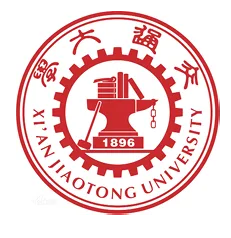
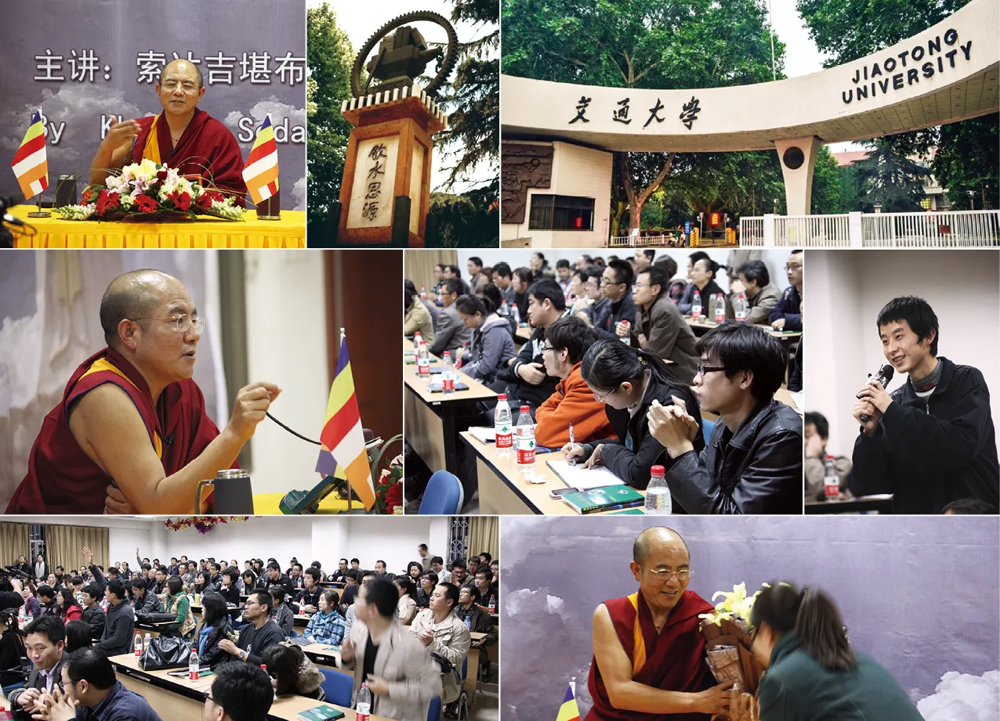
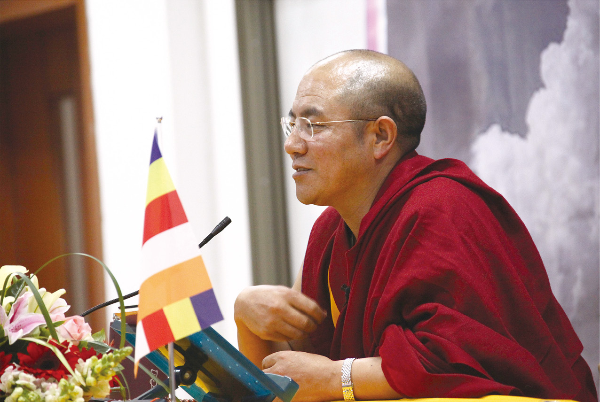
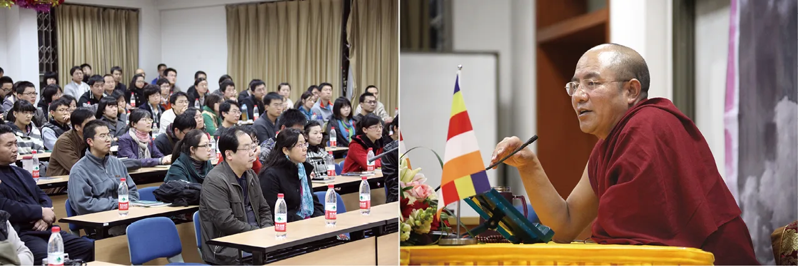
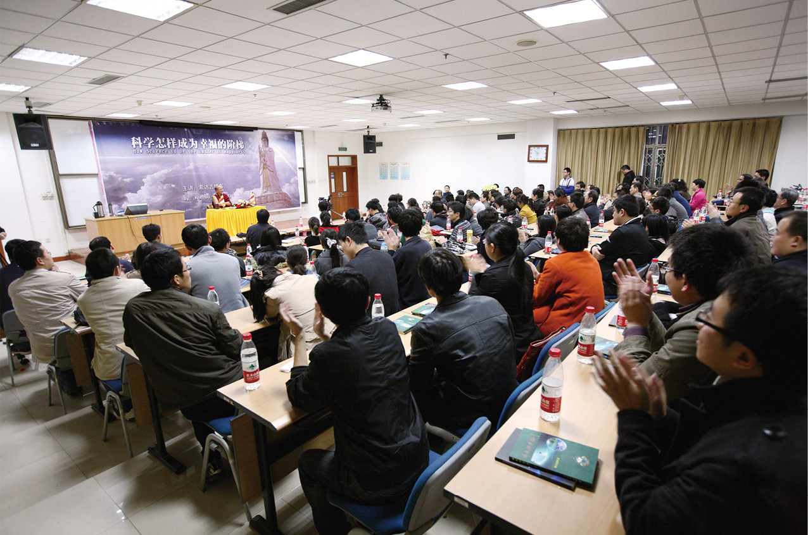

现代社会只注重物质发展，

一味地钻研自然科学、社会科学，

却忽略了心灵科学的重要性。

第17场

西安交通大学

Xi’an Jiaotong University

中国·西安

2011 / 11 / 12

## 科学怎样成为幸福的阶梯

## Bridging Science to Happiness

主持人：

大家好！感谢各位来参加我们这次讲座。

今天非常荣幸也非常高兴地邀请到了四川喇荣五明佛学院汉僧部的首席指导老师索达吉堪布，进行一次有关佛教与科学关系的演讲。演讲过后，我们会留有一个小时的时间，给大家进行问题的交流。

我们西安，在历史上是非常有名的佛教发祥地和传播地，现在还可以看到很多佛教的足迹。著名的玄奘大师从古印度取回来的大量佛教经典，成为中国文化非常灿烂的一部分。玄奘法师曾去的古印度那烂陀寺，是当时大乘佛教的传播中心。这个教法后来在汉地的流传，出现了很多波折，而在藏地，则得到了很好的保留，有特别完整的教育体系，是现代人类文化中相当重要、处于巅峰状态的智慧宝库。但可惜的是，由于语言、地域方面的差异，使我们很长时间都不太了解它的精髓。

索达吉堪布，作为藏密大乘佛教的传承者，本身的证量非常之高，而且他非常热心、一心一意想把他认为最好的佛法，分享给所有追求幸福、追求智慧的大众。他跟汉地学者特别有缘，这是我们很幸运的一个地方。他身患重病，但仍不辞劳苦翻译了大量经论，现在已是著作等身，成册的就有一百多册，约上千万字。而且他的翻译水平非常非常之高，语言远远超过汉地所谓大师级的精准水平，大家有机会可以去阅读。

另外，索达吉堪布在科学的思维方法上，有高度的理性。他对于逻辑学、现代科学的研究成果，都十分了解，并且能够很好地应用。他跟大量的科学工作者，在科学方面、在宗教内涵方面，都做过许多研讨。经过逻辑、理性的辨析，我们大概可以感受到，我们所处的科学、理性的世界，跟藏密佛教的神秘世界之间，距离并不是太遥远。

下面，请以热烈的掌声欢迎索达吉堪布——

各位老师、同学，很高兴跟大家一起交流。你们西安交通大学，我刚才进来时感觉很舒服，这里的环境、人文等都有特殊的氛围。今天，我们就在这里，共同探讨一下：科学怎样成为人类幸福的阶梯？

## 一、什么叫科学

首先，我们需要界定一下什么叫“科学”。在座研究科学的人都清楚，科学的定义有好多种，法国[^1]、前苏联[^2]的百科全书中，对此也有不同的说法。但不管是哪一种定义，我认为所谓的科学，就是要客观反映万事万物的真相。

关于科学的分类，以前有自然科学、社会科学两种，现在又新兴了一种心灵科学，也叫认知科学、心智科学。这种科学揭示了生命最甚深的心灵奥秘，对当前来讲至关重要，然而可惜的是，如今并没有引起人们的广泛关注。而在西方很多国家，相当一部分人却对此非常重视。不少学者认为，以藏传佛教为代表的2500多年前的佛陀智慧，是人类极为珍贵的宝藏，佛在《大藏经》中所阐述的佛教真理，详细地揭示了万事万物尤其是心灵方面的究竟真相。

如今，人类对前两种科学的研究比较不错，在特定的范围之内，可以发现一些事物的规律，像牛顿（Isaac Newton, 1643-1727）的万有引力定律、爱因斯坦的相对论，以及如今的量子力学。可是对心灵科学的探索，到目前为止，可以说是刚刚起步，其价值并没有挖掘出来。那么，以上这几种科学，到底能给人类带来什么呢？下面我们就来分析一下。

## 二、当今科学给人类带来了快乐还是痛苦

在古代，没有飞机、大炮、火车，也没有现在这些高楼大厦、尖端技术。如今毫不夸张地说，科学在物质方面，确实给人们带来了极大的便利，但与此同时，也带来了不可估量的危害。

20世纪，第一次世界大战和第二次世界大战，就充分体现了科技对人类的负面作用。当前，尽管没有发生这种大的灾难，可是在我们生活的时时处处，也经常可以看到科学给人们带来的恐惧感、不安全感。

古人正是预见到了这种现象，所以，对发展科技多持反对的态度，而鼓励君子要追求大道。其实在古代，也曾有非常先进的创造发明。比如早在春秋末年，鲁班就发明了汽车、飞机的雏形。他用木头制作的鸟，可以高飞三日不落，他父亲偷偷骑上之后，一飞竟然飞到了苏州[^3]。而他的母亲命运更悲惨，骑上他制造的木马车之后，从此一去不复返，就这样给弄丢了[^4]。

不过，这些技术并没有流传下来，也没有给后人留下只言片语，这是什么原因呢？主要是古人觉得这是“奇技淫巧”，过多钻研会“玩物丧志”。尤其是儒家，看重的是“道”，是高尚的德行，认为下等人才迷恋“器”，故有“形而上者谓之道，形而下者谓之器”的说法，并认为“万般皆下品，唯有读书高”。这就是古人的生活态度。

可是现在的21世纪恰恰相反，人们把所有目光、所有精力都投注在科学上，高楼一年比一年高，立交桥一年比一年多，轿车一年比一年豪华，表面上好多人拿着手机、开着车，穿的也比以往光鲜，日子过得似乎不错，但只有他们自己才知道，内心的压力有多大、焦虑有多重。

许多人年轻时的幸福感，现在可以说荡然无存了；原来在农村生活的轻松感，到了都市里以后，也全部一扫而光了。这是为什么呢？就是因为现代社会只注重物质发展，一味地钻研自然科学、社会科学，却忽略了心灵科学的重要性。这也正是古人所担忧的玩“物”丧“志”。

由于受这种潮流的影响，如今在我们藏地，好多农民、牧民极其向往城市生活，他们用掉了一辈子的积蓄，想方设法搬到城里去，分期付款地买房子，并将此视为一生的荣耀。相反，城市里那些有钱有势的人，已厌倦了纸醉金迷、车水马龙的生活，他们渴望远离一切尘嚣，羡慕藏地简单、自由、轻松的生活。这种现象很有意思，就像钱钟书在《围城》中所形容的：城外的人拼命往里挤，城里的人拼命往外跑。

但不管是“城里的人”，还是“城外的人”，其实都是为了追求幸福。然而，这种幸福究竟在哪里呢？现今很多人目光短浅，不要说生生世世的生死大事，就连古人那种“为万世开太平”的胸怀也没有，他们只盯着眼前几十年的利益不放，互相竞争、互相攀比，甚至为达目的不择手段，这样的生活能幸福吗？

再加上，如今不安定的因素也越来越多。尤其是前不久有报道说，10月31日，全球人口已突破70亿大关。人类从10亿增加到20亿，用了100年；从20亿到30亿，用了30年；而从50亿到70亿，只用了20多年。地球就这么大，随着人口的不断膨胀，日益加深了资源危机、生态危机和环境污染，使地球的负荷越来越重。为此，很多国家不得不实行“计划生育”。但实行了“计划生育”的话，年轻人的负担会越来越沉重。每个家庭把希望都寄托在一个孩子身上，父母也好、亲友也好，成天逼着他要争气，将来要为家人争光。孩子长大后，也要以一己之力赡养很多长辈，如此一来，现在年轻一代特别不容易，每个人身上的负担相当大。

我曾去了一些大学，也了解大学生的心理状况。他们很多人并没有把精力放在学习上，大多数都在想“我毕业后怎么样挣钱，怎么样找一个好对象”，除此之外，再也没有其他远大的抱负了。这种想法特别狭隘、特别自私，人人如果都是如此，那这个社会将来会变成什么样？大家也可想而知。

当然，学生这样想，有时候跟老师的引导也有关系。北师大就有一个教授，他对他的研究生说：40岁之前赚不到四千万，就不要来见他。此言论一出，马上引起轩然大波，网上有人评论道：你学生不是做房地产的吗，四千万，就是四个“千万”——千万要暴利，千万要心黑，千万要行贿，千万要强拆。只有这四个“千万”，才有希望在40岁之前弄到“四千万”。其实大家也可以想想，这“四千万”的背后是什么？就是金钱至上、唯利是图。

现在很多人为了金钱，欢欢喜喜地造恶业，却从未想过以后受报时的痛苦。诚如《正法念处经》中所言：“如是罪业，作时喜笑，得殃报时，号哭而受。”就拿地沟油来说，不知道从何时起，竟成了一些人发财致富的捷径。据有些资料显示，中国每年有大概300万吨地沟油流向餐桌，通过买卖地沟油，一年所得的利润近20亿。像广东等很多地方，每到晚上，就有工人在下水道捞地沟油，之后进行过滤、提炼、再加工，很快就看起来跟正常油一样了。这种劣质油屡禁不止，毒性是砒霜的100倍，人们吃后对健康有极大危害。地沟油现象，实际上在日本和英国也发生过，可是他们要么通过高价回收当燃料，要么依靠法律来严格控制，以此手段，最终让地沟油从餐桌上迅速消失。所以，只要人们引起足够重视，有些现象也不是不能制止的。

现在很多人干坏事，其实都是从电视、电影上学来的。有些影视剧把这些过程讲得细致入微，居心不良的人一看就会，进而模仿，这是特别不好的一种宣传。如今有些媒体，对负面的东西宣扬得很到位，然而对正面的东西，却捉襟见肘。比如对藏传佛教的描述，就与真相相去甚远，完全是一些外行人的编造。经过他们的种种误导，人们对前世后世、善恶报应等真理，很容易产生误解，进而邪见越来越深。在这种情况下，科学越是先进，人们离幸福就会越远。

## 三、寻找幸福的立足点

讲了这么多，可能有人会问：“那幸福到底是什么呢？”它实际上是一种满足感。马克思也认为，幸福是“欲望得到满足的心理状态”，这个定义比较贴切，跟我们佛教讲得很相似。佛教里是怎么说的呢？《遗教经》云：“知足之人，虽卧地上，犹为安乐；不知足者，虽处天堂，亦不称意。”只要内心满足了，就算生活再简陋，也仍是一种幸福；假如内心不满足，就算生活再富足，也不会有幸福可言。可见，幸福是内心的一种状态，并非完全建立在物质的基础上。

既然如此，我们就可以推知，内心若没有得到满足，科学发达了，物质条件好了，也不一定就能带来幸福。爱因斯坦也说：“单靠知识和技巧，不能使人类走上幸福和高尚的生活。人类有充分的理由，把那些崇高的道德标准和道德价值的传播者，置于客观真理的发现之上。”古希腊哲学家苏格拉底（Socrates, 公元前469-前399）也主张：“善就是知，知就是德，德就是福。”意思是说，要想获得幸福，其方法是先求知，再修德行善，然后才能是一个幸福的人。

可是现在的人缺少的，恰恰就是德，一个没有德的人，怎么可能真正幸福呢？金庸先生就说：“今天的中国，有的人很有权力，有的人很有财富，有的人很有知识，有的人很有名气。可他们普遍都没有一样东西——良知。如此一来，纵使你拥有得再多，依然只能算衣食无忧的穷人！”

尤其是一些知识分子，像大学生、研究生、博士生，在知识方面并不是很欠缺，跟过去的知识分子比起来，他们精通电脑等先进技术，拥有前人所不具备的能力。但是在做人方面，由于从小的教育所致，大多数人只知道想着自己，从来不考虑别人、不考虑社会，这是相当悲哀的。其实，汉地历来有很好的传统文化，教人该怎样为人处世，其中释儒道三教是中国文化的根，影响了一代又一代的人。尤其是佛教精神，对生命没有任何危害，若能懂得其中意义，对你短暂的今生、长远的来世，都会有特别深远的利益。

如今很多大学生对佛教感兴趣，我觉得这是非常好的事情，不然，完全把幸福寄托在物质上，只会让自己越来越痛苦。为什么呢？因为欲望是无有止境的，哪怕你一个人得到了天下的一切，也不一定会心满意足。佛陀在经中亦云：“世人求欲，不知厌足。假使一人得一切欲，无厌无足。”

一个人拥有得再多，享用实际上也是有限的。俗话说得好：“家有豪宅万千，夜寐仅需七尺；纵有良田千顷，日食不过三斗。”所以，希望大家将眼光放低一些，生活上尽量知足少欲，不要太奢侈、太浪费。在我们身边，有许许多多生命渴望得到帮助，他们每天在等待、失望中饱受煎熬，对此，有能力的人不应该置之不理。

## 四、如何才能得到幸福

### 1．了解因果规律

在座的每个人，今生中能衣食无忧，按照佛教的观点，这是源于自己前世的福报。假如你前世造了许多善业，今生不需要勤作，地位、财富等也会纷至沓来；假如前世没有造任何善业，那就像沙子不能榨出油一样，今生中再怎么努力，也不可能心想事成，甚至还会感情不顺、家庭不和，钱财不知不觉就不见了，最后倾家荡产变成穷光蛋。这一点，无论你信也好、不信也好，都是真实不虚的。

前世的善业和恶业，对今生的苦乐起到直接作用。那么同理可知，我们下一世会怎么样，也取决于今生造了什么样的业。因此，自己是自己的怙主，命运并不是别人来支配的，这是我等本师释迦牟尼佛，以无碍的智慧观察一切因果后所发出的狮子吼。

不过，世间上了知“善有善报、恶有恶报”的人，并不是特别多。既然它是真理，为什么很多人不信呢？前天我在其他学校也讲过：很多人不信，不能代表它不是真理。像在汉地很多城市里，对科学原理一窍不通的人也不在少数，但他们不知道、不认可，并不能说明那不是真理。以人多、人少来判断真理是否成立，不一定会很正确。所以，对于一些客观规律，大家务必要以公正的态度来对待。

### 2．以禅修调整身心

懂得了因果规律之后，对于各种得失荣辱，就没必要太斤斤计较了。人生的道路本来就弯弯曲曲，这个谁都避免不了，既然如此，我们就应当有充分的思想准备，遇到痛苦时，尽量将它转为道用。

当然，这话说起来简单，可假如你从来没有修行过，这方面没有一点一滴的感受，也不一定有很大作用。所以，现在许多大学里，都开设了禅学社，想通过禅修的方式，将佛法运用于实际生活中，对心灵起到一些帮助。

1967年，美国哈佛大学的赫尔伯特·本森博士（Herbert Benson, 1935-），曾做过一些冥想实验，研究结果证明，禅修可以缓解人体的压力。到了1997年，60%的美国医学院，都在传授这种“放松疗法”（The Relaxation Response），很多大医院也提供这个疗法，而且效果非常非常好。目前，打坐成了美国主流社会的风尚，一千万美国成年人“经常”打坐。当今社会，生活节奏特别快，每个人的压力相当大，人们确实很需要这样的禅修。

此外，美国某医疗中心对禅修也有一项研究测验。他们先让实验者每天禅修27分钟，这样过了一个礼拜，然后通过仪器检测，发现实验者禅修后的快乐指数，远远超过了禅修之前。

还有个美国研究中心，对藏地的一些仁波切进行测试，结果显示，他们禅修后的幸福感增强了百分之七百，致使科学家们以为机器坏了。他们又找来—群对禅修完全没有概念的大学生，分成两组进行测试，结果显示禅修与不禅修也有天壤之别。

这样的心理疗法，如今在欧洲、新加坡等很多国家，得到了十分广泛的关注。你们以后在这方面，如果也能有一些探索，对人生会有很大的帮助。不然，把一辈子的希望都寄托在财富上，肯定是不会快乐的。这一点，有些学生现在也许并不了解，但你到了社会上以后，慢慢就会感受到，人类的脚步再怎么快，也比不上科技高度发展的速度，在这种情况下，高科技若没有以正确的心态来引导，很容易就会偏离方向，将人类带入特别可怕的境地。因此，通过禅修来调整人们的身心相当重要。

### 3．思维佛教法义

现在有些人禅修学佛只是一种形式，内心没有多大改变的话，这也是远远不够的——当然，我不是说形式不重要，如今有些人十分极端，认为佛教中念佛、参禅、出家、烧香、磕头，这些都没有必要，完全是一种形式，这种想法其实不对。在某些情况下，特定的形式还是非常有必要的。如果说所有形式都多此一举，那世间男女只要心中有爱就可以了，又何必大费周章去登记结婚、举办婚礼呢？所以，有些人也不能太过分，觉得佛教中这个是形式、那个是形式，这一切都应该统统丢弃。

当然，只停留在形式的层面上，也是不行的，作为佛教徒，至少应该有一些内证功德。即使没有的话，对佛理也要有所了解，这样才不容易走偏，随外境而转变。假如你懂得了佛理并经常思维，内心就不会有太多挂碍，烦恼和痛苦也会烟消云散。正如宋朝无门慧开禅师所说：“春有百花秋有月，夏有凉风冬有雪，若无闲事挂心头，便是人间好时节。”

这样的快乐，是一种真实的快乐，是开豪车、穿名牌所享受不到的。为什么很多大德住在荒无人烟的山里，也依旧悠然自得？就是因为他们通过多年的修行，内心获得了自在，明白万法如梦如幻，不会像世间人一样对很多东西特别执著，稍有不顺就想自杀，买很多安眠药……

每天打开新闻，就知道世间人真的非常可怜。他们的所有痛苦都源于什么呢？唯一就是执著。假如学习了佛教的空性观、无常观，或者一些其他教义，对很多事情已经看破了，那么有钱也好、没钱也罢，内心都会非常自在。甚至，即便是有了很多钱，也不会成为金钱的奴隶。

像著名的慈善家李嘉诚，去年他在全球最具影响力的富豪中，位列第8，财富方面是排名第14。尽管家财万贯，但他自己的生活非常简单，对衣服和鞋子是什么牌子，并不讲究，一套西装穿十年八年是很平常的事。

他母亲是一位特别虔诚的佛教徒，从小就教他善恶必有报，崇善积德，多行善举。后来，李嘉诚在教导子女时，也常用佛学启发他们做人的智慧，三分之二教如何做人，三分之一教如何做生意。

他本人曾说：“是我的钱，一块钱掉在地上，我都会去捡；不是我的，一千万块钱送到我家门口，我都不会要。我赚的钱每一毛钱都可以公开，就是说，不是不明白赚来的钱。”他还在很多场合中，非常坦然地告诉别人：“我是一个学佛的人。”

相比之下，现在有些人，没有很多的钱，却挥金如土；没有很大的权，却利用自己的地位损害很多生命，这是非常不合理的。我们每个人的生命，说长也长，说短也短，几十年的时间一眨眼就过了。但不管这个人生是长是短，当你死的那一天，回顾一辈子到底做了什么时，最好不要有很多坏事。

如今很多人特别自私，在这个金钱至上的社会中，为了钱财、地位可以不择手段，对道德伦理特别漠视。甚至别人若是重视道德，他们还非常看不惯，想方设法地进行打击。所以，现代人普遍面临着一种精神危机。要知道，我们在物质上出现危机的话，其他各国可以支援，可以伸出援手；但如果我们的精神家园变成了荒漠，恐怕谁也没办法挽救了。

因此，现在最关键的，就是要重拾传统文化，让每个人有一种正确的信仰，有一种道德的约束。以前很多留学生跟我说，他们到了英国、美国以后，如果对同学和老师说“我没有信仰”，他们都会特别惊讶，觉得没有信仰就没有约束，想干什么就干什么，从不考虑来世怎么样，这是相当可怕的。

前不久，英国科学家霍金（Stephen W. Hawking, 1942-2018）说，所谓的来生，只是为怕死的人编造的“童话”，人脑在停止运转之后，生命便不复存在了。这一番言论，实际上并没有经过详细观察。倘若他翻阅一些宗教典籍，尤其是了解一下佛教理论，就会知道，想推翻来生存在，是根本做不到的。因为且不说别的，单单是许多案例，就曾真实发生过[^5]。

## 五、心灵科学才是通往幸福的阶梯

总之，大家应该通过修学，让自心得到一些真实的利益。听说你们这边有学藏传佛教的，也有学汉传佛教的，尤其是不少人对“心中心法”感兴趣。关于“心中心法”，我个人认为它非常好。这样说的原因，一方面是自己以前看过元音老人的书，虽然没有时间详细地看，只是大概看过几本，但看了以后，觉得里面讲得非常好。第二点，他们的传承弟子中，并没有发现谁诽谤因果、对上师三宝不恭敬。很多人都对三宝极有信心，对传承上师非常感恩，对众生也有大悲心，这是分辨正法与邪法的一种准绳。

现在有许多高僧大德，比如本焕老和尚、噶玛巴，也对“心中心法”有正面的评价。其实，判断一个修法是否可以接受，关键要看它能否对我们相续有真实的利益。若有利益，那不管是哪一个法门，我们都可以去学习、去修持，这一点非常关键。

在座的还有一些老师，虽然不信仰藏传佛教，但以一种研究的态度去了解它，这样也特别好。因为藏传佛教中保留着无比珍贵的传承、典籍，包括有些因明和密宗的窍诀，在汉传佛教、南传佛教中根本得不到。所以，如今西方和东南亚很多国家的修行人，排除万难前往雪域高原，多年来一直苦行求法，这也不是没有原因的。

在短暂的人生中，真正得到一些有用的知识，对我们每个人来讲不可缺少。现在许多人崇拜一些名胜古迹，像你们西安的兵马俑，听说有2200多年的历史了，被人们称为“世界第八大奇迹”。但我觉得，这并不是最稀有的。最稀有的是什么呢？就是2500多年前佛陀的智慧，细致描述了宇宙世界、人类本源、价值取向等方方面面，至今这些都完整保留在《大藏经》中，这么珍贵的百科全书，才是最大的“奇迹”。

但可惜的是，对于名胜古迹，每天参观的人络绎不绝，而对于印汉大德辛辛苦苦翻译出来的《大藏经》，去参观的人可以说寥寥无几。当然，这些也并不是“参观”一下就能明白的，而需要真正地深入经藏，认真学修才能彻底通达。

现如今，人类在物质上不断地往前赶，但在精神方面，应该不断地往后“退”，“退”到2000多年前。就像汤恩比博士（Arnold J. Toynbee, 1889-1975）所说：“拯救21世纪人类社会的，只有孔孟之道和大乘佛法。”在过去的时代里，尤其是佛陀，对器情世界的认识、对痛苦的解决方法，已经揭示得淋漓尽致、无一遗漏。所以，特别希望很多知识分子，今后不要只从外在的自然科学、社会科学上寻找幸福，更重要的是，应当从内在的心灵科学上去探寻！

主持人：

下面由陕西省道德文化研究会的刘副会长致答谢词——

刘亦雄副会长：

大家晚上好！非常荣幸有这样一个殊胜的机缘，聆听索达吉堪布的开示。

我知道索达吉堪布，是在将近20年前阅读法王如意宝晋美彭措的传记时，之后也阅读了堪布的一些著作和译著，从此就对法王及其上首弟子之一的索达吉堪布，生起了深重的恭敬和信心。但由于种种因缘，直到今天才能亲眼见到堪布，亲耳聆听堪布的开示，所以从内心里边，我非常珍惜、非常感激。再次向堪布表示感谢！

今天，堪布从科学、道德等诸方面，给我们进行了开示，尤其是最后讲到幸福在哪里？不能光从外在的自然科学、社会科学上去寻找，而要从内在的心灵科学上去开发。对此，相信每个人都深有感触。

作为此次活动发起者之一的陕西省道德文化研究会，能够邀请到堪布，邀请到大家，我们觉得非常荣幸。这个研究会是在今年7月11日成立的，挂靠于西安交通大学，它致力于道德的学术研究和社会推广，希望各位同道同仁能对我们的工作多多地参与、多多地指导，也希望大堪布对我们多多地指点。谢谢大家！

现场互动

问：我是西安交通大学管理学院的老师。现在很多同学对道德修养非常重视，您有大量翻译和讲解的著作，在这其中，您最推荐哪一部让他们先学习，可以获得最大的利益？

堪布：我翻译过一些藏传佛教的论著，也讲过一些法，后来个别人也作了整理，在这所有的法本中，我最推荐的就是《入菩萨行论》。这部论典适合所有人学习，有信仰的人学了以后，会在佛学方面得到真正的受益；即便没有信仰，通过学习也能减轻自己的嗔心、压力、焦虑、痛苦等。

所以，在印度，寂天论师造的《入菩萨行论》非常出名，用现在的话来讲，它是最热门的一部畅销书。而在我们藏地，不管是哪一个教派，也都要学习这部论典。如今，汉地有许多高校的师生学了以后，确实对人生起到了不可思议的指导作用。

因此，大家若能将《入菩萨行论》从头到尾学习一遍[^6]，人生的方方面面肯定会得到莫大利益。

问：有一道哲学考题问考生，说你是在梦中，但用什么方法来驳斥，说你不是在梦中？前些天我们在网上讨论时，很难得到答案。

堪布：得不到答案就对了，因为我们确实是在梦中，正如《金刚经》所言：“一切有为法，如梦幻泡影。”

但对初学者而言，刚开始不一定承认这个观点，所以，藏地大德麦彭仁波切造了一个《醒与梦的辩论》[^7]，其中就通过拟人的修饰方法，把醒、梦各安立为一个人，然后他们两个互相辩论……表面上看来，醒者似乎应该会赢，但实际上并没有。我们现在就是在做梦，人生确实是一场梦，这一点，你们若详细学过《醒与梦的辩论》，就会有特别深的体会。

以前我刚到佛学院不久时，上师如意宝就传过《醒与梦的辩论》。当时在一段时间里，我真的感觉人生是在做梦，跟梦没有任何差别。因为听了这部论以后，我找不到任何理由，可以推翻其中的观点。比如，我觉得现在不是在做梦，因为有些东西，手可以摸得着，眼睛可以看得到，但在梦中，也完全有这种情形；我觉得现在显现的一切时间很长，而梦中的一切时间很短，但实际上在做梦时，有些经历也非常漫长，像“南柯一梦”“黄粱美梦”就是如此。所以，从各方面来看，若认为现在不是梦，根本找不到可靠的依据。

当然，如果想真正认清这一点，大家需要再三地看书。尤其是《华严经》《三摩地王经》中，在这方面都有很多的描述。

问：我是陕西科技大学大三的学生。我9岁就皈依了，从小到大，妈妈给我讲了很多佛法道理，让我明白做人要有感恩之心、满足之心。但现在身为一个大学生，我经常和老师做些课题研究，在此过程中，要有一颗不满足的心，才可以继续坚持下去，往更深的科学领域发展。请问，一个要满足，一个要不满足，这二者的矛盾该如何平衡呢？

堪布：佛教所提倡的有满足之心，是指减少一些没有意义的欲望，比如对钱财、对享受，这方面要少欲知足。但在求学方面，是不需要满足的。藏地特别伟大的萨迦班智达，在格言中也说过[^8]：即便汇集百川之水，大海也不厌其多，同样，即便学习再多的知识，智者也不会有满足的时候。

所以，你们现在学习知识、研究科学，包括学习佛法，这些方面都不应该满足，不要认为大学毕业就像成佛了一样，从此什么都不用学了，再也不用看书了。其实，世间上一些有意义的知识，越学越对自他有利，所以求学方面不要有满足，这是我们佛教的观点，也是探索科学不可缺少的一种态度。

问：我从小就觉得，佛法对整个人类社会确实能有很大帮助。我虽然现在只是个学生，可是希望能尽自己的一点力量，影响周围的同学。因为我发现很多同学在上课时非常浮躁，不愿意听课，不愿意好好学习，他们只想挣钱、挣钱、再挣钱。所以我感觉，现在很多大学生的价值观和思维方式有偏差，就希望尽微薄之力影响他们，我该如何去做呢？

堪布：你从小就皈依了，对佛教也有一种信心，我个人来讲非常随喜。

你如今学习也好，以后工作也好，不管能做到多少，首先自己要不害任何一个生命，包括蚂蚁以上的虫类，不要故意去杀害它们，这是最珍贵的一颗心。然后在此心态的基础上，再力所能及地去影响周围的人、去帮助社会。当然，每个人前世和今生的因缘不同，利益众生的能力也有所差别。但只要你有一颗想饶益别人的心，将来它一定会发光的！

问：我是西安交通大学的学生，也是龙钦宁提的弟子。空性见来自菩提心，菩提心来自大悲心。请问，如何在日常生活中实修大悲心呢？

堪布：你是宁提派的弟子，这是很难得的。龙钦宁提是宁玛派中非常深的一个法门，依靠莲花生大士、无垢光尊者、智悲光尊者的加持，如今国内外修持它的人特别多，而且迅速就能生起许多感应，比如对传承上师的恭敬心、对众生的悲心等等。

你刚才也讲了，空性见来自菩提心，菩提心来自大悲心。那么，怎样修持大悲心呢？首先要把一切众生观为老母有情，愿他们都离苦得乐，然后，最好能同时修一下四无量心。这些的具体修法，在《大圆满前行》和《前行备忘录》中讲得特别清楚。一旦你依此生起了大悲心，更高的功德就会指日可待。

问：我是西安交通大学的学生。我对佛教了解不是太多，但对佛教的一些简单道理，比如善有善报、恶有恶报，还是很相信的。我想要过朴素的生活，每天也能行善，但在这个城市中，经常有地沟油、毒奶粉、豆腐渣工程……造恶业的环境实在太多了，我是不是只能逃离这个城市？

堪布：你说的还是很真实的。现在佛教徒与知识分子之间，确实需要一些沟通。其中，对于“善有善报、恶有恶报”，有些知识分子是比较相信，但他们相信的，也仅限于今生而已，好多人今生做了善事，就希望很快成熟善果，至于来世，一般人从来不考虑，这实在是一种悲哀。要知道，轮回是非常漫长的一个过程，有些善事你今生做了，果报也许会在今生成熟，但也许会在很多世之后才成熟。然而，不管它什么时候成熟，因果报应都是丝毫不爽的，所以我们一定要断恶行善。

如今这个社会，地沟油、毒奶粉、豆腐渣工程等比比皆是，在这种环境中，我们也不能一味地逃避，而应负起相应的责任，从自己做起，千万不要为了赚钱而伤天害理，故意去损害别的生命。当然，你在工作的过程中，有些事情的阴暗面不容易发现，可能会无意中做了一些错事，但由于你并非故意如此，佛经中也说，这样不会有太大罪过，就像无意间不小心踩死了小虫一样。

当前的人们，确实非常需要佛教的引导。假如人人都有慈悲观、因果观，知道再穷也不能损人利己，那么全民素质自然而然会提高，大家也愿意无条件地帮助众生。然而现在恰恰相反，很多人不是无条件地“帮”众生，而是无条件地“害”众生。前不久，我就看了一个藏族人的文章，他在文中说：“往昔佛陀无条件地把血肉布施给众生，而现在的人为了一顿饭，就要杀害很多众生，吃很多众生的肉，实在太可耻了！”跟佛陀的精神比起来，当今人类真的极其可怕。

问：我原来也是西安交大的一名学生。现在网络特别发达，信息也更加公开，我们可以看到很多不良的社会现象。作为一个知识分子，我们应通过网络去揭示这些不公正的现象，以唤醒更多人的正义感，还是把心放在修证上，让自己能以一颗更清净的心，面对周遭的生活？

堪布：现在是网络信息时代，跟古时候完全不同，跟上个世纪也完全不同。现在任何一件事情传到网上，无数人马上就知道了，所以，网络的力量确实非常强大。我们应在不影响修行的同时，依靠网络这一手段，将真正有价值的知识，与更多的人分享，哪怕你能帮助一个人，这也非常有意义。

如今很多人特别迷茫、痛苦，人生没有方向和目标，整天都在网上寻找心灵的寄托，结果不但找不到，反而遇到了一些邪师，把自己迅速地引入歧途。所以，在这个时代，我们依靠网络来救护他人的慧命或者生命，是至关重要的！

当然，没有利他心的话，那就另当别论了。但你若是有利他心，在修行基本不受影响的同时，应该想方设法地帮助一些众生。甚至就算修行受到了一点影响，也应把众生的利益放在首位。

现在的网络世界，充斥着乌七八糟的负面信息，人心一代一代被染污得不知方向，外在环境也被工业染污得面目全非，连呼吸都没有新鲜的空气。内外都如此不净的话，人活在这个世界上，不要说来世，今生都相当不健康，身体不健康，心理也不健康。所以，希望大家以后在网络上，尽量弘扬一些正面的传统文化和有利的知识，否则，网络没有被好的思想占据的话，人类的未来确实堪忧。

问：我是西安交通大学MBA的学生。我有一个朋友，跟我年纪一般大，现在身患绝症，可能没有多长时间了。他也是刚刚得到这个消息，心里非常难受，没办法接受这个现实。我很希望能帮到他，但也无计可施。请问上师，怎么样用佛法去帮助他呢？他该如何面对剩下的日子？

堪布：很多人在接近生命最后一刻时，确实会感到非常悲哀。从世间的角度讲，你再有钱、再有地位，死亡来临时，也不可能让自己多活一天。所以，“苹果”创始人乔布斯（Steven Jobs, 1955-2011）从17岁起，就把人生的每一天当最后一天过，这也是明白了佛教所讲的“诸行无常”。

现在很多人都有这样的心态：“别人死了，我不会死。”这无疑是在自欺欺人。要知道，我们的身体特别脆弱，谁也无法预料明天会不会出车祸，明年会不会得癌症。所以，每个人应该提前有个心理准备，平时不要浪费生命，而要好好把握当下，为众生、为社会多做些有意义的事情。若能如此，纵然突然面对死亡，你也不会惊慌失措，有很多的遗憾。

乔布斯年轻时就开始学佛了，他经常思维无常的道理，所以死时可以特别坦然。而你的朋友，不一定是学佛的；即使学了佛，也可能没有真正修过，没有把无常时时挂在心上。因此，让我现在告诉他一个窍诀，使他马上就有勇气面对死亡，这可能不太现实。

不过，你也可以跟他讲：死亡，并不是生命的永远终结，而是下一期生命的开始。我们的这个身体，只不过是一个“旅馆”，是暂时的一个住所，没有什么好执著的。面对死亡，恐惧没有任何用处，现在最有用的是，应当抓紧时间多做善事，为来世多做一些准备。

一方面这样开导他，同时，最好让他多念观音心咒、阿弥陀佛圣号。或许依靠三宝的加持，最终出现奇迹也不好说。我就认识一个大学生，她也得了癌症，后来她放下一切，临死之前一心念佛，结果癌症奇迹般地消失了。所以，有时候心的力量非常神奇。

其实，我们每个人都会死亡，只不过是迟早而已。假如死到临头才开始信佛，临时抱佛脚，这不一定能扭转乾坤。所以，希望大家也能以此为戒，对死亡要提前有所准备。古往今来，不少佛教徒在死时特别安详，这是什么原因呢？就是他们平时经常串习、观修。就像一个军人，平时训练有素的话，一旦真正上了战场，才能做到临危不乱，很多本事才用得上。

问：我是西安交通大学的老师，也是陕西省道德文化研究会的工作人员。今天非常荣幸能见到您！佛法的确是非常非常好，但作为一个普通人，面对浩如烟海的佛法，藏传佛教、南传佛教、汉传佛教的《大藏经》那么多，我们到底应该怎么样去学习，才能使佛法真正入于心中呢？

堪布：佛法确实浩如烟海、高深莫测，在短短的一生中，要想学尽无余的话，恐怕有非常大的困难。但所幸的是，往昔有许多前辈大德把《大藏经》的内容，以简短的语言归摄为一些论典和教言，若能学习这些，则很容易通达佛法的精髓。

那么，哪些论典比较便于我们学习呢？从个人的切身体会来说，我经常在很多场合中，建议大家先学《入菩萨行论》和《大圆满前行》。像《大圆满前行》的话，从最开始观修“人身难得”，到最后怎样往生西方极乐世界，全部的修行次第揭示得淋漓尽致。表面上看来它只是一本书，但却涵摄了显宗、密宗一切教典的精要。我这几年很详细地讲了一遍，讲记整理成文字，大概也有十本书。若能将此好好学一遍，佛教的框架基本上就理顺了。怎么样皈依？怎么样发菩提心？怎么样行持十善、取舍因果？……诸如此类的关键问题，自己也就明白了。

其实，系统地学习一些佛法，真的非常重要。否则，佛教就会完全沦为一种形象，包括现在寺院里也是如此。当然，有些形象也是需要的，但如果佛教徒没有内在的证悟，那就已经丧失了佛教的根本。

问：您刚才多次讲到现在的道德沦丧，我作为陕西省道德文化研究会的一名工作人员，也很想竭尽所能提升自己的道德水准，以及为提升社会的道德水准做一点工作。请问，该怎么做才是最好的呢？

堪布：对于你们研究会的宗旨，包括一些运作方式，我并不是很了解，所以无法提出非常契合的建议。但总体来讲，做任何一件有意义的事，短时间都不一定有立竿见影的效果，但只要持之以恒、坚持不懈，并辅以一些现代企业的管理模式，星星之火逐渐是可以燎原的。

在这个过程中，不能遇到一些挫折，就轻言放弃。现在很多人在推广道德文化时，遭到几次白眼和质疑，自己就开始动摇了，实际上这是不合理的。要想真正拯救这个社会，除了有一种兴趣以外，更重要的是，要有一颗勇敢、勇猛的心。只有这样，最终才有可能结出丰硕的果实。

问：尊敬的堪布，我也是一个道德弘扬者。今天见到您很荣幸，请问，佛法是属于非宗教还是宗教呢？

堪布：佛教既是宗教，也是非宗教。这样说会不会矛盾呢？并不矛盾，它可以从两个层面来理解：

说佛教是“宗教”，因为它属于世界四大宗教之一，确实是公认的一种宗教；说佛教是“非宗教”，因为它的教义涵摄一切学问，揭示了万法的真相，并非只是宗教这么简单。所以，现在很多佛教大德，经常在不同场合中说佛教其实不是宗教，而是一种导人向善的完美教育，也是源于这个原因。

问：我是西安交通大学一名年轻的老师，刚留校不到半年，我的专业是哲学。学了十多年哲学，我发现自己仍然很迷茫，觉得很不幸福。请问，如果我皈依佛教，能不能获得自己的幸福？

堪布：你皈依后到底能不能幸福，我也不敢保证。因为刚才也讲了，众生今生中要感受前世的果报，假如你前世造了很多恶业，现在即使皈依了，在前世的报应没有受完之前，也不一定很幸福。不过，我个人多年来长期研究佛教，结合自身的经验来讲，可以肯定地告诉你：今生皈依的话，对来世的幸福必定会是有利的。

当然，皈不皈依要看自己，信仰都是自由的。但确实很多人在皈依学佛以后，自己的人生观和价值观有了极大改变，以前可能是无恶不作，后来找到了人生方向，至少也能不害众生了。

问：我是西安交通大学MBA的学生。我是做投资的，前不久刚接触了一个企业家，他遇到了利益与道德之间的抉择问题：

现在的市场充满竞争，他的产品用的原材料，如果对人体健康等方面合格，成本就比别人高出三到四倍。原来他的基础不错，是从房地产商转过来的，有一些资金积累，所以最初觉得要保证对人体的安全，一直坚持这样的理念。

但在市场两年之后，他发现自己的成本比别人高，而这种产品做出来之后，顾客在使用时，短期内又体现不出来产品的优势，从而导致企业很难再维持下去，现在只好也用对人体有害的原材料了。这样一来，他的成本就降低了，从今年6月份起，资金就有了明显的好转。

那么我想请教一下，像他这样的企业家，在面临如此困境时，应该怎么选择才是对的？

堪布：的确，如今这样的现象比较多。但若仅仅是为了自己盈利，就不考虑大众的健康，这样肯定特别过分，逐渐是会受到报应的。

你们不管是读什么专业，以后在工作岗位上一定要小心，这一辈子中，尽量不要去做危害其他生命的事。若能如此，就算你的待遇不太好、钱赚得不太多，至少也会心安理得，生活过得比较清净。

当然，完全清净的话，对凡夫人来讲也不太可能。毕竟现在这个社会，很多人无恶不作，我们生活在这样的环境中，有时候的起心动念，难免会与恶业相连。但即便如此，也绝对不能故意去损害众生！

现在的很多不良现象，我们没有能力去一一揭露或制止。但你们在座的有些人，以后肯定会有能力，有这方面的实力。所以，大家一定要树立正确的价值观，如果你的人生方向没有定准，今后就很容易危害社会。

问：记得您曾讲过，您小时候也是个经常会打架的孩子，而现在，您的语言中、仪态中，却充满了温柔。那么，这种变化最重要的影响因素是什么呢？

堪布：我小时候确实特别爱打架，读中学的那一年，记得一天打过五次架，自己也受了伤，老师还准备把我开除，后来幸好没有。

读小学的时候，我也经常打架。当时我们小学的学习气氛不好，而且学校里很少有真实的老师，大多数都是代课的。所以现在到了母校，我回忆不起来学了什么知识，只记得在这里打过架、在那里也打过架，因为在学校里不太方便，我经常约别人在外面打，“等一会儿吃完午饭，到那里来”，然后就开始打架……所以，周围的山上、河边，到处都留下了我打架的身影。我的小学生活，就是这样度过的。

但自从学习了佛法，尤其是《入行论》为主的大乘佛法，跟过去比起来，我的变化特别特别大，这也是佛法的殊胜加持。不仅仅是我，我们学院也有不少这样的人。原来就有一个和尚，他跟另一个和尚发生冲突时，我亲耳听到他说：“因为学了大乘佛法，我现在不跟你一般见识。不然，要是按我以前的脾气，我肯定会揍你的！”所以，有些人的恶劣性格，通过学习大乘佛法，完全可以有翻天覆地的改变。

当然，学佛也要靠缘分，有些人特别契机，有些人则不一定。佛陀时代也是如此，没有缘分的人，就像《现观庄严论》中所说[^9]，如同天上虽然降下雨水，但毁坏的种子不可能发芽，同样，诸佛虽然出现于世，但无缘之人也不能获利。因此，学佛能不能改变自己，跟各人的缘分和善根也有密切关系。

主持人：

我们的时间差不多了。下面，有请学生代表向堪布献花，大家以热烈的掌声感谢堪布——

[^1]: 法国《百科全书》中说：“科学，通过揭示支配事物的规律，以求说明事物。”
[^2]: 前苏联《大百科全书》中说：“科学，是总结关于客观世界的知识，并使之系统化。‘科学’这个概念本身不仅包括获得新知识的活动，而且还包括这个活动的结果。”
[^3]: 唐朝的《酉阳杂俎》记载：鲁班曾远离家乡做活，因念妻心切，就做了一只木鸢，只要骑上去敲几下，木鸢就会飞上天。他常飞回家去会妻子，没多久，妻子就怀孕了。鲁班的父亲觉得很奇怪，媳妇只好一五一十地告诉了他。后来有一次，鲁班的父亲趁鲁班回家时偷偷地骑上木鸢，照样也敲了几下，木鸢也飞了起来。但哪知一飞竟然飞到了苏州。当地人见到天上降下个人来，当他是妖怪，便将鲁班的父亲给活活打死了。
[^4]: 王充的《论衡·儒增篇》中说：“巧工为母作木马车，木人御者，机关俱具，载母其上，一驱不还，遂失其母。”
[^5]: 详见堪布在西北大学的演讲——《来世生命及往生净土》。
[^6]: 堪布根据现代人的特点，深入浅出地讲过《入菩萨行论》，其全套视频、音频、讲记，现收录于“智悲佛网”。
[^7]: 《醒与梦的辩论》，现收录于《麦彭仁波切零散教言》。
[^8]: 萨迦班智达在《格言宝藏论》中云：“大海不厌河水多，国库不厌珠宝多，欲者不厌受用多，学者不厌格言多。”
[^9]: 《现观庄严论》云：“如天虽降雨，种坏不发芽；诸佛虽出世，无根不获善。”
