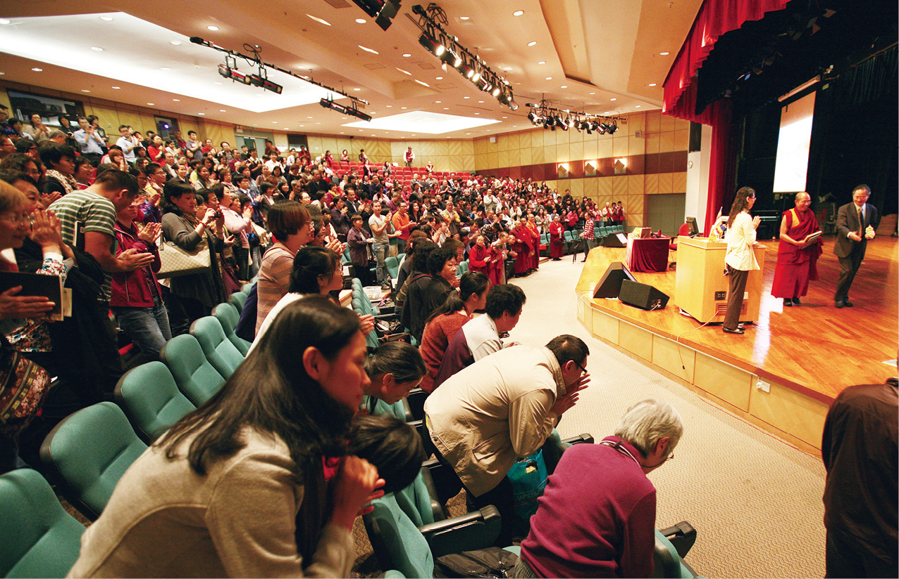
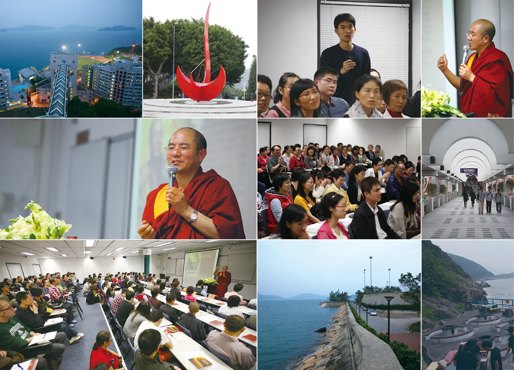
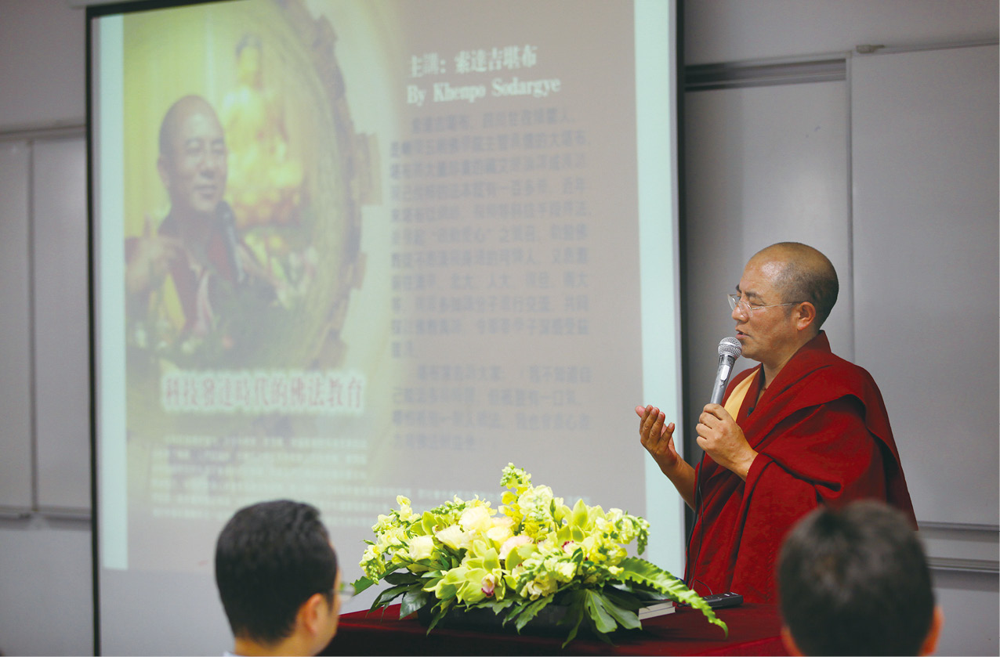

“没有宗教的科学是跛子，

没有科学的宗教是瞎子。”

第22场

香港科技大学

The Hong Kong University of Science and Technology

中国·香港

2011 / 11 / 24

## 科技发达时代的佛法教育

## The Buddism Education At Developed Age Of Science And Technology

主持人：

大家好！我是“内地学生学者联谊会”主席，这次很荣幸地邀请到堪布来到香港科技大学，为我们“杰出学人讲座”献上他非常精彩的思想分享。

今天的主题是“科技发达时代的佛法教育”，是堪布特意为我们选的。下面，请人文学部黄敏浩教授致欢迎辞——

黄敏浩副教授：

很荣幸得到邀请来致辞！

本次演讲的主讲人是索达吉堪布。堪布是四川甘孜炉霍人，现任喇荣五明佛学院主管汉僧的大堪布。堪布因深感汉地佛教徒不易接触到真正的藏传佛教，所以一直以来，将大量藏文经论译成汉语，并以窍诀的方式进行传讲。二十多年来，堪布常常讲、常常译，出版的书有一百多本，包括中观、般若、因明、俱舍、戒律等译作，以及讲记、开示等，可谓数量庞大。

近年来，堪布以网络、视频等科技手段传法，并且发起了“启动爱心”的号召，劝勉佛教徒不应漠视身边的可怜人。同时，他本人身体力行，先后建立了小学、养老院等等。

在上世纪90年代，堪布还曾前往世界各地弘法，他去过的地方很多，有印度、不丹、尼泊尔、日本、新加坡、马来西亚、泰国、美国、加拿大、法国、德国、荷兰、英国等地。

堪布在清华、北大、人大、复旦、南大以及香港中大、理大等地都做过演讲，今天很荣幸能够邀请到他来我们科大演讲，有请——

大家好！很高兴来科技大学与诸位交流。黄教授的介绍中说，我的书有一百多本，但实际上，多数是我的讲课理成了文字；另外的几本，则是我翻译的藏传珍贵论典。

我对自己的书没有信心，但对所译的经论有信心，里面的确蕴含着甚深的意义，很有价值。以前，因为历史原因或者语言隔阂，许多人对藏传佛教不太了解，所以，我就发心翻译了一些藏地著名高僧大德的教言。在翻译中，也许有少量因水平有限所致的错误，但我翻译的态度特别严谨，应该不会有大的问题。

值得一提的是，在我所译的文字中，有一部分是藏传佛教中极为珍贵的密法，很少公开，是法王如意宝晋美彭措住世时开许过才译的，要获得相应的灌顶才能看；还有一些是比较公开的密法，以及汉地难得的显宗经论，也是考虑到或许对后人有利才译的。除此之外的多数文字，是我的平时讲课，个别发心人员整理出来，也就成书了。这里顺便说明一下。

## 一、科技发达时代的失衡现象

今天的主题是“科技发达时代的佛法教育”，我很喜欢这个题目。因为现在是科技时代，而你们又是科技大学，在此时此地探讨科技与宗教，应该很有意义。否则，越来越发达的科技，如果失去了宗教的引导，那它对人类是有利还是有害，就难说了。

爱因斯坦讲过：“没有宗教的科学是跛子，没有科学的宗教是瞎子。”我思索以后，这样认为：当科学离开了宗教的引导，那么这种科学在行进时，很可能会损害自然、社会及人类，有害的就不会被认可，所以它走不快也走不远，甚至会倒下来，就像跛子一样；同样，当宗教不能与时俱进，经不起科学的验证时，它的教义也很难被普遍信赖，就像盲人一样，在方向上总是不太确定，这样一来，让跟随者也常常有“盲修瞎炼”的疑惑。

当然，爱因斯坦所谓的宗教——尤其是能引导科学的宗教，不一定仅指佛教，但从他的很多语言[^1]可以看出，他对佛教非常推崇。对于这样一位科学先驱的认识，我认为，作为科技大学的知识分子，有必要重视；而这种重视，或许有助于解决如今社会的失衡。

失衡在哪里呢？人们追求物质的节奏太快了，也太过了！这一点，诸位应该非常清楚。

如果普遍来看，可以看看人们的脚步。据英国的一个报告说：现在的人的步速，比10年前加快了10%。现在比以前快10%，那10年以后呢？肯定更快。人们为了赚更多的钱，为了做更多的事，就只有加快脚步了。人们常说“时间就是金钱，效率就是生命”，但这种认识，和哲学家所谓的“时间就是生命”，其实是有不同意味的。

今天这堂课要两个小时，对某些人来讲，或许真是用他追求物质的生命换来的，换来寻求精神的慰藉。但值不值得呢？应该是值得的。大家知道，随着科技的发展，跟50前年比起来，现在的人在物质上有了飞速的发展，可以说有天壤之别，但与此同时，人们的道德是否也快速提升了呢？人们的心灵是否依然安宁、快乐呢？绝对不是！这一点，所有智者是公认的。那这是什么？这就是失衡！

当人们只看重物质，而缺乏宗教善的规劝，任由良心泯灭的时候，许多匪夷所思的事情就频频发生了，比如“毒奶粉”事件，比如“苏丹红”事件，比如“孔雀石绿”事件……这就是科技被野心大而又毫无人性的人掌握的结果。

这种“科技工作者”，因为掌握了些科技，要发明、制作点什么，很快而且很容易。但是，由于缺乏良知，也不像古人那样畏惧因果，所以，当他只考虑自己而不关心别人的时候，就什么事都做得出来。在这个时候，说是人，实际跟动物没什么差别。

而作为普通人，虽然衣服穿得五颜六色，生活的各个方面也越来越奢侈，可是内心却越来越空虚，就算是父母与子女之间，也没什么感情了。因为要生活，为人父母的每天忙着工作，心里想的也是事业、金钱、地位，除此之外没有别的；而为人子女的，能学到什么呢？也是这些。所以，从家庭到社会，当物欲膨胀以后，那种善的理念——回馈社会、维护世界、利益一切生命等等，也就日趋减少了。

一旦一个社会或国家的物质水平越来越高，而道德水准或人文素养越来越低的时候，就叫失衡——精神与物质失去了平衡。那这种失衡，是进步还是倒退？很值得专家们研究。

## 二、佛法教育是当今所需

而作为一个佛教徒，我希望人人知道的是：在当今世界，要调整这种失衡状态，人们需要佛法的教育。

刚才有同学问我：“你穿的这个衣服叫什么？”我说：“按佛的戒律，统称为袈裟。”我一个穿袈裟的人，不管是在知识界中，还是在偏远地方的老百姓中，到哪儿都会讲佛教的基本理念。为什么去讲呢？一方面，因为我自己在学习佛法之后，的确得到了许多真实利益，说出来别人也不一定了解，所谓“如人饮水，冷暖自知”；同时，我也深刻认识到：从佛陀乃至印、藏、汉高僧大德们传下来的一切教言，全都是无价如意宝，而世间的金钱、地位、幸福，绝对无法同日而语。当然，这是我个人的看法。

而另一方面我也认为，这是现代人的需要。我与大家分享佛法，并不希求什么，也不是口头上说好，心里却揣着种种目的，不是这样。当然，作为一个凡夫，如果说毫无自利心，这个我做不到，但我大多数的心思，的确是想真诚地交流佛法：佛法这么殊胜，人们又这么需要，那我再累再辛苦，也还是愿意去传播。哪怕让一个人领会了慈悲与智慧的理念，体验了宽容与放松的心境，我都非常欣慰。如果让我给钱，给他多少，很快就花完了，但如果是给思想，即使是一点点正确的思想，它的价值也远远超过了前者。

所以，无论是藏地、汉地，一些高校让我去，只要有时间我一定会去，哪怕十几个人听也愿意讲；偏僻地方的老乡让我去，也是一样。我去讲法，总是怀着一颗好心，不为别的，就是因为他们需要佛法。

尤其是今天的社会，当人心都转向外面，德行日趋向下的时候，科技的发达与道德的衰落之间，出现了巨大的差距。这时候，综合素养相对较高的一些老师或同学，便警惕到了这个问题，甚至开始寻求解决之道。

其实，这也不是不可能的。在发展科技的同时，只要我们渐渐重视这个问题，思维方向有所改变，通过集体或多数人的力量，完全能够缩短这种差距。尤其是高等学校的知识分子，你们现在或将来走向社会时，心里一定要先有个意识，知道宗教的重要性。否则，一讲佛教就会当作迷信，认为这是念佛的老爷爷、老太太的事，“我们是21世纪的年轻人，我们向往的是美满、快乐的生活……”，然而，当你真正面对烦恼、痛苦甚至死亡时，就不得不从虚妄的高山回到真实的平地上，而当你双脚落地举目四望时，却不一定找得到这样的珍贵理念。

所以，不论你进入什么样的研究领域，千万不要忽略佛教的神秘力量。它对社会人心的作用无可替代，包括在座的同学，其实你们心里的困惑和痛苦，都能依靠佛法来解决。

《爱因斯坦谈人生》里有一段重要内容，或许会有启迪作用。1950年12月初，爱因斯坦收到一位19岁大学生的来信，信中说：“先生，我的问题是‘人活在世界上到底为什么？’”之后他说出自己的种种疑惑，诸如“我不知道是谁把我降生于世，也不知道世界是什么”“我对万物一无所知”“不知道为什么把我放在这里而不是那里”……和现在的大学生一样，他有许多奇奇怪怪的问题。

收到来信后，没过几天，爱因斯坦便毫不敷衍地亲自回了一封信。他首先肯定了那位大学生的思考，但他认为，那个提问“不可能有合理的答案”。爱因斯坦说，一个人活着，如果问自己“怎样度过一生”，应该是合情合理且非常重要的问题，而在他看来，答案就是：“在力所能及的范围内，尽量满足所有人的欲望和需要，建立人与人之间和谐美好的关系。这就需要大量的自觉思考和自我教育。不容否认，在这个非常重要的领域里，开明的古代希腊人和古代东方贤哲们所取得的成就，远远超过我们现在的学校和大学。”

这些内容我记得很清楚。从最后这一句话——“不容否认……”，可以看出，爱因斯坦在“自觉思考和自我教育”的道德层面，明显倾向于古代哲人们的思想。

现在很多年轻人想改变世界，就像乔布斯一样，以一种事业利益整个世界，可是，如果不是有一些前世因缘的话，再怎么想，也不一定能实现。即使你一本一本地看那些成功人士的传记，一次一次地去那样实践，但从我一个佛教徒的角度来看，也许你有智慧、有毅力，但没有前世的福报，纵使你发明了什么，最终也不一定得到社会的认可。

因此，人活在世间，就像爱因斯坦所说，应当尽量满足他人的愿望，建立一个和谐的人际关系。而在最根本的问题上，比如今生来世的问题等等，眼下的一般思想是解决不了的，应当向古希腊的哲人们——公元前400年前的苏格拉底、柏拉图的哲学理论中寻找，这些即使在今天、在中国，也被认为是西方思想的精华。

不过，虽然那些理论中也提及灵魂，而且说人死以后，或者上天堂或者下地狱，但在更神秘的层面，并不像佛教那样深入细致地去开显。所以我认为，爱因斯坦所说的“古代东方贤哲”，尤其应该指释迦牟尼佛，佛陀出世距今2555年，而佛教的教义及文化可谓包罗万象，很值得今天的人学习。

我学佛的时间比较长，看的书也比较多，显宗的、密宗的，藏文的、汉文的，藏传的、汉传的、南传的……越看越觉得佛教的智慧最为卓越。在座的都是知识分子，知识分子也应该追求佛教的智慧。汤恩比博士说过：“要拯救21世纪的人类，就应该寻求大乘佛教及孔孟思想。”而我更认为，科技越发达，越不能忘记佛教；社会越失衡，越需要佛法的教育。如果因为不懂、因为神秘，就打个问号放着，甚至当作迷信排斥，这是非常不科学的！

## 三、佛教的慈悲观永不过时

只要科学、客观地分析一下，在人类最关注的心灵领域内，不管时代如何变迁，佛教中的某些理念依然是最深刻的，而且始终是社会人群的需要，永不过时。

比如说“慈悲”。佛教的慈悲观，是教人关爱人、动物乃至一切生命。在西方的认识中有一个盲点：认为动物也有生命，植物也有生命，杀动物与杀植物的过失一模一样。其实，这种说法不正确：一是动物与植物的差别很大；二是在“杀”的层面，认为二者过失等同，也太过了。然而，人和动物的生命是一样的，所以，佛教的慈悲一向遍及动物。

而这种慈悲观，对现在的动物保护，应该是一个很好的理论支持，否则，当这些组织遭到非难时，用其他理念很难解释。甚至在很多时候，即使是不信佛的人，当他发现一些动物被残杀的时候，也会自然地生起同情或不忍。诸如此类，从生活中的点点滴滴可以知道，这种广大的慈悲观非常适合人类。科学再进步，一个人——我们自己也好、别人也好，说“因为科技的发展，我从此不需要慈悲了”，这是何时何地也不成立的。

还有就是“非暴力”。佛教所谓的非暴力，并不带有任何政治意味，是对修行人的教诫，如《毗奈耶经》中所说的沙门四法：“人若打我，我不还打；人若骂我，我不还骂；人若嗔我，我不还嗔；人若毁我，我不还毁。”这种忍让的修心原则，就叫非暴力。那这种原则，不说修行人，一般人需不需要呢？也需要。

有人认为这很怯懦，怯懦的民族会被强国吞噬，所以应该反抗。然而，18、19世纪各个国家手持武器相互杀戮、征战的过程，在今天的人们看来，既不科学，也无利益，和平与人道才是解决任何争端的最佳方式。

对于“非暴力”理念，一般人尽管偶尔也会有些触动，但却很难像一些伟人那样深刻了解并贯彻它。圣雄甘地曾说：“我的价值观很简单：真理、非暴力。”在他的认识上，如果你加上大乘佛法的教义，其实也就是前面说的慈悲观。所以，“慈悲”在这个世界，在社会的任何角落，都是需要的。

当这种慈悲心被真正受持时，怨恨的敌人来到面前伤害自己，也能够安忍。对这种高尚的安忍，不懂大乘理念的人不一定理解，但当你学了佛法并且慢慢深入的时候，就会懂得。

堪布贡噶旺秋的事迹，曾让我深受感动。“文革”期间，他被关进监狱20多年，释放以后去了印度。那个年代，在监狱中所受的虐待是无法想象的，虽然我没进去过，但见过很多被批斗的场面，对出家人、在家人，好似地狱来到了人间，极其可怕！到了印度以后，有位大德问他：“你在监狱里受折磨的这20年，心中最害怕的是什么？”他回答说：“我最怕的，就是对伤害我的人生起嗔恨，失去慈悲心。”

那个时候，他不是怕被饿死、被打死，而是怕失去慈悲，这就是真正的修行。他的境界，不说一般的世间人，就算是我们穿着袈裟、常年待在寺院闻思修行的人，也是很难企及的。试想一下，假如我们身处那样的环境，会怎么样呢？今天有人打我了，“我要记住这个人是谁，一旦我有机会，就不客气”，会不会这样呢？但是，大乘慈悲理念真正入心的人，就完全不同了。

青海那边也有一位大德，这位大德，也是在那个年代中每天挨批斗。批斗是这样的：挨批斗的人站在前面，一个人先讲一讲他所犯的错误：他是怎么学佛的，怎么怎么……然后就上来一两个人开始打他。每次打的时候，这位大德就当一次修安忍的机会，并以三殊胜摄持。所谓“三殊胜”，做任何善事之初，首先为利益一切众生发菩提心；中间以无缘、不执著的方式行持；最后将善根回向给一切众生。这是我们佛教中最关键的修法，依此修持，发心殊胜、无缘殊胜、回向殊胜，这就是三殊胜。

当他要被打的时候，他就发心：今天挨打，我为了利益他以及一切众生而发起菩提心。在被打的时候，他维护自己的心不生嗔恨。打完以后，他把修安忍的功德回向给这些人，有时间就完整念一遍《普贤行愿品》，当然是默念，嘴唇不能动，动又要挨打；没时间或者被人一路打着回去，他就念一些短的回向文，一回去也念完了，心里很高兴，因为修行圆满了。

这些大德的慈悲及修行，是可歌可泣的。但可惜的是，这种慈悲理念，在现在的大学教育中很少，很多高等学府的宗教系或宗教研究，要么是秉持马克思的唯物论，要么是以研究东西方的哲学理论为主，而这些理论在后人编写时，有些不为人接受的道理也被删掉了。这样的宗教系课本，与真正的宗教理论或实修教言，实际是相去甚远的。

因此，在座的老师和同学，在你们作科研或宗教研究的同时，也希望能研究一下纯正的佛教，藏传佛教也好，汉传佛教也好，去研究、修行以后，才能真正懂得佛教的理念，懂得慈悲观永不过时。

## 四、佛法会给我们带来怎样的改变

其实，这样的“非暴力”或者“慈悲观”，说到底就是心地善良。如果一位科学工作者、一位老师、一位公务员具有了善良的心地，指导思想就会高尚，不会偏离轨道。所以，借助善的教育改变一些现状是明智的，否则，学校就变成商业机构了。

美国著名的高等教育思想家、改革家罗伯特曾说过：“当一所学校为谋取金钱而采取一些行动，它必定会丧失其精神，同时通常也得不到金钱。这是很可悲的，但却是千真万确。”

有些学校以商业或其他目的招生，学生招了很多，但真正学到知识的，却并不多见。为什么现在的失业率高，越来越多的学生毕业后找不到工作？就是因为在大学期间，没有做好准备，没有学到真正的知识——不管是技术上的，还是道德上的。名义上是大学毕业了，但实际上并没有大学水平，所以一步入社会，不论是做人做事，都成问题。

其实，社会很需要人才，各个企业、单位都需要，但与此同时，好多毕业生又找不到工作，甚至有些博士、博士后，也是五六年一直待业在家，这样就导致了脱节的现象。当然，这也与自己有很大关系。现在不少学生散乱度日，要么上网，要么迷恋世间琐事，空耗了宝贵的时间。可能这里面还有诸多原因，但最根本的，在教与学的过程中，现代人的心不像古代人了，求学求知的心非常罕见。

我问过一个即将毕业的博士：“你在学校里学了多少知识？”

他说：“没学到什么，混日子而已，为了一张文凭。”

“怎么会这样呢？”

“不光是我，其他同学也一样，上学就是混呗！”

他一直在数日子，盼望着毕业。我相信，并非所有学生都是如此，但这种现象确实存在。如果他在学校里学过佛法，懂得以正知正念来约束自己、观察自己，懂得要报四重恩，就不会太散乱，一定能学到很多东西。

所谓报四重恩，就是指报众生恩、报父母恩、报国家恩、报圣教恩。其实你们读大学，也应该了解这四点，知道感恩、报恩。

首先是报父母恩。父母辛辛苦苦十几、二十几年地抚育我们，方方面面的呵护一定要记在心里。还要感恩众生和国家，很多人觉得这些跟自己没关系，实际上并不是。最后就是老师，我们依靠老师而获得知识，所以不能忘记他们的恩德。我虽然出家了，但特别感恩世间的老师，包括小学老师，哪怕只给了我一句教诲，我都记在心里。即使报答不了这份恩德，也还是尽心尽力地修行、做善法，并将善根默默回向给他们。

今天是感恩节[^2]，对吧？西方的节日，11月的第四个星期四。其实，有颗感恩的心很重要，有一首歌叫《感恩的心》，好多人都会唱，歌词很好，有一种向上的引导，能让人从内心中产生感恩。现在的人习惯于抱怨，对社会、对人都是如此，“这个对我不公平”“那个对我不好”……有了这种心态，人就不会舒服。尤其是年轻人，感情的困扰、生活的矛盾，常常在心里埋下怨恨。甚至，以前我看过的一本书里说，一个人因为跟女朋友分手，杀害了二十多条无辜的生命。

然而，如果我们学了佛法，有了感恩的心，人就会理智、轻松多了。佛教认为，你学得越好，心情就越舒服，什么都想得开；因为不太执著，所以痛苦也就慢慢减少了。

因此，有了佛法，也就有了快乐。我最羡慕藏地寂静山里的修行人，他们没有富裕的物质生活，平平淡淡，正因为平淡，所以内心没有很大的欲望，没有买房买车的执著，也没有还款的焦灼，没有竞争，也没有不公……总之是在一种内心的觉悟中，享受着人生的快乐。

2011年“QS亚洲大学排名”中，你们香港科技大学是第一，香港大学第二，新加坡国立大学第三，日本东京大学第四，香港中文大学第五，北京大学是第十三，清华大学第十六，台湾大学第二十一……我记得是这样。

从这个排名来看，我相信，你们在科研方面是非常顶尖的，也一定有许多突破性的进展。但是，在座的毕竟是人，是人就离不开生死，那我们除了科技知识以外，对生死大事有什么认识呢？如果你了解宗教或佛教中的利他精神，并借由你的知识改变世界，饶益一切有情，这当然最好不过；但如果做不到这一点，仅仅凭着对“无常观”及其他佛教理念的理解，并用在生活中修行的话，也是你个人最大的收获。否则，只是随着科技往外发展，而不让内心的价值体现，这不见得是真正的发展。

当美国哈勃望远镜（Hubble Space Telescope）的科学观测到达顶峰时，前总统尼克松（Richard M. Nixon, 1913-1994）说：“人类的知识科技已经征服外太空，却无法征服人们心里的‘太空’。”心里的太空，其实就是心灵的问题。科学再发达，也只能完成物质的观测，而对内太空的观测，不凭借修行，单靠科学技术是无法完成的。

因此，爱因斯坦等科学家都认为，他们对宇宙及物质的探索，只是整体中的一部分；而在下结论时，也只是用“或许”“也许”的方式，并不敢完全肯定已经到了顶点。

说到这里，我想告诉大家的是：不论你的专业是什么，趁着年轻的时候，应该学一些佛教的道理。以好奇心了解一下也可以，但最好是多花些时间，不但要了解，而且要实修。

## 五、纠正错误的学佛观念

### 1．不要等老了才学佛

其实，学佛法的紧迫性，不亚于我们对生存的追求。有人说：“现在我要成家立业，有所作为，等我老了才去学佛。”但到了那个时候，你的精力、因缘或许已经消失了，正所谓“勿待老来方学道，孤坟多是少年人”。等你白发苍苍、满面皱纹才去学道，人已经糊里糊涂，理解也跟不上了。

如果没有因缘另当别论，但是说来也怪，在这样的时代里，好多高等学校的学生、老师却很有因缘。前段时间，我们喇荣佛学院开了个“大学生夏令营”，你们这里的大学生也有参加的。当时我就感到，好多同学对佛教不仅是简单的感兴趣，而是水平相当不错；而且，在他们自身上出现过许多科学无法解释的现象，有些能回忆前世，有些在梦里或白天直接感受到佛菩萨的加持，有些人遭遇不顺，一祈祷就有明显的感应……当然，作为知识分子，光是凭感觉或者有个形象还不够，应该寻求理论上的解释，以此坚定自己的信仰。所以，有了因缘就要抓住。

### 2．信佛就直说

在信仰方面，香港这边很开放，“我是基督徒”“我是佛教徒”……领导也好，老师学生也好，信什么就坦率地说出来，这样很好。否则，明明学佛，却矢口否认“我不学佛、不学佛”，这没有必要。

我很羡慕的一点是，在这里，一个有信仰的人，人们都会认可他，认为他是好人，很可靠，因为他至少承认“善有善报、恶有恶报”。也因为他有信仰，大家都比较信赖他，让他当会计、做部门负责人。但有些地方恰恰相反，如果你学佛，人人都会蔑视你，上上下下把你当“怪物”一样看；而学佛的人，自己也胆战心惊，慢慢地，也觉得自己挺怪的。

我认为直率一点好，尤其是佛教徒，信佛就说自己信佛。但我遇到一个领导，明明已经皈依很长时间了，家里有佛堂，也一直在念佛，但我问他：“你是不是佛教徒？”“不不不，我不是！我只是研究佛教，喜欢看看，但我不信，我们不信仰这个……”其实这大可不必。

当然，一个人不论信什么，都是很难改变的，因为这是内心的东西。你信马列主义，信基督教、信天主教、信儒教……信哪一个都合理，因为任何宗教的存在都有道理，即使是非佛教徒，我们也十分尊重。这就是因缘，佛陀为什么说“诸法因缘生，诸法因缘灭”，就是这个道理。

不过我想提醒大家一点，那些更深层的智慧与慈悲理念，的确是人类思想中的精华。为什么是精华呢？我不需要以佛教徒的名义劝你，只要你擦亮慧眼，看看在世界漫长的历史转变中，佛教都经历了什么样的考验，也就心中有数了。因此，希望大家能选择一种智慧的宗教，获得智慧的教育。

### 3．学佛不要形象化

其实，佛教最重视的就是智慧，然而遗憾的是，多数学佛的人一直停留在形象上。香港这边也是一样，许多人学佛往往是为了保平安。你去朝圣礼佛，能不能保平安呢？当然能，但这不是根本。佛教最根本的，应该是进行佛法的教育。尤其是知识分子，当你学习佛法的时候，一定要学习它的精髓，这样便可以得到真实的见解。有了稳固的见解，你的信仰也就牢不可摧了。

这些见解，在智慧方面，用世间最尖端的学问，比如量子力学等微细智慧去观察时，也破不了；在慈悲方面，用人们最推崇的博爱思想来推敲时，也一样经得起观察，甚至更胜一筹。

因此，学佛就应该深入经藏，认真地学。如果只有一个形象，办个皈依证，参加个仪式，找找感觉，说说、笑笑、唱唱歌，这也可以，是佛教的一部分。但是，如果你想学到佛教的精髓，最好翻开传统的经典和论典，从中领略深层的佛法奥义。即使没有善知识或善道友引导，在一些基本理论方面，我经常推荐大家去学习《入行论》《菩提道次第论》《大圆满前行》等论典，学了以后再实修，就一定能获得真实利益。

如果不学而修，就不明智，因为修是很困难的。藏地著名的萨迦班智达曾说：没有如理闻思的修行，多数是旁生之因[^3]。因此，为了修行成功，一定要先明理，参禅修密都是一样的。比如坐禅，你为什么要坐禅？如果想让心静下来，怎么才能静下来？静下来又有什么用……其实这些都有理论。理论上明白了以后，再坐禅就非常稳妥。

那坐禅有什么利益呢？不说深层的解脱利益，就算是科学可以验证的层面，也是相当可观的。美国纽约有一位科学家叫卓然·约西波维奇（Zoran Josipovic），他用一台重达5吨的功能性磁共振成像仪，对坐禅者的身体及心智进行测试。在测试过20多人以后，他发现：禅修者的细胞免疫功能健全，完全有能力对抗抑郁症、老年痴呆等病症，心态愉悦舒适……可见，单就今世暂时的利益而言，坐禅也是裨益良多。不过，这种修行一定要有理论基础，否则就修不成功。

而从另一方面来看，如果只是学一学、研究研究，也体验不到佛教的深义。就像《楞严经》里说的：虽然听闻了很多佛法，但若不修行，其实与不听闻是一样的，就如同光是嘴上说食物，不吃终究不会饱[^4]。

很多知识分子只会夸夸其谈，说得倒是很漂亮，但从来没有修过，甚至都没有思维过。你不思维的话，即使是最简单的“人身难得”“寿命无常”，即使是你讲了一辈子佛法，也不一定会有太大感受。因此，一定要实实在在地研究，真真实实地修行！

总之，在科技发达的今天，愿大家能真正领受佛法的心髓。虚云老和尚有个偈子说：“心田不长无明草，处处常开智慧花。”我也由衷地希望，诸位心田中不再生长无明杂草，时时处处绽放胜义与世俗的智慧之花！

现场互动

问：我是香港中文大学哲学系的学生，一直想对如来藏有个全面了解。请问，该从哪里着手？

堪布：若想全面了解如来藏，我建议你先看几部最根本、最精要的经论：《如来藏经》、弥勒菩萨的《宝性论》、麦彭仁波切的《如来藏狮吼论》、觉囊派的《山法论》。在这些显宗经论里，都对如来藏作了细致阐述。

问：感谢您来科大作讲座！生长在21世纪的年轻人，他们对佛法没有太大兴趣。请问，该怎样让这些年轻人了解佛法、接受佛法呢？

堪布：让他们感受到利益很重要！

在当今学佛的人群中，中年人居多，老年人在寻找人生归宿的时候，很多也入了佛门。而80后、90后的年轻人，他们看重眼前的生活，多数人觉得佛法跟自己没关系。但是在我看来，也并不是没关系，我甚至认为，如果你想过好眼前的生活，佛法是最有益的理念，而且必不可少。

所以，一直以来，我们才尽力推广佛法，想让它深入人心。我们不是要用教义来控制哪一个人，也没有政治、经济等任何目的，只是从佛教徒的角度，想让大家了解佛法，让更多人分享到佛教的真理。尤其是大学生，不了解的尽量让他们了解，已经了解的，也劝他们不要停留在表面上，而要不断深入。我想，只要怀着真诚的利他心去推广，他们渐渐会感兴趣的。

当然，一个人在接受佛法时，也分阶段：刚开始，因为从前的教育等原因，有些人会误解，甚至排斥；中间的时候，在好奇与思索的过程中，毕竟是年轻人，有开放的接受能力，会出现半信半疑的状态；而到了后来，在试着运用——比如祈祷、忏悔或断恶行善以后，他们会得到真实的利益。只要感受到了利益，谁还不愿意接受呢？

问：我是这里的访问学者，对佛法很有兴趣。但刚才听您说，只是感兴趣还不够，还要修行。所以请问，我该怎么修行？

堪布：修行要有次第，像《大圆满前行》里讲的：先修“人身难得”，知道了人身很难得，你就会珍惜它，不能用它造恶，而愿意行善；之后修“寿命无常”，修的时候你会有种紧迫感：现在自己虽然年轻，但年轻很快就消失了，人终归一死，死期又不定；接着是“轮回过患”“因果不虚”，这些修法让你知道生命有前世后世，未来的生生世世唯一依靠现在的修行……就这样，从共同加行开始，一步一步地往上修，只有这样修，才可以打下牢固的基础。否则，直接修最高的法，就算你一整天闭眼坐着，那也只是坐着而已，舒服是舒服，但断不了烦恼。

要断烦恼乃至无明的种子，一定要有空性智慧，此外的修法或行为，都不能直接对治“我执”，对治不到“我执”，也就解脱不了。所以，一般的烧香拜佛，乃至表面上的修行，都只是一种善法，不是解脱正因。若想解脱，就必须遵循《三主要道论》中讲的三个要点：出离心、菩提心、无二慧。无二慧就是空性智慧，是解脱轮回的根本，但它也要依靠前前的功德才能生得起来。

所以，修行一定要按次第来。如今很多佛教徒只有佛教的形象，虽然有个形象也有功德，但想解脱的话，还是要闻思和修行。

问：我是科大的学生，对佛法就是半信半疑的那种。我想问的是：人是怎么来的？是谁创造了人？是佛吗？但在佛之前就有人了呀！

堪布：按照《俱舍论》的观点，人并非如“进化论（The Theory of Evolution）”所说的那样，是从猿猴变过来的，没有这么简单。一个人或者一个生命，都是经历了极为漫长的流转时日，才呈现了他现在的这种特定状态。

当然，人也不是谁创造的，不是神，也不是佛，而是以各自业力而生的。

释迦牟尼佛是贤劫千佛[^5]中的一尊，在这个劫中，他的前面已经有三尊佛来过了，他是第四尊。但佛陀出世，是为了转法轮度化众生，并不是从那个时候开始才有了人类。

问：我现在的研究很不顺，也很心烦，我该怎样用佛法来帮助自己呢？

堪布：应该祈祷佛，这有很大的利益！但祈祷佛，是不是就能达成所有心愿呢？也不一定，还要观待你前世的因缘。

有人说：“我祈祷了啊，为什么不起作用？”其实，这就像去医院看病，有些病能完全治好，有些病则效果不大。那么，既然有些病治不了，我们还要不要看病呢？还是要看。祈祷佛也是这个道理。

因此，生活上遇到不顺的时候，祈祷佛对你一定有加持。至于能改善多少，就看自己的信心和因缘了。毕竟每个人的前世以及今生，都存在种种复杂的因缘，这也起着很大的作用。

问：我是科技大学商学院的学生。在这样一个越来越复杂的时代里，该怎样保护和传承西藏文化及藏传佛教呢？

堪布：在科技越来越发达的时代，外来文化对西藏的佛教及传统确实有冲击，这一点不可否认。但是，短时期内应该不会有大的问题。

因为这些文化多数都保存在寺院里：一部分在个别开放的大寺院里；还有相当一部分，保存在深山中的寺院里。在这些寺院里，不仅有佛教文物，更有一批佛教学者——许多德高望重的格西、堪布，还一直在住世。并且，西藏人也特别重视学习佛法，出家人也好、在家人也好，都不同程度地在学习着。在他们心里，佛法就像如意宝一样，不可能轻易抛弃。

当然，有些去了汉地或国外的藏族年轻人，信仰也许会慢慢消失，他们羡慕那里的生活，明星的头发怎么弄、衣服怎么穿，自己也开始趋之若鹜，就像内地八九十年代羡慕美国一样。所以，若想将佛法的传承交给他们，得让其先懂得这些文化的价值。

不过，现在西方倒重视起这些来了，他们开始关注雪域的草原、文化及佛学。可能这也是一种流转吧，流转到最后，我想西藏人还是会回来的，从汉地到西方，再回到自己的故土。不过到了那个时候，在他们心里，不知道养育自己的“母亲”文化还在不在了？

问：我是科大工学院的学生。您书上说：佛教的精髓在于大悲和智慧。如果“大悲”是指大悲心、菩提心、恻隐心、同理心，那么，“智慧”又是指什么呢？

堪布：智慧有两种：一是世间中取舍并接受真理的智慧。就像你们大学生，有了智慧才能求知，否则连工作都找不到，佛教中也提倡这种智慧。

但最根本、最重要的，是通达万法实相的智慧。这和了解有所区别，它是一种大彻大悟。这种悟到的智慧，才是最高深的智慧。

问：佛教怎样看待“进化论”？

堪布：关于“进化论”，就算达尔文在世，恐怕用它也解释不了众生身上的种种现象。而且，就算在科学界，这一理论也很受质疑，比如前段时间，美国就有500多位科学家联合签名驳斥“进化论”[^6]。

在佛教看来，多了不说，单就每个众生的苦和乐这一层面，如果不从各自的业感上解释，而是按照“进化论”所说，人是以那么简单的方式进化的，那所有人的苦乐现象，应该都差不多，智慧的高低也很相近，但事实并非如此。所以，“进化论”的传播并不正确，它对人们认识生命的真相，以及树立正确的人生理念与价值观，都有相当大的损害。

问：佛教讲“业力”，讲“因缘和合”，那业力又是怎样发挥作用的呢？

堪布：还是就苦和乐来说，佛教认为，一个人的苦和乐，是以善业和恶业作为“因”，与众多复杂的“缘”结合以后形成的。总的来讲，你种下什么因，就会生什么果。恶业好比有毒的种子，你种了它，就会产生有毒的果——苦；善业好比妙药的种子，你种了它，也会产生妙药的果——乐。果上的不同，完全来自“因”。而在整个过程中，起辅助作用的，则是“缘”，像阳光以及水、土等等。

举个例子：兄弟姐妹几个人，父母是一样的，但在他们成长的过程中，各自身上所呈现的禀赋或出现的问题，却截然不同，比如性格、才华、工作、遭遇，这些都不一样。那么，这些差别的“因”在哪儿呢？是他们从前世带来的业力，而不在父母身上。父母对他们的降生或成长，只是个“缘”而已。

当然，这个道理很深，要想弄明白，还是要深入佛教的经论，在理论上思维清楚，然后再从实际生活中，方方面面地观察一些具体现象，这样你就会生起真实的定解。

问：对我们年轻人来讲，四谛、十二因缘以及空观等哲学性思想很有吸引力，但一看到经典里的这个佛、那个菩萨，就觉得离我们很远，不太相信是真实的。请问，这些是真的吗？

堪布：这些都是真的。释迦牟尼佛在2500多年前，真实地来过这个世界，只不过他是来传法的，是把真理介绍给世人。而他的思想也留在了文字上，这些你们都看到过，世界各地的人也都在研究。所以，佛陀并不是神，他一生的事迹也不是神话。

你刚才说的四谛、十二因缘或空观，这些就是佛陀的代表思想。如果你们感兴趣，可以深入研究，研究之后，很多道理也不难理解。其实，前辈智者们也都是在研究、修行这些之后证悟的。看看禅宗、密宗等各派大德的传记，他们的境界绝非凡夫可比，后代的追随者尚且如此，那佛陀、观音、弥勒等佛菩萨的功德，又怎么会是假的呢？而且，如果你一边学着佛的思想、体会着佛法的真义，一边又否认佛的存在，这好像也不是很科学。

当然，有怀疑也是可以理解的。因为许多层面你们尚不了解，而且，在目前环境、教育等因素的影响下，要对古老的佛教生起信心，对现实中缺乏对照的佛陀生起信心，的确也不太容易。

不过，我一向认为：年轻人学佛，不应该止于一种简单的信仰。信佛不像崇拜神一样，你若要真正相信佛，就一定要先全面了解他的思想。

问：我是科技大学金融系的职员。在香港这样一个大都市里，人人都忙着赚钱。生活虽然很享受，但我们该如何对治心里的烦恼呢？

堪布：在如今的社会里，一个人要对治烦恼并不容易。不仅是香港，内地大城市也是一样，人们越来越忙，光是每天接电话、打电话，就让许多人的听力出了问题。这个时候，不要说对治烦恼，就算静一静也很困难。所以，我建议每个人都停一停脚步，仔细看看自己在做什么？自己是谁？……否则，在忙忙碌碌当中，经常把自己都弄丢了！

要知道，人生的意义并不只是钱，对很多人来讲，你赚得再多，也不过是银行的一个数字，而且你在为这些奔波时，不知不觉人生就到了尽头。有些人以为，享受生活就是人生的意义。但实际上，所谓享受，也不过是在虚幻的追求中，盲目地活着而已。

人静一静可能才会发现，由知足带来的宁静，原来是我们内心很深的需求。每当我远离尘嚣从城市回到寺院，心里总会有一种莫名的愉悦——也许是回归自然的满足吧，那时候我深深体会到：快乐并非来自财富，而是来自内心的富足和喜悦。俗话说“知足常乐”，这的确是至理名言！

当然，一个人若连基本的生活条件都没有，也是会很苦恼，但现在大多数人的苦恼，并不是因为这个，而是因为不满足。不满足，就会不断求取；有了求取，自然少不了烦恼。因此，若要减少烦恼，唯一的方法就是知足少欲。

所谓知足少欲，对一个城市里的人来讲，做到随缘也就差不多了——没有因缘就随遇而安；有因缘就多赚点儿，但也不过多地要求。而且，有了钱以后，最好能帮助一下身边吃不上饭的人，甚至救济一些灾民。如果人富了以后，只是自顾自地沉溺在虚幻的快乐中，那到头来看看，这也没什么意义。

所以，知足少欲是一种智慧，在这种智慧的观照下，你可以积极地生活，该做的做、该说的说。而且，因为知足少欲，烦恼肯定就少很多。

问：我是香港科技大学机械工程系的学生。佛教里有“相”和“心”这对概念，请问“相由心生”是什么意思？

堪布：“相由心生”是唯识的观点。按照这一观点，内外的一切显现，都是由心产生的，这就相当于做梦——梦里没有真实的东西，一切都是心的造作。

若要弄懂这个道理，你可以研究一下《唯识二十颂》《唯识三十颂》，还有《楞严经》《楞伽经》等。懂了以后，你就会知道“三界唯心，万法唯识”，世间的万事万物并不是从其他地方产生的，而是我们的心被无明遮蔽以后，呈现出来的一种迷乱相。这些“相”，不管是内在、外在的，到底存不存在呢？存在，但也只是心的幻象而已。

问：还有一对概念是“色”和“空”，所谓“色即是空，空即是色”。但如果色是空的，比如说蚂蚁，蚂蚁这个色既然是空的，为什么还有对它生慈悲心或恶心的区别？再说，慈悲心或恶心本身也是空的，既然如此，又何必执著善恶呢？

堪布：“色即是空，空即是色”，是中观的基本思想，也是《心经》的核心内容，以前我讲《心经》时曾解释过。所谓“色”，也就是我们眼睛所看到的东西，它的体是空的，这一点，以中观理论可以推证。但这是站在实相角度上讲的，也就是说，在佛菩萨的境界面前、在万法的本体这一层面上，色和空无二无别。然而，从现相的角度、在我们世俗的一般显现面前，色不是空，空也不是色。所以，对于实相和现相，一定要分开层次理解。

这样的理解，其实与量子力学的分析是一致的。在量子力学中，观察瓶子时，它的本质上是分子、夸克、亚夸克……但在显现上，也就是说，当用眼睛看的时候，我们看见的是不是亚夸克呢？不是，而是瓶子。那为什么眼睛看不到亚夸克呢？因为这是两种概念、两种层次，不能混为一谈。

同样，当我们用眼看见某个众生时，比如说蚂蚁，虽然它的本体是空性，但我们还没有证悟空性之前，应该跟随众生器界的显现来修行。怎么修呢？你看到的是蚂蚁，蚂蚁有苦乐，我们就缘它的苦乐修慈悲心。虽然慈悲心或恶心的本体也是空，但在显现中，善和恶会导致不同的果报，所以要断恶、要修善。

就像那个瓶子，你不能因为它是亚夸克组成的，就不相信瓶子存在而把它扔了。扔了的话，没有瓶子就不能喝水了，同样，不取舍因果的话，就只有感受痛苦了，这是世俗层面的规律，我们每一个人的存在，都脱离不开这个规律。所以，现相和实相要分开。

在这个道理上，如果对佛教有全面的了解，理解起来会比较圆融。否则的话，不是满腹疑惑，就是轻易判断，甚至排斥，这都是不科学的。科学之所以被人认可，一位科学家在报告中说，它要具备三大特性，同时他认为，佛教也完全具备这三大特性。可见，佛教也是科学的，只不过有些问题要深入研究才会懂。

问：我是科技大学理学院的。佛家讲“生死轮回”“前世后世”，但我从小受的是唯物主义教育，不知道该怎么理解这些道理？

堪布：其实，即便是现在的科学界，也承认前世后世。像美国的史蒂文森博士（Ian Stevenson, 1918-2007）、塔克尔博士（Jim Tucker, 1960-），他们在美国以及世界各地，已经搜集了数千个案例能证明前后世的存在。这些案例在任何群体中都有：相信科学的，不相信科学的；有宗教信仰的，没有宗教信仰的……他们因为对这些的长期观察，最终也相信了前世后世的存在。

一般人不承认这些，多数是因为环境或教育的原因，但是我认为，如今也该反省一下了——其实，唯物论者否认前世后世，并没有有力的证据，只是口头上否认而已。

假如否认者没有依据，而建立者却有真实案例，这本身就是很好的建立方式。更何况佛教中还有理论——这可能稍微有点专业，但简单来讲：一个人因为有我执、烦恼，于是就会造业，造业以后，当这一期生命结束时，后世的生命就会随着业而延续，呈现出另外一种形态，由此形成无边无际的轮回；直到有一天，当他生起无我智慧时，才能断除这种流转。当然，这些道理很深，也很隐蔽，若想对此生起信解，最好学一学佛教的经论，甚至试着抉择一下空性，这就是圣天论师在《中观四百论》中的教诫[^7]。

其实，佛教并不是简单说教，不是让你无论如何都要信，你完全可以自己分析，而分析的最好方式就是辩论。在藏传佛教的辩论场上，像前世后世这样的问题，起码要辩上几个月。到了最后，如果你没有理由，而我有，那你就输了，不得不承认我的观点。

其实这样很好！在探索真理的过程中，你对于好奇但又不熟悉的任何问题，以这种方式去观察、提问、辩论，很容易提升自己的理解，甚至获得意想不到的突破。

问：我是科技大学人文学部的学生。在听您讲座、看您的书时，我都有种感觉：您是把藏汉以及显密佛教结合起来，进行传播和交流的。请问，您是出于什么因缘来做这事的呢？

堪布：“诸法因缘生，诸法因缘灭”，说到“因缘”，唯有佛陀才能彻底了知。像今天诸位坐在这儿，或者你在香港科技大学读书，这些事情看似简单，但在它的背后，确实都有很深的因缘。但这些因缘让爱因斯坦来说，恐怕也不一定说得清楚。所以，我也不知道是什么因缘。

不过，从心而论，我很愿意到各地讲一些佛教的道理，也很愿意跟大家结善缘、交流佛学。在交流的过程中，我常常觉得自己是个学生——因为我不具足当老师的条件，就算当个学生，可能也不太合格，所以一有人叫我“老师”“堪布”，我就很惭愧，只不过一想到佛教这么好，现在的人又这么需要，就不由自主地站了出来。

我站在这里，只是想把佛法介绍给大家。太虚大师说过：“科学愈发达，佛教的真意愈显。”当佛陀所揭示的真理，因为科学证明而变得更加明晰之时，人们会发现内心的真实需要，与此同时，佛教对人们的利益也最为深刻。

尤其是年轻一代，如果没有佛教理念的加持和约束，我担心有些人会做出极端的事情，甚至危害这个社会。所以，我虽然做不了什么，也利益不了谁，但算是一种小小的使命感吧，我常常会去一些大学作交流。

其实，我很喜欢跟年轻人、跟有智慧的人交流，在这个过程中，自己也学到了很多东西。

问：请问，您有没有遇到过别人的反对或攻击？您是怎么面对的呢？

堪布：有，但我乐意接受。

如果是反对我的观点，我的观点也确实错了，那我不会执迷不悟，一定会恭恭敬敬地接受对方的正确思想，这是佛教训练中的基本素质。但是，如果对方举不出什么真实依据，我还是会很自信地坚持自己的观点。

假如不是观点的问题，而是在公开场合说我的过失——也就是你所谓的“攻击”，那我不会有什么烦恼，也不会生气。为什么呢？因为在我看来，佛教徒也好、非佛教徒也好，老师也好、学生也好，大家在开放自由的心态中交流，是一种彼此的认可，是一种享受，谈不上什么“攻击”。而且，即使是攻击，真理也不怕攻击。伽利略说过：“真理就是具备这样的力量：你越是想要攻击它，你的攻击就越是充实了和证明了它。”

所以我认为，对一个追求真理的人而言，反对或攻击恰恰是一种机遇和挑战，从中可以反省并提升自我，将来为大家带来更完美的奉献！

主持人：

非常感谢堪布的演讲！希望下次还有因缘，能够再次邀请堪布为我们作更精彩的演讲。

请大家起立，恭送堪布——

[^1]: 比如爱因斯坦说：“佛教是一切科学的源动力。”“任何宗教如果有可以和现代科学共依共存的，那就是佛教。”“完美的宗教应该是宇宙性的，它超越一个人化的神，无须死板的教条及教义，包含自然现象和精神领域，基于对一些自然的和精神的事物的经验而成一体，只有佛教才能符合这些条件。”
[^2]: 感恩节：英文是Thanksgiving Day，是美国和加拿大共有的节日，由美国人民独创，原意是为了感谢上天赐予的好收成。在美国，自1941年起，感恩节是在每年11月的第四个星期四，并从这一天起将休假两天；而加拿大与美国的感恩节时间不同，在10月的第二个星期一。
[^3]: 《萨迦格言》云：“若无闻法仅修习，再勤亦成旁生因。”
[^4]: 《楞严经》云：“虽有多闻。若不修行，与不闻等。如人说食，终不能饱。”
[^5]: 贤劫千佛：现在之二十增减住劫中，有千佛贤圣出世化导，故称为贤劫，又称善劫、现劫。
[^6]: 中华网科技讯：500多名美国科学家联合签名反对达尔文的进化论。在这些科学家联合签名的反对文章中写道：“我们对达尔文的进化理论表示非常怀疑。”这篇文章还称：“我们对达尔文进化论中的自然选择理论表示怀疑。我们认为，作为科学家我们有责任要求各领域科学界进行一系列更加深入的研究，以确定达尔文的理论是否合理。”在这篇反对文章上签名美国科学家共有514名，其中有154名是生物学家、76名化学家、63名物理学家，其余的是一些毗邻学科的专家们。据这篇反对文章的起草者认为，地球上的生命具有极其复杂的发展过程，达尔文进化理论狭窄的框框，根本容纳不了地球生命的起源与未来发展进程。
[^7]: 《中观四百论》云：“若于佛所说，深事以生疑，可依无相空，而生决定信。”
