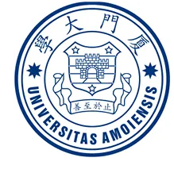
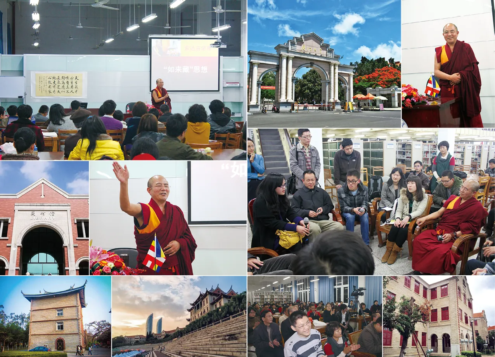

禅宗大德常说要见自己的本来面目，

那么，

这个“本来面目”到底是什么？

所谓明心见性，

“见”的究竟又是什么？

第26场

厦门大学

Xiamen University

中国·厦门

2012 / 2 / 24

## “如来藏”思想

## Philosophy of Buddha Nature

主持人：

厦门大学人文学院哲学系“硕博学术沙龙”，2011-2012年度第7期（总第39期），现在开始了！

今天，很荣幸地请到了索达吉堪布，为我们作一个关于“如来藏”思想的讲座。下面欢迎堪布演讲——

各位老师、同学：

大家好！今天很高兴来厦门大学“硕博沙龙”与诸位交流佛学。

十年前一次偶然的经历，让我对厦门大学留下了美好的印象。那是2002年，我在附近的一所医院治病，同时翻译《释迦牟尼佛广传》，就是在那段日子，我常来你们大学。每次来的时候，我都带着四片儿长长的藏文经函，坐在一个美丽的湖边，边思考、边翻译，感觉很惬意。当时我还想：在这样的环境里教学、读书，真是一种享受！

故地重游，时间虽然过去很久了，但刚才一进来，美好的记忆还是浮现了上来。不过，今天我是来交流佛学的——昨天他们提出，让我讲一讲“如来藏”的思想。

大家可能知道，对于如来藏思想，现在有一部分学者是以批判的眼光对待，也有一部分学者比较能接受，甚至想学习、修行。如果是第一种，想要批判这一思想，恐怕很困难，这个问题待会儿我会说明；而若想正面了解的话，今晚短短的交流，也不一定能讲得明白。不过，在共同探讨、学习的过程中，也许会对个别人有所启发，让大家对这个问题有重新认识。

## 一、对如来藏的误解、邪说

如今，台湾、香港有个别法师认为：如来藏思想是受印度某些宗教影响而出现的，佛教本来讲缘起性空，不承认常有，而如来藏被认为是常有的，所以不符合佛教教理。

对于这一观点，后来有些学者批判过，而我也持着与之相同的看法。

### 1．佛经论典是怎么说的

其实，经典中所说的如来藏常有，与外道的梵天、神我等常有不同，因为这种常有远离戏论。所谓远离戏论，就是远离有无等四边[^1]，以及生灭来去等八戏[^2]的执著。也就是说，是在远离一切戏论的基础上，才承许这一常有的大光明。

它与外道神我的不同之处，佛在《大乘入楞伽经》[^3]中，对大慧菩萨宣讲得非常清楚。因此，不承认如来藏思想，那对释迦牟尼佛的第三转法轮，以及密宗一切续部的教义，也等于是否认了。

如来藏的存在，其实不仅是第三转法轮，二转法轮也以隐含的方式说明过。比如，佛在《中般若经》里说：“心无有心，心之自性为光明。”心没有自己的体性，心的本体是光明。

由此可知，如果不承认如来藏，那么汉传佛教的天台、华严，乃至禅宗等一切宗派所奉行的经论，都将无法立足；而且，如果心的本体真是像虚空一样空无，那证得这么一种“空性”，从一地到十地乃至成佛之时，又是一个什么情形呢？没有庄严的身相，也没有洞察一切的智慧。很显然，这是说不过去的。所以，一定要承认如来藏的光明分。

当然，这个问题很深，三言两语解释不清楚，你们有兴趣的话，最好研究一下相关的经典，比如《如来藏经》。《如来藏经》有四个译本，最早的一个，是西晋时期法炬译的，不过，这个译本和第二个译本都遗失了，现在仅存第三和第四个译本，分别为佛陀跋陀罗（也译作觉贤，东晋，359-429）以及不空（唐，705-774）所译。

后面这两个译本，不空译得稍微细一点、广一点，佛陀跋陀罗译得比较略，但意义完全相同：都是以九种比喻说明如来藏的存在，也都是先讲长行文，再以偈颂作总结。而且，以前我专门对照过藏文，与汉文是一致的。

因此，如果你们想了解“一切众生皆具如来德相”的道理，或说第三转法轮以及密宗最根本、最核心的教义，一定要阅读《如来藏经》这样的经典，其他的还有《解深密经》《首楞严经》《楞伽经》《大般涅槃经》等。

其实这个道理很深，像《大般涅槃经》里讲：如来藏甚深难测，凡夫、声闻、缘觉都无法了知，就算是十地菩萨，也只是像在夜里见色法一样，不能完全明了，只有到佛地才能彻底了知[^4]。

既然如此，若是我们去研究，是不是也一点不能了知呢？也不是。

这就像空性一样，空性虽然很深，但只要你依着龙猛菩萨、月称论师的理证去抉择、研究，就可以了解，甚至为别人宣说。同样，要了解如来藏，除了《如来藏经》以外，还可以学习一些可靠的论典、注疏，像弥勒菩萨的《宝性论》、无著菩萨的《宝性论释》、龙猛菩萨的《法界赞》，以及藏地宁玛派、觉囊派等前辈大德的珍贵论典等，这样学下来，应该也不是特别难。

尤其是《宝性论》[^5]一定要看，它的内容多数源于《如来藏经》，是阐释如来藏思想最重要的论典。

### 2．明心见性是见了什么

此外，很多人常说“明心见性”，但明心见性是见了什么？不承许如来藏的话，见性也就谈不上了。你们可以看看禅宗、密宗或者任何的佛教典籍，里面最深的窍诀，全都要涉及如来藏光明。

因此，如来藏光明不是纯粹的理论。你们多数是作学术研究的，但在研究的同时，你观过自己的心吗？这颗心，它到底是个什么样子呢？

下面我们来观一观——

当你观心的时候，其实心的本体了不可得，它是空性的，既无颜色，也无形状，甚至了无分别；而与此同时，它又不离开光明。所谓光明，是不是像灯光或者太阳光那样呢？不是。那所谓空性，是不是空荡荡的一片，如虚空一般呢？也不是，否则，一切现象就不存在了。

因此，明与空是不二的，这才是心的本体。这个本体，在你的起心动念连续不断的同时，它是毫无迁变的，理论上可以这么理解“明心见性”。当然，要想真正了悟，还需要深入地学习和修行。

那么，这种努力值不值得呢？这是一个生命价值的问题。你们想一想：世间有这么多的学问，可谓包罗万象，但用你有限的生命，能否通达无碍呢？显然是不可能的。一方面是做不到；另一方面，如果这些学问不能触及生命的真相，做到了又有什么意义？

所以，在我看来，对任何一个生命而言，最重要的学问，是帮助他认识自心的学问；而最重要的认识，就是认识心的本来面目。否则，你来一趟世间，忙忙碌碌学得再多，也可能是在虚度人生，这不是太可惜了吗！因此，没有财富不要紧，没有地位、名声也不要紧，最要紧的，是通达心的本性。

而要通达心的本性，以动物或其他的生命形态，都是很难实现的，唯独人身最好。但遗憾的是，人在物质上有了进步以后，就自以为先进，不肯探究心的真实层面，甚至连“生命是伴随着心的流动而轮回不息”这么一个最普通的认识，能了解的人也是少之又少。

人类的智慧就处于这样的层次上，难道不是一种悲哀吗？

### 3．存在的何以说不存在

存在的毕竟是存在，你想驳斥它的话，一定要有足够的依据。

否则，没有充分的理论依据，不研究经典、续部，也不阅读高僧大德的论著，只是断章取义地了解一点佛教的观点，就在人前建立自己的“宗派”，那不管是从佛学、科学的角度来看，都是非常不严谨的。所以，作为智者一定要谨慎。这么甚深的道理，如果你还不能认可，我们也理解，但如果你直接下结论否认它，也许就不太明智了。

那些认为如来藏不存在，甚至说第三转法轮不了义的人，多数是觉得这些跟空性相违。但实际上，当你真正理解空性以后就知道，这二者本身并不相违，相违的是我们的认识。所以，在藏地的历史上，觉囊派与格鲁派的大德就他空、自空辩论到最后，除了稍许的不同点之外，究竟密意完全一致；而宁玛派无垢光尊者、麦彭仁波切等大德的教言中也都认为，佛陀第二、第三转法轮的教义，其实本来就是融会贯通的。

而这种贯通，就是现空不二；现空不二，也就是一切万法的本体。

这个本体在空分上，第二转法轮讲得非常清楚，后经龙猛菩萨、圣天论师、月称论师、寂天论师等印度大德用理证方式深入阐释之后，在后来的学者中得到了广泛认同。

而在现分上，也就是如来藏的光明分，除了第三转法轮的讲解以外，密宗的《大幻化网续》（也称《密藏续》）、《时轮金刚》、《密集金刚》等续部，也有详尽的说明。尤其是，在大手印、大圆满等实修窍诀中，更是以直接的方式为你指点，不用太多文字，一指点，利根者当下就开悟了。

当然，这也要信心。没有信心，甚至排斥的话，那不要说修行，理论上都很难建立。

## 二、以九种比喻说明什么是如来藏

下面，我依据《如来藏经》《宝性论》，以及前辈上师们的窍诀，简单讲一下众生具足如来藏的九种比喻。

这九种比喻，你信或者不信都没关系，但你要思考：佛陀说众生皆具佛性，皆具如来藏德相，并且用浅显易懂的比喻宣说了，这对你有何启发？比喻要说明的意思，你能信服吗？不信的话，你有什么理由？信的话，那这个如来藏、这个光明的心性，从现在直到成佛之间都是存在的，这一点你又如何受持……

下面，我一边讲，你们也可以一边思维——

总的来讲，这九种比喻，是分别对应凡夫、声缘阿罗汉、见道菩萨、修道菩萨[^6]而说的。

其中，第一个比喻是萎花中的佛像：在枯萎的花中，有一尊非常庄严的佛像，天人用天眼见到以后，剥开枯萎的花、叶，显出光芒灿然的佛像。

喻义对照：佛像被隐藏着，这代表在烦恼中安住的如来藏；包裹佛像的萎败花叶，代表以贪心随眠[^7]为主的八万四千烦恼；天人代表佛陀，当佛陀以佛眼见到众生都有佛性以后，为其说法，去除如枯萎花叶般的八万四千烦恼，显露佛的功德。

一般来说，这个比喻对应未入道的凡夫。

第二个比喻是蜂群中的蜜：在千百万只蜜蜂集聚的中央，有一块上妙甘美的蜂蜜，智者发现了这块蜜，便巧设方便驱散蜜蜂，取出蜂蜜。

喻义对照：被蜜蜂团团包裹的蜜，代表如来藏；外面的群蜂，表示以嗔心随眠为主的各种烦恼；智者代表佛陀，佛陀见众生都有如蜜般的如来藏，就为众生驱开如群蜂一般的种种烦恼分别，现前证悟。

可见，现在我们不能见性，是因为有太多的障碍遮着，但我们都有佛性，这是决定的。所以，从真实意义上说，众生是佛。

有人问：“如果众生是佛，那为什么还要受苦呢？”

其实这个道理很简单。佛教所谓的“众生是佛”，并不是说现相上是佛，是说实相是佛；而在现相上，众生是众生，佛是佛。

要进一步理解这个道理，就要涉及佛性的两种清净：自性清净与离垢清净。当说自性清净时，所有众生的本质都是清净的，都是佛，虽然暂时被烦恼、所知二障遮蔽着，还不是真正的佛，但本体上就是佛；虽然本体上是佛，但在离开障垢之前，还是众生，只有离垢了才能成佛，这就是离垢清净。比如冰和水，从本性上讲，水的本性是水，冰的本性也是水；但在显现上，冰就是冰、水就是水，你不能说冰是水，只有它融化以后，才是水。

这个比喻，对应已入道的凡夫。

第三个比喻是糠秕中的果实：被糠秕包着的青稞、小麦等果实，是不能食用的，想要食用的人，一定要用方法剥掉糠秕，才能享用果实。

喻义对照：被糠秕包裹的果实，代表如来藏光明；糠秕代表痴心随眠为主的一切烦恼；而去除糠秕的过程，就好比佛陀转法轮，让我们懂得真理，从而突破种种障碍，现前真实的如来藏。

这个比喻，对应资粮道的凡夫。

第四个比喻是不净粪中的纯金：有人走远路，不小心把金子丢在一个肮脏的粪坑中，天人以天眼发现了这个金子，便告诉大家，让他们把金子挖出来享用。

喻义对照：粪坑中的金子，代表如来藏；而这个不净粪坑，则表示我们非常强烈的贪嗔痴等烦恼；虽然如来藏像纯金沉在坑底一样，本来就存在着，但只有通过了解这一真理，然后去除烦恼粪秽，才能展现它的本来面目。

这个比喻，对应加行道的凡夫。

第五个比喻是地下宝藏喻：在一个贫穷人的屋舍下，埋着非常丰富的珍宝藏，但宝藏不能说话，而人也不知道自己家里有宝藏。只有当宝藏被勘探出来以后，那个人才知道，即使是以前自己最贫苦的时候，宝藏也一直都在自己的家里。

喻义对照：地下的宝藏代表如来藏；贫穷人的家，代表声缘阿罗汉的无明习气；虽然我们本自具足佛的相好、十力、四无畏、十八不共法等一切功德，就像自家地底下的宝藏一样，但我们并不知晓，只有在通达无我智慧以后，才能将这一切开发出来。

这个比喻，对应声缘阿罗汉。

第六个比喻是果中的种芽喻：在灰色的种芽里，有生长大树的能力，当你把它埋进地里以后，借助于灌溉以及阳光等因缘，它会破壳而出，生芽、扎根、成长为参天大树。

喻义对照：种芽代表众生的佛性，其中蓄积着无穷的精华和力量；而它的壳，则代表见道所断的烦恼；当因缘成熟时，如种芽一般的佛性，便能借助于福慧两种资粮，破除烦恼、展现本来面目，并最终成就佛果。

这个比喻对应见道菩萨。见道者的比喻有两个，这是第一个。

第七个比喻是破衣中的宝佛像喻：被臭秽破衣包裹的珍宝佛像，虽然放在路的中央，但无人知晓。在天人的指导下，大家知道以后，撕去破衣，取出宝佛像。

喻义对照：宝佛像代表佛性；破衣代表见道所断烦恼；就像天人为人指示佛像一样，佛陀为众生宣说妙法，解脱其相续中的珍宝佛性。

这个比喻，也是对应见道菩萨。

第八个比喻是贫贱丑女腹中的转轮王喻：一个非常贫贱丑陋的女人，无依无靠地住在一个破屋里，因为偶然与人相交，怀上了转轮王。转轮王，相当于现在一般的国王，他以正法教导世人。贫女腹中虽然怀着国王，但她自己并不知道，只有生下了他以后才知道。

喻义对照：腹中的国王代表如来藏；贫女无怙而住，代表修道所断的烦恼；众生虽然深陷痛苦，无有依怙，但在每一个众生的相续中都有佛性，依靠这个佛性，将来都可以成佛。

这个比喻，对应一地到七地的修道菩萨。

第九个比喻是泥模中的金像喻：古代都用泥模铸造佛像，先在泥模中刻好佛像的纹路，再把金子熔化倒入，之后取出时，就呈现一尊完美的佛像。

喻义对照：金像代表佛性本自无垢清净；泥模代表烦恼客尘；佛陀善巧说法引导众生修行，就像剥去泥模一样，破除他们的一切障垢，让众生成就佛道。

这个比喻，对应清净三地（八地到十地）的修道菩萨。

## 三、了解如来藏有何必要

以上的这种讲解方式，也许稍微有点专业，不过，很多名相都是固定的，不用的话，可能也没办法阐述。而对这些道理，想细致了解的人，可以学习《如来藏经》《解深密经》《宝性论》等经论，这样学下来以后，对如来藏一定会形成初步的了解。

这种了解是很有必要的。一方面，它可以让你系统了解佛的思想。

你们也知道，佛在初转法轮时，对如来藏几乎只字未提；二转法轮主要讲万法皆空的道理，但同时也提到了如来藏，只不过，是以不明显、不广说的方式略有提及；而只有到了三转法轮，才明确地提出这一思想。按显宗的讲法，一般是说在广严城等地方传讲；但如果说到密宗，那么在米积塔讲《时轮金刚》时，还有更加细致的阐述。

所以，如来藏是佛的真实思想，也是最了义的思想，不能因为最初佛陀没有宣说，或者只是少分宣说，就认为佛的话自相矛盾。只要你全面了解佛教以后，就会知道，其实这种矛盾是不可能的。

这个“不可能”，并非因为我是佛教徒才这么说，就是世间的学者、智者，他们在公正、深入地研究之后，也都会意识到：其实佛的思想，绝对不是一般人所想的那样，说矛盾就矛盾了，没有这么简单。

而进一步来说，当你了解到如来藏确实存在以后，就绝对不会诽谤了。这种诽谤不像其他的，佛经里讲了，诽谤佛法的过失是相当大的。

一听说有人诽谤如来藏，我的心里就很痛。你不了解没关系，你不承认也没关系，但你何必要诽谤呢？何必造这种业呢？再说，你不深入经藏，就想当然地批判如来藏思想，又怎么说得过去呢？就算你要批判，也至少得精通佛陀八万四千法门中的相当一部分才行，否则，只是凭空说“不存在”，恐怕没什么分量。

因此，希望大家以后对如来藏有个正面的了解，不要听一两节课、看一两本书、随意翻阅一两个资料，就随便下结论：“这里不对、那里不对……”一定要正面了解。如果有了正面了解，甚至能潜心学习和研究，这个功德也是不可思议的。

## 四、学修如来藏的功德

一说“功德”，也许有些人不太认同，认为这是佛教的概念，但是我想，闽南这边应该不会。为什么呢？因为在你们这里，不管是老师、学生，还是社会上的人，大家都生活在一个既有的习俗里：就算是不信佛，也都信观音。

这就不像其他城市了，其他的有些城市，你们可能也知道，几乎所有的人都没有任何信仰。但你们信观音，而且从小就信，有了这样的观念基础，我相信大多数人是不会否认功德的。既然相信功德，而如来藏的功德又这么大，为什么不接受呢？

昨天他们一提“如来藏”，我就很欢喜，觉得交流这样的题目，太有意义了。也许我讲不出什么特别深的道理，但这个思想本身，你们看看《如来藏经》的后面，佛陀说，凡是学习、研究的人，有无量功德，如云：“于此如来藏经典法要，受持读诵书写经卷，为他广说得福无量……”[^8]

所以，以前我看到这些功德的时候，就想：“《如来藏经》这么好，我这一生能不能学一遍呢？能不能讲一遍呢？”

当然，最重要的功德，还是在于开显如来藏的本来面目，也就是“明心见性”。

而要明心见性，常常观心很重要。所谓“参禅不在腿，念佛不在嘴”，你要参禅，双盘、单盘不重要，重要的是要懂得心的本性；你要念佛，口里念不重要，重要的是心里要念。所以，心调不好，行为上再怎么做，也不一定是那么回事。

大家都知道马祖道一的公案：刚开始，马祖大师很爱坐禅，白天晚上常常打坐。怀让禅师见他是个法器，而且度化的因缘也到了，就去问他：“大德坐禅图什么？”

道一说：“图做佛。”

怀让禅师找了一块砖，在他前面的石头上磨，“嗞嗞嗞——”。

道一见了就问：“师父这是做什么？”

“磨它做个镜子。”

“砖怎么会磨成镜子呢？”

“那你坐禅怎么能成佛呢？”

“那如何才是呢？”

怀让说：“譬如有人驾车，车不走了，你要打车呢？还是打牛？”

道一听了说不出话来。之后，禅师又为他开示：“如果执著坐相，则并未了达实相……”马祖当下大悟。

那么，他开悟依靠的是什么呢？就是观心，而不是行为。诚如《六祖坛经》云：“不识本心，学法无益；若识自本心，见自本性，即名丈夫、天人师、佛。”

因此，希望大家都能了悟如来藏的本来面目，了悟以后，也就回到了自己真正的家园。

现场互动

问：在藏传佛教的五大门派里，有四派认同如来藏思想，只有格鲁派持中观应成派思想，反对如来藏存在，认为毕竟空，请问您对此有何看法？

堪布：其实，格鲁派并不排斥如来藏。

在章嘉国师、第五世达赖喇嘛、克珠杰等格鲁派大德的论著中，都描述了如来藏如何存在，以及如何现前的道理。只不过，在跟觉囊派辩论时，他们的侧重点有所不同，而且语言也很犀利，但这些并不能说明他们不承认如来藏。

再说，就中观应成派本身来讲，他们是肯定承认如来藏的。像龙猛菩萨、月称论师，他们在抉择胜义谛时，一切万法都是空的，既然都是空的，如来藏空不空呢？当然也是空的。如《大乘入楞伽经》里说：“如来藏的本体空无相无愿、不生不灭……”[^9]可见，如来藏也同样摄于三解脱门，也是离戏空性的。但是在空性的同时，是不是就不存在了呢？也不是。

如果按你说的，格鲁派认为如来藏不存在，因为一切都是空的，那等于否认了所有本尊，以及密宗的各种修法。但他们怎么会这么承认呢？绝对不会。

问：在藏传佛教里，为什么要称红教、黄教、花教、白教呢？

堪布：这种说法，藏地没有。

藏地各教派的命名，有些是用时间，比如宁玛派是旧派，格鲁派是新派；有些是用地名，比如萨迦派，“萨迦”意为灰白色的土；而有些是用意义，比如噶当派，“噶当”的意思，就是将释迦牟尼佛的一切教言都当作修行的教授。

但在汉地某些信士、学者的说法中，好像红教就是穿红色衣服的，黄教就是穿黄色衣服的，那花教，是不是就要穿得花花绿绿了？

问：我是厦门大学哲学系的博士生，研究方向是佛教哲学。请问，空性和如来藏是什么关系？

堪布：这二者是不二的，也就是现空不二。

所谓现空不二，“现”是指如来藏的光明分，“空”是指空性。当一个人开悟时，一定会同时具有现与空两种境界。此时，因为他了达了空分，所以对任何法都不执著，也就是所谓的“看破了”；而因为同时也安住明分，所以会兴起大悲，修持善法、积累资粮。从一地到十地之间，都是如此。

开悟时既有智也有悲，这就是智悲双运；进入修道以后，随着明分越来越明清，功德也越来越增上；而这种不二的境界究竟了，就称为佛。

因此，如果分开理解，空性和光明可以说是两个，但从真实的层面上讲，二者是无别的。

问：我是法学院的硕士生。我听说藏传佛教中有吃肉的现象，但佛经里说“食肉者断大悲种”，请问师父，这个您怎么解释？

堪布：《楞伽经》里说“不戒肉则断慈悲种子”[^10]，这一点，藏传佛教是完全承认的。而且，根据《大般涅槃经》[^11]的观点，藏传佛教也认为：如果是大乘佛教，就应断绝肉食，所谓“食三清净肉无过”，只是小乘的说法而已。所以，很多大德也造了论典劝人吃素。

但从历史上看，为什么藏地就没有汉地那样的吃素传统呢？这个原因，我在其他论典中讲过，希望你能够理解。不过，对于你们的传统，我们都特别随喜赞叹，如今很多寺院也基本是素食了。

问：有人说，藏传佛教的乐空双运是受了印度性力派的影响，请问您怎么看？

堪布：乐空双运，不是从印度性力派传来的，它是密宗《时轮金刚》的最高修持方法，但这种修法，在寺院中一般没有人行持。

不过，它的理论基础，显宗的经论中也处处都有，像六祖的“烦恼即菩提”——贪、嗔、痴是菩提，这就是乐空双运的观点；而如果能落实到修持上，到了最高境界时，的确是转烦恼为菩提。所以，不要说密宗，显宗也成立这一点。

当然，对此不太了解的人，也许会从自己的文化背景出发，轻易评判这些高深的教义，但这样做，其实是很不妥当的。你们可以去藏地的寺院看看，看看他们在做些什么，在怎样地守护戒律，也看看密续是怎么说的，和显宗有何差别……

二十多年了，在我潜心研究藏、汉这两种不同传承教义的过程中，可以说，没有发现一处相违的地方。如果真的有，那我也不会执迷不悟，一味袒护自宗的观点，这又何必呢？我也知道什么是公正。

因此，大家一定要擦亮慧眼！

问：我看过师父讲的《弟子规》，知道您也在弘扬传统的儒家文化，请问当时您这样做，是出于什么样的发心呢？

堪布：我对儒家思想，一向都有很大的兴趣。

不仅是《弟子规》，这几年以来，我还学习了《论语》《中庸》《大学》《三字经》，并将个别国学经典译成了藏文。我非常欣赏儒家的理念，比如，怎么为人处事、怎么孝顺、怎么恭敬……不过可惜的是，这些传统现在基本都没有了。

为什么要讲《弟子规》呢？也许你们觉得，由其他民族的人来弘扬你们的文化，有些不合理，但是当时我学了以后，感觉非常欢喜，觉得这里面讲的和佛教的意思很相合，很值得学习。尤其是年轻的佛教徒，不从这些方面有个约束的话，在以后的生活中，可能会给自己带来一些不便。

当然，对里面的个别理念，我是有看法的。但这个不要紧，就算是人和人接触，也难免有看法，何况是不同的思想？所以，重要的是，让自他都学到一些有用的东西。

问：我是学自然科学的。佛教认为生命有轮回，但在自然科学看来，这是比较难以接受的，请问，有什么方法能证实轮回呢？

堪布：一个学自然科学的人，不接受轮回的说法，这一点我非常理解。

因为它关系到心的问题。但在现在的课程里，这方面仍是空白，自然科学的方向不是研究心，那些仪器也触及不到心的本源。所以，到目前为止，他们在心的领域内并无突破性进展，这是西方科学界所公认的。

不过，对于轮回的案例，许多科学家是承认的。像哈佛、耶鲁等的英美学者，他们在长期观察、审慎研究之后，从不同角度给出了结论。这类文章，我们“智悲翻译中心”最近翻译了许多，你们可以去看看。

当然，不仅是他们，像爱因斯坦、牛顿等这样的科学先驱，其实也相信轮回。这一点，从他们的传记、讲话中不难看出。既然如此，如果你只承认牛顿的部分学说——他在自然科学方面的理论，而否认他对生命延续的认识，恐怕是说不过去的。

所以，我们说有来世，你们不接受可以，但是科学家也说有轮回，是不是值得深思呢？

问：对于如来藏，我们怎样才能利用它的一些功能呢？

堪布：如来藏，也就是我们的真心。对于这个真心，首先要从理论上了解，了解以后，当你真正有所开悟时，它的部分功能就现前了。像禅宗大德所具有的超凡智慧，就是从这里来的；现在的人在禅修以后，调节了身心、对治了烦恼，也是从这里来的。

所以，你想利用它的功能，就要学着修心。修心，是对心的一种训练，这和锻炼身体不一样。身体锻炼好了，人会健康，而心一旦训练到位了，种种功德便会纷至沓来。

问：我是中国哲学的博士生。请问，阿赖耶识与如来藏有什么差别？

堪布：阿赖耶识，是具有微细分别的心识；而如来藏是众生的佛性，远离分别，不能与识混为一谈。

对于识与如来藏的关系，觉囊派一位大德曾以大海为喻：如来藏相当于大海的本体，阿赖耶识是大海的底层，而其他心识[^12]则是上面的波涛。动荡的波涛，与相对平静的海底，其实都是以大海为本体。同样，所有心识的本体，就是如来藏。

问：那识和智有什么差别？

堪布：所谓识，就是各种分别或无分别的识聚；而所谓智，是指断除人我、法我后证得的通达一切万法的有境[^13]。通过修行，识转依后就成了智。

问：请问如何观心？

堪布：观心的方法很多，禅宗、净土、华严、密宗……各个宗派都有自己的观心方法，但在所有的观法中，我自己修持的就两种：一是有相禅定：直接观想释迦牟尼佛；二是无相禅定：什么都不缘，就在明空无别的心的本体中稍许安住。

这两种方法包括了一切修法，也是我结合经典、论典的教义，自己常常观修的方法。

问：我是学建筑装材的本科生。佛教讲“有生必有灭”，那人类将来的走向是什么呢？

堪布：今年是2012，很多人认为，人类在不久的将来就会走向灭亡。（众笑）

有生必有灭，这是佛教对于生命最透彻的理解。其实地球也是一样，它有“成、住、坏、空”的不同阶段，现在是存在的状态，到了最后坏灭的时候，它就消失了。这和科学的认识一致。

那人类呢？人类那时候也会消失。不过，生命还是延续的，到其他的世界里继续“有生有灭”，流转不息。

问：我对地藏菩萨稍有了解，他的大愿是“众生度尽，方证菩提”，但我想问的是，地狱能度空吗？

堪布：地藏菩萨的大愿，是说明他要度化一切众生的伟大精神。

在大乘经典的教义里，地狱是不会空的。为什么呢？因为众生是无量的，就像虚空一样，没有边际。如果众生有边际，那菩萨一个一个地度下去，地狱一定有空的时候。但实际上，众生是无量无边的，所以地狱也不会空。

那地藏菩萨发了这样的愿——“地狱不空，誓不成佛”，是不是永远成不了佛呢？也不是。就像世人在做某件事情时，为了表明坚定、长远的心，也会发下大愿，有了大愿，事情很快就成办了。菩萨也是一样，在广大愿力的推动下，反而迅速成佛了。

他的愿和文殊菩萨一样，是利根者的发愿，代表了佛教最高尚的精神。

问：我是厦大中文系的学生。您刚才说到观修释迦牟尼佛，请问该如何观呢？

堪布：在我译的《释尊广传》的后面，就有释迦牟尼佛的观修方法，还有仪轨，最好按仪轨和修行教言去观。

问：那是不是把佛当作一个可以学习的对象？

堪布：对！佛陀的事迹，可以从他的传记中了解。

而且，释迦牟尼佛是一切寂猛本尊[^14]的根本，当你这么观的时候，你的上师、本尊、空行、护法等，实际也都包括在里面了。因为在法界当中，所有的佛都是一味一体的，虽然你观的是一尊，但其他的佛与这尊佛的本体无二无别。

当然，你观阿弥陀佛或别的任何本尊时，也都是这个道理。而我们观修佛，就是要和佛相应，不仅是向他学习，而且要和他一模一样。

问：我是哲学系的教师。能否请您介绍一下，您对我们汉传佛教《六祖坛经》的看法？

堪布：我对《六祖坛经》的信心非常大！

八年前，我有幸得到这个法本，反复读了几遍之后，发愿以后一定要讲，但一直没讲成。今年我又发愿了，一定要开讲[^15]。

你们也知道，在佛教的历史上，大德的作品一般都叫“论”，不叫“经”。但六祖的这部“论”，因为后人极为尊崇，所以就叫“经”了。这部经里的思想，我对比过了，和密宗大手印、大圆满的教言是一致的。

可见，一个证悟者从自性中流露的文字，总是有着非同一般的价值。

问：我是厦大哲学系的研究生。对我来讲，中观他空见是非常难的一个思想，能否请您略略地讲一下？

堪布：他空见是显宗经典的究竟意义，也是《时轮金刚》《密集金刚》等密宗经典的真实意趣，要想深入了解的话，我建议你看一下麦彭仁波切的《他空狮吼论》。

简单地讲，他空见认为：从凡夫到佛之间，如来藏的光明分都是存在的。这种存在，听上去是“常有”的意思，但这种“常有”，并不是因明里讲的观待的、暂时的常有。观待的“常”或“无常”，实际上是分别念的对境，属于有为法范畴，而他空见所谓的“常有”，是指如来藏的本体恒常，而它上面的所知法，也就是“客尘”，这些是不存在的。这就是“他空”的意思。

麦彭仁波切还有一部《如来藏大纲狮吼论》，也是讲他空的。所谓“狮吼”，是说这个他空见就像狮子的吼声一样，能遣除各种邪说。觉囊派也有一个《山法论》，不知道现在有没有汉译本。

问：我是哲学系的硕士研究生。现在我还是想问，如来藏到底是个什么？

堪布：如来藏有光明的一分，但它不像明灯一样有实在的体性，是远离四边八戏的。虽然每一个众生都有如来藏，但我们现在还见不到它。

问：那是不是我们的欲望、烦恼，把它给包住了呢？

堪布：也可以这么说吧，就像刚才讲的九种比喻一样。

这九种比喻是佛经里讲的，弥勒菩萨的《宝性论》引用了，无垢光尊者的《大圆满心性休息大车疏》也引用了，而且也作了对应——从初学者一直到十地菩萨之间[^16]。但这其中的道理是很深的，再怎么讲，可能也还是比较神秘。

问：在您刚才讲的那个比喻当中，如来藏和阿赖耶识是不同的，如来藏是大海，那阿赖耶识是什么呢？

堪布：阿赖耶识是大海的底层。

问：那从作为其他识的本体的角度，它跟如来藏有何区别呢？

堪布：眼耳鼻舌等这些识，既以阿赖耶识为本体，也以如来藏为本体。但在如来藏这一层面，它就像大海的水；而其他的识，也包括阿赖耶识，可以从水的不同颜色这一侧面来理解。

问：那如来藏它是动还是不动呢？

堪布：你说大海是动还是不动？

问：既算是动，也算是不动。

堪布：那如来藏也是一样，可以算是动，也可以算是不动。

[^1]: 四边：有、无、有无二俱、有无二非。
[^2]: 八戏：指八种戏论分别，即生、灭、常、断、一、异、来、去。
[^3]: 《大乘入楞伽经》（卷2）云：“尔时大慧菩萨摩诃萨白佛言。世尊。修多罗中说如来藏本性清净。常恒不断无有变易。具三十二相。在于一切众生身中。为蕴界处垢衣所缠。贪恚痴等妄分别垢之所污染。如无价宝在垢衣中。外道说我是常作者。离于求那自在无灭。世尊所说如来藏义。岂不同于外道我耶。佛言。大慧。我说如来藏。不同外道所说之我。大慧。如来应正等觉。以性空实际涅槃不生无相无愿等诸句义。说如来藏。为令愚夫离无我怖。说无分别无影像处如来藏门。未来现在诸菩萨摩诃萨。不应于此执着于我。大慧。譬如陶师于泥聚中以人功水杖轮绳方便作种种器。如来亦尔。于远离一切分别相无我法中。以种种智慧方便善巧。或说如来藏。或说为无我。种种名字各各差别。大慧。我说如来藏。为摄着我诸外道众。令离妄见入三解脱。速得证于阿耨多罗三藐三菩提。是故诸佛说如来藏。不同外道所说之我。若欲离于外道见者。应知无我如来藏义。”
[^4]: 《大般涅槃经》云：“善男子。如是菩萨位阶十地尚不了了知见佛性。何况声闻缘觉之人能得见耶。复次善男子。譬如仰观虚空鹅雁。为是虚空为是鹅雁。谛观不已仿佛见之。十住菩萨于如来性知见少分亦复如是。况复声闻缘觉之人能得知见。善男子。譬如醉人欲涉远路蒙聋见道。十住菩萨于如来性知见少分亦复如是……复次善男子。譬如有人于夜闇中见画菩萨像。即作是念。是菩萨像自在天像大梵天像成染衣耶。是人久观虽复意谓是菩萨像亦不明了。十住菩萨于己身分见如来性亦复如是不大明了。善男子。所有佛性如是甚深难得知见。唯佛能知。非诸声闻缘觉所及。善男子。智者应作如是分别知如来性。”
[^5]: 《宝性论》：《究竟一乘宝性论》之略称，在藏传佛教中，一般认为是弥勒菩萨所造。
[^6]: 凡夫有四种：未入道者、已入道者、资粮道者、加行道者；声缘阿罗汉一种；见道者二种；修道者二种。这九种比喻，就是要说明被这九种有情相续中的垢染所遮障的如来藏性。
[^7]: 随眠：烦恼的异名，俱舍颂疏十九曰：“贪等烦恼，名曰随眠，随逐有情增昏滞故名随眠。”
[^8]: 《如来藏经》云：“佛告金刚慧菩萨言。善男子若在家出家善男子善女人。于此如来藏经典法要。受持读诵书写经卷。为他广说得福无量。或有善男子善女人或余菩萨。为于积集如来智故。精勤供养一切如来。于一一世界。成就如是色三摩地。由此色三摩地威力。过恒河沙诸佛世界。过恒沙数俱胝那庾多现在诸佛。于一一佛所供养承事。并及菩萨声闻僧众。如是乃至过五十恒河沙诸佛世尊。当于和畅安乐之时。各送百千珍妙楼阁。一一量高十踰缮那。纵广正等一踰缮那。如是一切以宝成天妙香器。散种种花成办种种受用之具。日日如是乃至千劫。金刚慧若苾刍苾刍尼邬波索迦邬波斯迦。发菩提心于此如来藏经。取其一喻。或在于身或在经卷。金刚慧以此福业与前福业。如来安立百分迦罗分千分百千分俱胝分。俱胝百分。俱胝千分俱胝百千分。俱胝那庾多百千分。不及于此迦罗一分。乃至算数譬喻所不能及。”
[^9]: 《大乘入楞伽经》云：“佛言。大慧。我说如来藏。不同外道所说之我。大慧。如来应正等觉。以性空实际涅槃不生无相无愿等诸句义。说如来藏。为令愚夫离无我怖。说无分别无影像处如来藏门。未来现在诸菩萨摩诃萨。不应于此执着于我……”
[^10]: 《楞伽经》云：“佛告大慧。有无量因缘不应食肉。然我今当为汝略说。谓一切众生从本已来展转因缘常为六亲。以亲想故。不应食肉……又令修行者慈心不生故。不应食肉。”
[^11]: 《大般涅槃经》云：“迦叶菩萨复白佛言。世尊。云何如来不听食肉。善男子。夫食肉者断大慈种。迦叶又言。如来何故。先听比丘食三种净肉。迦叶。是三种净肉随事渐制……迦叶。我从今日制诸弟子。不得复食一切肉也。迦叶。其食肉者。若行若住若坐若卧。一切众生闻其肉气悉生恐怖。”
[^12]: 指前七识。
[^13]: 有境：从了达对境的角度称有境。
[^14]: 寂静本尊和忿怒本尊。
[^15]: 堪布于2012年底开讲《坛经》。
[^16]: 凡夫四种、声缘阿罗汉一种、见道菩萨二种、修道菩萨二种。
