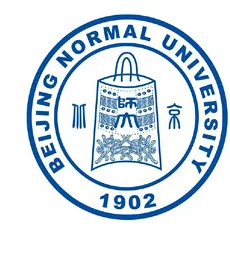
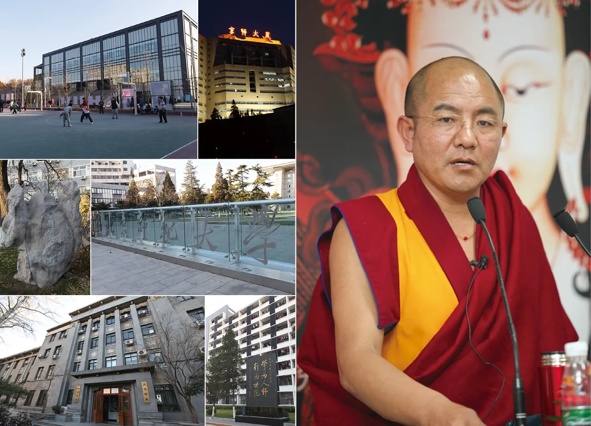
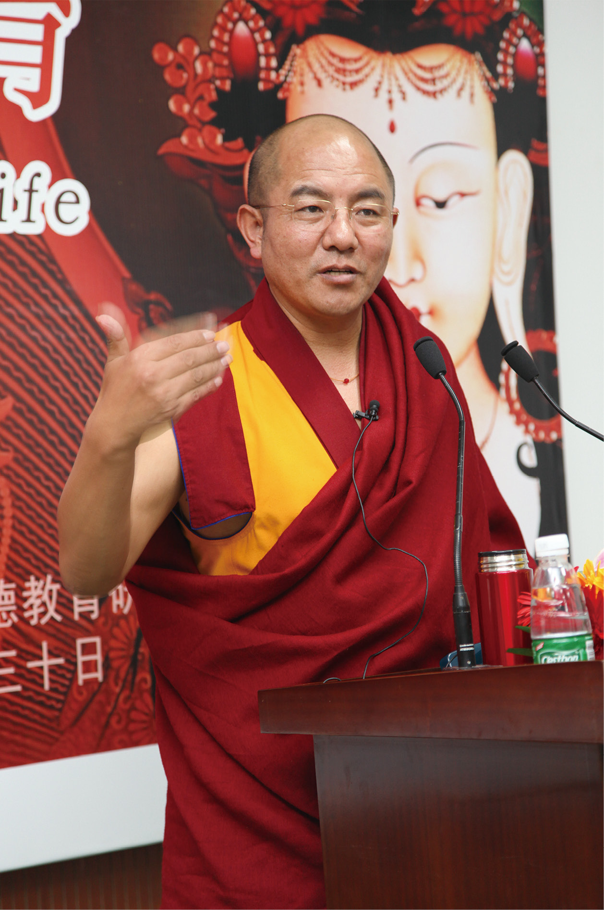
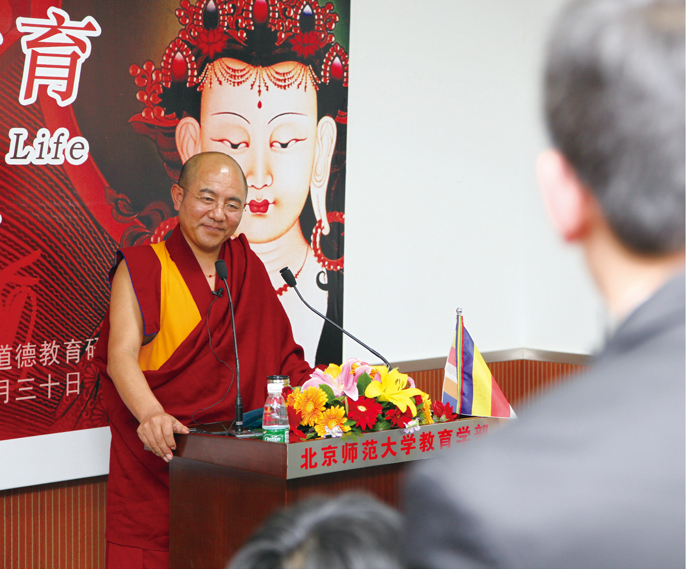

“金钱要布施，

爱情要奉献，

名声要服务于众生，

这样才会终生快乐。”

第24场

北京师范大学

Beijing Normal University

中国·北京

2011 / 11 / 30

## 佛教的人生教育

## Buddhism: The Life Education

檀传宝教授：

各位晚上好！今天非常荣幸地邀请到佛教界非常有名望的高僧——索达吉堪布。

堪布在佛教上有极高的造诣，曾前往欧美、东南亚多国弘法，近几年又应邀到北大、清华、人大等国内很多著名高校讲学。今天来北师大是第一次，我们对此深感荣幸。下面掌声有请堪布——

这是我第一次来北师大，心里非常高兴。今天跟大家一起做个简单交流，讲讲“佛教的人生教育”。

这个题目，好像是学校这边定的。我到大学里跟大家交流，题目有时候是校方定，有时候是自己定。说实话，我今天没怎么去思维这个题目，刚才在路上还在想：“到底要讲些什么呢？”但不管怎么样，自己在这方面还是有一点心得，利用这个时间，跟大家谈谈也未尝不可。

## 一、要有一颗感恩心

人生中最关键的是什么？我认为，首先是要有一颗感恩心。

我们现在拥有的学识和智慧，都源于自己的老师，因此，不管在求学阶段，还是从学校毕业之后，何时何地都要记得老师的恩德。

刚才与檀教授交谈时，他也讲了自己和老师的故事，我听了之后很感动。从教育界来说，一个人如果对老师有感恩之情，那么他所学的知识，对自己的人生会真正起到作用。从我们佛教界来讲，历代很多高僧大德，一提起上师的名字，就会流露出无法言表的感激之情，甚至泪流满面，这也是源于一种感恩。

不过，现在这个社会，很多人把老师当成学习知识的一种工具。依靠老师获得了知识后便远走高飞，从此就再也不联系了，对老师根本不关心、不过问。更有甚者，老师到晚年遇到一些困难时，自己明明有能力，却也不愿伸出援手，这就是没有感恩的表现。

感恩的对境，除了老师，还应该有父母。当我们刚来到这个世界时，不会说话，不会走路，连吃饭都要人喂。而依靠父母的长期呵护，我们才得以长大成人，所以，对父母的恩德也一定不能忘。

父母对孩子的付出，是非常难以想象的。为了孩子，他们付出了所有的青春，倾注了大量的心力、财力。即使儿女已成家立业，父母仍然放心不下。就拿我来说，父亲早已去世，母亲现在都80岁了，但还是每天牵挂着我。前段时间，我去了香港7天，母亲天天给我打不通电话，就特别特别挂念。我想天下父母对儿女都是如此，哪怕自己到了垂暮之年，也念念不忘自己的子女，一直惦记着。

但遗憾的是，如今很多子女，有了各方面的能力以后，总是以忙为借口，对父母不闻不问、置之不理，甚至一个月也不打一次电话。有些父母年纪大了，身体不好、行动不便，生活上特别可怜，子女也只是请个保姆照料他们，自己根本不把他们放在心上，这都是忘恩负义的表现。

所以，作为一个人，不能忘记父母的恩德，以及老师的恩德。在此基础上，按照大乘佛教的教义，还不能忘记众生的恩德，要关爱所有的生命。

总之，不管是什么身份的人，都应该有一颗感恩心。这一点，可能许多人没有兴趣听。因为这个社会非常现实、非常功利，能带来眼前利益的知识，像赚钱的手段、享乐的方法，人们都兴致勃勃，愿意去了解、去学习；而一谈到精神追求，尤其是伦理道德、宗教信仰，大多数人都兴趣索然，甚至嗤之以鼻。

其实，科技再发达、社会再进步，你们学习上再聪明，基本的做人也不能忘。否则，一旦失去了这些，今后在社会中生存，必定会举步维艰。

现在许多大学生，不缺知识、不缺技术、不缺文凭，尤其是像北师大这样的高等学府，这方面应该都圆满具足。然而，许多人最缺的是什么呢？就是道德教育，是正确的信仰。

大家都清楚，如今的小学、中学、大学，安排了大量课程，需要学习许多课本，可是学生们从中得到的知识，以后工作时真正能用上的，可能不到20%。当然，我并不是说学校不好、教材不好，而是说，学校除了传授知识和技能以外，更重要的是，还应该训练学生如何为人处事、待人接物。

毕竟他们毕业了以后，首先要面对的，就是如何与人交往，怎样对待上级、平级、下级，以什么样的态度投入工作……诸如此类的基本问题，假如上学时从来没有学过，那即使是名校毕业的硕士生、博士生，身上也常会发生令人意想不到的事情。

不仅世间需要人格教育，其实从佛教的层面来讲，若想成佛，也要先学会做人。“人”都没有做好的话，“佛”是根本谈不上的。因此，假如不懂怎么做人，无论身处哪一个领域中，都是相当困难的。

你们北师大，跟全国的教育有着密切关系，这里的许多老师，也经常参与编教材的工作和会议。如今各个学校使用的教材，从小学到大学，乃至博士生的课程，基本上我都看过。里面相当一部分知识非常珍贵，对培养人才的作用，是毋庸置疑的。不过，人格教育方面的内容，可能还是有所欠缺，今后若能增加一些，那就最好不过了。

我始终认为，人格教育不论对学生还是老师，都非常有意义。这次我去香港大学、香港科技大学等高校演讲，发现他们的教育方式，特别值得内地借鉴。这些学校的任何一个部门，对各大宗教都不排斥，他们普遍有种理念，认为有信仰的学生比较可靠，不论信佛教或是其他宗教，一个人只要有了信仰，内心至少会有所约束，不敢随心所欲、为所欲为。这一点是令人值得深思的。

## 二、佛教与现代教育不相违

### 1．皈依是不是一种迷信？

今天讲的主题，是“佛教的人生教育”。或许有人会问：“佛教跟学校教育的理念和方向，会不会背道而驰、完全相反？”

实际上绝对不会。这个问题，我也思考过很长时间。就拿佛教的皈依来说，皈依是皈依三宝——佛、法、僧，这是佛教的基本行为，也是佛教徒的入门标志。一个皈依了的人，不论是老师、学生，会不会就成了一种迷信？皈依对他会不会有什么损害呢？肯定不会。对此，我们可以分析一下。

一、皈依佛：所谓的佛，假如在世界上根本不存在，只是人们在脑海中虚构的，那皈依他肯定不合理。但事实上，2500多年前，释迦牟尼佛在当时的印度，即现在尼泊尔的蓝毗尼花园中，确确实实降生过。这个遗址，1997年还被联合国教科文组织列为“世界文化遗产”，也就是说，全世界对此是共同承认的。

佛陀降生以后成为王子，后舍弃王位出家，苦行六年，在印度金刚座成佛，之后到鹿野苑初转法轮，一生中传法49年，开演了八万四千法门，并于81岁示现涅槃，这是非常公认的一段历史。就像是老子、孔子等历史人物一样，释迦牟尼佛在往昔，也曾实实在在地出现过。而且，他所宣说的佛法，至今仍然保存完好。

其实“佛”是梵语，意为觉悟者。我们不管是什么人，从事什么工作，都需要一种觉悟。皈依佛的意思，就是要依止觉悟者，如同世间人依止老师一样。所以，皈依佛，跟我们的日常理念并不相违。

二、皈依法：法，指佛陀所揭示的真理，可以让人们离苦得乐。这种真理以文字形式存在，叫经律论三藏；若在人的内心现前，就叫戒定慧三学。

我们有了戒，才能生定；有了定，才能生慧。若想获得觉悟，这三者是任何人都不可缺少的。

那么，“戒”是什么呢？通俗地说，就是行为规范，用来规范人的言行举止。有些人一听到“戒”，就有点害怕，觉得佛教的条条框框特别多。其实不仅仅是佛教，就算是小学、中学、大学，学生们要守的校规也不少，乃至任何一个正规的团体，都有必须遵守的许多纪律。

其次是“定”。做任何一件事，如果心不稳定，一直处于浮躁、散乱的状态中，那什么都做不成。包括老师传授知识、学生搞课题研究，心也都需要安定下来。

最后是“慧”。有了行为规范，心也定了，才能产生取舍的智慧。否则，不知取舍、不会辨别，所作所为就是颠倒的。

所以，佛法的戒定慧三学，涵摄了人类的智慧精华。佛陀证悟并宣说了这样的真理，故而被称为觉悟者。

这一点，并非因为我是佛教徒，就在这里自卖自夸，许多著名的科学家、哲学家，对此也是异口同声承认的。比如，爱因斯坦说过：“任何宗教如果有可以和现代科学共依共存的，那就是佛教。”德国著名的哲学家尼采也说：“佛教是历史上唯一真正实证的宗教。”既然他们都承认佛陀是觉悟者，佛陀的智慧也经得起长期推敲，那如果把信佛当成迷信，与民间的鬼神之说混为一谈，这就大错特错了。

三、皈依僧：僧，是追随佛陀足迹，修学真理、追求觉悟的人。如果想获得觉悟，在这个过程中，必须依止这样的同行助伴。

可见，皈依佛、法、僧这三者，无论从逻辑上论证，还是从道理上分析，都是可以接受的。一个人如果皈依三宝、信仰三宝，对自己绝不会有任何损害。

### 2．十善是不是一种教条？

除了三皈依以外，佛教中还提倡十善，也就是要行持十种善业，断除十种不善业，以此规范人们的行为。

十不善业包括：身体的三种不善业，杀生、偷盗、邪淫；语言的四种不善业，妄语、粗语、离间语、绮语；意识的三种不善业，贪心、嗔心、邪见。断除了这十不善业，即是十善业。

这些要求，实际上适合每一个人。大家也可以想想，普通人需不需要行持十善，断除十种不善？肯定需要。所以，佛教徒应当遵守的，非佛教徒也不例外，只有这样，才算是一个合格的人。

下面对十善进行具体分析：

#### 1）身体的三种善业

一、不杀生：在这个世界上，不杀生的根本是不杀人，这是任何国家都要奉行的法律。

不过，现在的法律规定，不能杀害已出生的人，而杀害未出生的胎儿，即堕胎，却是允许的。这有点不太合理。为什么人在肚子里可以杀，出生之后就不能杀了呢？这在逻辑上说不过去。但由于没有法律制止，如今中国的堕胎现象非常严重，据官方数字显示，每年记录在案的堕胎手术，就有1300多万例，这个数字相当可怕。

在佛教中，制止一切杀生行为，不仅是杀人、堕胎，乃至剥夺动物的生命，也是不允许的。

二、不偷盗：众所周知，偷盗是极其低劣的行为。任何一个有修养的人，对此都会非常排斥。

三、不邪淫：古人说：“万恶淫为首。”若想家庭美满，夫妻双方就要断除邪淫，过清净的生活。

这是佛教对身体方面的三个要求。若能做到这些，且不说别的，至少家庭会更加和睦，社会也会更加和谐。

#### 2）语言的四种善业

一、不妄语：妄语，就是说假话。现在这个社会，到处都充斥着妄语。尤其是一些商品，本来不适合人们使用，但用虚假的语言一打广告，一传十、十传百，大家就信以为真、纷纷解囊，最终损害了无数人的身心健康。

常说妄语的人，就会失去别人的信任，到头来只能害了自己。俗话说：“一朝被蛇咬，十年怕井绳。”毕竟，别人被骗得了一时，也不可能被骗一世，假如你经常喜欢骗人，今后在哪儿都会很难立足。

二、不粗语：指不能恶口骂人。一个家庭或集体中，如果整天互相骂脏话，动不动就恶言相向，那身处其中的人就会特别痛苦。所以，断除粗语，尽量说柔和语，对自他来说也是一种享受。

三、不离间语：指不能挑拨离间、搬弄是非。现在人与人之间、单位与单位之间、部门与部门之间的很多矛盾，都是离间语造成的。由此，它的危害性确实可见一斑。

四、不绮语：绮语指没有意义的无稽之谈。如今网络上、电视上的很多语言，对人生没有点滴利益，讲这些完全是在浪费时间。尤其是一些流行歌曲，唱的全部是绮语，只会让人心越来越散乱、越来越迷失。

然而，许多人没有发现这一点，看到一个歌星唱歌，就像发疯了一样扑上去。其实，什么理由让你如此欢喜？是歌词充满了哲理，还是声音充满了智慧？这些都不一定具足。但有些人就非常肤浅，拼命地盲目崇拜，只要能刺激感官，就开始疯狂，根本不需要什么理由。

以上语言的不善业，佛教中都要求断除。如此对人们会不会有利益呢？大家也可以分析一下。

#### 3）意识的三种善业

一、断除嗔心：嗔心大的人，谁都不愿意接近。不论你是什么人，如果总爱发脾气，即使在其他方面非常有才，别人对你的评价也会大打折扣。倘若是一个出家人，经常生嗔心的话，修行也好不到哪儿去。且不说产生一刹那的嗔心，就能摧毁无量劫功德，单单从世间角度而言，脾气不好的人，大家也特别害怕，甚至跟他说话，都要看他的脸色，生怕一不小心就触怒他。这样的人无论待在哪个团体中，都不会招人喜欢。

二、断除贪心：贪心，就是贪人、贪财物、贪名声、贪地位等。现在人们的贪心特别重，该有的、不该有的，都想统统据为己有。随着物质水平的不断提高，很多人的欲望却有增无减，永远没有满足感。他们有一套房子，还想买别墅，在中国有房子还不够，还想在加拿大买一套，在澳洲也买一套……贪心的坑始终都填不满。

三、断除邪见：邪见就是对真理有一种排斥或偏见。比如，善有善报、恶有恶报的因果规律，本来是客观存在的，人们却不相信；上有天堂、下有地狱，本来是非常甚深的道理，许多人却嗤之以鼻。

最近，我看了西方科学家的一些研究资料，他们有许多依据可以证明天堂地狱、前世后世存在。但现在很多人却以种种原因，对自己的前世后世，要么持怀疑态度；要么根本不承认，一味地排斥；要么半信半疑，虽然有点相信，但却从不关心……这些见解都叫做邪见。这种邪见蔓延于整个世界，是非常可怕的。

所以，断除十不善、行持十善业，不单单是佛教的行为规范，也是每个人需要遵循的准则。有了它，对自己、对社会都会有莫大的助益。

## 三、两种与人生密切相关的佛教思想

### 1．前后世真的不存在吗？

我曾与很多老师、学生交流，也学到了不少知识，他们对社会问题的关心，对自然科学和社会科学的了解，远远超过我们这些出家人。但他们对待出世间真理的一些态度，却常常让我的遗憾之情油然而生。为什么呢？因为人明明存在前世后世，许多人却根本不信，包括一些佛教徒，口头上虽然不说前后世不存在，但他们的所作所为，只是为了今生而忙碌，考虑来世的可以说如凤毛麟角。

看到这些现象，我经常想：人类到底是有智慧，还是没有智慧？未来的岁月如此漫长，他们却不做一点准备，把毕生精力都花在转眼即逝的今生上，忙忙碌碌地不停追逐，实在可惜！

当然，追求一些财富、名声，对有些人来说，可能也是生活所迫，身不由己。但你想过没有：更需要关心的来世，到底怎么办？

还有一部分人，对来世存在比较关心，但他们的关心，也仅仅停留在研究的层面上，真正去修行的，恐怕寥寥无几。尤其是现在的科学家，对佛教的一些理论，虽然比较承认，但也只是承认而已，自己从来没有为此做过任何准备。像爱因斯坦，从他的很多文章来看，他对佛教的空性观，绝对会认可，但在他的生命中，却从来没有修过空性，对生死没有丝毫把握，这也是相当遗憾的！

### 2．空性思想与量子力学的碰撞

佛教不仅在伦理上是当今所需，其实在科学上，它也毫不输人。

尤其是当今的量子力学，完全可以解释佛教的超胜。虽然在这方面，我研究得不是很透彻，但对佛教与科学之间的关系，还是多多少少作过一点了解。

前不久我在香港交流时，有人就提问“色不异空，空不异色”的道理不好懂。于是我用量子力学的道理，给他解释说：“任何一种物质的组成，物理学家认为，可以从分子抉择到原子，再到质子、中子、夸克、亚夸克……最后的结论是一种细微的能量。这种能量是万法的作者，它遍及每一个法，跟佛教中的空性比较接近。所以，《心经》中的‘色不异空，空不异色’，也可以解释为‘色不异能量，能量不异色’。”

这种推理，物理学家应该也不能否认。佛陀早在2500多年前就揭示的道理，到了20世纪，成为量子力学的惊人发现，这不正说明了佛陀智慧的超胜吗？你们在座的，有些是佛教徒，有些不是，但是什么身份都不要紧，今天在这里我们不是只讲佛教，也可以共同探讨科学。

当然，佛陀所讲的“空”，千万不能理解成什么都不存在，如碗里没有东西一样空荡荡。其实，万法的本体虽然是空，但仍有一种不可思议的显现，这就称之为缘起性空。

如同数学里的“0”，我们不能认为它不起丝毫作用。任何一个数字，加上“0”或减去“0”，没有任何变化，但乘以“0”，却会变成0；在数字后加几个“0”，马上就会身价倍增。所以，这是数学中的一个奥秘，而空性的作用也可以同样理解。

## 四、学佛可明白幸福之因

现在很多年轻人，如果能懂一些佛教的基本道理，不说对来世，仅仅是自己的今生，实际上也会受益匪浅。

有些大学生，刚进入大学时，对未来充满了憧憬，认为人生会幸福快乐。可是步入社会以后，现实与理想之间一旦出现差距，内心的落差就无法填补，于是开始选择跳楼自杀。现在这种现象也越来越多，而相关部门往往是在悲剧出现后，才开始找措施、下文件，出一件事情，下一个文件……其实，如果能提前意识到这些问题，并有针对性地进行人生教育，才是最好的解决之道。

比如，应当让青少年尽早知道，这个世界并不完美，痛苦占绝大多数，对此事先要有心理准备，明白自己的学业、事业、爱情等，不可能百分之百顺利。有了这样的观念，当他们走弯路时才有承受能力。否则，一遇到挫折就对自己失望，进而绝望，正如叔本华所说：“对生的恐惧，超过了对死的恐惧，那肯定会选择自杀。”这样就非常不值了。所以，人生在世，一定要有面对痛苦的能力。

从前，汉地有位无德禅师，有一天，他面前来了三位信徒，他们为各自的事烦恼不已，不知如何才能使自己快乐。

禅师首先问他们：“你们为了什么而活着？”

第一个信徒说：“因为我不想死。”

第二个信徒说：“因为我想年老时儿孙满堂。”

第三个信徒说：“因为我有妻子儿女。”

禅师听后，说：“你们都不会快乐的。”

三个信徒齐声问：“那我们怎样才能快乐？”

禅师反问：“你们认为得到什么才会快乐？”

第一个信徒说：“我认为有了金钱就会快乐。”

第二个信徒说：“有了爱情就会快乐。”

第三个信徒说：“有了名声就会快乐。”

禅师答：“有这样的想法，你们永远都不会快乐。而且，有了金钱、爱情、名声之后，烦恼还会接踵而至。”

三人又问：“那我们该怎么办呢？”

禅师说：“你们先要改变观念：金钱要布施，爱情要奉献，名声要服务于众生，这样才会终生快乐。”

三人听后恍然大悟，并认识到了快乐的真正来源。

同样，你们每个人也在追求自己的快乐，但快乐的根本因不在外境，而在于自己的内心。尽管外在的钱财、名声、地位、爱人等，对你的幸福也能起一些作用，但它只是一种外缘，并不是决定因素。为什么呢？因为你的心如果很快乐，没有钱财、名声等也会甘之如饴；反之，你的心若不快乐，那外在的一切就算样样具足，也仍会感到非常苦恼。

现在很多人误以为有了钱就肯定幸福，于是拼命地追逐，一直想发财、发财。结果就算你发了财，但真的幸福吗？刚开始两三天也许稍微有点感觉，但久了以后，只有层出不穷的烦恼，不一定有轻松和自在。同样，感情、地位等给你带来的快乐，也是如此。

## 五、四法印揭示了人生真相

因此，我建议大家学习一下四法印的道理，以此了解人生的真相，明白该如何去面对人生。

四法印是什么呢？

第一，有漏皆苦：正如刚才所说，在整个世间，无论是外在世界，还是人类社会，痛苦都占大多数，偶尔有一些快乐，也是不稳定的。

听说你们大学生最关心的有两个问题：一是找份好工作，二是找个好对象。除此之外，再也没有更高的追求了。很多人以为有了这两个因素，人生就会充满快乐。但实际上也不一定，无论是工作还是家庭，都是有漏法，离不开痛苦的本性。而且，如果一个人的性格比较孤僻，道德理念比较差，那就算有了好工作、好对象，也不一定能获得快乐。

第二，诸行无常：世间的万事万物，如地位、财富、名声、青春等，全部是无常变化的。这是无可争辩的一个事实，也是非常重要的一种理念。

这一点，不仅仅是了知就够了，还要经常修行。许多科学家、文学家，口头上会说“一切无常”，但他们从来也没有修过，故而一旦无常现前，自己根本没办法面对。像牛顿、爱因斯坦、伽利略，他们死时是怎么样的？跟普通人一模一样。而佛教中的修行人，纵然没有很高的学问，但由于生前修过无常，一旦得了绝症，接到医院的病危通知，自己也能坦然面对，知道该如何面对死亡。这就是修行与学问之间的差别。

其实，假如你认识到了万法无常，且不说别的，就算在人生旅途中遇到一些悲欢离合，也会想得开：“一切都是无常的，一切都在变化，缘聚缘散，这是正常现象。”所以，通达诸行无常，对每个人来讲非常重要。

第三，诸法无我：通常而言，每个人都是以自我为中心。尤其是现在很多学生，特别特别自私，除了自己以外，根本不关心同学，不关心老师，不关心家人，不关心社会，可以说是“天上天下，唯我独尊”。有了这种心态，未来等待自己的，可能除了痛苦还是痛苦。而只有懂得了“我”不存在，才会明白生命的意义所在。

你们北师大在全国来讲，学风是比较好的。我认识一个人是这里毕业的，我曾问她：“北师大留给你的最深印象是什么？”她回答：“很多女同学不爱打扮，比较淳朴，比较诚实。”这种学风确实值得赞叹。

我以前也读过一个小地方的师范，不过没读完就跑去出家了。我们那个学校，让我最痛苦的是什么？就是每个礼拜换一次衣服。班里有钱的同学，不知道他有多少套衣服，只知道洗一次就换一次。而我是从偏僻牧区来的，换来换去也只有两套，衣服上还缀满了补丁，同学们因此就看不起我，经常嘲笑我。

当时我的汉语也不太好。记得刚上师范时，一次在班会上，老师点到谁的名字，就让他站起来发言。我坐在大家的中间，听到点我的名字，就信心十足地站起来，用自己最标准的“普通话”讲了一通。结果老师听后愣了半天，皱着眉头说：“你不要讲牧区的藏语，用汉语再讲一遍。”（众笑）

你们现在各方面的条件，应该是很好的，跟我当时比起来，确实有天壤之别。这个时候，希望大家不要把时间、精力都用在吃喝玩乐上，而应当用来追求学问，探索像“诸法无我”这样的甚深道理。

有人可能会问：“既然诸法无我，‘我’是没有的，那么谁上天堂、谁下地狱？”其实这是非常简单的问题。刚才也讲了，“色不异能量，能量不异色”。拿我面前的这张桌子来说，桌子就是能量，能量就是桌子，你不可能说：“桌子如果是能量，上面怎么放杯子啊？”这种说法，就已经混淆了现相和实相的概念。

要知道，所谓的空性，是从胜义实相来讲的，而并不是说在现相中，也什么都不存在。就像在物理学中，从现相上，这张桌子是存在的，而在实相中，除了能量以外，什么也得不到。所以，佛教所说的哪些地方空，哪些地方不空，这个一定要分清楚。

第四，涅槃寂静：通过抉择万法的本质，证悟了万法皆空，真正通达“我”不存在，这样的境界就叫涅槃，它是最彻底的快乐。

这种快乐，并不是像你买了一栋房子，第一天兴奋得不得了，过了两三年就没感觉了；也不是像你买了一辆好车，刚开始特别满足，过不久就没有新鲜感了；或者住在五星级宾馆里，刚进去时，“哇，好舒服”，但过了几天就习以为常了。世间有漏法所带来的快乐，都是短暂的，不具有稳固性，暂时你可能有一些感觉，但时间长了就没有了，甚至还可能变成痛苦。

明白以上这些道理，对每个人来讲至关重要。所以，我经常想：现在的学校教育中，应该让大家学一些佛教的知识。当然，这并不需要以皈依为前提，不是一学佛就要成为佛教徒、出家人。但是，既然你们都追求真理，就应该以广阔的胸怀，看看佛教是否揭示了人生真相。如果它明明讲得很有道理，你却不承认，甚至一概排斥，那就不是智者的正确态度了。

## 六、为人师表，传播真理

在座的各位同学，无论是现在自己学习，还是以后教育学生，都应该让自他成为有道德、有修养的人，而不要经过十几年的教育，培养出来一个个自私自利、冷漠无情，只关心自己、不顾周围的人。

像前不久发生的“小悦悦事件”，虽然不能说明如今所有的人都是如此，但也从一个侧面反映了当代人的整体素质和道德修养。所谓的修养，除了佛教中讲了很多以外，其实《论语》《弟子规》等儒家思想中也有不少。对于这些道理，大家不但要明白，还要慢慢去串习，让它变成自己内心的一部分。

一个国家，若想成为真正的强国，弘扬自己的传统文化必不可少。前几天有一则新闻说：中国政府给印度的那烂陀寺捐了一百万美金。为什么呢？因为那烂陀寺是5世纪到12世纪之间的佛教文化中心，也是世界上最早的大学之一。当年唐玄奘也曾在那里“留学”，之后把佛教的真理带回中国，为人类文明做出了不可磨灭的贡献。我们藏传佛教的许多传承祖师，也是从那烂陀寺来的，或者在那里修学过。鉴于那烂陀寺在历史上的重要地位，从2007年开始，印度政府准备把它修复起来，并配备一些现代化的教学方式，以及佛教的相关课程。

同样，中国是儒家思想的发源地，却因为受到“文革”的影响，把自己的传统文化扔掉了。这样的话，受害者是谁呢？就是你们这一代人。因此，希望大家能发挥自己的力量，在力所能及的范围内，拯救传统文化，弘扬有价值的真理，若能如此，也算是报答了老师的恩德。你们的老师，日日夜夜、辛辛苦苦地教书，目的是什么？一方面，当然是自己的一种责任，另一方面，也是希望你们以后能为社会、为人类做出一分贡献。

总之，佛教的教育，是一种善的教育、一种真理的教育。我自己多年来，投入大量时间研究后发现，佛教对现在的年轻人来说，确实不可缺少。而且，若能通过佛教的引导，做任何一件事，不是只为了自己，还想去利益他人，这才是当今社会最需要的，也是非常崇高的一种境界！

现场互动

问：我是教育学原理专业的学生。您说最喜欢做的有两件事，一是看书，一是以自己微薄的力量，尽量帮助有缘的人。请问，什么样的人算是有缘人？和有缘人相对的，是不是无缘之人，对于他们，我们应该怎么样帮助？

堪布：有缘和无缘，是相对而言的，每个人都可能是有缘之人。

判断有缘和无缘的关键是，自己的言行能否让对方获得利益。比如说，我今天的演讲，虽然可能讲得不好，但如果对某个人的智慧增长，能起一点助缘的作用，那么他就是有缘人。

而有些人，虽然知道有这个讲座，却没有来参加；或者，虽然来参加了，但对我说的内容不感兴趣。那么，尽管我心里想帮助他，但实际上他并没有得到利益，因此是无缘之人。

如果我们想帮助他人，就应该发一颗好心、发一颗广大的心，只要是众生，都应作为自己帮助的对象。当然，假如自己已经努力了，但由于因缘不成熟，对他人起不到作用，那么自己也应该随缘，没有必要痛苦。

问：是什么原因促使您皈依佛门的？又是什么契机让您选择出家的？

堪布：藏族的传统跟汉族不太相同，我们藏族基本上是全民信佛，而且每个人从小就学佛、念佛。藏族有一种说法：“孩子会叫妈妈的时候，就会念观音心咒——嗡玛呢巴美吽了。”这不仅是一个说法，实际情况也是如此。所以，对我来说，不存在“为什么会皈依佛门”的问题。

读中学的时候，我对佛法的信心越来越大，并生起了出家的念头，但没有成功。读师范的第一年，我也想出家，还是没成功。后来在读师范学校的最后一年，终于出家成功。

问：我是道德教育方向的学生。请问，您是怎样面对孤独的？很多人都会面临这个问题，在这方面，您对大家有什么建议？

堪布：有这样一个说法：“孤独，是一种寂静；沉默，是一种禅定。”

到目前为止，我好像没有感受过所谓的孤独。世人认为的孤独，对修行人来说，其实是一种寂静的快乐。就像长年累月在山洞闭关的修行人，他会不会因此而寂寞呢？肯定不会。

我家乡有一个出家人，在拉萨附近的山洞里闭关了十二年。前不久他回来了一趟，我问他：“你在十二年中，天天都坐在山洞里，连太阳光都照不到，会不会寂寞，会不会痛苦呢？”他说：“没有啊，在山洞闭关的快乐，简直无法言表！反而来红尘一趟，我特别不习惯，马上就想回去。”

因此，世间上很多的单一状态，在常人看来，是一种孤独和伤感，但如果自己没有这样的执著，并乐在其中，那就不会是一种痛苦。就像天上的月亮，也只有一个，但它发出的光却那么美，能照亮大地、开启莲花，给很多人带来快乐。

问：我是教学部的老师。佛教能安顿我们的心灵，给世界带来祥和，但我们也可以看到，现在佛教兴盛的地方，比如泰国、尼泊尔、印度以及西藏，经济都不太发达。而世界上的发达国家，佛教并不是很兴盛。

现在有种说法是，个人幸福指数=拥有÷欲望。也就是说，要提高幸福指数，有两个途径：一是发展经济，让人们拥有得更多，西方走的就是这条路；另一个途径就是节制欲望，也就是佛教所提倡的。

我的困惑是，这两种方式如何圆融？如果选择节制欲望，那么，还承不承认经济发展对人类幸福的贡献？

堪布：经济发展对人类的幸福，是有积极作用的。但佛教对幸福的定义，并不完全跟财富画等号。

我也承认，现在佛教比较兴盛的地方，不论是泰国，还是西藏，经济方面都不是特别富裕。这个原因，可以从两方面来分析：

一方面，从因果规律来说，今生信仰佛法、造下善业，并不是马上就能成熟果报的，有些善业要等来世才会成熟。因此，这些地方现在比较贫穷，可能是人们昔日没造过财富圆满的善业。

另一方面，经济发达、拥有财富，并不等于人们非常幸福。就拿中国来说，经济上取得了突破性的发展，但人们的幸福指数，却比十年前降低了很多。所以，人们的幸福，并不与拥有的财富成正比。

佛教的财富观是，既不主张过于贫穷，以至于生活都没办法维持；也不赞叹过于奢侈，完全沉溺于物质享受。而是选择一个中道，一方面要能维持基本生活，另一方面，也不盲目地追求财富。在这种状态下，幸福才最容易获得。

问：我是教育法学专业的博士研究生。佛教提倡修身养性，提高道德修养，从而自觉规范自己的行为。而法律，则是通过一种外在的强制力，来规范人们的行为，非常强调惩罚。在我看来，不管是佛教，还是法律，大家都有一个共同的目标，就是让世界没有犯罪，从而更加和谐。而在这方面，法律似乎显得有些力不从心，比如制定的法律越来越多后，却发现，法律的漏洞也越来越多，人们的不良行为频频出现。

所以，我想问您：佛教在和法律共同合作，使社会更加和谐方面，应该起什么样的作用？

堪布：佛教主要强调自净其意，也就是调伏内心。关于如何调伏内心，有一个很好的比喻：比如，为了保护自己的脚，在大地上行走时不被荆棘等伤害，而把整个大地全部铺上皮革，这肯定是不现实的。最好的方法是什么？是用小小的一片皮革做成鞋垫，这样一切问题就解决了，你穿着鞋子到处去，脚也肯定安全，不会被东西刺伤，这就相当于覆盖了整个大地。同样的道理，如果人们的内心有所约束，行为自然得到规范，很多不如法行为也就渐渐消失了。

所以，假如每个人内在的修养有所提高，那么，法律在规范行为方面的压力，自然就会减轻。

像我所在的佛学院，大概有六七千人，但附近的派出所在维护治安方面，基本上没什么事可做，因为大家都是佛教徒。试想，倘若是一个六七千人的非佛教群体，可能经常有各种违法行为，而民警们，则是白天晚上都拿着电棒，维持治安。我有时候跟派出所的负责人开玩笑说：“佛学院里全是佛教徒，所以你们经常没事干；这些不是佛教徒的话，你们可能天天都得加班，晚上也需要上夜班。”

所以，一个社会若认识到了道德的重要性，并且人们的修养很高，那么，即使没有很多法律，人们的行为也会如法。就像治病一样，病根已经祛除了，其他症状自然不会构成威胁。

当然，这也并不是说，法律就完全没有作用了。对于一些刚强难化的野蛮众生，在某些时候，还是要用法律来制裁。佛教的教言中也有这样的要求。

问：我是教育政策与教育法学专业的博士生。您是我见过的，唯一一位学院派的佛学者，或者说是学者型的法师，不知这样称呼对不对？

因为我老家是安徽农村，那里也有很多人信佛，但在他们的信念和语言中，超越性的事物特别多，比如鬼神等。我对这些并不相信，因为依靠我有限的认知结构，觉得这些无法成立。而您讲的很多道理，包括人生信条与道德修养等，我是很赞同的。

因此我想问您：超越性的事物，占佛教思想的多大部分？这些事物为什么在你们的理解能力范围内，是可以成立的？

堪布：其实我也不算是学者型的法师，更不愿意成为一名只是研究理论的学者。因为很多研究佛教的学者，分别念比较重，对佛教的很多理论和实践，经常这里看不惯、那里看不惯，而且，他们所作的很多评论，都是不正确的。

学佛必须要有一种体验、一种修行，佛教徒若整天都是夸夸其谈，而不关心修行，这是我不太喜欢的。只不过今天跟你们交流时，用到的全是一些理论、推理。

佛教里讲的超越性事物，包括鬼神，的确是有。现在很多年轻人，因为没有亲眼见到，就一概不承认。其实暂时你不接受也可以，但千万不能说，看不见的东西就不存在。以前一些美国总统，如林肯、里根，他们身边的人也不承认鬼神，但后来这些真在白宫中出现了，他们也不得不承认。

虽然我刚才说释迦牟尼佛不是神，但在这个世界上，鬼和神确实有。你们在城市里，不一定能感受到，但若到了一些特殊环境中，很可能就有亲身体会。

所以，希望很多年轻人，对于超出自己知识的领域，不要随便就一口否认。像藏地的虹身成就，对很多人来说，也是一种超越性的现象。但有些高僧大德圆寂时，确实身体可以化为光，肉体一点都不剩下。这方面在历史上，包括近代，都有很多的事例。

前段时间，我去法门寺的地宫，朝拜佛指舍利时，也看到一些领导见舍利发光的照片。因此，超越性的事物，虽然超出了一般人的认知范围，但事实上，它的存在是无法否认的。

问：您说人生中痛苦占多数，快乐是短暂的。我虽然才二十几岁，但已深刻地体会到了这一点，因此很赞同您的观点。

不过，我有个疑惑是：痛苦是欲望太多导致的，但如果要禁欲，则会带来新的痛苦。比如，佛教主张吃素，但让我不吃肉的话，我会感到痛苦；如果不让我结婚，我肯定也很痛苦。因此，为了消除痛苦，就要减少欲望，但减少欲望本身又带来了新的痛苦，这个矛盾怎么解决？

堪布：吃素或者持戒，如果对你来说非常痛苦、难以做到，佛教也并不会强迫你必须做，而是可以根据每个人的根基，循序渐进地进行。

比如，佛教中的居士五戒，你可以只受一条，也可以受两条、三条、四条，或者五条全部受持。在五戒都能做到的情况下，假如因缘具足，还可以受更高层次的戒律，比如八关斋戒、菩萨戒等。并不是你自己不想受戒，非要让你受；或者自己根本做不到的事，非要让你做，没有这样的要求。因此，佛教的戒律和修行，是根据各人的根基来选择的。

但你如果没有受持戒律，行持一些不如法行为，果报也是不虚的。因此，即使没有受戒，对于伤害众生、危害社会的行为，还是要尽量制止。

问：我是教育学的学生。有句话说：“小隐隐于林，大隐隐于市。”请问，在家修行、到寺庙修行或闭关，还有就像您这样云游，这几种修行方式，哪种比较适合我们？另外，不同的环境，对于我们的修行，有什么不同的作用和影响？

堪布：每个人的根基和缘分都不相同，因此，什么样的修行方式对自己最适合，也不能一概而论。

其实，我也不是真正的云游。今天上午，我还跟个别佛友说：“很想早点回佛学院去。不然，在城市里待太久了，经常是琐事缠身、杂念纷飞，这对修行人来说不是很好。而在佛学院里，心会比较清净。”所以，我只是偶尔出来“云游”。

不管是云游，还是在寂静处修行，甚至上班也好、在学校学习也好，最重要的是，每个人要经常观察自己的心，反省自己，这就是一种修行。如果修行好一点，吃饭、上班、骑自行车等，无论做什么事，都能观察自己的身体、语言、心态处于什么状态中。因此，有智慧的人，经常反观自己，一日三省。而没有智慧的人，即使是给别人传法，或者做很多善事，但目的可能是自私自利的，根本没有想到社会和众生，这样的话，只是一个表面行为罢了，意义不是很大。

所以，修行最关键的是心，表面的形象并不重要。心善则一切都善；心恶则一切都恶。

问：我是教育学原理专业的学生。请问，释迦牟尼佛的人生，是什么样的人生？他的生活为什么快乐？您刚才讲“诸行无常，诸法无我”，既然世间的快乐都是短暂的，为什么单单佛教徒的快乐、成佛的快乐是永恒的？

堪布：释迦牟尼佛出家前是王子，过着非常美满的皇宫生活，也有许多嫔妃，但后来他认识到，每个人都要面对老病死苦，皇宫的生活也会好景不长，应该寻找永恒的快乐，于是舍弃尘世的一切，前往寂静地方修行。通过修行，他获得了大彻大悟，这种境界，可以称之为永恒的大乐。

而世间的快乐，都是无常的，不离行苦的自性，跟在快乐后面的，往往是痛苦。就像我刚才讲的，世间人追求的快乐，在刚开始，可能觉得是一种快乐，但时间长了，就没什么感觉了，甚至会变成痛苦。

当然，并不是每个佛教徒的生活都很快乐。有些人表面上是佛教徒，但实际上并没有将佛法融入自心，这样的话，不一定能调伏烦恼，经常也会流泪、痛苦。

但佛陀的境界，完全是永恒的快乐，为什么呢？因为这种境界净除了所有烦恼障和所知障，一切执著消于法界，现前了色身与法身双运的果位。

当然，没有一些佛教专业知识的人，听了这些不一定能理解。但如果你证悟了这种超胜境界，就能完全远离世俗的执著，根本不会有痛苦。因为所有痛苦都源于我执，都跟“我”有关，人们的苦和泪，归根结底就是执著“我”而产生的。而佛菩萨断除了这种我执，因此，获得了不可思议的无比大乐。

檀传宝教授：

今晚，是一个非常充实、非常圆满的夜晚。

关于佛教，我在很多年前，就听过一位高僧的教诲，他跟堪布讲的一样，说佛教在某种意义上，并不是一种宗教，而是一种教育。尤其从道德层面来讲，佛教提供了非常好的思路和方法，这跟我们日常生活中的道德，有非常契合的地方。

我们研究中心，以及在座的各位，对道德教育之所以热心，我认为有两个原因：第一，道德教育，能让我们的人生因具有德性而充满智慧，进而获得幸福；第二，我们北师大教育学部的老师和同学，对这个国家来讲，可能应该担负起更多利益众生的使命。

所以，今天晚上，不仅是我们个人接受了一次智慧的启迪，同时我相信，堪布的智慧为未来教育学的研究与学习，为未来我们更好地服务于中国教育跟社会发展，也一定是贡献良多。让我们以最真诚的掌声感谢堪布！
