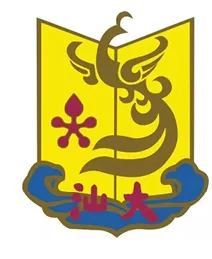
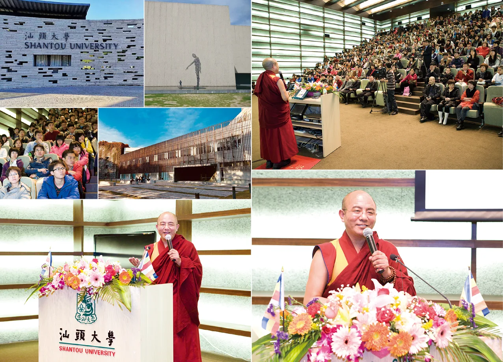
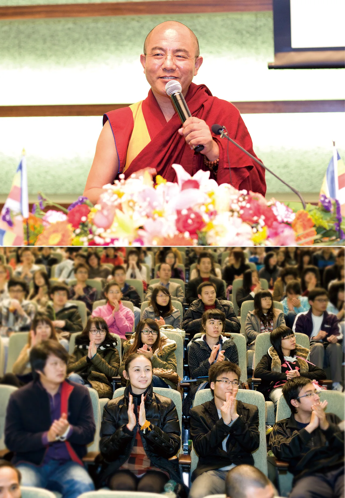
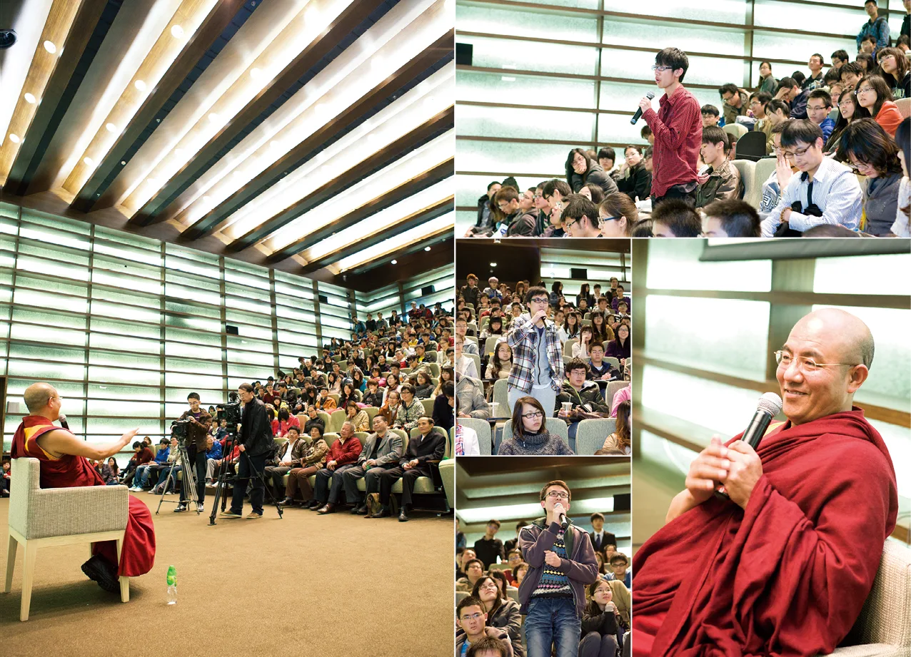

只要心满足了，

哪怕是粗茶淡饭，

也会怡然自得；

若是心不满足，

即便是金玉满堂，

也依然悲戚愁苦。

第28场

汕头大学

Shantou University

中国·汕头

2012 / 3 / 2

## 幸福的根本是心

## Finding the Source of Happiness in Your Heart

主持人：

大家晚上好！欢迎出席今天的“至诚讲坛”。

今天，我们荣幸地邀请到了“上海慈慧公益基金会”名誉理事长、著名慈善理论家和活动家索达吉堪布。堪布学识渊博，对于世间各种问题，都有本着慈善之心的独到见解。早在20世纪90年代，堪布就远赴欧美和东南亚各国，进行佛法的弘扬。近年来，应北大、清华、复旦等高校邀请，他也前往各个高校讲学，与知识分子们探讨佛学的真理。

接下来，有请至诚书院副院长兼党总支书记——陈文滨先生致欢迎辞！

陈文滨院长：

尊敬的索达吉堪布，各位朋友、各位同学，大家晚上好！

汕头大学至诚书院“至诚讲坛”，提倡包容的学习心态，致力于学术和文化交流，通过这种交流，希望同学们开阔视野。

今天，我们邀请到索达吉堪布，这是一个难得的机会。孔子讲过：“弟子入则孝……而亲仁。”也就是说，如果是一个好学的人，就要亲近有仁德者。下面，就让我们亲近这样一位大德——索达吉堪布，让我们聆听他的报告，寻找开启幸福人生的钥匙！

主持人：

佛教蕴含着人世间的真知灼见，尤其大乘佛教致力于成就无量修行、普度一切困厄，将个人修行跟普度众生结合起来，更是至高无上的思想。

当今时代，盲目和贪欲充斥在我们身边，我们不得不面对这样的尴尬——人人都渴望得到幸福，大多数人却不得其法；人人都在追求幸福，却与幸福背道而驰。

今天，我们请到索达吉堪布，就是想以他的眼光看看：什么是幸福？幸福的根本是什么？怎样追求幸福？我相信，堪布在演讲中，一定会给出令大家满意的答案。接下来，让我们用热烈的掌声，欢迎索达吉堪布开示——

尊敬的各位老师和同学：

大家好！很高兴来到汕头大学，跟大家共同学习。

藏族有一句俗话：“说话开头难，办事结尾难。”刚才陈院长致辞时，我还没想好怎么开头，后来，主持人说：“什么是幸福？幸福的根本是什么？怎样追求幸福？”看来，我应该从这几点谈起。

作为出家人，我的思想、行为跟你们不太一样，如果以我的眼光看幸福，和你们的理解也不尽相同。但不管怎么样，我也是一个追求幸福的人，对幸福思考过许久，所以很有兴趣和大家交流这个话题。

## 一、认识幸福

### 1．何为幸福

谈到何为“幸福”，可谓众说纷纭：有人认为，幸福来自金钱；有人认为，幸福源于爱情；还有人认为，幸福在于地位……

而我认为，从佛教的根本观点“万法唯心造”来看，幸福是一种得到满足的心态，也就是说，幸福的根本是心。

### 2．对幸福的误解

世间人每天从早到晚忙碌，唯一希求的就是幸福，但结果得到了什么呢？大多却是不同程度的痛苦。之所以出现这种反差，往往是因为没有认清幸福。

有些人认为，只要满足了暂时的身心需求，这就是幸福。

2009年，英国举行了一次“谁是最幸福的人”的征文比赛，收到全世界一百多万篇来稿，最后，评委选出了四个“最幸福”的人：成功完成一例手术的外科医生；在沙滩垒城堡的儿童；给婴儿洗澡的母亲；与心爱的人走上红地毯的新人。

以世间的眼光看，这四个人都非常幸福，他们也是千挑万选出来的。可是，如果我们深入分析：他们真的幸福吗？答案就不一定了——儿童在海滩玩耍时，沙滩城堡若一下被海浪吞没，他的幸福还在吗？给宝宝洗澡的母亲，如果孩子长大后不孝顺，这难道不痛苦吗？医生这次的手术非常成功，但下次万一失败了呢？跟心爱的人步入婚姻之后，生活会事事尽如人意吗？

佛教中讲万法是无常的，所以，不能过于执著有些事物。如果认为有钱就会幸福，或者结婚就会幸福，那么你也应该想想：自己梦寐以求的这一切，假如失去了该怎么办？这时候，还有幸福可言吗？

还有些人认为，离开了痛苦——比如现在头特别痛，过一会儿不痛了，这也是一种幸福。美国著名盲人女作家海伦·凯勒曾说，假如给她三天光明，她就是最幸福的人。“诺贝尔和平奖”得主南非前总统曼德拉，因反抗种族歧视入狱27年，后来他在《回忆录》里说，坐牢时每天晒半小时太阳，便是最幸福的事。

和曼德拉有类似经历的人，也不在少数。藏地有一位出家人，“文革”前后，他坐了十几年牢。在狱中，每天下午三四点钟，可以分到一碗稀饭、一个馒头，一天的食物仅此而已。据他说，监狱里的人特别盼望这个时刻，每当得到稀饭和馒头时，他们觉得这是最大的幸福。

还有一个藏族学者，和第十世班禅大师是好朋友，他有过18年的狱中生涯。他在一本书中也说，在监狱期间，最大的痛苦是看不见春夏秋冬，只能看到高高的围墙。在漫长的18年里，他每天都对着一堵高墙，所以觉得能越过高墙，看到墙外的蓝天白云、山河大地，这就是幸福。

当然，如果他们的幸福观都成立，对照起来，我们绝大多数人每天都生活在幸福之中。然而事实并非如此——我们的眼睛可以看到蓝天白云，每天也可以晒半小时太阳，但并非人人都能从中体会到幸福。许多人总觉得自己是最不幸福的，终日怨天尤人、牢骚满腹，用一句老话来说，就是“身在福中不知福。”

### 3．抉择正确的幸福观

#### 1）幸福在内，不在外

那么，对大多数人来讲，他们认为的幸福是什么呢？

如今许多人认为，幸福的根本是金钱。但实际上，金钱和幸福有关系吗？是有关系，但并不起决定作用。心理学家认为，金钱对于人的幸福感，所起的作用只占五分之一。

作为普通人，一无所有当然非常痛苦，然而，有了钱，也不一定就幸福，反而可能带来过多的压力。所以，金钱跟幸福并不成正比，否则，有钱人就一定快乐，没钱人就一定痛苦，但现实中却并非如此。

还有人认为，幸福在于住房，这种观点也不尽然。对有些人而言，刚开始有个小房子，就感觉不错；然而一段时间后，便不满足了，开始提升住房条件；过一段时间，又不满足了，想再换一套大房子……到最后，即便有最好的房子，他们也不觉得开心。所以，好的住房并不意味着幸福。

也有人认为，幸福在于所处的环境。大多数中国人认为，住在城市的中心比较幸福，这种心态直接导致城市二环以内的房价特别高。可是在美国，人们并不这么认为，他们觉得住在偏僻的郊区才幸福。因此，如果说幸福在于环境，何以中国人觉得幸福的地方，美国人却觉得不幸福呢？

总之，人们往往认为，达到某个外在的标准，就会获得幸福。但事实上，当达到这些标准时，也不一定真的幸福。所以，我们好好思考就不难发现：幸福无关乎外境，它只是内心的一种状态。

假如不明白这个道理，哪怕拥有了一切，也仍旧不会快乐。因为世间万法都是如此，没得到时，认为得到它会快乐，等真正得到后，也就没什么了。比如，没车的时候，你认为有车会幸福，刚买时你也感觉开心，可是过了两三天，就没有感觉了；没房子的时候，你觉得有房子会幸福，刚搬进新居时也非常快乐，可是过一段时间，也没什么兴奋了；没成家的时候，你觉得结婚会幸福，可是婚后才发现，对方的想法、行为与自己都不合，反而成了痛苦之因。那个时候，你可能又觉得离婚快乐，在离婚协议上签字的那一刻，才是得到了最大的幸福。

所以，现在许多人都没搞明白何为“幸福”。不仅是人类，动物也有这种心态。小时候，我在家乡放牦牛时，经常喜欢观察它们。有些牦牛要求很简单，只要有草吃、有水喝，就满足了。而有些牦牛则不同，它们有许多目标：有的喜欢伴侣，找到了就很高兴；有的公牛喜欢打架，胜利了就得意扬扬……放眼现在有些人的行为，跟它们也有点大同小异。

佛教认为，幸福是一种心态，这个道理其实不难懂。但因为许多人对佛法不了解，之前没在这方面探索过，只是天天看广告、看电视，在各种信息的狂轰滥炸下，自己的心随外境而转，认为买房子多么开心、穿名牌多么快乐，结果离幸福越来越远。

因此，有智慧的人应该反思：在那些琐碎的事物中，怎么可能蕴含着最难得的幸福？我曾看过恩格斯的一句话，他说：“在春光明媚的早晨，坐在花园里读书，嘴里衔着烟斗，阳光温暖了我的背脊，再没有比这更幸福的了。”大家可以想一想：这到底是不是幸福？如果是，那谁做到了这一点，谁就能幸福。但事实上是这样吗？

#### 2）幸福非常，乃无常

世间很多人没有想过无常，他们认为幸福永远不会消失，正在享乐的时候，根本不想几十年后的变化，更不会想到最终的死亡。

表面上看起来，有些人财富、权势样样具足，过得非常惬意。不过，这种局面能否长期维持，就不好说了。1923年，在美国芝加哥的海滨大饭店，举行了一次世界性的金融会议。在出席会议的人当中，有九位是当世最富有的人：全球最大钢铁公司的董事长，全球最大粮食公司的董事长，全球最大煤气公司的董事长……在许多人眼中，他们是世界上最幸福的人。然而26年后，这些“最幸福”的人却成了最可悲的人：一个疯了，两个破产而死，三个自杀，还有三个犯法而死。

## 二、欲求幸福，应当借鉴佛法的智慧

在佛教中，对出生与死亡、今生与来世、心识与外境等一切，有着详尽的分析。大家若能稍微了解一下，对世间真相就会看得非常明白，并能最大程度地避免痛苦、拥有幸福。但可惜的是，现在许多人不仅不了解佛教，甚至还存在各种误解。

我在这里倒不是给佛教打广告，但毕竟有些事实任何人都无法否认，所以我可以大胆地说：“前生后世是存在的，善恶报应是存在的，六道轮回是存在的。”个别人不要认为，这只是佛教的观点。若真是如此，你当然可以不加理会，而实际上，这些是宇宙万法的真相，是人人必须面对的事实。如果没搞明白这些道理，即使你是大名鼎鼎的博士、教授，或者是高高在上的领导、企业家，对于生命的真相照样会存在愚痴。

当然，我也不是要求大家都信佛，信不信看各人的缘分。不过，有些人总是对佛教心存偏见，一听到“佛教”就嗤之以鼻。他们认为，出家人是遇到挫折，在世间混不下去了，才跑到山里出家的。当然，也不排除有这种情况，不过，绝大多数人出家并非如此。在人类的一切行为中，出家可以说是极为高尚的，如果随着时代的发展，人类对这种高尚不屑一顾，那时代是在前进还是后退，恐怕要打个问号。

我建议大家去了解一下佛教，看看释迦牟尼佛开示了什么真理，对哲学、天文学、物理学有怎样的宣说，科学家对此又是如何评价的……假如你对这些一无所知，那说明自己确实需要学习。

话说回来，我们若想寻求幸福，就要知道幸福的根本，否则，虽然想获得幸福，却可能亲手葬送掉它。古印度的寂天论师曾说：“众生欲除苦，反行痛苦因，愚人虽求乐，毁乐如灭仇。”这句话看似非常简单，却蕴含着发人深省的道理——愚者的行为与目标往往背道而驰，也就是说，虽然他们希求幸福，但行为却是痛苦之因。

现在不少人往往觉得，幸福来自对外境的占有和享受，这是一种极大的误解。我始终认为，在这个世界上，大多数人没弄明白何为幸福。若能懂得幸福的根本在于心，而不一定要有多少钱，也不一定要实现某个外在的目标，那轻而易举就可拥有幸福。

当然，一个人是不是幸福，光看外在也是判断不出来的。1924年，英国哲学家罗素到四川访问，他和陪同人员坐着两人抬的竹轿上峨眉山。当时是炎热的夏天，轿夫们累得满头大汗，罗素暗自心想：“这些轿夫一定特别痛恨坐轿的人，大热天的，还要抬着他们上山。或许他们在想，为什么我是抬轿子的人，而不是坐轿子的人？”一路上，罗素都在琢磨这个问题。

到了半山腰，罗素让轿夫停下来休息。他下了竹轿，细心地观察他们的表情。出乎意料的是，轿夫们又说又笑，对于闷热的天气和坐轿的人，没有丝毫埋怨，反而兴高采烈地给罗素讲自己家乡的笑话，还好奇地问他一些有关国外的事情。

表面上看，在酷热的夏季，抬着客人爬山，这应该是苦不堪言的事。但轿夫照样怡然自乐，可见幸福确实无关乎外境。

后来，在《中国人的性格》一文里，罗素引述了这个故事，并得出这样的结论：“用自以为是的目光，看待别人的幸福，这是错误的。”

大家要记住罗素的话，不要自以为是地看待别人的幸福！我遇到过一些在家人，他们总以悲悯的语气说：“你们出家人不能结婚，不能吃肉，好可怜！”其实，人和人的价值观不同，在我看来，在家人有这样、那样的痛苦，才值得可怜，相比之下，多年以来，我这个普通出家人过得还算快乐。

以前我打算出家时，老师和同学纷纷劝阻，但我还是选择了这条路。20年后，当我和同学们聚会时，每个人都谈了自己的经历。通过交流，同学们才明白，虽然我的生活比较平淡，却非常轻松，没有那么多痛苦。有个同学就对我说：“当时我们认为你选择错了，现在看来，你确实有自己的快乐。”

所以，在判断一个人幸福与否时，不能仅凭外在的现象。看到无钱无势者，不要以为他们不幸福；看到荣华富贵者，也不要以为他们肯定幸福。

很久以前，有一位国王，他的朋友对他说：“你多么幸福啊！拥有所有人想要的一切，你是世界上最快乐的人了。”国王笑了一下，随后说了一句：“那么，我们就交换一天的位置来看看如何？”

第二天，国王让朋友代替自己处理一天朝政。一天繁重的国事结束后，朋友疲惫不堪，不禁感慨地说：“当国王实在太累了！我只看到你幸福的一面，却没有看到你痛苦的一面。”

还有些人以为，当明星就肯定快乐，这也是一种误解。前不久，我在上海遇到一个明星，在时下的娱乐圈里，这个人算是比较有名。她给我讲了当演员的辛苦，她刚演了一部电影，在拍摄过程中，每天晚上要背熟四张A4纸的台词。她还对我说，自己刚出道时演过一个公主，在大概半年时间里，每天穿着特别沉重的服饰，演其他角色的小丫头们都受不了，中途纷纷离开了。听了她的话，我想：人们特别羡慕明星，其实明星也有痛苦，如果没有顽强的毅力，恐怕也无法应对这一切。

所以，谈到幸福，我不得不经常引用佛教的观点。在佛教中，有大量面对痛苦和快乐的教言，如果能学习这些，对自己会非常有帮助。现在许多人是实用主义者，用得上的东西才肯接受；如果用不上，即使别人讲的再有道理，也不肯听从。在我看来，佛教的道理相当实用，既然如此，各位为何不去了解一下呢？若能这样，暂且不论会得到多少幸福，至少能避免许多痛苦。

## 三、幸福的小窍诀

### 1．要有面对痛苦的能力

当今时代，不少人缺乏面对痛苦的能力，他们一厢情愿地认为：“生活是充满阳光的，肯定是一路平安、顺顺利利，不会遇到任何曲折。”然而，现实往往不是这样。

因此，人们在享受快乐时，一定要有所准备——当快乐被摧毁时，自己应该怎样应对？比如你现在有钱，你要想：“如果以后没钱了，变成乞丐了，我该怎样生活？”现在你家庭和和美美，你要想：“一旦家庭出现问题了，我该怎么办？”如果提前有所准备，当遇到痛苦时，就不会垂头丧气、愁眉苦脸，更不会选择自杀。反之，假如没有任何准备，遇到危机就很容易崩溃。

现在的年轻人对感情特别执著，他们认为恋人就是自己的支柱，将一切希望都寄托在恋人身上，每天用各种言辞赞美恋人。由于内心的期望过高，一旦恋人背叛了自己，他们就无法面对现实。其实，这些人应该想想：恋人离开自己，也许正是个机会，可以选择另一条更好的路。

佛教认为，生活中的任何不顺，诸如贫困、生病，都可以转化为修行的良机。因此，当我们遇到不愉快时，要善于从反面挖掘出价值。比如，堵车的时候，没必要怨天尤人，可以利用这个时间做其他事。我自己就是这样，遇到堵车了，就会趁机下车散散步、念念经，或者思考一些问题。

此外，当别人骂自己时，也要把它当作修忍辱的机会。当自己被单位开除时，没必要丧失信心，而要想到寻找其他出路。

张海迪说：“即使翅膀折断了，我的心也要飞翔。”这是一个坐在轮椅上的人发出的感言，如此精神非常可嘉。人和人真的差别很大：有些人特别脆弱，在逆境面前不堪一击，遇到一点挫折就倒下去了；有些人则有面对痛苦的能力，遇到再大的违缘，也能顽强地站起来。所以，大家应该观察一下，看自己是脆弱的人，还是坚强的人？

有时候看来，人生这条路的确不那么平坦，所以我们不能把一切想得太好。昨天，陈院长带我参观至诚书院，看到一件名为“抉择”的雕塑时，我非常有感触。这个雕塑造型独特——一个人悬在空中，双臂向身体两侧平伸，被许多双手往外拉扯着。陈院长说，这表现人在抉择的过程中，被光明与黑暗、爱与恨、幸福与悲伤等矛盾牵扯。由此我想到，对于人生，我们也应该有全面的认识：一方面要憧憬光明，一方面要准备面对黑暗；一方面要梦想成功，一方面要准备迎接失败……若有了这样的认识，自己将来到社会上，定会受益无穷。

不仅对待自己要如此，在看待别人的生活时，我们也要有全面的眼光。现在有些人认为：出家人因为对世间绝望了，才选择这条逃避现实的路。一看见出家人，他们就感慨不已：“好可惜啊，永远没机会享受人生了！”这种看法是偏颇的。出家人没有那么可怜，尽管他们有戒律的约束，但这是为了促进修行，并不是要把人关在“监狱”里。

在藏传佛教中，有一位伟大的米拉日巴尊者，他一辈子在深山里过着清净的生活，世间人认为他没吃没穿，非常可怜，其实他内心的快乐远远超越任何人。传记中记载，有一次，米拉日巴尊者遇到几个漂亮的少女，她们看到骨瘦如柴的尊者，不屑地说：“人不像人，鬼不像鬼，我们千万不要像他一样！”后来，尊者唱了一首道歌，说她们被束缚在无明之中，根本不懂得修行人的自在。

我经常看一些汉地禅宗的书，许多大德也都在寺院或深山里，过着清贫的生活。但作为住惯了高楼大厦的在家人，如果没有佛教的信仰，很难理解这些大德内心的快乐。

### 2．灭除自私自利心

佛教认为，痛苦来自对“我”的执著，只要自私自利心存在，痛苦就会一直伴随自己。

不知各位发现没有，其实，人是不会为他人吵架的？人在吵架的时候，往往一开口就是“我”——你对“我”如何不公平，你对“我”说过什么……小到家庭内的吵嘴，大到部落、国家间的争论，都是以“我”为中心引发的。

在佛教中，有一个甚深的理论——人们牢牢执著的“我”，在本质上是不存在的。若能认识到这个道理，就能有效地对治自私自利。对此，初学佛者不一定理解：“我怎么不存在？我不是站在这里吗？我不是坐在这里吗？”实际上，若以佛法的智慧深入剖析，就会发现“我”确实不存在。

下面，结合今天的课题，我向大家介绍一下佛教的“无我观”：

在不以胜义理论、仅以世俗理论分析时，我们可以说，幸福是基于满足感之上的一种心态，幸福的根本是心。如果不是这样，而认为外境上有幸福，无论谁得到这种外境，都应该拥有幸福。比如，假如俊男美女是幸福的保障，那谁跟他（她）在一起都会幸福；倘若金钱是幸福的根本，那谁有了金钱就会幸福……这可能吗？绝不可能。因此，虽然我们不否认外境对幸福会起作用，但不得不承认幸福的根本是心。

这一点，是从世俗层面讲的。但若进一步以胜义理论分析，就会发现：心也不存在。

请大家看一看：自己的心是什么样？《金刚经》说：“过去心不可得，现在心不可得，未来心不可得。”

首先，我们想一想：刚才的心在哪里？昨天的痛苦和快乐在哪里？这样思维后会知道，从小到现在，自己产生的所有心态，都像昨夜的梦一样，一点一滴都不可得。这就是过去心不可得。

其次看现在心。所谓现在，从粗到细，依次可分解为今年、今天、这一小时、这一分钟、这一秒钟……如此分下去，有没有一个真实的现在呢？没有。既然现在不存在，现在心自然不可得。

再看未来心。未来是还没有产生的东西，所以也不可得。

既然过去、现在、未来的心都不可得，同理可知，过去、现在、未来的身体也不存在。身心既然都不存在，所谓的“我”，自然也就不成立了。

现在有些人口口声声说“万法皆空”，内心却并没有真实感受。而只有依靠佛教的理证，反反复复进行观察、抉择，才能体会到这个道理。

如果通达了空性，就可以获得永恒的大安乐。但在尚未通达空性之前，只有依靠大乘的利他精神，才能获得幸福。当今时代，人们往往以自私自利心做事，这没有多大意义。佛陀和历代大德讲过，一切快乐的根本是利他，一切痛苦的根本是自利。因此，大家应当将幸福建立在帮助众生上，千万不要伤害众生，更不要杀害众生。如果我们养成了帮助众生的习惯，在此基础上，再进一步修持空性，最终就会获得开悟，那时的快乐远远超越物质所带来的一切。

最后，愿每个人都能得到真正的幸福！

现场互动

问：我是一名科研工作者。我总结了一下，刚才您在演讲中说了：幸福不是对欲望的追求，也不是对痛苦的逃避，更不是被世俗观念挟持，而必须寻求自己内心的答案。您还讲到，人人都追求幸福，拥有幸福的人却很少。我的问题是：应该保持怎样的心态，才能达至幸福和得到之间的平衡？

堪布：谢谢你的总结！关于幸福的平衡点，由于每个人的定位不同，所以不能一概而论。

佛陀在《诸法集要经》中说：众生的幸福和痛苦，是由各自不同业力产生的。这句话很好地回答了你的问题。在这个世界上，有没有绝对的幸福平衡点呢？没有。以在座十个人来讲，每个人的幸福观就不尽相同，一个人认为，达到某个标准就是幸福，而在另一个人看来，这个标准还不够幸福。

总的来讲，幸福的根本是心，但分别来讲，因为众生的心态千差万别，所以，每个人的幸福平衡点也不相同。

问：我是长江艺术学院的学生。如今在佛门内部，禅宗攻击净土宗，净土宗攻击密宗，小乘攻击大乘，大乘攻击小乘……我不知道要信谁，所以直到今天都没有皈依。请问：我应该信仰哪个宗派？

堪布：在我看来，目前佛教界并不像你说的那么复杂，也没有那么多相互攻讦的言行。总体上，佛教内部还算和睦，各教派之间也经常互相学习。以藏传佛教和汉传佛教而言，藏地佛教徒对汉地高僧大德特别敬仰，汉地佛教徒对藏传佛教也非常随喜赞叹，双方没有任何抵触。

当然，佛教各个宗派有不同观点，这一点也是正常的。就像在你们至诚书院，有各种学术思想，大家互相了解、互相沟通，这种多元文化的气氛非常好。同样，佛教有各个宗派，彼此之间取长补短，这也是多元文化的体现。

你到现在一直没皈依，可能是对佛教的内涵还不了解。我建议你进一步了解佛法，要在正信的基础上皈依三宝！

问：我是电子信息工程专业2009级的学生。现在哈佛大学设有幸福课，您认为中国高校需不需要开设幸福课？

堪布：如果因缘具足，中国高校也应该开设幸福课。

我认识的一位教授说，哈佛大学不少教授对佛教都有研究，他们通过佛教的调心方法，有效地提升了生活质量。

哈佛大学不仅有幸福课，还有佛教研究中心。据我所知，国内的北京大学、西北大学、陕西师大等高校，也早就有了禅学社、佛教研究所等团体。我没听说汕大有佛教团体，不过我觉得，汕大也应该有自己的佛教团体。你们可能知道，汕大创办人——李嘉诚先生曾说，他是一名虔诚的佛教徒，他的母亲和妻子也是佛教徒。所以，倘若因缘具足，汕大也应该成立自己的佛教团体，以寻找幸福的来源，这对年轻人利益非常大。

问：我是生物系2010级的学生。刚才您说，幸福是帮助他人。可是我觉得：当我能帮到他人时，确实感到幸福；当我帮不上忙时，反而会觉得痛苦。您遇到这种问题该怎么办？

堪布：帮助他人不成功时，我们会有悲伤、难过的感觉，不过这并不重要。实际上，只要有一颗无条件利他的心，我们的一切所作就有了意义。

我曾经帮过一些贫困大学生，当把学费交到他们手中时，我觉得这笔钱用得非常有意义。反之，如果这些钱是花在自己身上，我就没有这种感觉。

帮助众生是一种极大的快乐。不仅帮助人，帮助动物也是如此。放生小鸟时，看到笼中的小鸟一只只飞向蓝天，我会感到非常欣慰。其实，易地而处去想想：如果我在狱中，有人将我救出，我肯定特别快乐；同样，小鸟也有苦乐感受，它们也想获得自由……

问：我是汕大的学生，请问如何寻找幸福？

堪布：既然幸福是一种心态，那从外境上寻找是不现实的，只有向内心探求才能获得。

像不丹，只是一个南亚小国，总人口不到70万，虽然经济不太发达，但由于全国上下都信仰大乘佛法，所以人们非常幸福，被公认为“全球最幸福的国家”。相反，日本尽管经济发达，可是日本人却没有幸福感，最近一些年以来，每年都有三万多人自杀。

1990年，我去过不丹，看到那里的生活，我非常羡慕。当然，我不是羡慕不丹人的物质生活，而是羡慕他们内在的幸福。在不丹，生活上虽然非常简单，可人人脸上挂着满足的笑容。中国人认为对外开放好，可是不丹人认为，毫无控制地对外开放，会导致传统文化的沦丧，人心也会因此而不平静，所以他们不愿意开放。

要知道，在人心浮躁的地方，不一定能找到幸福，而在人心宁静的地方，往往能发现幸福的足迹。尤其是若能懂得知足少欲，经常保持满足感，很容易就会获得幸福。否则，外在的物质再丰富，永远也跟幸福无关。

问：汉地有位叫陈光标的慈善家，他一直承诺自己将“裸捐”，他提倡的是“暴力式”慈善。您如何看待他？

堪布：我也关注过陈光标，俗话说：“路遥知马力，日久见人心。”他的慈善事业可能还处于起步阶段，所以现在不好下结论。

从总体看，中国的慈善理念不太普及，希望国家尽早出台“慈善法”，以推动慈善事业的发展。自去年“郭美美事件”后，大众对国内的慈善机构议论纷纷，中国的慈善事业受到了一定打击。不过我认为，一件事情并不能代表一切，具体问题应该具体分析，所以大家还是要从大局出发，考虑如何推进慈善事业。

做慈善要有正确的理念，不能认为是自己在给予别人，而应想到是别人在成全自己——依靠别人接受帮助，才实现了自己的善愿，因此，我们要感谢被帮助者。如果没有这种理念，今天你帮助了一个人，然后一直想着何时得到回报，这种心态就不好了。

昨天到了汕头大学，我发现你们的校园氛围特别好。我不是故意对你们说好话，再过一会儿，我就要离开了，你们对我印象好坏都无所谓。但我去过很多大学，大多数学校只注重专业课程，很少推广传统文化、慈善、放生、环保等理念。而汕大，在这方面做得确实不错。其实，大学生在校期间，特别需要培养好的理念，否则将来走上社会，很难说会变成什么样。

问：经历是“加法”，随着年岁的增长，我们的经历越来越多；修行却是“减法”，我们要不断地放下、再放下……您觉得这两者矛盾吗？

堪布：在生活中，既要有看破放下的一面，也要有积极努力的一面。有些人认为，学了佛以后，就要放下所有的事。实际上并非如此。该放下的固然要放下，该挑起的还是要挑起，这样学佛才能成功。

现在的年轻人大多是独生子，将来要独自面临各种压力，所以非常需要树立正确的人生观。否则，若没有认清人生的真相，一直盲目地向外追求，最后就会非常痛苦。

当然，在树立人生观时，也不能堕入一边，必须要有全面的认识。要明白人生既有黑暗，也有光明；既有成功，也有失败。

问：如何才能达至正信的学佛？

堪布：要实现这一点，必须进行系统的闻思。不过遗憾的是，汉地有些人虽然想学佛，可是讲经说法的人太少了。在藏地，每隔几公里就有一所寺院，而且寺院里都有讲经说法。拿我家乡炉霍县来讲，人口还不到4万，却有20多座寺院，在这么多寺院当中，除了2所寺院以外，其他寺院每天都有讲经说法。

所以，年轻人学佛，不能只停留在烧香拜佛的层面，这只是佛教的表面行为。试想，如果在一所大学中，除了体育以外，没有任何文化课程，这所学校就成了空壳。同样，如果仅有表面的行为，而没有领悟佛法的深义，佛教也会成为空壳。

我研究佛法将近30年了，自己始终觉得，在所有的学问中，佛法最为殊胜，它既经得起理论的观察，也经得起实修的检验。可是，现在的佛教比较衰败，不要说在家人，甚至出家人当中，懂佛法者也不多。不过我坚信，只要你肯去学习，就能通达佛法的真谛。当然，佛法博大精深、相当深奥，仅仅断章取义地看一两本书，不一定能了解其真义，而必须要系统地闻思修行。

问：我看您的简介中讲，您出国多次，可以说是阅人无数了。您有没有这种经历：某个人一眼看上去，就感觉跟佛有缘？

堪布：我虽然去过不少国家，但没有一见到某人就觉得他跟佛特别有缘，因为我没有他心通。

不过在我的印象当中，有些人看到三宝，态度特别恭敬，我觉得他应该和佛有缘；有些人表情特别冷漠，我觉得他应该暂时和佛无缘。当然，这只是我的感觉，不一定可靠。

问：您觉得我跟佛有缘吗？

堪布：你跟佛有缘，因为你具有如来藏，呵呵！

很多人都问过这个问题。按照大乘佛教的观点，每个众生都具足如来藏，到了一定时候，这种佛性都会苏醒，因此，可以说每个众生都跟佛有缘。只不过对某些众生来讲，这种因缘暂时还没有成熟。

在我的感觉中，在座各位非常有善根，只是大家以前没有学过佛法，不然一定会明白不少佛法的道理。当然，我这样说，并不是要拉你们加入佛教，我从来没有这个意思。只不过自己从佛法中受益颇多，所以内心始终有一种感觉：你们年轻人的人生才刚开始，将来肯定要面对许多现实问题，如果能对佛教有所了解，且不谈获得什么大利益，最起码会避免许多痛苦。

问：佛教包含了大智慧，您能不能介绍一个增长智慧的方法？

堪布：如果经常禅修，让心平静下来，烦恼等不好的念头没有了，就能开发智慧，也容易体会到真正的快乐。

因为时间关系，我没办法广讲，只能给大家介绍一个小窍诀——每天早上起来后，大家稍微坐一会儿，让心静下来，然后向内反观：“一切痛苦和快乐，既然都是心安立的，那么心到底在哪里？它是什么样的？”每天晚上睡觉前，也这样安住一下，然后反观自心。

这种观察很简单，逐渐习惯以后，心就不那么粗暴狂躁了。一旦心调柔了，就可以有效地支配身体，否则，人往往无法控制自己的行为，进而导致不堪设想的后果。因此，大家应该经常禅修、观心，努力调伏身心。

问：我是法学院2008级的学生。佛教一方面强调利他，一方面也强调自利。请您开示一下利他和自利的关系。

堪布：佛教分大乘和小乘。自利，是小乘的教义，即为了自己离开烦恼、得到解脱，进而修学佛法；利他，是大乘的精髓，在大乘的利他当中，尤以地藏王菩萨的发心——“地狱不空，誓不成佛”最为高尚。

在人类的思想中，大乘的利他理念，是最有价值的如意宝。不管是什么样的人，领导、老师或是学生，如果有了利他心，天天愿意帮助别人，那即便不去想自己，自己的利益也会日益圆满，自然而然获得快乐。

当然，自利有世间、出世间两种。出世间的自利，是为了解脱而看破放下，其中包含了无我的成分，这种自利还算可以；而世间的自利，是以私心维护自身，这种自利特别下劣。就像现在很多人，因为自私自利心过重，不仅没有真实饶益自己，反而给自他带来了巨大痛苦。

所以，希望大家学习菩萨的利他精神，假如从小有这种理念，以后到社会上做事情就容易了。昨天，我看了至诚书院的培训项目，当时心想：如果这些项目建立在利他的基础上，对自他都会带来利益，否则，出发点若只是为了自己，就不一定非常成功了。

问：您说到一个幸福的秘诀：当自己家庭美满时，要想想一旦失去亲人的感受。这对我们普通人来说，是不是太残忍了？

堪布：并不残忍。一百年之内，世界上的每个人，包括你最爱的父母、家人，都将一一离开世间，幸福美满的生活不可能永远存在。因此，在无常来临前，我们就要做好准备。

许多智者说过，人要有最好的希望，也要有最坏的打算，这就是面对生活的合理态度。

问：既然佛教说“善有善报，恶有恶报”，为什么总是老实人遭遇不幸？举个例子，雷锋做了那么多好事，为什么他英年早逝？

堪布：原因很简单：虽然做善事有乐果、做恶事有苦果，但做了善事或恶事以后，并不会马上感受果报。按照《俱舍论》的观点，一个人做了善事以后，有些是即生成熟果报，有些是下一世成熟果报，有些是几世后才成熟果报。就像农民种庄稼一样，今天种庄稼，明天不可能收获，至少几个月以后才有成果。因此，雷锋做了善事后，并不是没有果报，将来必定会有善报。

其实从某个角度看，雷锋的善报已经现前了。在我小时候，人们天天唱《学习雷锋好榜样》，直到现在，人们还在赞叹雷锋，这就是一种善报。我不知道雷锋现在转生何处，但不管他在哪里，肯定都会感受自己的业果。至于他的短命，应该是往昔造恶业的果报，因为我们谁也不敢保证，雷锋从来没干过坏事。

问：您说自己是即将毕业时决定出家的，当时老师和同学们都反对。请问：到底是什么原因，让您在大家都反对的情况下，做出这样的决定？

堪布：现在看来，我刚出家时的心态，也有盲目的成分。当然，我对佛教是有信心的，因为藏地99%的人都信佛。

其实读初中时，我就有出家的念头了，只不过一直没有机会。即将从师范学校毕业时，从我的语言和行为中，老师们都看出我要出家。有些老师赞同我的选择，私下建议：“你最好出家，这样可能有前途，如果跟我们一样成家娶妻，不一定有多大作为。”有些老师则反对我，经常在课堂上说：“某人有出家的念头，这就是消极！这就是避世！全班同学应该反对这种行为。”最终，谁都没能挡住我，我还是离开了学校。

离开以后，我也特别想念老师和同学。记得有一天晚上，我悄悄回到学校，当时正在上晚自习，从教室外往里看，同学们都坐在自己的座位上，只有我的座位是空的。当时我有一种感觉：“不知道出家这条路能否走到底？如果走不到底，我今天的选择也许错了。”

不过，依靠三宝加持，最终我还是彻底离开了红尘，没有走回头路。

问：出家这么多年来，您对自己的选择有没有后悔过？

堪布：在我的记忆中，从出家到现在，的确没后悔过。

之所以不后悔，是因为我一直在学习佛法，生活过得很充实。虽然不敢说有绝对的幸福——因为在这个世界上，除了大彻大悟者以外，一般人谈不上有绝对的幸福，不过，自己确实有相似的幸福感。

我记得，出家那天下着大雪，站在县城边上，我再三回顾漫天大雪中的县城，心想：“今天我就要离开尘世，前往寂静地方依止上师、修学佛法了，以后，再也看不到这样的红尘了……”现在回想起来，当时的想法有点幼稚，因为在深山待了十几年后，由于种种原因，我还经常回这个县城。不但经常回县城，我还去过世界各地的许多城市。不管怎么样，在我自己的感觉中，出家确实非常有意义。
