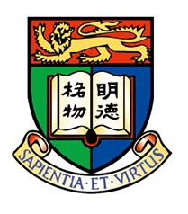
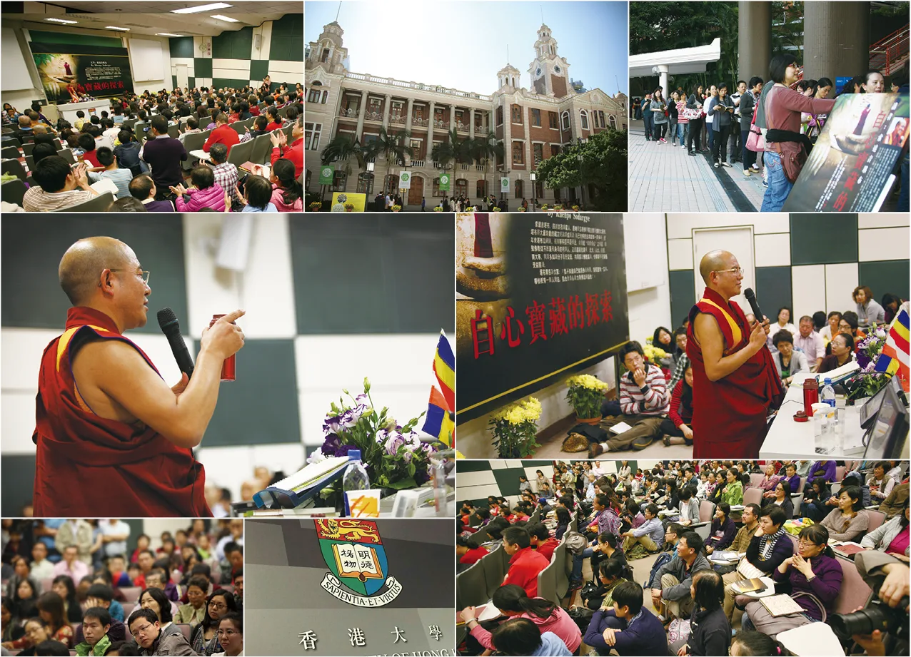
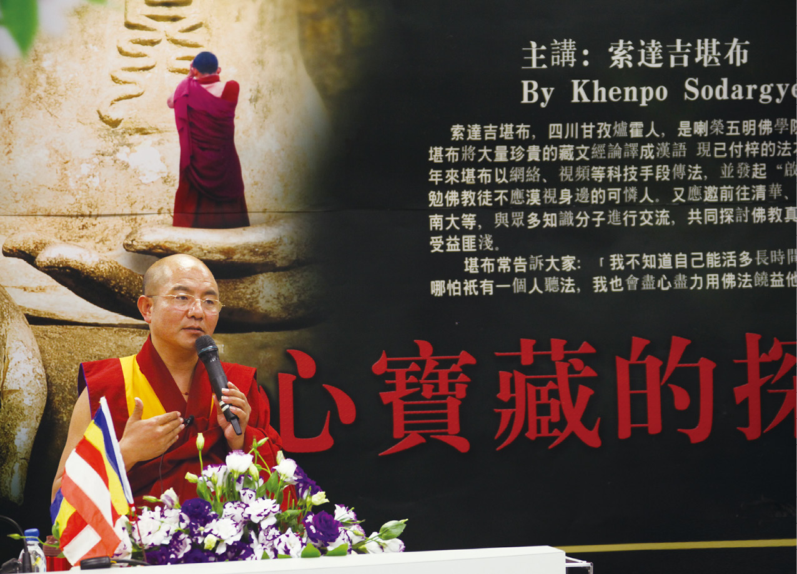
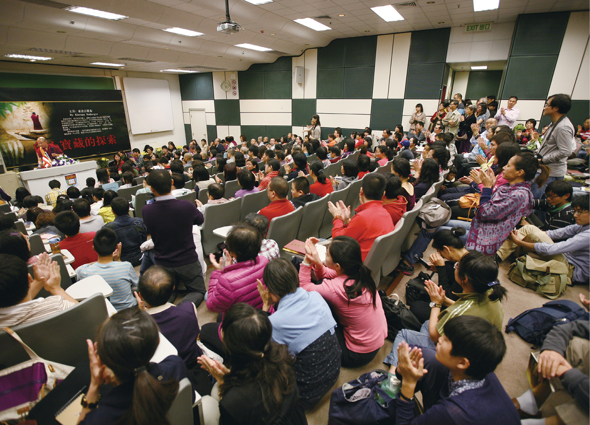
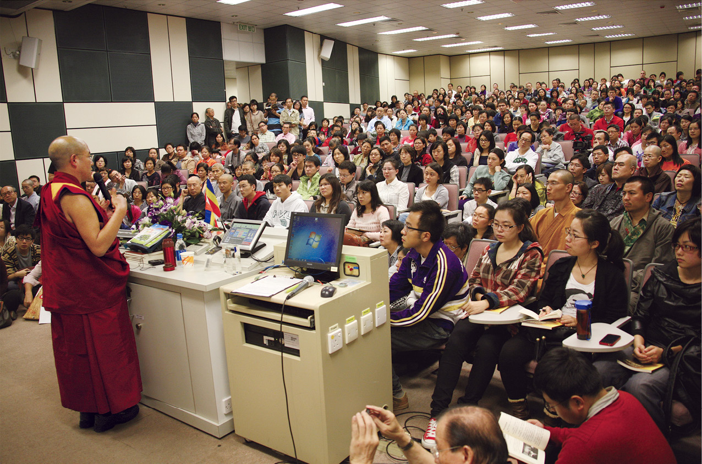

佛性，

是人人本自具足的，

所谓“夜夜抱佛眠，朝朝还共起”。

不过虽未远离，

我们却不认识它，

这也是最悲哀的地方。

第23场

香港大学

Hong Kong University

中国·香港

2011 / 11 / 27

## 自心宝藏的探索

## Discover the Innate Treasure

主持人：

欢迎大家来到香港大学，参加由佛学研究中心主办的讲座——“自心宝藏的探索”。

我是今年佛学研究硕士专业的学生，很高兴有机会站在这里做司仪。在正式请出索达吉堪布之前，请允许我为大家做一个简单的介绍：

索达吉堪布，是喇荣五明佛学院的大堪布，在翻译方面，堪布已将大量珍贵藏传论典译成汉文；在讲法方面，堪布借用网络视频等手段广泛传播佛法；在慈善方面，堪布以“启动爱心”等方式，劝勉佛教徒关爱可怜之人；在佛学学术方面，堪布曾应邀前往清华、北大、人大、复旦以及香港中文、理工等大学，与大家作过广泛的交流。

那么今天，我们也有幸邀请到堪布来香港大学作开示，下面有请——

大家好！今天很高兴来香港大学，与诸位老师、同学以及学者们进行交流。在交流佛学之前，我想先从一个佛教徒的角度，讲一点这次来香港以后的感想，其中有让人高兴的地方，也有令人担忧的地方。

## 一、来到香港的喜与悲

让我高兴的是，在你们香港大学，现在有颇具规模的佛教研究中心，也有颁发佛教硕士、博士学位的强大机构。一所大学能够如此重视佛学研究，如此着力于佛法的传播，在我个人看来，意义是相当深远的。

刚才在和老师、法师们沟通的过程中，大家也都有个意向：希望在不久的将来，能有一些藏传佛教的修行人来到这里，与香港大学一起，就“佛教与科学”等课题、理论与实修等方面，做些共同的研究与合作。我想这是个很好的方向。

我常常认为，能够学到佛法，是人生的一大幸事。不论是出于信仰，还是学术上的兴趣，从我们被佛教的教义和理论所吸引，进入到这个殿堂那时候起，生命便有了深刻的意义。不知道各位做何感想，就我本人而言，不说一生一世，就是生生世世，也不愿意舍离佛法的智慧光明，这是我发自内心的誓言和信心。

你们都知道，现在是一个功利社会，人人为一己私利而奔波忙碌，但在我眼里，这些不是很有价值和意义。最有意义的，应该是弘扬佛法、推广真理，以此来帮助世人、利益众生。

我对香港算是比较熟悉，20年前就来过了，那时候看到这里的信仰自由，心里十分羡慕。据我了解，从五六十年代起，敦珠法王就在这边建了一些修行中心，1987年时我看过照片，那种景象，当时在内地的各个城市里，如此广泛弘扬佛教的很少很少。

不过，10年前我再次来这里时，除了羡慕之外，还平添了一些忧虑——或许是太开放的缘故，这里的个别佛教团体，不免有鱼龙混杂的现象。而这次来香港，感觉就更强烈了：虽然从某些层面来看，有些人在佛教的修行或学术研究上，是有突破性的进展，但在某些地方，与20年前相比，不但没有进步，反而还有倒退的迹象。

也许是因为太忙了吧，为了生活，香港人的脚步越来越快，我见到有些人过马路时，还没有等红灯转成绿灯，就冲出去了。很明显，要让这种匆匆的脚步停下来，静心接受纯正的佛法，是有相当难度的。所以这里不像内地，在佛教的学习及修持上，好多人有所欠缺，这一点非常可惜！

心里没有正法，人就容易受到欺惑，以至于不如法的现象也大行其道。比如，有些人明明不是藏传佛教的，也不是汉传佛教的，却偏偏打着藏汉佛教的旗号，穿戴着怪式怪样的衣服、帽子，还光明正大地召集多少多少人，而下面的人也都崇拜得不得了……他们在这里如此受欢迎，正是让我担忧的地方。

当然，内地也有不如法的现象。藏传佛教里有、汉传佛教里也有，出家人有、在家人也有，但是，那边没有太多这种“怪现象”，多数佛教徒在学佛修法的路上，走得还是比较正的。

诸位老师、同学，也许你们不一定都信佛，有些只是在学术上担负着责任。但不管怎样，怀抱信仰也好，作学术研究也好，当你环顾如今的佛教现状，应该会引发一种责任感——对佛教、对周围的人和事、对整个世界……而当我们真正关心这些时，我想，可能就会有一些行动，引导大家学习真正的佛法，让他们走上真正的快乐之道。

## 二、快乐的主因和外缘

快乐之道在哪儿呢？在我们自己的内心。所以，我们要探索自心的奥秘，开启自心的宝藏。

当然，要深入了解和开启，需要你亲自去通达、证悟，短短一两个小时的讲座，我讲者也好，你们听者也好，恐怕都难以触及，只能象征性地解释和体会。

不过，就浅近的层面而言，一个人活在世上，学会观察内心很有必要。我也知道，现在的人很难接受所谓的理论和修证体验，但那些提取过的简单教言，应该还是受欢迎的。毕竟不管你是什么身份，出家人也好、在家人也好，学生也好、老师也好，谁都向往愉悦的心境，既然如此，我们何不尝试着探索内心，找寻快乐的因缘，保持开心的状态呢？

### 1．快乐的主因是内心

当然，光是嘴上说“开心、开心”，不见得真的开心。我读过一本书，书名就叫《开心》，但它的“开心”是指证悟。证悟了，当然开心了，而如果能用智慧观察，提升自己的认识，也可以调整出一种开心的状态。

要知道，我们之所以不开心，往往是被日常的琐事困扰，难决难断，纠纠缠缠。所以，这里我想告诉诸位一个最好的观察方法，就是古印度寂天论师在《入菩萨行论》中提出的：“若事尚可改，云何不欢喜？若已不济事，忧恼有何益？”我经常用这句话提醒自己，你们也可以这样想：当自己遇上了不开心的事情，不论事大事小，如果还有转圜的余地，那为什么不欢喜呢？如果就像碗被打破了一样，事情已无法挽回了，那你沉浸在痛苦当中，不停地怨天尤人，又有什么用呢？

能想明白这一点，我想你也会信服：前辈大德的智慧，与我们平常的认知相比，确实是最珍贵的财富！

当然，这些若想在生活中用上，还要学会思考。亚里士多德曾说：“人生最终的价值，在于觉醒和思考的能力，而不只在于生存。”但现在很多人正好相反，他们只在意“生存”，计较得失，甚至为此愁眉苦脸，好像除此以外再没有别的了。

如果人人都如此，那人类跟动物又有什么本质区别？动物就只是生存而已，除了吃、喝、睡，与同类生活在一起，它们没有更高的思维。而人若在社会压力的驱使下，心也渐渐转入这种狭隘状态，那跟动物就差不多了。

因此，若想获得快乐，就应善于思考、善于调心，不论遇着什么事都要想得开，一旦想开了，心也就能容纳下整个世界了。诚如雨果所说：“世界上最广阔的是海洋，比海洋更广阔的是天空，比天空更广阔的是人的心灵。”2500多年前的佛陀也说：“心如虚空。”既然心是如此宽广，又何必为一些区区小事纠结，放不下呢？

如今，我们其实并不缺乏开心的方法。且不说佛教中的理论和修证，这对一般人来讲，未免高深莫测，体系也过于庞大。单就是世间的很多畅销书，也都提供了种种好方法，足以让人开心起来。

一个人不开心，主要是因为有压力。尤其在21世纪，无论东方西方，人类的生活方式基本一样，在机械化、电子化连续不断的挤压和逼迫下，人如果没有调心的窍诀，那活在这个世界上，就只剩下痛苦、焦虑、疲倦了。这样的状态，又何谈生活的品质？

因此，要开心，首先就要解压，让心放松下来。随着藏传佛教传入西方，很多大德都教人坐禅，并称之为“放松解压法”，让人们在初步的经验体会中，感受一种放松的心境。心一旦放松下来了，不管你碰到什么事，完全有力量不执著它。那时候你会知道，其实自己以前的痛苦，就是因为执著，越执著越束缚，直至被压垮了，崩溃了……所以，生活中压力太大的人，要学着放松，有时间就坐坐禅、修修心。

这种放松的修心法，也可以叫“安心法”。本来，“安心”一词，在禅宗有特别的意义，不过从浅显的角度解释，了解事物通常的真实面，不受束缚，也算是一种安心。

就像一本书中所说：曾有一个名人，他的心很不安，一直在浮躁、焦虑中饱受煎熬，始终不明所以。后来他不经意读到《无量寿经》中讲：“人在世间，爱欲之中，独生独死，独去独来。当行至趣苦乐之地，身自当之，无有代者……”他当下豁然大悟，心放松了下来。

这就是安心——明白了真相后，心便踏实了。真相是什么呢？我们生存于世，被爱欲所牵，日日夜夜奔波营造的一切，不过是虚幻的聚合，而我们每一个人，到头来都是独生独死、独去独来，并且苦乐自受，没人可以分担……

当你知道了这一点，就不会把快乐再寄托在外境上了。很多人认为，找一个好的伴侣就会快乐，找一个好的工作就会快乐……其实这些都不一定。或者说，即使得到了快乐，也只是暂时的。因此，佛教告诉我们：快乐的根本在于自心——说来说去，我就希望各位能明白这一点，并从中得到真实的利益。

### 2．快乐的外缘靠不住

关于“真实的利益”，有不同生活背景和需求的人，理解上一定有许多差异。但是，如果你抛去想象的成分，再来看时就会明白：实际上，快乐不在财富或爱情上。

那么，这些需不需要呢？对世间人来说，确实需要，但这只是帮助你快乐的外缘。外缘起不起作用呢？也确实起作用，但是靠不住、不长久。

就好比没有钱的穷人，心心念念想着发财，结果腰缠万贯了，照样还是快乐不起来；没有地位的无名小卒，成天都渴望飞黄腾达，可是一朝大权在握，心里还是不满足。爱情、美名、婚姻等也是如此：得不到时，认为得到了就一定会快乐，但得到以后，不仅没带来快乐，说不定还让自己深陷痛苦，无法自拔。

我曾看过林肯的传记，他说自己一生中最大的不幸，就是长达23年的婚姻。他的太太脾气暴躁、喜怒无常，对他身上的每一个部位都看不顺眼。每当林肯出现在她面前时，她就会喋喋不休，嫌他的头太小，手脚太大，鼻梁不直，下颚突出，看上去像只猩猩。她最讨厌的，就是林肯的走路姿势，成天逼着林肯在房间里学她的步法。甚至有一天，当林肯跟别人一起用餐时，因为没有答她的话，她竟然将一杯热咖啡，泼到了林肯的头上……当然，这是林肯在步入婚姻之前，绝对不曾想到的。

无独有偶，托尔斯泰的婚姻，也是悲剧的典型。这位俄国著名大文豪，有无数的人崇拜他，在他那个年代，只要他说一句话，马上成了头条新闻。但就是这样一个人物，家庭生活极为不幸，甚至成了他致命的导火索。

他结婚之初，对妻子非常温情，两人经常一起许愿、祈祷，希望这种快乐的日子能长久。但遗憾的是，好景不长，婚后一段时间，两人就开始争吵不休，昔日的爱意每况愈下，最终变成了怨恨的敌意。

在经历了漫长的猜疑与痛苦之后，晚年的托尔斯泰热衷于人类和平，并将大量稿费捐去做慈善，解救贫困穷苦的人。但这与妻子的想法完全相反，因为她的虚荣心太强，守着钱财不愿意行善。终于，在每日不断的争吵之后，82岁高龄的托尔斯泰，于一场大雪中弃家出走，离开了共同生活48年的妻子。在俄罗斯寒冷的冬天，他颠簸在四处漏风的火车车厢里，最后患上肺炎，死于一个小车站的木屋里。

在临死之前，所有子女都来到他膝下，但他唯独不想见妻子最后一面。

如今许多年轻人，对爱情充满了憧憬，恋爱时总认为：“他就是我永远的幸福！”可时间久了以后，当无常上演时，才意识到“永远”原来并不远，于是开始哭诉：“为什么我的命这么苦？为什么他这样没良心？……”其实，与其到时候这样怨天尤人，还不如早点了知：自己的快乐要靠自己掌握。有了这种认知，当他带给你快乐时，你会感激他；即使相反，也不会太执著。否则，恩恩爱爱，纠缠太深，最终肯定会自尝苦果。

当然，上述那种悲剧的婚姻，并不是人人都会遭遇的，但即使在一般的婚姻中，无常的变故也随时在发生着，这是不争的事实。了解到这点以后，你就会明白，把快乐建立在一个人身上，是相当不明智的选择；以此类推，把快乐建立在钱财上或其他外缘上，也不例外。所以，我们应掌握好快乐的主因，也就是自己的心，进而通过修行开启心的宝藏，获得真实的快乐。

## 三、心的宝藏需要开启

要知道，每个人的心里都有宝藏。什么宝藏呢？佛在《如来藏经》《楞严经》《解深密经》《楞伽经》《涅槃经》等许多经典中都讲过，就是众生皆具的佛性光明——如来藏。

这个宝藏，从最高层面来讲，十地菩萨也无法彻底现见，但从浅显的层面上说，只要你去学、去修、去挖掘，多多少少都能获取一些。打个比方说，像比尔·盖茨、巴菲特那么多的财富，人人拥有也是不现实的，但只要你肯努力，想维持比较好的生活，应该没有任何问题。

不过遗憾的是，现在大多数人普遍只重视物质，虽然这无可厚非，就像车不加油便会抛锚一样，人不从早到晚拼命地干，生活就没有保障了。但是，你们也想一想：当自己一味地为这些忙碌时，若没有时间调整自己的心，会不会得不偿失呢？

从小到大，我们了解的“幸福”，全来自外在。比如有钱了就幸福，没钱了就痛苦；有人爱就幸福，失恋了就痛苦……但实际上，这一切并不稳定，随时可能发生变化。而佛教所揭示的“幸福”，建立在内心的基础上，这是人人平等具有的，只是很少有人懂得该怎样挖掘。可一旦你认识了它，才知道何为不变的幸福。

《入菩萨行论》中也告诉我们：“若不知此心，奥秘法中尊，求乐或避苦，无义终漂泊。”这个窍诀非常重要！假如我们不了知心的奥秘，纵然整日忙忙碌碌，想从外物上寻求快乐、逃避痛苦，终归也只是徒劳而已。

现在许多人都喜欢“幸福”两个字，并将此常常挂在嘴上，特别是作家、媒体、影视，天天拿“幸福”大做文章。但是，又有几人真正得到了幸福呢？少之又少。问题的关键出在哪里呢？就是没有找对幸福的来源。

如果我们想要幸福，就要多少探索一下心的奥秘。当你真正去做了，是利根者的话，一反观自心就会了悟。这不需要长期研究，也不需要用理论细细推敲，只是依靠上师的一种表示——简单而甚深的窍诀，当下就会证悟心性本面。而这样的证悟者，在汉地、藏地的佛教历史上，也可以说很多很多。

从前，慧海禅师去参访马祖时，马祖问他：“你来这里有什么事？”

他回答：“来求佛法。”

马祖说：“我这儿什么都没有，来求什么佛法？你自家宝藏都不顾，跑来跑去做什么？”

慧海禅师忙问：“哪个是我自家的宝藏？”

马祖说：“如今问我的这颗心，就是你的宝藏，一切具足，无有欠缺，何须外求？”话音一落，慧海禅师就开悟了，从此认识了本心。

所以，对有缘者来说，上师只需几句话指点一下，他当下反观自心，便了解了：“哦，原来世界的真相就是如此，除此以外，什么也没有……”

这就是“大道至简”！不了解的人，弯弯曲曲地探索、追寻，以中观的方法观察，以唯识的方法观察，以其他方法观察……但这些都是分别戏论。同样，学术界的人士，今天用考古研究佛教，明天用哲学分析佛法，虽然很想揭示其中奥义，但因为没有掌握关要，也始终触及不到深的层面。

这种层面，确实是一种深奥的境界，说深就极深；但说浅的话，也很浅，认识起来并不难。下面我简单地讲一讲——不过，讲密法可能不太方便，这要求听者修过加行、得过灌顶，有很多严格的条件。所以，我只是从密宗的理论上，讲一点与禅宗相似的道理，与诸位分享。

不管是教授、学者，还是一般的佛教徒，现在请你们观一观自己的心——

观的时候，你会发现：我们这颗心，并不是像机械唯物主义所说的那样在大脑上，也不是在心脏里，更不是在别的什么地方。从小到大，我们一直认为有个“我”存在，认为“我”有一颗“心”，但是这颗“心”，到底是什么颜色？什么形状？什么样貌？……这么一一观下来，你会生起一种前所未有的认识：“稀有啊！原来心的本体是空性，同时又是光明。”

这种认识，在词句上，就是经论中所说的“如来藏”“光明”“法性”“现空无别”“明空无别”……但词句毕竟是词句，不是真正的认识，如果谁通达了这些名称背后的真实意义，那即使他看似普通人，也已经与众不同了。

就像藏传佛教的伟大上师麦彭仁波切，有一次他去求见大名鼎鼎的蒋阳钦哲旺波，被傲慢的侍卫挡在门外。麦彭仁波切奋力把侍卫推到一边，强行闯进院内。一进门，见蒋阳钦哲旺波披着斗篷，蒙头坐着，他吓得大气不敢出，低头乖乖跪在上师面前。突然间，蒋阳钦哲旺波从斗篷里伸出头来，一巴掌重重拍到他头上，大喝：“你是谁？”麦彭仁波切当下开悟。

这是什么？就是禅宗的“打得念头死，许汝法身活”，当你的分别妄念被打死了，法身智慧就活过来了。在佛教历史上，依靠这种方式证悟的，可谓比比皆是，有直接获得极高境界的，也有一般的明心见性。所以，当我们开启自心宝藏时，这种直接的方式最为殊胜。像密宗的直指、禅宗的棒喝，都是以这样一种简单的表示，驱散修行人内心的贪嗔痴乌云，当下现前心性的光明。

其实，了悟心性，对任何一个人都至关重要。而且，这并不是修行人才能做到的，世间各阶层人士中，都不乏“见性”者，只不过他们不明说而已。所以，希望诸位在心性上多下点功夫，以认识自心，开启自心宝藏。

## 四、透视“色”与“空”的关系

倘若我们做不到像利根者那样很快开悟，花一些时间，用显宗的中观教理一点点分析、研究，也不失为一条捷径。

只要你以推理的方式，懂得心的本体不是有，不是无，不是亦有亦无，也不是非有非无，乃至不来不去、不常不断、不生不灭、不增不减……推得多了，到了一定时候，就会认识空性的道理。诚如《心经》所云：“色不异空，空不异色，色即是空，空即是色。”

不过，有人对此很不理解：“色怎么是空，空又怎么是色？”甚至有人解释：“空，是色之外的空；色，是空之外的色，色和空完全分开……”这种说法是不对的。

我建议你们知识分子，可以借助量子力学的分析，作类比推理。量子力学认为：物质是可以不断细分的，分子、原子、夸克、亚夸克……我们暂以“夸克”作为物质的最小构成单位。从瓶子的角度来说：瓶子的本体是不是夸克呢？是。那它是不是离开夸克之外的瓶子呢？不是，它“不异”于夸克。再从夸克的角度看也是一样：组成瓶子的夸克，就是瓶子，它不是离开瓶子之外的夸克。

如此从量子力学的分析中，也可以推出同样的结论：色不异夸克，夸克不异色，色即是夸克，夸克即是色。这个推理很有借鉴性，现在推荐给你们，以后理解《心经》的这四句时，不妨一试。

也许有人会问：“如果瓶子是夸克，甚至是空性，那怎么用它喝水啊？”其实这里有两种层次，不能混淆：在真实的层面上，也就是详细观察时，瓶子是夸克等细微粒子，乃至空性，除了这些以外，的确不存在瓶子，当然也谈不上喝水这回事；而到了显现的层面，也就是不作细致观察时，瓶子就是瓶子，它不是夸克，也不是空性，我们可以用它喝水。

但有些人太过分了，认为所谓的“空”，就是不存在，整天宣称“没有因果，不要执著”。其实，如果你真的不执著，那也可以不吃饭、不上厕所，因为这一切都是空的，但你能做到吗？

所以，这些人说“空”，只是一种口头禅，是把胜义和世俗混淆了。毕竟在世俗显现中，善有善报、恶有恶报是不虚的，这是名言规律，任何人都不能逾越。然而如今有不少人，对佛教的这些基本理论，自己不懂不说，还断章取义地随便解释，这样不仅错解了经义，还让人误解了佛教。

刚才讲到了色和空不二，这个不二的状态，就是我们的自心宝藏：心的本体是空性，但这种空性并不是单空，还有与之同时并存的光明。不然，假如只是单空，我们现在的起心动念就失去了基础，而将来也无从现前色身与法身。所以，现和空不二——“色即是空、空即是色”，这才是心的本来面目。

这些义理虽然比较深奥，但我们可以相似地观察和理解，并通过修行获得证实。在观察的时候，以显宗的推理可以大概地认识心性，这一点并不难；而在修行的时候，则需要一些加行的次第。

在佛法中，很多修法都需要基础，否则，法再殊胜，修起来也有一定危险性。所以，对学佛的人来说，最好的方法就是先依次修完所有加行，之后依靠密宗“直指心性”或禅宗“不立文字”等方式，直截了当地认识心性。

要注意的是，在此过程中，最好经由上师的指点。有时在恰当的因缘下，上师的一个表示，比如让你看看阳光，看看花，或者随便说一句话，利根者当下就开悟了。开悟以后，当你用智慧观照无边众生，见他们因为不认识这一点，而毫无自在地漂泊轮回中，日日夜夜饱受煎熬，自然就会生起悲心。这种悲心深刻而周遍，即是大乘佛教中所说的“大悲心”。

当然，值得一提的是，开悟时所现见的佛性，是人人本自具足的。所谓“夜夜抱佛眠，朝朝还共起”，这个本具的佛性，就是我们自心的宝藏，我们每天夜里都抱着它入睡，清晨又与它一同醒来，从来没有远离过。就像水，哪怕变成了坚硬的冰，水的本体也没有离开；或者像海里的波浪，无论是小浪花还是滔天巨浪，跟大海也是无二无别的。同样，你我不论生起什么分别念，贪心、嗔心、痴心……在起现的当下，与本来的佛性都并未远离。

不过，虽未远离，我们却不认识，这也是最悲哀的地方。所以，大家一定要通过学习来了解，尤其要接受善知识的引导，否则，我们照样还是不认识，照样迷惑，照样在轮回中感受三大痛苦、八大痛苦的折磨。

## 五、没有信仰的人生是悲剧

当然，对每个人来说，如果暂时没有认识心性，了解一些佛法，有一个信仰也是好的。否则，缺乏引导和约束的人生，终究是一场悲剧。

现在的学校不缺高科技，现在的人也不缺智慧，但是缺什么呢？缺传统文化的教育，缺乏信仰。缺了这些，即使是硕士、博士，进入社会后也难以立足，既不会做人，也不会做事。一个人没有信仰，其实不是个小问题，我看到一份韩国的资料中说：没有信仰，就等于没有希望，没有幸福！

乍一看，有些人可能觉得离谱，但你要知道，没有信仰的人，只会盯着眼前的得失，执著这一生的成败荣辱，却从不知道为来世准备。在这种错误理念的引导下，他们几十年活得庸庸碌碌，甚至为达目的而无恶不作，这又怎会有幸福可言？

现在有些大学生很可怜，从小没受过传统文化的教育，也没有正确的信仰，所以性格比较自我，经常跟导师产生矛盾，跟同学们发生冲突；他们平时喜欢挥霍，但又没什么钱，看到别人逛街、消费，心里就很不平衡；再加上学习又不用心，虽然身处于平静的校园，但内心相当浮躁，成天胡思乱想……总之，大学时代一旦缺乏信仰，人就会变得自私、焦虑，对周围的一切也充满了敌意。

这些人在学校里不知珍惜时光，等到毕业以后，找了工作、成了家，又觉得被琐事缠绕，沦为生活的奴隶，开始怀念起学生时代的美好……如此从小到大乃至到老，因为没有信仰的支撑，无论生活在什么环境里，都觉得非常空虚，心里很不满足，一辈子这样白白空过，徒留遗憾。

其实，人有没有信仰，跟自己的福分有很大关系，此外，亲友的言行、环境的熏陶，也会带来一定的影响。有了信仰，身心就会得以自在，行为上也会自觉约束自己，这种人谁都愿意亲近，生活上自然也轻松、惬意。

所以，信仰真的必不可少，不然，就算你有房子、有车子、有爱情、有地位，也无法带来内心的宁静。倘若你的人生只围着“我”转，整天想“我多赚钱”“我过好日子”，而从来没有想过利他，对社会也没有责任感，那不论你在学校里学习再好、在社会上赚钱再多，也体会不到真正的快乐。

因此，想要获得快乐的人，就应该把眼光放远一点，多为周围的人着想，培养一颗利他心。这方面，我建议大家多看佛书——当然，光是看还不够，还要对里面的教义，怀着一颗虔诚的心来感悟。有了这颗心，哪怕只读了一本书、一段话，乃至一个句子，效果都和平时截然不同。甚至对有善根的人来说，心念可能会立即转变，过去的行为再恶劣，当下也会得以重生。诚如思业禅师所说：“昨日夜叉心，今朝菩萨面，菩萨与夜叉，不隔一条线。”

当然，心的本性，需要你们自己去认识、去体证，否则，我口头上讲得再多、再好听，也不过是词句而已。莲花生大士也说：“不了解心的本性，就算是宣讲一切要诀的大法师，也摆脱不了迷惑；懂得了心的秘要，即使是大字不识一个的小牧童，也会获得解脱。”

《六祖坛经》里还有一句精辟的告诫：“不识本心，学法无益。”假如不认识心的本来面目，学法、修行都对解脱无益，只不过是种个善根而已。

听说你们很多人喜欢做火供，这些善法固然很好，但最关键的不是这些，而是应该先了解佛法，并对此真修实证，以认识心的本性。就像一个大学生，在学校里可以参加各种活动，以此丰富自己的见识，锻炼自己的能力，但最重要的学业却不能丢。同样，在学佛的时候，分清主次相当重要。

另外，还要提醒大家的是：学佛的话，不论学显宗、密宗，都应彼此和睦相处，只要是清净的佛法，就应当同等恭敬，没必要在一些小事上争来争去，说是说非。

前两天我遇到一个潮州的佛友，我问他：“以前我在新加坡和泰国见过许多潮州人，人都不错，也很成功，你们是怎么做到的？”他说：“年轻一代就不知道了，但我们老一辈潮州人，既勤俭又团结，一听说是潮州来的，大家都互相帮忙，不分彼此……”听了以后，我在想：同一个家乡的人尚能如此，更何况是我们佛教徒了？

当然，佛教徒要团结起来，并不是为了排斥其他宗教或者非佛教徒，而是为了共同维护佛陀的利他理念，为了更有力地传播真理。往昔佛陀创立佛教，是源于种种因缘，而在此之后，佛教若想发展壮大，以利益更多的众生，也需要因缘的推动，离不开大家的众志成城。

在这个过程中，佛教若想日益为世人接受，遣除大众内心的困惑，不能缺少的就是佛法的教育。离开了它，就算是佛教徒，甚至是知识型的佛教徒，也很难对佛教生起正信。这样的人我接触了不少，有些人的专业是佛学，但感觉上好像投入的时间并不多，学得也不够深入，如此一来，当他给别人传法时，说是在讲“佛法”，但与佛法的本义还是有一定差距。

所以，佛教学者也好，修行人也好，系统学习佛法很有必要。而且，只学一两部论还不够，只在理论上了解也不够，唯有广泛、深入地学修，才有可能生起定解。就像世间的学问，比如数学、物理、化学，走马观花地看一下，然后就给出“结论”，这显然不够严谨，也得不到学术界的认可。而佛教的教义，相比之下更广大、更甚深，若只浮皮潦草地看几本书，又怎么可能真正通达？

要知道，佛教若离开了系统的教育，就会失去原本的精髓，到头来只会沦为一种形象。像现在的很多人，学佛只是磕磕头、烧烧香、念念咒、求灌顶加持……这些表面行为虽然也有利益，但跟真实的利益相比，实在太微不足道了！其实，佛教能给我们的，远远不止这些。如果你沿着佛法的教导向内心探索，就会发现，佛教中不仅有解除痛苦、净化身心的关要，还有提升利他心的方法，乃至明心见性的窍诀，这才是最珍贵的宝藏。

当然，若对此不去学习、不去修行，宝藏虽然就在你心里，可还是得不到。你明明怀揣着宝藏，却四处流浪，在外面拼命寻宝，这不是一种悲哀吗？

所以，大家学了佛以后，应随着各自的缘分，围绕内在的“佛性”做些努力，以期早日开启本具的宝藏，这是至关重要的！

## 六、境界再高也不忘因果

最后，我还想强调一点：在修学佛法的过程中，如果你有一定的觉受和修证，此时千万不能轻视因果。

在佛教历史上，虽然是有“南泉斩猫”“丹霞烧佛”“济公吃肉”等奇特行为，但这是大成就者才能行持的。当他们证悟了至高境界时，为了调伏个别众生的执著，故意那样去示现，而我们作为凡夫人，万万不可效仿！

汉地的药山禅师曾说：“高高山顶立，深深海底行。”你的修行境界再高如山巅，行为上也要低如海底。此外，藏地的莲花生大士也说：“是故见比虚空高，取舍因果较粉细。”可见，祖师大德们的意趣是相通的：哪怕你的境界再殊胜、见解再高妙，行为上也务必要谨慎，不能妄造任何恶业。

总之，希望大家要学会调心，放下执著，用善行来润泽心灵。若有一天，你真正打开了自心的宝藏，必定可以满足一切众生的愿求，令其获得暂时与究竟的安乐！

现场互动

问：我是香港大学医学院的学生。我听说在修行之初，最重要的就是一定要修好福慧资粮。您能不能传个窍诀，让我们在积累福慧上来得快一点？

堪布：现在的人太忙了，什么都喜欢“快一点”。有人说这是一个“快餐时代”，看来挺有道理。如果有一所“快餐寺院”，传授“快餐佛法”，相信参加的人会特别多。

不过，这种来得快一点的修法，也并不是没有。从我长期学修佛法的经验来看，不论是哪一个教派，在积累福慧资粮方面，堪称窍诀的，还是前行法。

像人身难得、寿命无常、轮回痛苦、因果不虚，当你修了这些基础法以后，自心会有深刻的转变，也只有在那个时候，你才成为一个名副其实的佛教徒。否则，一个连前世后世都不承认的人，要参禅、要修密是谈不上的。然后，是不共内加行——皈依、发心、忏悔、供曼茶罗、上师瑜伽，这些修法，哪一个不是积累福慧的窍诀？

又是窍诀，福慧来得又快，就看你修不修了。如果连这点功夫都不肯下，想积累广大的资粮，恐怕是很难的。在汉传佛教中，古大德为什么要先让弟子长年累月地苦行？就是为他们培养修行的福报。

所以，不论你修的是密法还是显宗法，要进入高深的修行，一定要打好基础。否则，就像冰上的建筑一样，看起来倒是很壮观，但一点也不稳固，最终会全部坍塌的。

问：请问怎样才能证悟空性？因为只有这样才能解脱，而所有文字都是苍白的。

堪布：既然文字是苍白的，那你让我讲的话，我的文字也一样苍白。（众笑）

心的本性确实超越了文字，诚如佛典中所说：“不可言说智慧到彼岸，无生无灭虚空之体性，各别自证智慧之行境，顶礼三世诸佛之佛母。”不可言说的智慧度，是不生不灭虚空的体性，是圣者各别自证智慧的行境，也是出生三世诸佛的母亲。但是，你要证悟这一点，又离不了文字。因为证悟的前提是闻思修，而闻思修必须依靠文字。

当然，证悟还一定要祈祷上师，而且应具足恭敬心。印光大师说过：“有一分恭敬，即消一分罪业，增一分福慧。”这种“随着恭敬心的比例增上，自身所获利益也随之增长”的说法，与密宗的修行教言完全一致。在我们的传统里，一个想要证悟的人，必须对传承上师、对这个法门，具有特别大的信心和恭敬心，而且要常常祈祷。

当你这样去祈祷时，虽然你的所求超越了文字，但确实可以得到它。

问：我是香港大学经济系的学生，皈依佛门不久。我有一位上师，但我们很少在同一个地方，所以向您请教：当我在修行中遇到了疑惑，该怎么办？

堪布：修行时有上师在身边，当然最好，但如果没有这个条件，我建议你先系统地学习佛法。

系统学习的好处，一是可以去除我们对佛法的误解和偏见，许多疑惑也能迎刃而解；二是在深入其中时，以前心里装的那些世俗染污，就渐渐被净化了，日子久了以后，佛法自然融入你的生活，修行也就可以独立自主了。

问：以前我烦恼的时候，出去玩一下、买个东西就过去了，但现在学着反观的时候，它反而多起来了，这是为什么呢？

堪布：并不是修行让你的烦恼增多了，而是你反观的时候，烦恼变得明显了。

烦恼就像个调皮的孩子。小孩子自个儿在那儿调皮，你不关心他，他怎么闹你也不会放在心上，好像看不到一样；但当你开始关心他时，他的所作所为，在你的眼里就异常敏感了。所以，你现在觉得烦恼多了，原因就在这里。

但这也是一个标志，说明你已经有能力认识烦恼了。从这个时候开始，只要你不断地精进实修，烦恼和痛苦就会越来越少，这是大多数修行人的必由之路。

问：我是港大医学院四年级学生。您能不能为我们指点一些认识自心的方法？

堪布：在认识自心方面，我也很惭愧，虽然感兴趣，但除了一点理解以外，也没有什么证悟。

你们每个人的情况都不同，如果有兴趣，可以循着密宗的修行次第，从前行法修起，之后得灌顶、求大圆满窍诀，这样一步一步地来，最终必定能证悟不可言思的境界。或者，也可以像禅宗修行人那样，首先学习《金刚经》《六祖坛经》《般若经》等经论，只要有了正确的指点，并满怀恭敬心与欢喜心去阅读它，也一定会有所收获。

比如说，你由此可以得到一种见解，像《金刚经》中讲：“过去心不可得，现在心不可得，未来心不可得。”这就是最殊胜的见解。但“不可得”有两种：一是不存在而不可得；二是存在而不可得，就像我丢了东西，虽然它就在某个地方，但我找不到它。而心的“不可得”是前者——并非明明存在却找不到，而是它根本就不存在。

那么，单单一个“不可得”，或者说空性，是不是就是法性了呢？还不完整。你若只认识了这一点，按密法的教言看，还不是真正的认识，因为在不可得的同时，其实还有光明的一分，也就是说，在究竟的实相上，光明和空性无二无别。这个明空无别的道理，在第三转法轮的《宝性论》《大乘密严经》，以及龙猛菩萨的《法界赞》等经论中，都有细致的宣说。只要下点功夫，你就会慢慢明白。

当明白了以后，即使成千上万的人说你修法错了，你也绝对不会动摇，而是会坚定不移地修下去。这种“坚定不移”，并不是因为太顽固，而是因为已经开悟了。

问：我是港大社工系的研一学生，学佛已经三年了。我现在的方向是，想从佛法、传统文化以及西方的研究中，找出一个能预防心理疾病，甚至能解决某些社会问题的方法。

但到目前为止，让我感到困惑的是，虽然自己很信佛，却没有力量，也不知道该如何让更多的人信佛，该如何让他们相信传统文化的力量。请问我该怎么办？

堪布：你的这种心态，我也有。在这样一个时代里，虽然问题多之又多，但人们的所作所为还是只顾金钱，不重视传统文化，不重视前辈大德的珍贵教言宝藏，所以，有时我也有点伤心，甚至很无奈。

不过，回顾历史可以发现：在任何一个时代里，逆流而上、扭转颓势的，还是大有人在，即使将来的社会越来越复杂，也仍会有一大批有识之士。所以，你也不要担心太多，越有困难，就越应该发大愿：一定要以最广泛、最深刻的方式，传播佛法、弘扬传统文化，让每一个人都认识到这些珍贵理念的重要性和必要性。

只要我们不是以自私自利心，而是以对社会人群负责的心，尽力地去做，就必定能让一些人渐渐有所触动。尤其是年轻人，再不帮他们一把的话，可能就真的一代不如一代了。

以前的人还好一点，怎么说也受了一点传统的约束，但现在的人被西化久了，连传统的概念都没有了。汤恩比博士说得好：“要拯救21世纪的人类，就应该寻求大乘佛教及孔孟思想。”但是，该怎么去拯救呢？首先我们自己要有所认识，要花些时间去潜心研究；然后，利用现代的科技手段，有耐心地进行传播。

尽管现在是末法时代，但只要我们持之以恒，真正去做的话，肯定也会有很多人响应的。

问：我是香港大学的佛学研究生，也是佛教徒。通过学佛，我懂得了一些方法，让自己开心，保持平和的心境，但我该如何帮助身边的人，改变他们的命运呢？

堪布：在这里听到很多学生说自己是佛教徒，我心里十分欢喜，感觉气氛也似乎不一样了！

的确，有信仰的人——不论是信佛教、基督教或其他宗教，内心一般都比较平和，而且乐于助人。刚才你说想帮助身边的人，对此我非常赞叹，因为作为佛教徒，唯一的追求就是断除自利心。你能为身边人着想，这就是一种很好的修行。

那么，在去帮助他们的时候，除了尽量谦卑、恭敬之外，还要懂得善巧，要能安忍。这样经过长久努力之后，除了前世不可逆转的因缘之外，很多人的命运是可以改变的。

所以，在成办自他利益的问题上，我只有一句话：一定要往积极的方面努力！

问：我是内地学校的一名老师。我在上课时发现，如果直接灌输传统文化或佛教的内容，多数学生会有点儿反感，所以，我一般不会正面去说，只是间接地以“挂点钩”的方式介绍一点儿。但有时我也担心，不知道这样如不如法，是不是对佛法的一种亵渎？

堪布：这是善巧方便，并不是“亵渎”。

大家都清楚，现在整个社会的风气，对传统文化还不是很认同，如果直接传播，尤其在不恰当的环境里，效果很可能适得其反，不但帮不了人，还会造成种种误解，甚至出现违缘。所以，你的做法是对的。

不过，佛教里也说“一切都是无常的”，这种情况或许有一天会改变。记得“文革”期间曾有句口号——“批林批孔，坚持到底”，但时代一变，口号就没人喊了，也没人批了。现在不但不批孔子，反而开始赞叹了，甚至连教育部门也有了转变，想在各个学校恢复传统文化。如果真要恢复的话，传统文化中最主要的就是释、道、儒三者，作为其中之一，佛教届时一定会有广泛的弘扬空间。

当然，眼前还是要善巧地包装一下，“馅儿”是佛法，“皮儿”就用人们喜欢的东西。这样包得好一点送出去，不但没有过失，反而有很大的功德。

问：刚才你提到了“不可得”，《道德经》里说“天下皆知美之为美，斯恶矣”，我想这里把二元对立的美与不美破掉了，这种“既不是美也不是不美”的中间状态，是不是“不可得”？是不是“空”？

堪布：这也可以算是一种“不可得”，或者说“空”，但还不是现空不二——现即是空、空即是现，也不是远离四边八戏的中观境界。

真正的“空”，不是单单破除“美”或“不美”这种显现的空分，而是“现”与“空”不二。当然，这种境界无法用语言文字描述，因为在我们的分别念里，要么是“现”，要么是“空”，现空不二是无法呈现的。只有通过长期的闻思修行，才能以实证的方式获得。

问：我是香港大学化学系的学生。请问，您对高学历的年轻人出家有什么看法？

堪布：其实，高学历年轻人出家的比例，在整个大学生群体中是非常少的，而它之所以受到关注，主要还是认识的问题。

以前大家都觉得，出家是件消极的事，一个人如果出家了，肯定是被逼得走投无路了。而且在很多人眼里，出家人的水平也很低——通常是找不到工作了，只好到佛门里混。可能就是基于这样的心态，一听说有高校才子出家，很多人就觉得可惜。

但实际上，当一个人的缘分成熟时，走上了自己想要的道路，这没什么可大惊小怪的，出家也是一种人生选择。在我们佛学院，具有国内外高学历的出家人，就比比皆是。

那么，这会不会对社会造成什么影响呢？当然不会，因为出家的要求很严，要看破红尘、守护戒律……这些对大多数人来讲，即使想出家，也恐怕做不到。所以，有些父母也不必担心儿女一学佛就会出家，如果因为担心这个，就不让他们学佛了，这也太不明智了。

换个角度看，大学生出家，实际上也是正常之举。历史上有那么多帝王将相都出家了，现在有几个才子出家，也没什么不可以的。

问：我刚上网查了一下您的微博，发现您有65万多粉丝，当然，我也是其中之一。我经常看您的微博，发现您会用一些时下流行的网络用语，那您是不是也经常上网？

堪布：首先，我不可能有那么多的粉丝。前不久我在微博上也说：“听说粉丝也可以造假，我开微博，不需要什么人气，也不会为此花一分钱。我的粉丝应该不会有这么多！”不过，粉丝数量也不代表什么，即使有这么多，可能还是好奇者居多，他们对佛教是不是真有兴趣，我不得而知。

然后，我确实偶尔会上网，但上网不喜欢看那些乱七八糟的东西，只爱读一些国内外有启发性的好书，并了解一下世人的想法，这些在网上找起来也比较方便。

这次我来香港，手机因为没有办漫游，就无法更新微博了，当时只好提前跟大家请假：“这几天我要前往一个城市讲法，因为那里没这个信号，故暂时无法发微博……”

结果有人就在评论中教训我：“你去一个连信号都没有的鬼地方，有什么必要呢？不要去啦！”（众笑）

问：我是香港大学金融专业的研究生。在我身边，有许多信仰基督教的朋友，请问，基督教与佛教在见解上有什么异同？作为一个佛教徒，我在和他们交流的过程中，应该注意些什么呢？

堪布：香港有接近一百年时间属于英国统治，在文化及政府理念的影响下，基督徒比较多也是正常的。

在见解方面，佛教与基督教的确有许多相同之处，比如，佛教教人以慈悲为怀，基督教让人有博爱胸襟，这些都是利他的理念。然而，不同的地方也是在这一点上：佛教的慈悲，遍及一切生命，不仅是人，也包括动物；而基督教却认为，动物是人的食物，我不得不说，这确实是一个很大的差异。

不过，矛盾的地方可以放着。就像国家与国家的交往，虽然彼此有些观点不一致，但高层领导在会晤时，都只赞叹对方的好处，矛盾似乎已经不存在了。同理，当佛教遇上了基督教，不同的地方可以忽略——毕竟信仰是根深蒂固的，谁也不可能因为谁，就轻易改变自己的信仰。所以，为了人类的福祉，大家应该共同合作、彼此鼓励，宣扬一切善的理念。

善的理念真的很重要！基督教就是从善的理念出发，建医院、办学校，做了许多的慈善事业，这是我们很多佛教徒都做不到的。所以，我在不同场合中说过，我们佛教徒应该向基督徒学习。当然，也不是学习所有的行为，而是有些行为，就像慈善等。

对基督教而言，虽然我们佛教是异教，但异教中也有不共的教义，像菩提心、空性等，有许多可以交流的空间。所以，以后因缘成熟时，不仅是佛教与基督教之间，各大宗教的人士都可以坐到一起，互相学习、取长补短。

其实在这个世界上，各个宗教都有其魅力与价值，也有它生存的原因，完全没必要互相敌视，甚至排斥、诋毁。假如非宗教人士都可以团结和睦，那宗教人士之间为什么做不到呢？

因此，在有些大学里，如果基督徒比较多，你们也不要歧视我们佛教徒，不要非得把佛教徒拽入你们“神”的团体；而如果佛教徒的力量比较雄厚，也不要强行吸纳非佛教徒，非要让他们进入“佛”的国度。这种洗脑式的灌输，在西方的认知里，是很不道德的行为。

所以，我们应互相尊重各自的信仰，与此同时，也应当彼此学习对方的长处。

问：我是香港大学社会科学院的学生。佛法里讲“福自我求，命自我造”，我想知道，命运到底能不能改变呢？

堪布：命运，可以改变，也不能改变。

某些命运可以改变，就像《了凡四训》里讲的，袁了凡后来20多年的生涯，就是因为努力行善而改变了。所以，佛教不是宿命论，不是命中注定就不能改了。比如，即使是一个判了无期徒刑的人，如果有些方便途径，也还是可以被释放的。

但也并不是所有命运都能改变。如果前世造了特别严重的业，也就是所谓的“定业”，那就不能改变了，必须要承受它的果报。就像有些囚犯，无论怎么找关系，也依旧放不出来。

问：我是一个中学生。请问，有了慈悲心，是不是就是有了菩提心呢？

堪布：慈悲心，包括慈心与悲心，有世间、出世间两种：世间的慈悲心，一般是对身边的人，最多是对“一切人类”有悲悯心，范围比较小；而出世间的慈悲心，尤其是大乘佛教的，是愿“一切众生”离苦得乐，这个心量相当大。

但慈悲心还不是菩提心，它只是菩提心的因。

问：在我们语文课本里有许多古文，比如，司马迁的《史记》、王勃的《滕王阁序》等，好像字里行间都在教我们追名逐利，要怎么怎么……但我想知道，在我们长大之后，是不是一定要追求这些东西呢？不管它好还是不好。

堪布：在现在的教育中，教导学生追名逐利，似乎成了一种趋势，“你长大以后要成功，要成名，要怎么怎么……”但在这样教导的同时，最好也能为孩子们树立一些利他的理念——“你以后要帮助别人，要关爱生命，要回馈社会，要怎么怎么……”

如果从小受到的教育，就是教自己如何生存、如何索取，那他长大之后，也只会成为这种人，目光狭窄，心里只有自己。相反，倘若小时候就让他懂得为人着想，不能只为自己活着，那一路成长起来，他自然就会为社会考虑，为人类乃至一切生命付出和奉献。所以，好的教育，会让一个人的生命呈现出利他的趋势，而这种趋势相当难得，也相当重要。

当然，古文中的思想该如何取舍，这一点可能还是要具体分析。一方面，古人虽然有智慧、有德行，但毕竟是世间人，所以在文章中教人求名求利，也可以理解。但另一方面，古人的很多思想，其实也有值得我们学习的地方，对此不能一概而论、完全舍弃。

问：到目前为止，我还没有宗教信仰，希望我的话不会有任何冒犯。我想问的是：一个没有宗教信仰的人，可不可以通过自己的善心，在学习以及思考之后，来实现类似于宗教所带来的那种宁静与智慧？

堪布：在我们这样的交流中，有信仰的、没有信仰的都可以参与，这是一个自由开放的平台。我个人而言，对没有信仰的人一向非常尊重，因为我相信，他不受持任何信仰，一定有他的理由和价值观，以及由此建立起来的生活方式。

当然，我作为一名佛教徒，在长期研读佛学以后，因为经过了许多思考，也有过一点感悟，所以，还是希望人最好有个信仰。但正如你刚才所说，一个没有信仰的人，如果有一颗善心，并借由某种思想来完善自我，甚至造福人类的话，我认为也未尝不可。

不过，你若是借助了某个宗教的理念，可能也要算是一种信仰了。狭义的信仰，是要你变成一个信徒，但从广义上讲，你在阅读和学习的过程中，对某种教义生起的信赖与仰慕，已经是“信仰”了。所以，信仰也分很多的层次。

问：每一个宗教都有它的经典之作，但如果人们都抱着一种虔诚之心去读，会不会因为太过信赖了，从而伤害自己的心智，影响那种批判思考呢？

堪布：真理是绝对不会伤害你的心智的。

如果是一个不健康、不科学、不包含真理的作品，当你过于信赖它而阅读时，可能会对你的生活、甚至人生带来不利的影响。但若是真理，尤其是我所接触过的珍贵佛典，里面都是人类的思想精华，凡是读过它的，心灵会被洗涤，思想会被净化，有百利而无一害。

当然，我也理解你的顾虑。一般来说，人在年轻的时候，思想比较活跃，不肯就范于任何一种认识；而所谓的“批判思考”，也让很多人在接触经典时，因为担心失去自己的立场，宁肯采取远离的态度，敬而远之。然而，人到了垂暮之际，在感受到悲欢离合的种种经历、饱尝了生老病死的无常变幻以后，对经典里所提到的教义，可能会更容易接近。

其实，你也不用担心被“染污”，只要带着思考去研究，一段时间以后，你就会明白：真理就是真理，它是任何时代、任何社会的真实需要。

当然，如果不是真理，那就不好说了。

问：我是小学三年级的学生。我想皈依，请上师慈悲授我皈依。

堪布：小学三年级就想受皈依，好嘛！

那我念一个皈依偈，你们想皈依的，也可以一起，坐着不要动，一会儿就好了。不想皈依的也不用怕，心里不作意就可以，不会强迫你皈依的。

（堪布用藏语念皈依偈……）

问：证悟空性就可以获得自在，请问这与什么有关系？是实修吗？

堪布：是要实修。不过，首先要长期学习和思维法义，以此生起坚定不移的信解，之后再去实修。不论是谁，只要这样次第地修行，那种超越自然、超越心灵的境界，自然而然就出现了。

问：修行时要注意什么？

堪布：在修行的过程中，一般人都会遇到一些违缘和障碍，要战胜这些，让内心呈现美好的境界，一定要下些苦功。同时也要多学习，汉藏高僧大德们留下了许多金刚语，经常研读的话，很多问题都能迎刃而解。

问：我是香港大学的学生。今年七月，我们几个同学一起去了西藏，本想去五明佛学院拜见您，但后来没有去成。没想到，您竟然来了！

那我的问题是，能否请您介绍一下藏传佛教在内地及世界各地的弘扬情况，以及五明佛学院的教学近况？

堪布：这次来你们香港大学，与法师、老师们接触的时间虽然很短，但大家沟通得非常愉快。知识分子以其特有的敏感，在关心着社会、关心着佛教，而我多年以来最关注的也是佛教教育，所以，我们有很多共同的语言。

说到藏传佛教的弘扬，近二三十年以来，内地了解藏传佛教，应该说，与我们五明佛学院的确有很大关系。法王1987年去五台山之前，藏传佛教几乎是鲜有人知，但从那之后，对于藏传佛教闻思修行的传统，了解的人越来越多。如今，虽然不敢说特别兴盛，但在汉地的很多佛教团体中，大家对藏传佛教已经有了一些正面认识。

藏传佛教在香港、台湾，发展得是要早一些，但有些“怪现象”，也让许多人产生了误解，甚至有人对藏传佛教特别排斥。当然，佛教的弘扬也是随缘，要看众生的福报，就像大乘佛教在印度刚刚兴起、禅宗初到汉地，也都是不被人接受的。所以，透过历史观察今天也是一样，港台这边如此，汉地那边也如此，一上来不被接受，这也是正常现象。

但现在，也许是经历了这个过程以后，在西方的知识分子人群中，却形成了“藏传佛教热”。为什么在20世纪、21世纪，西方人会对藏传佛教如此渴望和仰慕呢？很多大德认为：就像人渴了要喝水一样，当人们被痛苦逼迫时，就需要一种力量来解除它，而藏传佛教，恰恰就具有这种力量。所以，“热”也是需求导致的。

至于我们佛学院的教学，我从1985年待到现在，大致是差不多的，有显宗的课程，也有密宗的课程。在显宗课程中，有五部大论——戒律、俱舍、因明、中观、般若，这是每一个人都要学的。当然还有密法的学习，以及法会的修行。我们学院不排斥任何教派，只要是如法的，不论是藏传、汉传的教义，都可以在那里教授。

其实，不仅是我们佛学院，在整个雪域这片土地上，依然完整保留着纯正的佛教体系和传统。既然生活在这么一个时代，我们一方面想要把它传承下去，同时也想让更多的地方、更多的人从中得到利益。

问：我是港大佛教研究中心的出家学生，我想请堪布对“他空”做个简短的介绍。

堪布：大学里还有出家人，这让我感觉很亲切！那次在复旦大学看到一位斯里兰卡的出家人，当时感觉很新鲜，而这里更多，所以一来的时候，我就觉得既新鲜又亲切。

你问的这个“他空”问题，显宗经论里有讲，密宗的《时轮金刚》里也有讲。在藏传佛教的派系方面，如果从主要的角度来说，一般认为讲自空的是格鲁派，讲他空的是觉囊派。而宁玛派的大德认为，自空、他空并不相违。

所谓自空，就是释迦牟尼佛第二转法轮的教义，阐释这一教义的论典，主要是龙猛菩萨的《中观六论》、圣天论师的《四百论》、月称论师的《入中论》等；所谓他空，则是第三转法轮的教义，主要讲如来藏的道理，像弥勒菩萨的《宝性论》、龙猛菩萨的《赞法界颂》及《佛三身赞》等，都是重要论典。

其实，自空和他空是不矛盾的，只不过侧重点不同：一个侧重空性，一个侧重光明。但实际上，在《大幻化网》乃至《时轮金刚》的究竟观点上，都认为光明与空性是不二的，也就是现空双运。

现空双运就是如来藏的本体，你可以用自空的方式抉择，也可以用他空的方式抉择。觉囊派用的是他空。他空的意思，就是自体不空而客尘空，这样说来，既然如来藏的自体不空，那和外道所说的“常我”有何差别？对此，《入楞伽经》中讲得很清楚[^1]，如来藏和外道的常我不同，因为它是远离我法、远离一切戏论的。

可见，自空、他空全是分别念的安立，真正的如来藏，超越了这些概念。

在印度历史上，月称论师和月官论师就二转、三转法轮，辩论了长达七年之久，但最终他们的观点还是融为了一体。因此，我们作为后学者，应在前辈们抉择的理论基础上，把二、三转法轮的教义结合起来，直接理解为现空双运。而这种现空双运，也就是超越了心识、超越了自空他空的所谓“大空”，这才是佛陀的真实密意。如果要详细了解这个道理，可以研究一下麦彭仁波切的《他空狮吼论》。

总之，“他空”在佛教中的专业性很强，是有一定深度的研究领域，短短的文字可能很难描述它的真正涵义。

[^1]: 《大乘入楞伽经》（卷2）云：“尔时大慧菩萨摩诃萨白佛言。世尊。修多罗中说如来藏本性清净。常恒不断无有变易。具三十二相。在于一切众生身中。为蕴界处垢衣所缠。贪恚痴等妄分别垢之所污染。如无价宝在垢衣中。外道说我是常作者。离于求那自在无灭。世尊所说如来藏义。岂不同于外道我耶。佛言。大慧。我说如来藏。不同外道所说之我。大慧。如来应正等觉。以性空实际涅槃不生无相无愿等诸句义。说如来藏。为令愚夫离无我怖。说无分别无影像处如来藏门。未来现在诸菩萨摩诃萨。不应于此执著于我。大慧。譬如陶师于泥聚中以人功水杖轮绳方便作种种器。如来亦尔。于远离一切分别相无我法中。以种种智慧方便善巧。或说如来藏。或说为无我。种种名字各各差别。大慧。我说如来藏。为摄著我诸外道众。令离妄见入三解脱。速得证于阿耨多罗三藐三菩提。是故诸佛说如来藏。不同外道所说之我。若欲离于外道见者。应知无我如来藏义。”
