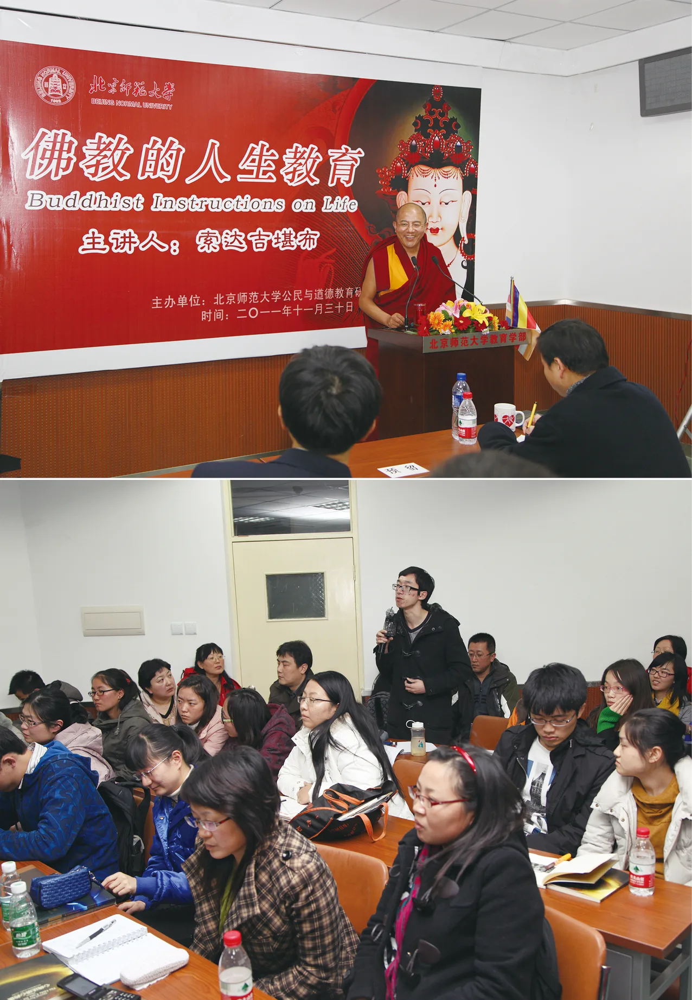
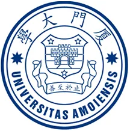
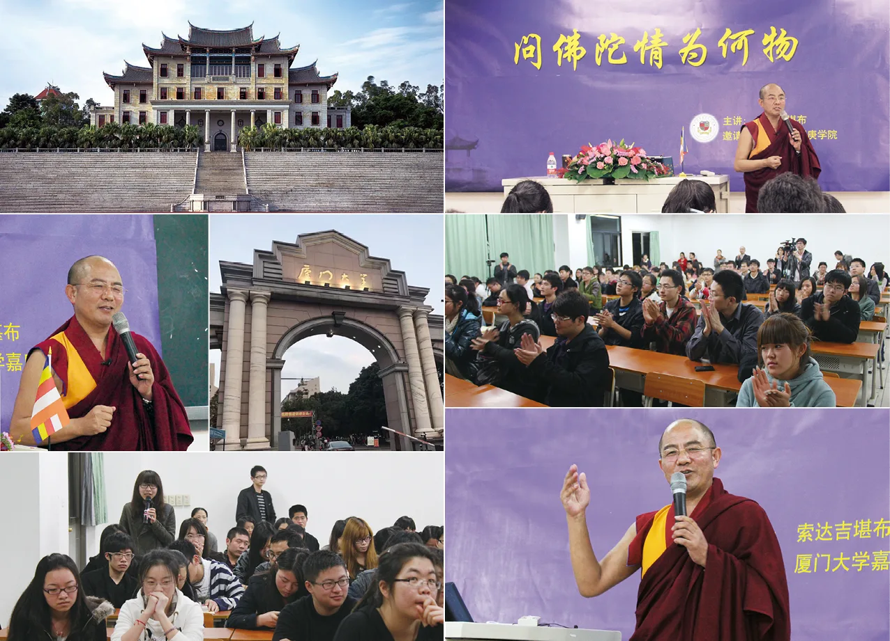
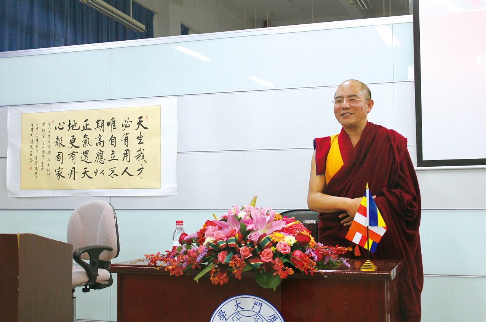

若有人问佛陀：“应当如何对待爱情？”

佛陀不会劝所有人出家，

也不会让所有人学佛。

佛陀会说：对感情不要太执著了，

否则一定会带来痛苦，

这些痛苦不是别人强加给你的，

完全是自作自受、作茧自缚。

第25场

厦门大学

Xiamen University

中国·厦门

2012 / 2 / 23

## 问佛陀情为何物

## What Did the Buddha Say About Love

主持人：

今天，索达吉堪布本来是要到厦门大学哲学系演讲，但堪布这次来厦门是一个难得的机会，所以我们也邀请他顺便到嘉庚学院作一场演讲。通过这场演讲，大家能近距离地接触佛教的修行者，我觉得这是一个非常好的机缘，用佛教的术语来讲，这是一个非常好的福报。

所谓“堪布”，就是“法师”的意思，这个称呼体现了他宗教家的身份，表明他是一位藏传佛教的大师。

在这里，我简单介绍一下索达吉堪布。中国有这样的传统，在介绍一个人的时候，一般要从立言、立功、立德三方面谈起：索达吉堪布是喇荣五明佛学院的主管堪布，在立言方面，他著作等身，总字数超过一千万；立功方面，他对显宗的戒律、俱舍、中观、因明、般若，以及密宗的大幻化网、大圆满等都有很高造诣；立德方面，他不仅是一位学者，而且是一位了不起的修行者。

今天的演讲题目是“问佛陀情为何物”。佛教对内心非常重视，所以，堪布对“情”一定有非常独到的见解。下面，让我们以热烈的掌声欢迎堪布——

能在这里与各位老师和同学们交流，我感到很高兴！今天的话题比较特别，看到这个题目，可能你们会有一种不同的感觉。刚才我在教室门口，就听到有同学在议论：“‘问佛陀情为何物’，这到底是什么意思啊？”下面，我以一个佛教出家人的身份，和大家做个简单交流，希望对各位有所启发、有所帮助。

## 一、现代人面临的感情问题

在座各位都是年轻人，对世间的爱情应该比较执著。我去过不少学校，发现许多老师和学生都是如此，他们把爱情看作人生的根本大事。为什么如此重视呢？原因有许多，最主要是受环境影响。各位都清楚，在如今这个时代，网络、电影、电视所播放的内容中，许多都和爱情密切相关。在这些渲染的影响下，许多人就对爱情特别耽著。

在此，我希望大家用智慧观察：人们经常赞美、追求的所谓爱情，真的有那么美好，让人如此沉迷吗？你们都是大学生，有一定的思考能力，希望好好思考一下。这个问题非常重要，如果没有思考清楚，在以后的人生旅途中，很可能遇到这方面的痛苦。

其实，在这个世界上，并非所有人都执著爱情。拿藏地来讲，许多在家人虽然对感情比较执著，但并不像西方人和汉族人那样，把不少心思和精力都用在感情上。按藏地的传统，人们不认为爱情是人生的支柱；在古代的汉地，也没有将爱情视为人生的全部，德行、才华、艺术才是人们最青睐的。

## 二、佛教如何看待爱情

作为一个佛教徒，我对感情并不排斥，佛教是包容感情的。现在有些人认为：佛教是绝情的，一旦走上出家之路，就要抛弃家人和一切，这种行为太残忍了！许多人都用不同的语言描述出家人的“无情”。但实际上，佛教并不是这样。说实在的，佛教所谓的绝情，只是细致、到位地描述了世间人执著的感情；佛教所谓的出家，也不是把所有感情都抛诸脑后。只不过许多人本身不了解佛教，再加上当前个别影视媒体刻意丑化，没有将佛法的本义展现在世人面前，才导致了人们对佛教的误解。

大家应该明白，世人拼命追求的爱情，它的“保质期”并不长，一旦过期以后，就没有新鲜感了。对于这种虚幻不实的感情，佛教有许多精辟的描述，如：一切爱欲都是无常的、痛苦的，它是众生非理执著引起的……如果你们有机会深入学习佛法，就会对这些道理有所领悟。

佛陀的传记中记载，2500多年以前，我等大师释迦牟尼佛舍弃了王位，选择了出家生活。当然，出家并不等于完全抛弃亲人，佛陀暂时辞亲割爱，是觉悟人生的一种途径。除了佛陀，历史上还有许多出家人，从表面上看，这些人远离了家庭和亲人，但这并不是没有良心，而是对一切众生无条件的大爱。

其实，不只是佛教徒才远离感情。现在社会上有些成功的企业家、领导、明星，也都选择独身，这样的例子可谓比比皆是。为什么他们不结婚呢？就是想一心一意搞事业，若是有了家庭的束缚，做很多事就没有自由了。

我在这里不是宣扬佛教，只是希望各位正面了解佛教。只要是真理，不管在哪里都会发光，不可能因某些人的误解就被舍弃。因此，对于佛教的看破感情，大家要有正确的认识。

在世间人的定义中，“情”就是同生同死、互相缠缚，正如一首歌中所唱：“问世间情为何物，直教生死相许。”然而，如果问佛陀“情”是什么，答案就不同了。

首先，在世俗层面，佛陀也承认感情。在《长阿含经》《增一阿含经》《善生经》《法句经》中，对于在家人的正常感情生活，佛陀有许多相关的教言。所以，并不是学佛就要出家，也不是学佛都要断绝感情。

随后，佛陀又会讲，感情归根结底是一种执著。当自己执著一个人时，暂时有一些快乐，不过，这种执著终会带来痛苦。

有些人可能不这样想，他们觉得爱情是美好的，怎么会带来痛苦呢？如果没有品尝过爱情的滋味，有这种想法当然很正常；但若是有过感情经历的过来人，对个中的酸甜苦辣，应该会有非常深刻的体会。

曾经，一个没结婚的人和一个已结婚的人谈论爱情，没结婚的人极力赞美爱情，他说：“爱情是多情的海洋，是迷人的画卷，是动听的歌曲。古希腊有一个叫皮格马利翁的国王，他用象牙精心雕塑了一个少女。由于这个‘少女’太美了，国王深深地爱上了她，天天在‘少女’面前祈求，并且拥抱她、亲吻她。后来，爱神阿芙洛狄忒被他的真情打动，将少女雕像变成了真人，跟皮格马利翁过上了幸福的生活。”

听了这番话，已结婚的人摇摇头：“年轻人，爱情并非如你所说的那样美好，听我讲一个故事吧。南朝的时候，有一个人叫刘瑱，他妹妹是鄱阳王的王妃，夫妻之间非常恩爱。后来，鄱阳王因故被齐明帝所杀。因为思念亡夫，鄱阳王妃终日不吃不喝，最后奄奄一息。为了救妹妹，刘瑱请人画了一幅画，在画中，鄱阳王跟一个宠妾在一起恩爱地照镜子。看到这幅画，鄱阳王妃醋意大发，咒骂道：‘他真应该早点死。’她对亡夫的爱意当下消失，身体也很快康复了。”

在后一则故事中，女主人公原来热气腾腾的爱，一瞬间变成了咬牙切齿的恨，这就是佛教所讲的“爱恨无常”。大家要懂得这个规律，否则，不管你学了多少知识，在遇到感情方面的问题时，还是很难面对。

佛教中有部论典叫《四百论》，其中就讲过：“无常定有损，有损则非乐，故说凡无常，一切皆是苦。”无常的法一定会坏灭，有坏灭的则非真正的安乐，所以，凡属无常的一切法，皆是痛苦的本性。比如，两个人关系本来很好，后来一方慢慢变心了，这种无常就会给对方带来痛苦。

所以，佛陀曾提醒阿难：“慎无信汝意，意终不可信；慎无与色会，与色会即祸生。”意思是，千万不要信赖你的分别心，你的分别心根本不可信；千万不要贪执美色，否则就会带来无穷祸患。但遗憾的是，现在许多人不懂这个道理，因而，在生活中经常饱尝这方面的痛苦。

## 三、以智慧照破情执

当然，佛教并不是强迫你绝情绝爱，而是通过理论分析，让你放弃非理的执著。比如，有些人往往觉得异性的身体很美丽，其实，这种好感是未经详细观察的错觉。如果用智慧去分析，就会发现自己特别喜欢的，也只是一堆肉而已。从头到脚慢慢剖析后，你会恍然大悟：“原来，我执著、贪爱、想念的，居然是这些东西！这样的身体不要说死后没有价值，活着时也根本不值得贪恋！”

佛经中也讲过这样一个公案：摩邓女爱上了佛的弟子阿难，她想尽办法让阿难还俗。佛问摩邓女：“你到底喜欢阿难哪里？”摩邓女说：“我爱他的眼睛，爱他的鼻子，爱他的嘴巴，爱他的耳朵，爱他的声音，爱他走路的姿势。”佛便一一给她剖析：“阿难的眼睛中有泪，鼻中有鼻涕，口中有唾液，耳中有耳屎，身体中有屎尿……”摩邓女算是利根，听了佛的分析，爱念当下就息灭了。[^1]

其实，爱情完全是一种分别执著，大家一定要明白这个道理。否则，现在的社会对爱情过于推崇，许多影视节目里，爱情成了人生的唯一。由于从小受这种影响，许多年轻人长大以后，根本没有辨别能力，这是相当遗憾的！其实，爱情只是一种弱不禁风的易碎品，就像一个美丽的水泡，稍微一碰就会破灭。当这种水泡破灭时，有些人为此大失所望，有些人甚至绝望自杀，这实在是不智之举。

我本人来自藏地，藏地的传统跟汉地差别很大，藏族人对爱情虽然也有执著，但不会把它放在特别重要的位置，也不会用各种语言过分地赞美它。而在汉地，人们对爱情渲染得无以复加。本来爱情没有那么惊天动地，但因为被许多虚构的浪漫情节包装了，导致许多人疯狂地歌颂它，直至这层包装被撕开后，他们才痛苦地发现，原来爱情不过如此。

《正法念处经》也说过：“若人贪著欲，众苦常现前。”所以，过于执著爱情，痛苦就会接连不断地降临。只有获得了无求的境界，才不会有这么强烈的贪求，一旦失去了爱情，也不会有那么锥心的痛苦。

在修行人眼里，无求才是最大的快乐。以前有一个富人，他非常有钱，可始终得不到快乐。他到处打听怎样才能快乐，一个人告诉他：“得到世界上最快乐的人的衬衣，你就会获得快乐。”于是他四处寻找，后来听说某个深山里有个老修行人，是世界上最快乐的人。这个富人就找到了老修行人，问：“你是不是世界上最快乐的？”老修行人悠然地回答：“应该是吧，我从来没有什么痛苦。”于是富人恳求：“你可不可以把衬衣送给我？”老修行人哈哈大笑：“我根本没有衬衣啊。”这个时候，富人才明白过来：无求才是真正的快乐。

这个道理，或许有人不太理解：“拥有才会快乐，一无所有的话，怎会有快乐可言呢？”但事实往往正好相反：没有的时候，你觉得拥有它会快乐；一旦拥有以后，就不一定快乐了。比如，没钱的时候，你认为有了钱会快乐，但当你有了钱，才知道就这么回事；没有家的时候，你觉得有一个家会快乐，但当你有了家，才知道它是争吵的来源；没地位的时候，你觉得有地位会快乐，但当你有了地位，才发现自己照样不开心。

不过尽管如此，人们的贪欲仍永无止境。如果一个人是副局长，他可能会想：“我是局长多好啊。”当上局长后，又成天琢磨：“我是副市长就好了。”等当上了副市长，又开始盘算：“如果我是市长，那该多棒。”……就这样一直追追追，永远没有满足之时，这种无止境的追求就是痛苦。

因此，大家需要好好考虑一下：“今后我该追求什么样的人生？”很多人认为，只要有了钱财，就能带来一切快乐，这种想法并不正确。作为年轻人，你们既要学习文化知识，也要拥有正确的信仰，既要有外在的财富，也要有心灵的财富，这样的人生才比较精彩。

总之，对于爱情，佛教中有深刻的揭示。其实，人与人之间的情感，也是前世、今生种种因缘形成的，在爱情当中，有些人是来讨债的，有些人是来还债的。比如，一个人对另一个人情有独钟，一见面就生起爱慕心，按照佛教的解释，这并非是一种偶然，很可能源于前世的宿债。

当然，现代科学解释不了爱情的这种复杂性。因为它只看到今生的现象，对前生后世的领域，则是一片空白。在这种情况下，如果你一概排斥佛教的观点，那在面对感情的困惑时，就会遇到许多麻烦。

尤其如今很多人的爱是一种占有，有许多实用主义的成分——对方能让自己快乐，就跟他朝朝暮暮在一起；如果他给自己带来痛苦，则恨不得灭之而后快。这种爱，实际上就是痛苦之因。

前不久，某大学发生了这样一幕惨剧：一对恋人在考研之前，女生对男生说：“如果我们都考上了，我们的关系就保持下去。如果你考上了，我没考上，爱情也可以继续。但若我考上了，你没考上，那就分手。”也许是命运的作弄吧，最终女生考上了研究生，而男生没有考上。于是女生提出“拜拜”，男生特别伤心，因无法接受这个事实，就冲到女生寝室，先将那个女生掐死，然后自己跳楼自杀了……

与这种自私自利的爱相比，佛教的爱是对一切众生平等关爱，并且没有任何条件。乍听这种说法，有些人也许会想：“不可能吧，太玄了！”其实一点都不玄，这种理念有甚深的含义，一个人如果有了这样的“爱”，就有了世上最宝贵的财富。

我经常在想：人类有各种科学发明，这不一定就是成功，真正的成功是培养慈悲心，通达心的奥秘。这方面的道理，早在2500多年前，佛教就有细致的宣说，希望大家多了解一下这方面的道理，不要盲目追求钱财，更不要像有些人那样，眼里除了钱，什么道德都没有。

## 四、追求对生命有真实利益的智慧

综上所述，若有人问佛陀：“应当如何对待爱情？”佛陀不会劝所有人出家，也不会让所有人学佛。佛陀会说：对感情不要太执著了，否则一定会带来痛苦，这些痛苦不是别人强加给你的，完全是自作自受、作茧自缚。

我经常跟许多大学生交流，通过这种方式，劝勉大家追求对生命有真实利益的智慧。这种智慧非常重要，如果没有它，即使你读破万卷书，也不一定能带来什么利益。

有时候，我真的觉得有些大学生挺可怜，他们学问确实不错，但从来没有学过佛法，不懂得佛教的道理，所以始终搞不明白一些关键问题，遇到小小的挫折就痛不欲生，给自他带来了诸多不便。

其实，且不谈佛教的成佛果、度众生等高深境界，仅就现实生活来讲，若能懂得一些佛理，比如“万法是无常的，每个人都会逐渐衰老”，内心的价值观也会有所改变，这对自己的未来会有很大帮助。

我们人生短短几十年，能遇到真理非常难得。一旦遇到了，就千万不能忽视，否则，将来定会后悔莫及。许多人年轻时，一直为了感情、财富而忙碌，从来没有寻求真理，直到生命的最后一刻，才开始考虑：“人死后，生命会不会延续？如果会，下辈子我变成什么样子？”但这时考虑这些，已经来不及了。

大家要明白，人死以后，并不像灰飞烟灭一样，什么都消失了，这辈子的身体虽然没了，但灵魂还会延续下去。这一辈子你做人，下一辈子的话，也许做人，也许做其他众生。但不管成为什么，你的生命都会继续存在，而且今生造了什么善恶业，来世必定会成熟相应的苦乐果报。

关于来世是否存在，现在许多人在这方面都是“文盲”，他们既举不出不存在的理由，也不知道来世如何存在，更不知道要如何面对。在世间学说中，这些道理基本上没有提及，而在佛教里面，对此就宣说得非常清楚。

总之，在胜义层面，佛教认为一切不存在，包括感情也不例外；而在世俗层面，承认感情的存在，不反对正常的感情生活。不过，佛教会提醒人们：感情是无常的，也是痛苦之因，对此不要过于沉迷，不然会招致意想不到的痛苦。

其实，除了佛陀以外，孔子、庄子等古圣哲也有一些对感情的认识。如果你传统文化学得比较好，对感情也不会那么执著。

比如，庄子身上发生过一个故事：一天庄子出门，看到一座新坟，一女子手执扇子，对着那座坟连扇不已。庄子问她为何这样做，女人说：“坟中埋的是我丈夫，他死时有遗言，如果我要改嫁，必须等坟土干了才行。我现在急着改嫁，所以用扇子扇坟，让坟土尽快干。”

听到这番话，庄子心中很不是滋味，回家后将此事告诉了妻子。庄妻听后，先是数落那妇人没良心，然后发誓说，如果庄子死了，自己绝不会这么无情。

天有不测风云，过了几天，庄子突然得急病死了。尸体入棺后，庄妻一身素缟，每天哭哭啼啼地为庄子守丧。几天以后，有个英俊少年来到庄子家，自称是楚国的王孙，想来拜庄子为师。得知庄子刚辞世，那个少年很伤心，表示要为庄子守丧百日。

因为王孙相貌英俊，在守丧期间，庄妻对他生起了爱意，便托人向他求婚。王孙同意了，不过他提了一个条件：“庄子是我老师，我千里迢迢到这里，如果连一面都没见，就太遗憾了。希望你能打开棺材，让我见庄子一面。”按当时习俗，这对死者是非常不敬的。但为了尽快成亲，庄妻答应了他的请求。没想到，一劈开棺材，庄子竟然坐了起来，这时候，王孙也忽然不见了。庄妻这才明白：原来，王孙就是庄子的幻化。她羞愧难当，不久就上吊死了。

从这个故事可以看出，世间的恩爱十分无常。不过，有些人明明懂这一点，就是不愿意接受。但有时候也比较讽刺，人越是不愿面对的事情，越有可能会遇到。

现在的教育中，基本没有讲过如何正确对待感情。在学校里面，老师经常赞叹爱情的伟大，从来不提醒大家感情不顺该怎么办；在学校外面，歌星整天唱恩恩爱爱的情歌，影视上也尽是你侬我侬的镜头。但这样的教育和宣传，给年轻人带来的是利、是弊？大家也应该思考一下。

## 结 语

《无量寿经》中说：“人在世间，爱欲之中，独生独死，独去独来。”这是一个深刻的教言。我们每个人都是如此，来到这个世界是独自一人，最后离开也是孑然一身。所以，有些人不要以为：“没有某个人，我就活不下去了。”尽管你追求爱情也无可厚非，但行为上应当发乎情、止乎礼，如此对自他才有利无害。

今天，我只是稍微提醒一下各位，希望大家对爱情要有理性的认识。其实，在佛教中，这方面的智慧教言有很多。比如大乘论典《入菩萨行论》中，关于如何调伏自己的心，就有非常好的宣说，是现代人不得不学的一本好书。

一直以来，我非常希望大家能了解佛教，尤其是学一下放下自我的利他窍诀、化解执著的空性智慧。而这部《入菩萨行论》，正好完整涵盖了这两者的内容。如果你有时间学习，必定会找到人生的方向。否则，心里全是自私和执著的念头，不一定就活得快乐！

现场互动

问：我是管理系工商管理专业2011级的。仓央嘉措曾经写过：“世上安得两全法，不负如来不负卿。”后来因为爱情，他留下了许多动人的浪漫诗篇。所以我想请问一下：您是如何评价仓央嘉措的？

堪布：仓央嘉措这句诗的意思是，世间没有两全其美的方法，既能对得起佛陀，也对得起自己的爱人。我想，这个问题可以从两个层次分析：从较高层次来讲，如果你是一个出家人，就应该看破小我，放弃家人和感情，这样才能荷担如来的家业；从一般层次来讲，则不一定要如此，就像你们在家人，一方面可以过世间生活，同时也可以做一些对佛教有意义的事情。

若要从事高层次的学佛，就必须放弃自己的家人，表面上看有点绝情，但这却是智慧的选择。近代的弘一大师就是如此，为了弘扬律宗，他放弃了自己的小家庭，毅然选择出家。出家后，他的日本妻子还找过他。在弘一大师的感化下，最终她理解了大师的选择，也认识到世间万法都是无常的，再好的感情也保不住，最后一定会劳燕分飞。

其实，仓央嘉措的情歌可以从不同层次理解，这些情歌有外、内、密的意义：外义是世间的男女感情，内义折射了当时的历史状况，密义则揭示了修行的心态和方法。

问：我是中文系2009级的。弗洛伊德曾经说过，人类的两大原始欲望是性欲和攻击性。现在，情这个东西困扰青少年，引发许多青少年犯罪，已经成了严重的社会问题。您刚才讲到，某大学的两个学生也因为感情而丧命。因此，基于青少年特有的心理状况，加上他们缺少社会历练，导致一部分人无法控制自己的身心，经常做出一些极端的行为。我想请问，青少年应该怎样调整自己的心？

堪布：你讲到情欲毁坏了很多青少年，我非常赞同这种说法。这几年以来，为什么我要到不同的场合演讲？一个重要目的就是想让更多人懂得感情的本质。我这样演讲不是为了抹杀真相，如果感情真的十全十美，只会给人们带来快乐，当然值得赞叹；实际上，在表面美好的背后，感情包含着许多痛苦的因素。

为了弄清楚感情的真相，现在的青少年非常需要学习传统文化和佛教知识。如果在这方面没有心理准备，许多人都会因为感情而痛苦，甚至自杀。

我去过许多学校，在有些学校里，高楼和湖泊已经成了年轻人的自杀场所。你们学校的这个湖很美，刚才在湖边散步时，我还在想：有没有人在这里投过湖？可能没有吧。

许多人殉情的原因是什么？就是没有认识到感情的本质。在藏地，过去从来没有因为感情而自杀的人。当然，如今受现代教育的藏族人当中，也有了个别这样的现象。

现在许多失恋者特别痛苦，由于对感情过于执著，一旦失恋以后，许多人都选择自杀。因此，年轻人一定要学习一些佛法，要学会正确地对待感情，这样，自己的人生才会幸福。

问：您也曾经年轻过，虽然在“上师”的光环下，许多人把您超人化或者脱俗化了，可是我想问：您年轻时，心理状况和欲望状况是什么样的？

堪布：我个人来讲，年轻的时候，确实也有贪欲和执著。不过，我虽然谈不上有修行境界，可是通过思维历史上的许多故事，通过对烦恼或人性反复剖析，对感情的本质有了真切的体会，所以能够摆脱感情的困扰。

通过自身的体会，我也感觉到，现代人特别需要认识感情的真相。如果能认识到这一点，即使有一些贪欲和执著，自己也不会特别苦恼，更不会因为失去恋人而自杀。

问：我是财政金融系2011级的。六祖惠能说过一句话：“本来无一物，何处惹尘埃。”既然佛教认为，什么都是空的、什么都是虚的，那我们为什么还会执著呢？

堪布：按佛教的观点：万事万物都是如梦如幻的；进一步剖析，这种如梦如幻也不存在，万法统统是空性的；再进一步剖析，所谓的空性也不存在，完全是一种不可思议的境界。

不仅是佛教，物理学也有类似的认识。对于一张桌子，物理学家会依次分割为分子、原子等，最后整张桌子都成了微细的粒子。

不过，虽然是“本来无一物”，因为我们的执著心作怪，所以，如梦如幻的显现还是存在。就像我们若去问爱因斯坦：“世界是怎样构成的？”他也会说：“虽然宏观世界的本质是细微的粒子，但在没有剖析时，世界照样是存在的。”

这些道理，有些人为什么听不懂呢？因为没有真实的体悟。也许他们在文字上有所了解，然而若没有修行过，就无法真正领会到。现在许多学术界的人也是如此，对于佛教的道理，只是夸夸其谈，但从来没有修过，就始终得不到真实受用。

打个比方说，刚才我给大家讲了人体不净，表面上看许多人都听懂了，这个道理也很简单，只要我们去剖析，就会发现即使再漂亮的人，身体也是不净的。

泰国有一位阿姜查尊者（Cha Phothiyan, 1918-1992），有一次，他和两位来自西方的比丘坐在车里。忽然，阿姜查回头对一位美国比丘说：“你在想念洛杉矶的女朋友。”

美国比丘大惊失色。阿姜查说：“你给她写信，让她给你寄一样她非常私人的东西，等你想她的时候，就可以把它拿出来。”

美国比丘问：“比丘可以这样做吗？”

阿姜查说：“当然可以啊！让她给你寄一瓶她的屎，等你想她的时候，就可以拿出来闻一闻。”

听了这番话，车上的人哄然大笑。其实，阿姜查看似在开玩笑，却是在宣说人体不净。不过，这个道理虽然简单，但若没有观修过，照样会贪执异性的身体。

同样，道理上明白了万法皆为空性，但没有修过的话，照样还是会执著对境。因此，若想灭除执著，关键在于懂得理论后要实修。如果修有所成，真正有所证悟，就不会再产生执著了。所以，大家要记住：只有理论跟实践相结合，才能领悟佛法的奥义。

问：我是行政管理专业2011级的。您刚才一直提到执著，也就是说，因为执著于情，所以我们才会痛苦，只要放弃对情的执著，我们就可以不痛苦。那您是否执著对真理的追求和对内心的塑造？这样的执著是否会对您造成痛苦？您是否应该放弃这样的执著？

堪布：执著有两种：一种执著会带来痛苦，比如对感情、财物的执著，这是颠倒的作意，本来这个对境不值得追求，可你反而去执著它；一种执著不会带来痛苦，比如你追求善法，追求利益他人，虽然这也是执著，到了佛法的最高境界，也需要将其抛弃，但暂时来讲，这种执著是需要的。

就像世上有两种船：一种船非常安全，可以渡你过河，这种船到岸以后就不需要了，而正在过河时，是不可缺少的；另一种船是危船，它不仅不能渡你过河，还会给你带来危险，这种船必须要放弃。

同样，我们的执著有好的，也有不好的。好的执著暂时可以利用，最后应该放弃，而不好的执著应该完全放弃。

问：我是国贸系2009级的。在佛教中，从空性角度看，一切情都不应该有。那么一位修大乘佛法的上师，他怀有慈悲心，并且发起菩提心，请问他心中是否有情？

堪布：作为大乘修行人，如果已经证悟了万法皆空，自然会放下一切执著，但还没有达到这种境界之前，发菩提心、利益众生是必不可少的，这种执著不会障碍证悟空性。

我们都是具有情感的人，那在追求空性的同时，是该选择利益一切有情，还是利益自己，或是对自他都不利益？经过抉择，有智慧的人会选择利益一切有情，这样的话，自己最终也会顺利证达空性。

所以，在修菩提道的过程中，应该弄清万法皆空和度化众生的关系。佛经里讲，在实相中，万法了不可得，而在现相中，万法的显现是存在的。就像做梦的时候，尽管梦境都是假的，但梦没有醒来之前，梦中的痛苦需要遣除，梦中的快乐也要追求。同样，站在空性的角度，发菩提心、度化众生也是一场梦，但没有证悟空性之前，暂时还不能放弃这种梦。

问：我是机电系2010级的。有个对佛学蛮感兴趣的同学，给我讲过许多成佛的道理，我当时反问他：“你想成佛，这也是一种欲望——成佛欲，为什么佛家对男女感情要禁止，而对成佛不禁止？难道你们那种欲望是对的，而我们这种欲望是错的吗？”俗话说“海纳百川，有容乃大”，既然佛法无边，就应该有足够的包容性，为什么佛法不能把七情六欲包容进去，一定要把它斩断呢？

堪布：我刚才再三说了，佛教并不完全禁止男女感情，我也引用了许多经典说明这一点。可是，佛教会提醒你认清感情的痛苦本质，认清感情的“惨”。如果你以贪欲心去占有他人，与他人产生各种情缘，这就是痛苦的因。至于一个人想成佛，想获得度化众生的能力，表面上看这是一种欲望，然而这跟世间的贪欲有区别。如果你通过发菩提心、学习佛法、积累资粮，最后获得了佛果，就能利益自他一切众生。

现在许多人认为，佛教是绝情的，佛教排斥所有的感情。其实不是这样。懂佛法的人知道，佛教并不排斥正常的感情生活。对于一般的在家人，佛教只是要求他们节制感情，并且受持清净的戒律。而且，佛教要求受持戒律，也是循序渐进的，佛教并不要求所有人都剃头出家。退一步讲，佛教也不要求所有人都信仰、皈依佛教。佛教的精神是很自由的，你信仰也可以，不信仰也可以。

对于佛教的理论，我们可以互相探讨、互相交流，如果以片面的理解，对佛法妄下判断，这是不合理的。现在许多人对佛教一窍不通，看到佛教的个别名词，就开始断章取义，以自己的分别念妄下定论，甚至大肆诽谤佛教，这种行为非常可怕。作为智者，应该客观地了解佛教，看佛教到底在讲什么。

问：我是金融系2008级的。如果两个年轻人相爱，但因为世俗或家庭观念的阻碍，使他们不能在一起。当两种感情相互碰撞时，既要考虑到亲情，又不能放弃爱情，我们应该怎么抉择？

堪布：年轻人思想比较活跃，也比较冲动，往往会不经详察而下决定。我觉得，当亲情和爱情相撞时，最好是作各方面的努力，尽可能地跟家人沟通，要做到既不伤害家人，也保护自己的爱情。

当然，这些矛盾不一定能在短时间内解决。不管怎么样，只要从方方面面进行沟通，就会找到比较好的出路。在现实中，有些人的家长刚开始不同意子女的选择，后来通过反复交流，最终也能慢慢接受，这种事情非常多。

问：我是电子信息工程专业2009级的。既然说情是痛苦的，当为情而痛苦到睡不着的时候，有什么办法能让自己睡着呢？

堪布：其实，不要说年轻时会为情而睡不着，在以后的工作和生活中，也经常会有睡不着的情况。许多有钱、有地位的人，每天必须吃安眠药才能睡着。

如果睡不着，你可以坐在床上，观想释迦牟尼佛的身像，或者放下一切执著，打坐十到二十分钟，让心处于宁静调柔的状态中，这样就比较容易入睡了。

有时候，我因身体不好也无法入睡，或者白天做了某件重要的事，临睡前脑海里一直浮现它，甚至为此焦虑、激动。那个时候，我就会放下一切执著，要么观想佛像，要么坐禅，让自己的心静下来，然后再躺下去，这样很快就能睡着。

当然，每个人的根基不相同，这种方法不一定适合所有人。不过，根据有关佛经的说法，这对大多数人还是比较管用的。

主持人：

今天，堪布用了一个多小时的时间，对“问佛陀情为何物”作了全面、深入的解说。这一座演讲下来，相信大家对这个问题，都有了比较好的认识。最后，让我们以热烈的掌声感谢堪布！

[^1]: 此公案也有其他说法：佛问摩邓女：“你如果真的喜欢阿难，你愿不愿意喝他的洗澡水？”摩邓女说：“我虽然爱阿难，但不想喝他的洗澡水，这个水太脏了。”佛反问：“既然你喜欢他的身体，就应该喜欢他沐浴的水。”摩邓女一想，确实有道理，就舍弃了贪心。
