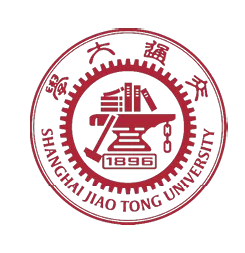
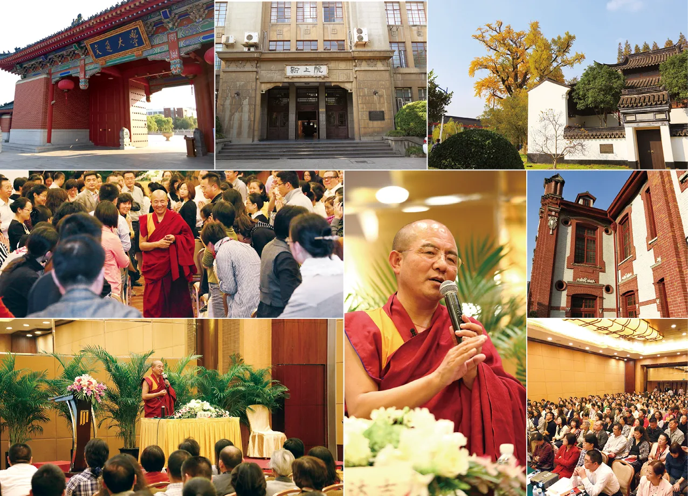
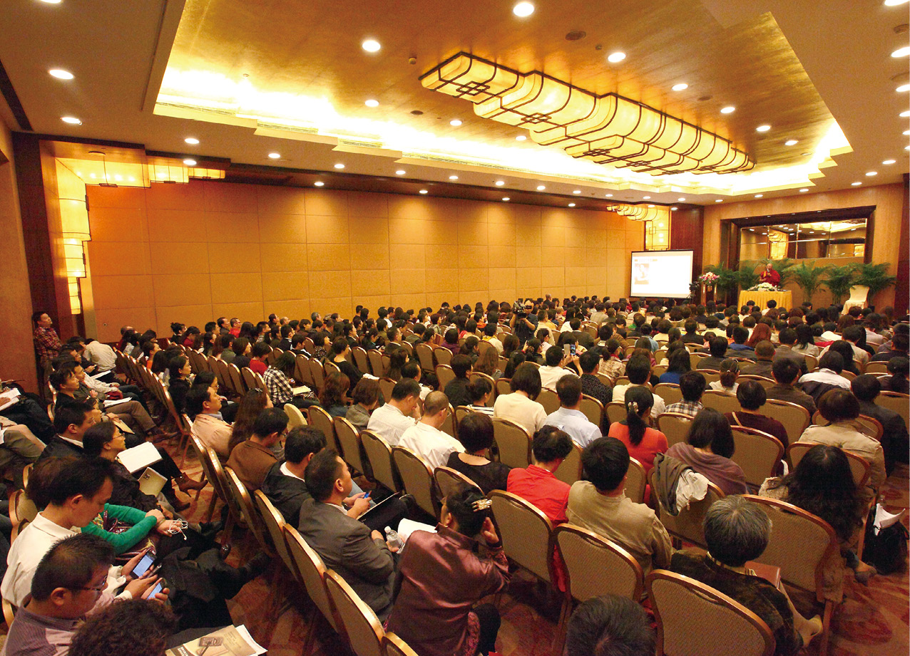

幸福不是欲望的满足，

是有一颗知足之心。

第34场

上海交通大学

Shanghai Jiao Tong University

中国·上海

2012 / 10 / 24

## 幸福的根本是心

Seeking the Source of Happiness in Your Heart

主持人：

交大海外教育学院国学班自创立以来，一直致力于向各界朋友提供最好的文化和精神美食。现今的社会物欲横流，处处充满激烈的竞争，在重重压力之下，人们的内心越来越浮躁、焦虑。希望通过我们的课程，能够向社会输送正能量，给人们带来内在的自在、安宁和解脱。

在以往的讲座中，我们邀请过众多学术名家，如易中天先生、于丹老师、钱文忠老师等。今天，我们邀请到了在国内外享有盛名的索达吉堪布，应该说这是在座各位的荣幸。下面，有请海外教育学院项目中心张广义主任致欢迎辞！

张主任：

上周，央视新闻联播报道了“桂林四兄弟寻母事件”，在社会上引起了轰动。这种轰动效应折射出大众对传统美德的渴求。

为什么我们要学习国学？因为国学能帮助我们树立正确的价值观，明白何为善、何为恶。当今时代，物质比较丰富，对绝大多数人来说，活下去已不再成为问题。现在的问题是怎样活得幸福。这个时候，就不得不涉及价值观。我认为，如果全社会能重视传统文化，广泛开展国学教育，一定会有助于大众树立正确的价值观，如此一来，人心就会从根本上好转，人们才会拥有真正的幸福。

在学习国学的基础上，如果进一步学习佛法，所获的利益就更大了。前年，我有幸参加了太湖大学堂的学习。记得当时南怀瑾老师说：“中华文化博大精深，有两个内容非常深奥，学起来也特别费劲，一个是《易经》，一个是佛法。”大家知道，南师本人也有修藏密。今天，我们荣幸地请到了藏传佛教的大师——索达吉堪布，希望以他的佛家智慧为我们解开幸福的密码！

主持人：

提起索达吉堪布，在座各位或许并不陌生。堪布是当今著名的佛学大师，他从1985年开始在喇荣依止法王晋美彭措学修佛法，后跟随法王进行全球弘法，足迹遍布东西方各国，每至一处，都受到崇高的礼遇。

在堪布的微博里，曾有网友问：“我们真正需求的应该是什么？”堪布答道：“心灵的安宁、自在和解脱。”通过今天的演讲，希望堪布能将安宁、自在和解脱传递到各位心灵深处。接下来，有请堪布给我们带来“幸福的根本是心”！

今天的话题是“幸福的根本是心”，类似话题我在其他学校讲过，本来我想换一个主题，但交大方面说许多人喜欢这个话题，我也觉得这个话题有很强的现实意义，所以最终还是按原定安排讲。

最近，央视记者在各地采访，他们向每位受访者提出同一个问题——“你幸福吗？”受访者给出的答案可谓千奇百怪。从这些答案来看，我觉得有些人找到了幸福，有些人还没有找到。

借着这阵风，也有记者问莫言先生：“你幸福吗？”莫言干脆地回答：“不知道。”随后，他解释道：“幸福就是什么都不想，一切都放下，身体健康，精神没有任何压力。我现在压力很大，忧虑忡忡，能幸福吗？但要说自己不幸福，你可能又觉得我太会装了吧——刚得了诺贝尔奖能说不幸福吗？”

在一般人看来，荣获诺贝尔奖，不仅有750万元的巨额奖金，而且名声远播至世界各地，肯定非常幸福。然而，莫言却直言不知道自己幸不幸福。如此看来，他确实敢说真话。

站在佛法的角度，顺着莫言的话思维下去，就顺理成章地涉及了今天的主题。

## 一、幸福无关乎外境

所谓幸福的根本是心，换言之，就是幸福不在于外境。

当然大家要明白，所谓幸福的“根本”是心，不是说100%取决于心，而是说主要取决于心。

下面，我从几个方面略加阐述。

### １．幸福≠财富

对缺衣少食之人来说，有了必需的财富，确实可以带来一定的幸福。然而，当基本生活得到满足后，财富的增长就不会带来幸福的持续增长了。

举例来说：从没有房子过渡到拥有一套房子，你的内心会有强烈的幸福感；此后，如果你不满足，继续购买第二套、第三套房子，甚至不满足于在国内有房子，又在加拿大、美国买房子，这些多余的房子就不会给你带来明显的幸福感了。

许多人轻率地认为：只要有了巨额财富，我一定会非常幸福。然而，事实并非如此。在现实当中，许多富人生活得并不幸福。好莱坞一代影后伊丽莎白·泰勒曾说：“我这一生，拥有财富、名声、成功、容貌，然而从来没拥有过幸福。”

有时候，过多的财富非但不会带来幸福，反而会带来痛苦。这个道理其实很简单：原来你住平房，一旦搬进豪华别墅，物业管理等费用马上就增加了；原来你开一般的车，一旦换成高级轿车，保养等费用也随之增加了……随着开销的增加，压力和痛苦也会随之而来。

在佛法中，对财富的过患说得极为透彻：“财富首先有积累的痛苦，中间有守护的痛苦，最后有灭尽的痛苦。”世间的智者也说：“在这个世界上，80%的幸福与金钱无关，80%的痛苦却与金钱息息相关。”

认识到财富可能导致的过患后，有些聪明的人断然舍弃了过多的财富。英国《每日电讯报》（The Daily Telegraph）报道：奥地利有一个叫阿伯德尔的百万富翁，因为有感于财富不仅没给自己带来快乐，反而让自己痛苦不堪，他把所有的财富捐给慈善机构，之后搬进一幢小木屋，过起了普通人的生活。

我接触过各阶层人士，通过反复观察他们的生活，我对佛陀所说的生活不堕二边之理生起了极大信心——在这个世上，如果什么条件都没有，生存下去确实有困难；但如果条件过于奢华，享受得太过分，不仅没有幸福可言，甚至会感觉非常无聊。

例如，刚入住五星级宾馆时，你可能感觉非常惬意，可是这股新鲜劲一过，就感觉和住在土房里没什么区别了，时间再一长，甚至会觉得一点意思都没有。

因此，对物质的追求应当适可而止，这一点相当重要。不幸的是，现代人一味盲求钱财，已经迷失了人生的方向。造成这种情况，我认为教育负有不可推卸的责任。现在的教育一味强调物质发展，鼓吹钱财越多越好，很少提及心灵的成长。但事实上，所谓的发展，绝不只是物质的增长，如果以心灵的堕落和道德的下滑为代价换取物质的增长，这非但不是发展，反而是一种彻头彻尾的倒退。

正因为如此，我才特别赞叹国学教育，也赞叹致力于国学教育的老师们，依靠他们的辛勤付出，在这个世风日下的时代，许多年轻人的心灵和智慧才有了提升的机会。在座的同学们也应该感恩这些老师，要尽量参加传统文化学习，虽然会付出一些时间和精力，但这种付出非常值得，它会给自己带来精神上的富足。

从总体上讲，与古人相比，现代人普遍缺乏内在的精神财富。古人虽然物质较为贫乏，内心却很富裕。现代人吃穿不愁，内心却极度空虚，非常可怜。

人生在世，应该活出点意义，不能为了活着而活着，否则就和禽兽没有区别了。禽兽除了白天觅食、晚上睡觉，再没有其他追求。如果人也如此，只知道吃吃喝喝，既不考虑心灵的塑造和道德的提升，也不考虑如何利益他众，和禽兽就相去不远了。

### ２．幸福≠地位

古往今来，人类社会涌现过无数成功人士，当这些人身居高位时，拜访者络绎不绝，家中每日高朋满座；然而一旦地位不保，亲朋好友会纷纷远离他们。就像一棵树，夏天枝繁叶茂，百鸟群集其上，发出动听的鸣声，严冬一至，枝叶凋零，群鸟纷纷离去。所以，世间的地位没什么可信赖的，把幸福寄托在地位上显然是不明智的。

在明眼人看来，轮回中的地位再高，也没有实义。顺治皇帝在《出家偈》中，曾发出这种感慨：“黄袍换却紫袈裟，只为当初一念差，我本西方一衲子，缘何落在帝皇家？十八年来不自由，南征北战几时休？朕今撒手归西去，管你万代与千秋！”

然而，愚者因为看不破，始终放不下虚幻的地位。《庄子·秋水》记载，庄子的朋友惠施当上了梁国的宰相。一次，庄子去拜访惠施，惠施以为他想谋夺自己的相位。庄子知道了惠施的想法，就给他讲了一个故事：“你听说过南方的奇鸟鹓吗？鹓从南海飞到北海，这么长的路程，不是梧桐不栖身，不是竹实不充饥，不是甘泉不饮用。有一天，鸱得到一只腐烂的老鼠，刚好鹓从头顶飞过。鸱急忙护住腐鼠，发出‘吓’的怒斥声。现在，您也想用您的梁国吓我吗？”

放眼今天的社会，贪执地位的愚者实在太多了。短暂的人生几十年，有些人一直在为了地位苦苦追求：从科员爬到科长，从科长爬到局长；从地方往市里调，从市里往省里调……从来没有满足的时候。

以佛法的智慧来看，企图依靠高位来获得幸福，这完全是行不通的。为什么呢？因为轮回的本性即是痛苦，身为沉溺轮回苦海的凡夫，不管再怎么折腾，得到的只能是身心的无尽痛苦。

对于这个道理，伟大的古印度佛学家圣天论师在其名著《四百论》中说得非常清楚：“胜者为意苦，劣者从身生，即由此二苦，日日坏世间。”

所谓“胜者”，就是有地位、名声、钱财之人。所谓“为意苦”，即身体无须吃苦，可是内心却痛苦不堪。

在座各位或许就是如此。从相貌、穿着来看，你们福报很不错，应该不会为吃穿操心。不过，你们的内心可能有各种担忧：我的企业会不会倒闭？我的工作会不会不顺利……个别人甚至会为此而失眠，不得不经常服用安眠药。

所谓“劣者”，是指没有地位、名声和钱财，生活在社会底层之人。所谓“从身生”，是指劣者的痛苦由身体而产生。

对于人生，“劣者”无有太多奢望，他们每天都在为维持生存而挣扎。我去过一些贫困地区，遇到过不少此类众生。你们也应该知道，目前全球大约有5000万人饱受饥饿之苦，这些人大多居住在非洲。我看过非洲饥民的照片，他们就像佛经中描述的饿鬼一样：四肢枯瘦，肚子凸起，什么食物都没有，只能以泥土、树叶充饥。

如果有人因为地位而痛苦，这就属于“胜者为意苦”。说实话，这种痛苦纯属自找。他们真该好好反省一下：世间的地位再崇高，也就是几十年而已，这样的地位有什么意义呢？

佛家有一句话——“得失从缘，心无增减”。意思是，对于得失，要抱着随缘的态度，心不要随着外境起起伏伏。希望大家记住这句话，对地位看得开一点，没必要为此而揪心痛苦。

### ３．幸福≠感情

还有人把幸福建立在感情上，这也是错误的。

人应该有自立精神，即使没有任何依靠，也要生活下去，如果内心没有主宰，将希望寄托在他人身上，最终一定会大失所望。

事实上，感情不仅不等于幸福，而且往往是痛苦的来源。《涅槃经》云：“因爱生忧，因爱生怖，若离于爱，何忧何怖？”意思是，世人因为爱产生忧虑，因为爱产生恐怖，如果没有爱，何来忧虑和恐怖呢？

现在的年轻人情执极为深重，他们视感情为人生头等大事，一旦感情遇到挫折，就没有了面对现实的勇气，极端者甚至会选择自杀。

造成这种情况，我认为媒体导向难辞其咎。看看时下热播的视影节目，几乎都在宣扬感情至上，天天观赏这些“精彩”的节目，年轻人在感情的漩涡中自然越陷越深。

其实，感情只是生活的一部分，远非全部。对于感情，我们不必过于执著，更不要将幸福完全寄托在感情上，否则，一旦感情出现危机，自己的幸福马上就没有了。

### ４．执著外境＝痛苦

一份资料显示：中国上班族的压力高居全球第一，中国过劳死人数也高居世界第一，每年有60万人因劳累过度而死亡。

国际医学杂志《柳叶刀》（The Lancet）的调查显示，目前每10个中国人中，就有1个罹患精神障碍疾病。该杂志估计，中国罹患抑郁障碍的人为6100万。

为什么中国人压力过大、精神不健康？说到底，就是对外境贪执太大。我们的心总是不满足，看到别人有什么，自己马上要拥有，甚至还想超过别人，这个时候，压力和痛苦就随之而来了。

有时候想想，众生确实很可怜。每次到熙熙攘攘的大城市，我总有到了蚂蚁窝的感觉，触目所及，所有人都在为自我而奔波——我要快乐、我要成功、我要……很少有人想到帮助他人、回馈社会。可想而知，以这样的心态去奔波，怎么可能不痛苦？

美国摇滚巨星“猫王”（Elvis Presley, 1935-1977）说：“尽管什么都尝试过，可是我还是不满意！”德国哲学家叔本华（Arthur Schopenhauer, 1788-1860）说：“财富就像海水，饮得越多，渴得越厉害。”佛经中更是一针见血地指出：“求得不成，发生热恼。”所以，贪执越大，痛苦越大，这就是无欺的缘起。

聊以自慰的是，在这方面，我还算可以。一直以来，自己对物质没有太多希求，不管到哪里，除了买几本书，就没有特别想买的了。我并不是炫耀自己修行有多好，一方面这出于天性，同时也与我的身份有关——作为出家人，本来就不需要太多。

既然痛苦源自对外境的贪执，要想远离痛苦，就必须对治贪执。在此过程中，光说不练是不行的，必须拿出实际行动。就像一个病人，光是说治病没有用，必须切实对症下药。

最近，记者逢人便问：“你幸福吗？”我觉得这种调查意义不大，因为它没有后续的实际行动。

由于长期的串习，要断除对外境的贪执，必须下一番苦功。以在座各位而言，今天听一堂演讲远远不够，下来以后，还要阅读相关书籍并且深入思维其中的道理。

## 二、满足了，才会幸福

前段时间，有记者在微博上问我：“你幸福吗？”我回答：“幸福。”记者又问：“你为什么幸福？”我说：“因为我有满足之心。”

这是事实，如果一个人内心有了满足感，即使外在不尽如人意，照样会非常幸福。

美国盲人作家海伦·凯勒（Helen Keller, 1880-1968）说：“假如给我三天光明，我就是最幸福的人。”

在座各位一年365天都有光明，可因为不知满足，并不觉得多么幸福。或许有一天自己双目失明了，那时才体会到：原来，能看到五彩缤纷的世界，这是多么幸福啊！

南非总统曼德拉（Nelson Mandela, 1918-2013）曾因反抗种族歧视而坐牢27年，他在回忆录中说：“坐牢的时候，每天晒半小时太阳，这就是最幸福的事。”

对我们来说，晒半个小时太阳算什么？只要愿意，天天晒太阳都没问题。因此，对比曼德拉的狱中生活，我们就知道现在有多么幸福。

可惜的是，我们往往是身在福中不知福。没病时不觉得什么，一旦卧床不起，才意识到：以前没病时多幸福啊，可惜那时没有珍惜！现在和家人相处时觉得很平常，一旦失去了家人，才醒悟过来：从前阖家团聚时多么快乐啊，那时却没有珍惜！

对智者来说，无须在外境上得到什么，有了一颗随缘知足的心，再平淡无奇的生活也能活出幸福和自在。

我看过《塔莎奶奶[^1]的美好生活》（The Private World of Tasha Tudor）一书。书中说，塔莎奶奶住在乡间的农庄，种植花草，饲养小动物，自己纺线、织布、缝制衣服，过着朴素的田园生活，她的幸福令无数人羡慕不已。

在我的家乡，有一位住山的修行人，这位隐士的幸福也是常人望尘莫及的。他在深山里盖了一间茅棚，除了一点干粮和一两套换洗的衣服，再没有什么值钱的东西了。由于无须担心被窃，他已经二十多年没锁过门了。在远离尘俗喧嚣的深山里，他每天以诵经、禅修度日。

有一次我去探访他，刚到茅棚前我就陶醉了：头顶是蓝天白云，四周是郁郁葱葱的森林，不远处，小溪在潺潺地流淌，到处是鸟语花香，自己似乎置身世外桃源，一切烦恼和不快都了无踪迹。

所以，只要我们平息了贪欲，对现有的一切有满足感，当下就能拥有幸福。对这个道理，有许多精辟的阐述。莲池大师曾说：“人生解知足，烦恼一时除。”佛经中也说过：“无欲无求，身心自在。”

相反，如果总不满足于现状，就很难免于痛苦了。有些人月薪2000元，看到别人月薪3000元，马上产生不平衡：“为什么他挣得比我多？不行，我一定要超过他！”攀比心一产生，痛苦就随之而来了。

## 三、通往内在满足和幸福之路

如何达致内在的满足和幸福？这当然见仁见智，依我看，最好是向宗教和精神传统中寻求答案。

科学研究发现，信仰宗教者的幸福指数普遍较高。2010年至2011年，为了研究幸福感与宗教信仰的关系，盖洛普公司在美国进行了67.6万次电话采访，调查结果显示，笃信宗教者幸福得分为69.2，无宗教信仰者幸福得分为65.3。

在遇到挫折时，信仰宗教者更易走出困境。一位佛教徒曾向我坦言：“因为种种不幸，我一度痛苦万分，我觉得世界对自己太不公平了，好几次，我想到了自杀。好在不久我遇到佛法，在佛法的加持下，终于摆脱了那段阴影。否则，真不敢想象自己还在不在人世。”

我绝对无意于给佛教做广告，但我也不得不指出一项事实：虽然各大宗教有一个共同的愿景——通过心灵的教化增上世人的福祉和安乐，但从结果来看，显然佛教的表现最出色。

以全民信奉藏传佛教的不丹而言，它被公认为世界上最幸福的国家。2008年，有个美国记者做了一次环球考察，之后写了一本书——《世界上最幸福的地方》（The Geography of Bliss: One Grump's Search for the Happiest Places in the World），书中提到了十个最幸福的国家，不丹就是其中之一。

对不丹人的幸福感，我有着切身体会。1990年，应不丹国王邀请，法王晋美彭措前往该国访问，当时我随同法王在不丹待了半个月。印象中，不丹不甚富裕，全国总共不过几架飞机，可是每个不丹人都非常满足，人人身上洋溢着快乐的气息。

我还记得，在不丹各地，随处可见意味深长的小诗。有一首诗是这样的：

当最后一棵树被砍倒，

当最后一条河被抽干，

当最后一尾鱼被捞出，

这时，人们才明白，

原来，金钱并不能替代一切。

简简单单几句话，字里行间却透出对生命的关怀以及破坏大自然的反思。

除了不丹，在藏传佛教盛行的青藏高原，人们的幸福感也非常高。如果到青海、西藏一带调查，我相信得到的指数不会低于不丹。在这块最偏僻、也最接近蓝天白云的土地上，不管老人、年轻人还是孩子，脸上始终挂着灿烂的笑容，内心的幸福一览无余。

相比之下，城市里的人就不同了，物质条件虽然无可挑剔，内心却几乎没有幸福可言，有的只是说不尽的忧愁和痛苦。

对于这些不幸的都市人，我的建议有二：一是学习佛法，掌握佛教的调心法；二是试着出去走走，看看修行者的生活，感受另一种度过人生的方式。人如果不跳出狭隘的圈子，每天只顾着吃喝拉撒，日复一日重复朝九晚五的职场生活，到一定时候不仅会感觉极度乏味，甚至会彻底迷失人生的方向。如果能换个角度体验，或许会有一些新的感悟。

说起调心之道，在佛教中可谓数不胜数，在此我向各位推荐的是禅修。目前，禅修在国外得到了广泛重视。在美国，成千上万人通过禅修提高了生活质量。在西方国家，许多大学和企业都有禅修中心。由于时间关系，今天我没办法细讲怎样禅修，有兴趣者课后可以查找相关资料。今后，大家也可以试着禅修，早晚禅修几十分钟，看看有何感受。

其实，人应该懂得调节生活。作为大城市里的人，不忙是不可能的，但如果光顾着忙，把自己搞得疲惫不堪，甚至累出一身病，那就得不偿失了。就这一点而言，我还是比较推崇从前的生活方式，古人的生活简单且有规律，该工作就工作，该吃饭就吃饭，该休息就休息，不会把精力浪费在无意义的事上。和古人相比，现代人实在可怜，终日忙忙碌碌，一刻空闲都不得。别的不说，光手机就弄得自己疲惫不堪：早上睁开眼，第一件事就是开手机；白天要么接打电话，要么收发乱七八糟的信息；一天忙碌下来，直到晚上休息了，手机才跟着“休息”。

## 四、追求永恒的幸福

最后，我想提醒各位：生命之轮无始无终，相比今生短暂的幸福，我们更应该追求未来永久的幸福。

有些人认为：人死如灯灭，死后一切都结束了。这种想法大错特错。死亡固然是此生的结束，但更是漫长来世的开端。如果不承认这一点，人就无异于石头了，甚至不如石头——人最多活一百多年，石头“活”的时间还更长。

受环境和教育影响，今天，大多数人都不知道自己有前后世。各位恐怕也不例外，虽然身为交大的高材生，许多人却从来没思考过自己生从何来、死往何去。这就是现代人的最大悲哀！

两千多年前，大慈大悲的佛陀就告诉我们，在无尽的生死轮回中，每一世的身体会消失，但心识不会无因无缘消失。只有明白了这个道理，我们才会对自己的生生世世负责。否则，如果执著生命就是今生几十年，以这种短浅之见，得到的最多是几十年的安乐。

最后，我诚挚地期盼各位：跳出旧有窠臼，试着去了解一些有价值的知识，构建起对生命正确、圆满的认知，让自己的生命变得有意义，也给其他生命带来快乐！

现场互动

问：一个人达到“应无所住而生其心”时，犯戒还会有因果报应吗？

堪布：这句话出自《金刚经》，意思是应当一切不住而安住于心性光明中。六祖惠能就是听到这句话开悟的。

不过我们要知道，虽然万法本性皆空，但世俗显现是不灭的，就像做梦，虽然梦境虚幻不实，可是梦中照样有苦乐感受。既然世俗显现无欺存在，我们就要励力断恶行善。否则，如果坏事做多了，阿赖耶识里就会积累恶的种子，这些种子也许今生成熟，也许来世成熟，最终会让自己感受痛苦的果报。在现实中，有些人命运多舛，有些人百病萦身，这都和宿世的业力有关。

问：福报大的人拥有财富、地位，可是他们往往不幸福，反而是社会底层的人感觉更幸福，如此说来，岂非财富、地位不等于福报吗？

堪布：财富、地位是福报，但它们会带来什么后果，则取决于我们如何运用。运用得当，这种福报可以给自他带来幸福，假如运用不当，反而会带来不幸。比如我有财富和地位，如果我用这些资源帮助他人，这对自他都有意义；如果我用来做不如法的事，那还不如没有这种福报。

问：如何让众生相信轮回？

堪布：是否相信轮回，主要取决于个人的因缘。现在有不少关于前后世的书籍，如果多看这类书籍，也会逐渐接受轮回的理念。

有些人说：“因为我不相信，所以我不承认轮回。”这种说法很不理性。如果人死真的如灰飞烟灭，什么都没有了，你不信倒也罢了，但如果死后有来世，那个时候你该怎么办呢？

实际上，轮回并非佛教一家之言，许多宗教都承认轮回，甚至很多非宗教徒也承认前后世。世界上有不少能回忆前世的人，这些人当中，有相当部分是无宗教信仰者。

有些人可能会问：“既然存在前世，那我为什么不能回忆前世？”这是因为入胎后有胎障，它让前世的记忆隐没，所以只有个别人能回忆前世。这个道理很简单，不必说前世，随着时光的流逝，我们儿时的经历大多都隐没在记忆的长河中了。

真要否认前后世，必须有可靠的依据，不过这种依据恐怕是找不到的。我关注前后世这个问题已有二十多年，在此过程中翻阅了大量资料和文献，现在我确信：前后世存在有充分依据，不存在的依据绝对找不到。

总之，前后世不是信则有、不信则无，它其实是生命的真相，大家应该拿出一定时间探索这个问题。

问：轮回的本体与人的心或灵魂有什么关系？

堪布：所谓轮回，就是在六道中不断轮转，其中天、人、阿修罗是三善趣，地狱、饿鬼、畜生是三恶趣。今生作恶，来世会转生三恶趣。今生行善，来世会转生三善趣。如果行持出世间善法，就可以超离轮回。这些道理在佛经中有广说。

轮回的本体就是心或者灵魂。无始以来，我们在轮回中做过各种众生，这都是心被业力牵引所致。在流转轮回过程中，由于经历不同，众生的习气也不尽相同。以两兄弟来说，先天的父精母血一样，后天所受的教育也一样，然而由于宿世因缘不同，很可能一个人性格善良，另一个人性格恶劣，爱好、特长、能力也各不相同。

如果要深入分析流转轮回的这颗心，就必然涉及佛教的第三转法轮。第三转法轮认为，心性光明永远不会消失，在凡夫位时，心被客尘烦恼遮蔽，成佛后，一切客尘烦恼都无余清净，平庸的凡夫心转依为如来的智慧。这个过程好比提炼黄金，刚开始黄金与杂质相混，通过反复提炼，最终才成为无垢的纯金。

佛教极为重视对心的探索，我也希望你们对心作一番探索。如果懂得了心的来龙去脉，人生的很多问题会看得比较透，处理起事情来也会游刃有余。

问：怎样才能改变当前大学生信仰和道德缺失的现状？

堪布：作为一个藏族人，我从小接受的是佛学教育，没受过汉地的国学教育，不过后来接触到国学典籍后，我感觉非常殊胜。我经常想，如果年轻人都能学习国学，国家和社会就有希望；如果不重视国学，人心彻底变坏了，物质再发展也没有意义。

十年“文革”是一场浩劫，这场浩劫革了传统文化的命。在座各位都是这场运动的受害者，像《弟子规》《三字经》《论语》《道德经》这些典籍，以前基本上没系统学过，确实很可惜。

怎样才能恢复传统文化？一方面教育部门要承担应有的责任，另一方面每个有心人也要努力，如此上下齐心，传统文化就会遍地开花，社会风气也会从根本上好转。

其实，仅从饶益自身来讲，我们也需要推广传统文化教育。再过20年，在座不少人都成了拄着拐杖的老人，如果现在不对儿女传递国学思想，等到那个时候，他们就不一定管你了。

弘扬传统文化不是说说就行了，必须有实际行动。如果你们做不了很大的事，可以从弘扬《弟子规》入手。《弟子规》非常简单，每个人都应该会讲，如果实在找不到听众，可以给自己的孩子讲。

问：我们应该选择怎样的膳食方案？

堪布：从健康角度来讲，吃素是人类的最佳选择。科学家发现，人的身体并不适合肉食，并且动物携带有许多病菌，肉食可能导致染上动物的疾病。

站在大乘佛教的视角，吃素更是理所应当的，退一步讲，即便不能吃素，也不要点杀。说实在的，食肉就是杀生，这辈子你大口吃肉，似乎很潇洒，下辈子就不好说了，很可能你变成动物，从前被吃的动物变成人来吃你。

不懂因果的人可能觉得这种说法很可笑，不过，在因果面前，某些人觉得可笑之事，却往往是残酷的现实。

各位朋友，希望你们深深思维这些道理。

问：请开示一下放生的道理。

堪布：放生就是解救屠刀下的生命，这种善行的意义难以言说。试想：假如你正要被枪毙，此时有人将自己解救出来，你的内心会有何感受？

有些人声称：“动物生来就是给人吃的。”这实属大邪见。对懂得生命价值的人来说，动物和人的生命没有区别，都值得我们尊重、爱护。

如果自己以前杀过生，今后应当精进忏悔，要多念金刚萨埵心咒——嗡班匝儿萨埵吽，并且多放生，这样就能清净杀业。

问：南怀瑾先生于今年9月29号仙化，您如何看待南老的弘法事业？

堪布：对南老一生无偏地弘扬儒释道，我发自内心地随喜赞叹。我曾几次想拜访他，可惜因缘都不凑巧。那天得知南老圆寂后，我特意带人为他念了经。

我看过南老的书，感觉他确实是一位博通古今、学贯中西的大师。尤为难得的是，直至九十高龄，他还在不懈地传道授业。今天，这样的大师非常罕见。

在复兴传统文化方面，南老可以说居功至伟。20世纪90年代，传统文化在大陆刚升温，南老的《金刚经说什么》等著作风靡全国，许多人依靠他的著作被引入佛门。

虽然南老已经离开了我们，可他的著作依然留存于世，所以大家也不必过于伤心。

当然，也有个别人对南老持不同看法，这也很正常。自古以来，当一个人有名声、事业时，旁边总会有人议论纷纷。

问：如果想学修中观，应该从何入手？能否介绍一下中观的学修次第？

堪布：要想学修中观，可以从《中论》、《入中论》和《四百论》这三部论典入手。

学修中观要经历四步境界：首先万法抉择为空性，然后空性抉择为双运，之后双运抉择为离戏，最后离戏抉择为等性。

修行中观有两种途径：一是以窍诀方式直接安住空性，就像《六祖坛经》中所讲的那样；还有一种方法是通过反复观察，抉择出万法皆空的正见，然后安住于此见解。

问：我有一个朋友，他的佛缘很深，他也一度笃信佛教。然而在现实中，苦难一个接着一个，把他打击得差点崩溃。后来他对佛法信心没那么强了，反而没什么灾难了。这是什么原因？

堪布：你这位朋友的不顺，并非源自他对佛法的信心。

现实生活中常有看似矛盾的现象：作恶时，一切都很顺利；行善时，则违缘重重。这并非因果错乱。一般而言，人在精进行善时，将来的恶报会提前成熟，那个时候往往会出现不顺；而从善法中退失后，生活往往会重归平静，不过这并不值得庆幸，因为恶业并未消失，依然在前面等候着他。

因果非常复杂，只有系统学习佛法，才会明白这些道理。

问：您的人生使命是什么？

堪布：以前，我没有特别的人生使命，只是觉得一辈子多看些书就行了，因为我从小就喜欢看书，从小学、中学到师范，最大的乐趣都是看书。后来我的想法变了，我觉得应该将学习佛法的心得分享给他人。

所谓“堪布”，有把知识传给他人的意思。我到喇荣五明佛学院才几个月，就获得了堪布学位，从时间上看太快了。我想，既然自己是堪布，就要将掌握的真理传递给众生，哪怕只剩最后一口气，哪怕只有一个有缘众生，也要尽心尽力传播佛法。这，应该就是我的使命吧。

问：怎样才能找到人生的使命？

堪布：每个人都要有自己的使命，具体是什么取决于自己的选择。从一般意义上讲，人生的使命在于断除一切伤害众生的恶行，行持一切饶益众生的善行。在这方面，自己要有所计划，哪怕一个月或者一年做一件好事，也是非常有意义的。

[^1]: 塔莎奶奶（Tasha Tudor, 1915-2008）：美国著名生活艺术家、插画家。
