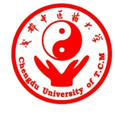
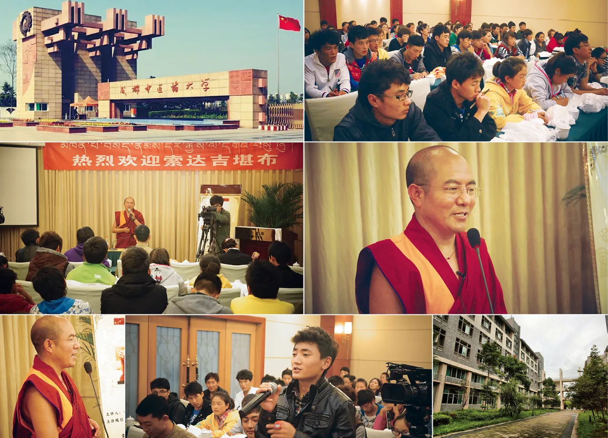
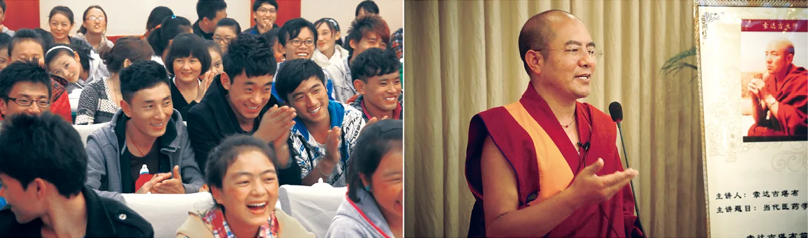

按正规方子配的藏药，

不仅有药力，

更有一种神秘的加持力。

第33场

成都中医药大学

Chengdu University of Traditional Chinese Medicine

中国·成都

2012 / 10 / 21

## 当代藏医药学者的历史使命

Tibetan Medicine: the History and the Future

主持人：

作为医学院校的一员，我们在肩负治病救人神圣职责的同时，也有疑惑：如何在每况愈下的社会风气中出淤泥而不染？如何扮演好藏医药学者的角色？如何看清自己肩负的历史使命，并实现自我价值？

今天，我们很荣幸地请到当今色达喇荣五明佛学院最具影响力的上师之一——索达吉堪布，为我们做主题为“当代藏医药学者的历史使命”的讲座。

下面有请堪布——

今天，按理说，用我们的母语——藏语讲比较好，但学校这边要求讲汉语，因为你们来自藏地的不同地方，我若讲安多语，可能青海、拉萨、康巴的同学不一定熟悉，所以请大家允许我用汉语交流。

今天的话题是“当代藏医药学者的历史使命”。你们学的都是藏医药学，对此我是非专业者，但站在藏传佛教的角度，我们的根是一个。

你们也知道，自古以来通达藏医学的人，也了解佛教；不了解佛教，对藏医学就不会有透彻认识。我们喇荣五明佛学院就有医明学，也就是藏医学，那里除由本院法师授课以外，也邀请著名藏医药学家前去交流，学生们一边学医一边学佛法。所以，藏医和佛教是相通的。

作为藏医药学者，未来的历史使命是什么？治病救人，同时也要弘扬我们的传统医学。

藏医学是藏文化宝库中的瑰宝，如今已为全世界所瞩目，被认为是相当罕见而深具价值的学问。你们考上了这么好的大学，选择了这么有意义的学科，理应为保护和继承这一传统而努力探索。

## 藏医药学的根源是佛教

《四部医典》是藏医药学的根本论典，它源于佛教，里面有许多佛教教义，所以不了解佛法就很难通达。

佛教对医学的认识很完备，不仅有阐述人体结构、疾病来源、治疗方法的理论，这在《金光明经》《佛医经》《医学陀罗尼》等众多经典中都有记载，同时也有丰富的实践，像佛陀住世期间就有一位耆婆医师，他可以做开颅手术，这和现代医学相比，显然是超前的。

由于佛教传入，藏地早在7世纪时，已经有了胚胎发育的研究，《四部医典》中详细记述了胚胎发育的整个过程，比欧洲早得多。今天的西方医学家们看到《四部医典》时，感到惊讶：这么完整系统的医学，何以那么早就出现在雪域高原？他们认为不可思议。

《四部医典》源自宁玛派。藏地有几大主要教派——格鲁、萨迦、觉囊、噶举、宁玛，五世达赖、格日秋吉旺修等大德都认为，它源于宁玛。

当这一学问被传承下来后，多数的教学和实践都留在寺院，一直到今天。寺院里设有门巴扎仓，即藏医院，在这里，学者们要经由一系列程序来继承这门学问，有些深邃意义还要灌顶后才能听受。

作为一种知识，今天它已经被普及了，不过遗憾的是，进入大学后只剩下了理论和学术，传承与传统的实践部分几乎消失殆尽。所以，你们不要以为大学毕业就已精通藏医，远远不是。大学四年加实习一年，五年时间不可能有一个很透彻的了解。

下面我就自己的了解，简单讲讲《四部医典》的来源：

当时，世尊药师琉璃光如来，从心间幻化一位“明智大仙”，从舌尖幻化一位“意生大仙”，接着两位大仙一问一答，成就了《四部医典》。

到了公元8世纪时，这部医典由莲花生大士的大弟子贝若扎纳译出后，被雪域公认为第二大药师佛、国王赤松德赞的上师兼御医——第一世宇妥云登贡布伏藏了起来。

伏藏是隐密保存的意思。有些学者用“埋”字，说这部医典被埋在桑耶寺的殿堂里，沉睡两百多年，但“埋”字不足以表达这种意思。因为那些大师们为后代保存伏藏品时，会用神通力把它藏在虚空里，藏在大海或湖泊里，甚至藏在意识里，这显然不是简单的“埋”了。

后来到了公元11世纪，扎巴吾西（懂俱舍的僧人）从桑耶寺取出《四部医典》，并辗转传给了第一世宇妥云登贡布的第十三代子孙——第二世宇妥云登贡布。之后又经五世达赖喇嘛、萨迦班智达、宗喀巴大师、蒋扬钦哲旺波尊者、麦彭仁波切等高僧大德，在不同时代与环境中将这部医典传承下来。如今，它已然成为这个世间的如意宝。

有人在撰写藏医药学历史时，说《四部医典》是贝若扎纳和另外几人编著的，也有人说是宇妥云登贡布撰著的，其实它来源于续部。在佛经里面，显宗部分称经，密宗部分叫续，而这部医典就是续，密续。所以按藏传佛教的传统，如果你要看或者学习《四部医典》，必须得到灌顶后才有资格。

虽然这部医典是医学著作，但就像我刚才所说的，因为它的佛教渊源，有些传承它的祖师们，也有极高的佛教修行成就。其他的不说，宁玛派的两大祖师都是大圆满虹身成就：第一世宇妥云登贡布，125岁时不舍肉身前往不动佛刹土；第二世宇妥云登贡布，77岁时不舍肉身前往药师佛刹土。这都有明确的历史记载。

总之，藏医药学的根在佛教，希望大家多少了解一些佛教的道理。

## 背诵《四部医典》

听说有些同学在背《四部医典》，这很好，颂词一定要背下来。老师提不提倡没关系。藏传佛教精通五部大论的上师们，年轻时都用功背诵，背得滚瓜烂熟以后，任何时候都能信手拈来、运用自如。你们学医也一样，最好趁年轻背一背这部医典。

青海有一位医生叫门巴蒋扬，七八十岁了，他说他年轻时就把《四部医典》的窍诀部背得非常熟。“文革”期间，他在监狱呆了十四年，根本没有看书机会，但出狱后去考医生，完全凭着记忆，结果考中了。

想想看，你们现在不背，十几年里又不看书，还能记住什么？所以，既然选择了藏医，把《四部医典》的颂文背下来，以后无论在学业上还是实践上，运用起来就方便多了。

大家都是很想学习的。不过，有时候受风气影响，要坚持初衷还是需要一些毅力。大学跟高中不同，这里有自由空间，但是太自由也有两面性：要学好也容易，你可以多学多看，可以结交各类人士；要学坏也容易，一个人在这儿，没有父母家人管束，缺少自控能力就会染上恶习。

读书期间要为以后做准备。你们读医学，就要想着把医学知识用在将来的治病救人上。但就我所知，现在很多学医的人，藏医也好、中医也好，一进入社会就把自己的专业抛弃了，要么做公务员，要么经商，就算进了医院，也只是做出纳，天天点钱。太可惜了。

你们学习藏医，谋生是其次，主要是为了治病救人，这才是自己的使命。

为了完成这一使命，要利用好现有的一切勤奋学习，充实自己。你们的专业是藏医，但西医、中医也要学，其他思想也要了解。现在网络发达，你们大学里的图书室、阅览室资料很丰富，只要你们肯努力，尽可以夜以继日、废寝忘食地学。

## 秉持善良传统

你们身处异地，有些同学还可以，能秉持自己的善良传统，没有变质，但有些同学一来就变了。打游戏、去网吧，信仰忘得一干二净，该学的不学，垃圾知识学一大堆，还自鸣得意……这样下去，怎么回家乡？怎么面对父母？他们挣钱不容易。

你们能来上大学是很好，但将来有没有出息，前途是光明还是黑暗，就要看这几年的努力了。所以我提醒你们：现在不是玩的时候，不是买名牌衣服的时候，也不是在毫无意义的事情上竞争的时候，而是认认真真学习的时候。一定要记住。

还有一点，你们要注意自己的形象。藏民族有许多好的理念，真诚、善良、慈悲为怀，这些要保持好。不要打群架，这些不好，让人一看到我们就怕，一说到我们就反感，这样对我们民族不好。

你们可以学一学潮州人，他们到哪儿都很团结，内部人彼此帮助，对外人不排斥，值得我们借鉴。

你们是来读书的，要和其他民族的人和睦相处。如果藏族人和别人打架，你们不要帮着打，这不是以前藏地偏僻地方的部落与部落之间打架，这是陋习，要舍弃。你们是知识分子，21世纪的藏族知识分子，要懂得宽容，懂得与人和睦相处，这有助于在将来的人生路上，与世界上的各种优秀文化相融。

## 我曾经也想当医生

各位选择医疗行业，我非常随喜，出家前我的理想也是当医生。

当时我有个亲戚叫阿客塔罗，是我们那里有名的藏医，我还在读中学时，就想跟他学藏医了。他不赞叹我读书，“不要再考了，跟我六七年，包你成个好医生。”他常常这么说。

因为他这句话，中学读完我就不想考试升学了，心里老想着当医生，只是迫于老师同学的苦劝，敷衍着把题答完。但结果考上了。考上以后我拿到通知书，也不敢见他，怀着愧疚读书去了。

我读的是师范。当老师也是我的兴趣，医生和老师都是我的理想职业。现在他们问我读什么大学好，我的建议就两个，要么读师范，要么读医学院。因为在我看来，当医生也好，当老师也好，只要你自己争气，对社会、对个人都有非常大的利益。

进师范后，我并未放弃行医的愿望。我有个幻想，想以后一边当老师一边开诊所，所以每天揣着宇妥云登贡布的传记，一遍一遍地看，都翻烂了。

不过一毕业我就出家了，老师没当成，医生也没当成。出家后，在我研究佛法尤其是翻译《释尊广传》时发现，原来佛陀在因地时也做过医生，于是很感慨：伟大的导师也做过医生，行医是多么神圣的职业！

职业是好职业，但现在的医生是不是都是好医生？医院是不是都是好医院？不敢说。在今天这个社会，能够看淡金钱，真正想着治病救人，愿意对患者负责的医生，是比较少的。听一听那些医疗事件，了解一下人们对医生的评价，还是很心寒的。

今年三月份，在哈尔滨一家医院里，一个患者将一名医生捅死了，同时造成三名医生受伤。腾讯网对此做了一项民意调查：读完这则消息您的心情如何？参与调查的人数是6161人，选择高兴的网民居然高达4018人，占到总投票数的65%。全国八十多万医务工作者非常失望：“我们这么辛苦，为什么该杀？”

谁不想当个好医生？但医院毕竟有自己的经济原则：国家给10%，其他只能“以药养医”“以检查养医”了。什么意思？就是医院里每一个人都要完成一定效益，你的工资跟这个有关。这种做法，让医生们不得不另花心思。

有一个藏医每次给人开药时，基本是三千块以上，朋友问他：“为什么开这么多？是药三分毒，对病人不好。”“没办法，年底一定要交那么多，不多开点，到时连工资都拿不到了。”他说。

医生也是人，所谓“人在江湖，身不由己”。但有些事情做多了，也就不当回事了。

2002年，法王如意宝因为阑尾炎到马尔康一所医院进行治疗。检查中，我听到一个医生说：“本来打开肚子看看也没什么，但法王是大人物，不敢……”言外之意，如果是小人物，“待遇”就有些不同了。这是我亲耳听到的，一想起来都心有余悸。

## 做一名好医生

不管怎样，别人是别人，你是你，你们一定要做一名好医生。

我们有优秀的传统——藏传佛教中的慈悲教育，医药典籍中“像关爱自己一样关爱病人”的理念，有这样的思想基础，我想你再怎么为了生活，也不至于堕落成一个坏人。更何况，我们还有学习的典范。

不说佛经论典的记载，不说历史上的名医，现今时代里也有好医生。我认识一个医生，他的原则是，病人需要什么药就开什么药，多一味也不开。这就是好医生，他不把医和钱挂钩，他关心的是治病救人。

美国有一位藏医叫东登，他常在世界各地为人看病，美国、印度、尼泊尔，不管到哪儿只是看病，除了睡觉、吃饭，心思都在病人身上。有一次在两周之内，他看了1096个病人。这是我们“智悲翻译中心”从国外文章中译过来的，真人真事。青海、若尔盖、甘孜州等地方也有这样的医生。为什么他们会这样？因为有利他心，有医德。

这种医德根植于佛教的慈悲教育，超越一般人的生存理念。如果你们想在毕业后找个好工作，让自己过得快乐富足，未尝不可。但你如果行医，就要有责任心，不能变成生意人不择手段地捞钱。

钱不过是人生的一小部分，既然选择做医生，为什么不做一个好医生呢？

## 白玛医生

近代的藏医历史上，白玛家族代代是好医生，也正是他们首次把藏医药带到西方，在国际上显示了它的独特疗效。

1857年夏天，俄罗斯境内发生疫情，一名叫白玛的喇嘛医生（Alexander Alexandrovich Badmaev），被俄罗斯当局邀请到圣彼得堡，从此开始了藏医药在西方的传播。1870年，他的弟弟（Pyotr Alexandrovich Badmaev, 1850-1920）也来到这里和他一起行医。

“十月革命”后，他弟弟的儿子（Vladimir N. Badmaev, 1884-1961）逃到波兰，因为曾经在莫斯科学过西医，所以他能把藏医和西医结合起来用在治疗中。后来这位医生（Vladimir N. Badmaev）的儿子（Peter Badmaev Jr.）从波兰的医学院毕业后，把祖传的藏药处方于1964年带到了瑞士。

在瑞士的苏黎士，白玛医生（Peter Badmaev Jr.）开了一间藏医药房。行医过程中，有人以“药物非法”的名义起诉他，并把他抓了起来。然而，那些曾经接受过他治疗的人却纷纷向瑞士政府抗议，要求卫生局出具一个证明，说明这些药物是非法的。

药监局开始检验。但检验的结果出人意料：在瑞士从未见过这么好的药效。他们发现，原来他带来的古老藏药在治疗心脏病、高血压、糖尿病等疾病上，有独特而神奇的疗效。他立即被释放了。

出来后，他与一位瑞士籍商人合作成立了瑞士白玛公司，用现代化手段生产和销售家族的藏药。而藏药，也从此得到了西方人的广泛信赖。

## 藏药的独特疗效和制作

藏药的独特疗效，来自它的独特配方。按正规方子配的藏药确实有非常好的疗效，因为这里面不仅有药力，更有一种神秘的佛教加持力。

藏药是一种草药，与中药相似。但它不会使用动物的肉，也不像西药用动物做活体实验。那些实验很残忍，西方很多动物保护协会也都抗议，他们认为：为研制药物拿兔子、老鼠等做实验是无益的，因为它们跟人类的结构不同，它们身上的效果在人身上不一定有，而它们身上没有见到的毒副作用，在人身上却出现了。

藏药制作不拿动物做实验，依据的是《四部医典》。《四部医典》将人体的五脏六腑、气脉明点等标示得清清楚楚。基于这种精细准确的描述，才有了藏医药的独特医理和诊疗方式。老藏医们都是虔诚的佛教徒，总是一边念药师佛心咒一边诊治。

念药师佛心咒管用吗？

有实践体会的人明白，这就是佛教中的“加持”，以后你们给人看病时，也要借助这种加持，不要认为多此一举。

当然，高明的藏医在祈祷加持的同时，也精通医理。你们都知道，西医分类很细，学外科的可能不懂内科，学眼科的只会治眼病，但藏医里没有这种局限。藏医的所学相当系统，他可以完整掌握所有医理，学成后即使没有现成的药物，也一样治病。

比如在草原上，有人找藏医看病。他只要摸摸脉，了解一下病情，就可以就地采药、治疗，结果药到病除。为什么他总能找到合适的药？因为对他而言，所有的草木都是药。

你们采过药吗？

找药、认药、采药很有趣。我认识阿坝卫校的几个学生，他们在那儿已读了三四年，但上山采药不过一两次。一两次肯定认不完所有的药。就我所知，有些藏医一年四季待在山上，他们药认得多，也了解药性，配药时更是严格遵循传统。

为什么这么严格？就是为了保证藏药的独特疗效。青海有一位久美医生，他得过许多国际医学奖，尤其在治疗肝病方面，很有特色。我参观过他的药厂，给我的印象就是严格。他的药稍贵一点，但严格的管理和生产，既保证了藏药的效果，也维护了藏药的声誉。

这不是所有藏药厂都能做到的，有很多藏药厂还不成熟，可能需要研究上的支持。不过现在的藏医药大学或专业还不太多，只有几所、几个系而已。再说交流也不通畅，虽然学校里有学术理论，医院里有临床经验，但双方配合不好的话，也很难形成规模。

在这个时代，藏药制作需要新理念、新技术，但也不是要排除古老的传统。这种传统寺院里还有，你们在学习之余，可以到寺院看看。我们佛学院的藏医院每次配药时，都要由几百位出家人严格遵循《四部医典》的要求制作，禁语七天，同时还要念经加持。这样一来，藏药的殊胜疗效全部保住了。

## 几点期望

最后我有几点期望：

首先，作为未来的藏医，你们既要通达医理，也要树立医德。要通达医理、深入《四部医典》，就要了解佛教教义；而要树立医德，最好多修习慈悲心。

大学四年的教育，在知识或医术方面，我相信你们会有一定的积累，但德行要靠个人培养。我们的传统很重视德行，没有慈爱心的人是做不了好医生的，对自己对社会，也不会有什么大的利益。

你们在学校读书期间，心一般比较纯洁善良，可到社会上就不好说了。社会是大熔炉，“近朱者赤，近墨者黑”，环境会影响人，把人染污。染污得久了，你眼里除了金钱、地位、竞争以外，可能不会再有学生时代那种善良的光了。所以，你们在学习知识的同时，也要经常修习慈悲心，塑造善良人格。

其次，要保持信仰。我们是藏族人，藏族人与其他人不同的地方，就是从小信仰佛教。既然是从小就信仰，到了中间最好也不要丢掉。

我知道年轻人喜欢改变，也正在改变，但信仰最好不要改。可能你们还不了解佛教的价值，我最近在和汉地大学生交流佛学的过程中发现，他们对佛教的兴趣、研究和见解，已经远远超过了我们。我们是全民信佛的民族，骨子里有信仰的，为什么不珍惜？

再次，要热爱自己的家乡。雪域高原是世界屋脊，也是地球上的四个“超净”地区之一，此外还有南极、北极和非洲沙漠三个地区。我们的家园是天然净土。

遗憾的是，这个让全世界都向往的地方，有不一样蓝天、白云、雪山、溪流的地方，现在的藏族年轻人不喜欢。你们喜欢城市，想住进城市里，买车买房过城市生活。可是你们也看看，为什么城里人现在喜欢往藏地跑，一放假就开车入藏？

“城外的人想进去，城里的人想出来。”

可能是这个道理。你们想进去，以为里面的人过着天堂一般的生活，可他们想出来，因为在压力和污染的逼迫下，想到高原上透透气。一到高原，那种开阔清澈的景象，让城里人几天都沉浸在愉悦和舒心当中。

他们的想法在变，而国外人的想法早就变了，越是有钱的人，越想到寂静地方生活。你们可能不知道，你想要离开的地方，正是人家理想的世外桃源。

最后，要继承和弘扬藏文化。我们的文化是在清净山川中孕育的纯洁文化，如今给整个世界带去了清凉。有西方人认为，这是一种强势文化。

德国马普研究所一位学者对我说：“你们的文化在欧美国家非常强势，不仅是藏传佛教或藏医学，就是青藏高原的风光也令人向往。但不知为什么，它在你们本民族却是弱势的，是不是你们的年轻人对自己的文化和信仰太缺乏了解？”

你们确实缺乏了解，有人甚至想抛弃它。如果你抛弃了它，去追逐汉文化和西方文化，追到最后，会不会跟着那些热爱我们文化的人回到自己的本土？那时候，我想你肯定很累了，想重新认识自己的文化也没什么力气了。与其如此，倒不如现在就做点什么。

做什么呢？不是要高喊“我们的文化如何如何”，而要思考：古老的藏文化如今落在我们这一代人手里，我们捧着的，是不是真正的如意宝？如果是块石头，扔了也罢，但西方和汉地人为什么都说“来寻找文化瑰宝”？如果人们只是来欣赏山水，我们也不必小题大做，但为什么他们去寺院、去佛教圣地寻找智慧宝库？他们把智慧带回去，用在生活和工作上，为什么那么开心，甚至感叹“得救了”？

藏文化的确是如意宝，你们一上大学就想抛弃它，是你们弄错了。

从现在开始，希望大家夜以继日学习，充实好自己，等知识的涓涓细流汇成大海，智慧海洋波澜壮阔时，你们就可以弘扬藏医学、藏文化，利益人类和社会了。

现场互动

问：我是2010级藏医班学生，来自阿坝州马尔康县。请问，佛教与科学有什么本质的差别？

堪布：十年前，我写了一本《佛教科学论》，当时的中国佛教协会会长赵朴初看后，为它题写了论名。这本书对你的问题有详细说明。

总的来讲，科学是后出现的，是大概几百年前在西方兴起的一种新的理论思想。佛教要早得多，按普巴派算法是两千九百多年，按斯里兰卡的算法，也是两千五百多年。科学对物质世界的探索的确给世人带来了崭新视角，然而和佛教的无边世界及业因果等认识相比，却又有所不及。

所以，有相当多的智者认为：用佛法可以很好地解释科学，而用科学却不能很好地解释佛法。

问：我是来自四川甘孜巴塘县的一名学生。我们藏民族有悠久的历史，有名扬中外的藏医学，还有丰富的文学及佛教思想，对此我深感自豪。但在语言方面我有一个问题想请教您：我们的方言很多，在实现藏语言的统一方面，您是怎么看的？

堪布：在藏地形成统一的普通话，是有必要，不过许多有志于此的人经过长期思考后都认为，这在目前看来是非常困难的。

不说别的，就是词典方面，因为是个别地方自己编写的，所以文字上都无法统一，更不用说语言的使用了。你们也知道，自后弘期以来，卫藏、安多等许多地方已经形成了零散的区域，现在要把他们的语言统一起来，显然不是件容易的事。

如果有政府参与，或由威望极高的人召集并且施行，或许有可能。否则，即使我们都觉得有必要，要实现这么庞大的工程，暂时来讲，也不太现实。

问：我是来自甘孜州理塘县2010级的学生。我想问的是：我们为何来到这个世界？

堪布：是为做医生而来的。（众笑）

医生有两种：一是给人治疗身体疾病的；一是给人治疗心理疾病的。我们为此而来。

问：我是2011级藏医班的学生，来自四川省阿坝州阿坝县。我的问题是，我们怎么才能传承藏族的学术思想和高尚人格？

堪布：作为藏族学生，既然来了医学院，就应该努力求学，在学习藏医学的同时，也要学习中医和西医，甚至了解一些现代知识。

为了培养医德，你们可以学习《萨迦格言》《水木格言》《君规教言论》等人规教言，以及《前行引导文》《入菩萨行论》等修行论典，这些对你们将来的工作和生活都很有利益。

放假后，你们可以回藏地寺院或佛学院待一两个月。那里有许多格西、堪布以及品行正直的僧人，你们看看他们是怎么做人做事的，跟着学一学。学了以后，我想脾气不好的人会变调柔，自私的人会懂得利他，乃至每个人都会变得虔诚、精进和有清净心。

不要以为出家人什么都不懂。出家人里是有不如法的，但这是极少数，大多数出家人都在进行系统的闻思修行。你们能背《四部医典》已经算智者了，有些大学还奖励五六千块；但在我们佛学院，能背五部大论和各种续部的人，比比皆是。

在现代的知识领域里，我相信你们的老师肯定有渊博的学问，你们也能学到很多东西，但在传统的医术实践方面，还是要亲近一些老藏医。他们可能住得很偏远，也可能衣衫褴褛，看上去没什么学问，但是当你亲近他们，听他们讲讲生活的故事，说说行医过程中的体会，可以得到很多领悟。

我不算是个现代的人，也不算是很传统的人，但我很愿意向一些老喇嘛请教人生的经验和做人的智慧。我认为这是一条捷径。你们年轻，对前面的路可能也比较迷茫，所以不妨到寺院或各处走走，寻访一些长者或智者。我相信会有收获的。

问：我是阿坝州若尔盖县的学生。作为藏族学生，在这样一个环境里，要学习并回归自己的传统文化很困难，请问我们该怎么做？

堪布：生活在这样一个人口众多的大城市里，不被环境影响的人，的确非常罕见，但此时我们内心应该抱定一些原则。法王如意宝晋美彭措临圆寂前曾说：“莫舍己道，勿扰他心。”希望大家记住这句话，以此作为你人生的准则。

“莫舍己道”，就是不舍弃自己的道。这对我们而言，就是不论在哪里，都不要舍弃自己的语言和服饰；不要舍弃佛教所赋予的信心和慈悲，要跟人合得拢，不仅是藏族人，跟任何人都要和睦相处；在学习当今先进知识的同时，也不要舍弃自己的思想和传统文化。总之，我们的语言、风俗、文化等优良传统，就是我们的道，不要舍弃。

所谓“勿扰他心”，就是不扰乱他人的心。佛教教导我们以慈悲为怀，以菩提心维护和救度一切众生，即使你暂时做不到这一点，也不要伤害别人，不要扰乱他人的心。

这是上师留下的教言。希望你们常常思维这个道理，能做到的话，不论将来如何变化，都可以把自己神秘而独具特色的教义和文化，展现给世人。

问：我是四川阿坝州若尔盖的学生。就我们自己的民族传统而言，从古至今，在拜见智者和具德上师的时候，一定要穿戴特殊的民族服饰，这是我们最基本的恭敬行为。但今天我们受环境等因素的限制，都没有穿，对此请您原谅。

堪布：今天大家是来听我演讲的，不穿藏装没关系，你们平时把藏装放在心里，才是最重要的。如果平时不把藏装当回事，为了听我的演讲才穿一穿，等我走了脱下来一扔，这样藏装不就成了“戏服”，为见上师才穿的？再说，就穿一两个小时，能不能体现你们对本民族的热爱，也很难说。

所以，只要你们不忘记自己的着装习惯，在今天大家都跟着西方走的情形下，随着环境进行穿戴也是有必要的。

问：因为语言不统一，所以来自康藏、青藏、西藏三藏的同学，平时交谈时不能用自己的母语，只能用汉语，对此您怎么看？

堪布：不光是你们，今天我的演讲也是用的汉语，主办方要求这样。也许是因缘吧，到了汉地城市，我这个“汉喇嘛”也不得不讲汉语。

问：我是来自甘孜州炉霍县的学生。现在我常听到一些大学、中学和小学生在说“大话”，自己根本做不到，但说得挺大，对此您怎么看？

堪布：你所谓的“大话”，如果是指大愿，就像在承办一些大事时，为了表明决心和毅力发起大愿，眼前看起来似乎有点困难，但以后会慢慢实现，这样的大愿是可以发的。

如果你小时候说“我要做博士”，别人听了，肯定会觉得你的话有点大，但只要你有毅力就做得到。同样的，当佛教徒发起菩提心，“我要将三界六道一切众生安置于佛果”，这个心再大不过了，但你发心后也进行佛教的修持，就一定做得到。

愿力不可思议。你们在读书阶段如果能为藏医学和藏文化发起大愿，同时也努力实践，我想很多事也并不是做不到的。

不过如果你指的是空话——只说不做的那种，说了也没什么意义。

问：我是来自藏药学的学生。您在《苦才是人生》里讲的无常和违缘的道理，对我的启发和帮助很大，请问您写这本书的初衷是什么？

堪布：《苦才是人生》的销量不错，听说很多人比较喜欢。在这本书里，一方面我讲了一些佛教道理，一方面也介绍了一些藏民族的生活习俗，寓言、故事都有。因为语言很适合现代人，也通俗易懂，所以谁看了都会明白一些人生真相。

问：就如何面对痛苦的问题，请您再开示一下。

堪布：最近我常说一句话：“得失从缘，心无增减。”什么意思呢？当你想要得到某个对境而没有得到的时候，如果懂得“这与我无缘”，从而随缘放下，也就没什么执著了；当你生病失去健康的时候，如果想到“我的病是有因缘的”，也就可以释然了。

从另一个角度认识“痛苦”，会为你带来从未有过的感悟和平静。

问：我是西南民族大学藏文系学生，我的家乡在甘孜州。从整个世界来看，我们藏地的环境是非常圆满的，我们该如何保护自己的环境呢？

堪布：那天我下来的时候，见有很多汉地的车子正往上面去，说是“去马尔康，那儿环境好，度个周末”。

我们藏地的环境是很有魅力，但要保护它，一定要学习先进的知识和理念。现在整个世界被称作“地球村”，借鉴一些成熟的东西，应该是不难的。

问：有些藏族老师和学生排斥佛教，您怎么看？

堪布：这我也听说过，有人甚至说佛教是绊脚石，我听了非常难过。

我们整个民族哪一样不是来自佛教？不说佛经论典，你们学医的人，若否定佛教，不就等于否定《四部医典》？否定佛教，不就等于否定藏文的《诗词》乃至最初级的《三十颂》《音势论》？

老师们不懂，学生们也跟着不懂，好像佛教真的阻碍了社会的进步和发展，多么颠倒。如果有人真的认为佛教不对，你到寺院和出家人辩论一下，我想用不了很长时间，一天下来你就清楚了。

现在全世界都认为藏传佛教和藏文化是稀世珍宝，你们年轻人正应该好好保护它，不要老想着往城里跑。只要大家齐心协力，所谓“众人抬，柴则轻”，就能够继承和弘扬这一文化，给世界带来利益。

问：我是来自甘孜州炉霍县2011级的藏医班学生。佛教中有个偈颂：“欲知前世因，今生受者是；欲知来世果，今生作者是。”这个偈颂说明人有前世后世，而后世的心识是从前世的心识产生的，请问如何能证明这一点？

堪布：生命有前世后世，这是佛教的重要思想，用因明推理和科学实例，都可以证明这一点。

在藏地过去的传统里，没有人怀疑前世后世，现在有些年轻人受唯物论影响，开始否认它，而他们的主要观点，就是认为心识是从物质产生的。

怎么产生的？有人认为是从精血里产生的，有人认为是从大脑里产生的，也有人认为是从心脏里产生的……总之，是由地水火风等物质产生的。但这些不难破斥，法称论师《释量论·成量品》里就有分析，有三处详细建立了前世后世的存在。

如何建立？

我们简单地从身体上分析：这个身体，它是常有的，还是无常的？如果是常有的，那从它上面产生心识，就有恒有恒无的过失。如果是无常的，那是从它的部分中产生的，还是从总体中产生的？如果是从总体中产生，那当身体有残缺时，心识也应该跟着残缺，但实际并非如此；如果是从部分中产生，那因为身体是由无数微尘组成的，所以心识也应该有无数个，但也并非如此。

所以，用智慧一抉择就能发现：心识不是从身体产生的。对心识而言，身体只是俱有缘，而不是亲因或说近取因。

它的近取因是什么？是前面的心识。因为心识是明清的，这跟无情法的身体等任何物质都不一样，而这个心识要产生，它只能依靠前前心识的相续流动来生起，而绝不是物质。如果单单依靠物质就可以，那现在顶级的科学家，用最尖端的技术，为什么连一只蚂蚁的生命都创造不出来？

当你了解到这一点，再去追溯今世最初那个心识的时候，就会知道，它绝对是来自于前世的生命。

对于前世后世这个问题，其实科学界也是承认的，慈诚罗珠堪布的《前世今生论》里就引用了史蒂文森教授（Ian Stevenson, 1918-2007）和塔克尔博士（Jim Tucker, 1960-）的许多案例，他们都是结合了科学思想，对这一命题作详细说明的。

塔克尔博士是史蒂文森教授的学生，他合集的许多有关前世后世的书，在当今西方国家产生了很大影响。书中讲述的都是真实案例，其中有很多人能回忆前世，对他们回忆起的那些人物或场景，科学家们用种种方式作了严谨证实，证实后他们认为：的确有前世后世。否则，就解释不通了。

在科学案例和因明推理面前，如果有谁还要怀疑，那你最好到寺院找人辩论，不管你有什么理由，去辩论一下。辩论完了，我想你会承认的。

问：我是来自阿坝州若尔盖县的学生。因明学里讲到法相、名相和事相，在法相的安立上我有一点疑惑：比如说火，火的法相是“暖热”，但这样热水等事物就不相应了；推理中说“有烟必有火”，但火星有火却没有烟……诸如此类。当用一些新的事物或名词作比喻时，这种安立是否还成立？

堪布：法相、名相、事相，这在《释量论·第一品》《量理宝藏论·第八品》中都有细致阐述。

关于法相的安立，最主要的一点：它是在种类上安立的，不是在一些个别法上安立的。

比如，人的法相是“知言解义”，那意识不全的人或刚出生的婴儿，是不是就不是人了？没有这个过失。因为法相安立在种类上，种类上周遍，也就周遍于名相了。火的法相是“暖热”，热水也有暖热，那它是不是也是火？当然不是，因为这是非同类事物。

总之，法相如果是从个体上安立，就会有不遍的过失。比如说人，要是你分开安立，就有西方人的法相、南方人的法相……这样就有法相无量的过失。所以，一定要从种类上安立，这样不会有过失。
