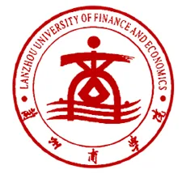
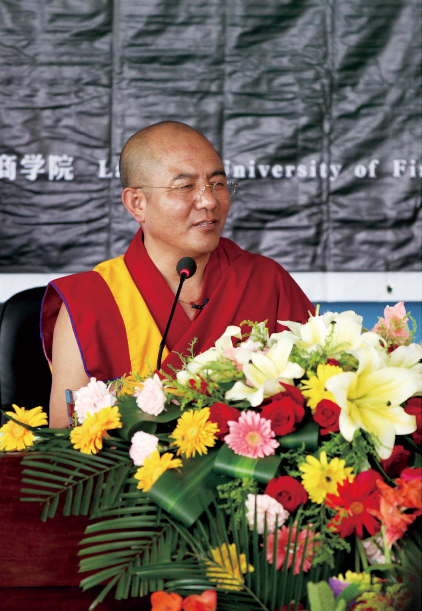

我们一向认为真实的东西，

往往最不真实。

第29场

兰州商学院

Lanzhou University of Finance and Economics

中国·兰州

2012 / 7 / 3

## 心底无私天地宽

## Selfless Heart, Boundless World

主持人：

大家下午好！

欢迎大家参加今天的讲座。今天，我们有幸请到尊贵的索达吉堪布，为我们兰州商学院的师生做演讲。堪布的演讲题目为“心底无私天地宽”。

天地无私，造就了万物的生命；父母无私，成就了我们的生命；那我们的无私会成就什么呢？我们的无私，会成就自他生命的快乐和美满。

《易经》有卦辞曰：“天行健，君子以自强不息；地势坤，君子以厚德载物。”古人认为，大地厚实和顺，君子的品行也应如此。而古来大德都是慈悲与智慧并行，胸怀也如大地般宽厚，没有不能承载的东西。

有人说：“人生，是我们在娑婆世界的一场旅行。”那生命中各种悲欢离合的经历，是否是旅行中每一次巧妙的起承转合呢？而今，在这个物欲横流的时代，我们有多长时间没有和自己的心灵沟通了？是否我们已经迷失了自己的方向，找不到人生的出口？我们如何才能做到《论语》中所言“申申如也、夭夭如也”？如何才能成就美好的人生呢？今天，我们有幸请到尊贵的索达吉堪布，为我们揭开人生的迷雾。

下面请全体起立，以最热烈的掌声，欢迎慈悲的索达吉堪布上台！

请大家就座！首先，有请兰州商学院商务传媒学院副教授张老师致欢迎辞——

张老师：

尊敬的索达吉堪布，各位来宾、老师们、同学们，非常感谢大家今天下午到我校参加这次殊胜的活动，我特别代表兰州商学院商务传媒学院国学研究所，欢迎索达吉堪布以及在座的各位，谢谢大家的光临！

对于我们每一个人来说，外部世界是我们存在的空间，我们如何看待它，如何对待它，如何处理好自己与环境的关系，是一个需要解决的问题。与此同时，我们也需要处理自己与自己的关系，寻求内心的宁静、和谐，乃至完美的境界。因此，我们需要一只眼睛向外，一只眼睛向内，在自然、社会和自我的法则中寻求途径。

藏传佛教神秘、精深，我相信，今天我们有缘、有幸聆听堪布智慧的声音，一定会得到启示！谢谢大家！

主持人：

感谢张老师！下面，有请尊贵的索达吉堪布为大家演讲——

各位老师、同学，下午好！今天我们交流的话题是“心底无私天地宽”。

作为一个既平凡又普通的出家人，一个藏传佛教的信仰者，我的信心和虔诚，让我在近三十年里将所有的时间和精力，都用在佛法的研究上了。我在研究中有个体会：佛法虽然高深莫测，但是任何一个人，只要你去修学、去挖掘，一定会受益匪浅！

你们是知识分子，但知识分子同样需要佛法，有了佛法慈悲与智慧的滋润，相信你的人生会更有意义。所以，希望诸位在有生之年，多多少少了解一下佛法的甚深和广大；如果有了些体验，也可以分享给身边的有缘人。

今天的这个话题，用世间的理念解释也可以，但从佛教的意义上入手，可能对你们更有启发。

## 一、“我执”是一切痛苦的因

佛教中最直接的认识，就是人的痛苦——从大的痛苦到微细的内心不平衡，都是源于“我执”。“我执”就是私心，就是对“我”和“我所”[^1]的执著，梵语称作“萨迦耶见”[^2]。

印度伟大的佛学家寂天论师曾说：“执我唯增苦。”只要你执著“我”，就唯有增加痛苦。在座的老师和同学，你们也可以观察一下：当你感到痛苦的时候，不管是身体上的，还是心灵上的，也不管是感情上的，还是工作上的，一切痛苦、焦虑和忧愁的源头是什么呢？真的是外面的人或物让我们痛苦了吗？不是，是我们自己对自己的执著，这也就是“我执”。

其实这个“我执”，不仅是人类痛苦的因，也是动物乃至六道一切众生痛苦的因，所以《入行论》中说：一切世间的痛苦，都是从寻求自利中产生的[^3]。再进一步来说，“我执”还是轮回的推动者，如印度中观学者月称论师所说：众生因为有“我”“我所”的执著，从而在六道中流转不息，就像水车上下转动一般[^4]。

所以，《修心七要》里有个窍诀：你应该把生活中遇到的一切痛苦，全都归罪于“我执”，而不是他众，只要你能对治了“我执”，你就不再痛苦了。

这个道理很深，以前我读书的时候不懂，因为书里没有这些。不过，当我痛苦时会思索：这个痛苦，它是来自于外境？还是心识？如果不是全由外境的话，心的成分就很大了……但当时只是模模糊糊地觉得，痛苦应该跟心有关，后来学了佛法才明白：其实这些都是心里的执著导致的，而且每一个心念，也都与“我执”息息相关。

虽然我们都不愿意受苦，都愿意快乐地生活，但命运很少会按着我们的想法去，它往往充满了坎坷、不公和意想不到的痛苦。所以，当我们不得不面对痛苦的时候，与其怨天尤人，倒不如尝试着了解痛苦，了解它的根源，以期渐渐地除掉它。

## 二、“我”所执著的是假象

刚才说了，痛苦源于“我执”，但这个“我”，以及“我”所执著的一切，是不是真实的呢？不是真实的，只是假象而已。这一点，不仅是佛教理论，就是用世间的方法来看，也是一目了然的。

可能你们都读过《理想国》（The Republic）。在这里面，柏拉图（Plato, 公元前429-前347）用他的老师苏格拉底（Socrates, 公元前470-前399）和他之间的对话，阐明了他们的哲学思想。其中有这么一个“洞穴比喻”（Allegory of the Cave）：

在一个洞穴里，长长的通道连着外面的世界，亮光顺着通道照到里面。里面有一群人，他们从小就住在这里，而且像囚犯一样，腿脚和脖子都被绑着，不能走动，也不能转头，只能望着前面的洞壁。

在他们身后远处的上方有一堆火，就在火堆和他们之间的这个位置上，洞外上方有一条路。沿着路边筑有一堵矮墙，墙后有些人举着各种器物，做着各种动作，而影像就投进洞里，呈现在洞壁上。

里面的人每天看到的就是这些影像，也只有这些影像；久而久之，他们认为影像是真实的，从来不知道外面还有一个光明的世界。

突然有一天，他们中的一个人解开了束缚，沿着光走到了外面的世界。当他看清了一切以后，知道里面墙上的东西都是假的，于是赶紧跑回洞里，想唤醒那些同伴，救他们出去。然而，当他说出真相时，所有的人都开始嘲笑他，以为他疯了，把他处死了……

这个故事说明了什么？说明我们一向认为真实的东西，其实最不真实。

我们从小认为有“我”、有“我所”，认为我所见所闻的一切，都是实实在在的，从来没想过这是假的。然而，即使你一辈子这么认为，即使所有的人都这么认为，假的还是假的。

如果“我”和“我所”是假的，那什么是真的呢？“无我”是真的。

比喻里跑出来的那个人，明明见到了真实的东西，为什么里面的人不相信呢？这就是《红楼梦》所谓的“假作真时真亦假”，你把假的当成真的，真的就被掩盖了，说出来也成了假的；“无为有处有还无”，你把无的当成有的，有的也就成了无的了。

所以，希望大家对“无我”做些思维。所谓“无我”，是本来就没有“我”，你认为有的话，那这个“我”是个什么样子？分析过吗？

可能有人会说：“如果只是我一个人执著有‘我’，也许是我错了，但世界上所有的人都执著有‘我’，难道都错了吗？”

月称论师在《中观四百论》的注释里讲过一则公案：从前有一个国王，婆罗门通过观察星相，对他说几天后要降一场毒雨，谁饮用了就会疯掉。几天以后，果然下了雨，整个国家的所有臣民喝了这个雨水以后，都疯掉了，只有国王一个人没喝，因而是清醒的。可是因为和大家不一样，大家都认为他是不正常的，说他是个疯子。这样说久了以后，国王不得已，也喝下了毒水，跟他们变成一样了。

公案里的这种现象，我们听了以后都会觉得荒唐，但不幸的是，现在的社会已经是这样了。大家可以冷静地看一看：人人都在追求地位、财富、感情，几乎没有人谈真理了；即使有些人在谈，一碰到房子、车子这些现实的问题，真理也就顾不上了。

当然，这可能跟舆论导向也有关。很多媒体不是要把人引向善的方面，而是想方设法让人关注那些吸引人的东西，但是这些东西，值不值得你关注呢？值不值得你追求呢？如果一上来不看清楚，辛辛苦苦追求了一辈子，结果得到了一些没有真实意义的东西，不是虚度此生了吗？

所以，在人生的某些时候，还是要思索思索。你没有接触到佛教，那另当别论，但现在已经接触到了，为什么不深入地了解一下呢？像这个“无我”的道理，如果它真的是一切痛苦的根源，那为什么不仔细推敲推敲？如果“我”所执著的真的是假象，那为什么不放下呢？……

其实，佛教对万事万物都有描述，器世界也好、有情世界也好，方方面面的学问这里面都有。只要你来学，一定会受益的，对此我很有信心。

当然，信心有很多种，太过盲目的话，就成了迷信。但我认为，我的信心不是迷信。为什么呢？因为我经过了多年的闻思，也对比了古今中外的各类学说，在这个过程中，我以我公正的理解来分析，世间方方面面的学问，虽然都有其不共的特点，但是有一点很值得回味：佛陀出世已经2556年了，他的教法，我们只听说后人不断从中发掘出新的奥秘，却没有听说它被谁推翻了。你们想一想，是不是这样呢？

所以，我并不是在偏袒佛教，因为皈依了佛门、穿了这身衣服、学习了佛法，就维护佛教，说自己有坚定不移的信心，不是这样。只要各位也作过同样的对比，相信你也会有同样的信心，而且会同样地相信：在21世纪，在物质文明比以往任何一个时代都有突破和进步的今天，要让人类思想进入善的轨道，一定要到东方的佛教思想中寻求启迪！

## 三、以佛教思想铸就“无私”基石

其实从历史上看，你们兰州与佛教很有渊源。

昨天我去了武威县[^5]，见到了萨迦班智达[^6]的遗塔。萨迦班智达是藏传佛教的伟大上师，他在1244年应邀来这里弘法，并于1251年在此示现圆寂。他的遗塔，虽然经历了多次的地震以及毁灭运动，现在仍完好无损。后来我又去拜见了鸠摩罗什大师的舌舍利，他也曾在这里住了17年。从这些以及其他佛教圣迹来看，这片土地对佛教的传播，有着相当大的贡献。

当然，还有敦煌文化。听说敦煌研究院就在兰州——的确，这样的文化值得研究，也值得传承。

那由谁来传承呢？由知识分子。虽然你们现在年轻，也喜欢财富、喜欢名牌、喜欢感情，但当你静下心来，剥开这些虚假的东西想一想：“除了这些，我还需要什么呢？”那时候你会明白，其实我们最需要的，是心灵的成长。所以，为了我们自己的心获得利益，也为了后人，我们应该把佛教的理念传承下去。

如果是物质的话，它或许对我们的这一生、对下一代有一点利益，但利益不大。你们想想，历代的帝王将相算是富极一时了，宅邸、乘骑、眷属、田地……但这些给后人留下了什么？一无所有。而精神财富就不同了，古代的那些好诗词，现在人们还在吟诵；儒释道的思想、大德们的教言，千百年来挽救了多少世道人心。其价值，物质财富又怎么比得了呢？

所以，我们应该关注精神的传递。当然，在这样的时代里，再怎么强调精神，人们对物质的执著还是越来越大了，而这种执著，也早就波及了校园。我去过很多大学，也知道大学生在关注什么、在做些什么……很多大学生不喜欢知识了，难怪有人说：“现在的大学生是在‘混’学业！”

但不管怎么样，即使大家普遍失去了有价值的观念，我们还是要追求真理。真理有时候是显得比较神秘，像佛教，像各种古老的智慧，但这不应该妨碍我们的兴趣。在座的很多是硕士、博士，大家学习了这么多年，不就是为了寻求真理吗？既然如此，我们怎么甘心几十年吃吃喝喝地过一辈子？

更何况，我们都还有来世！虽然有些人不关心这件事，“我不相信前世后世”“我不承认善有善报、恶有恶报”……但真理毕竟是真理。

还有我前面讲的，“痛苦的来源是我执”“我”以及“我”所执著的一切是假的，这也是真理。虽然这否定了我们从前的认识，虽然接受起来有点困难，但作为一个知识分子，你有求知精神，不就是要用在这样的真理上吗？

其实，真理也是最实用的学问。在我们学习的过程中，生活中遇着痛苦了，你可以试着分析：这个痛苦，它是不是因为我对自我的执著产生的？而这个“我”，它是不是那么真实呢？佛法里说它是假的，为什么是假的呢？……这样一步一步观察下来，长时间地修习下去，慢慢地你就会减少“我执”，“我执”减少了，最终就会通达“无我”空性。

通达了空性，你才能真正铸就“无私”的基石。

## 四、心底无私天地宽

对于空性，有人很不理解：“你们佛教天天讲空性，既然是空的，那生活、事业都不用管了？”

其实，空性不是这个意思。真正的空性是说，在生活中显现的这一切，虽然它的本质是空的，但显现是存在的。所以，该做什么就做什么，而在做的时候，因为你懂得了空性，私心就少了，私心少了，天地自然就宽广了。否则，我们这个“自我”的意识本来就强，再加上社会、环境的影响，乃至教育也不断地往这方面引导，那很容易就会出现一些极端的现象。

前段时间的一个研讨会上，北大一位教授说，现在的一些大学正在培养“精致的利己主义者”，并说这种人一旦掌权，比一般的贪官污吏危害更大。[^7]

我很能体会他的忧虑。一个完全以自我为中心的人，当他为自己奋斗，又有点能力的时候，就不会顾及别人的感受，甚至不惜破坏一切。就像希特勒（Adolf Hitler, 1889-1945），他从前的学习成绩、各方面的修养原本也不错，可是在受了某种思想影响之后，为了维护自己的种族，杀的杀、害的害，而且在他看来，即使杀掉了全人类，也没什么不对的。这就是“利己主义”的危害。

所以，作为一所学校，你不仅要关心学生的分数，更要培养他们的德行，至少让他们知道：不仅要维护自己，也要维护别人；维护别人也就是维护自己。当一个人能这样为别人考虑的时候，他的前途是不用担心的。而且，这个时候他的能力越大，越能给社会带来利益。

所以，在做学生的这个阶段，教育上能引导他们去除“私心”，应该是很有必要的课程。

《吕氏春秋》云：“天无私覆也，地无私载也，日月无私烛也，四时无私行也。”意思是说：天无私，所以它才能覆盖整个世界，如果它有私，就只能覆盖部分地域了；地无私，所以它能承载世间的万物，否则也只能承载少数的器物；日月无私，所以能普照世间，否则也只能偏照一方；春夏秋冬四时无私，所以它们总是自在运行，否则，如果某一个季节，比如春天或者夏天的时间过长，四季就颠倒了。因此，人要想放宽心量，就应该效法天地，去除私心。

当然，去除私心也需要一些方法。拜伦·凯蒂（Byron Katie, 1942-）有一本书叫《一念之转》（Loving What Is），很受欢迎。我大概看了一下，里面教人以反躬自问的方式，去除自我的想法，以及对他人的怨恨。

比如，当一个你喜欢的人背叛了你，做了对不起你的事，那你就要反问自己：“那是真的吗？”“你肯定他不喜欢你吗？”如果你肯定的话，就再问：“当你持有‘他不喜欢你’的想法时，你会如何反应？”“没有那个想法，你会是怎样的人呢？”……

这样反复思考以后，你会了解：其实你的痛苦，多数是源于对“自我”的想法太执著了，而这些只是你的误解或错觉，并不真实。认识到这一点，你就会理解并接纳对方了。

所以，“我”始终是问题的关键。不论小事大事，小到家庭内部的争吵，大到国家与国家的战争，全都是在对“我”以及“我所”的认同之上，为了维护这个“我”而导致的。有这么一种既有趣也有理的说法：在“我”这个字形中藏着一把兵器——“戈”，有了这把“戈”，既“戈”了别人，又“戈”了自己。因此，只要太过分地执著于“我”，家庭不会快乐融洽，社会不会安宁和谐，乃至整个世界也不会有真正的和平。

如果你想去除这个“我”，那么最好从“让”字开始，因为你要知道，别人对“我”的认同，和我们是一样的。

古人说：“君子量大，小人气大。”量大不大、气大不大，问题还是在“我”上面。有了“我”，一点点小的触犯就接受不了，反唇相讥，甚至大发脾气。现在有些人一发脾气就摔盘子——这个我们藏地没有，是不是电视上学来的，反正一吵架就摔东西。但这有什么用呢？根本没有用！这时候你要调的是心，你能试着理解对方，让一让，也就没气了，痛苦也就消失了。

其实，你静下心来想一想，可能事情真的没有那么大，只不过我们的心太窄了，容不下。日本的梦窗禅师说：“眼内有尘三界窄，心头无事一床宽。”如果你的眼里有了一点点尘埃，三界也会变得狭窄；而如果你的心里没什么挂碍，睡在一张小床上，世界也是无比的宽广。

当然，这是一种境界，不过境界也是培养出来的。如果我们经常观察这个“我”的虚假性，经常思维空性的道理，你会慢慢体会到，我们的确是很渺小的，和广阔的宇宙相比，我们还不如一棵小草。这么微不足道，你发再大的脾气，能伤到谁呢？只能伤到我们自己。

所以，还是要接受佛法的教育。有了佛法的教育以后，特别是有了些修养功夫，当你再遇到不顺心的事情时，即使心里有点不舒服，脸色也有点变化，但你只要把平时学的窍诀用上，冷静地反观一下，事情也就不大了。

何必在一些小事上过不去呢？宋朝无门禅师[^8]说：“春有百花秋有月，夏有凉风冬有雪，若无闲事挂心头，便是人间好时节。”对一个了无挂碍的人来说，人间处处充满了美好景致。不是吗？

当然，即使你看不到这些，还是有属于你自己的路，何必要钻牛角尖呢？又有什么必要走上绝路呢？

一落榜就自杀，太不明智了！人生的路有很多啊，不是就这么一条。如果就这么一条，走不过去，也只有一死了。但实际上，这比十字路口要多得多，你这边走不通，可以走那边；那边走不通，换个方向再试试。走不通，其实也不说明别的，只是你的因缘还不具足而已，但出路总归是有的，何必去死呢？

感情上的事也是一样的。我去过一些大学，也了解很多大学生在这件事上苦恼。苦恼归苦恼，但你要为了一个人自杀，就不值得了！你喜欢他，他不喜欢你，你的世界变暗了，这个我理解。但黑暗终归会过去的，在这个世界上，不是像你眼里所看到的，只有他一个人——他不喜欢你，其他的人也都死了，不是这样的。

世间上的人很多，世间上的路也很多，不管是谁，也不管你遇到什么样的事情，如果心能稍稍放宽一点，稍稍放下一点我执，烦恼和痛苦自然也就烟消云散了。

而在放下我执的修法上，除了上面讲的这些——要了解“我”的虚假性，要明白执著“我”唯有痛苦，要想得开放得下之外，我认为最好不过的，就是学习大乘佛教的利他精神。

佛教有大小乘之分。小乘注重的是自我解脱，通过证得无我，从而远离一切烦恼和痛苦，这种理念和修行，在如今的缅甸、斯里兰卡等国家，是非常兴盛的。大乘佛教虽然也要求对治这个“我”，要求放下对自我的执著，但它首先要求一个修行人的是：你应该把其他生命作为关注的重点，然后在利他心的推动下，进行你的一切修行。

当这一利他的理念被再再强化以后，自利的心就淡化了；而自利心越淡，利他的心及行为也会越来越明显……就这样，在增上利他与弱化自我认同的过程中，自身的烦恼和痛苦就日趋减少了。

这是真正的秘诀！你把自己放下了，唯一想着别人，可能起初稍微难一点，但串习久了以后，你会感觉到，这种恒时为别人着想的状态，实在是最快乐、最放松的心境。你们也试试看，当你在生活中感觉苦恼的时候，把视线从自己的那点儿事上移开，尽心尽力、力所能及地为别人做点什么，这个时候你再看看，“我”的感觉是不是变小了？痛苦、烦恼是不是减少了？

李连杰年纪轻轻就已经身家过亿了，那时他一直在追求怎么享受、怎么更成功，想的也都是自己。但后来他学了佛，开始做起了慈善，当他诚心诚意用大乘理念利益他人、回馈社会的时候，他发现了一个重要的问题：从前为自我而努力的一切，并没有给自己带来真正的快乐，而利他却可以。

王菲的孩子一生下来就有唇疾，她为此非常苦恼，不知道该如何在世人面前展现她的孩子，并为此纠结了很长时间。后来她受了佛教的启发，推己及人地想：我自己孩子的痛苦，去国外做个手术就去除了；但在这个世界上，还有很多孩子有着同样的痛苦，很多母亲在为自己的孩子难过，得不到治疗的话，一生就只有伴随着这种命运了。

于是她创立了嫣然天使基金，饶益世人。在做慈善的过程中，也让她明白了：执著“我”是徒然的，越执著越痛苦；而一心利他，天地却比以前宽广多了。

## 五、用教育成就无私心地

因此，如果我们想要一个开阔的人生，就一定要培养无私的心地，培养德行。

而要培养德行，学生时代是最重要的。这个时候若不培养慈悲和智慧，不树立信仰，只是学着如何赚钱、找工作，这样的人，对社会有利无利，很难说；对家庭有利无利，很难说；甚至对自己有利无利，也很难说。

而且，一个人能有多少财富，主要看福报。有的人再怎么精勤，如果没有前世的福报，也拥有不了很多；而有的人，即使他不太勤勉于这些，也会富足。因此，教育应该重在培养德行。其实人活着的意义，不是看你有多少财富和地位，而是看你是否能利益他人；再开阔一点说，就是看你是否能利益一切的众生，而且是生生世世。

关注生命的生生世世，这才是佛教的理念。佛教认为，你在学习中所积累的智慧，不仅是这一辈子可以享用，下一辈子乃至生生世世都可以。这样的教育理念——对于漫长的生命进行培养，在世间的教育中有吗？肯定没有，这一点各位是清楚的。

而佛教利他的范围，也不仅仅是人类，还涉及天下所有的生命，对这一切的生命，都要用慈悲心来爱护。怎么爱护呢？没有快乐的生命，给他快乐；感受痛苦的生命，遣除他的痛苦。

可能有人认为：“对人类我可以爱护、帮助，但对动物何必要爱护呢？应该享用它们。”

其实这是非常错误的观念！持这种观念的人，应该从生命的意义、权益等侧面，作些反省和观察。我们每个人都受过教育，但在你所受的教育中，有些是正确的，有些是错误的。人一旦接受了错误观念，就很难改了，虽然是从正规教育中得来的，但这样的教育对自他不仅无益，反而有害。因此，即使是习以为常的认识，也有反省的必要，用更高的理念来反省！

对一个学生而言，在学校里的时候，很多学生的思想还算纯洁，可一进入社会，就难免不受到染污了。杜甫说：“在山泉水清，出山泉水浊。”当前的教育和社会状况，不正是这样吗？

以前有很多大学生跟我说：“我毕业以后，一定要帮助别人，除了养家糊口的工作以外，我要把所有时间和精力都用来回馈社会……”但事实证明，多数人只是喊喊口号而已，毕业不到一两年，就被世间的浊水染浑了。就像黄河源头的水本来是清的，可是一路流淌下来，渐渐被两边的黄土染黄，当初的“清澈”再也看不到了。

因此，我常跟大学生们说：“你先不着急这么说，工作上几年、十几年以后，再看看还有没有这颗纯洁的心。”那时候，也许很多人已经学会了贪污，学会了弄虚作假，学会了杀盗淫妄——杀生、偷盗、邪淫、妄语，这些不正当的行为，你都学会了；甚至，你周围的人都认为，老老实实、清净本分是无能，而你也觉得干坏事才有面子……就这样，很自然地，你也成了一个坏人。

当然，如果一分为二地看，社会中向善的引导还是有的，只不过太少了。你们以后也可以看，让你在思想、行为上学好，让你孝顺父母，让你对社会负责，让你关爱生命，关爱一切人以及动物的教育，有多少？寥寥无几。

## 结语

总的来说，教育有家庭教育、学校教育和社会教育，作为大学生，在完成学校教育以后，还需要接受社会教育。人一旦离开教育，就像树离开水分一样，一定会干枯的。因此，佛教徒认为：活到老，就学到老、修到老。其实大学生也一样，离开校园，并不意味着知识已经学尽，不用再学了，远远不是这样。

当你离开校园，也就进入了社会，这时还有很多有价值的学问要学，比如佛教或其他宗教乃至世间各种有益的学问。这些一定要学，因为它对你的生命有意义，而且能让你获得真正的快乐。如果不学，思想就停滞了，没有新的思想，单凭学校的知识展开不了什么事业；即使能展开一点，没有厚实的积淀，也不会有大的作为。

因此，一定要多学。雨果说：“世界上最广阔的是大海，比大海更广阔的是天空，比天空更广阔的是人的胸怀。”既然人人都有一个广阔的胸怀，为什么不广泛接受一些学问呢？

当然，其中最主要的，应该是利他的学问，应该是有益于社会的学问。只要你不断地学、不断地实践这些，你的人生一定会灿烂，一定会发出有利于自他的光芒。

否则，一离开学校就停止学习，忙家庭、忙工作，与有益的知识完全脱离，不知不觉中，言行举止也不如法了，又虚伪又狡诈，这对一个知识分子而言，是很悲哀的。

因此，在离开世间之前，都应该不断学习。藏传佛教有一位伟大的学者——顶果钦哲法王，我去印度时曾经拜见过他。他对知识的渴求让人佩服，传记中说：法王七十多岁时，依然每天翻阅几页《大圆满前行》，直至圆寂为止。这样的精神，谁不景仰呢？

我们知道，学校是知识分子的群体。是知识分子，就应该重视知识，一旦知识分子谈论的全是金钱，全是世间无聊的话题，那这个学校、这个群体，就只剩下形象了。就像我在寺院里常讲的：寺院是佛教知识分子的群体，如果这一群体不重视佛教的研究和修学，即使寺院的建筑再金碧辉煌，也只是个外壳而已，因为在它的里面，不存在佛法这一核心。

因此，一个老师的心里应该装着知识，不应该全是金钱、地位和竞争；一个学生的心里也应该装着知识，不应该全是乱七八糟、无意义的事，而且，这些知识也应该为利他心所摄持。如果老师没有利他心，学生也没有利他心，人类的方向又在哪里呢？是不是很悲哀、很可怕？

可见，有知识的人，在有知识的同时，还一定要有利他心。当然，作为一个凡夫人，都会有自我的维护和执著，不可能没有，但这种执著不能太大了。白天想着自己，梦里也维护自己，从来不为别人着想，不为社会着想，这样的人，他的生存空间不会广阔；而对他人而言，他的存在，也不一定有价值。

什么样的人有价值呢？利他的人有价值。利他的精神让人感动，而我最感动的，就是大乘佛教中的无私利他——没有任何条件地利益一切生命，这才是大乘佛教的精神所在。

一般人利他是有条件的，我帮助你，同时也希望你回馈，相互之间像是一种交易。可大乘佛教不是这样，它的利他不谈任何条件，只要众生有苦有难，就全力以赴地去帮助、去给予。这才是纯粹的无私和高尚！对我们一般人来讲，也许这有些望尘莫及，但的确是让人景仰。

如果这种理念能在学校、社会团体中推广，利益是可以想见的。因此我认为，知识分子在具有知识的同时，更要有利他的精神，要有对社会、对人类负责的意识。

总之，“心底无私天地宽”，只要你心底无私，生命就有了不同的意义。因为你的心清净，周围的一切也显得格外美丽；因为你满怀慈悲，也就会为身边乃至世间所有的人带来光明！

现场互动

问：我是高三刚刚毕业、即将步入大学的学生。现在的媒体、网络中有很多色情内容，以女人的裸体为美；而现代人穿得也很暴露，能露的都露，让我很迷惑，请问您对这些怎么看？

堪布：在古代中国，乃至现在的藏地，一般人的穿着都相当保守。而现代人以暴露身体为美，应该是受了西方的影响。

但我认为，人体没有任何值得贪执的地方。不管是女人的身体，还是男人的身体，当你以佛教的九种不净观剖析时，再美的身体，也不值得贪求。只不过，人们的相续中都有“贪”的习气，所以就以此为美，以不遮不拦、吸引他人为美；而商家也抓住人的这一弱点，营造商机。

可是，到了一定的时候，人还是会回归传统的。为什么呢？因为有些现象多了以后，也就不希求了。以前，台湾、日本、韩国刚出现色情现象时举世震惊，而大陆很多城市也紧随其后，现在更是司空见惯了。然而，这终究是一件羞耻的事情。人一定要知惭有愧！否则，跟动物有什么差别呢？

还是古文化让人钦佩！

问：我今年16岁。我见过很多佛教徒热心劝人学佛，但他们的方式让年轻人无法接受：他们常讲因果报应，我知道因果报应是合理的，但很多年轻人还是觉得这是迷信，不理解、甚至厌恶；而且，他们的劝导常带有强迫性，往往起了反效果。

年轻人喜欢文艺性的、轻松的东西，他们劝我们学佛时，一定要死板地按照经典去灌输吗？是不是可以像禅宗那样不拘一格呢？请您开示。

堪布：佛教的因果观念是真理，既然是真理，佛教徒宣讲它是合理的；别人不接受，是别人的事。当然，也许会有死板、教条的现象，讲起来只有一种方式，但并非所有的都是这样。

其实，佛教的教义是很丰富的。像藏传佛教中就有“十明[^9]”学科，在这十明当中，很多理念与当今的艺术、学术是衔接的；只要懂得运用，应该并不单一。而实际情况也正是如此，不论在东方、西方，大德们为了普及佛教教育，根据不同的根基和意乐，采取了种种善巧方便。并且，这些也都被很好地接受了。

你刚才说到“禅”，禅文化就是其中之一。过段时间，我也要去北京大学交流禅文化。一提到“禅”，很多人的印象中，就是在寂静地方闭目禅修。但实际上，禅可以渗透到生活的方方面面，行住坐卧、上班休闲……时时处处都可以安住在“禅”的理念中——不离明心，也不障碍生活。

因此，佛教有很多道理，也有很多弘扬方式，不会死板。而你所了解的，可能只是个别情况而已。

此外，如果撇开形式，单就教育的内核而言，应该说，佛教的教育更具有进步性。怎么讲呢？你们也知道，现在一般的教育只重视分数，分数好，OK；分数不好，再优秀的人也不过关。一个分数高，又会说、会写、会面试的人，思想再糟糕、再低劣，也成了人才，哪里都进得去。但佛教不是这样。佛教选拔人才时，除了“讲、辩、著”之外，更重视一个人的思想道德，像戒律、行持，等等。

可见，佛教的教育理念很广，也很注重实质。

问：我来自甘肃中医学院，搞的是传统医学和传统文化。我曾经去过一些藏医院（门巴扎仓），知道藏医学是藏传佛教的一个重要组成部分，能否请您简单介绍一下藏医学的情况？

堪布：藏医学是藏传佛教五明之一。我们学院叫五明佛学院，就是这个“五明”。五明有因明、声明、工巧明、内明、医方明，医方明就是藏医学。

现在藏医学在国际上很受推崇，而且，从配方到治疗都有独到之处。我读书时对藏医学就感兴趣，诊脉、配药，甚至亲自上山采药。藏地的药材资源很丰富，有句俗话说：“山上的所有草木，在高明的医师眼里无不是药。”所以，那时候我很想成为一名医生，不过到了佛学院以后，就没怎么学了。

其实，古代的藏医学，就已经有非常成熟的医疗技术了。青海的西宁附近有一所博物馆，以前我去过，那里陈列着几千年前的医疗仪器，非常精致。看着这些仪器，可以想象古代藏医学的发达。

而如今，这些都继承在门巴扎仓（藏医院）里。门巴扎仓，格鲁派比较多，宁玛派或其他教派也有相仿的研究机构，像我们佛学院就有，那里培养了很多医师，也跟卫校、高等医学院建立了合作。

时下的有些病，吃西药、中药效果不好的，看看藏医、吃吃藏药，说不定很有效。我生病时就喜欢吃藏药，没有副作用，效果也好。

《四部医典》是藏医学的主要典籍，要研究的话，可以看一看。

问：我是兰大民族学院的藏学博士，感谢您的鼓励，才让我考上了这个博士。

我出身兰大的中国哲学专业。在中国哲学儒家的人性论中，孟子持“性善论”，荀子持“性恶论”，请问，如何以佛学理论观照这种“人性论”？一些学者在阿赖耶识上探讨佛性论，我觉得这肯定不究竟，能否请您在究竟意义上简单讲一下佛性论？佛性论与人性论的关系如何？

堪布：其实，儒家与佛教的思想，在某些意义上是相通的。比如，两家都认为有一种不可见的心性。

所谓“性”，有些学者比喻说：就像暗室中本来有物品，但没有灯来照的时候发现不了，而灯一照，就发现了。孟子、荀子讲“性”，深度不及佛教，或善或恶，形成两种观点；但在佛教看来，就究竟的本体而言，没有善也没有恶，一切平等。

那该怎么融合这些观点呢？

首先讲本体。所谓本体，也就相当于万物的本源，在这个层面上，已经超离了善和恶。这一点在佛教中讲得最为究竟：世间的任何一个事物，山河大地、太阳月亮，黑与白、善与恶……这一切的一切，从本体而言都不存在，都远离戏论。

而在显现层面，佛教也讲人的本性为善。为什么呢？因为人人都有佛性，有佛性就可以成佛。关于佛性，《如来藏经》《宝性论》里讲得特别清楚。学了以后你会知道，如果人性本恶，那无论你怎么努力向善的方面学修，终究还是会倒退。但历史上有成千上万的觉悟者，他们以自身所悟的智慧、所行的慈悲告诉我们：人的本性为善。

作为一切觉悟者的典范，释迦牟尼佛已经到达了善的最高境界；六祖等汉藏无数高僧大德，也都是最佳的追随者。所以，在显现层面，当心回归到本位时，便会如实显露它至善的光辉。禅宗讲明心见性，其实一见性，本具的善就自然流露出来了。

应该说，在这些道理上儒教比较欠缺。我钦佩儒教中那些为人处世、待人接物的轨范，但在理论上，他们缺乏对来世的探索，缺乏对本体空性的分析，这一点很容易看得出来。

因此，一个既懂儒教又懂佛教的人，在比较人性论、佛性论时，如果能对佛教的胜义空性和世俗显现作些深入研究，那对二者的相同与不同之处，会豁然开悟的。

问：我来自兰州大学科学学院。佛教很重视师道，有一位堪布曾说：身边的人，即使是自己的弟子、普通人、非佛教徒，他们的语言、行为也会对自己有启发，所以“人人是我师”。但我也看到其他文章中说：初学者较容易生邪见，依止的老师少一点好，请问，这两种观点如何融合？

堪布：三人行，必有我师！

一个有修行境界的人，任何人的语言，都能看作是对自己的教导，并将那个人当成上师。比如，假如有人骂我，而我并不觉得是受了伤害，也不以牙还牙，反而把他的指责当作是很好的指点和教训，能做到这样，实际上他就成了我的上师。

但如果我没有这种境界，不仅是批评，赞叹也听得像嘲讽，那要我把谁当上师、当老师都很难；即使是我的老师，也不一定会认。像有些学生，一回寝室就骂老师，“他讲得怎么怎么……”，嘲讽老师的行为，把老师当玩偶，在这样的学生眼里，老师也不成为老师了。

因此，假如一个人能随着别人的指导再接再厉，随着别人的指责有错就改，不用问，你可以说“人人是我师”；否则，不要说所有的人，就算是你的老师，也不一定能利益到你。

其实，“三人行，必有我师”的境界不低，这有点像佛教里讲的观清净心。阿底峡尊者说过：“三人之中，必定有一个是菩萨。”这个比例很高，可惜我们发现不了，谁是？谁不是？不知道。但如果我有清净观，今天在座的，我都可以观成菩萨；但如果没有，那我可能觉得在座的都比我差，而且都是凡夫。

这两种心态当中，前者显然是有境界的；而后者的话，你们想想，生活中如果持这种心态，那只能给自己带来痛苦，不会有快乐。

因此，在师道的问题上，关键看你的心里是不是认可对方，把他当老师。

问：以前我跟有些老师学过佛法，也看过他的书，但这些老师后来诽谤密法，那对这些老师，我该怎么看呢？

堪布：我也遇到过诽谤密法的人，但是他们诽谤密法，只是因为不了解。

其实，密法不是一个简单学问，也不是一般人能诽谤得了的。藏传佛教中有浩如烟海的大续部、大注释，如果哪位老师去研究，十几年下来，都不一定懂；一旦你懂了，肯定会瞠目结舌：“哎，以前我的思想太愚痴了！”

当然，不说大学老师或一般知识分子，就连弘一大师以及后来的个别大德，起初也不了解密法。不过，在他们看过密续及藏地大德的言教之后，都忏悔了。

因此，我能理解这些老师。因为环境和朋友的影响，加之没接触过密法，随随便便就诽谤了。不过，我倒希望他们能去藏地的佛学院，与那里的佛教徒辩论一场。到时候我当翻译，你们面对面辩论。你赢了，我们也认输；但如果连基本的因明三相推理都不懂，那就困难了。

所以，不管老师还是学生，先了解一下密法很重要。

问：佛教最重视对上师三宝的信心，但对初学者而言，要生起稳固不退的信心又很难，您在这方面有没有比较好的建议？

堪布：要对上师三宝生信心，有两个途径：

一、依靠前世的缘分。前世学过善法、行持过善法的人，即生要生起信心是不难的，很自然。

二、依靠串习，多看前辈大德的传记，同时认真学习佛理。看传记，人就会被感染，会生起信心。而学习佛理，如《中观四百论》所讲的：如果你对佛陀所宣说的隐蔽深奥的事理有疑惑，学习无相空性法门，便可生起决定信解[^10]。

为什么呢？因为空性法门是最深的学问，世间任何智者无法依靠自力来了解，唯有佛陀才能洞察、宣说，因此，当你一旦领悟时，自然对佛陀以及上师三宝生起不退的信心。

问：以前法王说，能念一千遍《普贤行愿品》有非常殊胜的功德，让大家一起念。但现在法王圆寂了，我们是否还可以这样发愿念？

堪布：当然可以。

问：我是一名大二学生，接触佛教已有两年，但在专业课和佛法的学习中，总是不能合理安排时间。请问，我该怎样安排时间，多念些经和咒呢？

堪布：鲁迅先生说：“时间就像海绵里的水，只要愿挤，总还是有的。”因此，在学专业的同时，早晨、晚上或者空余的时间，都能学习佛法。

学习佛法时，你可以多念经咒，也可以阅读经典。现在汉地对佛经的研究不够，《大藏经》只是摆着，没有人去深入研究，这一点很遗憾！因此，知识分子学佛，应该多看释迦牟尼佛在2500多年前留下的智慧宝藏，只要你去看，就会生欢喜，就会获得无尽受用。

问：请问，婚外恋有什么因果？

堪布：世间此类行为多之又多，至于它的果报，看一看《增壹阿含经》[^11]《善生经》[^12]《十善业道经》[^13]，就知道了。

问：请问如何破“我执”，有没有行之有效的方法？

堪布：寂天论师在《入菩萨行论·智慧品》中抉择了二无我：人无我、法无我。抉择时，从身体的各个部分——头发、牙齿、肢体……一一剖析下来，都不见有“我”；而“我”所耽著的一切法，也都没有自性，这样就破除了“我执”。这是最好的剖析理论。

或者也可以参话头。比如，禅宗让大家参“我是谁”“念佛者是谁”，以此摧毁“我执”；藏传的密法中也有，比如“我在何处”“往东方去的是谁”，有悟性的人参进去之后，最终就会开悟：噢，原来“我”和“我”所耽著的一切，本来没有；以前是错将“无”执为“有”“无我”执为有“我”了。

当然，对这些道理，要长期研究佛教之后，才可以产生真正的信解。

现在汉地的学校，对佛教普遍比较重视了，有了研究机构，学生也多多少少有了兴趣，这从你们的提问也看得出来。本来藏民族是全民信佛的，可是现在的年轻人，信心也不够，见解也不够，反而还不如你们了。对此，一方面我感到困惑，一方面，每次去藏族学校时也劝他们：“你们要好好研究佛教，从前我们的佛教是如何如何兴盛……”

不过，现在在他们的心目中，除了感情和钱以外，什么都装不下，很悲哀！年轻人的悲哀！当然，随着年龄的增长，有些烦恼也难免，但是，如果把人生的价值全部定位在这些方面，就不会有光明的前途了。

所以我认为，在读书的这个阶段，最重要的是追求真理；其他的，暂时来讲不重要。

问：感谢堪布在炎热的夏天给我们带来清凉的讲座。我是甘肃中医学院的，学的是中医专业。刚才您在讲座中提到了拜伦·凯蒂，让我觉得您的涉猎非常广泛。请问，您对她的《一念之转》看法如何？

堪布：她在写书之前，曾经遭遇了很多磨难，被家庭的烦恼困扰，还得了忧郁症……但她反复思索以后，醒悟到：自己此前的一切抱怨，都毫无意义！从此开始了放下自我、开导他人的快乐生活。

她经由自我观察而获得的醒悟，有些类似于佛教的开悟，只不过，她不是这么说而已。但我很认同她的理念。尤其是，在她的指导下，很多人都解除了痛苦，感情上的、事业上的，甚至是交不起房费这样的痛苦。能解除众生的苦，无论是什么行为，佛教都认可。

除了《一念之转》，她还有几本佳作，很值得看。尤其是年轻人，在你憧憬美好人生、追逐快乐生活的途中，提前准备一些面对痛苦的理念，很有必要。否则，痛苦一来，人就困惑了。

其实我写《苦才是人生》，也就是这个目的。很多人说：“你不该取这么个名称，佛教徒是要给人带来快乐和光明的，怎么能提‘苦’呢？”

但我半开玩笑半解释说：“其实生活的底色原本是‘苦’，你知道了，遇到它就不会逃避，会坦然接受；而一旦你接受甚至转变了它，也就不苦了。相反，如果你对快乐的希望过大，而现实中的苦又太多，就接受不了了，搞不好会自杀。”

因此，我对他们说：“书卖得好不好无所谓，‘苦才是人生’这个名字我取定了！”

问：从古到今有很多宗教信仰，这些不同的信仰该如何融通、减少对立呢？请教您的看法。

堪布：在21世纪，不同的宗教之间，宗教与非宗教之间，我觉得互相理解很重要。

站在佛教的立场上，任何一个人，你接受佛教也可以，不接受佛教也可以，我们很开放。但是，如果你不接受佛教，也不必一看到什么，就指指点点：“这些佛教徒怎么怎么……”在佛教徒这边明察秋毫，而在非佛教徒那边，天大的罪业也视而不见，这是有失公允的。当然，佛教徒也不该去攻击他人。

其实，但凡一个宗教，它能生存至今，它的悠久历史足以说明它的生命力，说明它有它的魅力。因此，应当给以尊重。当宗教与宗教、宗教与非宗教人士之间有了尊重和理解，甚至能相互学习时，人类才有进步。否则，如果水火不容，自己的宗教也不一定有生存之地。

因此我认为，理解胜过诽谤。

但就算是你要诽谤，比如诽谤密宗，那你至少得了解它，专门学个五六年，懂了再诽谤也不迟。当然，诽谤其他宗教甚至是非宗教的理念，也是一样的。不然，诚如莎士比亚所说：“不要侮蔑你所不知道的真理，否则，你将以生命的危险重重补偿你的过失。”

问：我对空性法门特别感兴趣，请问该如何串习这一空性不二法门？由此是否可以证悟？

堪布：我们所见到的万法显现，它的本体是空性，但显现不空。而物理学家也认为：瓶子在显现上是瓶子，但本质上则是由分子、原子、夸克等组成，其实这也是一种空的认识。然而，对此该如何修证，物理学家没讲，佛教讲了。

佛教讲空，不仅有理论：一切万法不是实有，也不是否认实有的空，是离开二边的；而且，通过修行的确可以证悟。当然，这要经由长期的熏习。否则，无始以来串习的都是实执，可以说塞满了相续，短时间是拿不掉的。只有长久地串习以后，才能证悟。

而一旦证悟了，那在你的面前，万法显现是显现，并且非常明了，但对你而言，就像梦中的万事万物一样，不会有任何执著。

问：请问该如何看待梦境？

堪布：人生就是一场梦，看待人生就是看待梦境。

问：我是甘肃联合大学的一名老师。如果有条件，我想在学校开办一个灵修中心，主要的目的，是让学生正确认识佛教，培养学生的慈悲心。但是我想知道，这样的灵修中心应该开设哪些课程？选择哪些书籍？举办哪些活动？

堪布：这种中心，跟禅文化结合就很好。北京大学、复旦大学都有禅学社，华中科大也有心灵研究中心，你们要设的话，也可以从禅入手。因为禅对生活、对茶、对企业等的种种文化，都容易渗透。

课程上，除了禅的思想以外，藏传佛教的菩提心修法很实用。菩提心提倡利他，有了利他精神，人就变得宁静了。为什么呢？因为一个人内心的浮躁、烦恼和焦虑，都是源于自我耽著，而有了利他心，自我耽著就弱了；为自己想得少了，烦恼和痛苦也就少了。当然，这方面的书籍很多。

至于活动，可以举办讲座。请一些有学识的老师，像西南民大有研究佛教及心灵的大师，其他高校也有许多老师对汉传文化、藏传文化有相当造诣，请他们来讲一讲，提升一下学生的道德修养，将来对社会、对国家都有利。

此外，如果整个教育导向上有些转变，就更好了。像最近厦大、北大的老师们就在开会讨论这个问题，希望能培养学生的综合素质，尤其是传统的道德素养。这才是为学生的未来考虑！

有了这样的教育，找不到工作也是能生存的，否则，单凭分数要面对人生的许多问题，就困难了。

问：我是西北师大化学专业的研究生，对佛教、传统文化都感兴趣。我看过各种不同的书籍，但始终收获不大，请问该如何学习，才会对佛法、佛教有个完整的了解？收益更大？该怎么选择适合大学生的经典、书籍？

堪布：学任何知识，专注很重要。如果只是走马观花地看一看，不能深入其中，那不说佛教，就是世间一般的文字，也不会有收获。

我在看书之前，常会先提醒自己：“这里面肯定有很深的意义，可能是我不懂的。”因此，看的时候很专注。哪怕只看一节，也会反复思索：为什么这样写？为什么这么说……而一旦心散乱了，就进不到它的精彩殿堂。所以，学佛法一定要专注。

对于想系统了解佛教的朋友，我常常建议他们：要深入了解大乘佛教，最好学《入菩萨行论》；要了解空性，最好学《中观根本慧论》或《入中论》；要了解藏传佛教的修行次第，那就是《菩提道次第广论》或《大圆满前行引导文》。

如果能常年钻研这些教理，那我相信，你的身心一定会有很大的变化。

问：我以前看过《和谐拯救危机》这部纪录片，那里面净空法师说：现在世界有越来越多的灾难，水灾、旱灾、雪灾、地震……这些灾难发生的原因，都是因为人类道德败坏、道德滑坡所致。

但我想请问：您有什么证据证明，是人类自身的行为导致了这些灾难？说这是道德的问题，如何让人信服？

堪布：《和谐拯救危机》里面，讲这些道理的人是净空法师，不是我。所以，你要找证据，应该问净空法师，让他提供给你。不是我说的，凭什么让我来讲？（众笑）

如果你认为，因为净空法师是佛教徒，我也是佛教徒，所以我有责任讲出证据；那么同理，净空法师是人，你也是人，从人的层面来讲，你自己也应该来解释。这是因明的推理方法，你回去慢慢思维。

不过，佛经中确实讲了，人类道德败坏时，会出现各种灾难。但是不是100%来源于此呢？也不是。人的前世或之前所造的业才是主因，而现在的思想、行为等，只是起了助缘的作用。

问：那念经、念咒回向给受灾的人，真的能化解灾难吗？

堪布：如果认为不会起什么作用，这个不对；但如果认为绝对会起作用，也不敢说。

就像病人吃药，不懂的人认为，这个药要么就不起作用，要起作用就应该百分之百治好。但对医生来说，反而不敢肯定。因为每个人的病情、体质都不同，能治到什么程度，也要看情况。不过总的来说，吃药是有作用的。

同样的道理，为了化解灾难，念咒、行善、做佛事，有些确实起了很大的作用；而有些也不尽然，因为业太严重了，即使做了善法，也看不到明显的效果。

那还要不要做善事，寻求佛法的保佑呢？这个是要的，就像病人仍要看病吃药一样。

主持人：

感谢上师！由于时间关系，今天下午的现场提问就到此结束。如果大家意犹未尽，可以通过网络和堪布的微博，继续与堪布交流。

让我们再次以热烈的掌声，感谢尊贵的索达吉堪布为我们带来了精彩的演讲！

相信听了堪布的演讲，在座的朋友们对自己的内心、人与世界的关系，都有了新的认识和感悟。愿堪布的话语就像炎热夏季的一杯凉茶，使我们内心得到清凉与安宁；更愿上师播撒的这颗智慧之种，在每一个朋友的心中生根发芽；愿我们大家携手共进，放下自我执著，发扬无私利他精神，共同拥抱更加广阔的天地！

最后，让我们全体起立，以热烈的掌声恭送索达吉堪布——

[^1]: 我所：是指为我所有、我所属的观念。
[^2]: 萨迦耶见：执著五蕴假和合之体，思为有真实之我，起我、我所见。
[^3]: 《入行论》云：“所有世间乐，悉从利他生，一切世间苦，咸由自利成。”
[^4]: 《入中论》云：“最初说我而执我，次言我所则著法，如水车转无自在，缘生兴悲我敬礼。”
[^5]: 史称凉州。
[^6]: 萨迦派五祖之第四祖。
[^7]: 在“《理想大学》专题研讨会”上，北京大学钱理群教授讲：“我们的一些大学，包括北京大学，正在培养一些‘精致的利己主义者’，他们高智商，世俗，老到，善于表演，懂得配合，更善于利用体制达到自己的目的。这种人一旦掌握权力，比一般的贪官污吏危害更大。”
[^8]: 黄龙慧开世称为无门禅师。
[^9]: 大五明：声明、工巧明、医方明、因明、内明；小五明：修辞学、辞藻学、韵律学、戏剧学、历算学。
[^10]: 《中观四百论》云：“若于佛所说，深事以生疑，可依无相空，而生决定信。”
[^11]: 《增壹阿含经》：“佛告诸比丘：‘若有人淫泆无度，好犯他妻，便堕地狱、饿鬼、畜生中。若生人中，闺门淫乱。是故，诸比丘！常当正意，莫兴淫想，慎莫他淫。’”
[^12]: 《佛说善生子经》云：“淫邪有六变当知。何谓六。不自护身。不护妻子。不护家属。以疑生恶。怨家得便。众苦所围。已有斯恶则废事业。未致之财不获。既获者消。宿储耗尽。”
[^13]: 《十善业道经》云：“复次龙王。若离邪行。即得四种智所赞法何等为四。一诸根调顺。二永离諠掉。三世所称叹。四妻莫能侵。是为四。”
