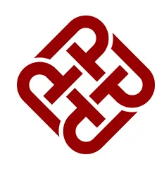
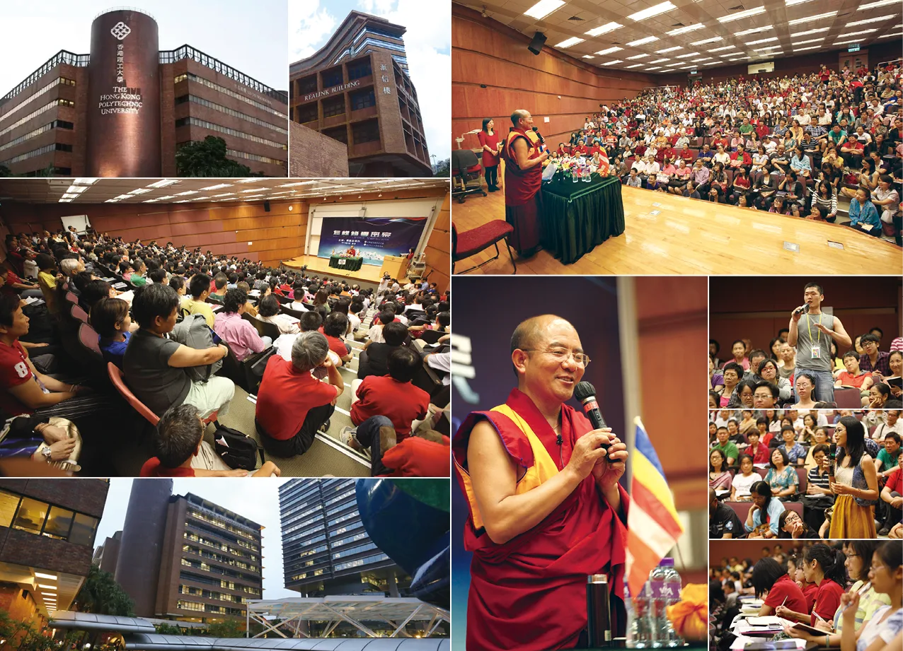
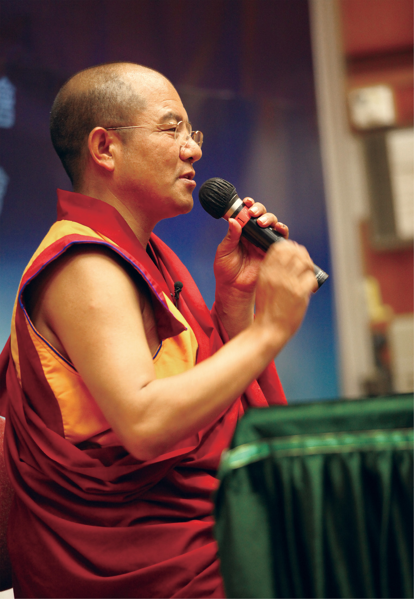
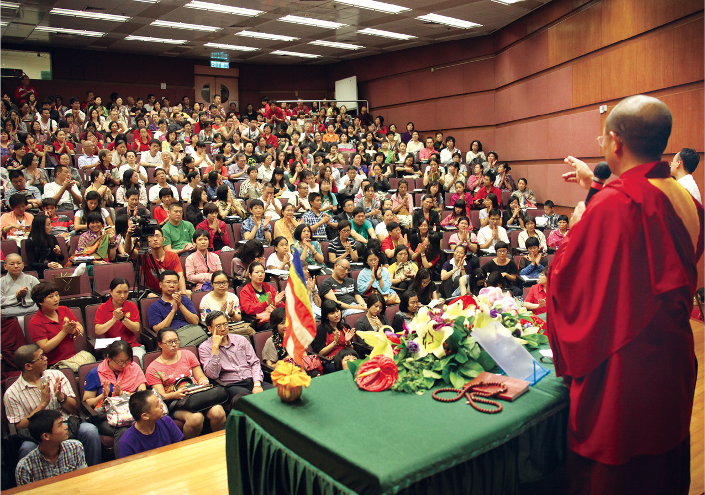

在佛菩萨才有的境界里，

装的只有一种理念：

利益众生。

第32场

香港理工大学

Polytechnic University of Hong Kong

中国·香港

2012 / 8 / 6

## 怎样修学密法

Starting the Vajrayana Journey

主持人：

索达吉堪布依止法王如意宝修学多年，不但承担着喇荣五明佛学院汉僧的教学与管理工作，同时也致力于将藏传佛教这一智能宝藏，传播至汉地乃至全世界。

堪布在知识分子、自然科学工作者中，享有崇高威望，尤其是近几年，更是不辞劳苦到处讲学。堪布曾发愿，要尽形寿、尽全力将佛教的思想和真理在社会上广泛传播，并与各大高校的知识界、学术界进行对话。

今次堪布来临香港，主要是出席“第二届世界青年佛学研讨会”，与三百多位青年就“佛教与科学”“环保”“心灵教育”“认识藏传佛教”等主题进行研讨。研讨会之后，堪布又应我们的邀请，就当前修学密宗者对藏传佛教认识薄弱，对藏密的双运、降伏等存在误解甚至诽谤等问题，来作开示。

请大家起立，以热烈掌声欢迎索达吉堪布——

有一篇祈祷文叫《自在怀业祈祷文》，不知道大家会不会念，会念的我们一起念一遍。这篇祈祷文相当殊胜，可以说，在如今这个末法时代里，念诵它对我们的身心健康、事业发展等各个方面，都有不可思议的加持力。

（堪布带领大家用藏语念诵《自在怀业祈祷文》）

今天我要讲的内容是“怎样修学密法”。这个话题很广，也很深，短短一两个小时不一定说得清。但简单讲讲，或许对大家会有些启发。

## 研讨会后的感言

我是第二次来你们理工大学，感觉还是那么欢喜，和去年一样。

“世界青年佛学研讨会”（World Youth Buddhist Symposium）昨天落幕，四天的活动，让每一个参与者都感觉颇有收获。很多人认为，它让香港及内地为主的大学生们提升了佛教认识，有些老师和同学甚至感慨说，今天才知道自己过去的认识是错的，“从现在开始，要重新做人”。

重新做人，这是人生新的缘起，而本次活动在香港理工大学、中文大学及教育学院联合承办下圆满后，我认为，也是佛教广泛传播的殊胜缘起。

在这里，我特别感谢理大的“佛学会”。就我所知，这个学会自建立以来举办过许多活动，为交流佛法做了许多有意义的事。你们年轻人来此求学，既可求到世间知识，又能学到出世间真理，应该说很幸运，所以希望大家多参与学会的活动，多学习学会的理念。

潘宗光教授是理工大学前校长，曾经担任工学院院长四年，校长做了十四年。他是科学家、教育家，同时已经皈依佛门，讲过《心经》，撰写过《佛教与人生》，是一名真正的佛教徒。让我钦佩的是，他公开承认自己是佛教徒，这在内地是很少见的。

理大佛学会会长甘耀权教授，和我学习密法的因缘比较近，昨天他在讲“藏传佛教的九乘次第”时，我就非常欣喜，原因是，他以大学教授的身份为知识分子讲佛法，比我一个出家人合适；而且，他讲的是从敦珠法王传下来的教言，感觉很亲切，有加持。

我在七八十年代时就听说，敦珠法王在香港、澳门、台湾等地方的弘法事业广大，而且他曾亲笔谕示，将他的法脉交付给刘锐之大德。今天香港修行密乘的人很多，我想，可能直接间接都跟这个传承有关联。

如今人们对密法的认识，虽然比以前好得多，但还是有些误解，比如，修密法要不要灌顶？要不要修五加行？很多人认为不用，其实是不对的。除非你是极为上等的根基，否则必须要灌顶，必须修五十万加行。

没有得过灌顶，又不依次第修行的人，即使看密宗书、听密宗的法，也不会获得成就。

## 离开基础的修行是空中楼阁

有人说：“我就没修五十万加行。我的上师很慈悲，为我开了绿灯，特殊开许不用修。”

且不说你的上师是否有资格开许，单就修行而言，因为它是建立在次第上的，很难逾越，所以不从“人身难得”“寿命无常”一步步修上去——你想的是上面的境界，然而如同一个没有基础的建筑，对你而言，这可能永远是空中楼阁。

“空中楼阁”出自《百喻经》：从前有一个愚人，他见别人有了一栋三层豪宅，心里很羡慕，于是请来木匠为自己造一个同样的楼阁。木匠立即挖沟、打地基，准备一层一层地建楼。但愚人看了很不悦，问：“你这是在干什么？”

木匠说：“为你造楼啊。”

“我不要下面两层，”愚人说，“你直接造最上面的第三层。”

木匠感到奇怪：“天下哪有这等事？不造第一层，怎么造第二层？不造第二层，怎么造第三层？”

此喻义再清楚不过了。修密法也是这个道理，我们不能在没有基础的情况下，妄想一些高的境界。

## 双运的修法有，但修的人很稀有

“双运是怎么回事？有没有这种修法？”

研讨会上有人问这个问题。也有人想问但不敢问，可能担心密宗上师们不敢答，或者不会答。

双运的修法有，但修的人很稀有。如今在藏地正规寺院和僧团里，没有人修这个法，原因很简单，一是没有人讲解；一是这种修法很高，一般人修不了。

有人想当然认为：“这就是男女关系。”其实不是。它有理论基础，不仅密宗，显宗也以隐藏方式说过。我们知道，显宗讲离贪分层次，一般的修法中说“对治”，但在最高层面上，讲的是把贪心转成智慧。

“或现作淫女，引诸好色者，先以欲钩牵，后令入佛道。”这是《维摩诘经》的教证：具有悲心和善巧的菩萨，为了接引好色者，有时会化作妓女一类的人，先用贪欲把他钩住，之后再引入佛道。

《华严经》里有一名美女菩萨，叫婆须蜜多，一般人认为这是个坏女人，善财童子参访善知识的路上，有一站就是去拜见她。当善财来到险难国宝庄严城，到处询问婆须蜜多时，有人替他惋惜：这位童子威仪不俗，根门寂静，为什么要找这个女人？

但了解这位菩萨的人，知道她有大智慧，赞叹善财，给他指了方向。善财来到她面前，恭敬顶礼。

婆须蜜多女开示说：“善男子，我已成就离欲实际清净法门……若有众生，欲所缠者，来诣我所，为其说法皆悉离欲……”[^1]

《太平广记》也讲了一个美女的故事。她二十四五岁样子，突然出现在延州地方，一个人行走在城市间，很多年少之人都喜欢跟她交往，嬉戏玩乐，甚至发生关系，她从不拒绝。几年后她死了。和她交往过的人自发把她装殓埋葬，还在路边修了座坟。

有一天来了位印度僧人，他在坟前停住，敬礼焚香，转绕赞叹，逗留了好几天。人们都嘲笑他：“这里埋的是一名风尘女子，人尽可夫，因为无亲无眷，就葬在这儿了。你一个出家人，为什么要礼敬她？”

“你们有所不知，”僧人说，“她是一位大圣者的化现，名叫锁骨菩萨。她来到此地，是为随顺俗情度化有缘众生，凡与她结缘的人都会解脱。不信，你们现在就打开棺木，一看便知。”

大家掘墓开棺。果然，她的骨架浑身上下钩连在一起，一环一环的就像锁链一样。不是一般的人。

以前为分析这类问题，我找过许多教证，不空翻译的《大乘密严经》里也有一个：“与诸明妃众，离欲常欢娱，此之观行法，萨埵之境界。”意思是，和那些明妃一起离欲而欢娱，这样的观行法，是菩萨的境界。

既然是菩萨的境界，凡夫行不行呢？不行。当你获得菩萨果位，能把贪欲转为道用时才可以。因此，这非常稀有，诚如《维摩诘经》所说：“火中生莲花，是可谓稀有，在欲而行禅，稀有亦如是。”

从这些公案教证可以看出，双运修法是有的，也不难理解。不过我要提醒一点：在没有达到这种境界前，千万不要用它作借口，行持所谓的“密宗禁行”。

如今密宗成为热潮，国内外有很多人信仰，是好事，但在热潮中不多些了解，人有时也会入歧途，所以我先简单讲几句，遣除一些常见的误解。

在一次研讨会上，有人问：“藏传佛教到底有没有错误？”

一位北京学者回答：“藏传佛教并没有错，但藏传佛教里个别人的行为，也许是错的。”

我很赞叹这种说法。确实，藏传佛教的教义完美无瑕，越研究越觉得殊胜，越能体会其价值。而我们认为有过失，可能是因为不了解，了解一下龙钦巴尊者、米拉日巴尊者的成就和智慧，应该就不会诽谤了。

## 修学密法的五个次第

藏地著名上师荣索班智达的神通很大。

“有神通很麻烦，”昨天有人说，“这个人的心也知道，那个人的心也知道，知道多了累，不要有神通。”

其实，有没有神通不重要，重要的是要有戒定慧——清净戒律、平等住心的禅定、抉择万法的智慧，有了戒定慧，有大德说，这就是真正的神通。

荣索班智达与龙钦巴尊者齐名，根据他的观点，修学密法分五个阶段：依止上师、得受灌顶、守持密乘戒、闻思、到寂静地实修。

我常留意初学者的状态，有还没入门的，有刚入门的，也有入了门又出去的，多数是在门口徘徊。如果我们想有所改变，有所收获，最好遵循这个次第：

### １．依止上师

依止上师最为重要。从什么时候算依止呢？从你在某位上师那里听过密法、得过灌顶时起，他就成了你的上师，你也就算依止他了。

依止前一定要观察好。就像买东西，是哪个厂出的？过期了没有？有没有副作用？如果是找对象，对方的家庭背景、文化程度、经济状况怎么样？……这些都有必要提前了解。

昨天我听到两个大学生的谈话，一个人问另一个：“你男朋友有没有车？有没有房子？有没有钱？有没有地位？”

当时我想：噢，她们对这些这么关心，观察这么仔细，如果依止上师前也这么观察就好了——“这个上师有没有智慧？有没有悲心？有没有传承？有没有清净戒律？”

观察久一点你才会知道，他是不是有资格摄受你。只看广告，“某某上师来了，要灌顶”，比如我要灌顶，你们就来了，之前根本不知道我是个什么样的人，这就有点草率了。

观察的时间一般是六年或十二年。元帝忽必烈很有佛教学识，他在观察六年后，对八思巴说：“我观察您六年了，现在相信您的确是一位具德上师，请您为我灌顶吧。”“你观察我六年，”上师说，“从今天开始，我也要观察你六年。”

你观察我六年，我观察你六年，十二年就过了。十二年虽然不短，但根据《事师五十颂》来看，这种谨慎对你日后的修行具有大义。事前不观察，依止后才看“这个上师有没有资格”，就没有意义了。

你们都知道密法要保密，但为什么保密？不是因为有过失，是因为珍贵。就像你家里的金银珠宝、银行卡密码，这些你不会公开，公开了，就被人偷走了。同样，了解了生圆次第、大圆满教义的人知道它珍贵，不会公开讲，一旦公开了，就会失去加持。所以，上师们在传授灌顶和窍诀时都非常谨慎。

如此珍贵的密法，当你得到时，修学它的关键在哪儿？就在依止上师。既然依止上师这么重要，那我们对依止前的观察、依止后的依教奉行，就应当重视。

我听说这边有通过广告选择善知识的，这可能不太妥当。广告说有上师来传法，你去看看可以，从他身边人那里或各种渠道了解一下他是个什么样的人，不行就去他的家乡或寺院，看他在当地是什么人物。

这是需要的。就像很多企业家有了合作意向后，他会飞过去和对方见个面，到厂里看看，见对方真有实力，才会谈判、签合同。佛教的师徒因缘关系到生生世世，这么重要的事，为什么不谨慎？

不过现在很多人喜欢冲动，一听说有上师来了，以为真是佛来了，匆匆忙忙依止；但依止后又不会观清净心，以致师徒间常常发生矛盾，什么矛盾都有。

所以，依止前一定要好好观察。如果能以这种谨慎态度开始你的修行，一路就比较稳妥了。

观察过后，如果你发现这是一位具德上师——就像《前行》[^2]《事师五十颂》[^3]里讲的，上师应具的十二或十四个法相中，他至少具足了戒律、慈悲、智慧等部分功德，这时候你就可以依止他。如果连慈悲心都没有，就失去了摄受弟子的条件，不要依止为好。

当然，依止到具相上师以后，我们自己也要有弟子相，比如，至少懂得以恭敬心来依止。

### ２．得受灌顶

对灌顶我有个比喻：给土里的种子浇水，它才可以生长；我们的佛性，通过灌顶才有成熟的机会。

所以，灌顶是进入密法的仪式，进香港要通行证，学密法要先灌顶。有人说“学密麻烦，还要灌顶”，其实每个宗教都一样，你要经由一定的仪式才能加入。进入密宗殿堂的不共仪式就是灌顶。

灌顶的要求很多，是否得到灌顶不在形式，而在于二因四缘[^4]具足与否。二因四缘有上师方面的，比如念诵、修持圆满，具有灌顶资格等；也有弟子方面的，比如具有信心、智慧等。这些我在讲《前行》时讲过，只有圆满具足二因四缘，才能真正得到灌顶。

灌了顶以后，还远远不是结束，这只是开始。很多人喜欢灌顶，今天求一个、明天求一个，但灌顶后既不守誓言，又不闻思佛法，这是如今学密者的一大弱点。你拿着通行证进了香港，会站在那儿不动吗？肯定不会。你一定有事情做，接下来要一步步施行。

灌顶也是如此，它是对你学修密法的开许，是洗涤心灵、启发佛性的仪式。

### 3．守持密乘戒

灌顶后，你就有了守护密乘戒的责任。佛教里大小乘都认为：依戒生定，依定生慧。也就是说，这戒定慧三学，前者对后者而言是“无则不生”的关系；戒又是一切功德的基础，有了它你才能修定发慧。

我常听有人抱怨学佛不易：“佛教的戒条太多，我守不了。”

事实上，戒是提升自我的行为准则。你要做个好人，必须接受道德的规范；你要修学密法，必须守护《大幻化网》的五条根本戒，或者共同的十四条根本戒。所以，守戒不是被束缚了，正相反，它可以维护你的修行。

灌了顶却还不知要守什么戒的人，是非常危险的。就像出了家的沙弥、比丘，做了居士的在家人，该守什么戒自己要清楚。你们考上理工大学，这里有什么规矩要知道，不能违规，违规了就会被开除。同样，守不好密乘戒律，也就失去了学密的资格。

灌了顶的修行人就是密乘弟子，层次很高，所以戒的要求也严格。否则，你依什么修这么深的密法？

### 4．闻思

依止上师、得受灌顶、守护密乘戒的目的，是为了修行密法。要修行，就必须闻思。

遗憾的是，当今佛教徒最缺乏的就是闻思。皈依一二十年的人，只会烧香、拜佛、念经，没有正规系统的闻思。即使遇上了闻思因缘，有些人的热情又像蝌蚪一样“头大尾细”：开头精进得不得了，白天不休息、晚上不睡觉，什么事都不管；但没过几天就和家里闹僵了，闻思也没了心情，结果一无所成。

还有不少人把密法当成气功或者瑜伽，不了解它的理论体系，也不探究它的修行意义，只是形象上似乎在修法，这种人也容易退失。所以一定要闻思。

闻思有两种层次：一是闻思前行法。像《大圆满前行》或《心性休息》前八品的外内加行，这些道理先要学好。还有《菩提道次第广论》，乾隆皇帝就是在章嘉国师指导下，从这部论典开始修的。还有一种是密宗正行法。像格鲁派的《密宗道次第广论》，萨迦派的《道果法》，大圆满的《七宝藏》《三休息》《四心滴》，以及《时轮金刚》《大幻化网》等。

我认识很多学者也在学密，国内外都有，在座当中就有。他们无一例外喜欢学习，既学前行，也研究密宗理论，同时还在修行，从二十年前到现在一直如此。

我也喜欢学习。尤其喜欢买书，不论到哪儿，不想吃的穿的，只想买些好书。我家里书很多，每间房子都是，虽然没时间一本本地翻，但摆在那儿也觉得舒服。刚才我拎了一下我那个箱子，拎不动，全是书，几所大学的老师同学送的。其他东西我都处理了，但书要带走，有价值的东西，重一点儿没关系。

我不是要炫耀什么，只是希望大家重视知识。如今时代已经变了，人们崇拜金钱，崇拜这个“臭皮囊”，重视心灵教育的人越来越少。然而，一个真正有内涵的人，还是会追求古老的智慧，追求前辈大德或智者们留下的思想。长远看，这些比物质重要得多。

如今学这些很方便。你可以到某位上师面前听课，也可以在网上听课。如果安排得好，每年听几门课、看几本佛书，吸收各类有益的知识，活到老学到老，人生不是很有意义吗？

当然，这是我个人的想法。你们年轻，喜欢奥林匹克，“我要踢球，我要游泳……”，喜欢这些时尚也好，不过当你静心思考一下或许会发现：能为我们一生带来深刻利益的，还是真理。

### 5．实修

闻思后一定要实修。没有实修的人，即使讲得天花乱坠，听者觉得有趣味，但讲完后理论归理论，烦恼一点也没有减少，这就远离佛教的意趣了。佛陀开示教法是让我们实践的，所以要实修。

实修有很严密的次第。前行修法中有四个共同外加行：人身难得、寿命无常、轮回过患、因果不虚；其次是不共内五加行：皈依、发心、念修金刚萨埵、供曼茶罗、上师瑜伽；最后是往生法。

修完前行后，可以进入大圆满的不共正行修法：身加行、语加行、意加行，生起次第、圆满次第乃至无上大圆满。这样修行以后，随着一步步深入，我们的心灵就会得到不断净化和升华。

传承上师告诉我们：在一切修法中，密法简单而且直接，可以轻易对治最顽固的贪嗔痴。

如今东西方人都喜欢密法的原因，就是因为它的这种实用性。忙碌让现代人在精神追求上变得懒惰，如我在美国看到的，他们不喜欢深奥理论，一是没时间，一是理解不了。他们意识到烦恼是根本性问题，也想对治它，但他们只希求最直接的法，所以选择了密法。

密法的窍诀的确具有不一样的力量。在显宗修法里，如果你生了嗔心，只能调息打坐修习安忍，思维嗔心的过患、安忍的功德，这样一点点瓦解它，让心平静下来。然而在密法修行中，只要你依着上师窍诀，直接观察嗔心的本来面目，它当下就会熄灭。

刚开始可能不一定管用，还不熟练。一旦你掌握了窍诀，不论生起什么烦恼，这么一观，认识它本体时你会发现：原来贪心嗔心这些心念如此可笑，完全是虚妄执著而已，不值得生起。

这种效果让人着迷，而我对密法的信心，也让我把一生的精力都奉献于此。我常默默感恩我的传承上师们，是他们用信心和实践将这一精神财富完好无损保留下来，我们才得以值遇；而我也庆幸遇到密法，让我这么一个平凡的修行人，在如今的时代里，还可以修持这么一种最简单、最深刻的转化之道。

虽然我对其他宗派有清净心，对其他宗教也有和睦相处的呼唤，但实践让我意识到：我对莲师及其教法的信心，永远也不会退转。

## 修学密法，超越平凡世界

今天，来此聚会的每一位都是有缘人，既是有缘人，何不进一步了解密法？

如果密法是真理，它肯定经得起推敲，人人可以观察。佛教提倡观察，是为让我们遣除疑惑、树立信心，但即使你想找它的过失，推翻它，也最好下一番功夫学习。不了解密法的人，常因看不惯个别人的行为就诽谤密法，这不明智。道理很简单：密法再清净，也保证不了每个学密的人都清净。显宗不也一样吗？

再说，出家人有不对的地方，也不奇怪。奇怪的是，出家人好的地方没人说，稍有不对，媒体就放大了宣扬，“这个和尚怎么怎么，那个修行人怎么怎么”，世间有那么多坏人坏事不说，为什么对出家人如此苛刻？

下面我们看看修学密法的功德。

修密有成的大德，当你越亲近时越会发现，他们的智慧不可测度，到哪儿都能宁静自处，和我们的肤浅、浮躁、自私、痛苦不同，在这种佛菩萨才有的境界里，装的只有一种理念：利益众生。即使是一位默默无名的修行人，当你感受到他的自在和全然投入后，也会不禁相信：修学密法，可以超越平凡世界。

谁都会起烦恼的，只要我们还活在这个世间。但是当你的心和法有所相应时，就可以过得平静快乐。“烦恼来了也不会有杀伤力，”像有些大德形容的，“在已将佛法融入内心的修行人面前，负面东西就像春天的风一样，毫无寒冷气息。”这就是密法的加持。

很不幸，没有修行过的人，生气时谁都劝不了，“那时候我真是疯了，不该说的全都说了，不该做的全做了”，自己静下来想想，也后悔不已。

当密法的加持和传承的力量来到西方，许多人修行后有不同程度的体会。不过我们知道，这种“如人饮水、冷暖自知”的感悟，不是一蹴而就的，它一定要借由次第——像刚才讲的五种次第，才可以现前。

一旦修行密法有些境界，人就会自动利益众生，因为此时他有一种自内而外的力量，不是三分钟热气。这和口头上“发菩提心”，实际却钻在“自我”的牛角尖里不同，他会力所能及地服务众生，在利益他人的同时也提升自我，进而长久地行持佛法。

我们都想超越这个平凡世界，然而先不说超越，面对生老病死的能力，我们有吗？无论你是什么身份，当衰老和死亡不期而至的时候，你能指望什么？仔细想想，除了佛法，还有什么真的管用呢？

所以，趁着年轻多学一点佛法，多修一点佛法，不要等到白发苍苍了才醒过来。与其到时候心有余而力不足，何不早一点清醒？

## 把利益众生放在第一

本次研讨会开到最后，有些非佛教徒的傲慢好像被摧毁了，有点想皈依，又不太好意思，一直观望、犹豫着。有顾虑是正常的，也是因缘未到，我们不勉强、不“抢”人，不是见一个就拉进来。

我们随缘。不过随缘的意思，是随缘度人，该度的还要度，不是什么都不做。为佛教的整体考虑，要维护什么，要争取什么，是要做的。否则，和其他宗教的积极相比，我们太懒惰了。

我们的懒惰，常常体现在过于自我上面。我们不关心佛法在整个人群中的印象，只关心自己那个小团体的利益，这有点狭隘，有时候也让人“烦”。就像那个西方同学说的：“看着有些宗教天天拉人，很烦。”但看着佛教徒不为整体着想，只顾小团体利益，也很烦。

的确，一个佛教徒整天“我的上师、我的宗派”，一听就感觉太自我化了。我们要记得，释迦牟尼佛是我们的共同本师，我们都是佛弟子，而且是大乘佛子。学大乘的人天天维护自己的小宗派、小道场，这种“家庭式”理念的结果是，让佛教徒和佛教徒之间不和睦，让道场和道场之间不团结，让外人不生信心。

我们常说南传佛教是小乘，但我以前去泰国那些国家时，发现所有道场都非常团结，甚至没有你我之分。说到这些我们要反省，我们学大乘尤其是学密乘的，为什么不能团结？我们这边有很多中心，但不管你在哪个中心学习，我们学的都是佛法，佛法是开放的，不是偏袒的自我维护。

释迦牟尼佛的教法由祖师大德传承下来，便形成了宁玛、噶举、禅宗、净土，这些不同的宗派就像一个家族中的十几个孩子，他们的后代子子孙孙仍旧是兄弟姐妹，我们要有这么一个整体的佛教观。

当我们的心量被拓宽，突破了狭隘思想，有了一种融合为一的了解时，你会发现，佛教原本就是包容的。它既可以涵盖其他教义，也可以涵盖天文、地理，乃至涵盖解释宏观、微观的任何一门学问，也就是说，它是最广阔的知识。

这种知识以教法呈现时，既可以有显宗教法，也可以有密宗教法；既可以是这个宗派的，也可以是那个宗派的；既可以在印度弘扬，也可以在美国、英国弘扬……我们要知道，它被如此宽泛地弘扬于世间，唯一的目的就是利益众生，让人们通过修行获得安乐和解脱。

了解到这点，我们尽可以撇开自他的争执，把心思放在利益众生和修行上。

最后，我希望大家不要把自己和小团体放在第一，要把利益众生放在第一；不要把生活放在第一，要把修行放在第一。

现场互动

问：感恩上师。请问，在家人该如何寻找寂静的地方修行？

堪布：在家里找一间房，关上门，就是寂静的地方。（众笑）

我看到一位居士在门上写个“静”字，说是修行用的，这个做法就不错。如果隔音效果好，自己规定个时间待在里面，关上门、关掉手机，就可以享受修行的安宁了。

问：我是高三的学生。作为一个学生，我该怎样用佛法利益身边的人？

堪布：你要用佛法利益别人，那自己要先学好佛法。学到了佛教知识以后，因为是自己的东西，所以当你传给别人的时候，自会根据不同情况找到相应的切入点。

如果你自己没有佛教认识，也没有修行，就像介绍学术一样，讲什么都靠“PPT”，那“PPT”万一坏掉了，你肚子里又没东西，就可怜了——电脑一死机，人也死机了。

问：我是广州外语学院国贸专业毕业的，现在搞出口贸易。一个朋友这样为我解释显宗跟密宗的区别：“修行佛法的目的，好比把瓶子里的气体释放出来，让它与外面的空气接触。为达到这一目的，显宗修法有点像用个东西去磨瓶子，慢慢磨穿了，气体才能出来；密宗是用锤子敲，一敲就解决了。”是不是这个意思？

堪布：从某种意义理解，可以这么说。因为显宗要求广泛、长期地学习理论，一步一步修；密宗通常是上师用最简单的道理直接讲要义，能领受的人可以顿悟成就。当然，后者必须是特殊根基，有殊胜智慧，否则很难一下子领会。

问：那您看我是学密宗还是显宗好？我想快。

堪布：那就学密宗嘛。

问：我是香港一所佛教小学的老师，接触的都是六到十二岁的小朋友，蹦蹦跳跳的，总是静不下来。希望堪布给我开示一下，该如何教他们观心？如何引导他们学佛？

堪布：从小学佛非常好。教育学院的王博士就是从小读的佛教小学，我们从他的PPT上，看到了他小时候的照片，很可爱。现在他是一名大学教授了。他的成长可以说明，宗教对孩子的健康是有利的，而不是相反。他从小发展起来的纯净心态，让他到今天还保有一种不同的气质。

以前我去马来西亚、新加坡时，发现那边有许多“文殊小学”“阿弥陀小学”，特别欢喜，也很受启发。回到家乡后，我在寺院里也办了个小沙弥学校，起名“文殊小学”。后来慈诚罗珠堪布把他的小学命名为“文殊小学”，可能就是从那边学的。（众笑）

能上佛教小学的人让人羡慕，如果我也上过这样的小学，现在可能会有点水平了。

你刚才问，怎么教那些蹦蹦跳跳的孩子？我想，六到十二岁的孩子，让他们天天坐禅、观心，不准动，也不准想，这不太现实。他们喜欢蹦蹦跳跳，那你就教他们一边跳一边念“皈依佛、皈依法、皈依僧……”。

问：我是广东工业大学材料加工专业的学生。听您讲了这堂课，我感触良多。平时我妈妈也让我修身养性，我就是不听。现在听您讲了，就想从理论上开始学佛。但是佛教的书籍那么多，我该选一本什么样的书，来启发自己的思维呢？

堪布：的确，共同学习很有感染力。像前两天的研讨会，有的同学以前根本不信佛，但在互动过程中，也开始相信了。这是一个好的开始，也许可以改变他的一生。

对初学佛法的人，我通常建议他们从《大圆满前行》或者《慧灯之光》的加行部分开始学，你可以试试。

问：我还有个不情之请。我们从广东过来比较麻烦，您有时间的话，能不能到我们那边去一趟？我的很多同学都想听您的课。

堪布：能否去得成，还要看因缘。你到这里比较麻烦，我到你们那里，可能也有点麻烦。（众笑）

我很乐意进入大学校园，跟知识分子交流。未来属于年轻人，为了让他们有个“造福人类、不害众生”的理念，让他们的人生过得美好一点，我很希望做点什么。不过，有些事也要看因缘。

问：我是加拿大留学生，也是菩提学会的学员。前两天在跟师兄讨论“修止”的问题，大家说“止”就是“不追随自己的念头，也不拒绝自己的念头”，但这跟发呆到底有什么区别？

堪布：一般来讲，止与观是双运的，这种修法在密宗、禅宗里都有。类似你刚才说的，“不忆念过去的念头，不迎接未来的念头，不落在当下的寻思中”，能安住这样的状态，平时常常生起的贪、嗔、痴等分别念，自然就止息了。

这是佛教中非常胜妙的修法，如果你修得进去，就会住于一种法喜的境界中，和发呆不同。

问：我是香港理工大学知识管理专业的硕士生。见您之前，我参加了台湾佛光山星云大师举办的“生命禅修营”，他也讲到了观心的几个层次，和您讲的一样，这让我了解显密的确是不分的。不过在打坐禅修课程上，我旁边有个女孩子，她学的是密宗，所以一打坐就结手印。我问她：“这是什么意思？”她说：“师父教的，我也不懂。”我想请堪布为我们解释一下打手印的意义。

堪布：我不是她的师父，能找到她师父的话，肯定有最正确的答案。

你刚才说得对，在究竟意趣上，显密是一致的，对此前辈大德们抉择得再透彻不过了，后学者不必争论太多，一心一意修持即可。我对佛光山诸多高僧大德的弘法利生行为非常钦佩，他们的法会庞大而有影响力，改变了许多人的命运，我很随喜。

说到手印，每一尊佛菩萨的手印，都有不同的内涵和意义，我们在修行一个法门时，也可以结相应的手印。如果你想结手印又不太会，可以用合掌代替，因为麦彭仁波切说过：“所有的手印都可以包括在合掌当中。”

甘教授最喜欢合掌，说明他深谙此理，把所有手印都总结在一起做了。（众笑）

问：有一个问题困惑了我很久。我自己很愿意学佛，但家庭成员反对，怎么办？

堪布：有人反对是正常的，但我们也不必舍弃信仰，相处时善巧一点就可以。

西方家庭一般都尊重彼此的信仰。我认识这么一家人，他们家有三种信仰，基督教、天主教和佛教，但是你信你的、我信我的，各做各的仪式，谁也不干涉谁，一家人在不同的信仰下和睦相处。

我们没有这么幸运。昨天有位佛友说，他家的佛堂被拆过几次，拆了建、建了拆，经过长期的斗争后才终于不用拆了。可能每个人学佛都会遇到些违缘，不说我们，当年佛陀在出家、修道、成就的过程中，也有很多违缘。

这时候我们要会随顺，听听家人的想法，问题也就解决了。否则家人也会觉得你装样子：“对家里不管不顾，一个人跑到寺院里修大悲心，去外面当义工、做慈善，这算什么慈悲？”

问：我来自江苏经贸学院。和上师一样，我也喜欢看书，很好学，但怎么才能坚持下去呢？

堪布：一个人好学，可能跟前世也有关。不爱看书的人一看书就困，学生时代还好，进入社会以后干脆就不看了。我有个同学说，他已经二十多年没看过一本书了。“是不是压力太大？”我问他。“是啊，没时间，也没兴趣。”他无奈地说。

所以，生活会把我们困住。除非你把看书当作享受，繁忙之余的一种休息，而且时时有所收获，否则，可能就很难坚持“好学”了。

我看佛书尤其是密宗的书，每每乐此不疲，偶尔涉猎世间学问也会有所心得，甚至兴趣盎然。我想可能有一种力量在推动着，就是当我对于想要深入的思想，一旦了解了它的功德，进而有些把握或通达的时候，再苦再累也愿意坚持。

问：我是来自哈尔滨商业大学的一名本科在读生。现在有一些佛教徒把传统的儒家文化和佛教思想共同推行，请问您对此有何看法？

堪布：在藏地，传统文化就是佛教，也早已融入了藏民的生活。而在汉地，儒教和佛教是传统文化的重要两支，把二者一起推行当然很有意义。

我想人们推行传统文化，也是在为这个社会担忧，尤其是年轻人。80、90后的年轻人，除了课本知识以外，基本没接受过什么为人处事的训练，以至于毕业后都不太会做人，再加上媒体的染污也越来越重，人心向下的趋势在所难免。可能是这种种原因，让大家开始呼唤传统文化了。

我以前讲过《弟子规》，很好的教材，里面有许多做人做事的道理。不过这些只涉及今生，根据佛教的精神，我们关心今生，也关心来世，所以在教导孩子的过程中，最好也为他们树立一个因果观，让他们从小相信前世后世。

佛化家庭一般都有这种教育，我见过这种孩子，既懂礼貌，又有佛教素质，让人特别喜欢。你们有孩子的，可以尝试这样去教育。

可能有人已经发现了，在孩子成长过程中，有些问题不难调整，教教规矩，让他明白道理即可。但有些问题，像一些很难治的疾病或偏执状态，就没那么简单了，很可能与前世有关。这时候光靠简单劝化是不够的，最好能运用一些佛教的修法，否则今生受苦不说，恶性循环起来还会延续至后世。

所以，我认为，越是这样的时代越需要佛教。在推行传统文化时，如果有儒家的人规教育，也有佛教的三世及因果教育，那对我们的家庭和社会，对现在和未来，都将带来莫大的利益和推动。

问：我来自香港理工大学机械工程系。俗话说“好人有好报，恶人有恶报”，但现实中好像不是这样，我爸这个人心地善良却一直在吃亏，请问这是怎么回事？

堪布：好人有好报，这个理是对的。但这个好报不一定都在今生里感受。

一个人今生快乐，是他前世行善带来的；一个人今生受苦，是他前世造恶导致的。如果你爸一直在吃亏，是不是前世的业的问题？不过他人好，现在造了善业，来世会快乐的。

我常用比喻解释这种“因果观”：有什么因就有什么果，就像你平时不学就考不好，你好好学就考得好；从因到果也需要时间，就像农民种庄稼，春天种秋天收，不可能今天种今天收。

因此，好人一定有好报。不过好报不是今生都看得到，有些要在来世或者来世的来世，才看得到。

问：我一个同学的祖母在庙里吃斋念佛，过世五十年后肉身不坏，当地人把她制成金身一直供奉。请问您怎么看这件事？她的子孙后代应该怎么做？

堪布：藏传佛教的论典中记载：修行有成就的人，死后会出现肉身不坏、烧出舍利等种种瑞相。所以，这是她修行的功德所致，应当受到供奉。

有这样的祖母，她的子孙后代们应该感到幸运，要对修行有信心，像她一样行善。她有了成就，她的眷属或与她结缘的人，将来也会得到摄受并证果。

问：我毕业于香港理工大学中文及双语学系，我想代我表姐向您请教一个问题。她今年从中医药大学毕业，现在在医院里工作，她想知道，怎样用佛法帮助病人？

堪布：大乘佛法的核心是慈悲：愿众生远离一切痛苦，这是大悲；愿众生获得一切快乐，这是大慈。

有了慈悲心的人，接触患者时会尽心尽力给予救治，并且也能够帮到他们。所以，有心用佛法饶益病人，最好多修慈悲心。我认识很多医生就是这样的，他们修得好，治病的效果也好。

问：请问，菩萨戒跟密乘十四条根本戒，都是在什么时候受？

堪布：菩萨戒要通过一种仪轨来受，有愿菩提心戒和行菩提心戒。密乘戒是在灌顶时受，没有单独仪轨，得到灌顶也就得到密乘戒了。

问：佛教的理念是“不执著”，但我发现一个现象：很多佛教徒去大大小小的法会抢购一些加持过的圣物或宝物，每个人家里都收藏了一大堆。他们支持不同的佛教团体，算是一种功德，但这种贪执心是不是有违佛教的基本概念？

堪布：佛教里说“不执著”，是说最后不执著，刚开始的时候一定要执著。你要找到具相上师，你要得到正法，你要得到传承的加持……这些在胜义中的确是空的，然而在世俗中却会起作用，你不争取，或许就得不到了。

“不执著”不是佛教的全部内容。

问：我是湖南长沙一名私营企业主。自去年学佛以来，我在管理的惩罚与佛法的慈悲之间有些纠结，请问这两件事该如何圆融？

堪布：管理很重要。不仅是企业，佛学院或居士团体也需要管理。但管理不能离开慈悲，你一方面要管理员工，一方面也要关心员工。

只要是恰当的管理——不是不道德那种，你把章程讲清楚，怎么赏怎么罚，只要不舍弃慈悲心，照章执行就可以。这是正常管理。否则，一味“慈悲”也会失去控制的能力。所以要掌握好尺度。

问：我是东莞一名小学教师。我刚入佛门不久，这个年龄才认识佛法，有点惭愧，也比较急迫。我想对孩子们发菩提心，用佛乐的方式度化他们，不知道这样是否有用？

堪布：上了年龄的人学佛会心急，我理解。我常去大学交流，也是不想让年轻人错过佛缘。他们有佛缘，但错过以后，等老了再学，业也造得差不多了。

从小学开始更好。不用提佛教名词，让孩子们听听佛号种个善根，适当做一点对他们肯定有利。香港这边比较自由，有兴趣、有能力的人，可以尽力弘扬。

问：我现在不杀生、不吃肉，但我有个孩子做不到。我用佛法劝他，他不听，请问怎么办？

堪布：你对他说：“吃肉对健康不好。”

这次夏令营期间，我们一起过了五天素食生活，有些大学生一回家第一件事可能就是：“哎哟，五六天没吃肉了，快做顿肉来吃。”（众笑）

其实素食比肉食健康。国际上很多素食主义者不是佛教徒，也不是其他宗教徒，他们吃素只是为了健康。现在的营养学、健康学、医学普遍认为，人的身体并不适合肉食，肉吃多了会得很多疾病。

有人说：“吃素营养不够，会瘦。”其实是够的。我经常开玩笑说：“你吃牦牛肉，但牦牛不吃肉，它吃草，吃草还那么肥。”所以，吃素不会瘦。

[^1]: 《大方广佛华严经》云：“善男子。我已成就离欲实际清净法门。若天见我我为天女。若人见我我为人女。乃至非人见我。我为非人女。形体姝妙。光明色像殊胜无比。若有众生。欲所缠者。来诣我所。为其说法皆悉离欲。得无著境界三昧。若有见我得欢喜三昧。若有众生。与我语者。得无碍妙音三昧。若有众生。执我手者。得诣一切佛刹三昧。若有众生。共我宿者。得解脱光明三昧。若有众生。目视我者。得寂静诸行三昧。若有众生。见我频申者。得坏散外道三昧。若有众生。观察我者。得一切佛境界光明三昧。若有众生。阿梨宜我者。得摄一切众生三昧。若有众生。阿众鞞我者。得诸功德密藏三昧。如是等类一切众生。来诣我者。皆得离欲实际法门。”
[^2]: 《大圆满前行》云：“尤其是宣说密宗金刚乘甚深窍诀要点的上师，必须具备一切续部宝典中所讲的下列条件：一、获得不间断能成熟的灌顶——成熟相续；二、没有违犯灌顶时所受的誓言和其他戒律——净持律仪；三、烦恼和分别念微弱——相续调柔；四、精通密宗金刚乘基、道、果的一切续部意义——精通密宗；五、面见本尊等依修之相都已尽善尽美——依修圆满；六、现量证悟实相之义——解脱相续；七、心相续周遍大悲心——唯求利他；八、断除了今生世间的贪执——琐事鲜少；九、为了来世精进忆念正法——精进修持；十、现见轮回的痛苦，生起强烈厌离心，并且劝勉他人生起厌离——厌世劝他；十一、以各种各样善巧方便摄受调伏弟子——摄伏弟子；十二、依照上师的言教行持，具有传承加持——具有加持。我们应当依止这样一位上师。如《功德藏》中说：‘尤其宣讲窍诀师，得灌净戒极寂静，通达基道果续义，念修圆满证自解，悲心无量唯利他，精进念法琐事少，极具厌离亦劝他，善巧传承具加持，依如是师速成就。’”
[^3]: 《事师五十颂》云：“稳重平和具智慧，安忍正直无谄诳，了知密咒续部事，具仁慈心通论典，了达十种真如义，擅长绘画坛城事，精通传讲密宗法，极具敬信根调柔。”
[^4]: 二因：即相应因、俱生因；四缘：即因缘、增上缘、所缘缘、等无间缘。
