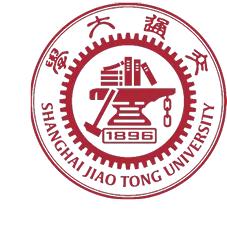
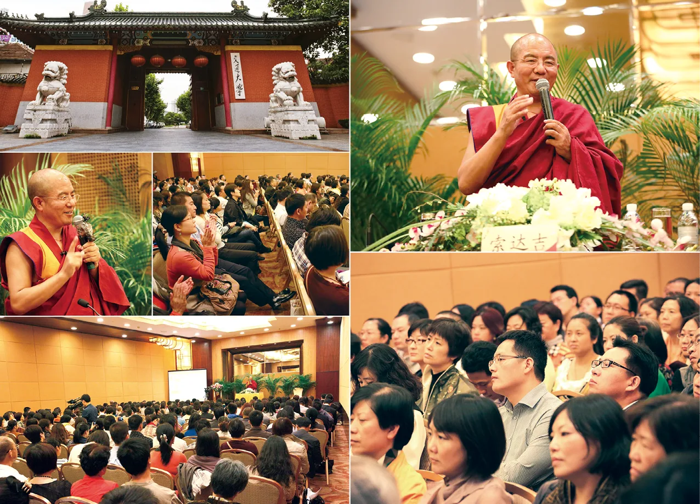
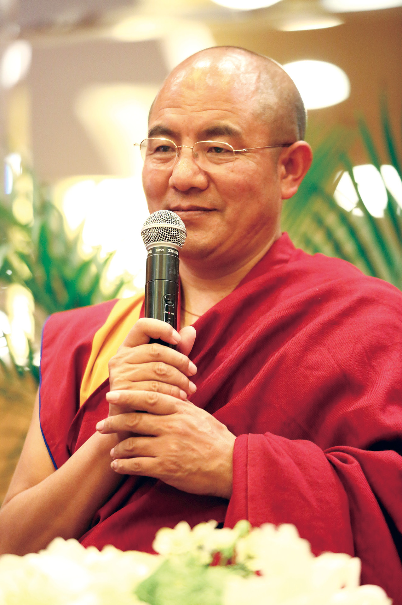
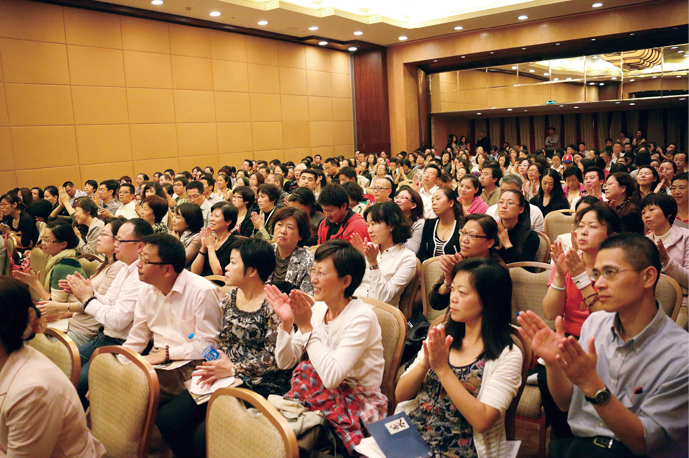
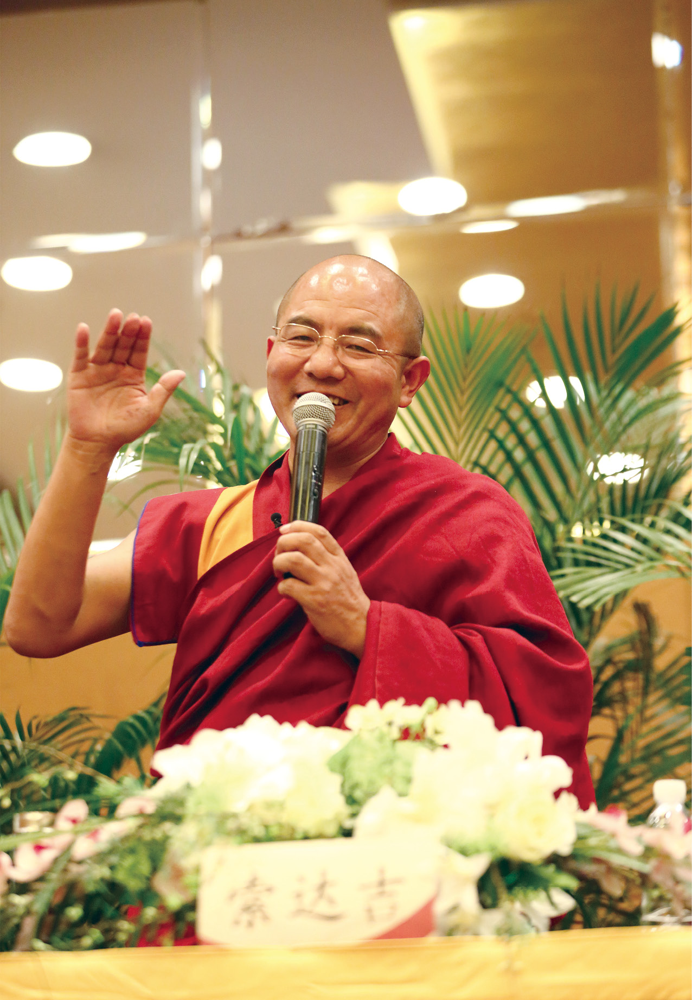
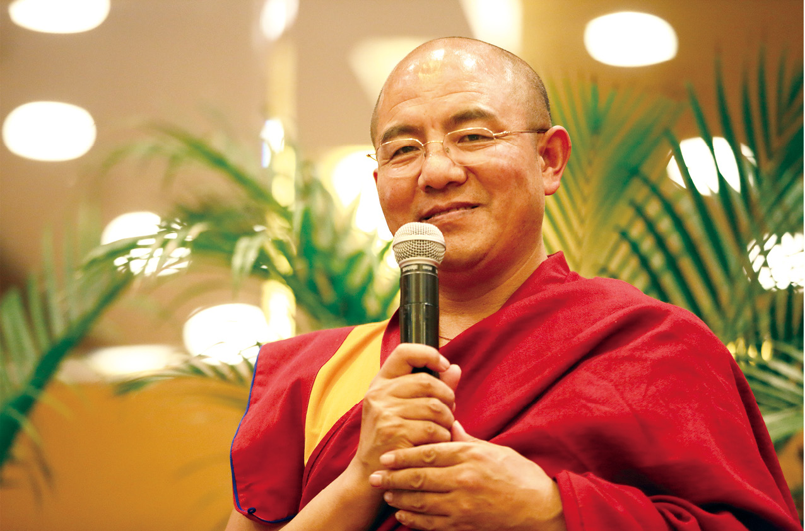

“亏损失败自取受，

利益胜利奉献他。”

第35场

上海交通大学

Shanghai Jiao Tong University

中国·上海

2012 / 10 / 24

## 自他快乐的八个秘诀

Eight Secret Keys to Happiness

主持人：

让我们以热烈的掌声欢迎索达吉堪布，请堪布为我们宣讲“自他快乐的八个秘诀”！

今天的讲课有点特殊，我准备采用藏传佛教的传统讲经方式，所讲的内容也比较难懂，可能有些人感觉比较枯燥，不管怎么样，希望大家能够认真对待。这堂课听下来，我们应该尽量掌握这八个窍诀，并最好能用自己的智慧解释它。

下面，我以武则天的开经偈，作为今天讲课的开始：

无上甚深微妙法，百千万劫难遭遇，

我今见闻得受持，愿解如来真实义。

## 一、秘诀简介

今天，我们学习的是一部藏传佛教的论典——《修心八颂》。

在藏传佛教的后弘期，印度佛学大师阿底峡尊者来到西藏，将已趋衰落的大乘佛法重新弘扬开来。阿底峡尊者有六大弟子，其中有一位叫博朵瓦，《修心八颂》就是博朵瓦的弟子朗日塘巴造的。

《修心八颂》问世以来，已有八百多年的历史。在藏地的寺院、学校，甚至普通人家里，随处可以看到这八个偈颂。表面上，这个似乎很简单，然而其中的甚深意义，我们可能终生都学不尽。

记得我刚出家时，上师给我传讲了这个法，当时自己还年轻，也比较傲慢，觉得这几个颂词应该很好懂。可是后来，我才发现自己错了，在之后的近30年里，每次重温这个法，自己都有新的收获。

今天，你们头一回接触这个法，也许个别人觉得：“这没什么稀奇的，我能写出更好的颂词。”然而事实上，这个教言非常殊胜，它是圣者的智慧结晶，根本不同于凡夫分别念拼凑的文字。所以，希望大家在学习过程中，打消轻慢之心。

《修心八颂》宣说的，大多是圣者的行境，严格来讲，出家人都很难做到这些要求，何况各位被世间的俗务缠身，不可能有太多时间修行佛法，所以，我并不奢望大家100%做到其中的要求。不过，即使无法完全做到，大家也要尽自己的能力去做。实在不行，也可以按照这些偈颂发愿。在《修心八颂》中，每个偈颂开头都是：“愿我……”这其实就是一种发愿文。如果你觉得这些发愿非常好，可以将它贴在显眼的地方，经常用它提醒自己。

《修心八颂》是真正的幸福秘籍。生而为人，谁不想获得幸福呢？然而，要想获得幸福，就必须付诸实际行动，否则，光嘴上说“我要幸福”是没用的。如果大家能按照《修心八颂》调整自心，我敢保证各位的幸福感会日益提升。

或许有人怀疑：“这个法只有短短八个偈颂，有那么殊胜吗？”其实，所谓的秘诀，就是用最简练的语言，开显最甚深的意义，就像一把小钥匙便可以打开大门一样。所以，大家千万别小看了这八个偈颂。

在藏地，高僧大德们极为重视《修心八颂》。我所在的喇荣五明佛学院，有近万僧人，出家人必须背诵的三部论典中，《修心八颂》就是其中之一，这是学院的创始人——法王晋美彭措仁波切明确要求的。

由于时间关系，今天我不会讲得太广，只是给大家简单介绍这些窍诀。如果在藏地讲这个法，时间会长得多。我家乡有一位八十多岁的老法师，他讲经说法时间特别长，有时候从下午一点讲到七点半，中间没有任何休息，不管下面的听众多累，老法师一直慢慢地讲。不过你们放心，今天，我不会讲那么长时间。

## 二、秘诀详说

### （一）

愿我以胜如意宝，饶益他众之意乐，

时时刻刻倍珍爱，轮回一切诸有情。

愿我以殊胜如意宝般的饶益他众之意乐，时时刻刻珍爱轮回中的一切有情。

现代社会最需要的，就是爱心。大家知道，不管是什么样的团体，如果里面每个人都怀着自私自利心，这种团体就不会有温暖和安全感。因此，为了让这个世界变得更美好，我们应该不分国家、民族、地域，平等关爱一切众生。

如意宝，是古代的一种宝珠，这种宝珠极为殊胜——无论你希求什么，它都能满愿。同样，珍爱所有众生的心就像如意宝一样，能出生世出世间的一切功德。这种心进一步升华，就是大乘佛法的心髓——菩提心。

谈到珍爱众生，不得不提到杀生。杀生是世间最恶劣的行为，一方面这会欠下可怕的命债，一方面也是没有爱心的表现。在世间，凡是稍微有点素质的人，都不会随便杀生。我看过这样一条新闻：在澳洲举行的一次网球比赛中，一个运动员回球时，高速飞行的网球击中了一只小鸟，小鸟当即坠地。那个运动员立即中断了比赛，跑到小鸟落地处，跪在小鸟的尸体前，在胸前不断地划着十字……

只有懂得了大乘佛法的精髓，才明白珍爱众生之心是何等重要。大乘佛法认为，之所以要珍爱一切众生，是因为一切众生都对自己有过恩德。这个道理并不难懂，请大家想一想：我们穿的衣服、吃的饭、用的资具，哪个是无因无缘而来的？哪个不是蕴含着无数人的汗水？

其实，只需稍加斟酌，我们便不难发现这样一条规律：一切痛苦源于珍爱自我，一切快乐源于珍爱众生。因此，如果我们把爱的方向从自身转移到他人，痛苦就会越来越少，幸福也会越来越多。

如果有些人顽固地执著：“凭什么我要爱一切人？他们又不是我的同胞、家人！”这就是智慧不成熟的表现。事实上，暂且不谈佛教的观点，即便站在科学的角度，我们也应该爱一切人。现代科学发现，不论哪个种族的人，99%的DNA结构都是相同的。从这个角度来讲，所有人都是平等的，我们应该平等爱一切人，不应该和别人产生隔阂，更不应该和别人发生冲突。

### （二）

愿我交往何人时，视己较众皆卑下，

诚心诚意又真挚，尊重他人献爱心。

愿我交往任何人时，将自己看得比对方低下，诚心诚意尊重对方，将爱心奉献给对方。

尊重他人，是做人的基本素养。《礼记》云：“夫礼者，自卑而尊人。”然而，现在许多人非常傲慢，一点都不懂得尊重他人。尤其是某些成功人士，任何人都不放在眼里，不管走路还是说话，始终是一副目中无人的样子。还有些“官二代”“富二代”，自打从娘胎生下来，就在鲜花和掌声中度过，自恃家中有钱有势，对别人总是不屑一顾。这样非常不好，人应该时刻保持谦卑的心态，如果因为在财富、智慧方面有过人之处而傲慢自大，这就是大乘佛法所呵责之处。

听我这样一讲，个别人或许想不通：“我明明是领导，为什么非要在别人面前显得卑下？”其实，所谓的谦虚、卑下，不是要你舍弃领导的身份，而是要求内心保持谦卑。

因为缺少谦卑，内心就有傲慢一大堆，许多人做什么事情都不成功。现在有些人学历特别高——硕士、博士、博士后，听起来很不错，可是因为缺乏对别人的尊重心，打起交道来就是另一种感觉了。

所以，在学校里不光要学知识，也要学如何做人。所谓的做人，也不是表面形式。现在有些素质教育只教人怎样微笑、鞠躬、走路，不教如何尊重别人，这不算真正的素质教育。

我始终认为，像尊重他人、自甘卑下这样的善心，在大乘佛法中才有圆满宣说。大乘处处强调善心，在大乘提倡的善心中，最根本的是大悲心、大慈心和菩提心。所谓大悲心，是将一切众生从痛苦中救拔出来的善心。所谓大慈心，是愿一切众生获得快乐的善心。所谓菩提心，是在大慈心和大悲心的前提下，希望众生获得佛果的善心。佛教的历史上，无数高僧大德用自己的一生，完美地演绎了大乘行者的光辉形象，由于内心具有圆满的善心，所以在接触众生的过程中，他们随时随地散发出慈悲的光芒。

学习这个颂词后，大家要想到：今后无论面对任何人，自己都不应该傲慢。其实，身为轮回中的凡夫，即便有一些暂时的圆满，也没什么可傲慢的。以有钱来说，这根本不值得傲慢：一方面有钱不等于功德；另一方面钱是无常的，今天你腰缠万贯，也许一夜之间就会沦为穷光蛋。前几天有人在网上爆料，说广州某贪官有22套房产。消息一传开，该官员立即被免职，他的资产也马上被查封。

在我接触的人当中，有些人傲慢心特别重，对任何人都不屑一顾，总觉得自己高人一等。其实，这些人应该想想：世间的一切都是无常的，或许有那么一天，自己会沦落到极其悲惨的境地，那个时候该如何面对现实呢？

凡夫人往往以这样那样的资本而心生傲慢。龙树菩萨曾说过，有些人以才华而傲慢，有些人以相貌而傲慢，有些人以财富而傲慢，有些人以地位而傲慢。在座各位如果有这些心态，我建议你们多看看历史，看看那些威德超群、洪福齐天的大人物最后是什么结局，这样就能打消内心的傲慢。

在这里，我要顺便提醒某些人：当你兴旺发达的时候，不要过于陶醉，以至于忘了体贴、关爱身边的人。有一个官员对我说：“虽然工作非常忙，但每周日上午我都会陪陪家人。因为我想，如果只顾着工作，一点都不管家人，自己以后肯定会后悔。所以我规定：不管再怎么忙，在一个星期中，必须给家人留半天时间。”我认为这种做法挺好，值得许多人学习。

相比世间层面，佛教对体贴、关爱他人有更高要求。大家要努力实践这种精神，不要认为佛教的要求太高了，自己根本做不到。即使我们做不到100%，做到20%、10%，甚至5%，也是可以的，不能因为做不到最好，就彻底不做了。像米拉日巴、印光大师等大德的境界，我们不要说一辈子，一百辈子也不一定做得到，但只要自己不断努力，也可以逐渐接近他们的境界。

### （三）

愿我恒常观自心，烦恼妄念初生时，

毁坏自己他众故，立即强行而断除。

愿我恒时观察自心，当烦恼和妄念刚生起时，就认识到这些非理作意会毁坏自他，立即强行断除它们。

末法时代，众生的烦恼极其炽盛。如《地藏经》云：“南阎浮提众生，举止动念，无不是业，无不是罪。”当生起烦恼时，一个人会丧失惭愧心，甚至会无恶不作。对此，培根在《论贪婪》中说得非常清楚：“贪婪者为了煮熟自己的一颗鸡蛋，不惜烧掉邻居的一座房子。”

看看如今的社会，到处是豆腐渣工程、毒奶粉、地沟油，以至于人们连走路、吃饭、喝水都没有了安全感。造成这种悲剧，一方面是因为许多人不懂因果，一方面就是因为贪婪等烦恼炽盛。

在烦恼的驱使下，还会爆发个人、家庭、民族乃至国家间的大大小小战争。昨天在上海街头，我看到两个小贩为蝇头小利而打仗，虽然他们打得不厉害，只是用苹果互相砸，但也算一场小战了。

要摧毁烦恼，最好的办法是培养利他心。如果我们经常想着别人的苦乐，经常关心别人，自相续中的烦恼很快会灭尽，当烦恼灭尽后，痛苦也就不复存在了。

### （四）

愿我目睹恶劣众，造罪遭受剧苦时，

犹如值遇珍宝藏，以难得心爱惜之。

当见到恶劣众生因造罪业而遭受剧苦时，愿我犹如遇到宝藏一样，以难得之心珍爱他们。

现在的社会太缺少爱了，人们都不愿意管别人的事。刚才我讲到两个小贩打仗，当时围观的人不少，可是没有一个去劝架。这虽然不是什么大事，然而从性质上讲，和前一阵子的“小悦悦事件”是一样的。

当发现金矿时，勘探队员会非常高兴。大乘行者的心态则不同，遇到发财的机会时，他们不会欣喜若狂，而看到饥饿者、残疾人、乞丐等可怜众生时，他们会觉得非常难得，会想方设法帮助这些众生。

大乘的爱心是最伟大的爱。世间的爱心是这样的：今天哪里发生灾难了，才想到去奉献爱心，比如汶川大地震期间，许多人向灾民伸出援助之手，然而灾难一过，就不管他们了。站在大乘的角度，这种偶尔的爱心是远远不够的，应该随时随地帮助可怜的众生。

在座各位扪心自问：“我有没有大乘的善心？”恐怕不一定有。看见可怜众生时，你不但不帮助，也许会想：“可怜之人必有可恨之处，他活该受罪……”如果是这种心态，跟大乘的发心就相去甚远了。

当然，要一下子转变串习已久的观念，达到大乘的思想境界，也有一定的困难。不过我希望，今后大家要往这方面努力，要尽量以善心对待一切人和事，不要总是抱着负面心态。如果你经常心怀嗔恨，经常面若冰霜，经常对他人发脾气，不要说来世的果报，即生中也不会收获幸福。

在培养善心时，应该从点点滴滴做起。去年，我在佛教徒中提倡“日行一善”。大家也不妨试着做一做，每天至少做一件有益于自他的善事：看见腿脚不方便的人，过去搀扶一下；别人骂自己时，尽量忍一忍；对别人产生烦恼时，马上调整自心……长此以往，自己的心一定会逐渐贤善起来。

### （五）

愿我于诸以嫉妒，非理诽谤本人者，

亏损失败自取受，利益胜利奉献他。

对于以嫉妒心非理诽谤自己的人，愿我心甘情愿地取受亏损和失败，将利益和胜利奉献给他。

这个偈颂加持非常大。《大圆满前行》中有一则公案：以前，恰卡瓦格西到甲向瓦格西家，无意中看到了这个偈颂。他感觉非常稀有，便问：“这是什么法？”甲向瓦格西说：“这是朗日塘巴尊者造的《修心八颂》。”听到此话，恰卡瓦格西迫不及待地想求得此法。不幸的是，当时朗日塘巴尊者已经圆寂了。后来恰卡瓦想尽办法，在夏日瓦格西前求得了《修心八颂》。依此法修持六年后，彻底断除了对自我的爱执。

世间有这样的观念：“以牙还牙，以血还血”，“人不犯我，我不犯人；人若犯我，我必犯人”。作为世间人，持这些理念是可以理解的；然而，站在大乘的角度，就不能有这种心态了，对于非理损害自己的人，我们更应该以慈悲忍辱心去对待。

大乘佛法处处强调吃亏、忍辱。昔日寒山问拾得：“世间谤我、欺我、辱我、笑我、轻我、贱我、恶我、骗我，如何处治？”拾得答：“只是忍他、让他、由他、避他、耐他、敬他、不要理他，再待几年，你且看他。”

乍一听这个偈颂，有些人可能想：“如果干什么都是‘亏损失败自取受’，那还怎么活下去啊？”这种顾虑是多余的。修行是讲次第的，对凡夫人来说，可以根据自己的接受能力来行持，暂时并不需要所有的事情都吃亏。

人和人之间的冲突，归根结底源于对自我的爱执。在佛法中，有各种根除我执的窍诀。比如别人骂你时，你可以观想：这些声音就像空谷回声一样，对自己无利无害，很快就会消失得无影无踪……如果善于运用这些窍诀，许多烦恼就无从生起了。

其实，这个偈颂不仅是修心的窍诀，也是为人处事的良方。当遇到他人的谩骂或者诽谤时，是针锋相对地回击，还是以这个方法化解？肯定后者的效果更好。

大家可以试想：本来你没有做对不起人家的事，可是人家硬说你做了，是对方说一句自己顶一句，还是自己先忍着，等对方气消了再解释呢？聪明人一想就知道，当然是后一种方法明智。

由此我想到，在大乘佛法中有许多为人处世的秘诀，不过，这些秘诀掌握在少数智者手中，大多数人都不知道。

佛法重在行持，对于“亏损失败自取受，利益胜利奉献他”这样的理念，大家要努力去实践。刚开始做起来，也许感觉有一定困难，但只要长期坚持，逐渐就会得心应手。

除了自己行持，大家还要将这种理念传播给他人。有的老师在做善法时，要求每个学生捐一元钱，这种做法非常好。事情看似不大，却能培养学生的爱心。这种爱心扩展开来，延伸到周围的人，延伸到整个社会，这个世界就会变得更加美好。

### （六）

愿我于昔曾利益，深切寄以厚望者，

彼纵非理而陷害，亦视其为善知识。

往昔我曾经利益某人并对其寄予厚望，纵然此人以非理手段陷害自己，愿我也将其视为善知识。

对世间人来说，如果曾经帮助过某人，对方反过来害自己，自己还要把他当作善知识，这根本是做不到的。在座各位学过《东郭先生和狼》，在这种教育的熏染下，大家都觉得坏人必须被干掉。其实，这种理念并不究竟。如果想培养真正的爱心，对于忘恩负义者，我们更应该以善心来对待。

在如今的社会，忘恩负义之辈特别多。有些老板辛辛苦苦培养出一个人，当这个人有了能力时，不但不回报老板，反而把客户和资源带跑了。以世间眼光看，这种人非常可恨，可是按照大乘佛法的理念，我们不但不应该恨这种人，还要把他们当作善知识。这，就是大乘的崇高境界。

在佛教的历史上，许多高僧大德都以实际行动，完美地展现了这种境界。印光大师无论遇到任何逆缘，都以一个“忍”字来应对。释迦牟尼佛在因地时，即便遇到再恶劣的众生，也不会怨恨对方。

作为高尚之士，要尽量记住别人对自己的恩德，淡忘别人对自己的伤害。不过在现实中，许多人恰恰相反：昨天别人帮了你，今天就忘得一干二净；几年前别人说了你一句，现在还记得清清楚楚。这样非常不好。今后，大家要转变这种习气，心里不要装着太多怨恨，如果怨气太多了，不说其他，对健康也是不利的。

### （七）

愿我直接或间接，利乐敬献诸慈母，

老母有情诸苦厄，自己默默而承受。

愿我直接或者间接将利益和安乐奉献给一切老母有情，自己默默承受他们的苦难。

此处宣说的，就是世间的换位思维。当然，世间的换位思维范围有限，只是人与人之间的换位，而佛法的换位思维范围无限，是将安乐奉献给一切众生，自己承受一切众生的痛苦。

颂词中讲到，直接或者间接利益老母有情。所谓直接利益众生，比如富人拿钱做慈善，医生治疗病人的疾病，老师解除学生的愚痴。所谓间接利益众生，是通过各种方便，让众生逐渐离开痛苦。不管直接还是间接利益众生，我们都应该尽最大努力去做。

从究竟上讲，利益他人就是利益自己。在美国，曾经发生过这样一件真事。一个风雪交加的夜晚，有个叫克雷斯的年轻人因汽车抛锚而被困在野外。正当他焦急万分时，有个骑马的男子路过。见到这种情况，男子二话不说，用马将汽车拖到附近的小镇上。事后，感激不尽的克雷斯掏出钱，准备酬谢对方。男子拒绝说：“这不需要回报，但我要你给我一个承诺——当别人有困难的时候，你也要尽力帮助。”在后来的日子里，克雷斯帮助了许多人，并且每次都将这句话转述给被帮助者。多年后的一天，克雷斯被洪水困在一个孤岛上，一个少年冒着危险救了他。当他感谢少年的时候，少年居然说出了那句克雷斯说过无数次的话：“这不需要回报，但我要你给我一个承诺……”这个时候，克雷斯心中涌起了一股暖流：原来，自己串起的这根爱的链条周转了无数人，最后又还给了自己！

关于利他即利自，在大乘佛法中有透彻的宣说。藏传佛教一部叫《入菩萨行论》的论典，其中说：“所有世间乐，悉从利他生，一切世间苦，咸由自利成。”这个教言讲得非常清楚：利益他人只会给自己带来快乐，自私自利只会给自己带来痛苦。

今天，大家也许是头一回听说大乘的利他理念，感觉可能比较陌生，但只要慢慢观察、慢慢思考，逐渐就会接受，也会知道这种理念的可贵。

### （八）

愿此一切我所行，不为八法念垢染，

以知诸法如幻智，无执离缚而解脱。

愿我的一切所行不被世间八法的分别念所染污，了知万法在胜义中远离四边八戏，世俗中如梦幻泡影，从而无有任何执著，远离一切束缚，从轮回中获得解脱。

所谓世间八法，即利、衰、毁、誉、称、讥、苦、乐。一般的人都愿意得到利、誉、称、乐，不愿意得到衰、毁、讥、苦。每个人观察一下自己，肯定都对这八种法有强烈的执著，如此就是痛苦的因。如果我们学习了《金刚经》，悟到了“一切有为法，如梦幻泡影”，就能远离世间八法的束缚。

## 结 语

在座各位过去对大乘佛法不太了解，通过今天这堂课，一方面是给大家播下善根，一方面是帮助大家打开思路，让你认识到大乘佛法的根本是利他。

利他不仅是大乘佛法的根本理念，也是全人类必不可缺的理念。如今是21世纪，我想，即使到了30世纪，人类照样需要它，这种思想依然不会被淘汰。

在朗日塘巴尊者造的八个偈颂中，从各个侧面圆满地宣说了大乘的利他理念，只要我们按照这些秘诀行持，一定可以有效地提升幸福感。有些人虽然没有学过大乘佛法，可是因为他们实践了这些理念，所以生活中充满了幸福。特蕾莎修女（Mother Teresa, 1910-1997）就是如此，她18岁当了修女，之后便开始利益他人，虽然物质生活极其简单，可是她的生命中没有任何痛苦，唯有喜乐。像特蕾莎修女一样，这个世界上还有许多爱心人士，他们将生命完全投入于利他，结果无一例外，得到的都是痛苦的减少和幸福的增加。

有些人没发现这个要点，总是抱怨：“为什么我这么不幸？为什么我这么倒霉？为什么上级对我不公平？为什么下级对我不恭敬？……”这样的抱怨非常不明智。对这种人，我的建议是：如果你不想快乐就另当别论，想快乐，就停止怨天尤人，从现在开始培养利他心吧！

虽然我修行很差，不过，通过翻阅大乘经论，自己深深感到：人类最需要的就是利他心，谁有了这种理念，谁就会过得充实快乐。我认识一些善心人士，因为始终想着帮助众生，所以他们的生活中几乎没有痛苦，晚上睡觉也特别香。试想，如果他们一直想着自己，可能就没那么快乐了，也许梦中还忙着跟别人争斗、拼杀……

学习自他快乐的八个秘诀后，如果大家经常思维这些道理，慢慢就会感悟到其中的奥妙，这种感悟有可能改变自己的一生。今天，我们给每个人都发了《修心八颂》，希望大家像对待如意宝一样珍视这些秘诀，不要觉得：“这张纸没什么了不起，不过是一张佛教的宣传品而已，这样的宣传品到处都有，甚至乘车、行路时，也经常有人派发这种宣传品。”如果这样想，那就太可惜了。

总之，希望大家生起利他心，有了这种善心，什么事情都好办。当然，凡夫的利他心跟菩萨的利他心有一定距离，我对各位要求不高，暂时达不到菩萨的境界没关系，只要能在减少自私自利、增上利他心方面有所进步，哪怕前进一步，也是一个良好的开端！

现场互动

问：我有一位同学，他去过大大小小的寺庙，几乎都有被骗钱买高香的经历。请问，藏传佛教的寺庙是否有类似情况？佛教怎么看待这个问题？

堪布：目前，汉地寺院商业化的倾向比较严重。在有些地方，寺院甚至在往上市公司的方向发展，有的已经上市了，有的正张罗着上市。对此，佛教徒和非佛教徒议论纷纷。这种情况如果继续下去，佛教确实会面临危机。

不过，最近国家统战部、发改委等部门联合下发文件，制止寺院“被上市”“被承包”。如果这些政策能落实，对佛教应该是好事情。

到目前为止，藏地还没有出现这种情况。除了个别大寺院外，藏区的绝大多数寺院还保持着传统特色，没有往商业化方向发展。

我个人认为，寺院不应该卖门票，一方面许多寺院其实并不缺钱，另一方面如果卖门票，就分不清楚是寺院还是旅游景点了。作为佛教道场，应该保持清净如法，要给人们带来精神上的满足。前段时间，有官员要求喇荣五明佛学院对外开放，搞所谓的“旅游开发”，我们佛学院的负责人就坚决顶住了。

问：出世间快乐与世间快乐有何区别？怎样才能获得出世间快乐？

堪布：世间快乐源自感官享受，出世间快乐超越了感官享受。

若想获得出世间快乐，首先要生起出离心，了知三界轮回是痛苦的，之后生起度化一切众生的菩提心，最后证悟万法皆空。若能如此，就能获得无法言表的大安乐。

自古以来，无数高僧大德证得了这种境界。只要具足信心和精进，我相信每个人都能证得这种境界。

问：有世间的经历之后出家和从小就出家，这两种人在开悟方面有区别吗？

堪布：对于开悟来说，从小出家还是半路出家不重要，关键是看自己的信心和精进。如果精进和信心不足，即使从小出家，也不一定开悟；但若具足了这二者，即使很晚出家，也能迅速开悟。

问：您刚才说，前世的因，造就了今生的果。那我们现在做善事，今生中能否改变命运？

堪布：这要看你行持善法的程度。佛法中讲，如果在佛陀、圣者、僧众等严厉对境面前行持广大善法，以这样的功德，即生中就会现前果报。

业果是极其复杂的，只有通过系统学习，才能通达其中的奥妙。简单讲，业大致有三种：一是现世现报，今生造业后，现世就成熟果报；二是顺生受报，今生造业后，下辈子成熟果报；三是顺后受报，今生造业后，第二世乃至百千万世后感受果报。就像世间人犯罪后，有些立即被判刑，有些过几十年被判刑，有些这辈子都不会受惩罚。

问：既然诸法是空性的，那我们何必执著于幸福？

堪布：究竟上讲，一切法都是空性，如果一个人证悟了空性，自然就不会执著幸福，因为他已获得了最究竟的幸福，就像获得博士学位的人，肯定已掌握了小学的知识一样。但如果还没有达到这个境界，就需要执著幸福。

要知道，万法皆空是就实相而言的，追求幸福是就现相而言的，二者不能混为一谈。打个比方，以物理学家的眼光观察一个瓶子，它是由分子、原子等粒子组成的，但物理学家并不会认为瓶子不存在，也不会否认瓶子能盛水。同样，学佛的人也不能以实相来否定现相。

永嘉玄觉禅师说：“梦里明明有六趣，觉后空空无大千。”六趣众生的苦乐就像做梦，然而，没有从轮回的迷梦中醒来之前，这些苦乐感受都是无欺存在的。只有完全证达了万法皆空，才不需要追求幸福、逃避痛苦。

问：我有一个朋友患忧郁症并失去了工作，还有一个朋友总想自杀。这些都是前世的业障造成的吗？他们该怎么办？

堪布：现在罹患精神疾病的人特别多。我想，不管遇到什么痛苦，都要有面对的勇气，千万不能选择自杀。毕竟生命是最宝贵的，留得青山在，不怕没柴烧，暂时没钱、没工作不要紧，这些可以慢慢来。

忧郁症的原因比较复杂。如果是前世的业力所致，比如前世欠了命债，这种比较难以对治；如果是暂时的鬼神和非人制造违缘，则可念莲花生大士心咒“嗡啊吽班扎革日班玛斯德吽”，只要经常持诵，病情就会逐渐好转。

佛教认为，在所有的疾病中，相当一部分是鬼神和非人引起的。在遇到鬼神和非人作祟时，最好的办法就是念莲花生大士心咒。

其实，不管你信不信某种药，只要肯服用，就一定会有作用。同样，不管你对佛法有没有信心，只要精进念诵莲师心咒，就会遣除鬼神和非人制造的违缘。

因此，在生活中遇到违缘时，最好多念莲师心咒。我自己便是如此，有时候做了噩梦，醒来以后马上就念莲师心咒，心情很快就会平静下来。

问：身口的克制，比如戒杀、吃素，这些很容易做到，而起心动念比较难克制。如何克制不清净的意念？

堪布：相对于身口，心确实比较难克制。正因为如此，佛陀才依次说身、口、意，先从调整身体入手，再调整口业，最后才调整心。

如果想调伏内心的烦恼，就要按照佛陀的教言，首先护持好自己的身、口，然后长期对治自己的烦恼，这样，心就会逐渐变得调柔。

问：您刚才提到，帮助别人是一种快乐。可由于自己的力量渺小，有时候无法真正帮助到对方，这反而会让我觉得非常难过。既然自己的力量如此微不足道，这种付出有意义吗？还值得坚持下去吗？

堪布：当今这个时代，做善事违缘重重，造恶业则往往很顺利。但无论如何，帮助他人的发心不能退，我们能做到多少，就去做多少。

有这样一个故事：退潮后，海边的沙滩上留下很多小鱼，在烈日的炙烤下，它们即将面临死亡。这个时候，一个孩子来到海边，一条一条捡起小鱼，把它们放进大海。有人问孩子：“沙滩上有那么多小鱼，你捡得过来吗？一条小鱼而已，有谁会在乎呢？”孩子一边往海里扔鱼，一边说：“你看，这一条在乎，这一条也在乎……”同样，在帮助他人的过程中，往往会遇到各种阻碍，真正帮到的人也许非常少，然而自己不能因此而灰心，要知道，总有人在乎我们的帮助。

我认识一位法师，去年他在弘法利生过程中遇到了阻碍，别人对他的做法不太理解，他自己也感觉很为难。一天晚上他找我谈心，说准备放下一切，不做寺院的住持了。我劝他：“还是继续干下去吧。如果你是为了自己做事，可能会有痛苦；如果你没有自私自利心，是以饶益众生的发心做事，即使事情不成功，也不会痛苦。”最终，他听从了我的建议，坚持了下去。

所以，在利益众生的过程中，我们能做多少就做多少，不要轻言放弃。只要有一口气，就要去帮助众生！

问：在家居士怎样才能保持精进？

堪布：现在诱发散乱的因缘相当多，作为皈依三宝的人，对每天的生活要有所规划，早起晚睡，少接触不学佛的人，尽量挤出时间修学佛法。

问：我是一名藏传佛教徒，每天都修上师瑜伽。请问：上师瑜伽是否相当于禅修？

堪布：禅修有两种，一是观察修，一是安住修。上师瑜伽中包括了这两种禅修。

修上师瑜伽时，在自己前方观想上师，把他当作三世诸佛的总集，并且虔诚地祈祷上师，这相当于观察修。之后，观想上师放光融入自身，上师的智慧和自己的心融入一体，安住在这样的境界中，这相当于安住修。

问：每天花两个小时念经磕头，不闻佛法不读佛书；每天花两个小时听闻佛法阅读佛书，不念经磕头，哪一个更有功德？

堪布：每天吃饭不吃菜，或者每天吃菜不吃饭，哪一个更有营养？

问：六道轮回像一台巨大的机器，众生就像机器里的部件，慈悲的佛陀站在机器旁边，不断地将苦难众生救拔出来。我想问：谁制造了这个机器？又是什么动力使它不断地运转？

堪布：这个比喻不太恰当。轮回是广大无边的，不能用有限的机器来比喻。轮回没有一个推动者，众生流转轮回是一种自然规律，如同播下毒种会生长毒果一样，造了有漏业，必定会转生轮回，乃至没有停止造业，就会不断地流转下去。在此过程中，没有一个外在的主宰者。

若想真正了解轮回，必须学习佛教的四谛或十二缘起。知道了这些道理，就会明白轮回是怎么回事。

问：既然“过去心不可得，现在心不可得，未来心不可得”，那了知幸福的心可得吗？

堪布：三心不可得，是《金刚经》中的话。在实相中，过去、现在、未来心皆不可得，所以，了知幸福的心也不可得。如果一个人到了三心不可得的境界，就会像藏地的米拉日巴尊者、汉地的济公活佛一样逍遥自在，没有任何约束。

证达这种境界，首先要在理论上明白万法本空。在中观当中，有许多抉择空性的理论。如果以这些理论分析，我们就会知道：一切万法，从内在的心，到外面的境，完全都是不存在的。

在没有证达空性时，了知幸福的心还是有的，害怕痛苦的心也是有的，因此，我们需要远离痛苦，追求幸福。当然，所追求的幸福也有两种——暂时的幸福是满足心；究竟的幸福是断除烦恼障和所知障，获得圣者的果位。

问：前些时候，我看到一段话：“人生有三重境界，第一重是‘看山就是山，看水就是水’，第二重是‘看山不是山，看水不是水’，第三重是‘看山还是山，看水还是水’。”请您解释一下这三重境界。

堪布：没学佛的时候，对万法有强烈的实执，这就是“看山就是山，看水就是水”；学佛之后，以中观的理论观察时，过去心不可得，现在心不可得，未来心不可得，这就是“看山不是山，看水不是水”；学佛到一定境界后，虽然体悟到无一法可得，但在显现中仍要随顺众生，这就是“看山还是山，看水还是水”。

就拿幸福来讲，也可以相应这三种境界：首先，没学佛时认为，幸福是个真实存在的法；中间，学习佛法后，明白幸福是一种心态，而且它是空性的；最后，虽然有了不可思议的境界，可是在随顺众生时，也承认幸福是存在的。

需要指出的是，随顺众生非常重要！佛陀已证悟了最高的境界，可是在众生面前，他还是像普通人一样托钵、吃饭。许多大成就者也是如此，虽然内心有常人望尘莫及的境界，但外在的显现还和普通人一模一样。

问：何为大乘佛教？何为小乘佛教？我们应该信仰大乘佛教还是小乘佛教？

堪布：小乘佛教，常被认为是南传佛教，在斯里兰卡、缅甸等国比较兴盛。大乘佛教，往往被认为是北传佛教，在中国、日本等国比较兴盛。

阿底峡尊者说过：“大小乘的差别，看是否具足菩提心。”具有菩提心叫大乘，不具足菩提心叫小乘。如果只想自己离苦得乐，这种发心属于小乘。不仅为了自己解脱，还想度化天边无际的众生，这就是大乘的发心。

选择大乘还是小乘，主要看自己的心态。如果你的心力比较强大，度众生的意乐很强，就可以选择大乘佛教。

问：在修上师瑜伽时，是否可将莲花生大士观为根本上师？

堪布：上师瑜伽有两种观想方法。全知无垢光尊者在《大圆满虚幻休息》中说：“修持上师瑜伽时，上师的形象无需改变，上师是什么样，就直接观想那种形象。”其他有些经论中则说，修持上师瑜伽时，可以观想本体为上师，形象为莲花生大士，或是文殊菩萨、观音菩萨等。

具体采用哪种方式，要看自己对上师有没有如佛般的信心。如果有，就可以直接观想上师的形象；如果没有，最好是观想上师的形象为莲花生大士。

问：为什么梦中犯错不算犯错，现实中犯错却算犯错？

堪布：按别解脱戒的观点，梦中犯戒虽然有一定过患，但因为不具足真实的对境，所以不算真正犯戒。

月称论师说：“人有三层梦：一是晚上睡觉的梦，二是现在的人生，三是成就的时候。”现在我们还没从轮回的迷梦中醒来，如果有一天你觉悟了，那时就会发现，过去所做的罪业犹如梦中的罪，从来没对自己造成过真正的伤害。

这个道理非常深，大家可以慢慢体会。

问：我总感觉自己这半辈子太苦了。请问，有没有办法改变下半辈子的命运？

堪布：做善事是改变命运的唯一方法。佛教认为，虽然人生的主线是命定的，但也并非完全不可改变。如果我们大量做善事，命运就会朝好的方向改变。学过《了凡四训》的人，应该都明白这个道理。

值得提醒的一点是，大家不要总是抱怨人生太苦了。其实，苦就是人生的底色，如果明白这一点，苦的感受或许就不那么明显了。比如身体患了疾病，病苦虽然比较难忍，但由心态而导致的痛苦，完全可以通过调整而消除。

实际上，应该说你们非常快乐，如果去监狱看看，才知道什么样的生活是痛苦。我去过一些监狱，在许多犯人的内心中，唯一的愿望就是跟亲人交谈一个小时。现在我们每天能跟亲人和朋友聊天，这个时候不但不珍惜，反而经常跟他们吵吵闹闹。如果有一天你被关在监狱里，有一次机会和亲友聊天，可能就非常满足了。

所以，大家应该反思，不要总认为自己太苦了。如果经常有这样的怨气，就会给生活平添许多不开心。对于外境的好坏，我们应抱着随缘的态度，做事情时的成败也要随缘。当然，随缘并不是消极，对于有意义的事，不能轻易放弃，还是要努力去做。

问：我长期吃素，兼修八关斋戒，可是经常会遇到被动杀生，比如朋友请吃饭时要点杀。我该怎么办？

堪布：佛教徒一般不会主动点杀，不过，现在的人结婚或者过年时经常大量杀生，有些佛教徒不得不应酬，结果染上了罪业。如果是这种情况，就应该多忏悔。

在我一生中，最不愿看到的事情就是杀生。小时候，只要碰到杀牦牛的场面，我尽全力也不能阻止的话，就只好跑开，因为实在不忍心看到那种惨况。

从因果上讲，杀生的后果非常可怕。倘若经常杀生，不要说本人会遇到各种不幸，甚至子孙后代也会受影响。因此，希望大家尽量不要杀生！

问：吃素的人可否食用鸡蛋和牛奶？

堪布：如果是严格的素食者，鸡蛋和牛奶都不应该吃。不过，一般来讲，有些鸡蛋不是受精卵，无法形成真正的生命，所以有些素食者也吃鸡蛋。

由于轮回皆苦，所以在这个世界上，完全没有罪业的食物是找不到的，甚至吃米饭和蔬菜，在种植的过程中难免造业，多多少少也有一点过失。

总之，吃鸡蛋和牛奶间接会给母鸡和奶牛带来痛苦，不过和吃肉比起来，吃蛋、奶的后果不算很严重，比较容易忏悔清净。

问：我妈妈患了癌症，有什么方法能帮助她？

堪布：人常常是得了不治之症后，才会反思是不是恶业的果报，但这时往往已经晚了。所以，大家现在一定要清楚，哪些行为是有罪的，哪些行为是没罪的，平时的行为就要有所取舍，这样才不会将来后悔——这是一个来自青藏高原出家人的肺腑之言。

昨天我和交大的老师聊天时，有人提到，有些癌症患者一心念佛，后来竟奇迹般地痊愈了。所以，当罹患绝症、来日无多时，如果能念观音心咒、佛号，并辅以放生等善行，一定会有所帮助。我希望你劝母亲多念佛，不管最后能不能活下去，这对她都有极大利益！

问：佛教提倡出世，儒教提倡入世，佛教追求精神上的财富，儒教追求现实的东西。您如何评价儒教？

堪布：如你所说，佛教对出世确实讲得比较多。由于今天的场合比较特殊，所以，我主要是以入世理念来讲佛法的。如果完全讲出世的道理，比如空性的概念、菩提心的修法，各位不一定能接受。

其实，儒教并非完全不重视精神财富，古代的大儒都是内在修炼极为圆满的贤哲，不过相对于佛教，儒教偏重于现世的关怀。我们知道，儒教更多的是讲如何为人处世，如何孝顺父母，而对于来世的解脱和度化一切众生，并没有深入剖析。

当然，不管儒教还是佛教，都是传统文化的精华，都值得我们学习。南怀瑾说过：“从历史的经验看，只有儒释道结合起来，才能给中国人带来全面的提升。如果儒释道缺少其一，就不会圆满。”我个人对传统文化非常感兴趣，平时看书也偏重看古人的书。希望大家也多了解一些传统文化，从老祖宗的智慧中汲取营养。

主持人：

诚如堪布刚才所言，传统文化博大精深，因此，如果我们能将儒释道甚至中西方文化融会贯通，智慧就会比较成熟，看问题也会更客观。

听了堪布的讲座，我有一个深刻的感悟：人生的每分每秒都是有意义的，任何一个善念或者恶念都会起作用，对今生或者来世都会产生影响。有些朋友算过命，觉得自己一生就这样了。我想劝这些人：命是可以改的，如果自己不断地行善，不断地利益众生，一定会走上幸福之路。

好，请大家全体起立，以热烈的掌声感谢堪布、欢送堪布！
