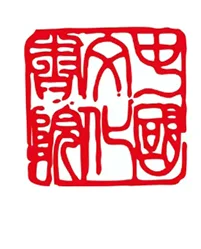
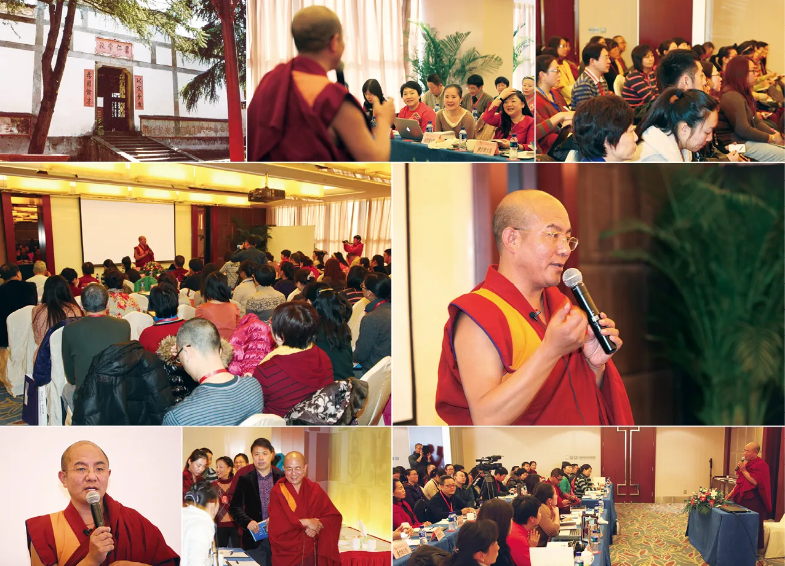
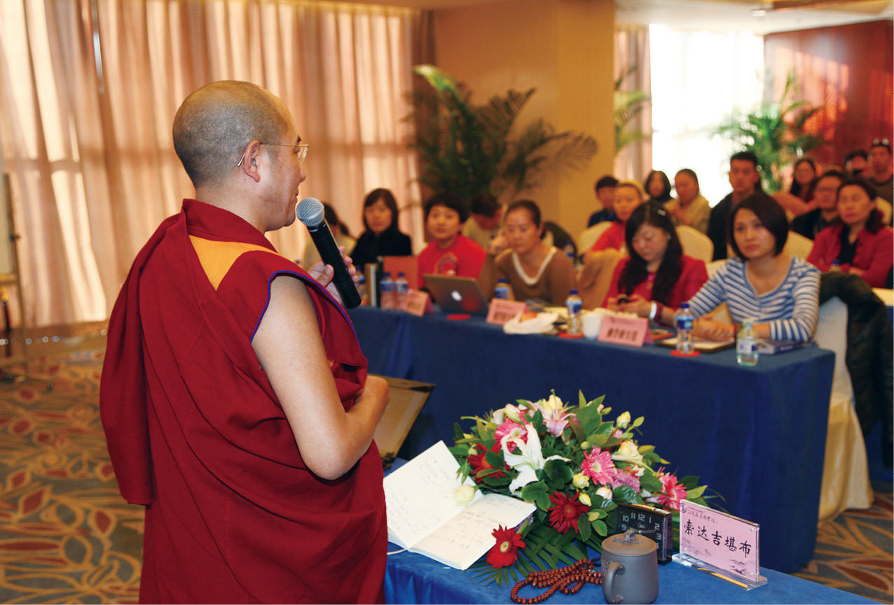
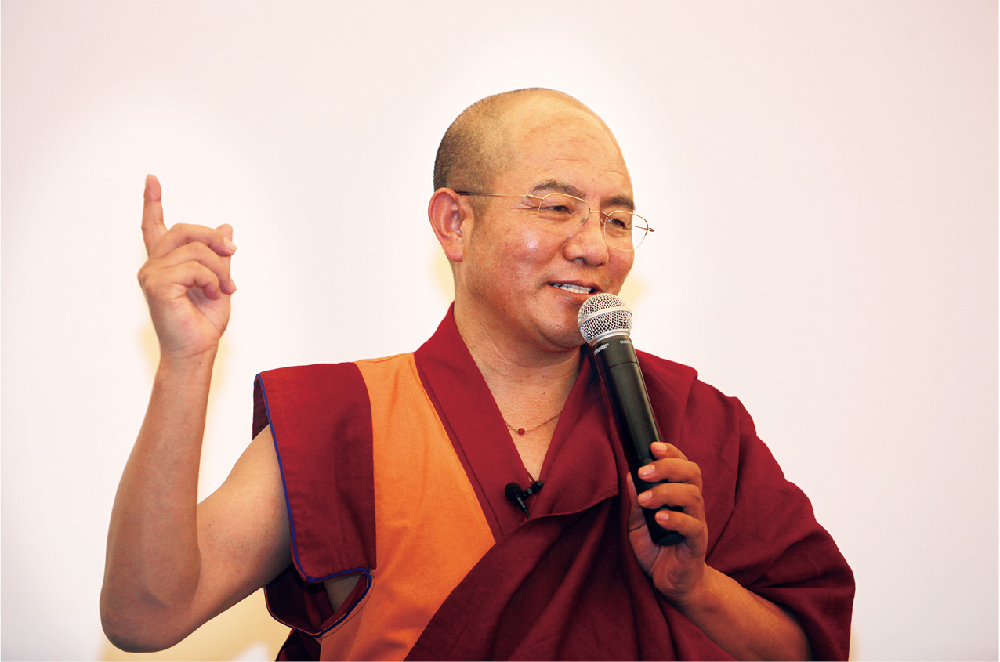

这些窍诀并非无序，

它完整介绍了藏传佛教的修行次第。

第40场

中国文化书院

Chinese Institute of Classical Learning

中国·北京

2012 / 12 / 22

## 《大圆满前行》的重要性

## The Importance of the Preliminary Practice of The Great Perfection

《大圆满前行》（又名《大圆满前行引导文》《普贤上师言教》）是我比较熟悉的一部法，多年来一直在学习和修行。这么一部长论典，要短短一两天讲完是办不到的，所以我想简单介绍一个梗概，以方便你们日后学习。

这次交流安排了三堂课。

第一堂也就是这堂，我讲一讲《大圆满前行》的重要性；第二堂讲共同外前行部分；第三堂是讲不共内加行部分。三堂课下来，一个完整框架就有了。

主办方要求加个共修，到时我念一遍《开显解脱道》的传承，同时也和大家一起观一观、修一修。

## 《大圆满前行》是一切佛法的精华

《大圆满前行》这个法，源自“龙钦宁提”。

“龙钦宁提”是晋美朗巴大师的意伏藏法，传承并汇集了龙钦巴尊者所有宁提法门的精华。大师将其传给如来芽尊者，尊者又传给了华智仁波切。华智仁波切经过多次聆听后，将上师的教言整理成文字，成就了今天这部《大圆满前行》。

本引导文是一部引导修行的论典，在藏传佛教中占据极为重要的地位，自成书以来，倍受各教派的上师大德们推崇，并得到广泛弘扬。

论典内充满窍诀，这是人们争相学习的原因。佛教有一种常识：修行依靠窍诀，离了窍诀无从修起。

去过佛学书店的人知道，尽管千经万论摆在那儿，但如果让你选，却不知从哪一本开始；要是依次学习，这么多书籍文字，一辈子学都学不完，更不用说修了。所以，想用短短一生修行的人，选择这部融进了祖师的实践、归结了所有窍诀的教言，也在情理之中。

重要的是，这些窍诀并非无序，它完整介绍了藏传佛教的修行次第。

它不仅像格鲁派的《菩提道次第广论》、噶举派的《解脱庄严论》一样，把修行旅途中最初发菩提心、中间积累二资、最终证悟佛果的道理讲述得一清二楚，更以贴切的公案和详略得当的阐释，指出了修行重点，同时还从证悟和过来者的高度，教诫了修行中最易出现的偏差和歧途。

所以，当我译完后，我的上师法王如意宝晋美彭措在为本论题写的序中说：

“此《大圆满前行》不仅完全包括了三士道次第，而且具有殊胜窍诀要点……此深法摄集了藏地兴盛的萨迦、格鲁、噶举、宁玛派的引导文及广弘于汉地的净土、华严、禅宗等一切显密修要，并且具有持明传承殊胜之加持……”

我在多年研究、修习和传讲的过程中，终于也了解了上师这番话的深意，我相信：懂得并修行《大圆满前行》的人，就是在修行一切佛法的精华。

## 译本和传讲

这部论典在1999年译完后，成了我所译经论中最受欢迎的一部。这样严肃的修行论典会受到欢迎，从中可以推知，今天的佛教徒已对次第法门有了兴趣，学佛也渐趋理性。

我曾以开玩笑的方式总结过自己的几个十年：

第一个十年，是1987年到1997年，那时我只是致力于用汉语讲法，还不敢直接译写成文字；

第二个十年，是1997年到2007年，此时我的心思已全部转移到翻译上，从《百业经》及部分零散教言译起，接着又译出许多大部头经论，《大圆满前行》也在其中；

第三个十年从2007年开始，说大一点，是用网络光盘弘扬佛法，与信众广结善缘，将来如果也能圆满这十年，或许我可以问心无愧地说：“我已将三十年人生奉献给有缘众生，尽了我的一份心意。”

说到翻译水平，我不敢说自己译得好，但我的译文基本符合藏传汉传的译法规律，也能准确传达佛教的教义和理念。受益者的肯定，让我深感欣慰。

此前的译本我看过。像郭元兴居士的译本，1989年，我就用这个译本讲过一遍，当时感觉文字比较难懂，有点接近文言文。贡嘎活佛的弟子根桑慈诚也有译本，不过他只是译了个大概，并非一字一句翻译的。

因为觉得有再译的必要，所以我就发了愿，并在1997到1999年之间译完。译完后，又经过多次校对，才有了今天你们看到的这个译本。

市面上还有其他译本。从英文译过来的汉译本也有，可能是以早年在欧美发行的英文版为基础。不论你喜欢哪个译本，我想，只要能了解并修行到纯正佛法，就是译者的本怀。

译完后，我也讲过几遍。藏地上师们讲《前行》一般是一两个月，多也不过一百天。但我最近这次讲解用了几年时间，今年刚讲完，大概有一百四十多堂课。

我曾说：“可能这是华智仁波切著作《前行》以来，后人讲得最细最广的一次，课时最多，历时也最漫长。”

传讲中，我发现作者的词句虽然简单，但里面处处藏有深意，所以我用尽了自己最细微的智慧，来分析每一段公案和教证，乃至一字一句。也是上师三宝加持，从头至尾讲得特别顺利，没有违缘。

发心人员把我的讲解记录下来，整理成讲记，也就是《前行广释》，一共八本。学会的人正在学。

我在世时，这个讲记不一定会受欢迎，但历史上也有这么一种现象——有些作品，是在作者离开后才受到关注的。因此，如果有诸佛菩萨护念、护法神加持，或许在几十年后，它对修行人也会带来一定的利益。

## 前行法不可不修

不论你是初学还是久修佛法，也不论你学的是汉传、藏传或其他教法，前行法都不可不修。

因为前行是一切修行的基础。有了基础的修行，就像掌握了开车技术的人开什么车都行一样，这时候你再修任何法，都是可以的。

喜欢高攀大法的人总是不明白，你这样一上来就求大圆满的本来清净、禅宗的明心见性或大手印、大威德的最高境界，不肯修基础法门，不肯积资净障，到头来会非常迷茫。可能这是现今许多修行人最大的毛病了。

不过幸运的话，当你什么时候发现自己不是利根者——利根者另当别论，也想起了以前不愿意听的教言，开始回归，那就有机会了。我了解不少人是这样，他们“从上往下”修：先修最高的，修不了只好闻思，闻思后再修，还是从最基本的前行开始，一步一步地。这时候踏实多了。

遗憾的是，有些人在不修前行的情况下，也修出了一些“成绩”，但他不知道，这就是冰上建筑。冬天湖面结冰的时候，你在上面造一栋楼宇，雕梁画栋，修饰得似乎相当可观。然而一旦春暖花开，冰一融化，它就倒塌了。

因此，不修前行的人，修禅、修密、修任何法，功夫不少下，时间不少花，但终究不能完成一种真正的修行。

这就是前辈大德重视前行的原因。我的经验也证明这一点：三十多年了，在我认识的汉族道友中，重视前行的人，一路修得非常稳妥；不重视前行的人，也许刚开始也会出点境界、相似神通或感应什么的，但后来这些慢慢都退失了，严重的，还对佛法生了邪见。

## 堪布阿琼

堪布阿琼是藏传佛教史上了不起的转世活佛、大成就者，他的成就，就是源于对前行的重视和修持。

有一次，他去拜见上师纽西龙多。上师问：“你修持前行的进度如何？”

堪布阿琼说：“上师，我不敢说自己已如理如法地圆满修完了四加行，但较有把握的是，从很小的时候起，我就对世间的荣华富贵看得比较淡……再说对三宝的信心，我认为自己已基本做到了心口不异。”

“噢，能这样当然再好不过……”上师说，“你最好把《大圆满前行》完整背诵下来吧。”

他依教奉行，把整部书背了下来。背完后，又去拜见上师。这次上师显得极为欢喜。以此因缘，后来他的修行非常稳固圆满。

可能是受了堪布阿琼的启发，我们学院也有人发愿背《大圆满前行》，有出家人，也有在家居士。不过后来真正背的时候，有些还不错，但有些刚背到“寿命无常”，就无常了。

背不背倒不要紧，对一般想修《前行》的人来说，能做到常听常看，就很好了。以前有那么一段时间，我的上师法王如意宝要求我们每年学一遍《大圆满前行》。他说：“《前行》不简单，你们每学一遍，心态自然会跟着转变，有殊胜利益。”顶果钦哲仁波切就是每天捧着《前行》，翻个三四页，直到他圆寂为止。

有人说：“前行不是密法，是基础法，老是停在这上面总觉得不好意思。”

也没什么“不好意思”的，修行又不是为了面子。大德们都那么重视《前行》，我们为什么要轻视它？再说，华智仁波切也讲过：这部《大圆满前行》，说是前行，实际也是正行。

## 推荐的历史

正因为如此，在学《前行》的人当中，初学佛的人会觉得受用，学佛一二十年，甚至四五十年的人，也一样受用。

来的路上高院长说起宗萨仁波切。他说：“仁波切去年有一次说，‘我今年50岁，几十年来，我自己修行、也推荐别人修行的教言，就是《大圆满前行》’。”

当时我想，他是1961年生人，去年50岁，我是1962年的，今年也50岁。50年里，从我遇到这部论典，学习并生起信心那时候起，也已开始为人推荐了。这样算来，我推荐《前行》的历史，有三十多年了。

那是读中学的时候。当时我得到一本《前行》，因为得来不易，所以老是想看。老师在上面讲课，我就在下面翻《前行》，结果挨了几次批评。后来又被老师看到，“索达吉，”他说，“你天天看这些反动思想的书……”那时宗教政策还没完全开放，八几年吧，所以我看《前行》是“反动”的。

不过看归看，也只是兴趣，还不算系统学习。真正的听闻，是毕业前在我们当地一所寺院见了我的上师德巴堪布的时候。

当时他正在举办为期一月的“大圆满前行”法会，我跟着系统学了一遍。学完后，我对“人身难得”有了新的认识，本来就想出家的，现在更有信心了，所以发愿出家。发愿后，我回学校取东西。

那时还不想让很多人知道，于是趁天黑，到他们打洗脚水的地方，等我一个要好的同学。他一来我就抓住他，带到墙后，说：“我要出家，不要告诉别人。我参加了一个月的‘前行’法会，太好了，你和云忠益西也学学《前行》吧。”

后来这个同学车祸死了。云忠益西做了老师，成家立业。七八年前他生起出离心，到亚青出家了。现在修行很好。

这就是我推荐《前行》的开端。出家以后，凡是有人问我“要修行学什么最好”，我都会说：“学《大圆满前行》，学《入菩萨行论》。”

## 《前行》是要精通的

有些论典可以泛泛学，但《前行》是要精通的。为了不让学佛变成形象，我也要求学院的道友每年都看一遍《前行》，并安排法师每年传一遍。

《前行》不简单。宁玛巴教主，顶果钦哲仁波切每天看，我的上师法王如意宝一生讲过多次，圆寂前还讲了一次。如果它真的简单，如幼儿园课程一般，那学过也就算了，但实际上，它是真正的修行阶梯，对此我们要有系统性的认识。

什么是系统性？就是完全掌握道次第。

有人学佛重视理论研究，有人希求密法窍诀，这些很重要，但是作为修行人，了解并且修持前行的道次第，更重要。

仲敦巴格西是阿底峡尊者最得力的弟子。上师将道次第秘密地传授给他，但他很不解：“尊者为何对他人传授密咒，对我只传道次第？”

“因为除你之外，我没有找到可以托付这个法的人。”阿底峡尊者说。然后把这个法门口授给他，加持他成为教主，为他建立广大弘法利生事业的缘起。

普穹瓦尊者问金厄瓦尊者：“一种是通达五明、具足五通、获得八大悉地，一种是道次第在心中生起，您会选择哪个？”

“不要说道次第在心中生起，甚至仅仅是产生‘道次第确实如此’的胜解，也应当选这个。过去我们曾无数次通达五明、具足五通、获得八大悉地，然而都没有脱离生死轮回。如果获得了对道次第的定解，必定能从轮回中解脱出来。”金厄瓦尊者答道。

前辈上师们规劝弟子重视前行法门，不仅是让他自己修起来安全稳妥，也是让将来与他结缘的人不入歧途，所以我认为，这是最负责任的教诫。

如今的年轻人肯学佛，有这颗心很可嘉，但如果你忽略了道次第，仅凭热情修法，是修不起来的。修不起来也正常，因为你没有基础。但问题是，有人修不出验相就抱怨，“你们看，还能因为什么呢？不就因为法不殊胜、上师没加持、传承没力量，所以我的修行才一塌糊涂”，这样就太可惜了。

有人问：“汉传藏传佛教中有那么多殊胜法门，为什么要修《大圆满前行》？”

其他的法门也好，我们不否定。但就像世间的课程一样，有的课程编写得完美，有的就不完美；有的适合你，有的就不适合你。作为修行论典，《大圆满前行》有窍诀有次第，并以最简洁的语言把你一生的修行都编写好了，既完美又适合现代人，为什么不学？

“它是藏传佛教法门，汉地修行人有必要修吗？”

是修行人，就可以修。《前行》里除了个别藏地的公案外，基本都是《大藏经》的内容，新版本中标注了《大藏经》里对应的公案。可以说，这完全是佛陀的真实教授，华智仁波切等传承上师们只是作了归纳而已。

## 为什么要修五十万加行

有人问：“不修五十万加行，可以吗？”

这是比较懒惰的人问的。如果你真的想修行，想遣除贪嗔痴以及一切无明烦恼病患，最好修完。

“为什么是五十万，不是七十万或三十万？”

数字不是随便定的，因为每一个修行都有它的必要。就像医生开出药方，让你一天吃三次，或一个疗程吃五个丸子，只要你遵照医嘱去吃，病情就会得到控制，甚至痊愈。

“修完五十万加行，就能消除所有业力了吗？”

至少可以让你的相续基本清净。比方说，假如我身上有病毒，抵抗力差，医生可能会说：“这个药你吃一百天，先消除身上的不良反应；然后再吃那个药，增加身体机能……”同样，磕过十万个大头以后，身体的罪业基本就消除了；念完十万百字明，相续基本就清净了；供完十万曼茶罗，修行的福报也就培好了。

因此，修五十万加行非常有必要。修完后，你就成了一个合格的佛教徒，相续调柔，也有了听密法的资格。否则，我们的心就像没有开垦过的荒地，普通的善法苗芽都不会生长，更何况甚深密法？

再说，我们学佛前肯定造了许多恶业——杀生、偷盗、邪淫，什么都造了，善业却少得可怜。不仅是这一辈子，上一辈子、再上一辈子乃至过去的许许多多生世当中，情形也大致如此。既然这样，为什么不修？

以前有人以为供养300块就能代替加行，现在是不是要1000块？过几年再涨？开个玩笑。

不同的做法是有的。不同的上师、不同的弟子、不同的窍诀，常规之外另辟蹊径，没什么不可以的。就像藏药、中药和西药，哪一个药对症，就是好药。佛陀说了八万四千法门，哪一个适合你，就是你的法门。

当然，想选择到适合的法门，也要有慧眼才行。“羊群效应”之所以容易起作用，就是因为一般人都缺乏主见：有人说好，蜂拥而上；有人诽谤，也跟着诽谤。即使不是别有用心，人云亦云也不妥当。如果传言是对的，昨天就“世界末日”了，但我们今天还在。

所以，真正的佛教徒是智者的群体，我们有自己的见解和修行方法，应该按这个来，不要被其他的左右。

修行中有些疑惑是难免的，可以探讨、辩论，这是藏传佛教的特点。辩清楚了，懂了以后一定要实地修持。《前行》的文字不难，难的是理解内容，融会贯通它的每一段、每一句乃至每一个字的意义，调伏烦恼。如果不肯修行，再好的佛法妙药也于你无益。

诚如佛陀在《劝发胜心经》里所说：“吾已说妙法，汝闻不修行，患者不用药，吾亦无法救。”

## 修行与广闻博学

修行与广闻博学不矛盾。

现代学佛的人，不仅要学高僧大德的教言，人文历史、自然科学、心理学等知识也要学。如果你的确待得住，其他的不懂，只是住山修行也可以。但如果你想弘扬佛法，就要多闻多学、与时俱进，让你的讲法不偏离世间人的认识。

这种融合趋势不可避免。我在《泰国游记》里讲述了一些泰国见闻。在那六天时间里，我除了见证他们修行白骨观的传统外，还亲近了许多南传大德。泰国是佛国，大德们热情温和，与藏传汉传的出家在家人，都相处得非常愉快。

近几年里，我跟汉传佛教的大德们也有交往，并且时常学习他们的教言。我认为，这种彼此的学习，一方面可以增进各教派的融洽，一方面也可以让自己开放心胸，以全局的视野来认识佛教。

“这样会不会太杂，影响修行？”

应该不会。杂不杂主要在于自己。一个复杂的人，今天想这个、明天想那个，学和修都毫无头绪。而不复杂的人有主见，懂得有主有辅，比如禅门弟子参禅，这是他的根本修行，不需要改变，但他同时也可以了解佛教其他宗派的教义。

蒋扬钦哲旺波有一项重要贡献，他自己虽以噶举、宁玛为主，但他接受了当时藏地所有教派的教法和伏藏法传承，并传递下来。法王如意宝也一样，因为求学时继承了各教派的法脉，所以在弘法利生过程中，毫无狭隘之见。我们学院的坛城，就体现了他的胸怀。

那是个特别大的坛城。当初修建时法王要求，为藏地各教各派都设立佛堂，也为汉传佛教、南传佛教设立佛堂，以此代表各教派互不相违，彼此圆融。因为这种缘起，法王的传承弟子对其他教派从不排斥。

“既然不排斥，是不是可以入其他教派？”

也不是这个意思，修行还是以自宗为主。前两天，在社科院“宗教与慈善”活动上，我听了各领域专家们对慈善的理解，很受用。不过我想，我做慈善还是会从佛教理念出发的。同样，如今学《前行》的人很多，格鲁、噶举、禅宗、净土，各教派都有，但这不妨碍他们修持自己本传承的法。

所以，各教各派的法都可以听，听这些，你会开阔见闻；世间学者们对佛教好的不好的说法，也可以听，听这些，至少你会知道他们不理解佛教的地方在哪儿。只听好的声音，“佛教好”“《前行》殊胜”，这对个别人或许有利，但对所有人来讲，也不一定。

## 精进

在修行过程中，一定要精进。现在的人特别懒惰，可能是家庭、单位的琐事太多，让人心有余而力不足，但是不精进的话，很难获得一定的成就。

《大智度论》里有一则公案：有一次，佛陀对阿难说：“今天你为诸比丘说法，我的背痛，稍微休息一会儿。”于是阿难说法，世尊躺下休息。

当讲到七觉支中的精进觉支时，佛陀立即坐起来，问阿难：“你在赞叹精进的意义？”

“对，正在赞叹。”

如是三问三答。

之后佛说：“善哉善哉，一定要善于修习精进，乃至得到阿耨多罗三藐三菩提之间，都不能离开精进，何况其他的地道功德。”

对此，龙猛菩萨总结道：“佛陀的精进从未减退，病中尚且精进不息，何况不病的时候？”

做任何事都要精进，学佛更要精进。如果世人为了家庭和事业，有些事不得不做，那么人生短暂，我们不修行怎么面对来世？“明明白白一条路，万万千千不肯修。”不肯修的人，即使遇到了善知识，听受了他们的教言，也解脱不了。

解脱依赖于修行。诚如佛在《大宝积经》里所说：“难陀，你不要信我，不要追随我的意愿……不要说‘沙门乔达摩是我大师’，你唯一要做的，就是独自到寂静地思量观察我所证之法……那时候，你自己就是你的洲渚，你的依处；法就是你的洲渚，你的依处。”

我们向来相信佛陀，但佛陀却让我们相信他的法，因为佛陀知道，唯有修行佛法，才能领会他所说的慈悲与智慧，以及不可言说的境界。

偶尔的境界是会退失的，它就像从浓密的乌云间闪出的一线阳光，只一会儿就被遮住了。比如，当你透过上师的教言，对无常或心性有些体认的时候，你可以理解这是一种非同寻常的知识，但如果不能长期修持，它就消失了，你也就回到了从前的状态。

为什么有些修行人要闭关，就是因为他对佛法有了真实领悟后，为了连续和巩固这种境界，要不间断地修行，甚至闭关一生。

我们通常说，佛陀的境界“难以言说”。不过对那些有所认知的人来讲，说不出来，心里也是明白的。

## 佛教经得起考验

佛教是经得起考验的，它最了不起的地方，就是2500多年来，没有一种理论或科学可以推翻它。

科学的进步日新月异，然而在天文、地理、物理、化学等各类知识的探索进程中，无论是对宏观世界还是微观世界的发现，都不能否定佛教的认识，相反，这些理论在佛教中都能找到最深层面的连结点。

和科学相比，宗教文明要久远得多。在中国，儒教、道教早已出现，基本是和印度的佛教同一时期，也是在二千五百年前。那时候两家虽然都未称“教”，但理论已经有了。据说孔子还向老子求教过，有的说见过一次，有的说多次，对此历史上有些争论。

抛开这些不说，道与儒的思想，“无为而治”也好，“治国平天下”也好，对中国历史的影响不容置疑。然而，自东汉时期佛教进入中国（公元67年）以后，也很快融入这里的文化，进而形成一种对人的心理调整更为适合的智慧传统，为人们的生活和实践所应用。

应用中，它的生命力越来越强，和儒道一起成为中国的传统文化。从夏商周秦南北朝到唐宋元明清，中国历朝历代都有一些代表人物和他们的口号，不过口号过一两代就消失了，没有持久力量。而传统文化不同，它们超越了这些暂时的思想，经得起考验，所以生存至今。尤其是佛教。

对于这样的佛教，年轻人可能更倾向理论研究，不理解什么是加持或感应，但我相信，“如人饮水、冷暖自知”，修行佛法的切身体会，会为你的人生带来明确的信仰方向。

现场互动

问：堪布您好。佛家一方面讲“轮回”、讲“有”，一方面又讲“无我”、讲“空”，我觉得有点矛盾，能否请您解释一下？

堪布：《金刚经》讲“空”“凡所有相，皆是虚妄”；《百业经》说“有”“轮回痛苦，因果不虚”，对此我们佛教徒要明白，这是两个不同层面的意义。

“空”所表述的是本质或胜义，在这一层面，轮回中的一切都是空的：吃饭走路是空的，你是空的，我是空的，问是空的，答是空的，身是空的，心是空的，北京是空的，人间是空的，地狱是空的……

如今这已不仅是佛教理论，在分析物质的过程中，物理学家从分子、电子、夸克抉择到场或能量的时候，也出现了一种不存在实质的了解——类似于“空”的认识。他们感到惊讶，玻尔说：“谁如果在量子面前不感到震惊，他就不懂得现代物理学；同样，如果谁不为此理论感到困惑，他也不是一个好的物理学家。”

在这样的物理学家面前，这个茶杯存在吗？他们认为，其实它没有实质的体性。崇尚并理解现代科学的人，当看到佛陀的般若思想时一定很惊讶：为什么2500多年前，就有人说出了这个道理？

如果一切万法是空的，为什么又有天界、人间和地狱，以及因果轮回？

这是显现层面。在显现层面，六道轮回并不虚妄，直到你证悟真理或实相之前，它在我们面前都会存在。也就是说，轮回的本质虽然是空的，显现上却有。

既是空又是有，难道不矛盾？

《心经》里说“色不异空，空不异色”，一个法的显现和它的空性并不相异。现实中的杯子是一种显现，它存在；但物理观察认为，它的本质是众多微粒，或者无实质状态。

“既然是微粒，怎么能装水呢？”如果你问物理学家，那他也会回答：“‘装水’不是在微粒层面上讲的，是微粒聚合的显现的作用。”

因此，两种层面不能混淆。

佛陀初转法轮时，讲述了业因果和轮回，二转法轮抉择万法空性，三转法轮阐释光明。在本体上，空性和光明是不二的，科学家最多了解了单空，对光明没什么认识。然而实相并不是一个单空，如果是，“什么都没有”不就是真理了？所以，密法的教言强调：一定有光明的法性存在。

和学者们的部分了解相比，佛陀的认识不仅完整，而且有很强的针对性：解脱。一个众生能否解脱，就在于他对“我”和“无我”的认识。

不观察时，我们都认为有“我”，你也有“我”，我也有“我”。但一经观察，身体不是“我”，思想不是“我”，里面没有“我”，外面也没有“我”……其实是“无我”的。

虽然“我”和“无我”是两种完全不同的认识，但实际却并不矛盾。迷的时候，我们认为整个身心上有“我”，佛教称之为世俗状态，是一种假相存在；而悟的时候，你就明白“无我”了——是对同一个身心。

你们看这个杯子，我前面说它“难看”，后面说它“好看”，是同一个杯子，相违吗？这就是中观。

问：藏传佛教里有一种修法叫男女双修，这个问题我一直比较迷惑，能不能请您给我们解释一下？

堪布：双修的问题，香港理工大学佛学会会长甘耀权教授，在“第二届世界青年佛学研讨会”上回答说：双修是藏传佛教很高的修行方法。他的上师是刘锐之大德，刘锐之的上师第二世敦珠法王是在家身份，修的就是双修法，但考虑到弟子的根基不够，法王没有将这个修法传下来。

后来我补充说，这个修法即使在藏地，也绝对不流行，不像有些人想象的那样。在我们学院求学二十多年的人，他们几乎走遍藏地的所有寺院，但从未发现有人修双修。相反，有些正规道场在持戒方面，比汉地的律宗道场还严格。

双修的修法是有的，不仅藏传佛教，汉传佛教里也有。我在不同场合开示这个道理的时候，引用过《华严经》等经典的教证和公案。

这一修法立基于很高的见解。《坛经》里说“烦恼即菩提”。什么是烦恼？贪、嗔、痴、傲慢、嫉妒是烦恼。既然是烦恼，也就是菩提。

小乘认为，智慧、悲心、信心是好的，清净，是菩提之因；贪、嗔、痴不好，不清净，你看男女执著的心态，怎么会是菩提？无法理解。然而在本质层面，贪心不存在，断贪的智慧也不存在，全是执著而已。

也因为这种见解，有相当境界的密宗瑜伽士，甚至被要求将人肉、大小便等一般人认为不清净的东西当作供品供养三宝，以此断除执著。当然，得有这个境界才行，否则是不允许的。

同样，双运相代表的不是贪心，佛菩萨如此示现，是为了断除那些具有相应见解的修行人的男女执著。没有这种境界的人，借“双修”名义行贪心之事，会修偏的。藏地过去有过这么一段历史，但自阿底峡尊者来藏以后，作了禁止。此后就鲜有人修了。

任何一种真实修法都是为了悟道——了悟现空不二的真相。空是心的本体空性，也即智慧；现是心性的本具光明，也叫方便或大悲。现空不二是不可思议、不可言说的，而以形象呈现时，就是佛父佛母双运：佛母代表空性智慧，佛父代表显现光明。

在一般人看来，佛父佛母无非世间男女，是平常生活不可缺少的组成部分，就像长短、高低等对立元素一样，因为这个世界就是二元对立的世界。但在对实相有所领悟的人看来，这种双运相直接提醒他的，是现空不二，没有庸俗执著。

问：大圆满注重哪个传承？

堪布：大圆满传承有三种：如来密意传、持明表示传、补特伽罗耳传。都很重要。《前行》里在讲“上师瑜伽”时，有专门介绍，我还做了一个图。

问：宁玛派的五加行，要求一定要大礼拜，但萨迦派的修法中，似乎不是特别强调大礼拜，请问在修行上，大礼拜这个修法是不是可以忽略？还是必需的？

堪布：如果你修的是宁玛派，就不能忽略，一定要修；如果是萨迦派，他们不要求的话，不修也行。

每个医生的方子，可以不同。如果你看这个医生，他的方子要加这味药，那你就照方抓药，不能省。同样，选择宁玛派也好、萨迦派也好，即使你不是这一宗派的，当你选择它以后，就应该原原本本按着这一宗派的仪轨和窍诀来修。

各宗派有差别是正常的。比如风脉明点，有些修法说精脉在右边，有些说在左边，你修哪一个，按它的要求来修就可以，并不矛盾。加行也一样，不能因为这个宗派没强调，你修别的宗派时，它要求了你也不修；或者这个宗派强调了，你修别的宗派时，它不要求你也加一个，这些都不合理。

修什么法就依着它的传承来，这是要点。

不过磕头的功德很大，我们宁玛巴要求磕头，是因为它能够对治傲慢。没磕过头的人总是有点傲慢，当你在佛菩萨和传承上师面前，放下世间的价值观，五体投地磕过十万个大头以后，人也就谦虚、调柔多了，这时候修行起来也就便利了。

问：大圆满里有心部、法界部和窍诀部，按说是不公开的，需要灌顶，随意看会犯盗法罪，但现在市面上流传了很多这种教材，是不是心部和界部以下，不修五加行、不经上师开许也可以看，窍诀部要由上师决定？

堪布：我在学院传大圆满时，要求他们一定要先得灌顶、修完五加行才可以听。我译的法本也不公开。

有趣的是，一说“公开”，反而没人听，《前行》是完全公开的，但听的人不多；一说“保密”，像《上师心滴》《大幻化网》《六中阴》，本来是为方便学院具有资格的道友印的，外面却卖得很多。

不过你们要知道，没有得过灌顶、修过加行，也没有传承的人，即使你翻了法本，法义也不会入心。因为一方面有空行护法的守护；另一方面，密法的道理很深，必须有一定基础才会懂，不经过一层一层的“手续”，看了也不会了解。

那这种人是不是犯了盗法罪？可能也没有那么严重。看后生了邪见，才是犯盗法罪的界限。

当然，大圆满密法要求严格保密。虽然现在是网络时代，保密很难，但如果你能尽量保持一种保密的态度，得到的加持也就殊胜。

问：念诵百字明时，咒轮该怎么观想？

堪布：百字明咒轮要观想为立体的。中间是吽字（ཧཱུྃ），其他的咒字围绕在外面。咒轮一般都要求这么观想：中间是一个，其他的环绕着它。

问：咒轮往哪个方向走呢？

堪布：右旋。

问：在供曼茶罗时，一个是三十七堆，还有一个是七堆，具体怎么修？

堪布：曼茶罗有两种，一个是所修曼茶罗，摆放在佛堂里作为修行的对境；还有一个是所供曼茶罗，自己实际修持用的。修的时候，先供一遍三十七堆曼茶罗，再供一个三身曼茶罗，之后开始供七堆曼茶罗。七堆曼茶罗供十万遍，要计数。一边念修一边计。

具体修法，可以看《前行》和《大圆满前行讲解》。

问：念百字明用汉语行不行？您能不能念诵一遍？

堪布：汉语是音译，藏语、汉语一样。

下面我念一遍：嗡班匝儿萨多萨玛雅 玛呢巴拉雅 班匝儿萨多迪诺巴 迪叉哲卓美巴瓦 色多喀友美巴瓦 色波喀友美巴瓦 阿呢Ra多美巴瓦 萨尔瓦色德玛美抓雅匝 萨尔瓦嘎玛色匝美 则当希央格热吽 哈哈哈哈伙 巴嘎万 萨尔瓦达塔嘎达 班匝儿玛美门匝 班则尔巴瓦玛哈 萨玛雅萨多阿。

问：网上有一套3D的金刚萨埵观想视频，看着这个观想可以吗？

堪布：可以。以前益西彭措堪布制作了一个，里面百字明和金刚萨埵心咒的观想都有。

问：这个修法是从法王如意宝开始，只有几十年传承吗？

堪布：其实汉文《大藏经》的唐密部分就有。以前我翻阅过，里面讲了许多金刚萨埵修法及百字明的功德。

这个修法历来在汉地没有广弘过，而藏地早就有了，几百上千年来人人在修。所以，它不是从法王如意宝开始的，传承也不只这几十年。

不过，也的确是从十几年前，法王如意宝针对汉地众生安排了金刚萨埵法会起，汉地各道场才开始大力提倡。可以说，它在汉地的广泛弘扬，与法王如意宝确实有特殊因缘。

问：一念咒就犯困，是业障吗？

堪布：没事。昨天我也特别困，后来一想：“是不是‘世界末日’的原因？”（众笑）

问：故意作的业和不是故意作的业，在果报上有区别吗？

堪布：有区别。详细的道理，你可以从《业报差别经》、《阿含经》及《俱舍论》等经论中了解。

简单讲，故意作的业，不论是善是恶，它的果报成熟得快，力量也强大。而无意中造的业，比如走路时踩死小虫，发愿吃素的人无意中吃了肉，这些业轻微。

问：在我帮助这个人的过程中，他伤害了别的人，我有过失吗？

堪布：你一心一意帮助这个人，没有害其他人的心，就没有过失。

以前我帮助过一个贫困学生，当时是出于同情，希望他有前途。但没想到，后来他利用自己的智慧伤害了很多人。我帮他有过失吗？肯定没有，因为我是利益他的心。他做坏事只会害自己，对我不构成损害。

问：那个业由他自己承担？

堪布：对。我帮他是一颗好心，好心不会有恶报。业依赖于心和行为，我的心和行为清净，没想过让他造恶，他要造恶，就自己承担。

问：也就是说，是从自己发心的那个点来判断。

堪布：对。随着心的差别建立善恶。

问：有些人长得不帅，但是你就是很想亲近他，请问这是因为他的魅力，还是什么？

堪布：可能是因缘吧。

佛教认为，初次见面时，如果你对某个人有一种不同的感觉，“好像以前认识他”“怎么这么亲切”……那很可能有些因缘在里面。

这种因缘有两种：如果你面对的是一位高僧大德，真正的善知识，你对他有欢喜心、清净心，这种善缘会给你带来解脱和快乐。

但如果是个一般的世间人，你对他的执著，也许源自前世你们在佛菩萨面前的共同发愿，“愿我们生生世世在一起”。也许没有这么幸运，即生一见面就很亲切的人，说不定前世是很敌对的，彼此负有债务，“你欠了我、我欠了你”，是亲是怨，难以确定。

因缘很复杂，有时要牵扯很多生世。

最近我在翻译明珠多杰的传记。他是宁玛白玉派中天法派的创始人，能回忆两百多世。在这两百多世中，他回忆自己有时变成动物，有时变成人，什么样的情形都有。其中，他跟这一世的上师乔美仁波切，有好多生世的关系，比如，有一世乔美仁波切转生为马，他就转生为一匹小马……诸如此类。

现在我只译了一百多世，还有一百多。每一世的故事都很短，不像《百业经》，文字很略，例如“当时他变成什么，我变成什么”“当时他是怎么死的，我是怎么死的”……一段一段的，很简单。

看了以后，你会感受到业的力量。再看今生自己与他人的相遇时，不管是和你的上师还是其他人，你会相信，这背后一定有很多生世的因缘在。

问：汉地弟子选择上师很难。戒律严格的，形象比较保守，不好接触；有才华的，涉猎广泛，又特别开放，请问该怎么选择才恰当？

堪布：保守的也好，开放的也好，先观察很重要。

不观察就依止，只是凭着一时冲动，往往会发生很多不愉快的事情：弟子的信心变了，上师的加持没了，弟子诽谤上师，上师辱骂弟子……这都是依止前没有观察的结果。观察后再依止，人不容易退，如果是具相的上师，不论上师怎么显现，我们都可以随学《华严经》里依止善知识的公案，以信心依止。

戒律清净的上师，可能会有点保守，藏地寺院里有很多。他们来汉地的机缘不多，即使来了，因为语言不通或者性格太严肃，显得不太好接触。不过，如果你能找到这样的上师，时时敲打你、监督你，对自己的修行很有好处。

开放的上师比较随和，如果他有些善巧方便，也精通佛法，那么你在依止过程中，一方面比较轻松，一方面也能够学到佛法，这也是很好的。

总之，上师的行为不重要，重要的是，在你依止他的过程中能不能得到佛法。

遗憾的是，很多人还不了解这点。他们依止上师，完全是依止他的微笑或行为，有点像感情依赖。但感情会变。如果你依止一段时间，始终没学到佛法，感情一变，信心也就没了，那时候很可能依止不下去了。即使不是这样，一旦无常显现，既见不到上师，又没有得到佛法，就悲惨了。

所以，一定要在佛法上结缘，这才是依止的真正意义。

问：禅宗是从佛陀一代代传下来的，有个传承图，《大圆满前行》是不是也是如此呢？

堪布：都是一样的。

《前行》里有显宗教言，也有密宗教言。显宗教言传自释迦牟尼佛，而密宗教言自普贤王如来开始，此后的十二位大圆满本师中，释迦牟尼佛也是其中之一。

佛陀所传授的密法有两部分：一部分是佛陀在世时传授的，像《时轮金刚》《文殊真实名经》等；一部分是在佛陀涅槃二十八年后，由胜心天子、国王匝以及莲花生大士和布玛莫扎等传下来的，这些都有授记。

最近我刚刚译完第二世敦珠法王的《藏密佛教史》，里面讲述了释迦牟尼佛、二胜六庄严以及后代藏传密法的所有传承故事。

问：他们有种说法，佛陀初转法轮讲的是小乘佛法，二转法轮讲大乘般若，三转法轮讲了金刚密乘法，可以这么说吗？

堪布：从间接的角度，可以这么说。

一般的说法是，三转法轮着重讲如来藏光明和清净刹土，有些道理虽然不像密宗讲得那么明显直接，但以隐藏的方式也宣讲了。包括弥勒菩萨的《宝性论》、龙猛菩萨的《赞法界论》等，也是围绕这点阐释的。

因此，即使没有“三转法轮是密宗法轮”的说法，理解上也应该知道，它所讲的和密法是很接近的。尤其是像“一尘中有尘数刹”等这样的道理，一转、二转法轮中是根本找不到的。

问：这三转法轮有没有次第？

堪布：有次第。第一转法轮针对一般根基的人，讲因果、讲四谛、讲万法的存在，还不能讲真正的空性，不然他们接受不了；第二转法轮才讲空性，说万事万物是没有实质的；第三转法轮宣说了光明，因为实相不是单空，否则会堕入断边，还有光明部分。

这是总的根据众生的根基这么宣说的。如果就一个人修行大乘的次第来说，可以归结在“色即是空，空即是色，色不异空，空不异色”这个次第中，也即中观的四步境界：空性、双运、离戏、等性。

问：六世达赖仓央嘉措写了很多情诗，可说是中国文学史上的璀璨明珠，对他的这些诗，我们应该怎么看？

堪布：仓央嘉措是著名的诗学家。在他的诗歌里，既反映了普通人对情感和社会的理解，也反映了修行人对佛法和人生的感悟。

可能是他比较特殊的历史身份——一方面是活佛，要面对修行，一方面又是政治人物，要处理政事和世间俗务，让他的诗歌里充满了复杂意象。不过，也许正因为这些，他的诗歌广为流传了。

一般我们认为，他的诗有外、内、密三层意思。表面上讲的是男女之间的情感，很迎合世人口味，但实际上却是一种授记或预言，甚至涉及甚深修法。比如：

“夜里去会情人，早晨落了雪了，脚印留在雪上了，保密又有何用”“守门的老黄狗，心比人还灵，别说我夜里出去，今日清晨才回宫”……

这些一般人看就是情诗，但实际有很多意义。

问：放生过程中，放鱼的时候，有的鱼死了，有的被人捞去了；放鸟的时候，有些不走，有人就往空中抛，这样会不会惊扰它？这是积福还是造业？

堪布：我发愿放生、劝人放生，已经二十多年了。我特别欢喜这件善事。

你说的这些情况是有，社会上也有人不提倡放生，认为放生有弊端，但我们不能因此说“放生没有意义”“放生不是修福”，不能这么说。我认为放生是百分之百的善法，功德非常大。只不过，方式方法上确实要注意，否则就是对生命和钱财不负责任。

放生的人要会观察：能不能存活？地点对不对？这些要事先考虑好。有一次他们放鸟，不是在公园或者山上，就在大路上放，结果车一来，好多被压死了。这是不负责任的。

慈诚罗珠堪布放生的时候，他们有经验的一帮居士会提前两三天开车去找好地方，有时候是三四小时车程以外的地方，这就比较安全了。

问：我们那个放生群都发愿吃素，但“佛法不离世间觉”，有时也会坐到荤桌上，请问该怎么解决类似冲突和矛盾？

堪布：平时能吃素最好，实在不行，放生的时候一定要吃素。否则，一边放生一边吃肉，善法就不清净了。

“佛法不离世间觉”，是让我们在修行过程中，懂得随顺世间，并学会从世间觉悟真理。但这并不是说，世间人吃肉，我也吃肉；世间人偷东西，我也偷东西；世间人干坏事，我也干坏事……不是这个意思。

有些事可以随顺，有些事不能随顺。

问：现在市面上有堪布的书，我在读，也推荐给朋友，不知道仅仅读这样的书，可不可以修行究竟？

堪布：《苦才是人生》《做才是得到》，是把我平常讲课时说的道理、讲的故事集合起来，用适合世间人的语言写成的书。每一篇都不长，很快就能看完。

看这些内容，改变一些观念是可以的。知道我们以前哪些行为不好，知道将来怎么为人处世，怎么变得善良，甚至可以学着积福累德。书中也提到了死亡问题，这没什么不好，对现代人有警醒作用。

至于能不能让一个人的修行究竟，这得看根基。禅宗的某些根基，听一个简单教言可以开悟，如果是这种根基的人，也不是不能开悟。

问：我一直跟我的师父日常法师学习《菩提道次第广论》，您对这部论典怎么看？

堪布：1997年的时候，我得到日常法师讲解《菩提道次第广论》的一些磁带，当时有点空余时间，就天天拿着一个黑色的小录音机听他的课，听了一大半。我很喜欢日常法师的讲课。

后来益西堪布也讲了一遍，讲得非常好。

《广论》后面部分，可能很多人不懂，其实当时宗喀巴大师撰著那一段内容时，也觉得太深，怕没人懂就准备放弃了。但此时文殊菩萨现前，鼓励他写完，他这才把整部论典著作圆满。这部论典非常殊胜。

我常说，格鲁派的《菩提道次第广论》和宁玛派的《大圆满前行》，是当今最圆满的修行百科书。

问：我们的人生有限，可不可以在梦里也修行？

堪布：要在梦里也修行，有一定的难度。宁玛巴密法里有这种窍诀，只是要求的层次比较高。不过，喜欢这样修的话，也可以常常祈祷发愿。

问：一阐提或精神有残缺的人，能修行吗？

堪布：“一阐提”是断了善根的人，一般来说，这种人是无法修行的。不过大乘的观点有所不同，《坛经》和《经庄严论》都认为，没有绝对的一阐提，有邪知邪见或者业力深重是暂时的，将来有了因缘，一旦对佛法生起信心，也可以解脱。

因此，对那些不信因果、有邪见的人，或者精神有点障碍的人，我们不应该把他们拒之门外，要用各种方式帮助他们，让他们和佛法结个善缘。马鸣菩萨本来是外道，排斥佛法，有大邪见，无疑是“一阐提”了，但后经佛教上师的度化，他成了杰出的弘扬佛法者。

佛教的精神是度人，不管什么样的人，都要尽量启发他的善根。

问：如果是精神病患者，他自己没办法学佛，但我们可以为他祈祷，帮他积福消业，对吗？

堪布：对。
