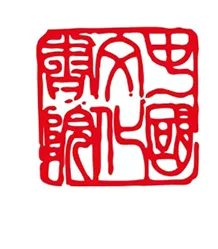
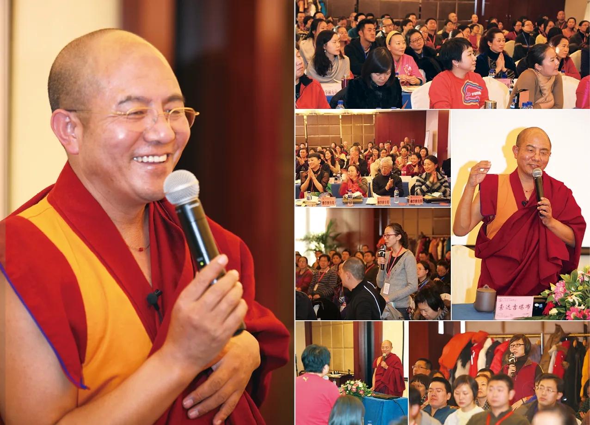
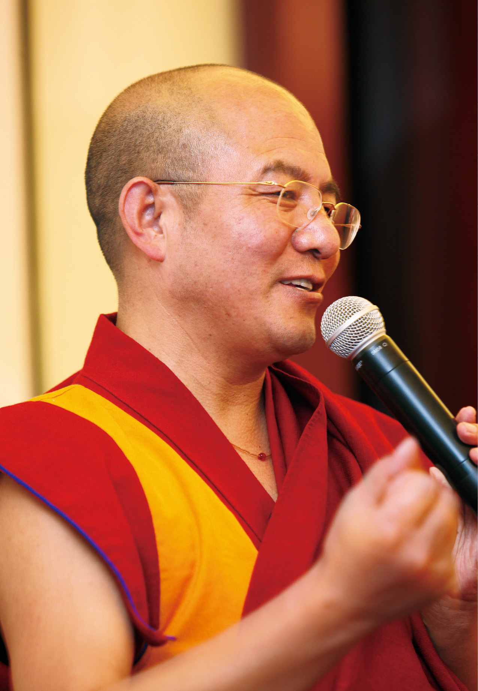

“你在寂静处千百万劫中精进闭关修本尊，

不如去世间一刹那利益众生的功德大。”

第43场

中国文化书院

Chinese Institute of Classical Learning

中国·北京

2012 / 12 / 23

## 不共内加行与往生法

## The Uncommon Practices of Preliminary Practice and Practice on Transference of Consciousness

## 不共内加行

从我自身的体会来讲，不管你们以前学什么宗派，完整修一遍五加行，可以让一名佛教徒在心态和行为上出现巨大转变。过去的大德们一生要修好多次，如今大家忙，但修一次是有必要的。至少要修一次。

我们通常说的五加行，就是指不共内加行：皈依、发殊胜菩提心、念修金刚萨埵、积累资粮（供曼茶罗）、上师瑜伽。

### 1．皈依

划分佛教徒与非佛教徒的界限，不是依赖于见修行果，而是看你是否已经皈依。什么时候你皈依了，就是佛教徒，没有皈依就不是，即使见解上你已了解一分空性意义，也不是。就像没有入党就不算党员一样。

皈依分五部分：皈依之基础、皈依之分类、皈依之方法、皈依之学处、皈依之功德。

#### 1）皈依之基础

皈依可以开启一切正法之门，而要开启皈依之门，必须依赖于信心，对佛、法、僧三宝的信心。每次讲皈依时都会提到信心，有些人生来有信心，有些人则要依靠后天的教育，在某个道场、某位上师的启发下，开始有了信仰。总之，信心是皈依的前提。

信心分清净信、欲乐信、胜解信三种。

清净信：当进入设有佛像、佛塔的道场，见到某位上师或某一个法本时，就像儿童进入花园一样，心里非常欢喜，不明所以自然生起的信心，就叫清净信。

欲乐信：当听到轮回的痛苦时，就想摆脱；当听到解脱的安乐时，就想获得；当听到某位上师的功德或佛法的威力时，就想皈依和修习，这样的信心叫欲乐信。

胜解信：胜解信是不退转的信心。当你经由智慧观察，了知佛陀是量士夫，他的学说是所有学说中的第一，从而相信三宝是一切时分无欺的皈依处。无论是苦是乐、是病是痛、是生是死，任何情境中，你愿意唯一依赖并皈投三宝，这就是胜解信，是最稳固的信心。

皈依一定要以三种信心里的一种作为前提，最好是胜解信，永不退转。其他的还有可能退转。

#### 2）皈依之分类

小士道皈依：因为畏惧恶趣的痛苦，希求平安、健康等人天安乐而皈依，是小士道皈依。如今大多数到寺院皈依的人，是这样一种皈依，没有求解脱之心。

中士道皈依：因为认识到无论善恶趣都不离痛苦，想从轮回中获得解脱而皈依，是中士道皈依。

大士道皈依：为了利益天边无际一切众生，拔苦予乐，将其安置于遍知佛陀果位而皈依，是大士道皈依。

我们的皈依最好有大乘发心，这是最殊胜的皈依。

#### 3）皈依之方法

修持皈依时，要把莲花生大士、宗喀巴大师或者某位上师观想为和三世诸佛无二无别，然后在他面前皈依。

我们皈依的是三宝，皈依佛陀、皈依佛陀所宣讲的佛法、皈依佛陀的追随者——大乘如文殊、弥勒、观音，小乘如舍利子、目犍连等圣者，或四个出家人以上的僧众，这叫三皈依。上师其实代表三宝，加上上师，就是四皈依。

在这样的皈依境面前，你要想：从现在起，我无论是上升还是下堕、是苦是乐、是好是坏、是病是痛，除了上师三宝以外，我没有其他的依靠、救护、怙主、友军、希求处与皈依处。我从今天进入佛教的团体开始，就成了一名佛教徒，我有继承如来家业的责任，我要利益无边的众生。

从内心里真实皈依，而且发下大的誓愿，这是我们大乘皈依的要点。

如果对三宝没有坚定的皈依心，办多少皈依证也没有什么作用。办皈依证是可以，但用不了那么多。如果你是从心里真实皈依三宝，也就皈依了所有上师，因为真正的上师跟三宝是无二无别的。

不了解这点的人，学起佛法来很忐忑，“我皈依这个上师，那个上师会不会不高兴；我念文殊心咒，观音菩萨会不会生气；我念观音心咒，释迦牟尼佛会不会不高兴……”，其实这是我们的分别念。

在法界当中，上师和诸佛菩萨一味一体，你修上师瑜伽，也就修了所有本尊。皈依也是一样。

如果是世间人，尤其是敏感的人，他笑你没跟着笑，就不高兴了；今天这个不高兴，明天那个不高兴。但真正的上师不会。我们说“视师如佛”，如佛一样的上师怎么会有这么强烈的嫉妒心？诸佛菩萨要关照多少众生，天天起那么多分别念，不是痛苦死了？好累。

总之，皈依是一种形式，有象征意义，你在哪一位上师或佛菩萨面前皈依都可以，但最主要的，你要从内心里皈依，这才会让你真正成为佛教徒。

为了坚定信心和誓愿，你在多少上师或佛菩萨面前发愿都可以，日日不断发愿更好，但从皈依的角度，最根本的地方你们要抓住：全心全意皈投、依赖上师三宝；利益众生。我们要在这种心念里念皈依偈。

修这一加行时，可以一边念皈依偈一边磕头，一共修十万；也可以单独修皈依，到上师瑜伽的七支供里再磕头。这两种方法都可以，上师们也都认可。

不过我的建议是：修皈依时就专门修皈依，把磕头作为上师瑜伽七支供里的一支来修。这也是有传统的。

#### 4）皈依之学处

皈依后，要学习皈依的学处，也就是皈依戒。皈依戒分三个部分：三种所断、三种所修、三种同分。

三种所断

皈依佛后，不能皈依世间天神等各种外道天尊，因为他们自己还在轮回中，不能作为我们的皈依处；皈依法后，不能恼害任何众生；皈依僧后，不能与外道或者对佛教有邪知、邪见的人交往。

守护第三条最重要的是见解。现实生活中，我们和外道徒、和不信佛教的人在一起是难免的，但行为上在一起不要紧，见解上绝对不能一致。

他们的见解是“没有前世后世”“没有佛菩萨”，这个一致了，我们也就不是佛教徒了，不合理。

行为上可以在一起，在一个办公室里上班，在一个宿舍里起居，这个没什么。有些大学生睡上下铺，上面是外道，下面是佛教徒，这时候佛教徒就担心了，“怎么办，上面睡着个外道？”

也不用这么排斥。主要是你的见解不能变成外道那样，行为上遇到或接触，是正常的。

国内外很多大德提倡各宗教之间要和谐，这是很有道理的。佛教徒不能排斥别人，“你是外道，我不跟你一起吃饭，不跟你说话，不跟你坐一辆车”，这样就把我们和世界隔开了，不对的。

所以，有些戒的界限要弄明白。

三种所修

皈依佛后，对佛菩萨以及传法上师的像，乃至零碎片段以上都要恭敬供养，以头顶戴，放在清净的地方，观想这是真实佛宝，生起信心并观清净心。

皈依法后，对写有法义的文字，乃至佛经的一字一句也要生起恭敬心，顶戴供养，生起真实法宝想。

有人说对报纸等各类文字都不能踩踏，说法很多。但一般来讲，对那些印有讲说解脱道的法本和文字，我们一定要恭敬，不能放在低处和不清净的地方，要放到高处，放到清净的地方。

皈依僧后，要恭敬出家人，要对僧衣上的红黄补丁以上都要生起真实僧宝想，恭敬顶戴。

有的人心眼不太清净，一听到出家人有什么毛病，“啊，这个不行、那个不行”，一点点不好的地方就开始指指点点，好的地方谁都看不到、谁都不说，这是不太合理的。

懂得“皈依僧”的人，即使见到出家人外相有些不如法的地方，也会观清净心，“毕竟这是出家人，是僧众，很可能是菩萨的化现”。宽泛一点看，我们对每一个众生都应观清净心，这也体现皈依僧的理念。

三种同分

三种同分，也就是三种特殊戒律。上师的身是僧众，语是妙法，意是佛陀，所以上师就代表三宝。依止上师后，要把上师的所作所为都看作是正确的、善妙的，要精进依止。

#### 5）皈依之功德

皈依三宝是一切正法的基础，任何人仅仅皈依就能播下解脱种子、远离不善业、增上善业，它是一切戒律的根本、一切功德的源泉。

《日藏经》里说，凡是皈依了佛陀的人，千万个邪魔也不能危害他，即使他犯了戒律或者心思散乱，也一定会趋入涅槃。所以，如果皈依的功德有一种形象可以被我们看到，那么整个大地都无法承载，整个虚空无法容纳，有不可思议的功德。

这种功德，不信佛的人或许信不过，但我们不必怀疑。而且，有信心而皈依的人功德更大，即使是刚皈依，也有可能超过那些学佛久但没有信心的人。

佛陀在世时，有一位老比丘听法时坐不住，也不专注，另有一个刚刚出家的八岁沙弥，因为对佛陀有难遇之心，对佛法有难得之心，听闻时专注、欢喜。

于是佛陀对大众说：你们看，这个老比丘虽然出家久，但习气始终改不了，而新出家的沙弥如此恭敬，日后必有成就……果然，小沙弥很快获得成就，而老比丘却依然如故。

所以，老修行人不一定是好修行人。

皈依后永远不能舍弃三宝，如果你纵使遇到生命危险也不舍弃三宝，就是最真实的皈依了。

《六度集经》里讲了这么一则公案：过去有一国王为了提倡佛法，规定凡是皈依的人都免税。于是人们都皈依了，装作佛教徒。国王为分辨真假，故意说：“皈依而不舍弃三宝的人杀头，舍弃者不杀。”

这时所有人都舍弃了，除了一个人。他说：“杀了我，我也不舍弃三宝。”

“你是真正的佛教徒，”国王很感动，“因为你皈依三宝不顾惜生命。其他人都是假的，税要照交。”

国王的观察很善巧。我们也要反省：如果换作是我，遇到类似生命危险，会不会舍弃三宝？

佛教徒里“鱼龙混杂”是正常的。但作为一个真正的佛教徒，我们不是因为别人皈依我也皈依，我们皈依是为了求解脱，是发自内心的。这才是真皈依。

### 2．发殊胜菩提心

阿底峡尊者说：“大乘和小乘之间的差别，用有无菩提心区分。”

发殊胜菩提心分三部分：修四无量心、发殊胜菩提心、愿行菩提心学处。

#### 1）修四无量心

修菩提心之前，一定要修四无量心：舍无量心、慈无量心、悲无量心、喜无量心。这些修法，《前行备忘录》里讲得非常广，你们可以参考着学习。

此处先讲舍无量心，是从实修角度出发的，以避免行人堕于慈心或悲心一方。

修舍无量心：舍无量心，就是断除对怨敌的嗔恨、对亲友的贪爱，对一切众生无有亲疏、无有爱憎的平等心。这种平等心，不是单单不起贪心嗔心、平平淡淡的愚舍，而是要把所有众生——不管是亲人、敌人还是中等人，平等看作和今世的父母一样。

修慈无量心：修到有了平等心以后，接着要像父母养育小孩一样，将一切众生作为慈心的对境，不顾他们的颠倒行为，一味地希望所有有情获得快乐，并将自己身口意的一切所作，都用在他们今生来世的安乐上，这就是慈无量心。

修悲无量心：愿一切众生离开痛苦，为其拔苦的心，叫悲无量心。慈是让众生得乐，悲是愿众生离苦。

没有大悲心的修行是成就不了的。无著菩萨在鸡足山修了十二年，最后是因为对一条狗生起大悲心，才现见了弥勒菩萨。此前弥勒菩萨一刹那也没有离开过他，但是只有到了这个时候，他才见得到。

如今很多人修行没什么感应，主要就是因为缺少一些悲心。家人或亲朋好友病了，马上送医院，但对其他正在受苦的人或旁生却没什么怜悯，就算亲眼见到了，依旧谈笑风生。悲心比较弱。

修喜无量心：对凡是拥有安乐的众生，修喜不自禁的欢悦之心，愿他们不要离开安乐，这就是喜无量心。

四无量心是菩提心的前行，前辈大德们在这个修法上一般要下很大的功夫。我们也要反反复复地修。

#### 2）发殊胜菩提心

发殊胜菩提心分二：发心之分类、正式发心。

发心之分类

发菩提心时，从心力的角度来分，有如国王式的发心、如船夫式的发心、如牧童式的发心三种。

如果依地道的界限来分，则有四种，资粮道、加行道称为胜解行发心；一地至七地叫清净意乐发心；三清净地（八地至十地）叫异熟发心；佛地为断障发心。

如果从发心本体的侧面来分，有世俗菩提心与胜义菩提心两种。其中，世俗菩提心又分愿菩提心与行菩提心。最初心里怀着一种愿望，要令天下无边一切众生获得无上圆满正等觉果位，这叫愿菩提心；发愿后，实地修持六度万行，叫行菩提心。比如有人想去拉萨，想去的心就是愿心；想好后，一步步走向拉萨，是行心。

正式发心

平时念诵、受菩萨戒或专门修持这一加行时，我们要在佛像或上师三宝皈依境前，默默观想并发愿：

自无始以来，一切众生无一例外都做过我的父母，这些老母有情因为愚昧无知一直流转在轮回中，我独自一人获得解脱有什么用呢？从今天开始，我为了一切众生一定要发殊胜菩提心，要令他们全部获得解脱。

这样一边观想一边念发心偈，你就成了大乘佛子。

#### 3）愿行菩提心学处

成了大乘佛子，就要遵循愿行菩提心的学处。愿行菩提心学处分二：愿菩提心学处、行菩提心学处。

愿菩提心学处

愿菩提心学处有三个：自他平等、自他相换、自轻他重。

修自他平等菩提心：修自他平等时，首先要了解，三界中所有的众生都和我一样，我不愿感受痛苦，他们也不愿感受痛苦；我希望获得安乐，他们也希望获得安乐，所有众生都是平等的。

了解这个道理后，就要一视同仁地看待一切众生，像对待自己一样，为一切众生的离苦得乐而努力。

修自他相换菩提心：修自他相换时，可以伴随呼吸来修。吸气时，观想把正在受苦众生的痛苦吸入体内，由自己代受；呼气时，观想把自己的快乐、善根等全部都施给他，由此他已经离苦得乐。

所谓：“亏损失败自取受，利益胜利奉献他。”

修自轻他重菩提心：把自己看得轻，把他人看得重，而且要把快乐全部奉献，自己甘受痛苦，这确实是一种很高的菩萨修行。《前行》里有许多公案，比如，阿底峡尊者的上师在一条狗被人击打时，就代受了它的痛苦，狗却安然无恙。

江西卫视的《传奇故事》也讲述了一个幼儿教师的故事：这位幼儿教师是一个单身母亲，带着女儿与外公外婆一起过着清贫的生活。女儿5岁那年得了白血病，她想把自己的骨髓给女儿，结果不匹配。但捐献中心发现，它与另外一个也患有白血病的七岁男孩相配。

当他们动员她为男孩捐献时，遭到她家人回绝，理由很简单：万一她出了意外，5岁女儿怎么办？但当男孩的母亲带着孩子来求她时，她立刻答应了。

骨髓移植很顺利。为了感谢这位救命恩人，男孩的父母送来5万元。但她说什么也不肯要，并说孩子术后的治疗期还长，钱要花在他的治疗上。男孩父母感激不尽，到新闻单位反映了她的事迹。

新闻一报道，小城里的好心人就开始为这位善良母亲捐款了。有一个打工的农民青年也捐了三百块。不过几天之后，他又找上门来，不仅想把那三百块要回去，同时还要跟她借两千块，民工说他的父亲突然查出得了胃癌，在医院躺着，还差两千块钱的手术费。

家人都说这是骗子。但她觉得不像。通过暗访，她发现那人说的情况属实，于是赶紧又加上两千块给小伙子，让他为父亲及时做了手术。

别人的事情都圆满了，男孩得到了骨髓，小伙子也给父亲治了病，但与女儿相匹配的骨髓却一直没有找到。钱也用完了，年轻母亲只好把女儿接回家，抱在怀里天天以泪洗面。

然而奇迹发生了，小女孩一天天好转起来，最后居然完全康复了。

这让医学专家们惊讶不已，“根本不可能的，这种白血病即使做了骨髓移植，生存率也只有50%。”

他们认为是奇迹。但我相信，这是自轻他重修法的力量，也许她不信佛，但她的善心善举就是佛法。

佛法就是利益众生的。发了菩提心的人，如果不关注社会，不理会身边的可怜人，那我们在其他宗教人士所行持的善法面前，会非常惭愧的。

其实利益众生的功德最大。《大威德之光》里讲到，热罗扎瓦闭关修行时，本尊就告诉他说：“你在寂静处千百万劫中精进闭关修本尊，不如去世间一刹那利益众生的功德大。”

利益众生不是非要帮助很多人，哪怕你只帮了几个人，也可以写进“自传”里。每个人都有“自传”。

行菩提心学处

行菩提心学处：布施、持戒、安忍、精进、静虑、智慧。

布施：财布施、法布施、无畏布施。

财布施，是将自己所拥有的小到茶叶，大到骏马、大象乃至自己的身体等施给众生；

法布施，是指为他众灌顶、传法、念传承等劝导他人行善的行为；

无畏布施，是指救护有情生命等的行为。

持戒：严禁恶行戒、摄集善法戒、饶益有情戒。

严禁恶行戒，是指身语意三门要断除所有对他众不利的十不善业，就像对待毒物一样；

摄集善法戒，是指随时随地竭尽全力奉行一切善事，包括微乎其微的善根在内；

饶益有情戒，要求从根本上断除自私自利心，依靠四摄直接成办利益众生的事业。

安忍：忍辱他人邪行、忍耐求法苦行、不畏甚深法义。

忍辱他人邪行之安忍，就是当有人对自己拳打脚踢、强抢硬夺、恶语中伤，或者暗中说些难听刺耳的话时，不但不满怀嗔怒，反而生起慈悲心饶益他们；

忍耐求法苦行之安忍，就是为了成就正法，不顾一切艰难困苦、严寒酷暑来修行；

不畏甚深法义之安忍，就是当听闻到甚深的空性实相等法义时，毫不颠倒地受持其密意。

精进：擐甲精进、加行精进、不满精进。

擐甲精进，是指要发愿行持善法，以古大德的事迹策励自己发下誓愿；

加行精进，有了行善修法的心念后，不是明日复明日地拖延，而是刻不容缓地实地修行；

不满精进，在求学佛法稍有获得时毫不满足，所谓“活到老学到老”，对有价值的知识，再累再辛苦也努力不辍。佛陀因地时为求一偈，也是舍生忘死；如今我们条件这么优越，为什么不精进？

静虑：凡夫行静虑、义分别静虑、缘真如静虑。

凡夫行静虑，是指耽著明乐无念觉受禅味的静虑；

义分别静虑，禅定过程中还有一个空的执著；

缘真如静虑，远离空有一切戏论，安住在法性无分别、不可思议光明境界的等持中，是缘真如静虑。

一般人安住时都会有耽著，耽著明乐无念，耽著空，但这些都是不究竟的，只有第三种是最究竟的。

智慧：闻慧、思慧、修慧。

闻慧，是指对于上师所传讲的一切正法的词义，自己听闻后原原本本地理解；

思慧，不仅词句上了解，通过观察抉择后对意义也生起了定解；

修慧，是指真正了知法义后，通过实地修行在自相续中对实相之义生起真实无倒的证悟，彻底生起定解，解脱是非之网后，现见实相的本来面目。

以上是发殊胜菩提心。

菩提心的功德非常大。哪怕你一刹那间这么发心，龙猛菩萨在《菩提心释》里说，即使你没有亲自去度化众生，但这一刹那愿心的功德也不可思议。而《入菩萨行论》也说，有了行菩提心，善根会日益增长。这就像你把钱存入高息银行，利息会节节增长一样。

为了确保我们的每一个善根不被嗔心或邪见等摧毁，传承上师们一再强调，让我们在行善的时候，一定要用菩提心来摄持，这也就是三殊胜：最初加行发心、中间正行无缘、最后结行回向。

回向时可以念《普贤行愿品》，这是最好的回向方法，也是殊胜的菩提心修法。

在这一加行修法里，发心偈要念十万遍。念完十万遍后，如果心还是发不起来，应该继续念，一直到生起为止；即使生起了菩提心，为了坚固它，也还是要不断修持。发心的观修对境与皈依一样。

我常常说，《前行》的每个修法都很重要，你不想修行另当别论，想修的话，每个环节、每个段落乃至一字一句都不能忽略，都要认真行持。

### 3．念修金刚萨埵

#### 1）忏悔之理

无始以来，在我们的相续中积累了无量罪业，这些罪业不仅障碍我们证悟，就是带业往生，想带着这么多的业去，也是很困难的。所以，趁我们现在还活着、还有自由修行时，一定要好好忏悔，尽量清净罪业。

忏悔的法门有很多，比如《三十五佛忏悔文》等，但前辈大德们一致认为，最殊胜的忏悔法门，就是念修金刚萨埵。

#### 2）四种对治力

忏悔时，依止四种对治力相当关键。四种对治力是所依对治力、厌患对治力、返回对治力、现行对治力。

所依对治力：将金刚萨埵或某位上师作为忏悔的对境，在他们面前忏悔往昔所造的一切罪业。

厌患对治力：对于过去的这些罪业，要像吃了毒药一样生起强烈的后悔心。

返回对治力：发下坚定誓言，今后再也不造那些罪业了。

现行对治力：通过修持空性或者念修金刚萨埵等善法，对治所有罪业。

#### 3）真实念修金刚萨埵

金刚萨埵的观修方法，《前行》里讲得很细致，为清净罪业，我们要常常修持。

不说别的，学佛前，我们在吃顿饭的时间里就会杀生，海鲜之类肯定吃了不少，这些要忏悔。不忏悔罪业，来世就要用生命偿还，那样太恐怖了。业力是转让不了的，有钱有势也阻挡不了它成熟。一定要忏悔。

我们学院每年开金刚萨埵法会时，都要求念四十万遍金刚萨埵心咒，为的就是遣除自他众生的罪业。

现在大家普遍修净土，往生净土的最大障碍是谤法罪和五无间罪。这么重的罪，今生我们不一定造过，但是想想其他罪业，想想那些我们不知道的过去世的罪业，肯定不会轻，也不会少。如果能够尽量忏悔，尽量清净这些罪业，那么对往生无疑是个很大助力。

我们修行不好，主要的原因还是业力，前世的业力、今生的业力，阿赖耶识上堆积了太多的业力，就是这些障碍了我们在修法上进步，因此我建议大家多修忏悔。

以前我在上师面前发愿念一亿金刚萨埵心咒。跟你们比，我从小没杀过生，也没造过特别严重的业，但是总觉得前世肯定造了很多，所以我对忏悔很有意乐。

#### 4）念修百字明

续部中讲了许多百字明的殊胜功德。在修持这一加行时，每个人要念十万遍百字明。一定要修圆满。

#### 5）忏悔的功德

一说到忏悔的功德，我就想起了那个警察。

以前法王在成都住院时，有一个帮我们维护秩序的警察，他天天看《大圆满前行》。当看到百字明的功德时，忍不住要修。他对我说：“这个功德太大了，我一定要念。”于是每天戴着警帽修百字明，“嗡班扎萨埵萨玛雅，嘛努巴拉雅，班扎萨埵……”，比旁边几个小出家人都精进。他们在散乱。

我对他们开玩笑说：“干脆我们戴上警帽到那边坐着，让警察穿上僧衣修行吧。”

警察没时间理会别的，他看一会儿百字明的功德，“哇，功德太大了”，整整帽子，“嗡班扎萨埵萨玛雅……”，看一会儿，念一会儿。

在座的有各种身份，但不管你是警察、企业家还是老师同学，谁都会死，死时你能带走什么？今生的成功一丝一毫也带不走，能带走的只有业力。我希望到时候大家都带着善业走，不要带着罪业前往后世。

### 4．积累资粮

#### 1）供曼茶罗

念修金刚萨埵是为了忏悔罪业，供曼茶罗是为了积累资粮。在积累资粮的众多方法中，供曼茶罗最殊胜。

这一修法的要点是观想。要观想把四大部洲或整个三千大千世界中的所有珍宝、善妙资具、世间的庄严等一切福报，全部供养诸佛菩萨，以此可以迅速积累无边资粮，功德极大。

要我们把真实财产、房屋等拿来供养，对很多人来讲有一定的困难，但依靠供曼茶，三十七堆、三堆、七堆，修起来不仅方便，功德也更大。

一般来说，这个加行要求修十万遍七堆曼茶。具体修法，你们可以参考《前行》和《大圆满前行讲解》。

资粮的重要性不言而喻，不说修行，一个人的生存状态也依赖于它。你们对自己的现状也许并不满足，但从我的角度看，你们都很成功。放眼这个世界，路上的乞丐有多少？生活在穷乡僻壤的人有多少？与他们相比，你们幸运多了。幸运的原因，就是因为你们前世曾经积累过广大资粮。

前世的积累，才让我们有了今生的幸运，那为了下一世乃至生生世世都能够延续这种幸运，我们在这一世里，更要特别精勤地积累资粮。否则，到了后世还会不会遇上今生这样的佛缘，就难说了。

格鲁派拉卜楞寺的蒋阳夏巴上师，每天上午都供曼茶、修七支供积累资粮，下午看一些因明辩论方面的书。

有一天来了一位格西问：“像您这样的修行人，干嘛还要整天供曼茶？”

他回答：“我特别笨，即使今生中不能开智慧，也要为来世多做准备。”

这位格西听后如梦初醒，喃喃地说：“上师不笨，我很笨。看来只看书是不够的，我也应该积累资粮。”

后来他在传记中说，当时这一句话深深打动了他，改变了他的一生。以前他总是耽著词句方面的辩论，除了辩论和看书以外，平时什么都不做，但看到蒋阳夏巴上师的行为，才意识到积累资粮的重要性。

我认识几位老上师，他们一辈子供过几十万曼茶罗。但有些道友稍微修一点就嫌累，“啊，太累了，手腕痛，不供行不行？”积累资粮是为自己，也不是在为别人打工，修起来这么简便，有什么累的？就算累一点，当作锻炼也可以。

佛教徒也要锻炼。就像当兵一样，没有受过严格训练的人，很难成为一名真正的战士。

#### 2）古萨里

古萨里就是断法，是在通达般若见解的基础上舍施身体的一种修法。这一修法传承自玛吉拉准空行母，是特别深的一种修法，可能一般人修不了。想修的人可以根据《前行》的讲授和仪轨，自己修修看。

### 5．上师瑜伽

上师瑜伽是让我们生起证悟的究竟方便。

上师瑜伽前面有个七支供：顶礼、供养、忏悔、随喜、请转法轮、祈请不入涅槃、回向。修完七支供后，就可以修上师瑜伽，也就是上师相应法了。

在这一修法中，要求观想的主体，一般是以自己的根本上师为本体，形象是莲花生大士。如果不会特别广的观想，在这样的对境前猛厉祈祷就可以。

祈祷时念诵《金刚七句祈祷文》：

吽！鸥坚耶戒讷向参 吽！邬金刹土西北隅

班玛给萨东波拉 莲茎花蕊之座上

雅参秋革怄哲尼 稀有殊胜成就者

班玛炯内意色扎 世称名号莲花生

扣德卡昼忙布够 空行眷属众围绕

切戒吉色达折吉 我随汝尊而修持

新吉漏些谢色索 为赐加持祈降临

格日班玛思德吽 格日巴玛思德吽

之后念诵一千万遍莲师心咒：

嗡啊吽 班则格热班玛斯德吽

在我们的传承里，从如来芽尊者、华智仁波切到后来的所有上师们，都念过一千万遍以上的莲师心咒。

我们学院的道友也在念，很多已经念完了。当你这样修持上师瑜伽，专心祈祷和念诵时，上师相续中三大传承的加持和智慧，一定会融入自己心里，让你的心跟上师无二无别，获得圆满成就。

以上是不共内五加行的内容。

## 往生法

《大圆满前行》最后一个引导是往生法。往生法分五类：上等法身往生法、中等报身往生法、下等化身往生法、凡夫具三想往生法、以大悲勾召往生法。

在这些往生法中，对我们最管用的是第四个“凡夫具三想往生法”，也就是我们平常说的颇瓦法。

这个修法简单讲，就是把自己观想为金刚瑜伽母，在头顶上方观想阿弥陀佛，然后把自己的心识变成红色的舍（ཧྲཱིཿ）字，通过念诵“贺嘎”融入阿弥陀佛的心间。

你们可以根据颇瓦的仪轨来修。我以前编写过一个临终《助念往生仪轨》，颇瓦修不了的，依着这个仪轨念诵或像净宗行人那样念阿弥陀佛也可以。

一个人如果是正常死亡，临终用上这些修法，完全应付得了，但如果是突然死亡呢？比如发生车祸，或者遇上什么灾难，这时候就要用“刹那往生法”了，这是莲花生大士在中阴法门里讲到的窍诀。

在突然死亡的情况下，你不能挂念家人或亲朋好友，要放下这些。也不能执著自己的钱或银行卡，一执著就会变成饿鬼缠缚在上面。

这时你唯一要做的，就是在头顶上观想自己的根本上师或阿弥陀佛，不要再有别的念头了，要专注祈祷上师，称念“喇嘛钦”（上师知、上师保佑）。

当你这么一祈祷，自己的心就会融入上师，与上师的智慧无二无别，往生清净刹土。或者你观想祈祷阿弥陀佛，依靠阿弥陀佛的愿力和加持力，也会立即往生。这是一个非常重要、非常关键的修法。

生命的确是脆弱的，犹如水泡，说没就没了。虽然“世界末日”已过去一两天，一切也没什么变化，但对每一个体来讲，我们自己的“世界末日”何时到来，谁会知道？而一旦到来，我们的世界必将大为改观。

你的生命将会怎样结束？如果是在经历长久病痛、饱受折磨之后，你会有时间作准备，但如果不是呢？前一分钟还活着，后一分钟就变成中阴身，怎么办？

那天我从成都飞西宁。快落地时，飞机突然急速降落，机舱里惊叫哭声一片。我旁边坐着位女士，之前一直在照镜子，但那会儿哭起来声音特别大。飞机着陆后，我转头看了看她，她不住地敲着胸口，好像一直恢复不过来。

下了飞机，我也回想，好像自己那时候也没想到佛陀，只是想着“这下完了”。很惭愧。

看来道理上谁都明白，口头上也谁都会说，但是到了关键时候用不用得上，谁都不好说。

不管怎么样，平时修好往生法很重要，最后走上这条路时，因为有了准备，面对起来和一般人还是会有所不同。

好，《大圆满前行》修法略讲传讲圆满。

现场互动

问：老师好。我四次进藏，三次是骑自行车走阿里线。那里有一座冈仁波齐。当地人说，它被印度教、藏传佛教等都奉为神山，转一圈可以洗清一生的罪责。我转了两圈。但不知道这种说法是否可信？

堪布：转神山有很大功德，特别是冈仁波齐，我也很想去朝拜。在许多上师的传记中记载，作为修行的一部分，他们就常常转绕冈仁波齐，还有匝日神山、湖心山等，这些地方加持力很大。

至于当地人的说法，如果是了义的，确有其事，那么只要你的心清净，也像大德们一样完全具足相关的对治力，就一定可以清净。即使做不到这么圆满——毕竟每个人的业力不同、修行力量也不同，但清净相当一部分罪业是没问题的。

问：我家里有两个孩子，一个八岁、一个两岁，请问您在小孩教育方面，有什么样的建议和叮嘱？

堪布：对于孩子的成长，现在大家提倡从胎教、家庭教育、学校教育到社会教育都不能缺少，尤其是家人的影响，是很重要的一种教育。

教育的目的是为了培养人。但北大、北师大的专家们认为，自从古文化传统失坏以后，现在的课本中就缺了这些内容，怎么为人处世、怎么做人，没人教、也没人重视了。所以我建议，家人可以安排孩子们学一学《弟子规》《三字经》，甚至是佛教的《业报差别经》，从小为他们植入一种道德理念和因果观念。

学校里也有这些就好了。有这种意识的老师，你们可以讲讲故事，孝顺父母的故事、关爱他人的故事，古代的、现代的都可以，这对孩子的幼小心灵会有很大启迪。光是靠ABC或考试分数来评判他，可能日后也很难有一些大的出息。

现在的人才，人很多、才很少。招的是本科生、硕士生、博士生，学历不错，但一做起事来，与人相处的能力都没有，这不是个小问题。他们自己也苦恼：读书这么多年，知识学了不少，但有些东西一点没学到，都二十几岁了，为什么一面对社会就这么可怜？

所以，要教些什么，还是要考虑的。

如果在家里、学校里都能推广儒教和佛教思想，让孩子们从小有个善良人品，其他的就不用操心了。

问：仓央嘉措的诗里有一些关于情爱的内容，我不明白，请问怎么理解？

堪布：有真实菩提心的人——菩提心也是爱，没有占有心的爱，像有些佛菩萨化身，他们随逐众生因缘进行度化的时候，可以作种种示现。但这是方便，“犹如日月不住空”，他们虽然这样做，却不会执著。

而我们作为凡夫，凡夫没有圣者的境界，凡夫的爱总是要占有，有自利心，所以不能效仿。

问：从几年前您号召爱心活动以来，我就积极参与了小动物的保护活动，也救助了很多流浪动物。但在这个过程中我发现，很多人不关爱动物，甚至伤害动物，请您对他们做些开示，也为我们提些建议。

堪布：台湾有很多保护流浪动物的协会和组织，我们这边目前还比较少。我们保护动物，是因为它们同样有感受，有苦有乐，甚至有爱有恨。

前段时间有则新闻：重庆一户人家的窗台上来了一只母野猫，它在窗台上生了五只小猫。母猫天天出去找吃的，回来喂它的孩子，就这么过了几个星期。

但是有一天，这家的一个人起了恶念，把那些小猫从窗台上推下去，全部摔死了。母猫回来后，不知道为什么，竟然衔着那些小崽崽的尸体，爬上楼梯一个一个地放在这家人的门口，就离开了。一个月后，推小猫下楼的那个人得了非常严重的皮肤癌。

这是一起真实事件，在当地家喻户晓，他们说这就是动物的报复，谁杀了它的孩子，它也会报复。

如果说这是因果，可能很多人不理解，但你想想它的感受，怎么会不痛苦？怎么能不恨？保护动物意识比较弱的人，常常以为伤害动物、杀死动物是无所谓的事，吃掉它们也理所当然，但当你知道它们也有感受的时候，会不会生起一点悲悯？

它们和我们人一样。很多人觉得救人功德无量，甚至舍己救人，其实救护动物也一样有功德。像你们救护那些流浪动物，保护它们、喂养它们，我认为这是非常有意义的善事，做得越久越好。

在一个项目上做久了，人就会有经验，方方面面会考虑得比较周到，功夫下到了，十年八年甚至几十年以后，会出现真正的成效。否则，今天想这个、明天做那个，到头来可能一事无成。

总之，你们帮助动物我很随喜。西方国家的动物保护观念很成熟，像法国、西班牙那边，他们去年就以裸体示威游行的方式，抗议人类虐待动物。

我认为，这是在捍卫一种平等——动物和人一样知苦知乐。他们已经明白了，但我们还不知道。

问：我有一只藏獒跟了我四年半，感情非常深，我把它当儿子一样。但是在我三个月前出差期间，它从公司的四楼上跳下去了，腰椎摔断了三节。我立即从外地赶回去，陪了它四天，没睡觉，把它抢救了过来。但最近它又开始自残，身上能咬到的地方，骨头都咬出来了。两家医院的几位医生和周围的所有朋友，都建议我给它施行安乐死，但我心里非常矛盾，下不了决定，您就简单告诉我，是让它继续活着，还是让它去？

堪布：让它继续活着吧。如果直接断了它的生命，有很大的过失。

问：顶礼堪布。我的一个朋友怀孕，几个月了，但在医学检查时发现孩子有缺陷，医生从优生优育角度，建议把孩子拿掉。但我的朋友是个虔诚的佛教徒，这段时间非常痛苦，因为她知道堕胎就是杀生，罪业相当重。请问这件事该怎么抉择？

堪布：佛教认为，每一个人的生命都有其价值，不仅是人，对任何一个众生，我们都不能说“这是可以杀掉”的。建议堕胎的罪业非常大。

问：我身边有一位六十多岁的女师兄，她闻思《大圆满前行》和《入行论》三四年以后，出离心已经修到一定程度，最近想剃度出家。但是汉地寺庙对年龄有规定，所以她想到学院出家，之后以出家身份在家里修行，这样行吗？

堪布：像她这种年龄，以出家身份待在家里修行应该是可以的。出家也不一定要到学院，哪儿都行，受个沙弥尼戒对修行有帮助。不过，这要家人支持才行。

在我们藏地，出了家的人回到家里会受欢迎，但是还俗不行。有个人还俗回家，家人说：“你不要待在家里，给我们丢脸。”他只好出门打工。但汉地正好相反：“你出家了就不要回来，给我们丢脸。”

如果她也是这种情况，出家不一定方便，以在家身份修行也好。要是有家人支持，带着出家身份在家里修，也没什么不可以的。

问：我们在吃饭应酬时，同席的人一般都不信佛，他们要吃肉，要吃活鱼、活虾，我劝过几次，但很少有人接受，请问怎么避免这种饭桌上的杀戮？

堪布：这个问题很难解决。我们周围还是不信佛的人多，肉食的诱惑这么大，让他们不吃肉、不杀生，是不太现实的。六祖大师也是在猎人堆里吃肉边菜，没办法的话，我们也只能这样。

有位法师开玩笑说：“现在有人吃肉边菜，久了，会不会吃菜边肉？”

是挺苦恼的，一边要学佛，不能吃肉，一边又要工作，不得不随顺大家的习惯，但我建议你们还是坚持吃素，这是个好传统。

这个传统从梁武帝开始，符合大乘教义，对生命也是最直接的保护。比如，今天我们一百人吃饭，要是大家都吃肉，一顿饭，一头猪的肉不够。你们想想，生活里顿顿吃肉要威胁多少生命。有本书里说“吃肉就是吃生命”，这不是危言耸听。

不过人的观念是可以改变的。在我们藏传佛教中，因为藏地的条件恶劣等原因，吃肉的习俗一直存在，但如今很多大德也提倡素食，学习你们汉传佛教。我们学院开法会时，好几万人一起吃素，平时吃素的人也越来越多，这都是前所未有的。

如果说在佛教传统中，吃素是因为慈悲，推广起来不难，那我们让身边人吃素，其实也符合现代医学、营养学的进步理念。他们认为，肉食并不适合人类，素食的营养足够。

“牦牛吃草，但长得很壮”，这虽是我常说的玩笑话，但时下很多人的素食实践也让他们了解到，吃素的体质是最健康的。

不愿吃素的人，主要是吃肉的习气重，一顿不吃都不行。我在家乡办学校时，和县领导开了几天会。领导随顺我们天天吃素，但最后实在受不了了，“我陪你们吃了三天素，都吃拉肚子了，你们佛教太苦了……”

“不会吧，”我说，“汉地那么多佛教徒天天吃素，身体都很健康，跟这个没关系。”

问：因明里讲“已决识”是非量识，而麦彭仁波切认为它是正量识，这该怎么理解？

堪布：“已决识”是因明里的专用名词，它的意思是：前面的识已经了知、决定了，后面对此再次了知的识，就是已决识。萨迦派认为这种识是非量。

但格鲁派的克珠杰大师诘难说：如果已决识是非量识，那佛陀的遍智在第二刹那的认知，是已决识还是非已决识？如果是非已决识，那就和第一刹那的认知不同了；如果是已决识，那岂不也成了非量？

麦彭仁波切也认为已决识是正量，因为前一刹那所认知的对境是真实的，而在这种真实了解的基础上，第二刹那再去认知时，刚才那种了解依然还在。比方说，当你第一刹那认知了“诸法无常”，第二刹那去忆念上一刹那所发现的真理时，也一样符合实际道理。

当然，萨迦班智达认为它是非量，是基于这么一点：就是后识去忆念前识的时候，前识已经过去，而此刻的了知没有新的对境。

所以，认为已决识是非量也好、正量也好，都不矛盾，只是抉择角度不同而已。

问：我一直有个很大的困惑，就是我特别耽著以前做过的事情，常处在一种回忆状态里；同时对未来也很执著，明天要做什么，今天会不停幻想，这是不是成了三心可得——过去心可得、未来心可得、现在心也可得？这种徘徊状态让我非常苦恼，而且耽误了很多宝贵时间。学了因明之后，我想用这些道理分析自己的心，遣除那种分别念，但一直没什么效果，怎么办？

堪布：你刚才说的这些心态，因明里是有相应的分析，像不悟识、颠倒识、犹豫识等等。但你要用得上，可能还要学得再系统、细致一点。

最好也学点中观。以中观的观点看，虽然你的回忆让过去的场景浮现在脑海里，你计划未来时让未来的画面也历历在目，但这并不表示三心可得。

三心是不可得的——“过去心不可得，现在心不可得，未来心不可得。”在心的本体层面，一丝一毫的法也得不到，不仅过去、未来，现在的心也是假立的。

当你心里浮现了过去或未来，并不是说你已经得到这些了，而只是说：当过去的经历或心情呈现时，你的心就成了回忆状态，但你所回忆的东西，现在这个时刻并不存在；当未来的计划呈现时，它也只是你现在心里的一个计划而已，并不是未来的心来到了现在。

这些分析有点细，不过学因明就是要让智慧越来越细，要细致入微。心太粗了生不起正见。

问：请问什么是“即心即佛”？

堪布：《六祖坛经》里说：“凡夫即佛，烦恼即菩提。前念迷，即凡夫；后念悟，即佛……”所以，虽然在显现上有凡夫和佛的差别，但从心的本体上讲，“心即是佛、佛即是心”。

既然心是佛，按《宝性论》的观点，这颗心在当下就具足一切相好、一切功德。而《大幻化网》更直接说：“除此自心外，勿寻他佛陀。”除了自己的心以外，你不必另外寻找其他的佛陀了。

因此，“即心即佛”是完全成立的。

问：我经常听一些法师说：“佛说一切法，为度一切心，既无一切心，何用一切法？”这个我一直不太明白，您能不能帮我开示一下？

堪布：这是《金刚经》等般若经典的究竟观点：

从显现上看，如来所说的一切法，是为了让我们度越一切分别妄心，在这个层面，法也好、心也好，都是有的；但从本体的角度来看，既没有心也没有法，既然没有心，也就不用法了。

然而，本体和显现又是不分离的，所以《金刚经》说：“如来说第一波罗蜜非第一波罗蜜，是名第一波罗蜜……”本体上不成立，但显现上还是有假立的法。菩萨通达了这点后，虽然在行六度，但他不会住相，这样才真正成就一切如来正等觉之因。

这里最关键的，就是要理解心或法的显现，与它们的本体是不二的。

比如这个瓶子，从显现上讲，我们看到的是瓶子；但你进一步了解它的本体，物理学家说这是粒子，佛教说这是空性，或说与空性无离无合的法性。

既是瓶子又是粒子，怎么结合起来理解？既是存在又是不存在，既是有又是无，不矛盾吗？

其实就是这么一回事。

我们觉得矛盾，是因为我们的分别念还没有和那种了解事物本质的智慧相应，一旦相应了——或说开悟，也就不矛盾了。为什么诸佛菩萨的智慧和我们不同，就是因为他们已经相应了一切万法的自然规律。

相应以后，就了解了。你看这个麦克风，不管谁来分析，它的里里外外无非是微尘，没有真实体性；但在显现上，你又不得不承认它的缘起假合。这就是缘起性空——虽然有显现，但这个缘起显现的本体是空；虽然是空的，但可以依缘而起，成立显现。

释迦牟尼佛最伟大、最不共的地方，就是他证悟并开示了这个道理。这个道理很奇妙，所以龙猛菩萨说“奇哉诸佛微妙法”，他这样赞叹佛陀。

问：“既无一切心，何用一切法”，那在这种状态上，就不用佛法了？

堪布：对，这是从本质上讲的，因为心不存在，所以也谈不上用佛法。但在显现层面是要用的。

问：那我们众生什么时候就不用佛法了？

堪布：真正证悟的时候。

问：请问该如何找根本上师？一定要去藏地吗？

堪布：现在找人都是上网找，你可以到百度上搜索根本上师。（众笑）

问：有个师兄说，传密法的叫根本上师，对吗？

堪布：也不一定。一般来说，为你灌顶、传密法、讲窍诀的上师，可以称根本上师。还有就是，如果你依靠某位上师的教言——无论你是否见过他，让你在心性上有所证悟的上师，也是根本上师。

比如晋美朗巴（智悲光尊者），他在阅读《七宝藏》时开悟，于是他天天祈祷。后来在桑耶修行时，无垢光尊者在他的境界里显现了三次。他在很多著作中也说：“我的根本上师就是无垢光尊者。”

所以，依照前辈上师的教言，即使某位上师已经圆寂了，但你依靠他的法本开悟的话，这就是你的根本上师。而我刚才说上网，也是让你们上网看法本，也许通过这种方法，也能找到你的根本上师。

找上师的方法很多，不一定非要到藏地。但不管怎样，最好能找一位真正的开悟者，由他做自己有缘的根本上师。

问：有了出离心的人，怎么看待他对子女和父母的责任？

堪布：不少人以为，对家人不管不问就是有很强的出离心，其实不是。《三主要道论》里说：修人身难得、寿命无常，会对今世生起厌离；修轮回过患、因果不虚，会对来世了无执著，这是真正的出离心。

有这种出离心的人，不会贪执荣华富贵，也不会计较荣辱得失，而是甘于过平淡生活。在平淡生活中，他也会按世间规则行事，该承担的都会承担。更进一步的，他会生起菩提心，那时候，他对父母、子女乃至所有生命都会像对待菩萨一样，恭敬随顺。

所以，出离心不是冷漠的态度，它是一种智慧，甚至是家庭和合的顺缘。

问：我是一个佛教初学者，您讲了这么多前行修法，但我们工作很忙，每天要怎么修？

堪布：这些修法在一天里全部修完，是很困难的，一步一步地修：人身难得、寿命无常……皈依、发心，一段时间里就修一个法，次第修完。

同时，每天也可以念一遍《开显解脱道》。昨天晚上我们就念了一遍，七八分钟，算是修了一遍。

你们修一遍五加行可能要一两年或更长时间，修完后，可以根据自己的情况，专修其中的一个修法。

问：念阿弥陀佛的人，没修过刹那往生法，出了车祸突然离世，或在睡梦中死去，能不能往生？

堪布：平时念佛的人遇着灾难时，如果还有念佛的想法，一想到阿弥陀佛，依靠佛的发愿力和自己诚心祈祷的力量，也可以往生，这也是刹那往生法。但如果是在睡梦或者昏迷中死去的话，可能谁也没办法。

问：发菩提心时，怎样提高心力和能力？

堪布：愿大力大。龙猛菩萨说，真有菩提心的人，即使行为上没有在利他，也是真正的大乘行者。

菩提心是大乘佛法的根本，我们心力弱，主要是因为自私自利心的牵制，多了解利他的功德和自利的危害，心力慢慢就大了。心力一大，能力也就大了。

我有这种感觉，不管是做慈善还是办学校，一发大心，好像各种资源和因缘就来了；不发心的话，这个也不行，那个也不行，什么都做不成。

问：有个年轻人失恋了，得了抑郁症，想自杀。一位禅师开示他说：“你现在的恋人离开你，是你们上一世的因缘所致。你的前世在海滩上遇到一具裸体女尸，当时你帮她盖了一件衣服，所以这一世她回报你，陪你度过了短短一段时间；另外一个人经过时把她掩埋了，所以她会陪那个人度过一生。”我想问的是，前世没有给人盖过衣服，也没有掩埋过，这一世怎么办？如果掩埋过好多人，怎么办？

堪布：这个问题你应该问那位禅师。如果他有宿命通，了解前世怎么怎么、今世怎么怎么，一定会有答案。

让我说的话，一个人失恋或者得了抑郁症，有些的确是因为前世的因缘，但不是百分之百，即生的因缘也有。但不管是什么因缘，失恋后不需要自杀。我常说，人生的路有很多，不是只有一条，你这边失恋了，往那边走走，应该会有新的生活。

和你的故事不同，《释尊广传》里有这么一则公案：一个痴情女人因为丈夫死了，便神智失常，背着他的尸体在尸陀林游荡，等尸体变成了骨架，还背在身上。当时佛陀转生为一名医生，叫革夏巴。他见了这个女人心生悲悯，于是也背上一具女尸，来到她的面前。

等彼此熟悉后，他趁女人睡去时，把女尸和她丈夫的骨架绑在一起扔进河里，然后大叫起来。女人醒了，他朝她大喊：“你丈夫把我妻子拐走了！”女人见状，嗔心大起。革夏巴安慰她一番，她就恢复正常了。

所以，人和人的感情，如果我们了解它的本质，不过是一种暂时的相遇而已，十年、二十年后回头看看，有些执著是非常可笑的。

问：我最大的心愿，是在川藏云贵那些地方建一所希望小学，但不知道他们长大后能否皈依佛教。有师兄说还是供养上师和建寺庙好，这才是弘法利生。请问上师，我该把精力放在哪方面？

堪布：是建学校，还是造寺庙，你最好自己决定。如果要建学校，孩子们长大后皈不皈依不重要，重要的是，他们可以学到文化知识，有前途，有个快乐人生。我自己建学校的目的就是这个。

不过建学校不容易。刚开始要建，建好后要运行，运行过程中要维护，方方面面要观察好。建寺院也一样，但主要看对弘法利生是不是有利。

问：无常说起来简单，可是面对起来特别难，尤其是当我们的父母子女突然离世时，好像完全没有准备。希望堪布再为我们开示一下这个道理。

堪布：我也认为是这样的。

我们知道无常就在身边，自身也好、周遭也好，谁都逃不过无常的威胁，但有些无常真的来了，还是很难面对。不过有个无常观念，修行人也好，非修行人也好，时时刻刻有这么一个观念，总归是好的。

乔布斯说：“我把每一天都当最后一天过。”

就我个人而言，其他修法不敢说，但无常是天天要修的。每次看到历史上高僧大德圆寂、帝王将相作古，我会修无常；看到身边的年轻人送老年人、老年人送年轻人，我也会修无常。

时时处处都是无常。倓虚大师在《影尘回忆录》里说，有一家人正举办婚礼时，一个人死了，婚礼成了葬礼；前段时间我一个同学突然去世，本来过得很好，说没就没了；这两天我们聚在一起，分别后有些还能见面，但有些可能再也见不到了……这就是无常。

人生就是一本无常教科书，我们每个人都在扮演无常的角色。只要常常这样观修，提醒自己，自然会有一种面对无常的能力。这是境界，不是简单的认识。

所以古德说：“如果要专修一法，就修无常。修无常，最初可作为你进入佛法之因，中间是你精进修行之缘，最后则成为你证悟诸法等性之助伴。”
