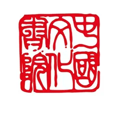
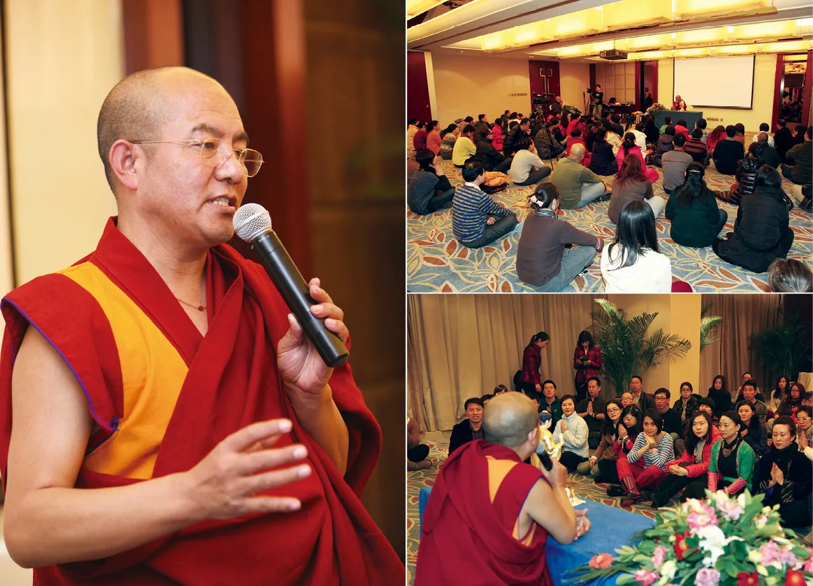
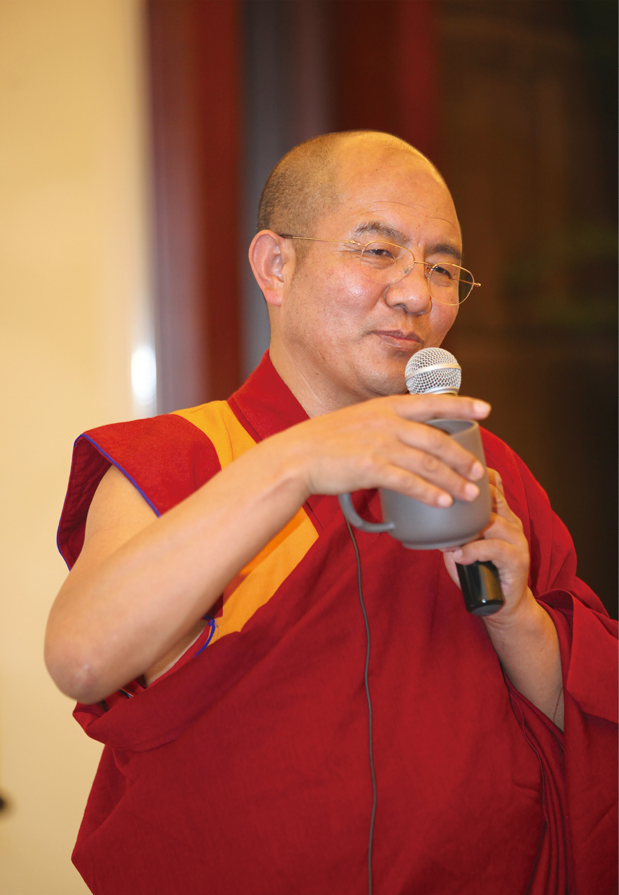

水静下来的时候，

才会呈现清晰的影像。

把多余的妄念放下来，

那时候才会更接近真相。

第41场

中国文化书院

Chinese Institute of Classical Learning

中国·北京

2012 / 12 / 22

## 念修前行仪轨及禅修

## The Sadhana of Preliminary Practice and Meditation

今天晚上的共修有两部分内容，一个是念修前行仪轨，也就是《开显解脱道》，一个是禅修。

## 念修《开显解脱道》

### 传承

根据藏传佛教的传统，我们修一个法门之前，要先得到它的传承。龙钦宁提的大圆满前行仪轨太广，所以我给大家念麦彭仁波切造的《开显解脱道》传承，我们学院和学会里修前行时，念的都是这个。

刚入门的人对次第修行不一定习惯，但是入了门以后，都要修五十万加行。待会儿我念个传承，有了传承，你们修行时会得到传承的加持。

汉传佛教好像不强调传承，《金刚经》《般若经》这些经典，都直接讲，不用传承，但这在藏传佛教中是不允许的。一定要在某某上师面前得过传承以后，传法者才有资格传讲，听法者也才有资格修行。

我们注重传承，一方面是传统，一方面是传承具有加持。

在传统上，大德们讲完因明、中观、密法等任何法门后，会念一遍传承。有了传承，也就有了学习和修行这一法门的权利，你可以随便看、随便修；有了传承，也就有了十方诸佛菩萨的开许、护法神的护持，学修起来自然有一种不共力量，这就是传承的加持。

因此，以后你们求法时，在得到开示，明白理论和实修方法的同时，还要求一个传承。这不是个别上师的做法，国内外大德们传法都是如此，短短几个颂词，也要给一个传承。

以前有一年，我和慈诚罗珠堪布到离色达五明佛学院150多公里外的炉霍朵芒寺，在德巴堪布面前听了整整一年《集密意续》的传承。

德巴堪布就是我第一次听《大圆满前行》的那位上师，八十多岁了。《集密意续》有厚厚三函。堪布倒是比较空闲，但我们俩时间紧，每次只能星期天去，坐四小时车，听两小时传承，然后返回来。堪布让我们住寺院，但我们怕给他添麻烦，就去县城住了。

堪布念得特别慢，有时候还跟我们说说话，所以每次也念得不多。有时候见我们有点着急了，他就批评：“让你们住寺院你们不住，怎么能多念？”

就这样，开头去的时候是春天，刚长出嫩草，然后是鲜花遍地、黄叶、白雪，结果一部传承听了一年。

下面我念《开显解脱道》传承。这是由麦彭仁波切撰写，涵盖整部《大圆满前行引导文》所有内容的修行仪轨。

（堪布念《开显解脱道》传承……）

### 带修

传承念完了。下面我们一起念修一遍。念的时候，念偈颂里藏文的注音文字。

开头是“喇嘛钦”念三遍。然后从“达救逆嘎鹅德Ra瓦札”开始念，这是藏文的汉语音，底下一行是这一句的意义（平时念这个汉语意译文字也可以），一边念一边随着意义观修。

念完这一个引导修法后，旁边有几个小字“第一修法竟”，这句不念。在皈依等修法开头有提示小字，像“复次不共前行之皈依者”等，这些也不念。皈依偈、发心偈都各念三遍。

以后修加行就用这个仪轨。下面我们开始，用藏语念，我起音，从“喇嘛钦”开始……

## 一辈子修行佛法

去年我在学院带他们修完了五十万加行，每天课后我们一起磕头、供曼茶，效果不错。修完后，我让他们继续修。因为在我们的传统里，前行要修一辈子，不仅学理论，还要把每一个引导当作功课，每天都修。

佛教徒一定要修行，否则皈依再久，也只是挂名而已。在家人修行不像出家人，你们不用什么都放下，什么都放下了，一遇着障碍会反弹，说不定从此再不学佛了。所以，在每天的24小时里，只要你肯抽出一小时用来修行，久了，也会有相当的积累。

你们对佛法有信心，这很好，但学佛不是一天两天的事，它需要一个过程。我是从小信佛，而越学佛越让我了解，人生的经历的确如过眼云烟，名声、财富、地位也是梦幻泡影，没有任何价值；真正有价值的，是你内心拥有的正法，以及你为生生世世准备的善法。

佛教徒相信来世，有了这种长远认识，你会看淡今生的一切所为，也会看清修行佛法有其真实意义。

“诸行无常，是生灭法，生灭灭已，寂灭为乐”，佛陀为求这一偈，可以不惜身命，我们为什么不能付出一点时间和辛苦？平常求个简单知识也愿意付出，为什么学佛就偏偏不肯？

能和佛法结缘，我们是幸运的。在这个时代，很多人活一辈子，不是自己造业，就是加入一些团体和别人一起造业，非常可悲。不是谁都能遇到佛法的。我们这个团体很好，我希望这种团体越来越多，在五浊恶世为有缘人开辟净地，让他们都能走进来。

这就是利益众生。有个道场，推广佛法，或者在你们的企业里推广佛法，或者向身边的一两个人介绍佛法，这都是有意义的，对我们的身心有大利益。

据《释迦牟尼佛广传·白莲花论》记载，佛陀在成佛之前，有时变成人，有时变成动物，以各种方式利益众生。但是你看下来，很多时候，他那一世就帮助了一个人，以此成就了一生的行持。所以，不要认为帮助一个人的意义不大。

我们这个班是国学班，也是佛学班，这种组织很好。我在云南、广州的一些企业里，发现他们有《心经》班、《金刚经》班，五人一组、十人一组，人不多，但对企业很有帮助，对个人、对社会也都有利益。

有家报纸想做佛教专栏，问我的意见。我说：“这个时代需要佛学思想，个人、集体、社会都需要。”

## 禅修

现在禅修在国际上很热门，哈佛、耶鲁、哥伦比亚、北大、清华、复旦等高等大学都设有禅修班。

这个时代人们重视禅修，主要是因为它对我们的心有一种不可替代的调节作用。人们发现，和身体相比，心是主宰，不仅我们的行为受心控制，就是外在事物的是美是丑，也会随着心的安定与否来呈现。

心不安定的人，外面的世界再美好，他也会觉得丑陋。比如夫妻之间吵架了，即使住在五星级宾馆里，那些豪华设施也会令人生厌。而一个内心安定或者很开心的人，即使身处穷乡僻壤，也会觉得美丽，像极乐世界一样。这就是心对外界的折射作用。

而我们要调心，最好的方法就是禅修。

### 禅修的方法

禅修可以让我们的心安静下来，有几种方法。

观佛像：在面前摆放一尊释迦牟尼佛的像，或者一张唐卡，把心专注在佛像上，一缘观修。刚开始一般都很难专注，因为自无始以来，我们的心习惯了散乱，总是会不停地四处投射。但当你强制性地把它一次次拉回来，停驻在佛像上，也就渐渐静下来了。

观不执著：心里什么都不执著，不起妄念。虽然这不是最高境界，但能够这样安住的时候，整个心会变得调柔安宁。随着禅修力量的加深，安住效果会越来越好，时间也越来越长，甚至达到两三个小时没有妄念。

观心性：稍有修行经验的人，可以观心性。心性就是我们这颗心的本体，当你安住它的时候，是一种光明和空性无二无别、不可言说的境界。这在密宗里叫认识觉性，禅宗里就是明心见性。

### 禅修的坐式

禅修时，一般用毗卢七法坐式：双足金刚跏趺坐或半跏趺坐；双手结定印；脊椎正直；颈部稍向前倾；两肩放松向后张开；双目垂视鼻尖；舌抵上腭。

### 观修释迦牟尼佛

在自己面前摆放一尊释迦牟尼佛的佛像，或者一张唐卡。佛陀身色金黄，着三法衣，左手托钵盂，右手持压地手印，面向自己，以慈悲的双目观照着自己。

观想佛陀的身体放光，光融入自己的身体，不仅消除了无始以来的罪业，同时也得到佛陀的加持，成就了一切智慧、悉地和功德。

我们观修佛陀身相，一刹那都有无量无边功德，更何况数数观修？我经常念《释尊仪轨》。释尊因地时，曾为娑婆世界的众生发下五百大愿，所以到了今天，我们才有机会被他的愿力摄受。

你们去过印度的知道，那里有佛陀从降生到涅槃的圣地。他是为我们才来这个世间的，要不是他开示解脱法门，我们将永远迷茫下去。

下面我们一起观修。首先要专注观佛。观一段时间后，可以一边观，一边祈祷，同时一边念诵释迦牟尼佛的心咒：

嗡牟尼牟尼玛哈牟那耶索哈

现场互动

问：怎样调整呼吸更易于入定？

堪布：一般来讲，所有禅修都有一个共同特点，就是呼吸要缓慢，甚至都感觉不到。这样心就容易安住。

呼吸跟心识有密切关系。呼吸急躁时，起心动念也变得很快，呼吸舒缓，心念也会平和。所以，在包括大圆满的修行中，总的都会要求呼吸要缓慢。

问：我在观想的时候，开始还觉得佛陀在我的前面，但慢慢地，我感觉佛像在靠近我，进到我的心脏里，不知道这种状态对不对？

堪布：也可以。不过心在妄动的状态下，现不出真实的相。就像水在动摇时，水里的影像就看不清，当水静下来的时候，才会有清晰的影像。所以，把多余的妄念放下来，那时候所呈现的更接近真实。

我刚才一生起分别念的时候，想到佛陀为我们付出了那么多次的身体、那么多的苦行，就自然流泪了。所以我常会处于一种感恩的状态里。不过，当你的心完全静下来以后，也会呈现它的本来面目。

对当今特别忙碌的人来讲，很需要禅修。我常跟他们讲，早上起床后，至少要打坐半小时，这对你一天的工作都好。晚上睡觉前，也最好让心稍微安住一会儿，放下工作和生活中的不平，放空了，再进入睡眠。这对我们的心理养护，有非常大的力量。

现在的人会养身，吃这个、吃那个，但很少有养心的窍诀。禅修就是最好的养心窍诀。会养身的人，不一定会养心，但对一个会养心的人来讲，养身很容易。

问：我有时间就抄经，抄经是不是禅修？

堪布：抄经是十大法行之一，是很好的修行。这种修行看似是一种有相行为，是执著，但却可以让我们的心平静下来，因为这里面有一种无形的加持力量。

还有念咒。当你心情特别不好的时候，可以手拿念珠，静静地念五分钟咒语，念完以后你会发现，刚才那么多的烦心事，现在都没什么了。

佛教的方法的确很独特。这些方法虽然简单易行，却能迅速制止各种分别念，在具足善心的基础上，也能积累起许多功德和资粮。

问：念咒语时有没有具体的修法？

堪布：根据生起次第的修法，先要观想万法皆空，接着观想从空当中起现本尊，然后念咒，观咒轮发光利益众生，最后收光，安住无缘禅定。

比如我修文殊菩萨心咒：先安住空性，断除一切不清净的分别妄念；然后观想文殊菩萨，观起来以后，就开始念文殊心咒；念完咒，再以观咒轮发光的方式作上供下施；之后收光，安住，回向。
