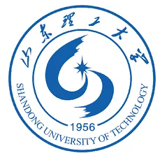
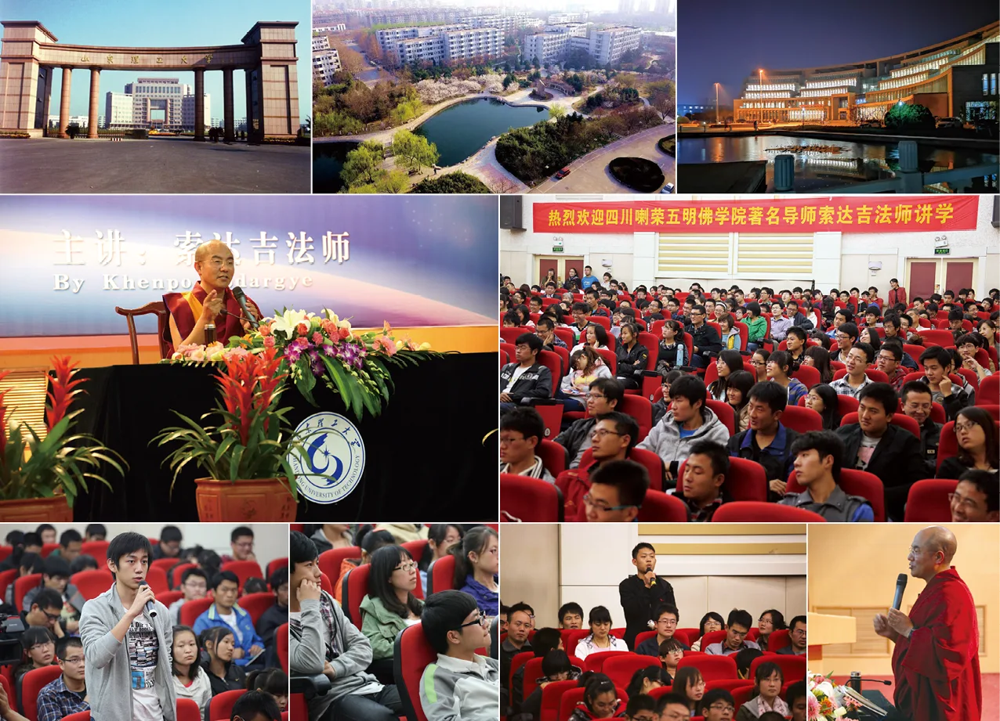
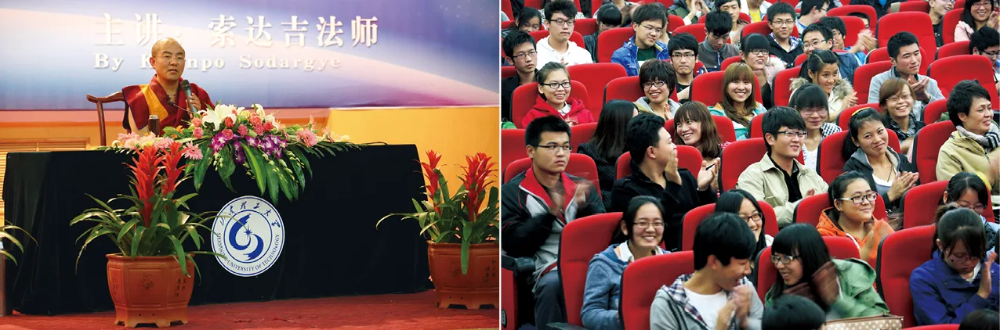
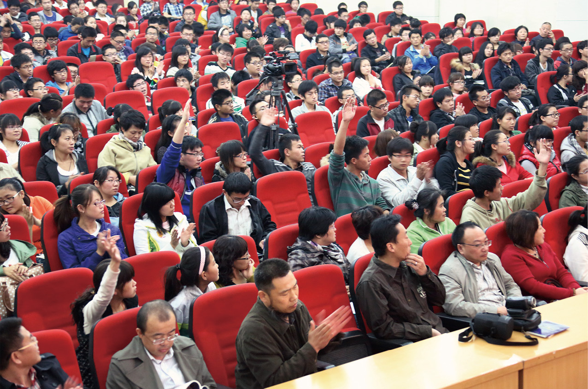
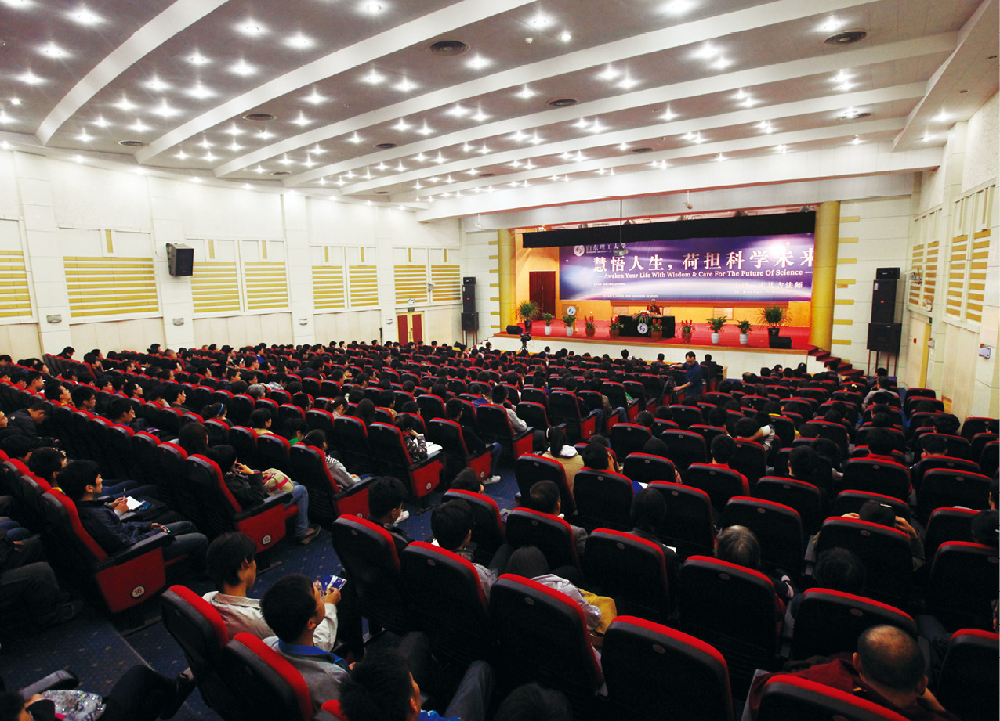

“如果一个人什么都不信，

很可能变成什么都不怕。”

第36场

山东理工大学

Shandong University of Technology

中国·淄博

2012 / 10 / 27

## 慧悟人生 荷担科学未来

## Bridging the Wisdom of Life to the Future of Science

主持人：

请全体起立，让我们以热烈的掌声欢迎尊敬的索达吉堪布！下面，请允许我对堪布做个简单介绍。

索达吉堪布是色达喇荣五明佛学院的大法师，对藏传佛教、汉传佛教乃至传统文化，堪布都有深入研究。

除了是一位传统意义上的佛学大师，堪布还是深受当代大学生喜爱的心灵导师。近几年，堪布应邀在国内外多所高校演讲，与知识分子们进行了广泛的交流。他的开示充满智慧和幽默，像一股潺潺的清泉，净化了人们的心灵，开启了人们智慧的宝库。

能邀请到这样一位大师，对我们来说是个殊胜的机缘。机会来之不易，希望各位放下烦恼，放松身心，专心聆听。好，下面有请堪布给我们带来“慧悟人生 荷担科学未来”！

感谢主持人的热情推介！也感谢山东理工大学提供今天这个交流的机会！

淄博是齐文化发源地，历史上曾涌现过无数智者和高僧，来到淄博，我感受到了深厚的历史底蕴。我想，置身于这种环境，各位对传统文化应该有着浓厚的兴趣。

接下来，我将和各位分享对人生和科学的一些想法。希望通过这种方式，让我们共同度过一个有意义的下午。

## 一、慧悟人生

今天，人类正享受着物质发展和科技进步带来的好处，我们的生活有了极大改善，不再像过去那样吃不饱、穿不暖。然而，这是否意味着我们已经拥有了幸福的人生？答案是否定的。

虽然生活已有保障，可是许多人依然不满足，还在追求更奢华的生活——吃得更好、穿得更靓、住得更高档……换言之，人们的六根还在追求更大的刺激——眼追逐更好的美色、耳追逐更好的妙音、鼻追逐更好的香气、舌追逐更好的美味、身追逐更好的乐触、意追逐更多的信息。这一切，使得人们的生活异常忙碌。

我们看“忙”这个字，左边是“忄”，右边是“亡”，合起来意思就是“心亡则忙”。这就是现代人的真实写照。

在忙忙碌碌中，许多人已经迷失了人生的方向。因此，我们不妨放慢奔波的脚步，让浮躁的心静下来，对人生作一番思考。

曾有人问我：“人生的目的是什么？”我回答说：“追求幸福。”我觉得这是个普适性的答案，的确，不管对什么人而言，幸福都应该是根本的需求。

可悲的是，虽然人人想拥有幸福，真正幸福的人却寥若晨星。更糟糕的是，随着物质条件越来越优越，人们的幸福感反而越来越低，内心的空虚、忧伤和焦虑则越来越多。

这个时候，除了学习专业知识，大家也要从佛学和传统文化中汲取营养，以树立正确的人生观。否则，在这个迷乱不堪的时代，不要说拥有幸福，恐怕连面对现实的勇气都不会有。

前几天我在上海交大讲学，有一位老师讲述了他学佛的因缘：“几年前的一天，当我步出一栋大楼时，见到一位美女从宝马车出来，匆匆走进大楼。几分钟后我回到大楼，刚到楼下就听到一阵惊呼：‘跳楼啦！’紧接着，‘砰’的一声，一个人落到坚硬的水泥地上。我定睛一看：不就是那位女士吗！我的脑海一阵轰鸣：怎么会这样？刚才还好好的，现在已成为血肉一摊！目击这场悲剧后，我不得不开始思考：人活着，究竟是为了什么？不久我遇到了佛法，佛法给了我问题的圆满答案。从那以后我的生活悄然改变，工作之余，我开始抽出时间学习佛法。”

各位或许没有这么血淋淋的经历，不过，死亡照样在我们身边不断发生着，只不过很多时候，我们有意无意忽略了这个事实。因此，大家也应反躬自思：人活着，到底是为了什么？

## 二、荷担科学未来

### 1．重新审视科学

21世纪是科学昌明的时代，为了让科学更好地服务于人类，我们首先应该对科学有一个客观的认识。

#### 1）科学的负面效应

不可否认的是，给生活带来便利的同时，科学也带来了很多负面效应。

拿互联网来说，一方面它非常便利，许多事情上网就能完成；另一方面，它也戕害了不少年轻人。由于思想不成熟，缺乏抵制诱惑的能力，许多未成年人成天泡在网上，沉迷于网络游戏和色情网站，严重影响了身心健康。鉴于此，不少有识之士甚至将网络比喻为“电子海洛因”。

通过上网，虽然可以学到一些知识，可是对网络的过度依赖，也使得人们无法像老一辈人那样，从生活中直接感悟真理。

谈起自己的成长经历，作家莫言这样说：“我小学五年级就被学校赶了出来。我牵着两头牛，一个人在田野里放牧。家太远，有时候中午也不回家吃饭，我就带一点干粮充饥。只有牛跟我在一起，我经常可以从牛的眼睛里看见自己的倒影……直到现在，我写作动用的依然是20岁以前积累的生活资源。”

我很赞同莫言的说法。不一定非要在大城市，不一定接受科班式的教育，不一定天天上网，才能培养出人才。有时候，到广阔的大自然中体验一番，或许更容易发现真理，这种直接源自生活的感悟是科学训练无法替代的。

在这里，我顺便引入一则故事。哈佛大学有一任校长，他向学校请了三个月假，之后告诉家人：“不要问我去了哪里，我会定期给你们报平安。”随后，他独自去往美国南方。

他在农场、餐厅打过短工。打工过程中，有时他背着老板偷懒，有时他和工友说说笑笑，这一切都让他感到前所未有的愉悦。最有趣的是，他做过一份刷盘子的工作，干了四个小时后，老板对他说：“可怜的老头，你动作太慢了，你被解雇了。”

三个月后，他重返哈佛。面对熟悉的环境，他开始以一种谦下平然的心态做事。此时，工作对他来说已经成了全新的享受。

客观地说，知识分子往往有根深蒂固的傲慢习气，遇到不如自己的人，会流露出强烈的优越感。各位可能也是如此。这种心态非常要不得。古人云：“月盈则亏，水满则溢。”人一旦有了傲慢，就既看不到别人的功德，也看不到自己的过失，再也不可能有进步的余地了。因此我建议：如果有机会，你们也像那位校长一样前往他方，过一段平凡甚至卑下的生活。这种经历或许会给自己带来意想不到的收获。

言归正传，既然科学存在种种不足，我们就要想办法补科学之不足。在前阵子的“世界青年佛教学术研讨会”上，香港理工大学校长潘宗光教授从大乘佛教的视角剖析了科学的不足，并指出只有以佛法引导科学，才会给人类带来真正的进步。我很赞同这种观点。

由此我也想到，老师应该发展出开阔的眼界，既重视专业知识的传授，又重视学生的心灵塑造，方能培养出有用之才，忽略了任何一者，都不能算成功的教育。

总之，我们应当谨记：作为运用科学者，首先必须是个好人，要怀揣一颗善良之心，具备这个前提，自己掌握的科学方能造益自他。

#### 2）科学不应被迷信

科学的职责在于探索真理，但科学并不等于真理，面对科学家的观点，我们不能轻易交出自己的思考权，否则很可能被误导。

试举一例。现代人深受“进化论”的影响，这就是科学对人类的一大误导。1831年，达尔文（Charles Darwin, 1809-1882）进行了一次环球考察，根据沿途的观察，他推测：地球上的生物遵循着一条从低等到高等的进化规律，最早地球上只有海洋动物，这些动物逐渐进化为爬行动物，之后进化为哺乳动物，最终进化出人类。1859年，他出版了《物种起源》（On the Origin of Species），正式提出了“进化论”。

“进化论”问世后，恩格斯（Friedrich Engels， 1820-1895）对其大为推崇，将其列为19世纪自然科学三大发现。受恩格斯影响，“进化论”一路东传，从西方到苏联，从苏联又到中国。短短一百多年，“进化论”已牢牢统治了中国人的大脑。

事实上，“进化论”只是达尔文的猜测，从一开始，它就缺乏充分的化石依据。时至今日，以科学的最新成果衡量，进化论更是立不住脚了。

根据“进化论”，人类的祖先是猿猴，猿猴进化为原始人，原始人再进化为现代人，因此现代人比古代的人聪明。但实际上，这种观点很难成立。从心灵到外境，在许多方面，古人都有不输于现代人的出色表现。

以心灵的智慧来说。孔子生活于公元前500多年，直到如今，他的学说仍然深刻影响着中国人。释迦牟尼佛活动于2500多年前，佛陀一生的说教被集结为《大藏经》，直至如今，也没有任何智者能指出《大藏经》存在错误。

建筑方面，古人也有远超现代人之作。埃及金字塔建于4000多年前，在没有现代工程设计学和大型建筑工具的古代，埃及人就能建造如此宏大的建筑，这不得不令我们惊讶。

西藏的布达拉宫也是个奇迹。这座石木结构宫殿始建于公元7世纪，历经1400多年的风风雨雨，它仍然傲然屹立于青藏高原。

另外，佛经中记载，早在释迦牟尼佛时代，就有个名叫耆婆的医师做过开颅手术，他打开一个少女的头颅，取出颅内的寄生虫，最终令病人恢复健康。

诸如此类的例子还有许多。所以有些人不要想当然地认为，自己肯定比老祖宗有智慧。事实上，古人绝非如某些人认为的那么落后。我看过《人类曾经被毁灭》一书，书中记载了大量现代科学无法解释的古代奇迹。大家也可以看看这类书籍，试着了解一下古人的智慧。

由于“文革”的遗毒，中国人染上了蔑视古人的大病，直到今天，许多人还没有痊愈。各位应当反思，要避免这种心态。今后，大家要虚心向古人学习，肩负起振兴传统文化的重任，切莫让传承数千年的文明在我们手中断掉。

### ２．科学工作者应注重内在的成长

我相信，在座各位对专业都应该很重视，知识时代的今天，这当然是理所应当的。不过我要提醒的是，与此同时，也不能忽略了心灵的成长，倘若缺乏健全的心智，纵然你学富五车、满腹经纶，在现实中也难有用武之地。

如果各位有志于提升内在的境界，以下建议可能会对你有所帮助。

#### 1）有一个正确的信仰

信仰是内在成长的重要基础，所以各位应该试着去了解宗教，发展出对宗教的兴趣。

当然，信仰是每个人的自由，你们有没有信仰或者信仰哪种宗教，完全取决于你们自己的选择。

佛教的特点是随顺众生，佛陀在世时，信仰佛者固然多，但不信佛者更多，佛陀并没有试图把所有人都变成佛教徒。在传授佛法时，佛陀也随顺众生。相应众生的根机，佛陀开演了声闻乘、缘觉乘、菩萨乘、密乘等无量法门。

顺带说一句，我甚至相信，对于暂时不具佛缘者，只要对他们有利益，佛陀也会鼓励他们信仰其他宗教。

所以，信不信佛教，完全是你们自己的事，对我来说无利无害。不过，站在对各位负责的角度，我要提醒你们：在人心极度迷乱的今天，一个人如果没有任何信仰，想获得幸福是相当困难的！

法国文豪雨果（Victor Hugo, 1802-1885）在《悲惨世界》（Les Misérables）中说：“信仰，是人们所必需的，什么也不信的人不会有幸福。”

有一位智者也说过：“如果一个人什么都不信，很可能变成什么都不怕。无所顾忌的人生往往会偏离正轨。”

听说你们学校有传统文化课程，我非常赞同这种做法。事实上，许多世界名校都有宗教课程。美国的哈佛大学有一所400年历史的神学院，这所学院最初只从事基督教的教学和研究，后来扩大到佛教、印度教和伊斯兰教。该院面向全世界招生，只要达到录取标准，任何人都可以就读。

在国外，许多年轻人都有宗教信仰，无信仰者仅占少数。我在香港时，一个就读于哈佛的香港女生曾说：“在班上，无信仰者只有我，其他人都有信仰。虽然老师和同学不排斥我，可是从表情和语气上，我能感觉到他们对我的不解。”

而在国内，情况则大不相同。如果某学生信佛，其他人都会在背后指指点点，好像信佛跟信鬼一样。

其实信佛没那么可怕。以我本人而言，潜心研究佛法至今已30年，在此过程中，自己越来越觉得佛法是宇宙万法的究竟真理。

我这么说，绝非自赞毁他。佛教有个原则：即便对自己的老师，也不能以虚伪之辞赞叹；即便对怨敌，也不能无中生有加以诋毁。我很清楚这个原则，如果佛法不能以正理说服我，我绝不会违心地替佛法打广告。

现在的人们口口声声谈发展，但很不幸，上至领导层，下至基层工作者，人们关注的往往是物质的发展，精神的提升却有意无意被忽略了。其实，与物质发展相比，精神的提升更为重要。如果人的精神得以提升，纵然物质条件一般，内心也会充满幸福，如果精神没有提升，经济再发展，也不可能幸福。

今天的中国，正面临着一个严峻的问题——自杀率节节攀升。调查结果显示，许多人自杀，并非因为物质匮乏，而是思想出了问题。他们错误地将幸福建立在物质、感情或者其他事物上，忽略了对内心的调伏，遇到挫折往往无法面对现实，结果做出轻生之举。

大家应当审慎思考，尽快树立正确的人生观，否则，将来走上社会后，面对复杂甚至残酷的现实，很难说会不会重蹈某些人的覆辙。

在引导学生树立人生观方面，老师负有重要责任。今天早些时候，我和贵校的老师进行了交流，结果令我倍感欣慰，我发现他们很关心学生，很想帮助学生树立健全的人格。今天，这样的老师还是很难得的。

不过，你们也不能完全依赖老师，大学生活比较自由，不像中小学的时候，老师天天拿着教鞭盯着你。如果没有自觉性，四年一混就过了，不仅专业知识欠缺，人格更欠缺，到社会上根本无法立足。所以大家不能懈怠度日，学好专业之余，也要汲取一些佛法的营养。

我要提醒一点：作为知识分子，在接触佛教过程中，应该着重从智慧趣入。佛教不是迷信，而是智信，如果学佛之人缺乏扎实的理论基础，弄不好信心会沦为迷信。

其实佛教的殊胜性，就在于她是究竟的真理。这不仅为佛教徒认可，甚至为外教徒所认可。在香港讲学期间，有一个信基督的教授曾对我坦言：“我对各宗教都有涉猎。我个人觉得，在所有的宗教中，当属佛教的理论最为严密，我最佩服的就是佛教。”

说一千道一万，人必须有正确的信仰，只有这样，内心才会有归属感，遇到不幸才会有思考的余地。否则，面对生活中的各种挫折，不仅难以从痛苦中自拔，甚至会做出极不理智的行为。

#### 2）培养慈悲心

佛教常说“无缘大慈，同体大悲”，这句话蕴含着深刻的道理。

人是一种社会性的动物，不管在任何团体，小到一个家庭，大到一个国家，都需要慈悲心。缺乏慈悲心的人无视其他生命的感受，甚至对自己的父母、家人都漠不关心，这样的人相当可怕。

科学工作者尤其需要慈悲心，否则，科学不仅不会给人类带来利益，甚至会成为毁坏人类的利刃。

回顾过去，20世纪的两次世界大战给人类带来了巨大的灾难。造成如此悲剧，我认为原因有二：1．科学负有不可推卸的责任，在冷兵器时代，战争不可能夺去如此多生命；2．运用科技的人没有慈悲心。

在座各位反躬自思，看自己有没有慈悲心。或许有人认为自己慈悲心不错，其实不然。人的相续非常隐蔽，只有真正遇到境界时，才会暴露你的真实面目。

慈悲心是衡量人的首要标准。如果一个人没有慈悲心，其他方面再优秀，也不值得称道。为了维护一己私利，他们不惮于损害他人。相反，如果有慈悲心，即便不太能干，也是值得信赖的好人。

在大乘佛教中，上师的法相有许多条件，所有条件均可包含于是否具足慈悲心。这个道理很简单：一个老师如果有慈悲心，他肯定会为学生负责，他会很努力地工作；如果老师没有慈悲心，那他只会考虑自己，即使水平再高，对学生也起不到作用。

现在的人找对象只看相貌、财产、地位、文凭，很少有考察人品的。这种择偶标准显然是错误的。有些人虽然外在条件优秀，内心却惨不忍睹，连基本的善心都没有，到了关键时刻，连最亲密的人也会抛弃。如果和这种人成了家，不后悔是不可能的。

从我们自身来讲，如果想获得快乐，也要有慈悲心。斯坦福大学一位博士在《慈悲与科学》一书中说：“虽然美国掌握了全球25%的资源，许多美国人依然孤独、焦虑、抑郁……因此美国人的痛苦不在于物质匮乏，而在于缺乏慈悲和爱。”

此外，熟悉大乘佛教的人知道，大乘的心要是菩提心，而菩提心有三种因——无二慧、大悲心和大慈心，因此，如果我们有了慈悲心，就具足了大乘的根本。

既然慈悲心如此重要，我们就应想方设法推广慈悲的理念，最好是从娃娃开始抓起。孩子的心随大人而转，有些孩子之所以没有信仰，就是因为父母师长没有信仰。所以，如果家庭和学校给予足够的重视，孩子们肯定能生起慈悲心。

在这方面，藏区的学校做得比较不错。我去过不少藏区学校，在我的感觉中，藏族学生慈悲心普遍较重，看见病人、乞丐，他们会为之恻然，看到遭杀的动物，他们会立即设法营救。

而在别的地方，由于教育理念的偏颇，遑论慈悲一切众生了，学生们甚至认为动物生来就该被人类利用——肉可吃、皮可穿……

这种杀气腾腾的观念实在可怕，如果任其发展下去，也许将来除了人类，地球上再不会有其他生命了。那个时候，甚至可能上演人吃人的惨剧！

不管站在哪个角度，教育的基本方向都应该是培养慈悲心。2009年佛诞日前，联合国秘书长潘基文说了这样一番话：“我们所有的人都要学习佛陀的大悲精神，他的永恒教言可以帮助我们驾驭许多当今面临的全球性问题。”

他说到了问题的关键。慈悲心不是奢侈品，而是人类生存的基础，不是古人需要慈悲，现代人不需要，也不是一个地方的人需要慈悲，其他地方的人不需要，人人都需要这种善心。

回顾人类历史，为什么一再上演互相残害的悲剧？究其根本，就是因为缺乏慈悲心。如果有了慈悲心的滋润，人的内心自然会调柔平和，如此一来，大到国家、民族间的战争，小到家庭、团体内部的争斗，都会从根本上平息。

#### 3）注重道德修养

道德是个很大的话题，限于时间，在此我只提一点具体要求——心存感恩。

现在的年轻人普遍存在这种毛病：衣来伸手、饭来张口，觉得一切都是理所当然的，从来不知感恩他人。这种心态非常不好。

我在向他人提供帮助时，经常会要求受助者说声“谢谢”。如果说得不好，我会要求再次说。我并不需要“谢谢”这两个字，我只是想让他们知道感恩。

更糟糕的是，不仅没有感恩心，许多年轻人还时常怨天尤人。这种心态的产生，很大程度源自网络。我们知道，网络是个缺乏约束的虚拟世界，在网络上，平时不能说的话可以随便说，不敢做的事可以随便做，在这种环境下，好东西很难学到，学到的往往是毛病。

有时候看起来，在网上泡大的年轻人和以前的人差别太大了。过去，人人有做人的准则，知道什么能做、什么不能做，不会轻易违越正轨。现在的人则无所顾忌，什么恶俗之事都做得出，甚至在街上裸奔也不以为耻。

但愿大家不要这样，你们应当保持头脑清晰，要用道德约束自己。否则，如果无视一切准则，认为红灯绿灯都一样，什么都可以乱来，只会在现实面前碰得头破血流。

话说回来，之所以要常存感恩心，是因为很多时候，我们都生活在他人的恩泽中，只是自己不知而已。

有这样一个故事。一个人走得太疲惫，躺在路边睡着了。一条毒蛇从草丛中钻出，昂头吐着毒信子，爬向沉睡中的人。这时另一个人经过这里，他赶走了毒蛇，却没有惊醒沉睡中的人，随后悄悄走开了。

和故事中的熟睡者一样，生活当中，我们也蒙受过许多帮助，可惜我们往往不知感恩。你们想想：为了自己，老师付出了多少，自己感谢过老师吗？也许直到毕业，你们都不会对老师说声“谢谢”。对明知于己有恩的老师尚且如此，其他人就更不必说了。

这样的忘恩负义不能再继续了，从今天开始，我们要有一个大转变，要时常反思：我拥有的一切源自谁？今后，我该如何对待为自己付出过的人？

## 结语

心理学家发现，对于一个人的成功，智商仅起到30%的作用，情商（心理素质以及人际关系能力）和逆商（承受失败和挫折的能力）则起到70%的作用。现在大多数人只关心智商，却忽略了更关键的情商和逆商，这是极大的错误。

具体到今天的话题，要荷担科学未来，除了扎实的专业功底，还要有健全的心智，信仰、慈悲心和道德底线都是不可缺少的。希望大家今后于此留心。

现场互动

问：我是建筑工程学院2011级的学生。美国有一家名叫摩托罗拉的通讯公司，它有一个理念——“要做世界上最好的通讯设备，以改变这个世界的通讯方式。”经过多年努力，它实现了这个初衷。您如何看待这种理念？

堪布：这种理念如果不是一句口号，而是真正利益人类的心愿，那确实很可嘉。

每个人都应该有类似理念，即使你没有能力改变世界，这样发愿也非常有必要。在大乘佛教里，最重视的就是利益众生的发心。

其实，只要具足了强大的心智，完全可以改变这个世界。乔布斯（Steve Jobs, 1955-2011）就是一个典型。1985年，乔布斯离开了苹果公司，之后跟随一位日本禅师学禅。这段学禅的经历对他以后的人生产生了重大影响。1996年，乔布斯重返苹果公司后，一边工作一边坚持禅修，在此过程中收获了许多天才的创意。最终，他用手中的苹果改变了这个世界。

当然，所谓改变世界，应该是让世界往好的方向转变。佛教认为，对众生有害的事情不值得赞叹，有利于众生的事情才值得赞叹。所以，我们要努力让世界变得更美好！

问：我是农业工程与食品科学学院的学生。您刚才说，佛教徒要心存感恩、造福人类。爱因斯坦也说过：“不能单纯地运用科学技术，关心人类应该成为一切技术奋斗的目标。”请问，我们应该怎样用科技来造福而不是毁灭人类？

堪布：很简单，只要有了善心，就能保证科学技术给人类带来利益。

要拥有一颗善心，是需要付出一定努力的。大学的环境比较清净，老师们以传道授业为己任，同学们的心也比较单纯，而到了社会上，周围的环境非常复杂，必须好好把持自己，才能保有一颗善心。

问：我是外国语学院2012级的学生。地藏菩萨有一句名言——我不入地狱，谁入地狱。这对我们的人生有何启迪？

堪布：地藏菩萨誓愿宏深，他曾发下宏愿：“地狱不空，誓不成佛，众生度尽，方证菩提！”虽然地狱没有空尽之时，众生也没有度尽的那一天，这样发愿依然是有意义的，它体现了菩萨的无尽悲心。

和地藏菩萨一样，释迦牟尼佛、文殊菩萨也发过殊胜的大愿。我们应该向这些佛菩萨学习，不要认为他们的发愿太广大了，自己根本无法做到。心是万法的根本，只要我们打开心量，经常如是发愿，奇迹一定会出现。相反，如果心量狭隘，整天想的是工作、家庭、爱情，将来的成就肯定不会广大。

释迦牟尼佛教下有八大菩萨——地藏菩萨、虚空藏菩萨、除盖障菩萨、文殊菩萨、观音菩萨、普贤菩萨、金刚手菩萨、弥勒菩萨。如果经常祈祷八大菩萨，念诵他们的名号或者心咒，会有不可思议的功德。尤其遇到危险时，只要虔诚祈祷他们，会立即得到救护。

问：我是电气学院的学生。既然佛教认为诸法皆空，父母妻儿自然也是空的了，释迦牟尼佛为何还要出家修道？

堪布：诸法皆空是就实相而言的，在现相层面父母妻儿依然存在，因此，如果想专心修道，还是要远离家庭的羁绊。

这其实是一个对世界多层次看法的问题。不仅佛教，科学界也有类似情况。比如物理学家会认为，在微观层面上，茶杯实际上是许许多多的基本粒子，但他们并不会因此而否认宏观层面茶杯的存在。

需要说明的是，佛陀离开父母出家修行，这不是没有孝心，世尊成佛后，首先回国度化了父母。黄檗禅师说过，出家方为大孝。

另外，佛陀出家也是大悲心的体现。如果世尊没有出家修道，就不会有后来的大彻大悟，更谈不上度化我等芸芸众生了。

问：为了摆脱六道轮回，很多人一心念佛求生西方极乐世界，可是佛法又说，佛教徒应该断除贪嗔痴。请问，求生西方是不是最大的贪？

堪布：贪和求生西方虽然都是希求的心态，但二者性质截然不同，求生西方不是为了占有，而是为了利益众生，因此它不属于烦恼所摄的贪。

当然，究竟而言，求生西方也是一种执著，这种执著最终也需要舍弃。正过河的时候需要船筏，过河以后就不需要了。同样，解脱之前需要有求生西方的执著，解脱后就不再需要了。

问：我是农业工程学院的学生。怎样做才算对自己的生命负责？

堪布：关键是要相信前后世。

对前后世，现代科学并没有透彻的研究，只有佛教对此才有详尽宣说。佛教认为，流转轮回的主体不是身体，而是心识，前刹那的心识产生后刹那的心识，如是心识不断延续，就形成了从前世到后世的不断流转。

诚信前后世很重要。如果来世不存在，这辈子我们怎么过都行，什么都不需要顾忌。但事实上，来世是存在的，因此我们理应对未来有所准备，要尽量断恶行善。这才是智者的选择。

有时候看起来人类很聪明，我们在科学上取得了前所未有的进步，甚至可以飞到月球上。可是反观内心，我们又会发现人类非常愚痴，许多人连前后世存在都不懂。这就是人类的最大悲哀！

问：我是商学院的学生。据我了解，目前世界上只有中国人没有信仰。在外国人看来，这种情况是非常可怕的。近几年来，我国食品安全问题泛滥，民众道德水准大幅滑坡，这些是否可归结于信仰缺失？

堪布：我倒不认为除了中国人，其他国家人都有宗教信仰。不过相对而言，国外信仰宗教者比较多，中国不信仰宗教的人比较多。

在历史上，中国人曾是具有虔诚信仰的民族，只是最近100年以来，由于激烈的文化、社会变革，才造成民众信仰缺失，甚至出现了无信仰光荣、有信仰可耻的颠倒现象。

信仰非常重要，人如果有了正确的信仰，就会知道什么能做、什么不能做，行为会有所约束。

一位教授对我说，在香港的学校，对有宗教信仰者一般比较放心，当涉及财物管理工作时，会优先录用宗教徒。

在色达喇荣五明佛学院，常住者约六七千人，大家都有虔诚的信仰，极少有人干坏事，生活在那里很有安全感。

问：我是法学院的学生。历史上佛教曾几度兴衰，在佛教的起源地印度，佛教甚至一度灭绝。我想知道，未来佛教的发展前景如何？

堪布：这要看众生的缘分。现在许多人对佛教有信心、有兴趣，从这种情况来看，佛教的前途应该是光明的。

我经常想：不必说佛教徒，即便非佛教徒，也应尊重并了解佛法，因为佛法是宇宙人生的究竟真理，而真理是任何人都应接受的。

曾有人问佛陀：“世尊，每个教派都认为自己的观点正确，您怎样证明佛教超胜其他宗派？”佛陀说：“不管听到任何说法，你都要用智慧去观察，符合正理就接受，不符合正理就舍弃。对于我的教言，你也应如是观察。”这个人通过反复观察，认识到佛陀的教言是究竟的真理，从此对佛法生起了信心。

佛法既经得起理论的观察，也经得起实修的验证，对于这种无上的智慧，如果没有理由却顽固否认，那只能说明自己的愚痴。

问：您怎么看少林寺的发展模式？

堪布：和大多数人一样，我很早就知道少林寺。上世纪80年代，由于电影《少林寺》的影响，在中国人心目中，少林寺成了令人神往的武林圣地。我读书的时候，校园里到处都传唱着：“少林，少林——”

这些年来，围绕少林寺，社会上众说纷纭。最近我看到济群法师的微博，他引述了释永信的一番话：“……地方政府想让少林寺上市，我做了很大努力，才没被上市。”所以少林寺的情况比较复杂，有些事情很不好说。

我建议各位，今后在评判佛教界的事情时，最好用“显微镜”去观察，不要用“放大镜”看，通过“放大镜”看到的与实际情况往往有出入。

问：我是农业工程与食品科学学院的学生。过去，出家人过着与世无争的生活，今天出家人的生活是什么样？

堪布：和从前相比，现在出家人的生活比较散乱。对此我有切实体会。在五明佛学院的前十几年，我的生活非常寂静，全部时间都放在闻思修行上。后来，随着弘法利生事业的开展，各种琐事逐渐多了起来。当然，这也是度化众生的需要，如果彻底与世隔绝，就无法度化众生了。

不过，有些寺院似乎有点过了头，整天忙于应付各种琐事，甚至成了旅游场所。寺院本来是闻思修行的道场，如果一所寺院既没有闻思，也没有修行，再怎么金碧辉煌、人流如潮，也没有意义。目前，许多有识之士很担忧某些寺院的发展方向，正在采取措施保持寺院的宗教本色。

问：我是交通与车辆工程学院的学生。人生在世，许多因素迫使我们去追求名利，这是否与佛法的生活观矛盾？

堪布：佛教的生活观有两种。对米拉日巴那样的利根者来说，由于内心有超凡脱俗的境界，已经彻底看破世间，所以任何物质都不需要。如果是一般人，生活就应不堕两边，不能过于富贵，也不必过于贫穷。

身处尘世，追逐名利是正常的。古人说：“天下熙熙，皆为名来，天下攘攘，皆为利往。”因此，只要不是太过分，在自身福报允许的范围内过日子，佛教对此没有意见。

但如果始终不满足，无止境地追名逐利，就会给自己带来灾难。许多贪官就是如此，起先他们也是正常人，然而在欲望驱使下，最终走上了违法乱纪的不归路。

问：我是资源与环境工程学院的学生。在生命的前半程，阿育王发动战争，造成无数人死亡，在生命的后半程，他大力弘扬佛法。请问：阿育王的善行能抵消恶业吗？他的来生会怎样？

堪布：阿育王的一生可以说是善恶参半。早年，他多次发动战争，令无数人丧命，后来他认识到自己的过错，开始广行善法，尤其是收集佛陀的舍利，造了八万四千座舍利塔，并将这些舍利塔分送世界各地。据说仅中国境内就有十九座阿育王舍利塔。

阿育王死后会怎样？凡夫人很难测度。不过，佛陀曾授记：“我入灭后百年，将有阿育王出世，他分布我的舍利，广弘佛法。”从这些授记看，虽然阿育王造过恶业，可是他对佛教也有巨大贡献，所以他应该有转生善趣乃至获得解脱的机会。

和阿育王一样，在这个世界上，大多数人的一生都不可能完全清白，不少人年轻时都造过恶业。不管怎么样，只要自己精进忏悔，励力行善，罪业也有清净的机会。

问：我是商学院的学生。我觉得人还是需要欲望的，有了欲望，人们才会为之努力。就市场而言，因为消费者的欲望，企业才会做各种努力，结果带来了经济的发展和消费者的满足。您怎么看欲望？怎样才能用信仰的力量让欲望朝着正确的方向发展？

堪布：总的来说，如果以非法手段牟利，佛法是不赞叹的，如果以正当手段赚钱，佛法对此是认可的。

作为企业家，应当本着对良心和消费者负责的态度牟取利润，自己的产品要过得了“因果关”，不要为了赚钱而生产“毒奶粉”“地沟油”等害人的产品。

现在是商业气氛浓厚的时代，身处这样的环境，大家要有“己所不欲，勿施于人”的理念。按佛教的说法，就是要有自他交换的理念。如果没有这种理念，未来的前途不一定光明。

问：我是建筑工程学院的学生。佛教讲究放下，可如果把握不好，放下就可能变成逃避。我们应该如何区分放下与逃避？

堪布：所谓放下，有真放下和假放下。

真放下是认识到“三界无安，犹如火宅”，不管转生于轮回中哪一处都无法免于痛苦，基于这种认识，从而万缘放下，一心希求解脱。许多高僧大德就是如此，他们彻底了知轮回的本质，认识到一切世间法皆无实义，前往寂静处精进修行，最终获得成就。假放下则是逃避，当感情、事业遇到挫折时，由于无法面对现实，所以逃到寺院里。这种“放下”是不可取的。

问：我看过《金刚经》，经中有些道理能看懂，有些看不懂。请您指导一下，应该怎样看佛经？

堪布：《金刚经》是般若法门的重要经典，它的内容非常深奥，如果没闻思过中观，看《金刚经》会很吃力，甚至会感觉前后矛盾。

像《金刚经》这么深的经典，不可能像小说那样一下就看懂，必须花一定时间研读，才可能明白其意义。我以前讲过《金刚经》，许多法师也讲过《金刚经》，在网上应该能找到《金刚经》的讲义，如果反复研读这些讲义，慢慢就会理解《金刚经》在说什么。

问：我是美术学院的老师。我在一本书中看到，现代天文学的许多说法——例如月球、地球、金星等的公转周期——跟佛教《时轮金刚》的说法惊人地相似。我们知道，现代天文学是通过仪器观察得出这些数据的，那么《时轮金刚》是怎么得出这些数据的？

堪布：这个问题问得好。天文学的大发展是最近几百年的事，而《时轮金刚》问世已有几千年历史了，它是释迦牟尼佛在印度南方的米积塔宣说的。按《时轮金刚》的算法，无需任何科学仪器，就可以精确地推算出每年的日食、月食。藏族使用的藏历就是根据《时轮金刚》制定的。喇荣五明佛学院有一个历算组，他们专门负责用《时轮金刚》推算来年的藏历。

由于时间关系，今天我无法广说。我们学院的慈诚罗珠堪布写了本《慧灯之光》，书中有现代天文学与《时轮金刚》的对比，对于《时轮金刚》的道理，堪布讲得比较清楚。有兴趣者可以自行参阅。
