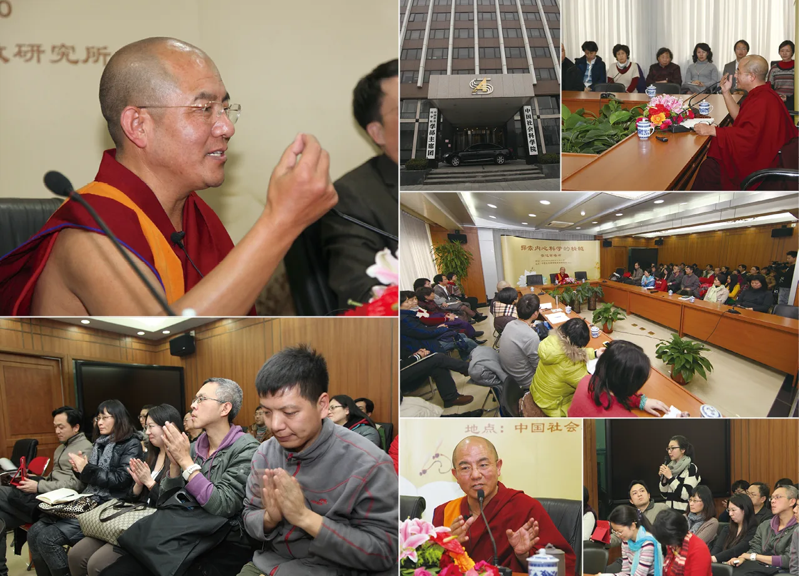
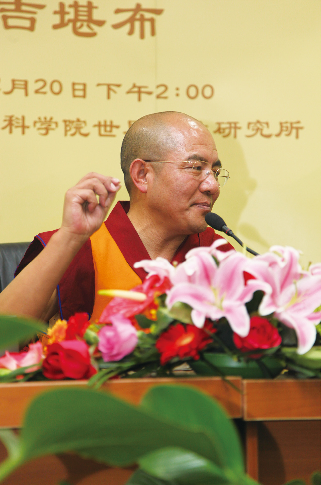

“若不知此心，

奥秘法中尊，

求乐或避苦，

无义终漂泊。”

第39场

中国社会科学院

Chinese Academy of Social Sciences

中国·北京

2012 / 12 / 20

## 探索内心科学的精髓

## Exploring the Essence of Inner Science

卓新平所长[^1]：

今天，我们给中国社会科学院的研究生、世界宗教研究系的学生开一堂特殊课，因为是开放性讲座，也有社会各界的朋友、贤达来参加。欢迎你们！

为什么说特殊呢？因为我们邀请了一位特殊的教师。以前给我们讲课的，都是社会科学院的研究人员或大学教授。但我们毕竟是研究宗教的，想要研究透彻，直接与宗教界人士尤其是精英人士面对面对话，很有必要。用佛教的话说，我们今天要跟一位藏传佛教的大师结缘，由这位特殊的教师，为我们作一个不同以往的讲座。

今天我们邀请到的，就是索达吉堪布大法师。

尽管许多朋友对堪布已非常熟悉，但我还是简短地介绍一下：堪布生于1962年藏历六月初四。对我们这代人来说，其实堪布是非常年轻的，不过虽然年轻，他的深厚学养与修行功力，却让我们学界钦佩不已。

堪布1985年舍俗出家，到色达喇荣五明佛学院潜研教理、精苦修持，得到大成：教理上有相当深度，修持上更是颇有造诣。由这位教师授课，不仅可以听到他对我们所熟悉的学理作的精要阐释，更可以了解修持在宗教研究中的意义，而这也正是我们学术界了解不够的地方。今天有这么一个学习和对话的机会，很值得珍惜。

索达吉堪布著述甚丰，介绍他著作的单子有整整两页，这让我们学界人士都颇感汗颜。

法师送我两本新作，一本是《苦才是人生》。“苦才是人生”，这话一听就非常有哲理。学界里常说“没有痛苦就没有宗教”，宗教就是用来面对痛苦的。不管你生活在什么样的世界里，也不管你的人生道路或命运如何，都离不开“苦”这一大的命题。所以，“苦才是人生”，很有哲理。还有一本是《做才是得到》，讲实践的，书名已经简洁地表达清楚了。

好，让我们一起倾听宗教大师的智慧之言，有请——

在前几天的“宗教慈善与社会发展论坛”闭幕讲话中，卓所长提到“本次论坛于2012年12月12日这个‘特殊’日子闭幕……”，这种“特殊”很有意味，或许也是一种缘起。

很高兴又和大家见面了。

我没有什么高深的学识和修证，这一点我有自证，也算自知之明吧。只不过从小信佛，加之近30年的学佛历程，让我对自己有了些信心。时间长点而已，也没有别的。

今天与诸位交流，我并不奢求改变谁的观念，或给谁的人生带来转变。但长期的学习让我相信，佛教教义的确值得每一个知识分子潜心研究，研究后你将发现，它对你的人生观、价值观或世界观只有好处，不会有丝毫损害。

我知道世界宗教研究所对各个宗教都很尊重，也为学习研究提供了开放、自由和包容的气氛，我认为这种气氛是适当的，是未来教育的必然趋势。而你们让我来以出家人身份谈谈对佛教的理解和收获，我也乐于分享。

## 建立理性信仰

大家知道，当今人类在价值取向上，因为教育导向或自身缺乏理性思维等原因，常有盲从现象：不管是在生活领域，还是科学或宗教研究领域，当一个新事物被提倡时，人们便会蜂拥而上，可遗憾的是，他们最终获得的利益不大。也许这就是“羊群效应”了。

羊群是一个散乱组织，每只羊都没有主见，因此当一只羊有什么反应时，便会骤然引起整个羊群的巨大骚动；甚至一只羊受惊跳崖，其他的也会跟着坠入深谷。

人类社会不也如此吗？一个人穿件好看的衣服，大家都穿；广告说某个营养品有益健康，大家都买……实际上，人人都要这么穿吗？一定要这么补充吗？不一定。

如今开放了，打着科学幌子让人上当的，有；打着什么教的名义传播虚假思想的，也有。因此，在你可以信这个、也可以信那个的时候，我认为，如果是包含真理的教义，信哪个都好，有信仰比没有信仰好，不过，你也应该问问自己：我的信仰，是否有一种理性成分？

今天我们探讨的是内心科学，在心这一层面，我向来觉得佛教与科学是一样的，我们都相信理性。佛教所强调的信——“信乃道源功德之母”，指的就是理性之信。

佛在《卡拉玛经》（Kalama Sutta，译自巴利经藏）中说：卡拉玛人，你们不要信风说、传说、臆说，不要信与藏经意义相合之说，甚至不要因为有人说“此沙门是我大师”而相信他……卡拉玛人，你们应当用自己的智慧观察，如果这个法是不善或有罪的，会引来无益和痛苦，应舍弃；如果这个法是善或无罪的，会引来利益和快乐，则应具足……

我没有PPT给你们演示，你们可以到网上查一下。这个经文很短，但它对理性的强调，以及用非信仰方式教诫人们思维苦乐与善恶因缘的关联，是很值得我们深思的。

## 物质与精神追求的次第

放眼中国历史，其实信仰一直都有，尤其是在物质条件比较优越的时期，人们总会崇尚精神追求，“信点什么”。

上世纪的五六十年代，连温饱都成问题的时代，没人讲究什么精神追求。莫言坦言，那时他的目标就是吃顿饺子，后来写文章也是为了温饱。此前人们对释道儒的信仰还在，家家供佛，供太上老君或孔子、孟子的像，而“文革”一来，这些供奉就被无神论摧毁了。很特殊的年代。

改革开放了，人们的生活渐有起色，各方面也有了自由空间，于是，被压抑的心灵开始寻找归处。而与此同时，宛如“八仙过海，各显神通”一般，气功、瑜伽以及后来的心理咨询和催眠等宗教非宗教团体也应运而生。

这很正常，因为人就是这样：在他不必特别关心饮食的时候，会向内心寻求精神食粮。这就是人跟动物的差别。

据说有科学家观察过：当把一个人和一个动物同时关起来，在不给食物的情况下度过几天后，放出来时，两者最先需求的都是食物。动物也找吃的，人也找吃的。

但之后就不同了。动物得到吃的以后，还是找吃的，除了吃的，没什么其他品位。而人在解决了吃的问题以后，就开始考虑衣服、房屋等各方面生存需求；接下来，非常自然地，人会在心灵或精神上寻找慰藉，这就是人的不同。

当然，在人类社会里，这种进程也是有先有后。西方早在上世纪七八十年代就开始了，1993年我去美国、加拿大、德国、新加坡等国家时，见他们在物质方面已相当富足，人人有车有房，那时他们的心也转向了精神需求。

而现在的中国与之类似，人们在生活上有了一定满足以后，也开始内观，寻找精神层面的意义了。

## 在你寻找信仰的当口

那么在这个时候，在你寻找信仰的当口，有可能遇到好的宗教，树立正确信仰；但也有可能遇上邪教，堕入邪知邪见的深渊，谁能保证呢？没有智慧掌控的饥饿心灵，一口咬住的是真理美食还是邪教毒品，不好说。你们也清楚，邪教有市场，并不是没有原因的。

所以《卡拉玛经》教诫：“不要信风说、传说……”

传说明天就是“世界末日”，那我们是最后的交流了……（众笑）会不会呢？如果从细无常的观点看，每一天都是末日，因为这一天永远不会回来了。比如，今天是2012年12月20号，对我今天的这个身心来讲，就是它在这个世界上的最后一天，明天以后不会再有了。的确是末日。

然而，如果是像人们传的那种“世界末日”，我在不同场合都说过，是没有依据的。我家乡就有人说：“地球马上毁灭了，不要待在家里，到外面住……”我跟他说：“整个地球都毁灭了，你到外面搭帐篷有什么用？”

在我们的生活里，也常有人打着“科学”的旗号，“你要吃这个、吃那个，再不吃就完了……”，或者顶着什么“教”的名义，“你要这么这么做，不然肯定有灾难！”

其实我们的灾难，是不理性。一个人如果足够理性，有智慧，就能够获得正确信仰。

佛教是个好信仰，然而在信仰佛教的人群中，很多人的修行只是烧香拜佛而已。烧香拜佛是有功德，这一点，在座的研究生法师们都会承认，我也承认。但是，只烧香拜佛，能不能体现佛教的所有精神呢？不能。

佛教的主要精神是智慧和大悲，但不了解佛教的人，看到一点表象或不如法行为就诋毁整个佛教，这是不对的，也说明自己的认识不够。但不管怎样，我建议大家研究一下佛教的因明逻辑。这种逻辑非常严密，不仅经得起观察和推敲，还能让你在运用和探索中发现真理。

## 佛教义理乃内心科学之精髓

苏国辉教授是香港大学脑神经科学专家，多年的科学研究和实践，反而让他对佛教有了新的认识，他相信：“虽然科学先进，但很多事情科学是无法解释的，佛法可解释其他宗教所不能解释的很多重要的问题，甚至帮助解决这些问题，这是佛法最吸引我的地方！”

他已经皈依了。起先他也认为佛教是迷信，皈依、出家或佛教行为只是形式而已，但通过姐姐的因缘，开始听闻佛法，甚至研究起佛法，“佛教最令我惊讶的两个概念就是‘无常’和‘因缘’， 这是科学证实不到的，偏偏这正是宇宙万物的真理，是我们不能去否定的。”

他喜欢引用爱因斯坦的话：“任何宗教如果可以和现代科学共依共存的，那就是佛教。”这不是简单崇拜，而“科学之父”对佛教的评价也不是说说而已。从爱因斯坦的传记看，他对犹太教、基督教、伊斯兰教等许多宗教都有研究，所以，他的结论不是凭空而来。

我不排斥任何宗教，它们对人类的贡献不容置疑。但在长期观察后我也认为，佛教义理的确是内心科学之精髓，世间任何一门学问，不管是心理学、逻辑学、宇宙学、生命学，这些知识虽然各有其深邃与智慧的一面，但却无法超越佛法的理论和认知，过去没有超越过，将来也不会超越。

下面我对佛教的几个观点做个简单分析：

### 无常

佛教里所说的无常，不需要你凭借信心来认识，如果需要信心，信仰就成了判断基础，你当然可以选择不信。但这是一条真理，如果你的智慧够细腻，就不得不承认它。

无常分粗无常和细无常两种。

粗无常是容易发现的：大自然中春夏秋冬的交替；生命从婴儿、少年、老年直至死亡的进程；你的家庭或周围所呈现的你可以感觉到的变化……这些都是粗无常。

细无常较难了解：一个法，当它生起的那一刹那就会灭，这就是细无常。换句话说，生即是灭，生等于灭。

也许你会觉得矛盾，生怎么会是灭呢？让我们先假定一微秒就是这“一刹那”，一个不能再小的单位。

第一微秒是“生而即灭”的，也就是说，在这一微秒上，法必须有生灭的变化。如果它生而不灭，不变化，那就要留存到第二微秒，与之成为一体；而第二微秒也应该不变；第三、第四微秒不变，乃至一分钟不变，一小时不变……这样一来，这个法就恒常存在了。但现实中却没有这种法。

现实中凡是产生的法，外面的物质也好，我们人的内心也好，我们都可以见到或者预见它的坏灭，以及在不同阶段的变化。由此你可以推知：前一刹那与后一刹那的法必定不是一个体性；在这一刹那上也必定存在无常。

因此，在虚幻的世俗显现层面观察时，生即是灭、灭即是生，生灭是一体的，这就是细无常的真理。

### 缘起性空

所谓缘起性空，就是我们见闻觉知的万事万物，看似真实存在，但实际却是因缘聚合的虚幻显现，本体是空的。

对此，量子力学已有所认识，物理学家们也不再把物质当作实体存在。而在霍金倡导的弦理论中，更认为一切显现的法——也包括组成物质的基本粒子乃至波或磁场，全都没有真实体性，不过是由“弦”的振动或力用所呈现而已。

有了这种认识，再来看《金刚经》所说的“凡所有相，皆是虚妄”，就能理解：科学所证实到的夸克、亚夸克等微粒也无非缘起显现，有相，但不成立本体。

有学者把弦理论与缘起性空对照，认为二者是相通的。

### 万法唯心造

我大概了解过“测不准原理”，它认为，当你观测一个亚原子时，因为观测器发射的光子的影响，让被观测的物质微粒的现状发生改变，从而无法精准测量。

这比较符合唯识的认知。依唯识观点看，粒子改变的原因，与观察者的意识介入有关。当意识介入时，原有的客观存在会受到主观意识的影响：我来测试，粒子会随着我的意识改变；专家来测试，粒子也会随着专家的意识改变，所以就测不准了。由此你会发现，在现实世界中，纯粹的客观实体并不存在，心反而起着主导作用。

随着一个人的意识运作，它不仅可以让外在事物不断发生变化，甚至可以发出特别广大的波，有如银河系般无边无垠。这种波是眼睛看不到、手摸不着的一种能量，要确定测量当然很困难，就像粒子的不确定一样。

当我们借鉴佛教知识思维这个道理时，业感现象很能说明问题，因为它也是测不准的。

比如眼前这朵花，三个人看会有三个结果：一个觉得好看，一个觉得一般，一个觉得难看。谁的审美才是标准？“好看”还是“难看”？显然，花上面没有确定的“好看”或“难看”，这是随着各自意识介入，得出的不同测量结果。即使有更多人参与，得出很多“好看”，也肯定是不同的。

这种“测不准”，佛教里称“万法唯心造”。

什么是万法？就是器世界和有情世界。用现在的话说，就是自然科学和社会科学所研究的一切法。自然科学研究外在事物，社会科学研究人类社会现象，而佛教认为，这些事物或现象的差别全都是心造的，诚如月称论师在《入中论》中所说：“有情世间器世间，种种差别由心立。”

讲到这里，我得说，我这个人有些特别。我研究佛法，会对佛教生信心，而我看世间理论，会更加深我对佛教的信心。这种信心，也许是我的分别念，但也许是在认识和比较中得到的一种经得起考验甚至相当科学的理智信念。

## 探究内心科学的方式

如果佛教的确是内心科学的精髓，该如何探究呢？探究的方式就是闻、思、修，尤其是听闻及思考佛法。离开了这条途径，我们对于心的真相很难达到一种确实的认知。

### 辩论

在闻思佛法或探索内心科学的过程中，怀疑和困惑在所难免，不过我个人认为，藏传佛教的因明辩论传统是遣除疑惑的最好方法。即使在今天，也是不可或缺的。

当今学者们知识面比较广，这个也看，那个也学。这固然是一种求知方法，但从逻辑学的认知态度来看，不求甚解是不可以的。也就是说，有了问题不能放着，你选择这个课题，那对里面的每一个知识点都要通达。怎么通达呢？要辩论，要和智者们辩论，直至辩得清清楚楚、明明白白。

而现在的佛教徒也是似懂非懂的多，信得真切的少。“前世后世存在吗？”“应该存在吧，听说是有。”“善有善报、恶有恶报成立吗？”“应该成立吧，听说是这样。”处在这种犹疑不定的状态中，从科学层面看，说这个人已经把握到真理了，是很难让人信服的。

我对科学也有信心，是因为长久以来科学家们一直在用严谨的推理与实证，展示先进的理念及成果，造福人类。于是我认为，想让佛教的理智光辉遍照世间，让人们的心灵受益，也需要懂些因明的辩论方式，以树立坚信、推广佛法。

前世后世存不存在？这类命题一定要辩论。当你能够符合规则地辩论一段时间，终有一天，你的心中将会远离疑惑，犹如强风驱散乌云、太阳显露一般，完全明了。

所以，学佛就要遣除疑惑。遣除了疑惑，作为佛教徒，你可以有无谬的见解和行为；作为学者，你可以严谨地治学和实践。而如果被疑惑的硬壳包裹着，说“有”，不确定，说“没有”，也不确定，始终是迷糊的。

你一定要深入、彻底地了解真理。了解了，就不会从信仰或思想中退失了。

### 认识心性

当你对见解和修行有了确实认知，接下来就要用修行把它明晰、真实地体现出来，也就是要认识心性。

禅宗的修行本来是通达心性的绝好途径，但是修行者也需要明理，不明教理直接趋入很危险，有可能误入歧途。而如果只是枯坐，毫无境界，也不过是空耗时间而已。

马祖道一起先喜欢坐禅。怀让禅师问他：“大德坐禅图什么？”他说：“图作佛。”怀让就拿一块砖在他面前磨来磨去。马祖好奇地问：“你磨砖做什么？”怀让说：“做镜子。”“磨砖怎么能做成镜子？”“那坐禅怎么能成佛？”马祖一听，言下大悟，立即拜怀让为师。

枯坐不是智慧的来源。禅宗有禅宗的安住方法，不过这种安住，最好是在认识心的本来面目或者追随这种认识的境界中，才有意义。不认识心性，不论坐也好、行也好，多数只是一种形象。

“若不知此心，奥秘法中尊，求乐或避苦，无义终漂泊。”

这是印度佛学家寂天论师的名句，出自《入菩萨行论》，一部千百年来让无数修行人意识得以转变、命运得以改造的经典之作。偈颂的意思是：如果你不了解心的奥秘，不了解心是一切法的主尊，想要求得快乐、避开痛苦，是做不到的，也没有实义，终归还是要漂泊轮回。

“不思善，不思恶，这时候，哪个是你的本来面目？”这是六祖启发惠明的教言，惠明也因此开悟了，“如人饮水，冷暖自知”，完全通达了心性。

可能我们都很羡慕这种境界，但是在寻求或到达这个境界之前，我建议大家，一定要系统了解佛教的知识。

## 信仰是快乐的源头活水

你可以尝试着有个信仰。

都市里的人每日奔波，为家庭、为工作、为各种事物忙碌着，但是我们得到了多少快乐？很多人有相当高的文化水准，穿着体面，也过着有档次的生活，但是在这些人里面，真正快乐的又有几个？

也许你们不了解山里人。在我出生的那个山沟里，直到今天，很多老人、孩子没见过飞机、火车、高速公路，没上过网，也没看过电影，一如古代一样，过着清贫的生活。

“什么享受都没有，这是什么生活？”

可是他们很快乐，论幸福指数，可能远远超过那些拥有财富、地位、名声，但缺乏精神生活的人。

我不是说因为贫穷才幸福，这样的话，乞丐就最幸福了。我是说，当佛教的信仰从小注入他们的血脉，让他们在知足少欲和乐观的心态中成长，此后不论过上什么生活，碰着什么境遇，都会体现出那份天然的快乐。

这就是信仰的力量，它是快乐的源头活水。

我常常希望人人有个信仰，有了信仰，在你享受宗教的精神食粮时，可以得到快乐。不论你是贫是富。

没有信仰的富人很苦恼。听说西方有些巨富因为不知道怎么使用财富，非常苦恼。其实这个好解决。如果你懂得因果道理，知道这是你前世的福报，以及今生自己努力与他人帮助的结果，自然会感恩社会，也会乐意扶贫济困。那时你心里不仅没有吝啬，反而会充满快乐。

有信仰的穷人不必苦恼。虽然活着离不开物质，但是当信仰带给你的知识，让你因为生存本身或自己所拥有的一切感到满足、感恩，甚至满怀慈悲地平等待人、爱任何人，那即使你身无分文，也一样可以过着简单而快乐的生活。

在佛教历史上曾经涌现过无数有修证的高僧大德，他们的人生也是风风雨雨。不过在这些风雨中，他们从来没有失去快乐：兴盛光荣时，他们不骄慢，一如平常过着淡定的生活；受社会歧视、遭人非议时，他们不仅不感到失落，反而更加从容、自在，一样快乐。

这就是境界，是真正的、难得的人生快乐。

## 世界上最快乐的人

这种超越外物、纯由精神的快乐，能检测到吗？

2002年，美国威斯康星大学做了一项“快乐与禅定”的研究，研究中他们发现，修行人的大脑中与快乐相关的神经元活动比一般人活跃很多，而明就仁波切在禅定中大脑快乐区域的神经元活动指数，比普通人提升七倍以上。这让科学家们惊讶不已：“是不是仪器坏了？”

他因此被誉为“世界上最快乐的人”。

像他一样拥有内在快乐的人，我相信，在这个世界上还有很多。不过，如果你到城市里有财富、有才华、有地位的人群中寻找，不一定找得到，相反，在有纯正信仰的群体中你会发现：原来快乐的人确实不少。

## 大多数人还是“信点什么”

2005年，华东师范大学童世骏教授和刘仲宇教授领导了一项有关宗教信仰的调查。调查结果中最耐人寻味的是，“不信教的、宣称自己是无神论者的，占样本总人数的15％不到。”

从这个结果可以看出，就像刚才说的，人们在物质上稍感满足的时候，大多数人还是“信点什么”。

什么都不信的人是比较空虚的。上班、下班，看电视、睡觉；第二天也是上班、下班……一天天这么过。当然，日子可以这么过，这也是一种生活方式，但是谈及意义，谈及我们对自己、对社会的责任，可能还是需要一些思考。

而对有信仰的人来说，如果你从自己的信仰中汲取到善心、爱心、慈悲心，我认为这是最大的收获。前几天在社科院的这个论坛上，我仔细聆听了四十几位发言人的讲话，也认真做了笔记。结果他们讲的没有别的，全是这些理念，以及追随这种理念所付出的实践，无一例外。

当时我有些感慨：人，表面上是一样的，各个国家的人也都差不多，但因为价值观的不同，有些人活一辈子，只是为自己活着，为生存活着；而有些人在为自己活的同时，也成为一盏灯，照亮别人，照亮无数的人。

的确，有钱人和有钱人不同，有地位的人和有地位的人也不同，但是看待这些不同，旁观者一般会有一种比较一致的评判，大家会问：“这个人，他为社会做了什么？”

你有地位，这是你的能力，但也是社会给你的，那你用这个地位为社会做了什么？你有财富，这是你的福报，但也是你从社会中获取的，占去了一定的资源，那你用这些财富又为社会、为地球，回馈了什么？

想想看，人生不过几十年，当我们走过这段生命历程，我们给大家留下了什么？如果我们什么都不想留下，当走到生命尽头的时候，那些东西，我们能带走吗？

## 佛陀圆寂了，但他的精神还在

今天探讨的是心的奥秘，总结起来可由两方面分析：一是空性与光明无别的一面，一是慈悲利他的一面。

空性与光明无二无别，这是心的本体。一般来讲，这个道理非常深奥，不经由佛教的修持，只用科学或心理学方式是很难通达的。而从历史上看，高僧大德们在通达心性的时刻，因为真正了解了，也就看破、放下了。

看破放下了，会不会感到痛苦？

我坐出租车的时候，很多司机问我：“你这样不痛苦吗？不孤独吗？你怎么过得下去？你怎么怎么……”

他们对我如此关心，很感谢。不过，从佛教的道理看，你不看破的话，也不一定快乐；而我们看破了，也不一定痛苦。所以，快乐与否，一定要有智慧的观照。

慈悲利他有很多层次，从菩提心的高度来看，作为学者或宗教人士，都还有进步和提升的空间。当然，只要我们肯放下以自我为中心的状态，就有利他的起点了。

诗人臧克家曾说：“有的人活着，他已经死了；有的人死了，他还活着。”如果一个人死了还能活着，是指他的精神永存，那我们也可以说：佛陀圆寂了，但他的精神还活着。

佛陀的精神，留在他的教义中。2556年了，直到今天，这种思想东西方的人们都在学，芸芸众生也因此获得了无边利益。而且我相信，将来乃至有人类、有生命居住在这个世间，他的精神依然会闪耀光芒，照亮有情的前途。

现场互动

问：法师您好！我是社科院宗教所的研究生。我的专业是汉传佛教，但我对藏传佛教也有兴趣。现在的年轻人基本知道，藏传佛教与汉传佛教义理上是一致的，只是在文化及传播方式上有些区别。所以我想请教，怎样才能更好地了解二者的共同性？

堪布：和你一样，我学藏传佛教，但对汉传佛教也有信心；可能和我们俩一样，现在有很多不信佛的人也想了解佛教。所以，在这个开放时代里，广泛了解是一种自然的需要。

要了解藏汉佛教的共同性，我建议可以举办一些研讨会。在举办研讨会时，如果是以藏传理论为主的，可以邀请汉传佛教的学者、法师或大德；如果以汉传理论为主的，则可邀请藏传佛教的学者、专家或大德，这样在同一平台上就教义、文化或传播进行对话与探讨，应该会有收获。

早些时候文化之间总有隔阂，西方的东西没进来，东方人就没法了解它。但现在不同了。现在什么文化都可以交流，如果是佛教界坐到一起，我想只要围绕“诸恶莫作，诸善奉行”的原则，谁都有话说，谁都可以得到利益。

禅宗、净土、华严，格鲁、噶举、宁玛，虽然每支传承都各有特点，但其慈悲与智慧是一致的。人类正需要这些。

问：我是中国社科院宗教所研究藏传佛教的学生。现在藏密在内地非常火，许多藏地的活佛、高僧也都在广行灌顶和传法，您怎么看待这种态势？是不是应该有更多的大德来引导福慧二资的修行？

堪布：现在内地学藏传佛教的人，有两种层次。

一种人近似迷信。他们几乎不知道何谓上师、活佛，一听到有灌顶、传法就蜂拥而上，也不观察这位上师是从哪里来的，这是一支什么样的传承……如此凭一时冲动来依止是非常不妥当的。在我们的传统里，一个弟子与某位上师结上师徒因缘之前，必须作一番谨慎观察。

还有一种人比较理性。他们在需要精神依托、在其他地方又找不到依托时，遇上了藏传佛教。他们发现，藏传佛教不仅有完美的理论体系，更有殊胜的修行方法，于是，就如饥饿者找到了美味营养的食品一样，纷纷加入并学修起来。这种人知识分子居多。据我了解，现在有成千上万的人经由系统学习后，已步入了正规的修行之路。

这是学习者的两种情况。至于活佛上师们的做法，我相信，只要有真正的菩提心，用什么方法都可以利益大家。

问：据说藏传佛教中有一种认识：无显宗不得佛教正道，无密宗不得佛教正果。请问您怎么看？

堪布：是有这种说法。不过，显宗和密宗在究竟意义上是融会贯通的，二者相辅相成。可以这么说，如果你得到显宗的最高果位，就得到了密宗的无上境界；如果你没有圆满密宗的修行，也不可能得到显宗的至高圣果。

问：请问什么是前行？

堪布：前行分共同外前行和不共内前行，共同外前行有人身难得、寿命无常、轮回痛苦、因果不虚；不共内前行有皈依、发心、忏悔、供曼茶和上师瑜伽。这就是前行。

在藏传佛教的各大教派里，前行的教授大同小异。但有一点我要提醒：它不是藏传佛教所独有，而是一切修行的基础，离开它，高攀任何大法都是修不成的。不过前行也不难，不论是出家人在家人、东方人西方人，谁都可以修。

问：现在内地有很多居士拿出很多钱供养某位高僧，但我们觉得他走偏了，不是正信，是不是可以这么理解？

堪布：这不能一概而论。如果他供养的是汉传佛教或藏传佛教中的真正上师，也是凭信心供养的，功德确实很大。当然居士们也得会观察。供养了不具资格的上师，发现问题了再来后悔、诽谤，就不愉快了。

不过再怎么说，我们都不应该因为个别人的行为，判断藏传佛教或汉传佛教整体的师徒关系。

问：那该怎样判断一位上师是不是具德上师？

堪布：我对《大圆满前行》做了一个讲解，144堂课，里面有很详细的阐释。例如，真正的上师在智慧上要过关，通达显密经论或至少通达自己所传授的法；要具足大悲心；要不贪财物；要琐事鲜少，等等。

问：请问人生的意义是什么？您对幸福怎么理解？

堪布：人生的意义或幸福有很多层次，但我认为，最高的人生意义就是帮助他人；最大的幸福，就是从内心里感觉满足，并认识到让你感觉满足的事物的价值。

问：我是来自中央民族大学的博士生，学习藏传佛教，研究方向是宁玛派。有人说汉地禅宗对宁玛派大圆满法产生过一定影响，对此您怎么看？

堪布：在莲花戒论师时代，禅宗玛哈雅那和尚来藏地弘扬顿悟法门，但他所提倡的“不行善，不造恶，一味安住”，让寺院里供灯、烧香的传统消失了。于是莲花戒论师与他进行辩论。之后，玛哈雅那就离开了。

有人说，他的观点是邪说，所以被藏地大德赶走了；也有人说，他的禅宗思想太深奥，当时藏人的智慧还普遍处在较浅的层次上，接受不了，所以他自己走了。

龙钦巴尊者是宁玛派中最权威的大成就者，他在《七宝藏》之一的《实相宝藏论》中说：“阿阇黎大和尚的密意，寻伺者接受不了，但从实际意义来说，完全符合正法。”

学过《六祖坛经》的都知道，禅宗有顿渐之分，神秀大师弘扬的是渐悟法门，易于理解和修持，为当时帝王所认可。而惠能大师接受并弘扬的是顿悟法门，这一法门可以一刹那安住，所以要求也高，不适合渐次根机。渐次根机是要次第修行的，不可能一下子安住。

因此可以说，是因为顿渐差别，才有了玛哈雅那来藏时的冲突。我也对照研究过禅宗和大圆满的道理，非常相合。

问：我也是中央民族大学的研究生，学藏传佛教。活佛转世是藏传佛教的独特现象，请问在佛教义理方面，怎样看待这一现象？是不是我们每个人也都是转世而来的？

堪布：所谓“活佛”，是后人改变后的用词，藏传佛教中的本意是“转世者”，不是活生生的佛。现在很多人喜欢活佛，认为是活的佛来了，但不是这个意思。

转世者也分层次。有些修行好的人，因为想在轮回中度化众生，临死前会跟随发愿作不同观想：如果他想在来世成为一个能力大的人，就把自己的神识观想成藏文的“吽”字入胎；如果他想变成有智慧的人，就观想“德”字入胎；而他想成为具广大悲心的人，就观想“舍”字。这样有目的地圆寂之后，来世就成了活佛。

有人想：“为什么藏地有活佛，而汉地没有呢？”其实汉地也有。不仅是汉地，美国乃至很多地方都有。

如果从广义或不讲究修证的角度讲，每一个人都是“转世活佛”。比如，假如我前世做牛，今生变成人，那我就是牛的“活佛”。同样，马的“活佛”、羊的“活佛”、人的“活佛”，都可以有。这是从单纯转世的角度讲的。

真正的活佛——藏传佛教中的高僧大德，他们的确是由前世透过自己的修行力量，有意识地作了适当观想以后，把神识迁移到今世而成为人的。这种人的奇妙之处在于，他的身上真实延续了上一世的慈悲和智慧，甚至习气，你可以轻易发现这些超越或相似的征象。

在今天的市场经济环境下，虽然也有个别“活佛”是因为家人的“认证”或其他什么原因，有了“活佛”称号，但我一向不否认转世活佛现象，也亲自拜见过很多真正的活佛。他们确实不一样，不是普通人。

有一次，我去青海参加了一个藏传佛教的研讨会。会上提到一个人，他可以把《格萨尔王传》全部背下来。《格萨尔王传》的每个传记大概都是一本书，总共有四十多个，他全部背下来了。但奇怪的是，他一字不识。对于这部《格萨尔王传》，你们社科院的降边嘉措也有专门研究。

用科学解释这种奇特记性，可能谁都说不清楚，但以转世理念来认识它，前世的串习与积累或许是有说服力的。

问：要靠愿力才能转世成功吗？

堪布：成就者才转得成，一般人光靠发愿不行。

问：请问哪里有这种修法？

堪布：你想转世，是吧？

问：对，我想继续再来。

堪布：莲花生大士的《中阴法门》，以及全知无垢光尊者的《上师心滴》里都有这种观修方法。

由这种修法所成就的转世化身，不仅是人，也可以成为各类众生。宁玛巴的麦彭仁波切7岁时即能造论，是藏传佛教中最伟大的上师，他的著作如今在英美等国家备受关注和推崇。临圆寂前，他说：“我下一世将转成动物，不会马上生在人中……”成就者有转世成功的把握。

问：我是中央民族大学藏学院副教授，也是一名佛教徒。看过您与济群法师的对话《藏密问答录》，解除了我和朋友们对藏传佛教的许多误解，所以对您非常景仰。我很推崇吃素，但有朋友说，佛陀时代不纯粹吃素，结缘到什么就吃什么，也吃肉，而汉地吃素传统源于梁武帝。不知道他的说法对不对？

堪布：根据小乘经典的描述，佛陀时代的佛教徒在化缘过程中，的确是得到什么就食用什么，而今天南传佛教的有些僧团也还是这么做。但在《大般涅槃经》[^2]等经典里，佛陀也亲自说过：“我以前允许比丘吃三净肉，是不了义的，是随顺当时情况制定的……从今天起，不能再吃任何众生的肉了。”这些大乘教义，才是佛的真正密意。

佛在大乘里遮止吃肉，就是为了不给众生带来痛苦，而这种否定过去的做法，也符合世间的某种教育规则。比如，小学课程中提到的动物故事，虽然对学生们有教育作用，但不一定真实，大学里讲的才是真的。

所以，依据大乘精神，是不允许吃肉的。

问：有人听我说吃素是因为怕动物有痛苦，就说：“植物也有痛苦啊。”我说植物没有，因为它不是有情。他们就说：“你怎么知道它没有呢？你又不是植物……”甚至有人说植物也参与六道轮回，请问该怎么反驳？

堪布：植物学认为植物有生命，但这种“生命”，是指在阳光水土等因缘聚合下的一种生长，一种简单反应而已，没有苦和乐的感受。苦乐要依着五蕴才有，但植物没有五蕴，所以没有苦乐，这在《大般涅槃经》[^3]和《楞严经》[^4]里都有说明。

虽然我们不是植物，但理论上知道植物属于无情法。而动物有五蕴的缘故，和人一样会感受苦乐，所以杀动物和伤害植物不同。当然，从环保角度讲，也要保护植物。

问：我是中科院微生物所的，做基础研究。我曾经想过，我这么研究一辈子，也不一定给人类带来多大好处，解决什么问题。我正在学《入行论》，所以想问您，怎么能在工作中也修行菩提心？

堪布：你能学《入菩萨行论》，我非常赞叹，这部论对于爱心的传播，确实有一种不可思议的作用和力量。

修习菩提心，不一定非要与你的研究和工作有密切关系。一个人生存于世，即使交游不广，但只要怀着一颗助人之心，对你的亲人、同事以及你所接触的动物之类，时时刻刻奉献无私的爱，生命就是有意义了。你的奉献不一定会载入史册，但它在你意识的“蓝本书”里，一定会被记载的。

问：我是宗教所硕士一年级的学生，研究藏传佛教。刚才说到幸福时，您说您家乡的人虽然没见过飞机，却很幸福，但有更多人不是生活在您的家乡，请问生活在这个现代社会的人，该如何找到幸福？宗教与现代社会又该如何融合，使大家在心灵上有一种寄托？

堪布：这里有很多人研究藏传佛教，很好啊。

我不是因为你们研究佛教、弘扬佛教就说好，其实我一向认为，只要是对人类有利的，不论是什么宗教或者哪种科学，我们都应该广泛弘扬它。而对人类身心不利、对社会不利的宗教或科学，不必过于吹嘘它。

关于幸福问题，刚才我也解释了，我们藏地人觉得幸福，不是因为那里的条件不好，而是因为大家都有信仰，是信仰让每一个人保持良好的心态。

不过现在也不是所有人都信佛了。前段时间华西医院接诊了一个藏族年轻人，得的是抑郁症。医生觉得奇怪：“你是藏族人，按理说不该得这种病的，你是不是已经被同化，丢失了信仰？”他们从来没遇到藏族人得抑郁症的。

我也没听说过。所谓抑郁症或因感情自杀之类的，我们那里几乎没有。因为大家从信仰中知道，两个人的感情是无常的，感情破裂就是因缘到了，再怎么努力也没办法。有了这种了解，无常一来也都能接受。

不丹成为世界上幸福指数最高的国家，也是因为信仰。上世纪90年代我去那里时，当时的国王是桑给旺修，我还跟他聊过天。他们全国上下都信仰藏传佛教，特别虔诚，对物质的要求也不多。因为担心外来事物影响本国信仰，他们特意对国外旅游者设了一个最低消费：每人每天两百美元。

说到这些，我很庆幸自己能够出家。“黄金白玉非为贵，唯有袈裟披最难”，出家是挺难的，但出家以后，随缘度日比什么都幸福。这是我的人生观和价值观。

我认为信仰的确能带来幸福。比如你信佛教，懂得因缘和无常的道理后，遇上痛苦就不至于特别难受了。那时候你会明白，和外在物质相比，我们更需要内在的精神食粮，这才是保持心态快乐、放松，使人生走向幸福的真正力量。

问：信佛的人心存疑惑，怎么办？

堪布：不管佛教徒还是非佛教徒，任何一个追寻真理的人，起先有些疑惑是好的。禅宗所谓“小疑小悟，大疑大悟，不疑不悟”，当我们在疑惑的引领下，经过长时间的了解、摸索和磨炼，一个明显的结论将会在心里呈现。

这就是定解，一种意识层面的决定见解。

因为获得这种见解的路很曲折，你要经历挫折，要在疑惑与遣除疑惑中辗转前行，所以当你最终得到它时必定深信不疑，而且不会退转。那时候，你念佛会念得踏实，参禅也参得有力，修什么法都容易。否则，盲修瞎练只会带来痛苦。

[^1]: 卓新平：中国社会科学院世界宗教研究所所长，中国宗教学会会长，中国社会科学院学部委员。
[^2]: 《大般涅槃经》云：“迦叶菩萨复白佛言。世尊。云何如来不听食肉。善男子。夫食肉者断大慈种。迦叶又言。如来何故。先听比丘食三种净肉。迦叶。是三种净肉随事渐制。……迦叶。我从今日制诸弟子。不得复食一切肉也。迦叶。其食肉者。若行若住若坐若卧。一切众生闻其肉气悉生恐怖。”
[^3]: 《大般涅槃经》（卷7）云：“谷米草木无命无我。非众生数。若有能作如是说者。是我弟子。若不能者。当知即是外道弟子。如是经律是佛所说。若有随顺魔所说者。是魔眷属。若能随顺佛所说者。是名菩萨。”
[^4]: 《楞严经》云：“又善男子穷诸行空已灭生灭。而于寂灭精妙未圆。若于所知知遍圆故。因知立解十方草木。皆称有情与人无异。草木为人人死还成十方草树。无择遍知生胜解者。是人则堕知无知执。婆吒霰尼执一切觉成其伴侣。迷佛菩提亡失知见。是名第四计圆知心。成虚谬果违远圆通。背涅槃城生倒知种。”
