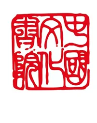
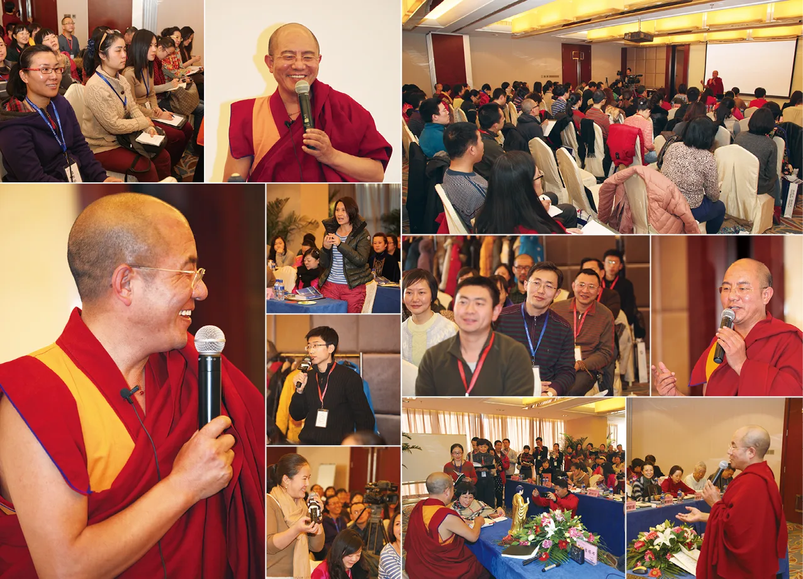
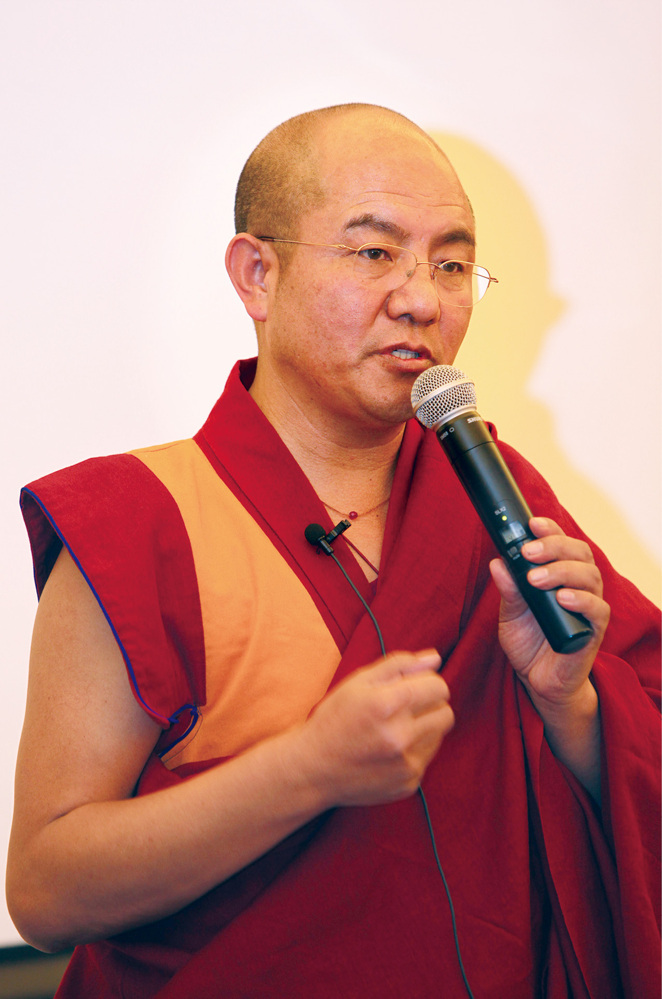

我们随时随地要唯一观修死亡，

观想行、住、坐、卧一切所为都是最后一次。

第42场

中国文化书院

Chinese Institute of Classical Learning

中国·北京

2012 / 12 / 23

## 闻法规律与共同外前行

## The Common Practices of Proper Way of Listening and Preliminary Practice to Dharma Teaching

无上甚深微妙法 百千万劫难遭遇

我今见闻得受持 愿解如来真实义

这是开经偈。

《大圆满前行》的作者，按我们安多语，叫华智仁波切，康巴语是巴珠仁波切，稍有差别。这就像用广东话和东北话念《心经》，音上虽然有些不同，但加持是一样的。所以，发音不是什么问题。

据《华智仁波切略传》中说，他是观音菩萨、夏瓦热尊者和寂天菩萨三者合一的化身。菩萨和一般的文学家不同，他的作品具有加持力和摄受力，所以，《大圆满前行》不仅让修行人获益，不学佛的人也都把它当作了解藏传佛教的重要资料。

本论主要分两部分：共同外前行和不共内加行。在讲这两部分之前，首先介绍闻法规律。

## 闻法规律

我们在听闻佛法时，要调整好自己的发心和行为。

### 1．发心

#### 广大意乐菩提心之发心

一个大乘佛子在做任何善法时，首先要想到利益天下无边的众生，这是最基本的要求。

如果听一堂世间普通讲座，老师讲、学生听，仅此而已，没有人要求你怎么发心。但是听佛教的课程，且不说内容，发心都不能有偏差：讲的人要想到，我今天讲法，是为了利益天下无边的一切众生；听的人也要想到，我今天听法，是为了利益天下无边的一切众生。这就是显宗广大意乐菩提心之发心。

#### 广大方便秘密真言之发心

密宗发心要求观五种清净圆满：传法者圆满，要观作普贤王如来、无量光佛或莲花生大士；听法者圆满，要观作男女菩萨或勇士勇母；传法地点圆满，是极乐世界、邬金刹土或东方现喜刹土；所传的法圆满，是大乘法；时间圆满，是本来常有相续轮[^1]。

总之，我们不能把传法者当成一般的人，把听法者当成一般的人，也不能把传法的处所当成娑婆世界的一块平庸之地，要把这一切都观想成清净的。

### 2．行为

听法时的行为，分所断之行为和应取之行为。

#### 1）所断之行为

所断之行为有三种：法器之三过、六垢、五不持。

法器之三过

耳不注如覆器之过：听法时耳根不专注，上师讲法就像在反扣的碗上倒水一样，一堂课下来，可能一句正法都听不清楚。

意不持如漏器之过：如果只是很敷衍地听听，没有记在心里，那就像漏底的容器倒进多少水都会漏光一样，听多少法也不会往心里去。

印度当年有得了不忘陀罗尼的人，一听就记住了。我们没有这个能力，重要的地方可以记到手机或笔记本上，以备将来复习。否则，听的时候好像懂了，但过两天就忘了。

杂烦恼如毒器之过：听法时如果存有贪求名位的心思，或者处在嗔心、嫉妒等烦恼妄念中，那么正法也就成了非法，对自心毫无利益，如同把上好的乳汁倒进了有毒的容器一样。

六垢

傲慢：如果因为世间或出世间某方面有少许功德，就自认为了不起，觉得自己跟上师没什么差别，“他也是人，我也是人”，这样就见不到自己的过失。因此要断除傲慢，恒时谦虚谨慎。

无正信：不具备信心，就阻塞了迈进正法的大门，所以要具备不退转的信心。

不求法：希求正法是一切功德的基础，不希求正法，也就不可能成就正法。

外散：在听法过程中，一会儿想中午吃什么，一会儿想下午做什么，家里的事、单位的事……人虽然坐在听法行列，但心已经离开了教室，这样得不到法。一定要具足正知、正念、不放逸而听法。

内收：听法时心仅仅受持个别词义，就会得此失彼，不能了知全部，过于内收时，甚至会昏昏欲睡。

疲厌：一两个小时的课是正常的，不要生厌烦心。有位老上师下午讲课，从三点讲到七点多，四五个小时下来，底下的人累是累，但都不敢动，规规矩矩地耐心听完。所以，佛法难值难遇，听的时候要有一种欢喜心，不要老是看表。

五不持

持文不持义：有人只受持优美动听的词句，不分析甚深的意义，这样不能使内心获得利益。

持义不持文：有人只注重意义，轻视文字，这使得词句和意义脱离，也理解不到意义。

未领会而持：不领会了义、不了义、秘密、意趣这些道理而受持，会误解词句和意义，最终违背正法。

上下错谬而持：如果上下错乱而持，则违反了佛法规律，以致处处觉得矛盾。

颠倒而持：内容明明是这么讲的，你却颠倒地那么去理解，于是滋生种种邪分别念，毁坏心相续。

#### 2）应取之行为

应取之行为也有三种：依止四想、具足六度、依止其他威仪。

依止四想

依据《华严经》的教义，我们应该把自己作病人想，把佛法作妙药想，把上师善知识作明医想，把精进修法作医病想。

这四想的道理不难，但非常重要，修行中能够依止它，也就基本有了一种很好的态度。

不过遗憾的是，现在有些人很颠倒，他把自己作医生想，把上师作病人想。上师给他讲法，他却反过来教训上师，“你的行为应该怎样”“你说话应该怎样”“你应该怎样观想”……这不是求学的态度。

具足六度

闻法过程中可以具足六度。

布施度：闻法前摆设法座、供花等，以及听课的本身，是布施度。

持戒度：遵守课堂纪律，认真听讲，是持戒度。

安忍度：听课过程中忍耐各种困难、痛苦或疲劳，比如腰痛也一直忍着，这是安忍度。

精进度：闻法时满怀信心和欢喜，态度积极认真，这是精进度。

静虑度：心不散乱，专心谛听上师所讲法义，是静虑度。

智慧度：能够了解、辨析上师所讲的意义，是智慧度。

依止其他威仪

传法时，传法者的位置要高，听法者的位置要低；听者要具足温顺的威仪；要以欢喜、开心、恭敬的表情看着上师；要像品饮甘露一样听闻法义……

以上讲了闻法规律。一个懂得发心、行为如法的闻法者，一看就知道受过佛教的教育。

## 共同外前行

共同外前行主要有五部分：暇满难得、寿命无常、轮回过患、因果不虚、依止上师。

所谓“共同”“不共同”，有几种意思：

外前行与显宗共同，所以叫共同，内加行是密宗的不共修法，所以叫不共；外前行与萨迦、格鲁等藏地各教派的修法一致，所以叫共同，内加行如上师瑜伽等的观修方法与各教派不同，所以叫不共；外前行与声闻乘的道理相同，所以是共同，内加行皈依、发心等是大乘的不共修法，所以是不共。大概这么了解即可。

### 1．暇满难得

暇满难得分四部分讲：

#### 1）思维本性闲暇

有人说：“人身有什么难得？城市里那么多人。”

这种人身的确并不难得。佛说人身难得，是指具有暇满修行正法的人身，这样的人身难得。

所谓暇满，“暇”是闲暇，“满”是圆满，远离八种无暇，具足十种圆满，就是暇满人身。

八无暇是指地狱、饿鬼、旁生、长寿天、边地、持邪见者、佛不出世和喑哑。无暇就是没有闲暇修法，转生到这些无暇之地，确实是没有时间修行的。但现在的人不是没有时间，是不爱修行，“你为什么不修加行？”“我太忙了，没空”——“没空”只是借口而已。

八无暇处才是真的“没空”。常常思维他们的状态，我们会庆幸自己没有转生到那里，进而善用这个人身，自由地修行佛法。

八无暇不是藏传佛教的独有说法，《佛说八无暇有暇经》里就有，也叫八难[^2]。远离了八难的人身，不要空耗。

#### 2）思维特法圆满

特法圆满有十种，五种是依于自身圆满的，叫五种自圆满；五种是依于他身或其他因缘圆满的，叫五种他圆满。

五种自圆满

所依圆满：修行的所依是人身，没有得到人身，就无法真正修行妙法，所以，生而为人是先决条件。

环境圆满：佛法兴盛的中土是修行的最好环境，没有转生到这种地方，就很难值遇佛法。

根德圆满：五根中任何一根不具足，很可能成为自己修行的障碍，所以，必须具足五根。

意乐圆满：业际颠倒的人，就是意乐不圆满，他们的所作所为都违背正法。所以要调正意乐，不入于颠倒的业际中。

信心圆满：对佛法没有信心的人，就没办法脱离轮回和恶趣的痛苦，更无法解脱。

在座的应该都具足这五种自圆满了，否则你不会来听这堂课的。非佛教徒不爱听佛学课。

那天在社科院的论坛上，我说：“从佛教高一点的角度看，所有众生都是佛教徒。”

“为什么，”有一个专家马上说，“我们可不是佛教徒。”

我说：“每个众生都有佛性，既然有佛性，怎么不是佛教徒呢？”当然，我是从广义上讲的。

五种他圆满

如来出世：佛陀不出世的劫叫暗劫，佛陀出世的劫叫明劫，如今佛已出世。

佛已说法：有些佛出世，一劫中不说法，那时候世间没有正法，但现在佛陀已为我们转了三转法轮。

佛法住世：佛陀虽已转法轮，但如果佛法隐没，就与暗劫无别了，幸好现在还有佛法住世。

自入圣教：虽然世间还有圣教，但如果自己没有步入佛门，依然得不到教法和证法，所以要皈依。皈依和不皈依有很大差别。

师已摄受：即使皈依了，但如果上师没有摄受，就不会懂得总结佛法要领而修行，所以也没有什么收益。

以上的八闲暇和十圆满如果全部具足，就称为具有十八暇满的人身。

此外，全知无垢光尊者在《如意宝藏论》中还讲述了暂生缘八无暇[^3]和断缘心八无暇[^4]，不被这十六种违缘所转也是相当重要的。所以，能够得到一个真正可以修行的人身，的确是非常难得的。

#### 3）思维难得之喻

“盲龟值木轭”是说明人身难得最好的比喻。

从前，有一位童子听法师讲到这个道理以后，决心做个试验。他把木轭扔到家门口的一个水池里，自己也跳了进去，几次三番想把头钻入木轭孔，但木轭漂来漂去的，始终不能如愿。

“一个小水池里尚且如此，”他想，“那在无边无际的大海上，一只盲龟，又是一百年才上来一次，怎么可能值遇这木轭孔呢？”想到这里，他相信人身确实难得，并专心修持这一法门，终获解脱。

《涅槃经》等经典还讲了其他比喻，比如“光壁撒豆颗粒难留”以及“针尖堆豆颗粒不存”等。

#### 4）思维数目差别

得到人身的众生数目，是微乎其微的。

经典中说：“地狱众生犹如夜晚繁星，而饿鬼则如白昼之星；饿鬼众生犹如夜晚繁星，而旁生则如白昼之星；旁生众生如夜晚繁星，而善趣众生则如白昼之星。”还有说：“地狱众生犹如大地的微尘，饿鬼众生犹如恒河沙，旁生犹如酒糟，阿修罗犹如弥漫大雪，而人及天人仅仅如指甲微尘。”总之，善趣的身份少之又少。

以上介绍了人身难得。

不少人以为“人身难得”简单，没什么可修的，其实这是一个很深的修法。

在我们藏传佛教中，有人就专门修这个法，像金厄瓦格西，他一辈子修人身难得，并念了九亿不动佛心咒。上师仲敦巴劝他休息，他说：“身体健康固然重要，但我一想到此暇满难得时，就觉得无有空闲休息。”

现在很多佛教徒都是早起晚睡，每天工作之余，功课也没有落下，这就是懂得了人身难得。当一般人还在把财富、事业当作人生的意义，或者认为“只要生存、活着就可以”的时候，他们却已知道人生的真正意义在于：把握好这个难得的人身，努力修行。

### 2．寿命无常

寿命无常分七个部分：

#### 1）思维外器世界而修无常

整个宇宙天体，我们的地球、山川陆地，没有一样是恒常的。如果“大爆炸”是这一切的起源，那么因为有了那一刻的产生，将来注定会有毁灭的一天。如果这些看似恒常不变的东西都会消失，那我们所居住的房屋以及生活的场所，更没有坚实性可言了。

这就是外器世界的无常。假如这种无常如“世界末日”一般突然到来，没有人能躲得过去。有人跑来跑去想找个栖身之所，但地球都没了，能躲到哪里？要仔细思维器世界无常的道理。

#### 2）思维内情众生而修无常

内情众生，就是指上至天界有顶、下至地狱底层的所有众生，这一切有生命的有情，没有一个能逃脱死亡。

我们人也好，我们附近的旁生也好，有没有一个降生了却不必死亡的？见所未见、闻所未闻，对这个注定会来的死亡，我们甚至从未怀疑过。

但即便如此，我们还是不了解它，所以要多观修有情的无常。

#### 3）思维殊胜正士而修无常

在这个贤劫中，从毗婆尸佛到释迦牟尼佛，从二胜六庄严到八十大成就者，从藏地君臣二十五大持明等诸多成就者，到内地净土、华严、禅宗等一代代的祖师们，都已经离开了世间。菩萨如此，阿罗汉如此，我们的上师高僧大德们也是如此。

我依止过的上师现在只剩一两位了，其他的都已示现圆寂。现在住世的上师们，不久的将来也会离开，他们有不共的修证，有超越的境界，但仍要显示无常。这些道理要常常观想。

#### 4）思维世间尊主而修无常

历代的国王们就是世间尊主，他们都已离开世间了。就中国来说，从尧舜禹至唐宋元明清的所有帝王将相，现在只有历史记载而已。今天我们能看到的各个国家的领导换了多少？而他们也是无常的。包括我们身边各层次、各部门的领导们，都是一样。

#### 5）思维各种喻义而修无常

我们生活中的一切，都可以用来修习无常。比如春夏秋冬的交替，比如一个家庭的兴盛、没落和复兴，比如每一个人的曲折人生，比如邻居的转换，比如宠物猫狗的变化……这些都是教授无常的老师。

总之，生际必死、积际必尽、聚际必散、堆际必倒、高际必堕，乃至亲怨、苦乐、好坏等都是无常的。

#### 6）思维死缘无定而修无常

每一个人一出生就必定走向死亡，但死的方式、死的因缘和死的时间却决定不下来。我们随时都会死，坐车可能翻车而死，睡一觉可能醒不过来，昨天我听说一个孩子突然昏迷，三天三夜还没醒过来……所以说死缘无定。再怎么样，百年之内也会死。

#### 7）思维猛厉希求而修无常

我们随时随地要唯一观修死亡，观想行、住、坐、卧一切所为都是最后一次。吃饭时要观想“这是最后一次吃饭”；走路时要观想“这是最后一次走路”；说话时要观想“这是最后一次说话”；睡觉时要观想“这是最后一次睡觉”……要习惯这样一种观修。

有人以为这不吉祥，“乌鸦嘴，什么最后一次，我活的时间还长着呢。”

其实没什么不吉祥的。观修死亡是非常重要的修行。苹果创始人乔布斯平时就修无常，所以得了癌症时，很容易面对。如果换作他人，要丢下那么多财富，可能人没死，精神已经崩溃了。

塔波仁波切有一个弟子，是大成就者，有人向他求法，但他一直不传。经再三请求后他才说：“你也会死、我也会死，这就是最深的法。”那个人有些不解：“你也会死、我也会死，这算什么深法？”但他慢慢思维进去以后，知道上师的确给他传了最殊胜的窍诀。

印光大师的禅堂里有一个大大的“死”字。去年我让一位书画家也给我写了个“死”字，学着大师的样子，挂在房间里。结果好多客人都说：“哎哟，不吉祥，摘了吧！”我只好摘下来了。本来是想学印光大师的，但没有学成。

不过对死亡这件事，就算不是修行人，提前想清楚也是有意义的。

四川省藏文学校的老师就给学生们讲无常。有个从那里毕业的女孩，生孩子遇到生命危险，已经没救了。但她对家人说：“生命是无常的，老师讲过，所以我有准备。迟早的事……我很感激我的老师。”

“她非常优秀，”她的老师边哭边说，“可惜了。”

教育里有这些是对的。如果只教怎么赚钱，生命里明明有死亡，而且是最重要的一部分，却没有人提，就有所缺失。缺了这种教育，当学生们面对真实人生的时候，会感到迷茫和无助。

有人生了重病不敢去检查，怕是癌细胞，怕从此失去一切，没有胆量面对。这就是不了解无常的原因。如果有人讲过，自己也修习过，就不会那么害怕了。

“迟早的事”，像那个女生说的。当我们对死亡的认识和观修，让我们对那一刻已经有所准备的时候，它何时到来都无所谓了，“不过是换个单位而已，以前我在人间工作，今后换个地方”，仅此而已。

对无常生起定解的界限是怎样的？

应当像喀喇共穹格西那样。

格西在后藏的觉摩喀喇山修行时，岩洞口有一堆荆棘丛，常常挂到他的衣服。开始他想砍除，但转念一想：唉，我也许会死在此山洞中，也不知道是否再有出去的机会，不如好好修行吧。当他出洞时又想：不知道是否还能返回这个山洞。于是一直都没有砍除荆棘丛。

就这样，他连续在这个洞里修行多年，最后已经获得成就，可依然没有砍除荆棘丛。

可能有人认为，修无常会影响积极的心态。其实正好相反，你修了无常，工作会更加努力；你修了无常，修行会更加精进。要知道，历代的高僧大德们，也都是在无常的鞭策下获得成就的。

在藏传佛教的修行教言中，描述无常的窍诀非常多，也非常殊胜。像我以前译的《开启修心门扉》《山法宝鬘论》，里面都是大篇幅宣讲无常。很多修行人在修行过程中，也都尽可能地掌握各教派的无常教言，以此作为自己精进修行的助缘。

而如今我们修习无常，现实生活的实例已经够多了。感情上的、家庭上的、事业上的，不用我多讲，对此稍有了解的人，你去观察生活，处处都是无常。

心情是无常的。今天心情好，很开心，笑容也灿烂，但明天可能就会愁眉苦脸，别人不知道为什么，自己也弄不清楚。身体也是无常的，有时候特别好，健康有力，有时候突然就垮了，不知道问题在哪儿。

法王在一首道歌里说：“如果你会观察，整个世界的一切都是讲授无常的最好教科书。”

### 3．轮回过患

轮回过患分两部分：

#### 1）总的思维轮回痛苦

人死后不是一了百了，必然会投生，有投生就离不开生死轮回。轮回是痛苦的。我们暂时的财富、美貌和快乐，都是以前的善业导致的，善业尽了，我们就会变得一贫如洗、可怜兮兮，甚至堕入恶趣感受难忍之苦。

#### 2）分别思维六道各自痛苦

六道是地狱、饿鬼、旁生、人间、非天、天人。

地狱之苦

地狱有十八大地狱：八热地狱、近边地狱、八寒地狱、孤独地狱。

八热地狱：复活地狱、黑绳地狱、众合地狱、号叫地狱、大号叫地狱、烧热地狱、极热地狱、无间地狱。

从复活地狱逐渐向下到无间地狱之间，就像高楼大厦一样层层叠叠。这些地狱的地面与周围全部犹如打造的烧铁一般，从一落脚就没有丝毫的舒适感，在熊熊烈火之中只会觉得火烧火燎，热到极点。

这不是一般的高温可比。然而遗憾的是，很多人不信，“因为我没有看到”，但你看不到的东西多了，不能说看不到就不是真的。如果有人坚持“我不信”，那我举个比喻。比如有个愚人不相信有监狱，而一旦犯法进了监狱，就不得不信了。那时候就晚了。

近边地狱：在无间地狱四方，各有煻煨坑、尸粪泥、利刃原及剑叶林四个地狱。东南西北四方各有四个，一共十六个。同时在东南等各个角上各有一座铁柱山。

八寒地狱：八寒地狱处在雪山、冰川的环抱中，到处是狂风四起、暴雪纷飞。这里的众生，都是赤身露体遭受寒冻之苦。

八寒地狱有具疱地狱、疱裂地狱、紧牙地狱、阿啾啾地狱、矐矐婆地狱、裂如青莲花地狱、裂如红莲花地狱、裂如大莲花地狱。

孤独地狱：孤独地狱的处所没有固定性，痛苦也是变化不定。有的夹在山岩间，有的困在磐石内，还有的转生为人们日常使用的扫帚、地板、门、柱子等无情法形象，但也以识蕴感受痛苦。

饿鬼之苦

饿鬼有隐住饿鬼和空游饿鬼。

隐住饿鬼：隐住饿鬼分外障饿鬼、内障饿鬼和特障饿鬼三种。

外障饿鬼在数百年中，连水的名称也没有听过，整日饥渴交迫，为寻找饮食四处游荡，结果却一无所获。

内障饿鬼嘴巴小得像针眼一样，本想开怀畅饮大海里的水，怎奈水却无法流进它们那细如马尾毛的咽喉，而且在喝水过程中，海水已被口中的毒气一扫而光。

在每一个特障饿鬼的庞大躯体上，都居住着成群的小饿鬼，这些小鬼不停地啖食着大鬼。除此之外还有许许多多不定的疾苦。

空游饿鬼：空游饿鬼包括妖精、王鬼、死魔、厉鬼、鬼女、独角鬼等等。这些饿鬼始终处于提心吊胆、担惊受怕以及恍恍惚惚的错觉状态，经常居心不良，精勤于害他的恶业。他们死后多数立即堕入地狱。

旁生之苦

旁生分海居旁生和散居旁生。

海居旁生，就是居住在大海里的动物。在散居旁生中，有的为人类所饲养，像牛、马、猪这些，它们要感受役使和屠宰的痛苦；没人饲养的野兽或鸟类，则要感受互相啖食或被捕杀的恐惧和痛苦，有些连吃口草都是胆战心惊，毫无自在。

旁生是我们看得到的，要对它们生慈悲心。不过我们从小到大肯定都杀了不少生命，也吃过各种动物的肉，对此要好好忏悔。否则，我们今天是人，但做人的时候造了这么多恶业，死后有没有把握不转生地狱、饿鬼、旁生？恐怕谁都没有把握。

以上是三恶趣的痛苦。

人类之苦

人类之苦分三大根本苦和八支分苦。

三大根本苦：苦苦、变苦、行苦。

苦苦就是苦加苦，前面的痛苦还没有结束，后面的痛苦又来了。比如，身体不好的时候，感情又受到伤害，里里外外出现各种压力。

变苦，上午还开心，下午就伤心了，快乐总是瞬息万变。

行苦，表面上我们正过得快乐，但享受的过程很可能成为造罪业的因，引来后世的痛苦，这叫行苦。

八支分苦：生苦、老苦、病苦、死苦、怨憎会苦、爱别离苦、求不得苦、不欲临苦。

这每一个苦我们都感受过无数次了。如果地狱的苦我们想不起来，但活到今天，这样那样的苦肯定受了不少。细的解释你们看看《前行》，应该会有感触。

非天之苦

非天就是阿修罗。非天的嫉妒心重，忍受不了天人的受用圆满，总是出兵与之争斗。

天人之苦

天人有死堕之苦。天人活着的时候应有尽有、快乐幸福，但死前七天会出现种种衰相，了知后世将转生何处。这里的七天相当于人间的七百年。在这么长的时间里，想想从前的快乐，再看看将来的悲惨境地，这种痛苦可想而知。

总之，在六道轮回中，不管你转生到哪一道都没有快乐，真正的快乐是解脱。

朗日塘巴尊者了解这一切，一辈子没有笑过。一次，侍者对上师说：“其他人都管上师叫黑脸朗日塘巴。”尊者说：“想到三界轮回的痛苦，怎么会有笑容？”

据说，有一天，一只老鼠悄悄地来偷尊者曼茶盘上的一颗松耳石，可怎么搬也搬不动，于是“吱吱”地唤来另一只老鼠，它们一推一拉，将“成果”搬走了。看到这幕情景，尊者情不自禁地露出了笑容。

除此之外，任何时候也没有现过笑脸。

### 4．因果不虚

因果不虚分三部分：所断之不善业、应行之善业、一切业的自性。

每一个众生都是以各自所积累的善恶业为因，转生到轮回的善趣恶趣当中的。实际上，轮回是由业力所生、由业果所成，上升善趣或下堕恶趣并没有其余作者，也不是由偶尔的因缘所生。为此，我们务必随时随地观察善不善的因果规律，悉心毕力止恶行善。

#### 1）所断之不善业

所断之不善业分四部分：身恶业、语恶业、意恶业及十不善业之果。

身恶业：杀生、邪淫、不与取。

语恶业：妄语、离间语、恶语、绮语。

意恶业：贪心、害心、邪见。

十不善业之果：异熟果、等流果、增上果、士用果。

#### 2）应行之善业

我们了知十不善业的过患之后，要厉行断除，同时行持不杀、不盗等十种善业。

#### 3）一切业的自性

一切有情各自感受不可思议、千差万别的痛苦和快乐，都是来源于各自往昔所积累的恶业与善业。

不仅是一般有情，佛陀显现上也要感受果报；龙猛菩萨的圆寂，是因为以前割草时杀虫的业所致；目犍连被外道殴打致死，是以前对母亲不恭敬的行为所引起。可见，业网极其广大，没有谁能逃脱。

现在很多人不重视因果，这一点特别可怕。相信因果不虚的界限，应当像米拉日巴尊者那样。

弟子们问米拉日巴尊者：“您最初是金刚持还是一位佛菩萨的化身？”

尊者说：“你们认为我是金刚持，说明你们对我有信心，但对正法来说，恐怕再没有比这更严重的邪见了。

“为什么这么说？我最初依靠咒力降冰雹，造了滔天大罪，当时想肯定只有堕地狱而别无出路了，于是集中精力、专心致志、兢兢业业地修持正法，依靠密宗甚深的方便要诀，在相续中生起了殊胜的功德。

“如果你们能发自内心对因果深深诚信，像我那样刻苦精进，凡是有毅力的凡夫人都能做到，这样一来，你们相续中也会生起同样的功德，到那时，你们也可以称为是金刚持或佛菩萨的化身了。”

米拉日巴是藏传佛教历史上最伟大、最了不起的上师，他的成就，就是从诚信因果而来的。

所以，我们要诚信因果，要以最大的悔心忏悔以前的罪业，认认真真地取舍善恶。虽然我们不能像出家人那样守护净戒，丝毫不染，但至少要断除十不善业，尽量守护好居士戒，以此圆满自己的人生。

### 5．依止上师

这一科判之前还有一章“解脱利益”，但内容不多，只是简单介绍了解脱和解脱的分类。

#### 1）依师之必要

一切佛经、续部、论典中从来没有提过不依止上师而成佛的历史。在现实生活中，通过自我造就以及有胆有识而生起五道十地功德的人，一个也没有。所以，佛法一定要由善知识开示，否则就很难通达其甚深意义。

如果连开车、做饭都要向老师学的话，修解脱道、求遍知佛果，就更需要善知识的引导了。

#### 2）依师之次第

依师之次第分三：

观察上师

依止前先观察上师是非常重要的，至少五六年。国外有上师讲解说，一上来你不要急着去求法，先请他喝个茶、吃个饭，以朋友的方式了解他，观察他的言行举止，之后再决定是否依止。

但大多数的人不是这样。就像现在所谓“闪婚”，他们依止善知识也是“闪依”。遇到一个仁波切就求灌顶，这种方式太危险了。依止上师比找生意伙伴严格得多，所以在结上法缘之前，一定要详详细细地观察。

依止上师

观察好了以后，接下来就是依止上师。依止时要如理如法，不能整天挑毛病、说过失，要尽量具足一个弟子所应该具备的各种条件，以三欢喜依止上师。

修学上师之意行

明确了怎样依止后，要通过依教奉行来受持上师的意趣。

《前行》里讲了三个故事，常啼菩萨依止法胜菩萨，那若巴尊者依止帝洛巴上师，米拉日巴尊者依止玛尔巴罗扎上师。这三个故事非常经典，也非常精彩，为我们后学者在依止上师方面，提供了真实而确切的教导。

不过有一点我要提醒：我们最好依止行为如法的上师，因为他的行为你能够理解，不容易生邪见。否则，大成就者另当别论，如果不是大成就者，行为上却各式各样的，可能开头你会喜欢，但最后一旦信心变成了邪见或仇恨，彼此都很可怜。

如果是真正的成就者，他怎么做，都有必要性在里面。有位上师开示说，“作为仁波切培训课程的一部分，他们应该去谈恋爱，然后这个女孩应拒绝他，因为那时他才会知道什么是苦。”他说自己二十岁时有过这么一次经历，“她给予了我非常珍贵的教导，我必须视她为使我觉醒的上师之一。”

在成就者那里，这些确实是修行的助缘，不是什么束缚，而且他们做起来，也很贴近世人的心理。

现在很多人不喜欢太保守的上师，像阿罗汉一样，只是坐着，什么都不说。他们不希望有距离。奥巴马逛市场吃这个、吃那个，民众一看，“啊，他跟我们一模一样，选他”。上师也一样，走下法座、贴近大家的时候，“啊，上师太慈悲了”，于是就有信心。

当然，这样的上师也要有修证。不然过段时间，自己真的变成那个样子，弟子们的清净心也很难维持，说不定再也看不惯上师了。

总之，我们依止上师是为了求法，不论上师显现为在家身份还是出家身份，我们都不要杂有太多的世间念头，应该以三欢喜依止上师，以期得到上师的慈悲、智慧以及不可思议的境界。

米拉日巴尊者提到玛尔巴罗扎名号时热泪盈眶，法王如意宝提到托嘎如意宝时也是泣不成声，为什么会这样？因为上师的智慧已经融入了他们的心。

所以，什么时候，上师的智慧和加持融入了自己的心，你就会知道，这是以世间任何东西都无法回报的，你的心里将充满感激。那时候，上师的任何行为，也都会成为增上你的信心和智慧之因。

这是依止上师部分。首先是观察上师，然后是依止上师，最后是修学上师的意行，这个过程要求我们用一生来完成。今天依止这个，明天依止那个，像新闻记者一样到处采访，这样“依止”下去，什么都得不到。

一定要如理如法、一心一意依止上师。

现场互动

问：我先生做的是管理工作，压力很重，当他专注佛法的时候，工作就使不上劲了；专注工作的时候，佛法又疏离了，即使勉强观修一下，也会不由自主想工作上的事情，为此他特别烦恼，请上师开示工作和修行如何协调？

堪布：你先生的问题，是一个很实际的问题，也是很多人的问题：不修行吧，人身难得，一定要修；要修行吧，工作又太忙，顾不上。所以我经常建议大家：在修行中生活，在生活中修行。

其实这件事不难。对我们藏族人而言，从小的时候开始，修行就被很好地结合进生活，成为习惯，一旦习惯了，也就容易了。

认为二者水火不容，修行时就不能过平常生活，也不能工作，工作时又不能修行，那你可能永远没时间修行了。作为在家人，你们都有家庭和社会责任，完全放下来不太现实，想抽出一个单独时间修行，一个月，一个礼拜，行不行？很难。

所以，我们要习惯在工作的同时，完成一定的修行。比如，你可以每天看三四页《前行》，你可以在走路或坐车时，念够一定数量的咒语，习惯以后，就不至于中断修行。

有些人喜欢极端，修的时候完全舍弃工作，等家庭和生活的压力累积得承受不住，就不得不去工作；一工作起来，又把修行全部放下了。

我不赞成这种做法。除非你像学佛前一样做个一般的在家人，或者干脆出家，两者都做不到的话，那最好兼顾——在修行中生活，在生活中修行。其实，释迦牟尼佛住世期间，大多数的佛弟子也都是在家人，他们就是这样的。那时候都如此，何况现在？

把工作做好，把家庭理好，与此同时，你也可以每天空出一两个小时学修佛法。

每天一两个小时，肯定空得出来。我认识一些企业家，他们特别忙，这儿出差、那儿开会，但只要一空下来就学佛法、做功课，天天如此。这样两件事都做好了。特别是修行，不会退失。

我也是这么过来的。平时要翻译、要传法、要管理、要搞建筑、要办学校，同时还要跑出来跟你们交流，但我的功课从来没落下。出来的车上或飞机上，我会念一部分功课，中间一有空就翻译，哪怕两三个偈颂，也坚持翻译。就这么坚持下来了。

要想坚持，最忌讳的就是冲动，一会儿热情高涨，什么都不管，一心修行，一会儿又心灰意冷，什么都不修，这样既做不好工作，也修不好法。你应该有一颗恒常心，安排好，永远也不放弃。

你不必放弃工作，因为你要生活；你不能放弃修行，因为你要解脱。只要你不放弃，就总能找到一种平衡的方法，让生活和修行同时进行。

问：我们现在学佛了，不喝酒、不吃肉，也不去卡拉OK，但一聚会就被边缘化了，因为别人觉得你另类。请问，这个时候应该怎么对待？

堪布：这个问题也很现实。学佛的人不喝酒、不吃肉，圈子变小了，对待起来有两种方式：

一种是随他去。如果因为你的行为，减少了一些不好的朋友，生活反而简单、正常了，这是好事。现在的人“无酒不成席”，你不喝酒就不够意思，你不娱乐就成了怪物，“你是不是受了什么刺激？”“你最近受了什么奇怪教育？”……我们学佛有什么问题？只不过人们的认识已经是这样了。

还有一种是，你可以用“健康”这个理由跟朋友解释，比如，“医生说了，我再喝酒就没命了”“要是我继续吃肉，血压肯定降不下来……”这样渐渐地，周围的人也会理解。

其实吃素很时尚。有些藏地老乡说：“你不吃肉不行，营养不够。”我说：“你们知道吗，奥巴马也吃素，他身体很好。”不过他是为了环保，他的妻子和女儿也在各个学校里推广他的理念。

眼下在一些圈子里，喝酒、吃肉、KTV仍然是重要部分，但慢慢也在变。你们可以试着转变别人的观念，即使做不到，也要善巧自处。

问：晚上我们要去共修，一下班就得走，但领导看你不加班，就会找你谈话。这时候该怎么办？怎么才能既不得罪领导，又能继续共修？

堪布：这个也得善巧。看来佛教强调善巧，是很有道理的。

在这种情况下，你要反反复复地观察、思维和祈祷，要借用文殊菩萨的智慧、观音菩萨的大悲，再加上你自己的善巧，一定会有办法的。

问：为了修法，跟领导撒个谎怎么样？算妄语吗？

堪布：这叫方便妄语。你准备说什么样的方便妄语？（众笑）

问：有个师父跟我讲，说开车时念咒语不计功德，必须坐下来静心念才计。我已经发愿念某个咒语十万遍，但他这么一说，我就气馁了，请问您对此的观点是什么？

堪布：我的观点是，开车也好、走路也好，都可以念。也许对一般人而言，这么念不如静下来专注，但对一个修行纯熟的人来讲，就不同了。

我们藏地有许多大德，他们在行住坐卧中都能念咒，已经习惯了。以前有位格西，他每天一边看因明、俱舍，一边念咒，法义完全领会，咒语也念得有质有量。我的上师法王如意宝在睡梦中也能念咒。我就亲眼见过几次，就在旁边看着，他人已经睡着了，但手还一直在拨着念珠。

我们没有这个境界，但开车或做事的时候念咒，肯定有功德。那位师父说一定要坐下来念，可能是从严格角度讲的，坐着念心比较静，功德大一点。

问：您能不能拿您典型的一天，说说您的起居情况，比如几点起床？都做些什么？这样我们也好随学。

堪布：就说今天吧。早上我五点半起床，念了半小时咒语，禅坐了一会儿。然后念了一小时经，这是我的功课。念完后，磕了一百个头。接下来，我喝了点五台山的文殊茶，一边喝茶一边看书——社科院教授们给的书。之后写微博，吃早餐，然后就到这里来了。

问：那您一般几点睡觉？

堪布：以前有资料说，晚上要睡足八小时，但今年有更科学的统计说，每天睡八小时的人死得快，四五个小时足够了。所以，睡眠时间太长对健康不利。

一般我十二点钟以后睡。昨天要晚一点，我们那边有个病人，说要我念经，让我等着。但我等到一点钟，还没有来电话，就睡着了。

问：那您什么时候写作或翻译？

堪布：一般是在下午。

问：《普贤行愿品》里有句话，就是“恒顺众生”，但这对我们来讲很难。一是自己有分别心，再一个就是，众生的确是有善有恶、有正有邪。面对善的时候好做，我可以从善如流、与人为善，但面对恶人恶事的时候，该怎么办？还要随顺吗？

堪布：恒顺众生，就是在一切时候随顺众生。这是《华严经》等大乘经典教诫菩萨利益众生的殊胜方便。

法王如意宝的《胜利道歌》里说：“言行恒时随顺友。”针对这句，曾有人问：“如果对谁都随顺，那么对贪心大的人，是否也要随顺他生贪心？对嗔心大的人，是否也要随顺他生嗔心？”

法王说：“当菩萨随顺这种人的时候，一定要有度化他们的智慧和能力。比如，文殊菩萨在度化国王的明妃时，首先就是随顺她们，然后才让她们皈依，并引导她们获得解脱。”

不仅是文殊菩萨，许许多多菩萨也都有自己的善巧方便，他们在各种场合里随顺世人，度化有情。

所以，在接触所谓恶劣众生时，如果你有能力、有方便，不妨先顺着他，以赢得信任。比如，当你想帮助一个有邪见的朋友时，可以先听听他的观点，甚至适时地表示认同，但到了一定的时候，就可以恰当地提出你自己的看法，慢慢度化他。

不过，你没有这个能力，就不要随顺了。一“随顺”，说不定被别人吸引，度不了别人，还跟着人家跑，这不成了“同流合污”？

问：我做媒体工作。听堪布开示“依止善知识”部分时，我有疑惑。现在有些人虽然披着上师的外衣，但我们已经在很近的距离，看到了他的私心以及不如法现象，请问这时候该怎么做？是视而不见，还是揭露出来提醒一下身边的人？

堪布：这个问题要分开看。有些不如法的现象，如果危害面比较广，让大家知道也好，有个提防。但要注意的是，不能因此给整个佛教带来负面影响。

现在有很多藏传佛教的上师在汉地度化众生，劝大家皈依、发心，让大家行善，而很多人也皈依了，懂得了法理、得到了摄受，这非常好。

与此同时，也有来谋私利的。那些比较单纯的人，因为没受过佛教教育，加之心急，一见到上师也不观察，直接冲上去依止、供养。等看出问题了又生邪见，甚至闹到打官司。这种现象是有，就像工业革命后，市场上出现了各种商品，真的假的都有。

看到这些问题，要不要说出去？这要观察我们有没有制止的能力，制止的话，效果好不好。

如果你有能力，确信效果会好，那就制止。但如果你观察到，这对他个人不利，你度不了他；对佛教更加不利，装着不知道也好。

为什么？因为一旦你报道了，现在的人你们也知道，一个人的问题，他们不会怪罪这一个人，他们会说“藏传佛教怎么怎么”“汉传佛教怎么怎么”……本来这个人代表不了任何教派，但“丑闻”一出来，就会损害整个佛教的形象，也会伤及很多人的善根。

而且，媒体对佛教的负面报道已经够多了。其他宗教不好的地方，他们不敢报，怕人家抗议，但不怕佛教，“今天这个和尚干什么”“明天那个寺院怎么了”……而我们佛教徒也太“慈悲”了，随你怎么说，不在乎。这样一来，反而让佛教受到歧视。

所以我认为，现在我们更需要的，一方面是法律，法律对佛教的保护；一方面是多些正面报道，以赢得社会对佛教的普遍认同。

问：我一位朋友的母亲刚刚过世，她这段时间的心情很悲痛。我在两年前也经历过这样的事，这次很想帮她走过这段无常，所以介绍她看宗萨钦哲仁波切的书，也推荐了您的《苦才是人生》。她看完后，特别特别想要见您。我说我们正在上您的课，她今天就想来听，但碍于学院的规定，来不成，非常难过。我也为此很不开心，就向您诉诉苦，也没有别的。

堪布：国学班在管理上有些规定，非常有必要。但她处在这样的困境里，想要见我的话，可以单独安排个时间，晚上或明天早上都可以。

亲人死了，这是最悲痛的时刻，很需要帮助。没有感受过的人不知道，“为什么哭得这么厉害，为什么这么难受……”但正在感受的人，是很难摆脱痛苦的。

以前在学院时有人请我念经，我很少去。但后来我父亲死了，我去请一些上师、活佛念经，有些答应了，有些没答应。我知道他们忙，但还是沮丧：“我家人死了，请您念个经，为什么不答应？”

我感受过，就知道她的痛苦。用自己的感受来为别人着想，也是一种修法。

问：我是这里的新学员。一般禅是静着修的，能不能动着修？比如我打球，打一下念一句“嗡玛呢巴美吽舍”，再打一下，再念一句，能这么修就方便了。

堪布：这个主要看修行的熟练程度。初学者一般先安住修比较好，念咒也好、观想也好，在身心都寂静的状态中容易修。

等境界提高了，稍微有点散乱也没关系。像密乘里的有些修法，有一定境界时，还要求你奔跑、唱歌，做各种行为，这时也能专注，就可以成就很高的境界。

每个人的根基不同，如果你有这个能力，一边打球一边念“嗡玛呢巴美吽”，当然好。如果打着打着就忘了，不如多抽些时间静修。

问：您说念咒一定要计数，但我经常不知道自己念了多少遍，这样念行吗？

堪布：念咒还是要计数。光是口头上念，心里不一定很踏实，念了十遍，可能你觉着念了很多了。如果你一个一个计数，念多少是多少，对修行是一种动力和压力。

问：我在一个比较大的公司里工作，同事很多。我参加您的加行班学习，有人对此感到好奇，有时也找我聊佛法。他们都是自己看书，也常说些自己的见解，但我一听就知道他在谤法。我不好直接反驳，怕他们烦恼，请问该如何善巧引导他们？

堪布：要引导别人，我们自己要学好教理，培养好佛教徒的综合素质。

昨天有个佛友说，以前慈诚罗珠堪布来讲课，讲到显宗密宗时，有人问旁边的人：“什么叫显宗密宗？”那人答：“显宗就是显宗，密宗就是密宗。”

可能很多人确实不知道这个差别，所以很难作答。佛教徒要系统学习佛法，最好有善知识引导，这跟你没学过或者自己看书的差别很大。

自己看书，可以了解点知识，但很难通达教理。不通达教理，就像你说的，一说话可能就谤法了。所以，你最好建议他们，在有师承的情况下学习佛法。

没有师承，不说一般人，就是永嘉大师也不被认可。当时他对玄策禅师说：“我读《维摩诘经》时，悟到了佛陀的心宗，但没有人为我证明。”

玄策说：“无师自悟，这是天然外道。”

“那您为我证明吧。”

“我的话没有分量，曹溪有位六祖大师，你可以找他印证。要去的话，我们一起去。”玄策说。

就这样，他参礼六祖，得到了印证。

因此，碰到有人自己学佛，我们应该启发他的善根，让他接受一些正规的佛教教育。开导时要善巧，不必加些什么“罪”给他，免得人家生烦恼，但是在道理上，你一定要有破斥他观点的能力。

这个不必客气。他觉得自己对，那你就用佛教理论跟他辩，让他知道什么是对的，什么是不对的，理论上不要留余地。否则他会觉得专业佛教徒都答不上，自己的观点如何如何，还到处宣扬。这对他不好。

我们自己要学好。自己学好了，方式上善巧一点，那些断章取义的说法很容易破的。

问：修顶礼时要念《开显解脱道》，我每天分两次来修，是不是每次都要念一遍这个仪轨？

堪布：有时间，最好每修一次都念一遍。没时间就根据自己的情况决定。

问：烦恼怎么转为道用？

堪布：《六祖坛经》说：“烦恼即菩提。”这句话的意思若能通达并做到，就是把烦恼转为道用了。

比如，当你生起贪心或嗔心，就用智慧观察这个烦恼的来龙去脉：它从哪里产生？住在哪里？去了哪里？这样观察下来你会发现，其实烦恼是不存在的。

不仅烦恼，生烦恼的人和烦恼的对境，也都不存在。如果我对这个人生嗔恨心，我的本体存在吗？这个人的本体存在吗？嗔心的本体存在吗？……反复寻找以后，结果了无一法：找不到我，找不到敌人，也找不到嗔心，里外都找不到。所以说了不可得。

一切唯有空性，显现也不过是智慧的妙用而已。

当你学着观察，真正了解到这点时，也就是把烦恼转为道用了。因为你已经了解了它的体，体是空的，既然是空的，也就没什么可烦恼了。

当然一定要修，只是道理上懂、口头上会说，是不管用的。试想，怨敌来了，你边跑边喊“没有怨敌、没有怨敌”，有用吗？烦恼来了，你边生烦恼边喊“没有烦恼、没有烦恼”，有用吗？不还是天天被它折磨？

一定要认识烦恼本性。认识了，也就无害了。

问：我是国学班里唯一没作皈依的人。我公司很多人在学佛，天天“我的上师是谁，你的上师是谁”，但我一直没皈依。不过您的课讲得好，我喜欢听，特别是您说要拿五六年观察上师，这挺对我的想法。而且您不是那种把自己摆得很高的感觉——不好意思啊。我想问的是，是不是每个学佛的人都要皈依？

堪布：大家一起交流时，有什么想法就说出来，这一点我很欣赏。你在皈依上这么谨慎，比那些不知道观察，听到一个名字就去皈依的人，要明智得多。

暂时不皈依也好。有人皈依后，以为皈依的是人，把上师当私有财产，“这是我的上师，不是你的”。听说某位上师有两拨弟子，这边一拨，那边一拨，上师一下飞机都去抢。结果一拨抢到人，一拨抢到了衣服，闹得很不愉快。（众笑）

基督教没这种事。他们共同信仰上帝，他们的上师们不说“这是我的弟子”，弟子们也不说“这是我的上师”，这样就团结。其实我们也一样，大家皈依的是三宝，所以我每次都说：“不是皈依我，我给你们授皈依是代表三宝，让你们皈依佛法僧三宝。”

我这么说有我的考虑，一方面，一旦我做了什么坏事，不会染污别人；另一方面，也是让大家不要有“你的、我的”这种概念。我们都是佛教徒，是佛的弟子，就是非佛教徒也有佛性，所以大家要和合。

佛教是包容的。皈依也一样，人的意乐、根基不同，我们走的路，不是所有人都要这么走，谁都可以自由选择。今天我们一起学习，是研究佛学，信仰什么都可以，不妨碍我们共同开拓一种事业。所以，皈依看因缘。因缘成熟了，瓜熟蒂落，也就皈依了。

不过人身难得，以后因缘成熟了要把握好。要知道，皈不皈依在功德上有很大差别，约束力也不一样。

问：我平时喜欢看书，有些看一遍就能记住，但不知道为什么，一看《金刚经》就想睡觉，这是怎么回事？

堪布：是不是这部经的加持让你的心安宁？以后我睡不着也试试。

问：在依止上师的问题上，您说要观察五六年，我觉得这肯定是非常如法的，也是最踏实的，但是，如果每个人都花这么长时间去观察，会不会影响佛教发展？有没有特殊情况呢？

堪布：观察五六年，应该不会影响佛教的发展。就像九年义务教育，这不仅不妨碍国家发展，还会促进社会进步。所以，长期观察是有必要的。按宗喀巴大师《事师五十颂释》的观点，要观察十二年。

特殊情况是有的。一些公认的大德，你可以不经观察就依止。以前我就听德巴堪布说：“按理来讲，长时间观察上师是对的，但像法王如意宝那样对弘法利生具有极大功德，举世公认的大成就者，你们没有能力观察，也不必观察，直接依止就可以。”

听了这句话，我马上去色达依止了上师如意宝。

问：大圆满教法里有三个概念：本体空性、自性光明、大悲周遍。而现在的“人间佛教”常说“无缘大慈、同体大悲”，禅宗也只强调空性，那这是不是说，大圆满才是将这三者整合在一起的教法？

堪布：我们宁玛巴里讲的“本体空性、自性光明、大悲周遍”，是从觉性的不同侧面上讲的，这三者本来就融汇一体。

所以，这不是指所有宗派观点的最终圆融，而是当一个人证悟心性时，自然会呈现这三个融合一味的特点：本体空性，这是法身；自性光明，这是报身；大悲周遍，则是指在不同众生面前示现种种化身。

问：我经常组织助念活动，但有个别师兄有顾虑，担心念助念仪轨时会把亡人招来，给自己以及家庭带来不良影响，请问这种顾虑有没有必要？

堪布：一般的亡人是不会的，像病死的、老死的，这些都不会。但是按照藏地民间的说法，有些横死的可能稍微有一点。但这个通过念咒，也都能遣除。

你们助念者的发心大，功德也大。虽然民间有各种说法，但也不必有什么顾虑，因为佛菩萨的名号及咒语完全有守护自己、防止危害的能力。而且，发心清净助念的时候，对亡者的利益不可思议。

问：弟子以前在一年当中，都是五点起床，然后学习、上早殿。后来我发愿受四十九天八关斋戒，希望再早起一点，多些时间学法，谁知道已经三十天了，还是不到五点起不来。我现在好像起不来了……

堪布：你不是已经起来了吗？（众笑）

修行佛法，也要根据自己的身体条件，这个要长时间调节，偶尔性的过于精进，不一定适合。

如果你想多些时间修法，一个是要减少睡眠，睡太多了只是习气而已，这个可以慢慢减下来。还有一个就是要减少散乱，很多人说没时间修行，其实时间都用到散乱上了，并不是没时间。

问：我是“慈慧”的志愿者。在我实习过程中，真正接近那些老人的时候，才体会到他们的孤独无助。但同时我也看到，有些人做志愿活动时，觉得这些只是世间法，和自己追求的出世间法不一致，而且有人也不愿意接受制度的管理，比如要做些统计什么的。但我个人认为，亲自做慈善，是能够实践菩提心的。我想请上师开示，该如何通过做慈善完善自己的心灵？

堪布：我做慈善的时间不长。刚开始的时候，是一个女孩的信触动了我。

那时她在读中学，因为家里没钱，读不下去，于是给我写了一封信，托人转交给我。当时我正在汉地，回去也没见到那封信。为了读书，她又写了第二封信。这封我收到了。

信里说：“我很想用自己的智慧来过自己的生活，但我家里实在太穷了，没办法供我读下去。听说您是一位堪布，能不能帮帮我……”信末，她留了一个隔壁的座机电话号码给我。

此前我没有资助过贫困学生，但读了信以后，我辗转找到她，并开始给她资助。现在她已经毕业了，在我们甘孜州白玉县做医生，对我非常感激。

这件事改变了我很多观念。以前我认为，只要自己修行、自己行善就可以，是她让我做起了慈善。那天我对她说：“你的那封信，让我后来资助了一些人，也改变了一些人的命运。”

那这些是不是世间法？是。你去看望老人，去关怀他们，这些也是。但一个求出世间法的人，有没有必要做这些？有必要。

虽然你修的是空性大悲，但要落实它的话，无非是落实在这些地方。

然而，当你去落实的时候，可能会发现自己的悲心远远不够；或者偶有所得的时候，你又会深深地激励自己去修行。所以，世出世间并不矛盾。当然，我们也不是天天做这些，不修佛法。

做慈善要不要管理？

我认为，合理合法的管理是需要的。就像你们国学班，像我们的“慈慧”、菩提学会，虽然大家都是佛教徒，都是想行善的人，但不管理也不行。包括我们出家人，甚至是仁波切、上师，也都需要有管理。以前上师如意宝在世时，对学院的许多堪布、活佛，也有相应管理。所以，合理管理很重要。

没有管理，即使行善，也不会做得尽如人意。“六一”儿童节大家都去给孩子送花，“老人节”又都去照顾老人，但完了以后呢？没人管了。所以，所谓细水长流，行善也要用管理保证大家那颗助人的心持之以恒。

我常说“慈善是心”，当我们有了行善之心，一有机会就做慈善，也就顺理成章了。在座的都有行善的能力，而我们身边也有需要帮助的人，可是，如果你没有一颗利他心，即使擦肩而过，也看不到那些可怜人，看不到他们的痛苦。

若是佛教徒都这样，还有谁会关心他们？

我们常常认为自己是大乘菩萨，但是不是菩萨，不是口头上说，而是要见诸行动。基督教没有太广的教理，但实际行动中却在为宗教、为众生奉献，这比我们为自己修行更有说服力，更能体现一种慈善的力量。

刚才那个道友说，他在印度金刚座发愿做善事，这非常好。不管是病人、老人，能帮多少算多少。我只有帮助五个人的能力，那我把这五个人的事情做好，五年十年，把事情做圆满；我能帮十个人，那就帮十个人……什么都不做的话，天天为自己，人生也就过了。

其实我们拥有的财富和地位，一方面是自己前世的福报，一方面也跟众多人的帮助有关，得到以后，只是独自受用不回馈社会，因果上是说不过去的。

[^1]: 常有相续轮：是密法中的不共法语，指永恒不变之意。
[^2]: 《佛说八无暇有暇经》云：“汝已获人身，复得闻正法，爱护自身者，当除烦恼慢，若有闻正法，不能如说行，轮回八难中，备受诸辛苦，已舍无暇处，常求闻正法。”
[^3]: 《如意宝藏论》云：“五毒愚痴魔所持，懈怠恶业如海涌，随他救怖伪法相，暂生缘之八无暇。”
[^4]: 《如意宝藏论》云：“紧缚现行极下劣，不厌轮回无少信，行持恶业心离法，失坏律仪三昧耶，断缘心之八无暇。”
