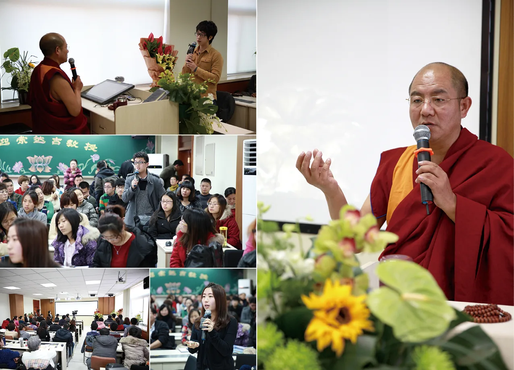
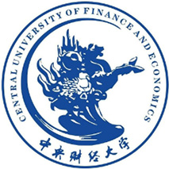
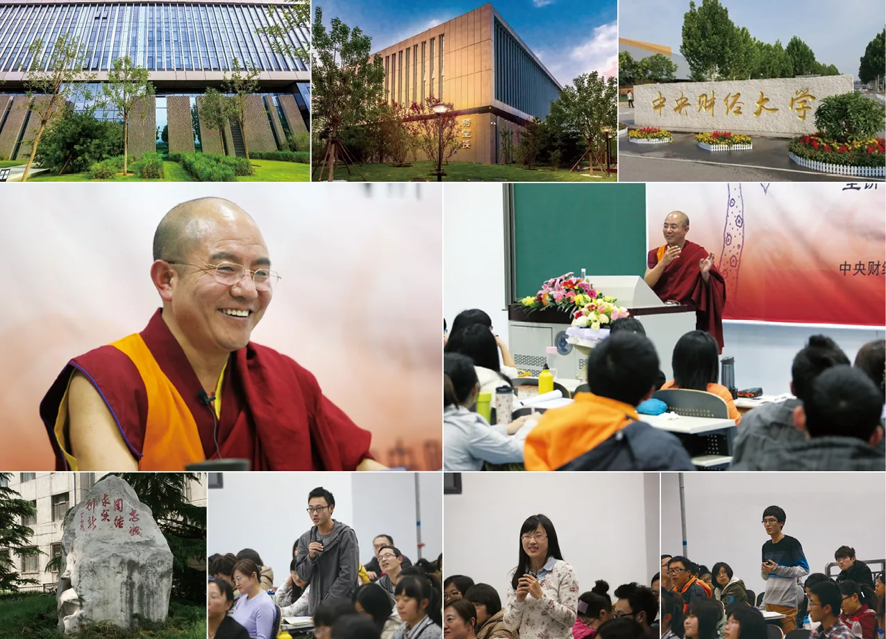
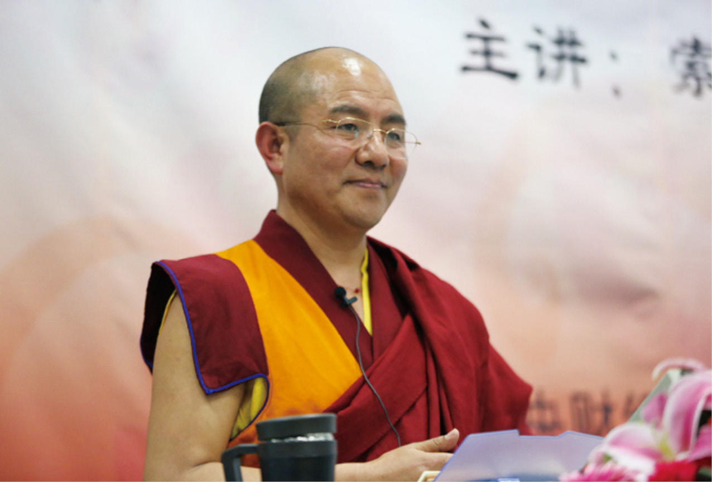
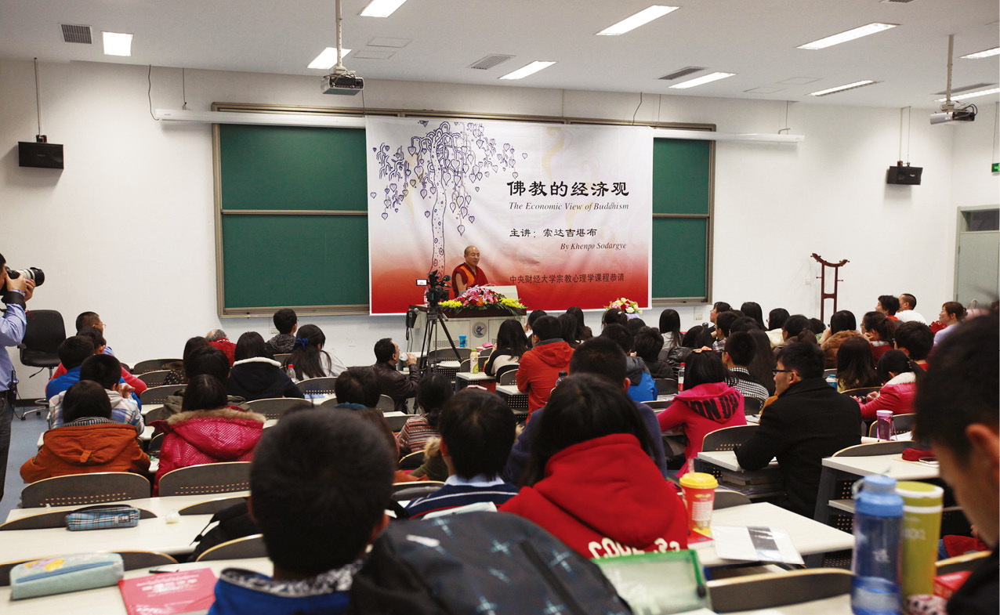
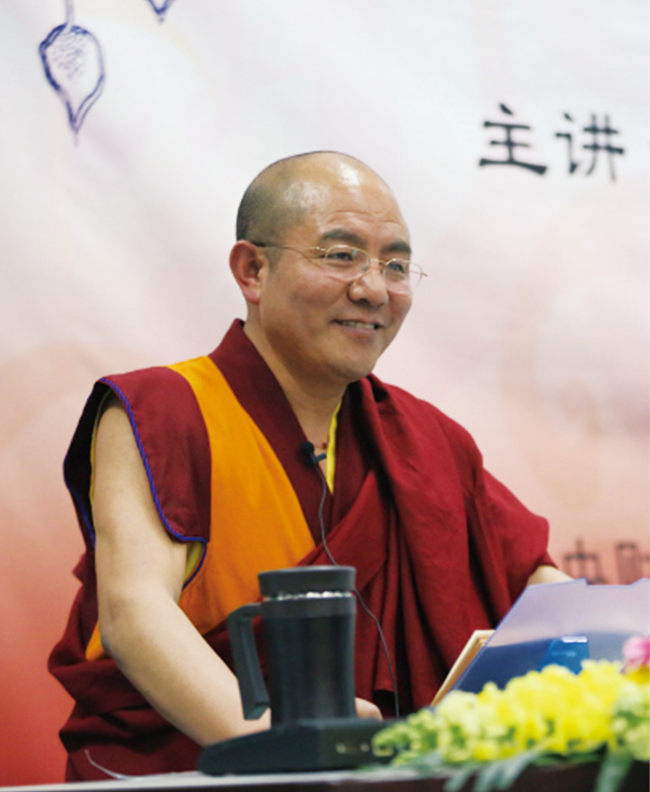

问题不在于钱多少，

在于我们心里会比较，

这个摆脱不掉。

第49场

中央财经大学

Central University of Finance and Economics

中国·北京

2013 / 3 / 5

## 佛教的经济观

## The Buddhist Approach to Wealth

主持人：

各位同学，正如你们现在看到的，尊贵的索达吉堪布已经来到咱们教室，让我们以热烈掌声欢迎仁波切的到来。

上节课我讲过，我会尽量邀请一位具备慈悲、智慧和力量的上师来给我们讲课，但当时也没想到真能恭请到索达吉仁波切，这是大家的荣幸，也是我们的福气。幸福来得太突然，感谢各位的福报，也感谢大堪布的慈悲！

索达吉仁波切，是世界上最大的佛学院——喇荣五明佛学院的主管大堪布，他对佛教的经律论三藏都有极高造诣，著述多得令人叹为观止，累计字数已超过千万。堪布不仅学识超群，而且在最高密法的修行上，也已证达不可思议的境界。仁波切在国内外享有极高的知名度，曾经访问过许多国家，在那里弘法并担任佛教的修行导师。

近几年，他应邀前往清华、北大、人大、复旦、港大等高校，为众多知识分子深入浅出地展示了佛教的奥秘，引导大家正确面对学业、情感、工作、人生等问题，并与诸多海内外科学家一起，对宏观微观的生命科学以及环保、和平、道德等方面进行了深入探索，让科学与宗教能够正常对话。

堪布曾两次应邀出席在人民大会堂举办的“国际慈善论坛”，得到政府部门的尊重、重视和认可。堪布在各项社会活动中，展示了只有智者才有的感召力，于行动中践行其慈悲理念，先后建立了智悲小学、养老院、居士林、小沙弥学院等，资助大量失学的高中生、大学生，在几所中学设立奖学金，同时还救济了大量身患重疾、无力医治的病人等等。

虽然仁波切再三嘱咐不要宣扬，但我还是坚持用最简单的方式介绍堪布的背景。因为我知道，堪布的到来，除了一般意义上的知识交流，更多的是，让我们有了一个聆听圣者金刚语的机会。金刚语的力量不仅能断除疑惑，更对我们每一位聆听者的将来乃至久远的未来，都有极大的利益。这是一般的老师所不能企及的。

下面，让我们再次以热烈掌声欢迎大堪布在百忙之中拨冗来到我们的课堂，有请大堪布——

很高兴来到中央财经大学，与诸位分享精神财富。

我对学问很有兴趣，看到你们也是这样渴求知识和智慧，我非常欢喜。经济学不是我的专业，我的专业是佛学——自己一生大多数时间用在这上面了。以佛教的眼光来审视经济学很有意思，尤其是在当前社会，更有必要。

可能很多同学都会疑惑：佛教要求看破红尘，而红尘中的人讲求发展和进步，难道这二者不相违吗？

认为相违，是对佛教缺乏了解。受电影、电视以及媒体的影响，现在一提出家人，大家脑海中就会浮现一幅抛家舍业、到寺院独修苦行的僧人形象。这是不是佛教？是佛教，但只是很小的一部分。真正的佛教要宽泛得多，它涉及方方面面的知识和行为，当然，也有对经济的分析。

## 把你的财富分作四份

佛经里有一种教导，它让我们把所得的财富分作四份：一份自己用；一份投资或经营企业用；一份存起来；还有一份要作慈善用，救济贫困的人。

如果有人想参考这种分配方式，那你赚了100万，可以取出25万用于生活和饮食；25万投资运营企业；25万存起来，以备经济危机等不时之需；此外，你还应拿出25万为社会做贡献。当然，这只是大概的分法。

今天的社会有不少富翁，他们有财富，但理念很陈旧，挣钱、挣钱、为自己挣钱，结果到死的那天，也没做一丁点慈善或扶贫事业。这种现象很多。而我认为，一个有能力的人这样度过一生是可悲的，赚钱是辛苦，但你从社会里赚到钱，却不想着回馈社会，是说不过去的。

因此，在经济活动中，慈善理念不可或缺。

中国的慈善事业比较落后。据2007年中华慈善总会一份报告称：“每年收到的捐赠大约75％来自中国以外，15％来自中国的富人，10％来自平民百姓。”中国的企业捐款少得可怜，“99％的企业从来没有参与过慈善捐赠。”2003年中国的人均捐款是0.92元，而据另外一份资料说，美国中低收入家庭每年的慈善捐赠，占其可支配收入的4.7%。

开头就讲慈善，是因为在佛教的认识里，即使是讲经济，也不是纯粹在说外在财富，而更多会强调内在财富。

## 内在财富更重要

1955年，缅甸总理的经济顾问舒马赫（Ernst F. Schumacher, 1911-1977）先生提出了“佛教经济学”一词，他的同名文章发表在1966年的《亚洲：一本手册》（Asia: A Handbook）中。他在很多文章里都告诉人们：经济活动，应该追求简单和量入为出，并懂得用财富饶益社会。他的作品主要依据南传佛教巴利三藏的教义，现在在国际上很有影响。

这种经济观的特殊之处在于，它真正教导我们如何运用经济为人类带来快乐，而不是一味地积累财富。

我去过一些财经大学，也知道老师、同学们研究最多的是外在财富，比如，宏观经济讲国民经济总产值、总供给和总需求，微观经济探讨个体的经济活动，这些我常常听到。但我很少听到有人关注内在财富。其实内在财富更重要。每个人都拥有相当的内在财富，但你不认识它，就意识不到它的价值，只要你认识了，即使外在上不富裕，也可以快乐。

我们追求金钱，无非是为了快乐和幸福，但有了钱，是不是就真的快乐和幸福了呢？不一定。

很多同学认为，有钱可以玩，很快乐，想什么做什么，很幸福，其实也不尽然。如果你挣钱的手段不好，消费的心态不对，钱带给你的只是一时快乐，更多的是痛苦和伤害。诚如莎士比亚（William Shakespeare, 1564-1616）在《雅典的泰门》（Timon of Athens）里所说的：“金子！……这东西，只这一点点儿，就可以使黑的变成白的，丑的变成美的，错的变成对的，卑贱变成尊贵，老人变成少年……”

金钱的确是一根魔棒，可以轻易改变人的模样。看看那些腐败分子，丧失道德的商人，他们变坏的原因，无非是因为钱。有了钱，便不顾良知的提醒，肆意妄为，不仅毁了自己，毁了身边的人，也毁了很多人的价值观念。

所以，认识什么是真正的财富很重要。尤其在今天这个社会里，认识不到内在财富的重要性，钱多钱少都不一定快乐；相反，深重的执著，还会给人带来极度的痛苦。

## 张朝阳闭关

搜狐CEO张朝阳失踪了一年半，《杨澜访谈录》采访了他，他说闭关去了。

20世纪90年代，张朝阳很火，搜狐做得很好，比腾讯、百度都早。他是清华的高才生、麻省理工的博士后，从美国归来便创立搜狐，从此钱财、地位、名声应有尽有。

但他为什么要去闭关？采访中，张朝阳坦言：“钱多不是幸福的保证，钱多少跟幸福没关系。我这么有钱，却这么痛苦。”他是在煎熬和疲倦中，才去寻找内心依处的。

出关后，他心里快乐舒服多了。这也的确跟物质没什么关系，否则，闭关前他有很多享受，可以坐着大飞机去巴黎喝咖啡，或者到沙滩打排球，但是，“能喝几杯咖啡，不都喝烦了吗，对吧？”享受并没有给他带来真实的快乐。

不要以为有了钱就会快乐，有了家庭就会快乐，有了名声地位就会快乐，其实这是想象而已。没有得到的时候，我们会这样期待，而得到了又怎么样呢？两三天还蛮好，感觉不错，但这种感觉很快就没了。你甚至发现，这些反而变成了压力，处理不当，还会生出一堆痛苦来。

一定要提前对财富有个正确的认识。

佛教一向不主张奢侈，因为太奢侈会败坏心灵、浪费资源；我们也不认为一定要过贫穷的日子，因为太贫穷了，也无法做真正的修行。佛教最提倡的，就是积累无形的内在财富，这才是快乐之源，很难估出一个明确的价值。

## 缺乏内在财富导致的错

缺乏内在财富的人，就会看重外在财富，从而导致攀比，甚至争夺——小则争夺，大则发动战争进行掠夺。

当你有了攀比心，再多的财富也不会感到满足和宁静，这就是大多数人不快乐的原因。

打个比方，如果你有一万元，周围的人都只有千把元，你会觉得还不错，但如果他们有几十万、几百万，你就很难平衡——“一万元太少，别人那么富。”其实，就算你有一千万也是一个道理，问题不在钱多少，而在于我们心里会比较，这个摆脱不掉。我们一直追求，以为完成某个数字就快乐了，但是，21世纪不缺可以比的人，你不知足，就不会幸福。

如果攀比是给自己带来痛苦，那么争夺就是给他人带来痛苦。为了争夺财富、地位，人类犯下了不少错误。

21世纪是相对自由、和平、民主的时代，但回顾历史，20世纪最大的错误，就是一战和二战。一战中有1000多万人丧生，波及15亿人，总共30多个国家和地区；二战中有5500多万人丧生，波及20亿人，60多个国家和地区卷入其中，而那些国家70%的国民经济，都用在了军事上。

我们想想，这些历史悲剧是什么造成的？贪婪。

冯小刚的《1942》反映了很多东西——我不喜欢看电影，但这种历史性题材的电影偶尔也会看——那些饥荒和死亡场景是令人悲伤的，虽然是电影，但背后确实有这样的事实。和那段日子里的人们相比，今天的年轻人是有福的，我们可以享受和平，享受物质带来的便利。但我们也要留意自己的内心，要知道，欲望这个东西，在你没有达到一定境界之前，一直都会有，哪怕临死前都还是会有没有满足的欲望。

所以，请大家记住佛陀的教导：知足少欲。

## 中道

知足少欲不是让我们不要工作、不要做生意。佛陀在世时，出家人为了僧众或众生的利益，适当做些商业或贸易是开许的，更何况在家人？因此，佛教提倡的是中道。

有人认为，既然佛教说看破，那就不能碰金钱。其实不是这样。佛教所说的看破，并不是反对合理运用金钱。依据《毗奈耶经》——一部讲授僧人行为准则的根本经典，一个出家人在不损害众生的情况下，以福报感召，即使住在豪华的高楼大厦，穿着高档服饰，享用精美饮食，也是开许的。

十六阿罗汉是戒律最清净的圣者，唐朝的一位皇帝曾经迎请他们在夏天三个月里安居，供养承事。临返回时，皇帝特意赠送了非常庄严的服饰，在藏传佛教的唐卡中，就细致呈现了当时他们穿着盛装的优雅形象。由此可见，不是非得穿得破破烂烂，像济公和尚一样，才是出家人。

佛教对钱财的态度是中道，为遮止贪婪，很多教义中说金钱如毒蛇；而为了启发利他的修行，也说这是善财，以此鼓励佛教徒上供下施、慈悲济世。

总之，钱财本身无害，关键看你怎么用。

## 不要让钱伤害你

不过通常情况下，钱是惯于伤人的，它的字形透露了这一特殊因缘：“金”字边，加上二人挥刀相争，这就是“钱”。

钱伤人，最重要的是伤害人的性灵。人有了钱就会傲慢起来，不循规蹈矩，让好端端的家庭不和睦，让社会不安定，处处散发贪婪与腐败气息。当人们善念殆尽、行为失去准则的时候，整个社会就被恶行感染，漏洞百出。

所以，佛教里常常教诫，一定要用智慧和善心来驾驭钱，否则，钱的可怕有甚于毒蛇。身体被毒蛇咬了还可以治，但心灵一旦被钱毒害，可能永远都无法弥补了。

读书时就要认识这个道理。我建议那些有钱的父母，也不要给孩子太多钱。年轻人若什么都有，就不肯读书了——虽然不是每个人都这样，但例子很多，严重的还会显露出各种丑恶面目，不像个学生。钱少点反而好，就像许多农牧民的子女，知道读书不易，因而肯努力，成绩也优秀。

总之，钱是有利有弊，它的确可以给人带来快乐，但如果认为“有了钱，一切快乐就都有了”，也是幼稚的。年轻时要懂得善于用钱，或至少知道，如何不让它伤害你。

## 快乐家园

在这个中国经济增长的初步阶段，人们把所有希望都寄托在钱上。20年前我去美国时，他们的状况与现在的中国类似，也是拼命赚钱，以为有钱就能解决一切。但等到了某个顶点，回头一看时，失去的比得到的要多，钱并没有带来一切。于是，人们开始回归，寻找真正的快乐家园。

那我们是不是可以提前找到这个家园呢？

生长在偏僻地方的人向往城市，觉得在这里生活是天大的快乐；而城里人喜欢藏地，认为那才是一片乐土。说起来都是快乐，但哪里更快乐呢？可能这跟经历有关。

没经历过的，比如久居北京的人，他对郊外的寂静生活满怀憧憬，一旦抛下城里的嘈杂来到高原，便仿佛进入了天堂，奔跑、呼喊，充满喜悦。而在寂静地方长大的人，又感觉生活太平淡，他们喜欢城市，“北京人多、车多、楼多，能在那里过一辈子，肯定胜过天人。”当然，这在北京人看来可能是相反的，“北京有什么好，人杂、车堵、房价又高，空气不好、压力这么大……”早就感到厌倦了。

可见，人们对快乐的理解是不同的。

我想你们也一样，没上大学之前，可能觉得到这里读书是多么荣耀、快乐，可是来了以后，两三天还可以，但日子一久，严格的管理和竞争的压力就把快乐冲淡了。对于将来，可能你们会想象各种美好，然而经验又告诉我们：人的一生，苦和乐是交替的，不是只有乐。佛教甚至说：人生是苦。

佛教并非不承认快乐。唱歌跳舞，这在当下是一种快乐，但快乐会逝去的，会变成痛苦，这才是佛教要提醒的无常之苦。

了解无常不是一件令人沮丧的事情。当你透过无常，看清世人所追求的快乐是那么短暂，甚至在享乐的同时还会造下罪业，导致将来的痛苦，你就会信赖佛陀所教导的真理，从而投入善的事业，追求永恒的、生生世世的快乐。

这种对于真理的认识和信仰一旦形成，将会带给我们随时可以回归的宁静，这才是快乐家园——在心里。

## 不要太依赖外在

想进入这个家园，就需要引导。现在有些老师是有信仰的，他以研究和开放的心态，帮助学生们打开了许多窗口，让他们了解世间和出世间、今世和来世的道理。

这是一种广闻博学。过去因为教育、环境等原因，我们在这方面比较欠缺，但现在随着东西方文化融合，人们思想开放了，对心灵问题有兴趣，因而在很多学校和知识分子群体中，大家都开始研究起藏传佛教。

我希望你们也研究一下，尤其是它的窍诀。窍诀是最有力量的，可以直接撬动你的心，让你对人生豁然有悟。多年的研究和修行也让我相信，它对今天的人们最为适合，因为它简单、深刻而且实用。这不就是自己需要的吗？

所以，不论是谁，只要去了解、学习和使用，你的人生必定会发生巨大转变，得到最真实的利益。

人生是坎坷不平的，会遇到许许多多的痛苦、违缘和挫折，有时候根本面对不了。尤其是年轻人、独生子女，从小像公主和王子一样被宠爱着，长大了一面对社会，不管在感情上还是工作上，很多时候经不起挫折、受不得批评，这是你们的脆弱之处。

但不管怎样，社会越复杂，人越痛苦、越脆弱，就越需要这种窍诀，因为这才是调治心灵的真正妙药。

你们的文凭都不错，某某大学毕业，研究生、博士生、博士后，看了让人眼前一亮，可是一到社会上，有很多事情不会做。这就不得不让人怀疑，你并没有和文凭相当的知识，也没有从长期的教育中培养出一种过硬的人品和能力。所以，在这些方面，现在就需要多训练。

其实对你们而言，生存本身就是一项很大的挑战，你的肩上有很多重担——要赡养父母，要抚养孩子……在今天这种环境里，如果你不懂得忍耐和宽容，不说别的，就是在家庭生活里，是快乐多还是痛苦多，都是不好说的。

你们的电脑水平也不错。过去好多知识分子是不会用电脑的，现在都会，而且把知识都存到笔记本上。这当然有好处，但也有坏处，如果只存在电脑里，没存到心里，一旦离了电脑，怎么办？以前的人用手写信、用脑记事，心里有东西，现在你把课程都交给电脑，心里却没东西了。

所以，不要太依赖外在。我们在看到科技进步带来便利的同时，也要看到它的弊端，并思考：一旦离开这些东西，怎样面对生活？换言之，当真正要面对内心问题，而这些又都用不上的时候，怎么办？

## 利他，要有心

今天讲的是“佛教的经济观”，就一个人的生活来看，以中道的方式，不特别奢侈，也不特别落魄，过中等日子，算是比较符合这种理念。当然，在此基础上，也不要忘记利他，而且在利他的时候，要有心。

俄罗斯文豪屠格涅夫（Ivan Turgenev, 1818-1883）遇到一个乞丐，他从口袋里掏钱，结果没带，于是失望地握着乞丐的手说：“对不起，我忘了带钱。”乞丐很感动：“不，我宁愿接受您的握手。”让乞丐感动的是他的好心，一贯被人歧视，有句安慰话，已心满意足。

在一本书里，有这样一个笑话：又到学雷锋的时候了，有个老人想过马路，但被那些做好事的人从这边搀到那边，又从那边搀到这边，走了好几回，一直回不了家。无奈之下，老人只好假装倒在地上，结果没人敢扶，终于回家了。

这个笑话很有趣，也很深刻，它温情地提示大家：其实我们考虑的还是自己，做好人好事也是表面形象太多。

什么时候，如果能发自内心地帮助别人，像对待家人一样，就有了真正的利他心，由此可以发展出佛教的菩提心。什么是菩提心？我们小时候常说“毫不利己，专门利人”，西方有“人人为我，我为人人”，这种精神与菩提心有些类似，不过菩提心还要宽广，境界也高得多。

如果上上下下的人都为自我发展而活，整个社会将变成什么样子？所以，尽量弱化自我、扩大利他的心态很重要。如果是发自内心地想做好事，那么每天做一件，甚至一个月或者一年中做一件，也都是真正的好事。

## 君子爱财，取之有道

且不说做不做好事，你们在赚钱的时候，如果能做到“君子爱财，取之有道”，就非常好了。佛教不反对财富，你以合理手段赚多少钱，佛教都认可，因为这是你的福报。

但是，你有没有这个福报？

前世行善积德的人，今生的财富不勤而至，好像也没怎么努力，钱就滚滚而来。相反，如果前世没有做过任何善事，那今生再怎么努力、勤奋，赚钱也很困难。

前世后世是存在的，你们不相信，只是受了环境和教育的影响，并没有真正的理由。其实不说佛教，对这件事，科学也已经通过很多案例论证过了，很多科学家都相信。

相信前世后世，会让你看清一个问题：今生是乐是苦、是富是贫，都是前世的善业和恶业导致的；而今生是修福还是造恶，又会决定来世的穷通荣辱。在这么明明白白的因果面前，希望同学们今后都能够取财有道。

苏格拉底临终时对弟子说：“我们曾向克雷皮乌斯借过一只公鸡，请你不要忘记付钱给他。”有人分析，这就是苏格拉底的人生，他在精神上富裕，但一辈子很穷，连只鸡都还不上。可能这也说明安贫才能乐道，财富多了，就没时间追求学问，而生活一般，反而对知识的兴趣越来越大。

所以，从某种意义上看，拥有太多财富对我们不见得是个好事。许多人喜欢听“恭喜发财”，但发了财，障碍了人格发展或是真正的前途，就不值了。

最好能随缘。我经常强调这一点，如果有福报有因缘，你稍加努力，任何事都是水到渠成；而如果没福报没因缘，再怎么强求也是得不到的。所以，生活上满足于温饱就可以了，其他精力，还是要多积累些精神财富。当你有了精神财富，是贫是富，都没关系了，内心的幸福无法言喻。

我认识一个藏族人，他非常快乐，因为他唯一追求的就是真理，其他全都随缘。如果你们也能多多少少做到一些，世界将会变得非常美好。

现场互动

问：我是大三应用心理学专业的。刚才您讲到，有财富并不等于幸福，那您认为怎样才幸福呢？

堪布：白岩松有句话说得好：“不平静，就不会幸福。”为什么有钱有权的人往往不幸福？就是因为不平静，不仅不平静，有时比普通人还忧愁和焦虑得多。我刚说的那个修行人，为什么他幸福呢？平静。因为没有过多的要求，一日三餐足矣，再不要求什么了，所以他平静。

人能平静，快乐和幸福就会围绕左右。

不丹是喜马拉雅山下的一个小国，人口百万左右，它能成为全世界幸福指数最高的国家，不是因为 GDP，而是因为举国奉行佛教理念，人人诵经、念咒、做佛事。这样一来，心就清净、平静，开心的笑声随处可闻。反观国内，为什么北上广的幸福指数远低于二三线城市？心的问题。为什么藏地人就特别快乐？也是心的问题。

所以，幸福不是来自财富，而是内心的平静。

问：我觉得所谓经济就是，一部分人总想着怎么从另一部分人那里赚钱，或者我们只考虑人类，忽略了外部的其他物种和地球，以此原因，现在地球的资源和环境被毁得差不多了。这是我的看法，不知道您是怎么看的？

堪布：我的看法跟你基本一致。我们考虑自己可以，但是为了一部分人的利益，肆无忌惮地伤害其他的人、生命，或整个环境，就不对了。这不是经济学。

我想起非洲黑奴的故事。现在的美国总统是黑人，从某种意义上看，这无疑体现了很高的平等，很难得。但在1451-1870年，黑人一直被当作奴隶。这420年间，从非洲运送黑奴到美洲的过程中，包括捕捉以及在船上得病或扔到海里死亡的总数目，有人说是1亿，有人说是1亿5千万，还有人说是2亿。这是人类对人类的暴行。

除了伤害人类，许多人还残杀动物、毁坏自然，对各类资源过度开采，已经没什么可留给后代的了。在极度膨胀的欲望驱动下，人类做了太多对不起天上天下的事情。

也许要等人们对世界和平的理解达到一定境界，才会相信：不仅人与人之间需要和谐，人与动物需要和谐，人与自然也需要和谐。而要达成这种和谐，没有别的办法，一定要懂得克制和尊重：每个人都减少对资源的占有和控制，不浪费；同时，也不能伤害其他的生命，不破坏环境。

这听上去比较佛教，但它对世界和平是最好的建议。

21世纪有很多事要做，不过，都是你们的事了。有位大德说，我们上了岁数的人，是20世纪的人，马上要拜拜了，21世纪是你们年轻人的，世界在你们手上。

问：现在很多寺庙的佛像前，都有一个功德箱，有求的人会往里投钱，请问这些钱应该怎么处理？这也牵涉到佛教的经济观吧。

堪布：这是功德箱款项的处理问题，虽然涉及经济，但和佛教的经济观不是特别有关系。

寺院里设功德箱是允许的，不过这里面的钱，按戒律要求，如果是佛像前的功德款，一定要用在佛像上。比如，给佛像贴金或供灯、供花、供水都可以，但不能印经书，也不能供养僧众，否则就犯戒。甚至，如果有三尊佛像，中间这尊佛像的功德款，不能用在别的佛像上。当然，在家人更不能用，否则，因果非常严重。

不懂戒律的人滥用，是犯戒。不过寺院有时也很尴尬，因为自己没有权力，经济方面被旅游局、开发商在背后操控，虽然功德箱摆在佛前，但那些善款既没有用在佛像上，也没有留在寺院里，都被弄到其他地方了。最近有新闻报道，有些商人承包了寺院，然后自行卖门票、安排出家人，可能这也是21世纪借由佛教开发经济的“新形式”吧。

当然，并不是所有功德箱都不合理，也有严格管理的。

问：上高一时，我听到北大一个学生出家了，感到很惊讶。一方面我佩服他的魄力，敢于追求自己的幸福，另一方面又觉得，他是不是辜负了父母的辛苦培养，有点不孝？请问，对于我们一般年轻人追求成功，和他这种与世无争，您是怎么看的？

堪布：在我们佛学院也有很多大学生出家，北大、清华以及你们学校的都有。出家是一种人生选择，历史上有很多汉地的国王也出家了，没什么特别的，价值观不同而已。

出家并不是不孝。出家人舍弃俗事，追寻真理，在与一般人不同的方向上，为一切生命的幸福努力修行，这本身就是最好的报恩方式。有些大学生刚出家时，父母非常反对，但后来父母也出家了，因为有了佛法，一家人不再吵架，一起过着快乐的修行生活，平静、自在。

所以，知识分子出家不是什么错误。在固有的认识里，所有人都是一个理念——追求成功，几乎没有另外一种考虑。然而，人生是多样的，不只有一个方向，你有你的路，我有我的路。但不管你走哪条路，我想提醒一点：人生的路都不平坦，既然走了，就要有毅力，倒下去要能爬起来。

再者，出家不求名利是对的，但也不是不争取，什么都不做、空守寂寥。就像你们追求功名一样，刚出家的人也要努力闻思，以求得对佛教知识的了解和认识，进而刻苦修行。当修行到一定高度，观察一切法确实是空的，那就真的看破、放下了。是这样一层层上来的。

所以，也不是一上来就看破的。甚至，对在家佛教徒而言，佛教不仅不排斥他们的追求和情感，还会以开放和智慧的理念，帮助他们更好地生活。

问：我是统计学专业大一学生。我的家乡是湖北黄梅，今年去五祖寺，发现寺庙没有了过去那种古朴和清静，很现代。但去寺院拜佛的，又都是爷爷奶奶辈的，年轻人很少，我不知道，他们去拜佛到底想得到什么？

堪布：你当时去寺院想得到什么？（众笑）

五祖寺我以前去过。五祖大师的真身因为各种原因，已不复存在，但那里的确是非常有加持的圣地。现在汉地的很多寺院变得有点像旅游景点，可能跟经济潮流有关吧。

其实，寺院的作用是讲经说法，如果不能介绍佛法，就很难吸引年轻人。年轻人不像老年人，拜拜佛、求求菩萨就满足了，他们想了解道理。而在这个分别念越来越重的时代，佛法的确是最好的教导。所以，我希望汉地寺院也有人讲经说法。若能如此，大家就会发现，佛法的确是真理，能够为我们带来切实的利益。

在藏传佛教的传统里，讲经说法一直都是传承教法和培养人才的重要手段。一个出家人学习20年左右，便可形成稳固的佛教素养，并进行传法工作了。因此，不管在藏地的哪个寺院，讲经说法都是最主要的佛教活动。有能力的出家人，不仅在寺院里讲，还会到各地去普及佛法。

希望汉地也能形成这种传统，让善男信女们来到寺院后，不仅可以烧香拜佛，种个善根，还能听到佛法。这样一来，不管他们开头想得到什么，后来都能得到更多。

问：我是大一税务学院的。心理学有个词叫“脑袋饶舌”，就是大脑会不停对自己说话，我有这种现象，也尝试内观，但感觉到强烈的抵抗。请问，怎样才能让心平静？

堪布：我建议你以“毗卢七法”的坐式禅修。毗卢七法是：双足结跏趺坐；双手结定印；脊背端直；颈部稍向前屈；臂膀后展放松；双目垂视鼻尖；舌抵上颚。

这个坐式类似金字塔，科学家发现，只要是这种形状就有“金字塔能”，可以聚集宇宙能量。因此，早上起来或晚上睡觉前，以这种坐式禅修一会儿，对心的安定很有帮助，可以起到心灵净化的作用。当然，坐式不对，效果则不会很好。

问：柏拉图在《理想国》里提到，有个人在赚钱过程中做了坏事，虽然赚了钱，也过上好生活，但有负罪感，于是去宗教里忏悔，内心得到了释放。但我觉得不公平，因为穷人一直穷，而坏人虽然干了坏事，却能过好生活，还能忏悔，这难道不是说，宗教给了他们一个很奇怪的赎罪机会吗？

堪布：这要从忏悔的力度和坏事的程度上分析。

如果他做的坏事不严重，例如犯了些规矩，但后来忏悔时做了大量的善事、献出了大量的财物，其功德远远超越了前面的罪业，这是可以抵消的。他的心可以平静。

但如果他的罪业很严重，比如杀人之类的，那做件善事或口头上忏悔一下，是绝对不可能清净的。也许他即生不一定有明显的果报，但来世一定会感受无量痛苦。

那本书里所说的忏悔，我想指的是前者，不是后者。

问：对于“存在即合理”，您怎么看？

堪布：在佛教的观察中，人们所谓合理的存在，都是可以破掉的。

比如，我们认为这栋房子是静止、恒常的，如果有50年寿命，到了那时才会坏灭，但事实是，它在刹那刹那运动或改变；我们认为它是实体存在，也看到它了，但实际它是由极细微的微尘组成的，眼睛根本看不到，这一点物理学家也承认。因此，万事万物都是假象，是不可靠的；虽然存在，但在真实义中并不合理。

当然，在不经观察的显现层面，如果不加道德判断，只要是由其因缘呈现的存在，可以说合理；而不符合缘起规律的，例如河水倒流、太阳西升东落等现象，是不合理的。

问：您认为会出现泛宗教化吗？就是人人有信仰，但不一定会信仰某一个特定的神。

堪布：不论出现什么，我认为，只要是宣讲真理和智慧的教育，就不会被人类淘汰，例如佛教，它讲的是万事万物的真相，所以是真理，是无法毁灭的。

相反，如果不能揭示器世界和有情世界的真相，只是讲解某种理念或价值观，这是一种认识派系，不是完整的宗教。

问：美国人百分之八九十都有宗教信仰，而中国就很少，请问您怎么看待宗教信仰和人生的关系？我们该怎么寻找自己的宗教信仰？

堪布：去年的世界青年佛学研讨会上，有一位在哈佛读书的中国女孩说，她在一次活动中发现，所有的老师和同学都有信仰，只有她没有，别人都把她当作怪物，“没有信仰，那你来干什么？”

对此，我思考了很长时间。

现在不少人以为，没有宗教信仰是正常的，甚至是智慧的。在我看来，没有信仰是没有智慧的，有了信仰，它会提升你的道德，至少维护你的道德底线。美国前总统布什在清华大学演讲时说，在美国，“有95%的人说他们信神，我便是其中之一。信仰为我们指出一种道德的规范……”

所以，我建议大家都有个信仰，不论周围环境如何地不认同或束缚你，都要用理性来寻找自己的信仰。

如果你们什么都不信，只信自己，也算一种信仰。不过，自己真的可信吗？我们不是已经被它欺骗了无数次吗？

过去已经过去了，以后的路，如果有个信仰，当你五六十岁时回顾自己的人生，将会发现，原来信仰并没有让你变得愚笨，相反，它始终是你内心最坚实的寄托和归宿。

问：唐卡或佛像之类的器物，都是由人造出来的。既然是人造的，它是否等同于所描绘的佛菩萨？我们去敬拜，究竟有没有益处呢？

堪布：唐卡中的佛菩萨画像，或者人造的佛像，不是人们凭空想象出来的，而是根据佛经典籍中的标准和要求制造的。这样的佛像，不仅制造者有无量功德，我们去佛像前祈祷，也如同在佛前祈祷一样，会得到真实的加持和护念。

要知道，这虽然是人造的，但里面蕴含着深妙的缘起。就像纪念碑，它不是一块简单的石头，背后有一段真实历史。所以，佛菩萨的微妙加持，是透过佛像、咒语等形象或文字传递出来的。世间很多形象，其实也有这种力量。
