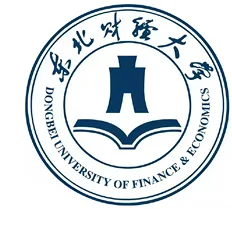
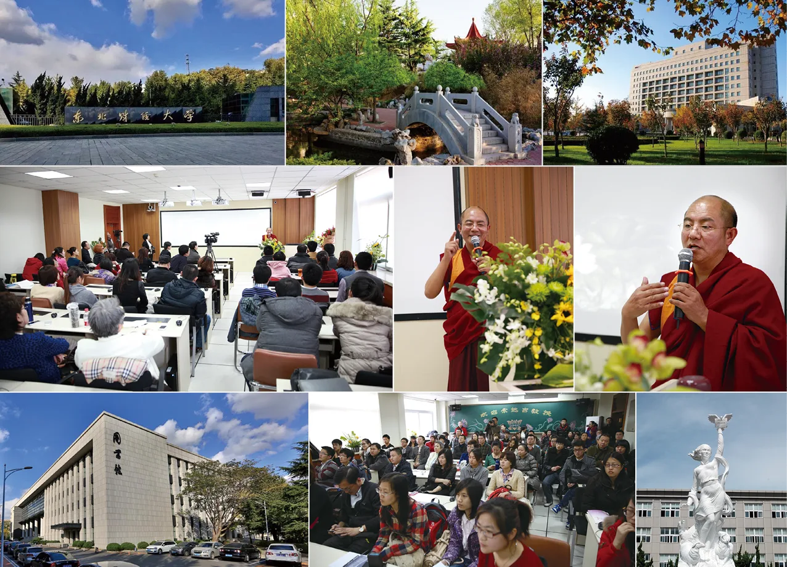
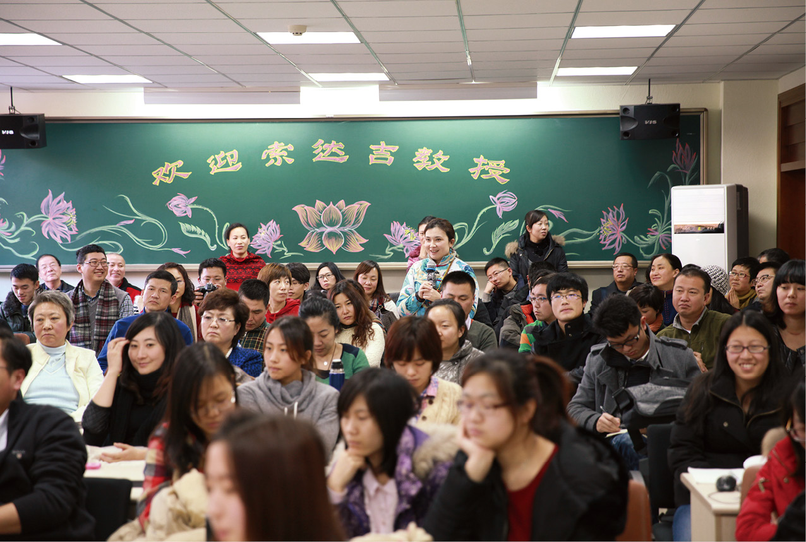

自我执著是一切痛苦的根本，

而利他的心和行为，

才是快乐之源。

这是智慧的精华，我的座右铭。

第48场

东北财经大学

Dongbei University Of Finance And Economics

中国·大连

2013 / 1 / 4

## 博学与济世

## Erudition to Compassion

主持人：

我们这里很多人对索达吉教授并不陌生。索达吉教授毕业于甘孜师范学院，是当代著名的佛学家、慈善家、理论家、翻译家、社会活动家，在国内外享有极高的声誉。

今天的主题是“博学与济世”。索达吉教授非常博学，著作已累计有上千万字。近几年来，教授应邀前往清华、北大、浙大、人大以及港大等多所院校进行交流，与知识分子进行现场互动。可以说，教授是用他的悲心体谅了我们，在今天2013年1月4日这个“爱你一生一世”的特殊日子来到大连，来到我们东财，用他的大爱普度我们。

下面让我们心怀感恩，聆听索达吉教授的开示——

主持人说今天的日子很特殊，对我来说，这个讲座也比较特殊，我很珍惜，因为来这儿花了不少时间。

刚开始答应来以后，我发现前后的时间比较紧张，下一站离得又远，于是找他们商量，想推到下个学期。但个别老师和同学一再要求按时举行，我就同意了。来的路上，从昨天下午开始，飞机和车上的时间加上晚点、堵车，一共花了十二个小时，今天凌晨4点才到东北。

为一次讲座，这样跑值不值呢？讲两个小时，再坐六个小时的飞机去下一站。我觉得很值，也很珍惜。

我常常记起释迦牟尼佛在因位苦行时，为求一偈——“诸行无常，有漏皆苦，诸法无我，涅槃寂静”，甘愿在身上钉一千枚铁钉；而成千上万追随佛陀的修行人，也是为求真理付出一切。一想到这些，我就觉得，虽然时代不同了，人人都很忙碌，但为讲解和听闻佛法，做些付出是值得的。

## 博学济世， 就是智慧与悲心

“博学济世”，这是你们东北财大的校训，拿它作为交流主题，我担心自己有班门弄斧之嫌。不过我得说，在我见过的许多校训里，这是最喜欢的一个。因为所谓“博学济世”，也正是我们佛教最核心的教义——智慧与悲心。

这样联系并不牵强。“博学”是广闻博学，和佛教的智慧是一个意思；“济世”也就是救度世间，佛教说以大悲普度一切生命，没有两样。刚好是智悲双运。我相信，由这一校训培养熏陶出来的人才，应该是对自己有益、对社会有用的。

智慧在藏语里称“西绕”，其直接涵义是，在所有取舍判断中顶级的抉择和认知能力；悲心是“酿杰”，“酿”是心，“杰”是王，心之王——在我们可以生起的所有心念中，悲心是最高尚的心念。因此，智悲是佛教中统摄一切的理念。

佛教说“智悲”，你们说“博学济世”，一样的。不用特意解释。

## 没有智是可悲的， 没有悲是可怕的

没有智、没有悲，古人今人都无法生存。

离开了智慧，人类无从进步。你们也知道，从工业革命到信息时代，再到今天的智能时代，智慧一直起着关键性作用。然而，如果没有济世的悲心，智慧掌握在谁的手里，谁就有可能给他所处的社会乃至全世界带来灾难。

所以，智与悲最好兼具，也就是智悲双运。

在这个地球上，像非洲某些地方的人，因为没受过教育，不要说为人类做贡献，连养活自己都成问题。古代的东北和西南也一样，因为愚昧，征战抢掠时有发生，生存难以为继。这都是缺乏智慧导致的。所以，今天我们要生存，尤其是在大城市里生存，一定要有相应的知识和智慧。

这种智慧依靠教育基本可以保证，从幼儿园、小学、中学到大学，教育给大多数人提供了发展机会。不过在藏地，目前还是有很多孩子上不了学，开启不了智慧。

没有智慧是可悲的，很难融入这个时代。

然而，今天我更想提醒的是，如果有了智慧，甚至掌握了高科技却没有慈悲心、没有道德的话，是非常可怕的。试想，要是希特勒手里有原子弹，那这个世界早就毁灭了。因此，在培养智慧的同时，更要培养慈悲心。要知道，慈悲心弱的人，道德感也脆弱，很容易给他人造成致命伤害。

20岁的亚当·兰扎（Adam Lanza, 1992-2012）枪杀了27个人，这是前段时间在美国发生的一起重大事件。很多媒体都报道说，亚当·兰扎曾是一名荣誉学生，成绩优秀，2009年因父母离异得了自闭症。有人认为，他报复社会、伤害无辜，是因为人格障碍。

这虽是个别案例，但仔细分析一下，除了个人因素外，更深层面的还是教育问题：教育中给出的“优秀”，很多时候忽略了道德。现在的中国也一样，知识分子进入社会后，不论从事哪一行业，他们不缺电脑、科技以及各种现代知识，这方面堪称优秀，他们最缺的，是对社会的责任感。

这种缺失，一方面是家庭原因，现代家庭可能很少像古人那样重视道德。另一方面，在我们每天看的电视、电影里，娱乐的内容比较多，教导做人的知识少，这些看多了就会消耗人的意志。你们很清楚，一个意志低沉的人，是很难从内心确立一种责任感的，对自己、对社会，都不会有真正的承担态度，更不要说为整个人类做出什么有意义的事了。

很多同学读书期间总在想：什么时候毕业，毕业了我要多挣钱。多挣钱是不错，但如果你没有利他理念，就算把智慧发挥到极致，最多是照顾好自己和家人，仅此而已。

## 怀抱济世之心成长

前两天，我在杭州遇到一名在美国读书的华裔高中生。他的父亲是中国人，母亲是美国人。交谈中，我随时能感到他对这个世界充满关爱和责任，也看到一种差距。

和内地同学聊天，我最常听到的，是他们关于自己的理想——“我毕业后要找个好工作”“我要买车、买房”“我要好好照顾家人”，对人生的追求，似乎就只有这些。

但那个男孩不同，他对人生有着许多长远而具体的展望：如果有机会，自己要怎么帮助少数民族摆脱落后面貌；有经济能力时，要怎么扶弱济贫；有朝一日如果拥有了更大的力量，他还要如何帮助社会扭转不良状况……

可能有人觉得这是妄想，是不可能成真的梦想。但在我的理解里，年轻人怀抱一颗济世利他之心，是相当难得的，这对他的一生都非常重要。如果没有利他理念，没有泛爱世人的胸怀，即使我们有一些智慧，也会因为自小被封闭在狭隘的家庭或小团体观念中，让智慧在这种自私自利、维护自我、养活自己和家人的庸庸碌碌中，浪费掉了。

我们为什么不能对社会有所贡献？对一个有知识、有能力的人来讲，养活自己不是什么大的问题，我们的教育也不应该把它摆在重要位置上。牛马也能养活自己，而作为人，我们怎么能只考虑这些，甚至把这个当作人生的理想？

想过得快乐并没有错，但如果你只想自己的快乐，不关心他人的快乐，不说佛教，就是在世间道德看来，也是不适当的。因此，希望大家都能怀抱一颗济世之心来成长。

## 反思我们的教育

前不久，北大法律系的一名毕业生，因为被女友抛弃、创业失败、司法考试落榜等原因，心怀怨愤，于是在一个名叫乐乐的11岁男孩玩耍时不小心撞了他之后，为发泄不满，就把男孩骗到家里，残忍杀害了。

像北大这样的学府，在人们的期待中，从这里毕业的人都有远大理想，并且也正在各行各业做着贡献，可他为什么做出这种行为？他的残忍是从哪里来的？

当然，错不在北大，一个人不好，不代表所有人不好，这在逻辑上说不通。不过从另一方面看，也值得反思：我们的教育在某些方面是不是有问题？他虽然残忍，却也是脆弱的，老师有没有教导过如何面对挫折？有没有提倡控制自我、尊重他人的道德？没有的话，要不要重视？

我们的教育是否有这样一种预见：教了知识，也教了技术，但这些会不会被用在利他利己方面？如果相反，某些学生用它害人害己，那我们就该考虑，是否需要强调济世和利他理念，以确保智慧被用在正确的方向。

有人认为，有学问有能力就有前途，事情不是那么简单。康熙、乾隆下面都有奸臣，他们有学识、有能力，但为什么会走入歧途，危害国家和人民，也害了自己？现在每每见诸报端的贪污分子，又为什么会侵吞那么多的钱款？

有一点是肯定的：这些人都有智慧。然而遗憾的是，当他们把智慧用在维护自我利益上，心里就只有自己了，智慧成了邪慧，他可以伤害社会、伤害人类。当然，那时候他是想不到因果的，更想不到来世。

如果这不是个别现象，在我们的教育之上，可能还需要反思一下信仰问题。希拉里的话值得回味：“中国是世界上少数没有信仰的可怕国家之一。”她认为没有信仰是可怕的。也难怪，因为美国95%以上的人都有宗教信仰。

没有信仰，那我们信什么？信钱信权力。这就是问题。一旦从个人到家庭，从校园到企业乃至国家，人人崇拜这些的时候，所有关系都用利益维系，谁都不讲爱心和济世之心，那这个社会一定会出问题的，可能是很严重的问题。

## 做一个有用的人

人性是本善的，人人有利他倾向，但要激发它、让善心成长，需要一定的环境和教育。离开向善的教育，再好的教学条件，教再先进的知识，也很难培养出真正的人才。

前段时间在一个国际性的慈善与宗教论坛上，有学者指出：“现在是人多，才少。”显然，他们所理解的人才，不是单单指有文凭有才华的人。古人说“德才兼备”，先有德后有才，既有德又有才，这是人才，这样的人对社会有用。

今天的教育偏重才智，所以很多学生不关心德行，甚至不知道底线在哪儿。好分数就是好学生，但当企业接受了这样的“好学生”，又大失所望，“这么好的学历，应该不错，怎么是这样？好像没什么水平。”这就是做人不行的原因。

社会虽然很现实，不如家庭那么温暖，不如学校那么单纯，然而也并非无道可循。如果知道怎样待人接物，怎样与人合作，投身其中也不是特别困难。但可惜的是，很多人没有受过这种训练，所以一接触人，要么退却、要么冲撞，好像是道难以逾越的坎儿。而受不了的，就只有逃避了。

我听一位老师说，他班里有个特别优秀的学生，还没开始工作就自杀了，因为他觉得社会太复杂，不敢面对。我说：“那之前作些心理疏导，应该也不至于吧……”

年轻人有烦恼是正常的，因为对自我太执著了，所以面对不了、对治不了。但如果能接受一种利他的引导，哪怕是一句话、一本书、一堂课，或是一两个月的培训，学着让别人在自己心里变得重要，那你的人生可能从此就改变了。

吉姆·柯林斯（James C. Collins, 1958-）拜访了85岁的彼得·德鲁克（Peter Drucker, 1909-2005）以后，他说：“别人都在问‘我如何成功’，而德鲁克却在问‘我如何贡献’；别人都在追问‘我怎么做才能使自己有价值’，而德鲁克在问‘我怎么做才能对别人有价值’。”拜访结束，临别时德鲁克对他说：“年轻人，走吧。走出去，做一个有用的人。”

管理大师们是如此强调利他，所以，不管你们现在学什么专业，以后做什么工作，都要有颗利他心。利他心是我们最需要的，在家里需要，在单位也需要，年轻时需要，年老时也需要，何时何地都需要的，一定是最重要的。其他的则不一定，现在我们认为重要的，等老了，就不重要了。

## 博学是为了济世

所以，现在我们就要博学，为了济世而博学。

人生会遇到很多问题，如果我们肯学习，最好能涉猎各方面的学问和知识，通过阅读及实践丰富自己的阅历，这样可以帮你提升抉择力，处理好每一个问题。因此，做老师也好，做企业管理者也好，不断学习是很重要的。

许多名人就是依靠读书成长的，老子、孔子都曾当过图书管理员，李大钊、毛泽东也在图书馆工作过，比尔·盖茨、莫言等也是读书高手。最典型的是美国前总统杜鲁门（Harry S. Truman, 1884-1972），他四十多岁时还是一个很普通的人，但一直在广泛阅读，因而知识渊博。当上总统后，他就是运用自己从书中得来的智慧和力量，帮助美国渡过难关、走向繁荣的。

杜鲁门有一句名言：“不是所有的读书人都是一名领袖，然而每一位领袖必须是读书人。”

因此，我们一定要多读书。当然，读书的出发点最好是利他或者利己，千万不要有害人的念头。如果要研发一些先进的东西，一定要在道德上预先做些权衡，于己于人有益的，就尽力去做。否则，如果只追求先进，不考虑后果，到时后悔就来不及了。像各种各样的武器，害了多少人？

这是智慧带来的，但对人类不利。

## 我们要相信因果

这里要说一下因果，害他人的一定会害到自己，这就是因果。可能有人会质疑：如果真有因果，为什么做好事的人不见有好报，干坏事的人却又没见被惩罚？

其实因果是很复杂的。一般来讲，从因到果需要一定的时间，比如，春天播下种子，秋天才可以收获，而有些是三年以后才能结果，这是常识。同样，因果也是自然规律，只要你遵循它断恶行善，到时一定会看到果报。否则，只是因为不懂就轻视或践踏它，对自己是非常不好的。

《法句经》里有这么一则故事：有个猎人带着一群猎狗去打猎，路上遇着一位比丘，他心里嘀咕：“今天不吉祥，可能打不到猎了。”结果进了山，确实没打到任何猎物。回家的路上，他又碰着那个比丘了，比丘刚从城里化缘回来。他正好气愤未消，于是放出猎狗去咬比丘。

比丘情急之下，爬到了一棵树上。猎人走到树下，用弓箭头去刺比丘的脚底，比丘痛得不能护持袈裟，结果袈裟从身上滑落，正好罩在树下猎人的身上。猎狗见到袈裟，以为是比丘掉了下来，一拥而上，把猎人咬死了。

所以，造罪业的人，终归害的是自己。这就是因果。《佛说四十二章经》里也说：“逆风扬尘，尘不至彼。”

一讲因果，很多人不信，但不信不能证明没有。我常常感到悲哀：你们是知识分子，为什么就没有这种知识呢？如果能接受因果及前后世的教育，像藏地一样，那你们的很多观念会改变；观念一改，行为就变了，行为一变，很多社会问题自然就解决了。因为观念是一切行为的主导。

“没有因果”“人只有一世”的观念是错的，抱这种观念的人，只考虑自己、只顾眼前很正常，不关心他人和社会甚至不照顾父母也可以理解，但这是多么可怕啊！

## 莫言讲的因果故事

我想起莫言在领奖时讲的故事。以前我就喜欢看书，也看莫言的书，但兴趣不大，是他得了诺贝尔奖以后才看的。人就是这样，名气会为他赢得好奇和关注，这是挂着钩的。说到名气，先讲另外一个故事吧，这是很早以前听到的。

爱因斯坦常去各地讲学，他的司机每次都在下面听，听久了，自己也会讲了。有一次，爱因斯坦对他的司机说：“这次你讲吧，反正这里没人认识我。”于是司机上台。他讲得也确实不错，所有人都开始鼓掌赞叹——“爱因斯坦，厉害。”他们真的把他当爱因斯坦了。

这是故事，真假不好说。不过从中折射出一个道理：我们的社会，过去也好、现在也好，人们听什么、接受什么，往往跟讲述者的名声和地位有关，对真理也不例外。

莫言讲了个什么故事呢？他得了诺贝尔奖以后，我翻阅了一些他的书，也看了一些评论，有人说这是中国的光荣，有人说他写得不如巴金，也有人觉得无所谓：“他得不得奖，跟我的工资有什么关系？”不过我觉得确实不容易。在这么多国家、这么多人物里评选，不管得哪个奖都不容易。

得奖后，他讲了个故事，是他爷爷讲给他的：

有一天，有八个外出打工的泥瓦匠，遇到一场暴风雨，躲进了一间破庙。外边一直打着雷，一阵一阵的，一个个火球滚来滚去，他们都非常害怕。这时有一个人说：我们几个人里，一定有一个人做了伤天害理的坏事，谁做过坏事，自己出去接受惩罚吧，免得连累他人。结果，没人出去。

又有人提议：既然没人出去，那我们抛草帽，谁的草帽被刮出庙门，说明他做了坏事，请自己出去吧。于是大家开始往庙门外抛草帽，七个人的草帽被刮了回来，只有一个人的草帽被卷出庙外。这些人认定他干了坏事，让他出去，但他不肯，于是大家就抬着他把他扔了出去。

这时莫言说：“故事的结局，我估计大家都猜到了——那个人刚被扔出庙门，破庙轰然坍塌。”

这个故事见仁见智，但在我看来，它除了告诉人们判断事情要依靠智慧外，更重要的是警示我们：因果规律总是以心为起点，如果有谁起了害人的心，最终只会害到自己。

所以，人要有智慧，更要有悲心，要坚持博学，更要培养济世利他的心。如果学校能建立一种机制，像很多企业正在做的，借由爱心理念培养学生的利他心，无疑对学校的管理是有益的。而且，就社会层面看，这种爱心培训的意义，可能远远超过了一般的知识传递，因为当一个人有了爱心、可以忘我付出的时候，他所能提供的效益是非常大的。

## 借鉴佛教智慧以博学

在济世利他心的基础上，我建议大家也能借鉴佛教的智慧以博学。佛教的智慧虽然深奥，像“四法印”，太专业的解释不一定好懂，但是简单了解一下，弄懂一条两条，也是有益的。下面我大概讲讲这个四法印。

### 1．诸行无常

诸行，就是指一切万法。在座的诸位、这个学校乃至整个世界或宇宙，这一切都在刹那刹那变化，没有一个法是恒常不变的，这就是无常。懂得无常的人，在生活和事业上遇到任何变故，都有面对的力量，或至少不会那么痛苦。

我们学了佛，不是说不会老不会死，相反，佛教很清楚地告诉我们，每一个人都会病、会老、会死。我们了解这个道理以后，将来不论遇到什么意外，心态是不同的。

昨天有个道友说，最近他查出得了重病，但他不怕，因为他次第学了一年佛法，现在感觉心里有股力量。我想他说的是对的。得了重病不怕的人很少，但佛法的智慧的确有这种力量，可以让你坦然面对一切。即使等你老了，怎么也掩盖不住皱纹和白发的时候，想想无常，也就没什么痛苦了。

我知道知识分子认理，但分别念也重，这个不信、那个不信，这个不对、那个不对。不过这种心态学佛法最好，尤其是因明，学了因明，你觉得佛教的哪个观点不对，可以找人辩论，一辩论，智慧就开了，傲慢也没了。

### 2．有漏皆苦

一切法因为无常，所以是痛苦的。

像这样从本性上认识痛苦，知道在人世间找不到真正的“完美”，可以让我们放下对生活的过高要求。佛教不否认幸福，佛教入世，就是要帮助人们获得幸福；而强调慈悲和无我的缘故，让佛教徒关心社会比一般人要强烈得多。

也正因为关心，佛教才更重视真理的传递，比如无常和痛苦。毕竟，人们不仅需要幸福，更需要面对痛苦的智慧。

### 3．诸法无我

人们认为的“我”或法的“自性”，其实是一种虚幻的存在，用理论观察时，在胜义或真实义中是得不到的。

没有“我”，那谁堕地狱，谁上天堂？谁在工作，谁在生活？没有“自性”，那山河大地、瓶子柱子又如何成立？

其实这些都是假象，只能在显现层面存在。当物理学家观察这个瓶子，发现它的本体只是能量或场的时候，他们知道，瓶子是假象，不是真实的存在。同样，当佛教以胜义理论推知万法的本体是空性，便了解到，不论是外在的瓶子柱子，还是内在的身心五蕴，都没有自性。这就是“无我”。

现象中有“我”，不代表真实中有“我”。

### 4．涅槃寂静

如果我们真正通达了一切万法的本体空性，证悟了无我的本来面目，这就是涅槃寂静，是真正的成就。

以上是佛教的四种智慧，也是真理。如果我们能接受真理的熏陶，我相信，黑暗会被遣除，社会将变得越来越光明。

## 年轻人是大有希望的

我总认为，今天的年轻人是大有希望的。

报纸上经常报道“最帅90后”，我看了一些照片，好像人长得也不是最帅，但他们的心灵的确很“帅”。像前两天那个22岁的医生，他从火里救出一个4岁的孩子，成了很多年轻人的榜样。当然，还有更多年轻人在做着善法，虽然没有人知道，但他们默默地走着自己的路。这就是希望。

现在的年轻人向善有很多机会。现在不像以前，父母和老师说什么，错的也认为对，现在有网络，你可以从中找到很多正面理念，像东西方包含智慧和真理的宗教，世界上普遍接受的好的或善的观念，都可以学，很自由。即使父母不让你到外面接触这些，也可以在家里上网学。

所以，世界是有希望的。

藏地有一两个学者，学了几篇文章就开始骂这个骂那个、骂传统骂现实，其实这样不对，一分为二比较好。

现实中是有不如人意的地方，但也应该看到，好的地方也有。尤其是发生在年轻人身上的变化——他们开始重视传统文化，开始对自我建设有兴趣，甚至参加一些有益人生的培训，这种力量是不可思议的。我曾经参加过企业关于管理和国际化理念的培训，从此改变了很多看法。所以我相信，只要年轻人经常参加这类心灵培训，培养自己的利他心、慈悲心，未来的社会因为你们，一定会变得越来越美好。

烦恼和痛苦谁都会有，但只要你不是老想着自己，而能心存社会，为你所服务的企业着想，把那里的事当自己的事做，那你自己的痛苦和焦虑慢慢就消失了。这是规律。

请大家记住：自我执著是一切痛苦的根本，而利他的心和行为，才是快乐之源。这是智慧的精华，我的座右铭。

今天，东北跟藏地一样，外面是冰天雪地、寒风刺骨，但我站在这里，心里却充满欢喜，有一种如沐春风之感。我希望把这股春风传递给大家，并借助大家，将它的温暖传递到其他的生命、其他的角落乃至整个世界里。

现场互动

问：据我了解，辽宁阜新过去有一个东藏佛教基地，当年有三千僧侣的规模，用当地话说，叫“东西平衡”，是这样一个文化遗产。但可惜的是，现在只留下了遗址。关于东藏佛教，能否请您为我们介绍一下？

堪布：李院长说要送我一本书，非常感谢！我很喜欢书，在我学院的房子里有很多书，不知道具体有多少，他们说，一个小地方的小图书馆都没有那么多书。一有时间我就会到书海里游泳，很快乐。每增加一本我都特别开心。

东北这边有东藏寺院的遗址，这个我听说过，以前也查过一些相关的历史，但记载得好像不是很清楚。不过从逻辑上推，有西就有东，应该有东藏的佛教。

其实，这边藏传佛教的寺院古迹很多，黑龙江的齐齐哈尔、大庆，以及吉林和辽宁的很多地方都有，有些我以前去看过，那里的菩提塔、降魔塔跟西藏的完全一样。

可能中间发生了很多变异吧。早期在内蒙古、宁夏一带都有藏传佛教的寺院，从宗喀巴大师传下来的也有，但这些寺院具体是在什么时期、怎么传下来的，我也不太了解。以后如果能找到可靠的历史，我们可以共同研究。

问：我买了一本书，西方人写的，他讲了世界范围内100位有影响的教育思想家，孔子、基督、柏拉图都在，但没有佛教的创始人释迦牟尼。我觉得这个不对，因为有其人有其事，佛陀的教化是明摆着的。请问您怎么看？

堪布：可能是作者的立场问题吧，有所偏重的时候，有些就不收录了。应该不至于否认佛的存在。

你说得对，有其人有其事。一九五几年的时候，时任中国佛教协会会长的喜饶嘉措大师，曾去印度参加了一个世界性的佛教大会。回来后，竟然有人问：“释迦牟尼佛真的存在吗？”大师当时是跟班禅大师一起去的，他们朝拜了佛陀降生、成道、转法轮以及涅槃的所有古迹。他说：“世界上任何一位国王的存在，都可以从他的历史事迹、建筑遗迹来推知，佛陀也一样。谁有怀疑，我跟他一起去印度走走。”

所以，证明佛陀来过世间是不困难的。

问：堪布您好！我们的人生分几个阶段，小时候、中年、老年，请问在这每一个阶段里，做些什么才有意义？

堪布：人这一生里所执著的东西，有些是会变的。童年时我们喜欢玩具，喜欢跟小朋友一起唱歌跳舞，但一长大就变了，把这些舍弃了。年轻时我们执著感情，追求成功、财富、地位，但老了又变了，又舍弃了。然而，在人生的所有阶段唯一不需要舍弃的，就是善心、感恩心和利他心，随着年龄的增长，这些将成为你最珍贵的财富。

很多同学认为人生是完美的。其实也不是，有完美的，也有不完美的，这是轮回的本性，佛教对此阐释得相当透彻。

所以，用我多年学习佛法的经验来看，我觉得，不论你眼前处在什么状态，地位高也好、低也好，财富多也好、少也好，只要你肯接受心灵的教育，树立因果观念，培养善心、感恩心、利他心，那么你的人生就有意义，一定会有意义。

问：社会比较复杂，我们在学校里接触得少，有时候都很逃避，害怕面对这些，请问怎样让心变得坚强？

堪布：佛教理念是很开放的，像无我，像大慈大悲，这些对你的心态会有帮助。普通知识也是学了才懂，所以，学学这些，“磨刀不误砍柴工”，不会耽误你很多时间。

现在很多独生子女的心态我理解，他们怕一些未知的东西，工作的压力、家庭的压力、生活的压力，想想都怕，怕毕业后被太多不情愿的事情束缚住。其实没有必要。只要你有一种宗教信仰或理念，让它成为你内心的坚强依靠，那时候，不论你遇到什么，用些智慧和方便也就解决了。

问：现在生活节奏这么快，在这种快节奏下，我们怎样才能安住自己的心，不跟随境界转呢？

堪布：生活节奏虽然很快，但也可以慢慢地过。

有这么一个故事：有一个小孩坐上火车，火车开得很慢，等检票员来检票时，他已经老了，而检的是一张儿童车票。也就是说，他在火车上度过了一生。

当然，这是故事。然而我们也可以反省，生活一定要那么快吗？一定要追求那么多东西吗？如果你能约束一下自己，该放的放一放，或许会发现：其实生活本身并不快，都是追出来的，但那么多的东西，就算你拼命追也是追不完的。再说，有些事物，你跑得越快，就越发现不了。

所以，静下来，找找最有价值的东西，好好品尝品尝。

问：那一定要学佛吗？这对我们有什么帮助？

堪布：佛教里所说的百分之百正确，所以，从追求真理的角度，我常常建议大家以理性方式思维佛法。我到大学或在研讨会上交流时，探讨的也都是理论和学术，这是我一向的态度。我不排斥任何宗教，我们非常和睦，但是我对佛法的熟悉让我知道，人所有的烦恼和痛苦，用佛法的窍诀都能解决掉。事实上，你也不必学习所有佛法，只要能撷取其中一部分，哪怕是沧海一滴，也会大大改变你的人生。

佛陀常说，我为你说解脱法，但解脱依赖于你自己。所以，我的想法就是，学不学佛是你的事，信不信佛也是你的事，但介绍真理是我的事。就像你们的老师，老师的话你听不听是你的事，但老师有为你开导的责任。

问：我是工商管理学院人力资源管理专业的学生。前段时间，一名老人在街上摔倒了，结果第一个冲过去扶她的是一名路边的乞讨者，他扔下了饭碗救起老人。这让我想起两年前的小悦悦事件，当时从她身边走过18个人，其中不乏开高档车的所谓成功人士，但最后去帮小悦悦的却是一名捡破烂的老人。我想请问堪布，我们善良的本源在哪里？是所谓“人之初，性本善”，还是要从信仰或教育中找到？

堪布：善良的本源，就是我们本善的人性。“人性本恶”是不成立的，西方科学家已通过试验验证了。然而，人的本性虽善，也要由教育启发和促进，否则，善就被遮住了。

学校里应该提供这种教育，比如利他。利他是最有价值、最有利益的生存理念，如果一个人在读书时就能得到适度的教导，那么他的一生都会因此焕发光彩。我常常这么认为，我们的生存目的，不是自己端牢饭碗、养活好自己就可以，我们的知识和能力，应该更多地体现在利他方面。

媒体也有引导向善的责任。“老人倒了没人扶”“小悦悦事件”，这些的确说明今天的道德缺失，新闻里播出来，以此提醒大家反省，是有必要的。但我们也看到，负面东西播多了，有时只为吸引人，添枝加叶渲染一些偏颇观点，也会起很大的反作用。举个例子，对佛教徒好的地方不播，不好的到处搜罗，然后拿来指责佛教，这对社会、人心是无利的。

其实分析一下也知道，一两个人的行为不好，不代表佛教不好，不代表所有佛教徒不好；18个人没去救小悦悦，也不代表所有人都没有良心。这个道理是不难懂的。

去年“小悦悦事件”刚出来，我正好在一所大学演讲，我问他们：“以后如果有类似事件发生在你身边，你会不会去救人？会的请举手。”结果，绝大部分都举手了。可见，大家并不是不想帮助人，但有些新闻的确起了反作用。

所以，人性本善，但也要教育。

老师的思想会成为学生的人生哲理。老师说善有善报、恶有恶报，学生们就行善、不造恶；老师说没有因果，学生们就无恶不作。老师的行为也会影响学生的性格：老师爱帮助别人，学生们也喜欢利他；老师不停地抱怨，学生们也处处指责。佛教团体也一样，法师喜欢赞叹别人，小法师们也会说人好话；法师爱说过失，小法师们也会效仿。

教育会在社会中形成循环，良性的或者恶性的，在重要人物和主流宣传推动下，形成各自走向。一定要谨慎。

问：佛教与慈善可以画等号吗？

堪布：各个宗教都有慈善，它们以各自的教义——对真理与善心的教导作为依据，结合一定的方式方法利益世间，从而形成了自己的慈善理念和事业。佛教也不例外。

总的来讲，我认为佛教是一种智慧。这种智慧虽然古老，但奇妙的是，它在任何时代里，又都是时尚的。历史中有很多思想兴起后，很快便会过时或被转化，几百年前的理论，现在大都用不上了。而佛教却是完全不同的。

我对科学有信心，但我在不断对比中发现，佛教思想与今天的人类学、宇宙学、医学等知识完全适合，比如，佛教的无我空性与量子力学相近，佛教对宇宙的描述与天文学相近，佛教对人体构造、寄生虫的阐释与现代医学相符……

所以，佛教跟慈善是不能画等号的。

不过我们可以说，佛教里有慈善，有最好的慈善。因为基于菩提心的认识，佛教徒作慈善时，可以无私奉献，可以提供无界限的帮助，不分民族、文化或国界。而且，这种慈善也是遍及一切众生的，不仅仅是人类。

问：我长期在欧美生活，有很多别的国家的朋友，他们都有不同信仰。请问作为一个藏传佛教徒，在那样一个社会里，应该怎样修习自己的内心？

堪布：在欧美国家里生活，可以学到很多不同的知识，有这个自由，但有时太自由了，也会找不到方向，这一点要注意。所以，作为佛教徒，要坚定信仰，不要变来变去。

至于修行，我建议你修习最殊胜的窍诀——出离心、菩提心、无二慧，这是所有佛教教义的命根与核心。你可以一生都修持这三个法门，不用今天修这个、明天修那个。当你思维或修持任何一个道理时，可以把它贯穿到这三个主线式的修法中，这样既抓住了重点，又统摄了显密一切教理。

这就是修习窍诀的力量，也是藏传佛教的特点。现在内地有股“藏传热”，西方也出现了“藏漂”，越来越多的人纷纷对这种神秘、甚深的学问感兴趣，应该不是没有原因的。

问：我来自大连理工大学，学环境工程。我小时候是我妈逼着我上学的，请问您小时候是怎么信佛的？

堪布：我是跟着我父母信佛的。

1962年我出生那会儿，饥荒刚结束，佛教正经历一场历史性毁灭，但藏地全民信佛的基础还在，所以父母怎么说、邻居怎么说，我就信了。从小就有的信念虽然比较坚定，但不太理性，总有些人云亦云的感觉，“大家信，那我也信”。

直到出家以后，跟随我的老师学习佛法，才算渐渐有了真正的信仰——已经近30年了。我一直认为，这是我人生里最有意义的时间，就是在这段时间里，我找到了真理。

我对真理的信心，现在不管谁来破，都破不掉的。这不是因为我固执，而是在研究佛法过程中——佛陀留下了这么多教法，虽然我只研究了一部分，但在研究和比较中，我对它的理论依据和修证体系生起了定解，相信这是最完美的真理。我信的是佛陀的教法，这是我的信仰基础。

所以，如果出家前我还是相似的佛教徒，从出家后系统学习佛法以来，算是一名真正的佛教徒了。

问：既然是人创造了佛教，为什么我们还要学佛，而不去相信自己呢？

堪布：如果我们自己是可信的，我们从来不发脾气，从来不偷东西，从来不做任何坏事、不说任何妄语、不起任何恶念，那我们可以信自己。但我们不是，怎么信？今天好像性格还可以，但过不了几天就变了，没什么可信的。

但佛陀不一样，他的教法并不是一种设计或创造，就像一栋建筑物被建造起来一样，它是宇宙万物的真理。释迦牟尼佛成佛后，也只是说出这一真理，进行教育而已。我们学佛就是学习这种教导，把人做好，然后，我们也可以成佛。

和释迦牟尼佛一样，在我们生存的这个贤劫里，一共有一千尊佛出世，之前有拘留孙佛、拘那含佛、迦叶佛，释迦牟尼佛是第四尊，之后还有九百九十六尊佛出世。他们都是证悟并宣说真理。这和一般意义上的代代相传完全不同。

问：佛教里讲“诸法无我”，如果这一世行善、修行，那么当他离开世间时，这些福报都落到谁的身上了？

堪布：在暂时的世俗层面里，造恶会受苦，行善则会感受快乐果报，这些都是自己受的，到了后世也是如此。诸法无我指的是实相，在这一万法究竟实相层面，的确是没有善也没有恶，但在我们证悟它之前，还是脱不了苦乐的。

我们拿瓶子来比喻：既然物理学家认为瓶子的本体是能量，讲能量时，如果让你分析，这个瓶子里装的是好的东西还是不好的东西，你怎么回答？如果是能量，东西去哪儿了？

我想可能你不得不说：能量是对物质的究竟认识，在这一层面，应该没有“装的是什么”的问题，也谈不上“去哪儿了”，因为这是本体，唯有能量。而只有跳出这个层面，看瓶子的现象时，才可以说，里面装的是好东西或者不好的东西。而且，在瓶子没碎之前，它都有“装”的功能。

什么意思呢？讲实相时才讲无我。无我是对的，因为那种实有的“我”或说不是空性的法，是找不到的，物理学家找不到，佛教学者也找不到，所以说“无我”。承认无我，并不妨碍在世俗虚幻层面成立善恶，成立断恶修善的行为，以及由此感得苦乐果报。所以，我们现在一定要积福累德。

只有到了最后，就像过河要船、过了河就不用船一样，当你成就并渡过了轮回，那时才不用行善。之前还是要的。
