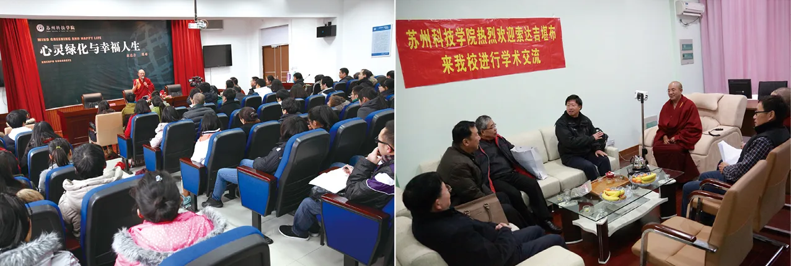
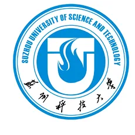
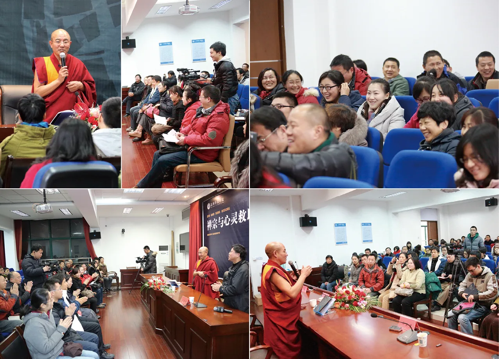
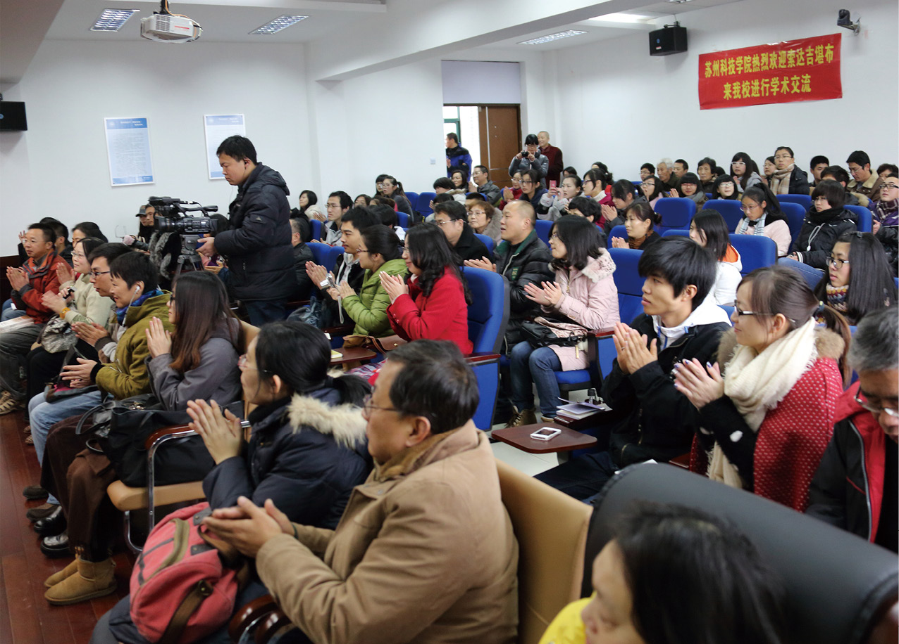

禅，

是一种回归自性的修行。

第46场

苏州科技学院

Suzhou University of Science and Technology

中国·苏州

2012 / 12 / 26

## 禅宗与心灵救助

## Zen to Emotional Rescue

主持人：

索达吉堪布本次来我院作两场学术交流，第一场同学们非常踊跃，效果很好。这是第二场，在教育与公共管理学院与哲学一级学科硕士点的师生交流。这一场有这么几项程序：

一、由我们学院院长为堪布颁发兼职教授证书；

二、由索达吉教授为我们赠书；

三、由堪布作“禅宗与心灵救助”的主题报告，以及我们与堪布进行学术互动。

（韦洪涛院长为堪布颁发教授证书；堪布赠书。）

刚才休息时，堪布说，他希望这个兼职教授不是虚的，而是实的，所以跟院长作了简短协商，并达成一个备忘录。备忘录要求，为进一步加强哲学一级学科的发展，促进中国哲学学科的开放性建设，经双方协商拟在以下领域开展合作：第一，在教育与公共管理学院一级学科哲学硕士点，设立研究生奖学金；第二，不定期来我院开展学术讲座和学术交流；第三，与索达吉堪布所在的五明佛学院共建中国哲学的研究基地；第四，与索达吉堪布共同开展学术课题研究。其他事项则跟随发展与时俱进。

（双方交换备忘录。）

下面有请堪布为我们做主题报告——

各位科大的老师、研究生同学，大家好！虽然我们生活在不同的环境里，但因为有着共同的愿望和目标，以及彼此的信赖，于是成就了今天的这桩善缘，还有这次交流。

作为一名老师，近30年来，在我身披袈裟从事教学工作的经历中，一直对教育有着浓厚兴趣，从未舍弃或中断，这是让我感到自豪的地方。同时，看到老师们长久以来培养了那么多的有德有才之士，也让我由衷钦佩。

前两天，有些老师对我说自己压力大——工作、家庭、方方面面，压力太大，所以想借禅修调调心，想在如何将禅修与生活结合方面，听听我的建议。今天就讲讲这个话题。

## 我们为什么有那么大压力

尽管这几年经济已经相当发达，可人们心里的痛苦并没有减少，相反，据今年10月17号一则报道说，“中国是目前世界上压力最大的国家”，压力的来源主要是“工作”“个人经济状况”“来自老板的压力”。我也知道，一个人在这样的压力下生存，没有些心力和智慧，是挺艰难的。

然而，我们为什么会有那么大压力呢？

一方面是被逼迫的，不得不面对；但另一方面，我个人认为，也是我们要得太多，要的多了，就有压力。

古人不一样。古人生活简单，欲望也不大，有简单的衣食住行就满足了，就算过上好生活了。可是现在不行。现在随着科技发展，各国间的相互影响越来越大，人们的生活标准一提再提，目标也越来越高。但问题是，你把目标定得太高，一直达不到的时候，就只有自己痛苦了。

而人们又不肯降低标准。单从衣着来看，过去的人寒冷时有棉衣裹体，出门或见人时服饰得体，就可谓标准了。而现在不但要好看，还要讲究品牌、价格、品味、层次，样式也是东方的、西方的……复杂得很。耗去多少心思？

所以，和外界的压力相比，我认为，内心的欲望——或说怎么样都不满足的心理状态，才是真正的压力来源。

## 禅修是最好的减压方法

要想减少压力，不管是哪种压力，最好的方法就是禅修。

禅修时，是不是一定要放下全部生活，保持寂静？也不一定。从前有个小和尚问老和尚：“什么叫禅？”老和尚说：“饿了吃困了睡，就是禅。”可见，在禅宗大德的修行里，是不需要排斥任何行为的，行住坐卧都是禅。

如果是这样，那我们普通人不也成了禅师，谁不是饿了吃困了睡？难道这也是时时刻刻在禅修吗？再者，时下有一类所谓“生活禅”，这是把佛教世俗化了，还是说它虽然高深，但的确可以进入我们的生活？回答这类问题，其实主要取决于一点：就是看你是否了解这种修法。

如果你了解并懂得运用它，那的确是的，你可以在生活的各样形态里禅修，即使生烦恼时也不例外，例如生气。

生气的时候，你要向内观察这种愤怒意念，看它的本体到底是什么？如果你能认识它的本体，并安住其中，狂暴的心态自然就烟消云散了。为什么会这样？因为在真实层面里，并没有一个另外的“愤怒”存在。确实没有。

这就是禅，一种回归自性的修行。

随着佛教的普及，很多人发现，禅修背后的佛教认识，那种对心的透彻分析，是当今神经学、脑科学或心理学远远达不到的，而且禅修给心灵带来的抚慰效果，更是超越了一般的治疗手段。西方人喜爱禅修的原因就在这里。你们也知道，当今欧美的高等学府，像哈佛、哥伦比亚、剑桥、牛津等都设有禅修中心，以帮助人们了解心性或处理压力。

当你有了压力，我想在座的都有体会，整个人会变得浮躁、心绪不宁，那时候也最容易把事情搞坏。什么原因？我举个比喻：透过平静的水面，你才看得到清晰的月影，而当水面被搅动，月影就不见了。因此，当你心里平静时，才能把事情做好，也有效率，心不平静就会出错。

想想现实生活就知道了。当我们陷入竞争和攀比的怪圈时，内心被焦虑、不平、怨恨等情绪塞得满满的，于是慈悲心不见了，笑容也消失了。很明显，负能量的提升削弱了善心，而更严重的，还会破坏正常生活：我们开始跟家人吵架、打骂孩子、敷衍工作……负面行为全都跑出来了。

所以，我们应该通过禅修来安心。心安了，万事皆平。

## 禅修坐式类似金字塔

禅修可以安心，除了内在的专注外，还跟它的坐式有关。坐禅时，身体的外形酷似金字塔状，上尖下宽，你们把释迦牟尼佛的像与金字塔一对比就会看到，佛身与塔身相似。而这种金字塔形，科学界认为，是能聚集特殊能量的。

考古学家证实，埃及金字塔有4700年历史，而位于波斯尼亚的“月亮金字塔”已经存在了12000年，这些在建筑学里都是奇迹，因为水泥建筑的寿命通常只有50到100年。

埃及金字塔是谁造的？有人说是人造的，也有人说是外星人造的，说法很多。但不管怎样，和金字塔本身的古老一样，塔内保存的物件也寿命极长，可以说，它的储存效果远远超过了其他建筑物。不仅是金字塔，就是它的模型也是如此，科学实验证明：在模型里存放的鲜花长时不会枯萎，食品不易腐烂，人进去也能保持活力，伤口迅速愈合……

这种不可思议的能量，人们称之为“金字塔能”。为了利用这种能量，还有人制造了许多金字塔形的构造物，甚至是大型建筑。奥地利就有这样一间酒店。

这个能量来自哪里？科学家们很难解释，不过他们一致认为，这种塔形本身有聚集宇宙波的能力，也就是说，它可以采集宇宙精华。常习打坐的人都有体会，一入座，你会感受到一种宁静。宁静的原因，一方面是心里专注，一方面是打坐的姿势呈金字塔形，你一进入这种状态，自然就“天人合一”，宇宙能量直接融入你的身心里。

解释禅修为何能给人力量，是件比较困难的事，要是用佛教词句，显宗的或者密宗的，怎么解释，你们都会有点陌生，但借用科学的理解方式，也许就不那么抽象了。

## 毗卢七法

一般来说，在印度瑜伽或佛教的修行里，采用最多的坐式是毗卢七法。这七法要求：

1）双足金刚跏趺或半跏趺坐：盘腿时最好双盘，不行就单盘，或者坐在椅子、凳子上也可以。

2）双手结定印：右手在上，左手在下，两拇指相触，放在脐下。

3）脊背端直：不论你怎么坐，一定要把整个脊柱端直，佛教的修行窍诀里说，身端直则脉端直，脉端直气便运行正常，气运行正常，心自然就被调正了。

4）颈部稍向前屈：不能往后仰，也不能左右歪斜。

5）臂膀后展放松：不要向胸前内收，微压腰间。

6）双目垂视鼻尖：不能睁得太大，也不是死死盯着，是微微地看着。

7）舌抵上颚。

这种毗卢七法坐式，从外观上看就像金字塔，调整好各个部位坐定后，你的心自然就静下来了。打坐过程中会产生种种分别，这时候你要运用修行窍诀，放下分别妄念，截断万缘。之后便可自在完整地接受宇宙能量了。

## 禅修对健康的意义

且不说解脱，很多科学家认为，这样打坐对我们的身心健康确确实实有着非常大的帮助。

平时经常打坐的人，一般情绪上不易冲动，有取舍智慧，为人谦卑恭顺，喜悦而又满怀慈悲。总之，那种正面的心念会提升，而负面的心念自然消融。对于这种心灵能力，《静坐的科学》一文解释说：“当人在静坐时，会增加35%的血液流到脑部。而提供给脑部的血量大小，与我们的心灵能力有密切的关系……脑部的功能也获得改善。”

可见，打坐可以让人精神活跃，且富于辨析力。

一般人上了岁数后，像养老院里的某些老人，基本是活在痛苦和忧伤之中，甚至绝望地等待死亡。但高僧大德们不是，因为常年禅修，即使他们活到一百岁——这种修行人很多，汉地有，藏地也有，依然是耳聪目明，开心自在。

我们那里有位老修行人，一百多岁了，身体健康，到哪儿去都不用别人扶着。你跟他说话时会发现，他的反应和思维一点都不慢，尤其是在佛法方面。

本焕老和尚是在106岁时示现圆寂的。前几年我去拜见他，老人家虽已年过百岁，但饭后绕佛殿时“跑”得特别快，我们要紧着追才能跟上。

这些都是我亲眼所见，不是传说，也不是离开了我们的真实生活，虚无缥缈的故事。

说到我自己就惭愧了，不能跟大德们比，可能也比不上一些在家的虔诚佛教徒。我喜欢禅修，有时修得还可以，感觉不错；但有时修着修着，会想起很多事情，今天的、昨天的、很久以前的……心静了，很多事情也跑出来了。

不过，真正会静心的人，在你心静的时候，痛苦、妄想连同不合理的分别意念全都会消失，处在这种状态是很享受的，是一种法乐。而当宁静的力量延续到生活里，你整个人的面貌会有改观，精神好，心情开朗，比吃药的效果好。现在的人喜欢吃药，靠营养药撑着，但这些毕竟是药，有益的同时可能也会有副作用，所以我建议你们多禅修。

如果能正确而规律地禅修，那种调整是看得见的。

不仅是身心上的，还有事业。乔布斯（Steve Jobs, 1955-2011）在“苹果”上的超凡创造，不是一般的专注力所能达到的，他就是在长期的禅修实践中，进行创新和管理，并发现世间奥秘的。如果这是佛教的一家之言，你们不信也可以，但世界上有很多心理学家和科学家也都认同这种力量。你们从媒体里找找看。

我听说你们也有禅修课，这很好。我觉得，教禅修的老师不一定要信仰佛教，也不必要求你的学生信仰佛教，只要你把正确的方法传递出去，对他们的生活就有帮助——想调心的可以调心，要治病的也能治病，有很多好处。

美国威斯康星大学麦迪逊分校做过这样一个实验：他们把149人分成三组，第一组做禅修，第二组做慢跑，第三组任其自然，什么都不做，主要是为了测试他们的抗病能力。八周后的结果是：和什么都不做的那组相比，禅修组的病假率仅为其24%，而慢跑组的病假率为其52%。

从这个实验中科学家看到，经常禅修的人，因为心平静的缘故，身体也不易生病，免疫力强，甚至能抵抗传染病。

## 禅修不是为了无所事事

禅修有这些好处，借助它完成对社会的责任，无疑是有益的。遗憾的是，有人只喜欢其中的安逸，“无所事事，这样最好。”其实无所事事最不好。禅修不是为了无所事事。

我们禅修，是要让生命更有意义，并有所作为。

“我的教学压力太大了”，常有老师这么抱怨，恨不得逃避。其实我倒觉得，有点压力好，天天打牌、聊天，这种人生有什么意思？我们来到这个世界，享受了很多社会给予，懂得感恩的人都会想着有所回馈。什么都不做，我们的存在有何意义？什么都不做，又怎么会有成果？

怕苦、怕累不是教育工作者的态度。我认为，在一个老师身上，智慧与利他是统一的，而当他把这些品性传递给下一代时，也成就了自己的伟大人格。自古以来，智慧就是这样传递的。前辈们不计自我的发心和奉献，让我们在今天还可以享受到各种优秀文化，而面对下一代，我们也有同样的责任。这是我们的事业，我们的使命。

我们不能做那种纯粹的享用者——不付出，一味享用。没有什么比这更消极的了，以这种心态，也培养不出优秀学生。在我的理解里，搞教育的人就应该多付出，付出比得到有意义；若论得到，也没有人会比老师得到的更多——“桃李满天下”，这是最大、最光荣的回报。

因此，我们每天安排些时间坐禅是可以的，但天天坐着，甚至上课时也要坐禅，就说不过去了。

以前我读书时，有一次上物理课，老师讲着讲着不讲了，开始闭目坐禅：“你们也好好思维。”但我们不知道要思维什么。“也没什么可思维的，坐着就可以。”结果，45分钟的课，他坐了半小时，之后在黑板上写了个“空”字，离开了。我们都不懂，但后来知道他还是有些境界的。

不过当时校领导批评他了，让他不要把学生带入迷信状态。于是第二天，他不写“空”，写了个“实”字，还是没讲课。“我在安住，你们也安住就可以。”

作为老师这样讲课，可能境界“太高了”，也不太合理。

## 随时随地禅修

真正的禅修，不需要影响工作。你甚至不必单独安排时间来修行，坐车开车、上下电梯乃至行住坐卧都可以。事实上，在禅宗本来的修行中，只要你懂得以心观心，从而认识心的本性，随时随地都可以转变意念；一个人在任何时候都能将心念转变为对实相的了解，就是在禅修了。

《五灯会元》里有一则公案：唐宣宗问弘辩禅师：“什么叫佛心？”禅师答道：“陛下每日处理种种事务的心，即是陛下的佛心，即使千佛来作开示，也别无其他。”

在座诸位每天的事情也不少，但如果你能观心，也一样会明白“即心即佛”——我们的心与佛无别。这种禅宗的修行窍诀，在密法中也有很多，不过，要有些境界才做得到。

为了引发这种修行，我们要培养每日打坐的习惯。比如，早上起床后，你可以禅坐10分钟到半个小时。坐好后先排垢气：吸气，然后伴随呼气，观想贪嗔痴等烦恼从鼻孔呼出体外；这样连排三次。之后，静静地安住一会儿。

不要小看这十几分钟的修行，从这里得到的平静，将为你一整天的心态输入正能量，起到很好的调整作用。

晚上睡觉前，最好也禅修几分钟。这时候禅修，就像通过按摩去除身体的劳累一样，轻轻松松坐一会儿，内心的疲倦和杂乱就消失了。可以说，这是一种心理按摩。

对于只会调身而不会调心的现代人来讲，很多人心理出了问题，有时也作心理咨询，但这个效果很难说。倒不如平时就培养禅修的兴趣，以启发内心的宁静，当你有了这份宁静，在生活的所有时刻，都可以保持良好的条理性。

佛教认为，现实中的一切都是心的造作，而当你的心完全处于一种宁静、澄清状态时，会形成强大的专注力。就像非洲猎豹专注猎物并捕获一样，专注力可以让管理者迅速作出合理抉择，让科学家一瞬间得到新的发现，而前辈的佛教智者们，更是以一种非同寻常的专注，开启了智慧。

所以，如果能把握好规律性的禅坐，以及行住坐卧中随时随地的禅修行为，我相信，只要假以时日，不论是男士女士，我们终将迎来自己生命中的奇迹。

## 千代野

日本禅师千代野的奇迹，是在出家三十几年后出现的。

千代野是一位绝世美女，生在贵族家里，当时的君主、贵族及武将们都追求她。但她生来对荣华富贵及世俗生活看得很淡，再经禅师点化，她对生命的无常也有了透彻了解，于是萌生出家之念，并真的开始了求道之路。

千代野去过许多寺院请求剃度，但全都被拒绝了，原因很简单：因为她长得太美，住持怕她守不了清净戒律，就干脆不接受。后来她来到常乐寺，求大觉禅师收下她，禅师说：“自古以来，美貌是女人修行的障碍，我怕你修不成正果，反而玷污了佛法。所以，你还是走吧。”

千代野知道是容貌让自己出不了家，但她求道的心非常坚决，于是用火炭灼伤整张脸，毁掉美貌。然后又来找大觉禅师。禅师被她的决心所感动，摄受了她。出家后，她每日在寺里提水、劈柴、种菜，转眼已是三十几年。

公元1282年的一个月圆之夜，她在提水回来的路上，看见桶里圆圆的月影庄严优雅，不禁专注地欣赏起来。突然，破旧的桶箍断了，水桶散落在地，水全部漏光，月影也消失了。就在这个时候，千代野开悟了。

这个故事有点悲壮，但很精彩。今天我们修行，不一定要像她或许多古代禅师那样苦行，不过也可以借鉴他们的风范，随时随地禅修——不论开车、走路，还是吃饭、睡觉，在生活的各个环节中都可以修。那里面的确有令你开悟的提示或因缘，若能把握得住，一样可以见性。

不思善、不思恶，那个时候，谁是你的本来面目？

当你正在起心动念，或什么都不执著的时候，以心观心，瞄准它、观察它，当下就能认识心的本性。这不是不可能的，因为由迷而悟，也不过是一瞬间的事而已。

## 通达心性， 才是对心灵的终极救助

当你在一瞬间认识心的本性，你将发现，原来心的本面如此简单，只是无始以来我们和芸芸众生一样，从来没有通达，所以才会一直在红尘中翻滚，在轮回中流转。

就心的本面而言，这里没有我们现在所见的对立、浮躁、不净和丑陋世界，一切呈现除了纯一而美丽的景象外，别无其他。这才是最精彩的境界，可惜我们还感受不到。正因为不了解这种空性本质，我们以再再叠加的分别妄念，将原本不存在的东西当作真实、坚固的存在，进而在执著、求取、计较、分别中，把自己弄得苦不堪言，坠入深渊。

为什么不观观心呢？

生存在这个世间，要生活要工作，也许你觉得又苦又累，也许你乐此不疲，但在佛教看来，最美妙的地方不在外界，而在我们的内心。什么时候能认识到内心世界的奥妙，眼花缭乱、看似真实的外境，便当下崩塌瓦解，那时候，你也就安住在了妙不可言的境界里。

这是用言语无法表达的，想用文字描述、用其他任何方法把它指示出来，也是徒然。所谓“如人饮水，冷暖自知”，亦如“哑巴吃糖，有味无可说”。这些禅宗和密宗证悟者的表述，是最贴切不过的。佛陀证悟后不也说“深寂离戏光明无为法……纵于谁说他亦不了知”？佛陀也是担心没人了解，才安住了49天，经天人祈请后，开始转动法轮。

所以，如果我们想借由禅修来寻求心灵救助，最好致力于体悟心性。因为只有通达心性，才是对心灵的终极救助。

不要觉得这个太高，其实我们有这个能力，也有这种因缘，人人都可以透过虔诚的信心和精进修持，证悟远离戏论、不可思议的般若境界。当你掌握了以心观心的窍诀，也能随时随地去观照时，观照中，外在世界就会完全融入你的心。

那时候你就明白，为什么佛教会讲“万法唯心造”。

“心怎么可能造物质？”这么简单的质问是难不倒佛教的，“万法唯心造”不是假说和猜测。有人想不通，是因为对佛教的认识太少，修炼太少。如果能对这些深邃的思想有些认识，哪怕将千分之一、万分之一用在生活里，我相信，你肯定会过得逍遥自在、快乐无比。

然而遗憾的是，由于种种因缘的阻隔，虽然我们遇着佛法了，也学习佛法了，佛法的境界却始终离我们的心极为遥远。那种真实和纯粹，始终不能融入我们的心。

不管怎么样，我相信年轻人有无限潜力。我很羡慕在座的老师们，因为你们可以为他们提供心灵资助。帮年轻人成办事业、争取地位，顶多是暂时利益，而给予心灵指点——让他们心理健康，具有利他理念和因果正见，才是对其一生乃至生生世世的光明前途，最不可思议的帮助。

因此，在传递知识的同时，如果也能涉及慈悲观与万法真相等理念，甚至让自他有所通达，你的教育就不一样了。

人生是无常的，海明威说“岁月不待人”，佛教说“生命在呼吸之间”。所以，当我们拥有生命、无常尚未到来时，应该用这个人生来做最有意义的事——帮助他人的事，而且是那些能最深刻、最长远的帮助他人的事。

现场互动

问：请问怎么观心？

堪布：观心的方法很多，但一般可以归结为两种。

一种是无相的观法：让你的心对什么都不执著，当它外散时，用心把它收回来，安住在离执的状态中。用来维护的心叫正知正念，是它守护着你的观修。

还有一种是有相的观法：在你作无相观法时，如果心总是散乱、不停执著外境的话，我建议先观佛像，比如释迦牟尼佛或观音菩萨的像。观修时，先专注地盯着塑像或图片，之后闭上眼，让佛陀的相在心里呈现；反复观修、安住，直到清晰为止。这种修法简便易行，当佛的加持力与自己的专注力结合时，心很容易就平静下来，甚至认识心性。

事实上，初期的观心也是管心，训练心往正确的方向走。对我们每一个人而言，心是指挥官，身体和语言是随从，所以，心管不好，就会无恶不作、口无遮拦；而一旦把心管好了，身体和语言会受到节制，行为也就规范了。

问：我的一个好朋友做了些事，自认为是对的，但我觉得不对，对他说了我的想法，他不相信。有一天，他遇到一位大师，大师对他说的和我一样，但他相信了。请问这该怎么理解？

堪布：是有这种现象。同样一句话，两个人说，起的作用可能完全不同。或者说，是谁说的，这很重要。

比如，我和科学家说一样的道理，人们会认为科学家是对的，而我不一定对——“他知道什么？”但我若补充一句，“我引的是牛顿的话、爱因斯坦的话”，那对方就不说话了。

解释佛教观点也一样。他不承认的时候，我说，“这是释迦牟尼佛的话，龙树菩萨的话”，他也不说话了。

所以，这是人的智慧、福报和名气的问题。不过也不用伤心，到一定的时候，他会知道你对他的付出。

问：我是中国哲学专业的研究生。请问佛性和人性有什么异同？

堪布：从实相角度讲，佛性和人性没有差别；但在现相层面有差别。

佛性不是一种简单的善，它是觉悟的基础。

问：佛教里的“一切众生皆具如来智慧德相”，与儒家的“人皆可以为尧舜”，有什么异同？

堪布：“人皆可以为尧舜”这句话，在提倡“人性本善”以及鼓励人人向善方面，的确有着很大的价值和作用。但这种“善”跟“如来智慧德相”是有差别的，它不排斥杀生，还有用鱼类等孝敬父母的说法；并且，儒家认为只有人性是本来善良的，旁生或一切众生善不善呢？就不说了。

这和“一切众生皆具如来智慧德相”相比，显然是狭隘的。所以我认为，儒家思想好是好，但它是属于人的学问。

再加上，它根本不涉及来世。人死了以后怎么办？守孝三年，以表达哀伤，仅此而已。没有超度的说法。不仅是儒家，道教里也不讲轮回。基督教算是有所涉及，讲天堂、也讲地狱，但远远不及印度教和佛教描述得广泛。

因此，如果想要了解自己和他人，乃至一切生命及宇宙的真相，我建议你多研究佛教。像“一切众生皆具如来智慧德相”的道理，佛陀在第三转法轮里讲得很细致。

问：佛教的众生平等观，对现实社会有什么价值和作用？

堪布：现在大家都提倡社会和谐、世界和平，而众生平等观正可以帮助实现这些宏愿。有了这种观念，不仅人与人、国与国之间可以友好相待，人跟动物也可以和睦相处。

为什么说众生平等？因为我们的感受相同。说人和人平等，不是因为大家都长着一个头、两只手就平等，也不是因为都穿衣服就平等，而是因为我们都想求乐避苦：你希求快乐，我也希求；你不想痛苦，我也不想。人人如此，没有例外。说人和动物平等，也是基于这一点。

这是人人都需要的价值理念，很关键。

佛教在讲授菩提心时，有三大修法：自他平等、自他相换、自轻他重。修习这些，就是为了让我们认识并实践这种平等理念，对世界上任何人、民族乃至任何众生都平等相待，进而让对方感受到其自身所具有的尊贵价值。

要知道，世间所有不平等都是以自我为中心导致的，国家对国家的侵略、人对人的欺凌，都是因为这个。而今天的人们想要实现大大小小的“和平”，最好修修自他平等。

什么时候人们一说“世界和平”，已不再是喊口号，而完全基于这种平等观念，我想，世界和平也就不困难了。

问：我是苏州科技学院外国语学院的老师。我对佛学非常感兴趣，刚才从法师的开示中也获得了很多正见。但我一直有个疑问：依据中观学般若空性理论，为了了生死，我们必须认识人无我、法无我，不能执著；但在整个佛教中又有一个最根本的认识，就是我们死后会陷入六道轮回。所以我想请问，既然我是空的，究竟谁在轮回？如果连佛也是空的，修行不就没有目标了吗？

堪布：你的问题，也是很多人困惑的地方。认识它的关键在于：要了解“空性”和“轮回”是不同层面的学说。

佛教承不承认轮回者——流转轮回的“我”？承认。佛教承不承认空性——“人无我”“法无我”？也承认。那既有我，又无我，这矛盾吗？不矛盾。不仅不矛盾，还必须这么承认。否则，理论上就说不过去，修行也会出现偏差。

在没有证悟之前，包括在座的老师、同学，“我们”是存在的，对我们而言，“六道轮回”也是存在的。而当认识到万法的真相或本源时，我们不存在，六道轮回也不存在。

你们看我手里的茶杯，就量子力学分析，它的显现存不存在？存在。那这个显现是不是分子或电子？在我们肉眼面前，不是，在物理学家的观察里，是。他们观察后发现，实有的茶杯是不存在的，它唯一是微粒或能量，别无其他。

这样科学家就会有两种承认：既可以承认杯子存在，也可以承认杯子不存在，只是能量。那能量能不能盛茶？能量是不能盛茶的。因为能量是体，不是单独的容器。

因此，在你认为轮回实有、同时也认为“我”是空的情况下，说有一个“空的我”在这里流转，确实是说不通的。也没有这种说法，就像说用能量盛茶一样。因为显现和本体是不同的概念。如果你一定要问是谁在流转，我们说，是缘起假立的“我”在流转。轮回如此，成佛也是如此。

释迦牟尼佛在第一转法轮时，说一切万法是存在的，到了第二转法轮，又把这一切抉择为空性，像《心经》《般若经》等所讲的那样。在空的层面，的确是没有人、没有法，也没有六道轮回，甚至没有佛果可成，一切唯有空性。

这个空性不是一种教条说法，我说、你信，就行，它是可以用推理来成立的。龙树菩萨在《中观根本慧论》里用的就全都是推理，推理的结果是：现象界存在的万事万物，在真实义里，连芝麻那么一丁点大的实体都不存在。

不存在，为什么又说我们陷在轮回中？

这就回到显现上了。在显现层面，迷乱者面前有杯子，也有六道轮回。是在探究本质时，才说不存在的：量子力学发现没有真实的杯子，杯子不过是微粒或能量；佛教发现没有六道轮回，一切是空的。能量也好、空也好，在本质层面是这么成立的。但这种成立，并不妨害显现中万法存在。

佛教通常把显现和本质称为世俗和胜义。世俗中有，胜义中空。虽然我们现在还处在世俗当中，但通过学习般若法门，并以禅修通达胜义谛时，世俗的幻象就会烟消云散。那时候，你就可以离开束缚，对一切运用自如了。

问：请问，五圆满中的“时圆满”是什么意思？

堪布：当你学习参禅、有人为你宣说禅法的那个时间，就是传授佛法的圆满时刻。这种特殊时刻，如同释迦牟尼佛三次转法轮的时间一样，都可以称为时圆满。

问：我看过慈诚罗珠堪布的书，记得不是很清楚，只记得里边讲，所谓如来藏就是两个妄念之间的那个真空或空白，他说这可以“粗略地认为是如来藏”，请问是不是这样？我还看到一些说法，说这个并不究竟。那我该怎么理解？

堪布：这是慈诚罗珠堪布的问题，你应该问他。（众笑）

问：我也想听听您的高见。

堪布：对于如来藏，可以有两种层面的认识：

一种是一切万法的法性。这是不可思议的境界，是在断除所有妄念、分别后，确实认识到了不偏于任何执著相的本性，这就是法性，是真正的如来藏。

还有一种是单空。你说有人认为“这不究竟”，可能在他们的理解里这是单空。单空确实不是如来藏，如果单空是如来藏，那么“瓶子不存在”也成了如来藏。

所以，堪布的意思，所谓“粗略认为”，可能也是指在妄念之间的那个认识，作为了解法性的阶梯或部分，可以初步地理解为如来藏。

是不是这样？我问一下堪布再说。（众笑）

问：《西藏生死书》说，中阴阶段的49天里，每天有不同的佛像显现。请问，这种显现是不同的人有不同显现，还是所有人都这么显现，差别只是有人认识、有人不认识？

堪布：人死后的几天时间里，不是所有人面前都能显现寂猛坛城的如来本尊像。有些人虽然显现了，但这种显现如同流星般瞬间即逝，认识不了；还有些人，因为不了解这个法门，以另外形象显现了；而业力深重的人，则看到自己从前所杀的生命或其他景象，见不到佛尊。

只有那些业力轻微，生前对中阴法门有信心，并通过良好串习结下善缘的人，才会依次显现一百位文武本尊。当某位本尊显现时，只要你认识他，并安住于自性中，就解脱了。

所以，这种显现是观待因缘的。

前不久我研究十六罗汉像时，发现藏传佛教有藏传佛教的画法，汉传佛教有汉传佛教的画法，不一样。所以我想，不同文化背景的人死时见到的本尊，应该是不同的。比如同样是念佛的人，但临终时来接引自己的西方三圣，不论样貌、姿态还是装束，汉地人、藏地人所见的肯定不同。平常的梦境也是如此：如果我天天穿藏装，那梦里也穿藏装；天天穿汉装，梦里也穿汉装。这就是习气的力量。

中阴与梦境相似，会随着习气而有不同浮现。但不论是怎样的显现，你能认出并祈祷这些本尊，解脱是一样的。

问：禅修过程中，有人会长时间听到“阿弥陀佛”的念诵声在脑海里回旋，有人会产生类似耳鸣的错觉，过段时间就消失了。请问该如何面对这些问题？

堪布：修行中，当听觉或视觉中出现一些相时，我们要学会辨别哪些是真道相，哪些是假道相。怎么辨别呢？前辈大德们留下了一则很管用的教授：不论是什么相，当它显现过后，如果你发现自己对三宝的信心越来越增上，对众生的悲悯也增强了，说明这是真道相，是好境界，要尽量护持它；相反，如果你的信心和悲心不增反退，甚至有了想还俗的迹象，就不是什么道相了，是修行的障碍。

那我们该如何面对呢？

禅宗有这么一则故事：在道树禅师的寺院旁边，有一座道观。道士们因为看不惯这个寺院，于是施行法术扰乱寺里的修行人，今天呼风唤雨，明日幻变魔影，结果很多小和尚被吓跑了。但道树禅师不为所动，一住就是十多年。十多年过后，道士们法术用尽，便自行离开了。

有人问禅师：“他们法术高强，你是怎么胜伏的？”

禅师答道：“他们的法术是‘有’，但‘有’是有限、有穷、有尽、有量、有边的，而我安住在佛教的空也即‘无’当中，‘无’是无限、无穷、无尽、无量、无边的。所以，我的‘无’胜过了他们的‘有’。”

可见，修行中不论出现什么相，都不需要执著，安住空性的了解就能面对：好的相可以增上，不好的相自然化解。

我的上师曾经讲过：“你们有了感应，不要执著。在你的境界或梦境里显现佛菩萨的相，不要过于欢喜；显现邪魔的相，也不要害怕，‘是不是我修错了’‘着魔了’……不需要的。我们要记住，佛教修行最关键的要点是，不论你遇着什么样的顺逆境界，都不要去执著它，顺其自然就好。否则，太欢喜了，是着魔；太失望了，也是着魔。”

了解所有显现如梦如幻，用“空”的理念观照一切，修行自然会入道。这是传承上师们开示的重要窍诀。

问：禅宗行者的开悟，比如您刚才讲的那个日本行者，她是修行30年后开悟的，虚云老和尚是开水溅到手上开悟的，六祖惠能大师因为一句话开悟了，我想请问的是，他们开悟的必然性和偶然性是什么？

堪布：在这些开悟现象中，见到什么、碰到什么或者上师稍作点化，这只是触发的缘，或许偶然；而开悟者本身具有的特殊根性才是主因，是其开悟的必然性所在。

禅宗有顿门修行和渐门修行。渐门是一步步次第来的，有些要修很长时间才开悟，有些修一辈子也不一定，而顿门是当下开悟。但这种开悟者，其根性之利，也是以前世的因缘和今生的信心为前提的。密宗有一位大成就者，一次，上师突然抓住他的衣服，问：“你是谁？”他一观心，当下开悟了。之后无所不通、智慧如海。这就是全知麦彭仁波切。

仔细想想，他的开悟是看似偶然、实则必然，是在累积了无数资粮之后，今生因缘一成熟，瓜熟蒂落，证悟了。

如果我们追求证悟，修禅修密都一样，我认为有两个条件必须重视：一是你自己的信心；一是具有殊胜证量的上师的特殊加持。这两个因缘要具足。

这样的上师有，但够量的信心不是每个人都有，要长时间训练才行。

问：我知道吃素可以防三高等，对身体很好，但它对心性的提升是否也有好处？

堪布：吃素对身体健康确实有利。不了解的人以为，吃素是佛教或某种宗教的特殊行为，其实不是。现在世界上有很多素食主义者，他们不基于任何信仰，而纯粹是从营养学、健康学角度吃素并倡导吃素的。

当然，佛教提倡吃素，主要还是出于慈悲。

据《楞伽经》记载，吃肉的人不生长慈悲心，即使原来比较善良温顺的，性格也会变得暴烈，让众生见了害怕。这在生活中也看得到，喜欢喝酒吃肉的人，很容易发脾气，不喝酒不吃肉的人，相对比较随和。这就是素食对心性的调整作用。而且，喜欢吃肉的人即使变成动物，也是食肉动物，从而形成恶性循环，造下更多的罪业。

以前我写过一本书，叫《悲惨世界》，里面引述了许多残杀动物的场景，比如吃猴脑、从活动物身上抽血饮用等，非常残忍。在书的最后我也发愿：愿我在生生世世当中，即使成为乞丐，也绝不做屠夫之类的人，伤害有情生命。

我对因果有着深深的畏惧。做人的时候，即使利益不到谁，也愿意成为性格柔和的人，对众生对社会无害；而如果后世得不到人身，变成了动物，也希望成为吃草的那种，吃一辈子草，不伤害任何有情。

问：能不能这样理解，学佛修道要从吃素做起？

堪布：是要从吃素做起。

这一点，汉传佛教做得很好。近1600年了，从梁武帝开始，这么长时间里不论寺院还是居士团体，能一直吃素，就是利益众生，而且是直接利益。想想看，假如今天我们几百人一起吃肉，一顿饭下来，一头猪肯定不够；而且吃肉的人欲望越来越大，一顿顿、一天天地吃，要伤害多少生命？

所以，吃素就是利益众生，就是修行。

而吃肉的话，《梵网经》里说“断大慈悲性种子”。大乘佛教徒断了慈悲心，就没有菩提心了，没有菩提心，还怎么修行？怎么成佛？不可能的事。所以，学佛就应该吃素，这样生活简单，有规律。如果能推广素食文化，那对保护自然、生命及健康都有好处，有很多功德。

现在藏地也都提倡吃素，我在《藏密素食观》里，就引用了很多前辈大德们赞叹素食的教言。有人以为藏传佛教就是吃肉的，其实不是。以前是因为资源不丰富，没办法，但现在很多已经开始吃素了，寺院及不同的群体都在弘扬。

昨天我们去一家素食馆，他们的素食文化做得很好。不过有一点我不太认同：把素食做成鱼虾等动物形象，这是没有必要的，既然是素食，形状不必是荤的，纯粹一点好。否则，明明是吃素，却因为它的形象起了恶念，也有过失。

但不管怎样，弘扬素食，对世界和平都是有意义的。
