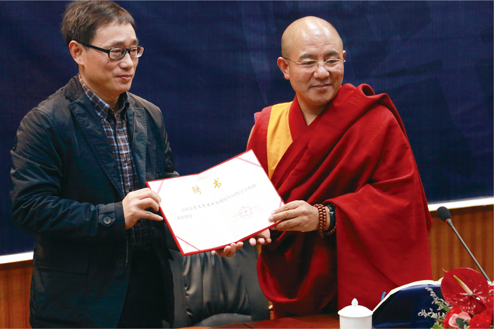
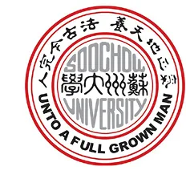
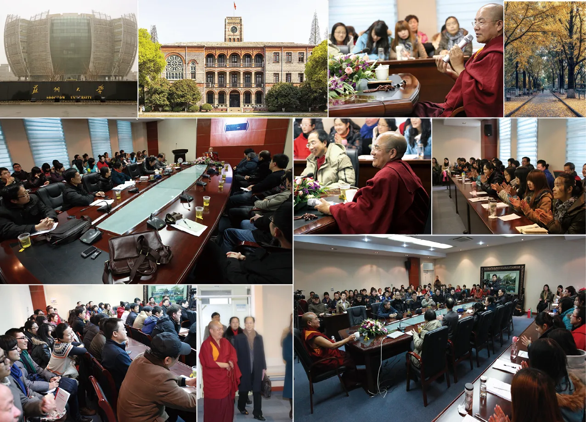
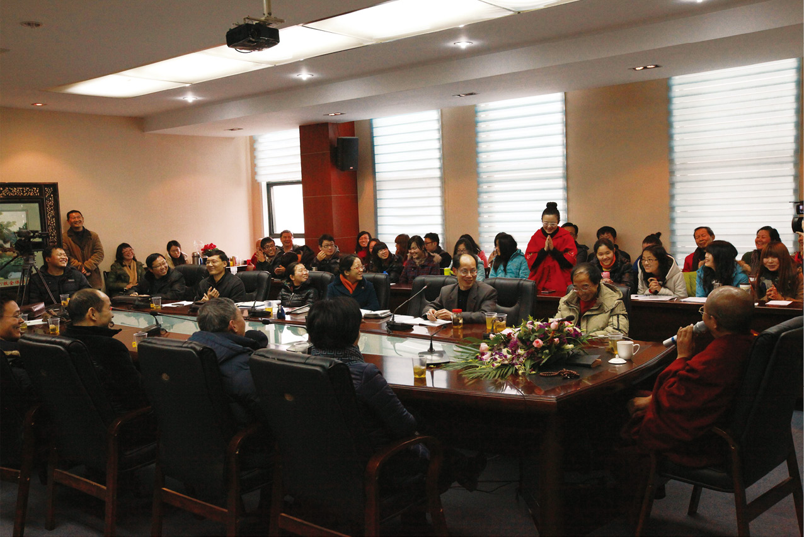

意识层面的最完美状态

——智慧、悲心、力量，

通过与简单行为结合便可获得。

这就是大乘佛教的善巧。

第47场

苏州大学

Soochow University

中国·苏州

2012 / 12 / 27

## 藏传佛教把握意识的 方法和途径

## The Tibetan Buddhist Approach On Taming the Mind

主持人：

大家上午好！本学期的“东吴哲学系列沙龙”又开始了，今天的主题是“藏传佛教把握意识的方法和途径”。

意识问题在当代国际学界非常前沿，随着神经科学、脑科学以及人工智能等学科的发展，它如今已成为一个非常显赫的课题。其实在东方思想包括藏传佛学中，对意识的探讨有着源远流长的传统，所以在这方面，东西方有许多可以交流沟通的可能性。

今天，我们非常荣幸地邀请到一位非常特别而尊贵的嘉宾——索达吉堪布。

索达吉堪布非常有名望，在座很多朋友都比较熟悉，但按照惯例，我还是稍微介绍一下：

堪布是当今国内著名的藏传佛教学者，目前任职于四川喇荣五明佛学院。堪布在藏传佛学上造诣精深，娴熟经论、著述宏富，同时也悲智双运，积极投身于慈善事业。最近堪布也关注当代现实问题，注重从当代思想角度阐释藏传佛法。

下面，请苏州大学东吴哲学研究所所长李兰芬教授致欢迎辞——

李兰芬教授：

尊敬的索达吉堪布，尊敬的各位同仁、同学们，上午好！

藏传佛学是中国重要的传统文化，在“文化强国”的战略形势下，研究藏传佛学，是建设文化强国的一个重要途径。

我们苏州大学的佛学研究，在中国学界也是重镇之地，有比较专业而且成气候的佛学研究师资队伍和人才结构。索达吉堪布此番来作公益讲座，与苏州大学的学术传统有着内在的巧合性机缘。所以，我预祝并深信，在此次对藏传佛教的传统文化作真切的近距离接触中，也能为文化强国挖掘出丰富的文化资源。谢谢大家！

主持人：下面，请大家用热烈掌声欢迎索达吉堪布做精彩讲演——

大家好！今天很高兴到苏州大学与诸位教授、老师和同学进行学术交流，探讨佛学。

作为一名普通僧人，我对藏传佛学谈不上有修证，只能说在理论上稍有了解。下面我将就自己所了解的，也是从我的老师们那里学到的知识，与各位做个分享。

我发现，如今人们对藏地感到好奇，多数是因为那里的神秘和神圣气息：雄伟的布达拉宫，湛蓝的天空，洁白的云朵，清澈的湖泊和潺潺溪流……这些让他们向往，也给了他们美好记忆。但是我建议，如果你有兴趣，可以进一步了解隐藏于这些背后的更具价值的藏传佛教。

藏传佛教自传入以来，便以其丰厚底蕴，如同我们藏地的水一样，普遍、深刻地浸润着每一个藏族人的心灵。

佛教什么时候传入西藏？

有两种说法。一种说法是，在公元5世纪的拉托托日年赞时期，这比佛教传入汉地（公元67年东汉时期）的时间要晚。但据《中西交通史料汇编》以及藏地著名旅行家、史学家根登群佩的一致说法，是公元前3世纪。

那是在释迦牟尼佛涅槃272年后，阿育王执政期间。《中西交通史料汇编》是这么说的：“孔雀王朝阿育迦大王……大王奉佛。遣僧人至诸邻国，传布佛教。远如埃及、马其顿、西藏，皆为佛徒踪迹。”所以，确切地讲，应该是早在这个时候，佛教就进入了西藏。

两千两百多年了。那这和一般说法相违吗？

不相违。就像早期儒道未形成宗教时已对社会有了影响一样，当时佛教进入藏地以后，虽然暂时还没有被纳入王室宗教，但因为它的教导人所共爱，而且行之有效，所以很快在民间形成了信仰。并从此历经久远，流传至今。

## 藏传佛教的重要作用，就是转化意识

在今天这个浮躁的社会里，人们有着说不完的烦恼、情绪和无助感。面对此类问题有人发现，要解决它们单单依靠物质是不行的，因为这更多关乎精神，是意识层面的事。

“有没有解决之道？”寻找中，他们遇到了藏传佛教。

这不是巧合，因为藏传佛教的重要作用，就是转化意识，它能让我们的内心充满智慧、慈悲和力量。这种转化之道，高等的知识保存于寺院，由佛教学者们继承和实践，简便易行的就流布民间。

有人看到藏民表达信仰的虔诚行为，感觉不理解：为什么要供酥油灯，不浪费吗？为什么要手摇转经轮、转动大经轮，不晕吗？为什么要三步一拜磕大头，不累吗？……做这样的行为有什么意义？

其实，这就是在转化意识。藏传佛教认为，行为和意识有着很深的联结，一个小小的行为，以其自身的象征性，加之背后的发心力量，会对意识形成最深、最有效的转化。

转化的关键是发心。藏地人了解和学习的都是大乘佛教，在大乘佛法的教导下，人们无论做任何善法，都不会忘记利他的发心或动机。因此，和一般人行善不同，他们不论供灯、磕头或是摇动转经轮，都会因为利他心的驱使，把微小善法也转变成对意识层面的巨大启发。

## 以供灯开启智慧

你们供过灯吗？供灯时都想些什么？

在藏地，不论平民百姓还是知识分子，他们了解灯代表智慧，点燃一盏灯，就是点燃内心的智慧。所以他们在供灯时会想：“愿我以这盏灯的明亮，驱除一切众生内心的愚痴黑暗，为他们开启明了真理的智慧。”

这种美妙善愿甚至被写进文字，让人们不论在家、在寺院或者在任何地方供灯时，都这么念，也这么想。

我知道你们也会去寺院供灯。我在汉地佛殿里见到有年轻人供灯时，好奇他们都说些什么，但很难过，听到最多的是：“佛啊，您一定要保佑我身体健健康康，家庭平平安安……”全是为自己。这样祈祷是狭隘的。

所以，希望你们以后供灯的时候，除了想到自己以外，也要想到这盏灯代表智慧，你正在点燃智慧之灯，愿智慧光明遍照所有世界的一切众生，令其不再沉溺无明黑暗，愿他们的心灯开启，愿整个世间沐浴在无量光明之中。

## 以转经轮运转慈悲

大多数的转经轮里装的是观音心咒，所以转动它，也就象征着你在运转内心的慈悲。

我们平常的心态总会固守自我，是狭隘、僵化、不开放的，像一潭死水。而借由转动经轮这样的佛教行为，你可以把自己的心运转起来，让它本有的慈悲自狭而广，转动到你身边的穷人、可怜人身上，转动到每一个微小如蚂蚁之类的众生身上，令其全都离苦得乐。

类似的行为还有转绕佛塔、佛像或寺院，你们去过大昭寺的应该都看到了。不懂的人觉得这些行为无聊而愚痴，但稍微懂一点佛法的人会知道，这不比运动锻炼缺乏意义，这是对心的一种训练——让我们的心结合经轮的转动，放下自我，展开大悲。

你们摇过转经轮的都有体会，当你摇动它的时候，会明显感到自己的心变得平静温和。按佛经记载，这种行为的确可以利益到众生，甚至就转经轮自身的功德而言，仅仅搁在亡人的身边，他就不会堕入三恶道。

这种神奇的功效，即使你不了解、不理解，也不要诽谤。就像一粒看似平常的妙药，你甚至不相信它能治病，但当你亲自感受到药力的时候，就不会再小看它了。

## 以磕头造就力量

磕头是我们比较熟悉的。

《百年虚云》里再现了当年虚云老和尚从普陀山三步一拜朝礼五台山的情景，激励了很多佛教修行人。这种修行在藏地更为普遍，你们在电视里或那边的路上应该都见到过。在藏地许多人的一生里，都有这么一段经历，他们会少则半年、多则一年甚至更久，三步一拜越过千山万水朝礼圣地。每次我在路上看到他们，都随喜不已。

马尔康一带有个叫“观音桥”的地方，那里供奉着一尊天然自现的观音菩萨像。附近像红原、若尔盖等两百公里内的所有信众都会来此朝拜，有些就是三步一拜前往。当然，我们听说最多的，就是以这种方式朝拜拉萨。

要去朝拜的人，启程前通常会接受一定的身体和心理训练。身体方面，他们将由专业的上师教导如何做正规的礼拜。心理上，除了要了解怎样面对困难和违缘外，最重要的，就是强化利他的心态。上师会教你观想：“我要通过这次礼拜，开发我利益天边无际一切众生的所有能力。”这样训练一两个月，你就可以启程了。

所以，磕头象征着利他的坚定和力量。

意识层面的最完美状态——智慧、悲心、力量，通过与简单行为结合便可获得，这就是大乘佛教的善巧修行。

由于这种广泛的文化熏染，藏地人在他们的日常生活中处处找得到修行佛法的因缘；也由于这种深厚的修行氛围，在藏传佛教的历史上出现了许多大成就者，他们都是转化意识的典范。我的老师就是其中之一。

## 意识转化后的超越与神奇——我的老师

我这辈子最感恩、最有感情的，就是我的老师。

我的老师2004年圆寂，今天刚好是九周年，我们学院正在开纪念他的法会。我依止我的老师近20年，从1985年开始，到2004年老师圆寂之间。就目前传递知识的体制来看，一个学生以这种方式——花尽可能长的时间来依止他的老师，可能并不多见。而在依止过程中，我从我的老师那里不仅学到了知识，也发现了难以想象的超胜功德与成就。

我的老师是法王如意宝晋美彭措，他是举世公认的、全球性的精神导师，就是从整个佛教历史看，也是具有代表性的著名佛学家，具有极高修证的成就者。他的离世，对文化界、宗教界，都是一个巨大损失。

我知道，从诸位对哲学思想的认识，以及我对因明训练的了解分析，如果我不够理性，仅仅因为感情的原因，说一些不尽合理甚至过分赞叹的话，是不恰当的。所以我想就我所了解的，在老师的诸多功德中，介绍两点与大家分享。

第一，传法不辍。自11岁开始，我的老师便开始传法了，也就是讲授佛教的课程。

我的老师自小智慧超群，这也是他的老师让他在寺院讲课的原因。11岁这个年龄，一般的孩子小学还没毕业，但他已经开始讲法了。从那时候起，一直到72岁之间，我的老师从未中断过讲经说法。即使在一些混乱的年月里，他也是带着弟子们，躲在森林的山洞里听着枪声讲法。有时子弹就掉落在他们的洞顶上。

60岁时，我的老师得了白内障，看不清字。当时我跟随他去印度，那里的寺院请求他讲法。他让人把每天要讲的课的原文（论典的颂词或长行文）用录音机录好，讲课时放一段，他给学生们解释一段。那是1990年。此后一直到圆寂之前的十几年时间里，都是用这种方式讲课。

我想你们做教育工作的人，都要有这种精神。我听说有的教授五十来岁就想退休：“我老了，该休息了。”其实你不老，按《黄帝内经》的说法，六十岁是人生新的开始。所以，六七十岁将是你的辉煌岁月，只要你还怀抱着深藏于内心的使命感，就可以为社会做出很大的贡献。

我佩服我的老师，他眼睛看不到了还是天天讲课，在学院、在藏地、在世界各地，到哪儿都要为人讲法。他讲了一辈子的法，可以说，六十多年从未中断过。我相信，如果他不圆寂的话，还会继续讲下去。

还有一点，是他的成就相。讲法不辍我们可以学习，甚至做到一些，但这种成就相很神奇，我们无法企及。

我相信科学，读师范时就学过唯物论，懂辩证法；也相信佛教的理性思辨，因为在学习佛法过程中，接触最多的就是因明推理，可以说，我所学到的一切让我变得相当理性。然而，有些事情——我在我老师身上亲眼看到的有些现象，让我不得不信服，他有着非同一般的成就。

那是1989年，我们跟着老师一起去朝山。就在一块平平的石头上，当老师的脚踩下去时，石头上留下了一个很深的脚印。在场许多堪布都看到了，我也看到了：前面没有脚印，老师踩过，才出现了脚印。

但我不迷信。我学过唯物论呀，出家后又学过因明，“脚踩在石头上留下了脚印”，这怎么可能？就算亲眼看到，我还是不能相信。我的分别念比你们重。

晚上回到住处，我悄悄偷出上师的鞋子，量好尺寸，长多少、宽多少，连鞋底的纹路都记得一清二楚。

第二天上路前，我找个借口离开队伍，爬了一个多小时山路，来到昨天的那块石头前。在量过脚印的长宽后，我又仔细对比了脚印上的纹路和我昨天的记录，结果全都吻合。没办法，我不得不相信——应该说，我完全被折服了。

那个脚印今天还在。

说到成就相，藏地还有很多。前几年新龙有一位虹身成就者，他圆寂后没留下一片指甲、一根头发，整个身体都化成了光。这是我们学院一位堪布亲自采访后证实的。

这位堪布还证实了五几年发生的一件“不舍肉身前往清净刹土”的事件。那天，才旺仁增喇嘛在被带往批斗会的路上，从马背上飞入虚空，之后消失不见。带他去的人全都看到了，但谁也不敢说，只说死在路上，埋了。不过事情还是传了开来。这位堪布去青海采访，找到一两个当时还健在的目击证人，听他们讲述了亲眼所见的整个过程。他们也觉得神奇，但又不得不承认确实发生了。这些资料在网上都有。

在这个世间，神奇的现象和神秘的知识很多，我想你们和我一样，不会全信，但不必全都否定。

可能受“唯物论”影响，很多同学不论学理学文，一听到类似事情就排斥，其实这不见得理性。有个知识分子说自己身上有附体，他相信，因为感受到了，但旁边的人都不信。他们否定他的感受，凭的就是唯物论的认识，认为除了人以外，不可能有所谓的鬼神。

其实是有的。有人也确实感受到了干扰，心态变得明显不同。这是真的，佛教也有解释。如果人们能超越旧有认识，从现实出发，很容易发现某些理论的局限性。

回到意识问题上。我想我的老师通过他的修行和实践，从我们可以了解的层面看，不论智慧、悲心还是力量，他和一般世间人的意识状态确实是完全不同的。

## “我分不出哪些是佛教以外的生活”

据国家统计局和中央电视台联合进行的“CCTV经济生活大调查”，拉萨市连续五年被评为中国幸福指数最高的城市。

幸福跟什么有关？

有人认为跟房屋、建筑以及设施的舒适有关，我不否认这是一种条件，但我认为，最重要的是藏族人有信仰。

《寻找香格里拉》里有一位上师，当主持人见他下榻香港五星级宾馆时一脸欢喜，以为是条件好，所以他开心。但等上师住进西宁的普通宾馆，依然面带微笑，回到家乡的简朴生活，不顾劳累接待善男信女为他们祝福祈愿，也仍旧是一副温和笑容时，他才相信，上师的淡定随和，应该是佛教信仰的力量，是信仰让他随遇而安。

希望你们了解：这种把信仰融入内心，时时处处关注他人需要，而不在意自我的生活状态，的确是快乐的。

每个人都想自己快乐，但遗憾的是，这种想法常常让我们深陷痛苦：为自己得不到而难过，为得到了会失去而焦虑，甚至为别人拥有了自己想要的而嫉妒。“为什么他有车有房，而我没有？”好像是别人把自己的车和房子抢去了。

嫉妒有什么用呢？何不为他人的快乐而快乐？

所以，在大乘佛教教导下，和自己的快乐相比，藏地人更在意他人的快乐；和今世的快乐相比，他们更关心来世的快乐，因为来世长远，而今生几十年很快就过了。

在香港“第二届世界佛学研讨会”上，中央民族大学的一位青海藏族学生说：“藏传佛教是每一个藏族人的心灵罗盘，它已点点滴滴融在我们的生活里，我分不出哪些是佛教以外的生活。”我完全认同他的说法，并且相信，这正是藏地人信仰坚固同时也颇感幸福的原因。

藏地人在起床后、睡觉前，会用一种既定的规矩和程式念诵祈祷，婚丧嫁娶也在佛教仪式中进行，人们见到佛塔就脱帽致礼，喝杯茶也会感念三宝的恩赐。总之，因为行住坐卧全部贯穿着佛法，慈悲与智慧理念很自然地在人们心里生长了。这就是全民信佛的力量。

美国人信仰上帝的比例也相当高。据盖洛普调查，他们十人有九人信仰上帝。大家知道，美国人重视体育，但他们每年观看体育运动的人数是5亿人次，而参加宗教活动的人数是50亿人次；他们每年在体育方面的开支是50亿美元，而对教会的捐赠数额却高达500亿美元。

奥巴马在竞选演讲中说：“如今美国的强大，并非依赖它的军事与财富，而是依赖人们的信仰和信念。”历代每一位美国总统就职演说的最后一句话是“上帝保佑美国”，这句话被写进美国国歌，甚至被印在了钱币上。

信仰对美国意味着什么？

对没有信仰的人群来说，这一切或许很难理解，但对那些信仰本身就是生活方式的人来说，又怎么能离开信仰呢？

## 我们需要什么

我们需要什么？

需要现代的知识和技术，依靠它过好自己的生活；也需要到外面看看，看山看水，看看外面的世界；但更需要的、终究会需要的，却是内心的宁静。

就像技术可以在专业培训中获得一样，宁静一定要经由佛教的训练才能得到。在藏地的寺院里，僧人们通常要接受许多训练：逻辑的训练、为人处世的训练、禅修的训练，在经过了不是一年两年，而是长期训练以后，一个合格的僧人，因为具有了遣除烦恼的能力，不论在何时何地，都能表现出一种不受干扰的状态。

我们还需要什么？

还需要慈悲心。慈悲心就是利益他人的心。习惯为自己着想的人，学什么都为自己，其实这利益不大；如果你受过利他的教育和训练，再学什么都会更有意义。

我敬佩我的老师，也仰慕藏地历代的伟大上师们，他们都是在利他心的推动下，成就了一番伟业。然而，即使是一个普通百姓，当他在大乘佛教教导下，有了慈悲的利他心，做着属于他自己的利他实践，我认为，这一样高贵。

## 一毛钱的慈悲

曲吉是这样一位普通而高贵的女人。

一篇文章中写道：曲吉是拉萨一间宾馆的服务员，每月收入1200元，她的丈夫早已过世，她用这些钱，一方面要供女儿在内地读大学，一方面还要养着没有工作能力的弟弟。

笔者发现，她每天都要背着一个很大的鼓鼓的旧布包上下班。在一次去曲吉家做客时，她发现了这个包的秘密：里面装满了面值一毛的钱。

曲吉的家在小昭寺的背后，是那种老拉萨人家。走出宾馆过了马路以后，有许多乞丐在路边向行人讨钱。这时曲吉打开包，掏出一毛钱给一个乞丐，接着又是一毛钱给下一个。就这样，她一毛钱一毛钱地给，遇到多少就给多少，一个也没有落下。

“你每天都这样做吗？”作者问她。

“是啊。我钱不多，只能给一毛钱。”

“那你不怕给完了，自己没饭吃。”

她笑着说：“我妈妈在的时候就这样做的，我从小也是这样做的，可是从来没有因为给出一毛钱而吃不上饭……我妈妈说，一毛钱的布施，可以让慈悲心像流水一样不断掉。最后形成大海一样的慈悲力量。”

一毛钱实在微不足道，但曲吉却用这每一个一毛钱，对那些乞讨者表达着她的慈悲态度。

可能这是今天的人们最缺乏的态度。换位思考一下：如果我成了乞丐，要站在路边仰视行人哀求乞讨，那我会是个怎样的状态？也许我已习惯了冷漠和蔑视，但在我的内心深处，不需要一种慈悲的关爱吗？

人有富贵的时候，也有贫贱的时候，两者相去不远：可能今天还是总统，明天就被判刑；前半生风光无限，后半生妻离子散……这是真实的人生。

所以，在你能够给予的时候，要慈悲地付出。人一旦有了慈悲，对周围的人或动物所作的交流，也都成了爱的传播。传播爱，这是当今社会最需要的。

## 把爱传递生生世世

爱不仅可以传递给他人，就拥有爱心的个体而言，爱的力量还可以从今生传递至生生世世。

在佛教的认识里，前世后世是一个基本命题，不难理解。林肯的博爱和坚毅从哪里来？牧师兼作家索瓦（Richard Salva）在其新书《从林肯到林伯格灵魂之旅》（Soul Journey from Lincoln to Lindbergh）中说：美国前总统林肯的前世是西藏喜马拉雅的一位瑜伽修行者，而林肯死后转世为林伯格，一位著名的飞行员。

他有很多证据。对照了林肯与林伯格在性格、思想以及为人处世的方方面面后，他以翔实的资料和充分的依据，证明他们是同一个人，是同一个生命在延续着。

林肯竞选总统时落选七八次，但他却可以不断地站起来、站起来，勇敢地面对一切；执政过程中也是饱含慈悲，充分展示了他的智慧。对这些超越常人的特质，作者分析认为，这来自他前世在喜马拉雅修行的力量。

至于他的前世修到什么境界，意识转化到什么程度，我们不得而知。但依据佛教的教义，以及科学对林肯或更多人的案例考察，我觉得现代人有必要了解：我们即生通过学习或实践所拥有的状态，不管是什么状态，都将传递到来世。

可能是教育原因，一般人都认为“人死如灯灭”——生命只有一世，过完这一世就全然消失了。

当这种认识根深蒂固后，再有智慧的人，恐怕也只会关心短短几十年的生活。关心眼前无可厚非，然而遗憾的是，今天的人们怀疑甚至排斥来世，并不是因为他们对自己的认识有多么确切的了解，而是因为无知。

所以，作为学者，理应寻找真理，理应对前世后世、业因果等神秘与甚深的知识进行探索，这才是求知的态度，也才是对生命更负责任的态度。

最后我做个简单回向——在藏传佛教的教导下，不论做任何善事，都要把这种善根或福报以回向的方式奉献给他人，并认为这是最好的礼物。所以，我把今天与诸位共同探讨利他与智慧的所有善根，也都奉献给各位。

现场互动

问：我是苏大外院的学生。我发现佛教徒与非佛教徒在价值观念和生活观念方面有些矛盾，对此您怎么看？

堪布：以我个人的理解，佛教徒和非佛教徒如果在观念或行为上有冲突，应该不是在善的方面。因为非佛教徒所称道的心地善良、做人做事合情合理，正是佛教的要求。

佛教讲十善：在身体上，不杀害生命、不偷盗、不邪淫；在语言上，不说妄语、恶语、绮语和离间语；在心理上，没有贪心、害心，也不抱持邪见。对这十种善的要求，我相信，一个不信佛但追求人格完善的人，也一样会努力的。

因此，佛教徒不会排斥非佛教徒。不过有一点我希望非佛教徒也能了解：就是佛教不是迷信，是智信。

凭我多年学习佛法以及各种优秀文化的经验判断：一个好人的行为，或者好的生活方式，与佛教不冲突；一个心地不善者的行为，或者不好的生活方式，不仅与佛教，与世间道德也是冲突的。换句话说，如果你讲求真理，与佛教就不冲突；如果你不讲求真理，那与佛教一定相违。

问：我是苏州科技学院的毕业生，信佛一年多。我身边有很多同学、同事都觉得，佛教在为人处世方面很有智慧，在认识事物方面也讲得很有道理，但对非自然力量的那部分，他们不太相信，甚至很生邪见。我自己也觉得，因为眼睛见不到，所以不太有信心。请问这怎么破？

堪布：你所谓的“非自然”是指什么？

问：比如“前世后世”“冤亲债主”之类的，就是现代科学没有证实过的事情。

堪布：你们这么想，可能跟从小的环境和成长中所受的教育有一定关系。

前世后世的问题，我在很多学术交流中都提过，也跟学者们做过大量探讨。可能你们不相信，探讨中我依据最多的，反而是现代科学的案例和论证。在当今发达国家的科学界里，虽然不是所有科学家都相信这些“非自然”现象，但有相当一部分是相信的。这种权威性的论证，在十年前我译的《前世今生论》、我写的《佛教科学论》里有很多。

所以，这是佛教与科学共同承认的道理。

你刚才说“眼睛见不到，所以不相信”，我能理解，但这种说法不符合逻辑。因为我们看不到摸不着的东西太多了。量子物理学讲的波或能量，我们就看不到，但专业人士们了解，对此谁又能否认？还有意识问题，意识里有很多浅浅深深的层面，我们见不到，甚至都想不到，能否认吗？

昨天在与济群法师探讨佛法时，我们一致认为，在心的问题上，佛教心理学肯定最有优势。对科学家尢智表在《一个科学者研究佛经的报告》一文中，把唯识学与心理学结合起来的认识，我们也都深表赞叹。

至于冤亲债主，你可以采访一些被冤亲债主干扰过的人，包括明星、名人，采访过以后，你会信的。

问：我是管理学院哲学班的一名学生。据我所知，太虚大师提出“人生佛教”，星云大师把它演化成“人间佛教”，目前人间佛教的思想在我国得到了普遍认同和支持。我想请问，藏传佛教有没有受到人间佛教思潮的影响或冲击？

堪布：冲击可能谈不上。因为藏传佛教的理念，在藏地两千多年的文化历史中，一直是人们生活乃至行住坐卧不可缺少的一部分，这不就是人间佛教吗？也许是汉地佛教没有这么普及的缘故，当太虚大师、星云大师一提倡，它就成了一种革新性的理念。其实藏地一直如此。

我今天没有提大手印、大中观、大圆满，这些法太深，很难普及。只是讲了供灯、磕头和转经轮，这些行为虽然简单，但是懂的人听了也会知道，这完全是以整个藏传佛教为背景，体现在普通人群中的一种文化形式。

所以，要提“人间佛教”的话，藏地早就有了，或者说，整个藏地本来就是弘扬人间佛教的领域，没有什么冲不冲击的。只不过，要适应新时代，新的形式还是需要。

问：我是来自上海交通大学的。在我做事过程中，时间长了容易昏沉、打瞌睡，这在佛教里有没有解决办法？

堪布：佛教里修习禅定，心思散乱时，要求眼睛往下看，身体不动；如果是昏沉欲睡，就要求稍微运动一下身体，摇一摇头，眼睛往上看。这个方法很有效。

问：怎么能够长期保持专注工作，不畏难？

堪布：想要善始善终地做事，最重要的是心态要稳重。

困难哪里都有。今天在这个部门，明天换到那个部门，遇着一点违缘就换来换去，是不明智的。我个人认为，不论做什么事，只要是你经过观察并决定下来的，遇到什么样的问题或痛苦，都不应该退却，应该更加坚强。

有一次，年轻的艾森豪威尔（Dwight D. Eisenhower, 1890-1969）在和家人打牌时，一抓到坏牌就抱怨。母亲很严肃地对他说：“如果你要玩，就必须用你手中的牌玩下去，不管那些牌怎么样……你能做的就是尽你全力，求得最好的效果。”

他一直记住母亲的话。在以后的生活直至当上总统的每一步路上，遇到再大的困难或违缘，都不再抱怨，只是专注于解决之道，从而磨砺了智慧，甚至找到了乐趣。

所以，人生需要智慧。有了智慧，复杂的问题可以变得简单，困难也可以变成顺缘，从而让浮躁的心态渐渐稳定。在这种状态里，做任何事都会有效率。

问：我是苏州大学的讲师。汉传佛教常以比喻说，如来藏自性清净如水，由无明风起，产生了假有的波浪，波浪也是水性。我的问题是，无明风是怎么来的？生起的可能性在哪儿？

堪布：对如来藏与无明的问题，佛教中有水和波浪的比喻：大海的水，喻如来藏光明、无为、寂灭的本体，波浪喻无明；也有虚空和乌云的比喻：虚空喻体，乌云喻无明分别。

无明是怎么来的？

它是忽然性的。就像波浪，和大海的体相对，它是忽然起的；就像乌云，从虚空这一无为法、不变更的本体来看，乌云是忽然起的、暂时的。因此，如来藏的本体恒常，而无明烦恼则可以分离。不过一个被无明所困的人，只有通过修道来到十地末位，无明所包括的一切分别心识，才会由粗到细渐次转依离去，从而呈现如来藏的本体光明。

这个本体光明是不是新生的——原来没有，成佛了才有？不是。原来就有，到了佛地只是现前它而已，除此之外，并没有一个其他的本体重新展现。

既然原来就有，忽然性的无明又是怎么起的？

是依靠因缘起的。不过这种忽然性的起现，以我们粗大的认知发觉不了。就像在无为法的虚空中，有为法的乌云一定是依靠了某种因缘才会起现，但这种起现不易察觉。

正因为无明依靠因缘而起，所以它是可以远离的。如来藏的本体常住，只是暂时被无明遮住了而已。

那无明和本体是什么关系？

禅宗、密宗都认为，就像波涛不离海水一样，当你不认识的时候，大海是大海，寂静不动，波涛是波涛，汹涌澎湃；一旦认识的时候，波涛就是海水。同样，迷的时候，我们认为有种种相的差别；悟的时候才会知道，在实相层面，“起心动念无非智慧”，就像波浪刹那不离海水一样，无明一刹那也没有离开过如来藏的智慧。

事实如此，只是我们还没有认识。

问：请问，怎样在缘起空性的背景下建立三世因果？

堪布：缘起和空性是两个层面的规则：本体是空性，显现是缘起。

在本体层面，一切万法唯一是空性，没有丝毫许的实质。佛教不是以教条方式介绍这个道理，而是用推理，如果你能跟随龙猛菩萨《中观六论》的思想，透过自己的智慧进行观察，就可以了解这一点。

而显现层面，在不离本体空性的情况下，会体现为世俗的缘起，也就是三世因果、六道轮回这样的规则。

“空”和“有”不相违吗？

不相违。物理学家们知道，在我们肉眼面前显现的这一切，它有它自己的运行规则，而这种规则与他们用仪器观察到的物质的本体规则，并不是分开的两套。现象就是本体，本体就是现象，它们不能被分割，也从来没有分割过。

这很好地印证了中观的逻辑推理。不过，或许要等你通过修行认识到心的本性时，才会确实地相信这个道理，相信《心经》里所说的“色不异空，空不异色”。

问：我是哲学系的老师，教宗教学，感谢您为我们上了一堂宗教学的课。我想问的是，现在藏传佛教在和其他宗教的对话交流方面，有什么进展？

堪布：感谢老师们也来参与这样的交流。你带宗教课，让学生们在正需要一种价值观的时候，了解一些宗教理念，这对他们的人生，或许有着超越一般知识的作用。

藏传佛教在汉地的弘扬，早期受忽必烈影响，自元朝、明朝时期就开始了，到康熙、乾隆那个年代，已颇有影响。民国时期，在法尊法师翻译诸多格鲁派论典的带动下，这一教法被广泛接受了。就我所知，如今它的影响与汉传佛教相当，尤其是在知识分子群体中，人们对藏传佛教的兴趣有增无减。而在国际上，我是听说的——没有具体统计过，有一百四十多个国家已经建立了研究藏传佛教的中心和机构。

说到和其他宗教的沟通，海外的藏传佛教机构常常开一些学术研讨会，这种形式非常好。明年七月份，我们也准备在香港教育学院搭建平台，邀请基督教、伊斯兰教、道教、儒教等各宗教人士，进行一个世界性的平等开放的交流。

前段时间，我在社会科学院参加了一个宗教与慈善的论坛，聆听了十多个国家各种宗教的思想。我记得听到最多的，就是基督教的声音。和我们佛教只宣扬自己的教义相比，他们更关注的是服务社会，帮助弱势群体，而且的确做了很多事情，力量也大。美国人也赞叹中国的基督徒，说他们站得高、看得远，人人有一种非常强大的使命感。

总之，交流让我学到了很多。我们的佛教是很好，但如果今天不能尽力传播，不能把它的精神体现在一些公益方面，在日后的历史中，说不定会遇到种种挫折。

问：您的开示中再再强调了菩提心，能否请您为我们宣说一下它的功德和利益？

堪布：菩提心的功德和利益，印度著名论典《入菩萨行论》第一品讲了很多，《华严经》里也有专门开示。

不过，一个人要改变是不易的，尤其是心灵改变。不论你学的是藏传佛教、汉传佛教，不经过长期训练是做不到的。

问：请问陈那和法称对现量的解释是怎样的？

堪布：很多佛经里都有因明知识，不过因明学的开创者是印度的陈那论师，进一步解释者是法称论师。

因明认为，要证实任何一种结论，需要依靠现量、比量或圣教量。在现量问题上，陈那论师在《集量论》与法称论师在《释量论》中讲的基本一致，关键点在于：当眼耳鼻舌等根识取外境时，取的是自相，所以不错乱；因为是明现而非模糊，所以是以无分别方式取受的，没有分别。

问：请问您对龙树、瑜伽行以及宗喀巴大师对“空”“有”关系的解释，是如何理解的？

堪布：宗喀巴大师在部分论典中，为接引初学者抉择过单空，但在《缘起赞》等论典中抉择究竟空性时，与龙猛菩萨《中论》里所讲的空性，是一致的。以《瑜伽师地论》为根本论典的瑜伽行派，虽然暂时抉择的是唯识观点，但在究竟胜义谛的理解上，也承认远离四边八戏的大空性。

有一部将唯识与中观观点完美结合的殊胜论典，就是藏传佛教伟大学者麦彭仁波切著的《中观庄严论释》。这部论典既抉择了名言中成立唯识，也阐释了中观宗暂时的自续派观点与究竟的应成派观点，同时对宗喀巴大师如何解释龙猛菩萨及月称论师的最究竟观点，也有分析。

我建议你看一下这部论典，看了以后，相信你对“空”和“有”会有更系统的理解。

问：汉传佛教宗派间的争论很厉害，不知道在藏传佛教中是否也有这种现象？

堪布：历史上也有。不过，如今在大范围里是没有的。

我们佛学院有一座特别大的坛城佛塔，塔的周围为藏传各宗派以及汉传、南传都设置了佛堂。这象征什么？象征佛教各教派在究竟观点上一致。虽然大家在法会、仪式以及修行方法上有些不同，但归结到佛法本质——最初发心度化众生、中间作利他行为、最终成就佛果，这些没什么差别。

昨晚跟一位法师聊天时，我们有个共识：现在汉传佛教与藏传佛教需要一个交流平台，交流可以帮助我们放下各自内部的争执，以及彼此之间的排斥。

我们认为，既然大家学的都是佛陀教法，完全可以像各地的基督徒那样团结。如果每个人都只关心各自的小派别，“这是我的上师”“那是我的弟子”，上师与上师之间不同，弟子与弟子之间有别，进而在寺院与寺院、教派与教派之间构筑起种种家庭式的藩篱，不肯有一种团结气氛，那对未来佛教的可持续发展，一定是有危害的。

所以我希望，世界上所有佛教团体都能和睦相处，佛教徒与其他宗教人士以及非宗教徒之间，也能在宽容与理解中互相学习，这样自然会遣除不必要的误解和偏见，实现各自的成长，同时也可以最大限度地推广“善”的理念。

问：佛教讲“唯心所现，唯识所变”，这个心和识指的是什么，变现的又是什么？

堪布：《瑜伽师地论》等唯识论典中讲到了心、意、识，这些在词句上可以互用，但从作用上分，也有分别对应。

“唯心所现”的“心”，可以从心的本体上讲；“唯识所变”的“识”，是阿赖耶识；所变现的就是万法。

唯识的观点，不仅是一种理论，也是可以经由实修证悟的境界。诚如月称论师在《入中论》里所说，一切万法本来就不是独立于心识之外的存在，而是心的幻现，犹如梦境。这个比喻非常好。而梦是会醒的，你梦得再久、梦里再执著，也会醒来，醒来时你将发现，梦里的一切根本就是不存在的。所以，了解唯识，也有助于了解“空”。

这个道理虽然深，却很贴近我们的感受。你们想想看，你们所看到的外在事物，是有个固定的美或丑，还是跟你的心境有关？你心情好，它也美；你心情不好，它就变丑，是不是这样？如果是，心不就成了主导？

一般人以为，物质可以让人快乐。但看看那些过着优越生活的孩子，他们坐再高级的车，住再高级的宾馆，还是一样的痛苦、伤心，甚至绝望；相反，藏地一个纯朴的穷孩子，在哪里玩都很开心。所以，心对外境有直接作用，如果是一颗贪婪的心，再多的物质也满足不了它。

所以我常说，苦乐由心。没有修过心的人，即使到了天堂也会苦恼；心得自在的人，到哪儿，哪儿就是天堂。

问：我是管院马克思主义基本原理专业的博士生。有这么一则故事：和尚和屠夫每天早起，一个去营生，一个去念佛，他们相约，谁起得早就要叫另一个人起床。后来他们死后，屠夫上了天堂，和尚下了地狱。和尚不明白，“为什么我要下地狱？”上帝说：“因为你叫他起床是为了杀生，而屠夫叫你起床，是为了念佛普度众生。”但马克思说：“人类的一切活动都是为了利益。”就这个故事我想请问，以藏传佛教的理念，如何解释这种行为与果报？

堪布：假设如你所说，和尚下地狱，是因为他叫屠夫起床去杀生，而屠夫上天堂，是因为他叫和尚去念佛，即便如此，根据佛教的认识，他们也不会永远待在那儿。

他们会以前世最主要的业，成熟另外一种果报：和尚受完苦，以其念佛的功德会上天堂；屠夫享乐后，以其杀生的罪业会下地狱。这是更深层面的因果。

因果是佛教的基本课题，什么因感什么果，哪种因先感果，哪种因后感果，都有讲述。重要的是，佛教是在一个极为漫长的生死连续中建立因果的。所以，假使这个故事是真的，我们也不应该把它当作“行善不得好报”的佐证。

因果是不虚的。我们看连续片时，这一集是这样，但广告之后，还有下一集。

问：我是一位在读博士生，专业是电影文学。我的问题是，禅宗的见性成佛与大圆满的成就，在最终取得的佛陀果位上有什么异同？

堪布：禅宗的明心见性，在层次上有些差别，大圆满的即身成佛也是如此。不过在究竟佛果上，两者是无别的。

曾有人认为，密宗的即身成佛太夸张。为反驳他，我在《密宗断惑论》里引用了禅宗的语录和公案，尤其是《六祖坛经》的故事，说明这也是显宗的观点。显宗也认为见性后可以成佛，不仅是密宗才这么说。

刚才我讲了一两个虹身成就的例子，这在大圆满的修行人中并不少见，只不过网络上的宣传不多而已。你们有兴趣的话，可以亲自去了解一下。有些成就者的修行境界和征相的确非常奇妙，很让人惊讶。
