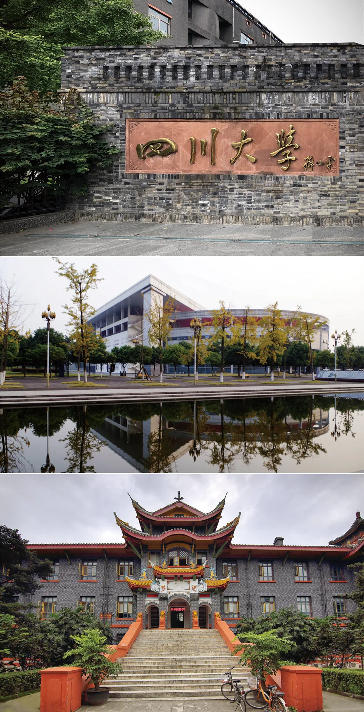
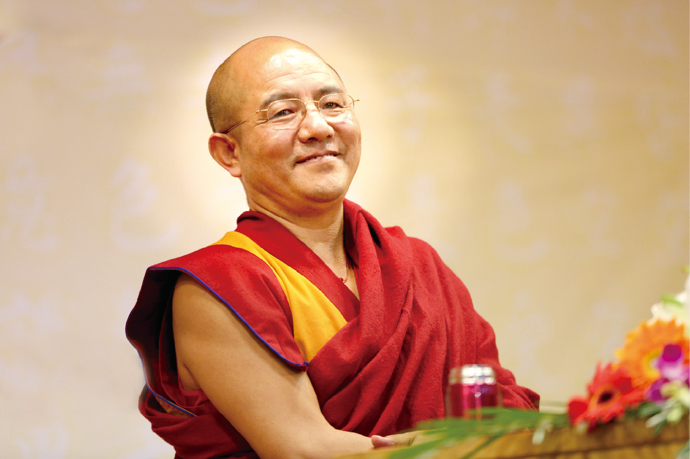

“能给人类带来灭顶之灾的最大危险，

并非瘟疫、饥荒、地震，

也不是核战争，

而是高度发达的科技。”

第59场

四川大学

Sichuan University

中国·成都

2013 / 4 / 27

## 信仰、科技与法律

## Spirituality, Technology and Legislation

主持人：

索达吉堪布刚从哈佛、哥伦比亚、乔治·华盛顿、科罗拉多以及德国哥廷根大学和马普所讲学归来，今天中午刚到成都，可能时差还没倒过来。堪布来我校交流，预计讲座时间一小时，后面半小时，大家可以就法律、科技与信仰之间的关系等内容进行提问。有请索达吉堪布——

朱老师说得没错，我确实还没倒过时差来，有点迷迷糊糊的感觉。今天有这个机缘来川大与老师和同学们交流，我觉得非常难得，很欢喜，也感谢大家的到来。

生活在今天的人们，大多对信仰、科技与法律都非常关注，我也一样。你们虽然年轻，健康、青春，对人生满怀信心，但此时不妨考虑一下这类问题，并想想将来在就业、工作、家庭中注定要面对的压力和责任。与其到时被迫承受，不如现在就做些思考，趁着年轻，确立好自己的价值观。

比如，对今天这个主题，你们有些什么认识？

## 只有科技，是危险的

长期以来，人们对科技与宗教的看法不一：有人认为它们完全抵触，信仰宗教不科学，是迷信；也有人认为二者有相合之处，也有抵触的地方；还有一部分人认为它们不仅不矛盾，而且密不可分。大概有这么三类看法。

那我怎么看呢？我认为，那种“只要科技就够了，宗教或信仰应该完全抛弃”的说法，是不合理的。

你们也知道，科技的发展不过几百年时间，而很多宗教已在世间传播了一两千年，甚至几千年之久。对于这些有着漫长历史、曾经启迪过无数心灵的智慧，到了今天，科技稍一发达就全部当作迷信，恐怕是不妥当的。看看现实，人们对信仰的淡漠带来了什么？对社会和个人有利还是无利？

所以，推崇科技可以，但视其为独一无二，所有人一心一意追逐它的脚步，不理会道德滑坡，那社会就会失衡。甚至有人认为，只有科技并任其发展，我们的前途是危险的。

前两天，据英国媒体报道说，牛津大学的人类未来研究所指出：“能给人类带来灭顶之灾的最大危险并非瘟疫、饥荒、地震，也不是核战争，而是高度发达的科技。”他们认为，科技发展速度太快，已经超出了人类的控制能力，它“就像孩童手里的致命武器”，将会发生什么，你无法预计。

他们最担心的是，当电脑的威力一代胜过一代，最终会出现“智能爆炸”现象，它所造成的伤害，可能会影响到地球上的每一个人，绝非一战二战可比。现在大家都担心核武器，担心它被希特勒（Adolf Hitler, 1889-1945）、本·拉登（Osama bin Laden, 1957-2011）那样的人使用，伤害所有的生命。但人类未来研究所所长坚持说，相比而言，还是高科技可怕，如果国际决策层不重视这些，一旦决策失误，“那21世纪可能就是人类在地球上存在的最后一个世纪”。

由此可见，一味推崇科学，没有宗教信仰为之护航，可能谁都无法保证它会在一种正确的轨道上行进。

## 只有法律，是缺乏温情的

下面看看法律。美国百分之九十以上的人信仰宗教，但这种信仰和藏族不太一样，他们在管理上完全依据法律，定得很死，打孩子都可以报警。这次我在纽约遇到一对藏族夫妇，他们就是因为打孩子，被拘留了十五天。

是不是有点不近人情？在中国，藏地汉地一样，孩子不听话，有必要时父母就打一打，算是教育。但在美国不行，老师会告诉学生：“不管是你的父母还是亲戚，谁打你都可以报警，拨911。”那对父母就是被自己的孩子报警拘留的。

当然，也不都是这样，传统还是有力量的。有个藏族小女孩也被父母打了，在外面哭，一个美国孩子过来问她：“你为什么哭啊？”

“父母打我。”

“快去报警！”

“为什么要报警啊？他们是我的父母。”

美国孩子愣在那儿，不说话了。

孝顺父母，知道感恩和恭敬，这是我们传统文化中的基本美德，可是到了美国，在那种法制健全的管理中，只要违反法律，即使是父母和子女间的问题、夫妻间的问题，都可以用强制方式处理，稍微有点什么，就可以报警。这似乎很有秩序，但仔细想想，只有法律，也是缺乏温情的。

这毕竟是人的群体。在人类社会中，完全依赖法制，约束不良行为的同时，是否也桎梏了人性？利多弊多，值得观察。

## 我们需要法律，也需要自律

我到学校交流都是学术性的，以探讨理论的方式让老师和同学们了解宗教，当然，有时也会介绍信仰的意义。

在交流中我经常感到，交流是要有时代性的，所以到了其他场合，我也会建议宗教人士们多了解现代的法律和科技等各类知识，以适应当前正在发生的改变。

人类已经走到今天，已经生活在和前人不同的模式里，用着不同的表达方式，此时一味守成不变，恐怕就很难建立起有效沟通了。有效沟通不是要把宗教完全世俗化，这会破坏理论的完整和严密，但形式上不随顺时代，也会被淘汰。

我一直认为，宗教是古老的，但不落伍，在某种意义上，它就是很好的法律。法律的目的是以强制手段规范人们的行为，而宗教的意义在于，它教导以信仰方式达成一个人的自我约束。比如，你所信仰的教义不允许偷盗，当它在你的心里从小形成自律，长大了就不会贪污，以致泥足深陷。

所以，我们需要法律，也需要自律。

我在哈佛和一位老师聊天时，聊到了选举，我故意问他：“你们会选一位没有任何信仰的总统吗？”我知道美国人基本都有宗教信仰，“你们的法律允许吗？”

“法律是允许的。”他说，“但是，一般民众不会投票给这个人，因为没有信仰，就没有道德底线，不可靠。人是需要自律的，尤其是掌权者，没有信仰，很可能无恶不作。”

## 佛教不是简单粗浅的知识

也许有些同学一直这么理解：凡是信仰就是迷信。

其实这要分开看。我知道，不是所有宗教都十全十美，宗教中是有迷信的，也有狂热或崇尚暴力的，给世界带来威胁的，但那些真正的宗教，其教义完全跟得上世间理论。要是谈到佛教，近代思想家梁启超甚至提出“以佛学为国教”的尝试。这次我在德国遇到好多研究梁启超思想的人，他们一直钻研这个命题：如果把佛教作为国教，对国家有何利益？

我倒没有智慧探讨这类问题，但我相信，如果知识分子们能够学习佛法，并借由这种高贵思想为人民服务，那的确会给我们的社会、国家乃至全世界，带来诸多利益。

佛教救护天下苍生的慈悲理念，以及彻底揭示万法真相的智慧，表明这一教法的确是真理。如今大家的思想都开放了，以这种开放心态，我相信，你很容易瞥见真理的光芒，或至少发现，原来佛教不是一门简单粗浅的知识。

西方人早就了解这一点了。这次接触好多学者，他们对藏传佛教的喜爱出乎我的意料，他们把这个作为一生的专业，能说流利的藏语，会写藏文，理解也很好……很让人感动。在我去过的这几所大学里，都有这种杰出的研究者。

有位老师研究藏传绘画二十三年，跑去藏地的德格巴宫（德格印经院）二十多次；科罗拉多大学一位教授，全球生态及环境方面的专家，研究藏传佛教十七年；还有一位哈佛大学教授，1993年我随法王如意宝去美国时见过她，她最关心男女平等，是个女权主义者。

美国历史上对女人是有歧视的，例如没有选举权等，虽说已渐被废止，但直到今天仍然有一些不平等。二十年前她就研究这个，现在还在研究。那天我去听了她的课，来自各国的学生都聚精会神地听着，很有兴致。

他们把《空行母益西措嘉传》《晋美朗巴密传》都译成了英文。在探讨藏族妇女的社会地位、生活习惯时，传记中的细节描述，让他们很想到藏地实地了解一番。我们了解这些不难，学藏语也不难，但对他们来讲，是不太容易的。他们会说藏语的，一般都说拉萨语，很少听到我们那边的安多语，所以，有时我也装成拉萨人和他们交流。

聊完学术，说起信仰，我发现情况就不同了。

总的来讲，研究可以，研究任何宗教都行。有的学校是完全开放的，既可以研究，也可以信仰和修行，但有的只能研究，不能传教，还有的不允许修行。有人告诉我，很多老师是不会说自己信哪个宗教的，因为一说出来，比如他信基督，有同样信仰的学生喜欢他，但其他的就不好说了。

所以，一问信仰，他很可能会转话题，甚至很生气地看着你，“为什么问这个问题？”

但不管怎样，有一点很好，就是他们都是把佛教等各类宗教当作非常甚深的学问看待，没有人认为这是迷信。

## 由戒律转化的四种文化诉求

你们很多是学法律的，我认为，佛教里讲的十善——身体上不杀、不盗、不淫，语言上不说妄语、恶语、绮语、离间语，心里不贪、不嗔、不起邪见，就是简单的法律。

公元641年，藏地最早的留学生囤弥桑布扎从印度学成归来后，立即创立藏文，结束了此前藏地没有文字的黑暗时代。在他所译的《十善经》里，就专门讲授了上面这十种善法。自十善成为藏民族的行为规范以来，出生在这块土地上的人，自小会从父母那里得到教导：你不能杀人、不能偷盗、不能邪淫、不能说妄语……这些都是不对的。

佛教就是用这四条——不杀、不盗、不淫、不妄语，作为根本戒，对佛教徒做了最低的行为要求，从古至今没有变更过。而到了今天，它的意义已不再局限于佛教内部，德国全球伦理基金会秘书长斯蒂芬·施伦索格在一次演讲中，就以此为基础形成了四种通用的文化诉求：

第一，不杀，他们理解为，是对非暴力文化以及尊重所有生命的诉求：“你不杀——也不会折磨或伤害任何人。”

全世界的人们都认为，杀人是大罪，佛教教义将遮止这一恶行排在首位，认为是第一善法，就是基于对生命的尊重。佛教认为，当你以自己为起点去看待其他生命，看待自己对待他人的行为时，就能理解：我们是那么珍惜自己的生命，认为它珍贵，那么其他的人呢？一样的。其他的生命呢？一样的。因此，凡是生命都是尊贵的，不能杀害。

第二，不盗，是对团结文化以及公正经济秩序的诉求：“你不可偷盗——也不可贪污，不可利用、贿赂任何人。”

所谓偷盗，就是把别人的东西拿来据为己有。贪污可以说是最严重的偷盗，不偷盗就是廉洁。为什么是团结文化呢？我们知道，很多矛盾都是因为财物引起的。比如，几个人合伙赚了三百块钱，分的时候一定要各得其所，分得清清楚楚，否则就会出现争执，不团结了。所以，也不能偷盗。

第三，不妄语，是对宽容文化以及诚实生活的诉求：“你不可说谎——也不可欺骗、掩饰，或私自操控。”

不说妄语的人有诚信感。在藏地，爱说谎的人，一般别人上过一次当，就会防着他了。我想很多地方也是一样的。

第四，不邪淫，他们理解为，是对以责任文化处理性行为的诉求：“你不可犯奸淫。”

这一条是维护家庭和合的重要条件。你们也知道，现在很多家庭里出现的不信任、不和睦，就是邪淫导致的。

把这四条做好了，再加上不饮酒、不抽烟——这是两项健康文化，那我们的人生就会相当清净和圆满了。在一般人的看法里，喝酒抽烟只是对健康不利，但在佛教看来，它们对心理健康也不利，因而也被列为最基本的禁行。

听到这里，有人会想：“佛教的条条框框这么多，出家人的、在家人的，学佛是挺好的，但这些戒我受不了。”

其实哪里没有戒呢？它不过是规范行为的准则而已。

做人做事的层次越高，“戒”也越多，这是很自然的事。比如酒店员工，他的戒条就是那些“不准”，如果三星级酒店只有十条“不准”，五星级可能要二十条，七星级至少三十条。国家各级领导也一样，越往上要求越高，一定要做的、绝对不能做的，相当多。做不到，那你就胜任不了。

由此可见，戒律说起来是这个不准、那个不准，好像很束缚，实际上不是——你看得懂，它是真正在保护你。只要你守得好，它会帮你提升做人及修行的素质。我从来没有看到这种现象：戒守得越来越好，人却变得越来越可怜。

因此，用适度的戒守护行为很重要，尤其是在今天。

## 信仰也要跟上

在今天，伴随科技越来越发达，我们对自己的行为是否越来越有了控制能力？并没有。事实上，即便法律越来越健全，但由于道德跟不上的原因，犯罪率已越来越高了。

中国政法大学犯罪学教授魏平雄在他的研究中说：“我们正在目睹建国以来的第五次犯罪高峰。这次高峰自1989年出现以来一直没有降下去，更糟糕的是恶性程度逐年上升。最近几年每年发案150多万起……换言之，全国每20秒钟就发生一起刑事案件，每分钟发生一起重大刑事案件。”

除了案件的数目和大小以外，他特别提到：“还有4个值得关注的新特点：年轻化、组织化、流动化、智能化。”

这个智能化是比较可怕的。前几天我在波士顿，那起爆炸案就发生在我们宾馆旁边，我差点化成空气了（众笑）。调查发现，两起爆炸都是在远处遥控引爆的，算是比较智能了。记得小时候看的电影里，都是人工点燃导火索，然后爆炸，不像现在这么先进。现在的犯罪都有很多智慧成分。

所以，有时我也思索，对于科技，有没有一个规定——什么样的人才可以研发？如果他们对人类、对所有生命真的有慈悲心，有责任感，他们愿意用科技帮助我们消除那些不健康、不文明的东西，引领我们走入健康、高尚的光明之道，那不用说，谁都希望他们下些功夫。否则，如果让那些毫无道德感的人来做这些，那怎么能不令人担忧呢？

我对科技很感兴趣，虽然不懂，但我确实看到了它的简单有效，也感受到了它在众多有意义、有利益的事情上为我们带来的便利。不过，与此同时，这柄“双刃剑”另一面所散发的寒气——那种无法预知的伤害，就如人类未来研究所所警告的各种不祥后果，却让人想想都胆战心惊。

科技是先进，但它确实有一个用得好、用不好的问题。用得好，就利益全世界；用不好，也可能会伤害甚至摧毁无数生命，包括我们自己。我们认为的先进，或许是一种进步，但不是纯粹有益，要避免危害面，还需要道德的约束。

所以，科技要进步，法律要健全，但信仰也要跟上。

## 找到内心的宁静

在这个时代谈信仰，可能比以往任何时候都更加迫切，它不仅可以帮助我们纠正一些大的偏差，同时也可以在这个纷繁浮躁的世界里，让我们找到内心的宁静。

撇开科技的两面性不谈，它再先进，也只能解决人类需要的一部分——物质那部分，因为科学家研究的主要是这个。所以，在面对心灵问题，例如烦恼、焦虑或痛苦时，不说别的人，科学家们也是尴尬的：一辈子研发了那么多技术，培养了那么多学生，却一直解决不了自身的简单问题。

我们追求物质可以，但不要忽视了精神。

我知道年轻人喜欢外在这个多彩世界，也希望借由对各类事物的拥有来证明自己，但是，我倒宁愿大家更理智地看待人生。也许你们认为拥有了就是成功，没有就是平凡，但更多经验却证明：你如何拥有，如何面对平凡，如何在情感、名利、责任等问题上取舍，是很决定人生品质的。

因此，直接一点说，如果你们想在任何情境下都保持淡定，做出恰当取舍，我建议大家学习一些宗教理念，尤其是藏传佛教的心灵教育。没有这种教育，物质世界已经够诱人了，我们再把握不住自己的内心，什么时候能够知足呢？

现在人就可怜在这里：要得太多。但你这样要下去，得不到痛苦，得到了也痛苦，一辈子都不会快乐的——即使到了死，也还是不满足。

适当的时候，要寻找一些让心灵宁静的方法。

现场互动

问：现在人把大量资金花在重塑佛像这类事情上，与主流价值观相违。我觉得，佛教想有生命力，把钱花在慈善或什么更该花的地方可能更好，您怎么看？

堪布：捐款塑佛像、造寺院之类的善事，自古就有。现在修建寺院，藏地有耗资几百万、上千万的，汉地也有用掉几个亿的，都是依赖捐赠，资金量确实不小。不过这完全取决于个人意愿，出钱的人要求塑佛像，我们就塑佛像，不允许挪作他用；他想做慈善，我们就做慈善，不会塑佛像的。

和塑佛像、造寺院相比，我个人更重视教育。我甚至认为，在某种意义上，多花些钱培养佛教内外的各类人才，比塑佛像的功德还要大。尽管如此，我们尊重施主的发心。

问：从上世纪八十年代起，转基因技术已经开始席卷全球，对宗教也产生了影响。我注意到，转基因的相关问题没有在《圣经》里出现，成为欧洲宗教界反对转基因的一个理由。但我想知道，您对此项技术是如何看待的？您对中国社会如何应对转基因浪潮，有什么想法？

堪布：在佛教《毗奈耶经》的许多公案中，常会出现一些让当时和现在人都觉得非常稀有、奇怪的因缘，这让我想到，要理解转基因、克隆等问题，“万法因缘生”是最好的解释。每一个事物的出现都有其特定因缘，而且是各式各样，有的能够被人们普遍接受和承认，有的就不被承认，甚至受到排斥，但实际上，所有这些都没有离开因缘生的范畴。

概括来讲，因缘就是近取因和俱有缘，近取因是主因、内因，俱有缘是辅缘、外缘。那么在这个因缘当中，让我理解：转基因的成功，是在于对缘所做的改变，不是对因。

所以，从佛教的观点看，就是因缘生：任何事物，它的因缘有了，它就呈现了。你不承认，它也已经存在了。现在也好，未来的多少世纪也好，都会有这种现象的。

至于在中国它会成为什么样的理念，现在不好说，因为它的背后跟着许多不同观点，要是抵触某些观点，对两边都不好解释。带着因缘生的理解，慢慢会发现结果的。

问：现如今我国刑法中最严厉的是死刑，您对死刑有怎样的看法？在社会逐步走向和谐的趋势下，您认为会废除死刑而使用其他刑法吗？

堪布：《金光明经》等经典都认为：不应该使用死刑。儒家对此的态度也比较谨慎。有国王问孟子，犯了罪该不该杀？孟子说：左右大臣都说可杀，先不要听；大夫或者说有相当职权的领导们都说可杀，也不着急；如果全国民众都说这个人一定要杀，这时候再审察他，发现可杀，才可以判死刑。

这就是德治理念，是从孔子到孟子的一贯思想，它主张以德和礼来教化民众，而非刑罚。老子的无为而治也被很多国王采用，因为顺应民意，也比较柔和。不过，权衡时代背景，在今天的社会现状下，完全以德量刑似乎不太可能。

所以，就我个人理解，考虑到罪犯在被处以死刑时非常可怜和痛苦，如果是判以终身监禁，要好得多。然而，每个国家和地方都有自己的法律和规定，只有遵照执行，任何宗教都干涉不了。宗教也要随顺国法，有时依据佛陀的戒律精神，对待偷盗这类行为，就是按当地法律去处罚的。

佛教不允许杀生，即使是凶恶的动物，在这种理念下，佛教徒当然不可能随喜死刑。不过我相信，它的使用或废除，在不同时代和不同国家中，一定会有不同考量的。

问：什么是信仰？法律能否作为一种信仰？

堪布：从广义上讲，法律也是一种信仰。或者说，如果你特别喜欢钱，也是对钱有信仰；喜爱无神论，就是对无神论有信仰……但要从狭义理解，它是单指对宗教的。

起先我不明白，你们学院让我讲的信仰是指什么，来的路上我还在想，既然是和科技、法律一起讲，应该是指宗教了，就是狭义的信仰——“你有没有信仰”，指这个。这就不是信仰法律那种了，执法人员也不一定有信仰。那天我在哥廷根和个别人在思想上有冲突，就是因为这个。

回过来讲，当你对某种思想或事物产生了一定的信赖和仰慕，甚至是兴趣和投入，就是信仰。在这种广义理解上，我觉得法律重要，我相信法律，那我就是信仰法律。

主持人：我补充一句，哥廷根只有12万人口，却出了45位诺贝尔奖获得者，很不简单。一座诺贝尔奖大城。

问：现在很提倡藏传佛教与社会相适应，这是否意味着，藏传佛教的神圣性将被削弱，变得世俗化？

堪布：朱老师说得对，12万人里有45位诺贝尔奖得主，确实让人惊讶。也许这跟他们喜欢传统有关：在哥廷根大学，北大季羡林先生的房子还在；在德国，两三百年甚至七百年前的房子还在；他们的思想也不是今天这个、明天那个；车子没坏之前是不会换的；买栋房子就一辈子住在里面……他们似乎不寻求改变，不像其他地方的人，变来变去。

我在哥廷根大学参观了一个地方，那里摆着十三个诺贝尔奖纪念碑，都摆在一起，包括马普研究所创始人马克斯·普朗克（Max Planck, 1858-1947, 1918年诺贝尔物理学奖得主），物理学家马克斯·玻恩（Max Born, 1882-1970, 1954年诺贝尔物理学奖得主）等。有趣的是，这种将荣誉集结一处的现象，并非独有。我在哥伦比亚大学发现，那里也涌现过98位诺贝尔奖得主；哈佛大学也一样，除了上百位诺贝尔奖得主外，还培养了包括奥巴马（Barack Obama, 1961-）在内的8位美国总统。

我不知道这些学校有什么共同性，不过，老师们强调并引导灵活性思维，或许是一个因素。他们似乎喜欢学生提怪问题，一提怪问题——“嗯，这个孩子很有创意。”这也确实比一般的灌输好，能够启发开放的思维能力。

我对一位德国学者说：“你们这种教育方式和藏地的辩论差不多，我们辩论时，也一定要提最尖锐的问题，要刁难对方，这样才能对自他的智慧增长，起到最大的帮助。”

回到你的问题上。现在有很多专家在研究怎样把佛教变得世俗化，因为社会这么进步，这么科技化，佛教要生存其中也得通俗一点。但通俗的后果，我觉得有两种可能：

一种是不变味。例如藏传佛教，只要能保持原有的讲辩著体系以及培训方法，不损失主体，那它的生命力就可以贯穿到今天，进入任何文化或知识分子群体，都不会变味。同时也能适应时代，因为它有理论——就是这套经得起科学最严厉质疑的思辨方式，让它不至于沦为简单的感性信仰。

在今天的西方，很多老年人爱学其他宗教，但年轻人喜欢藏传佛教，为什么呢？因为它可以跟科学同步。爱因斯坦不是说过：“任何宗教如果有可以和现代科学共依共存的，那就是佛教。”“那就是佛教”，很多成分指的就是逻辑学。

当然也包括其他学问。当年法尊法师入藏求学，学因明、学密法，也学历史、地理、文艺、工巧甚至政治学，他学的不仅是宗教，是多元的文化，而这些在藏传佛教里都有。

举个例子，比如天文学，我们佛学院有一个六七位喇嘛组成的团队，他们不依靠任何仪器，用时两个月，就可以把明年的日历提前写出来，包括所有日食、月食的准确时间。这是很高级的天文历算，我亲眼所见，不是吹嘘。藏传佛教之所以能折服今天的很多知识分子，应该是有原因的。

那么，如果是这种原汁原味的藏传佛教进入市场，以融入的方式被世俗化一些，它也是不会变味的。

还有一种可能是，如果没有保留传统，也没有掌握佛教原本的思想精髓，直接世俗化，那可能就要变味了。

主持人：我再补充一句，今年我参加了中国藏学会第三次北京论坛，分的组就有天文、历算、医学、建筑、美术、音乐、哲学……有一个上海复旦大学的博士，就在社科院学因明，从哲学角度研究藏传佛教的因明学。这次活动分得很细，而且很官方，三百多人，分了若干组，由中国藏学研究会举办，国家非常重视。堪布讲到这，我也顺便证实一下，确实有很多现代科学也在研究藏传佛教。

问：当下中国有一种社会现象，老人倒了没人扶、小孩被车轧了没人救，这都是之前法院的判决先例对善心人士不利导致的，伤害了人们见义勇为的热情。法律不鼓励，所以大家想做而不敢做，请问对此您是怎么看的？

堪布：我没有丧失希望，个别现象总归是个别现象。

前段时间，复旦大学一名研究生被同学毒死了，到处在传，这和你说的那些事件一样，也是个别现象，不代表学校如何、整个社会如何。人们对佛教的看法也是如此，一个人不如法，不代表所有佛教徒、所有佛教团体都不如法。只要跳出那些报道，擦亮眼睛看看，社会也没有那么不好。

同样的，一个人做好事，也不代表整个社会都那么好。凡事要一分为二地看。

问：那该怎样运用法律或信仰，解决好这些问题呢？

堪布：二者都取其优点、补其不足，应该能解决很多问题。

法律有强制性，案件发生了，由法官依法判决，立竿见影，这是法律的优势。但在犯案前、做坏事还没构成犯罪或犯罪后没被发现时，法律就没办法了。这时要靠信仰。信仰有自律性，即使没人看着，也不会偷东西，不会干坏事，内心的自我约束力量，让他不会去犯法。然而，事有偶然，一旦犯了罪，信仰就无能为力了，这时候要用法律。

所以，二者相辅相成、缺一不可，既要增强法律意识，也要增强信仰意识。光是依赖法律，从许多国家的现状看，也并未达到理想的治理状态；只用信仰守护，不说现在，就是2500多年前佛陀在世时，也很难控制得好。
