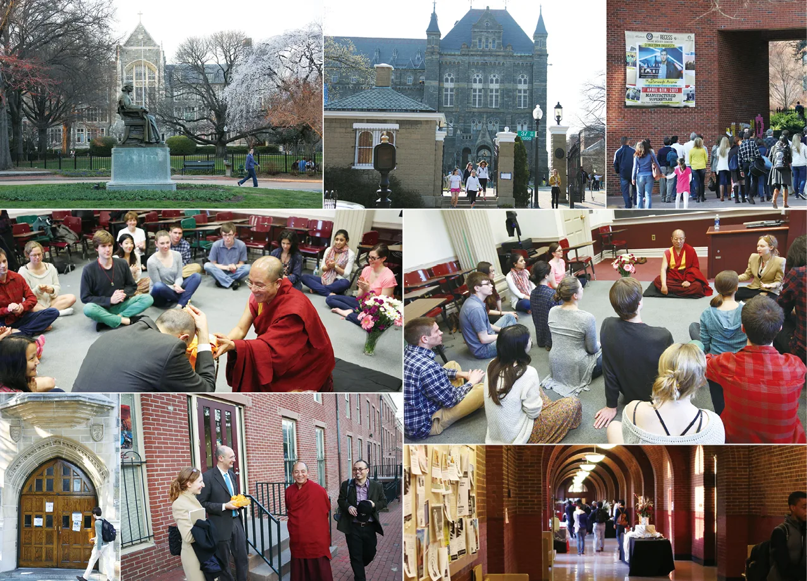
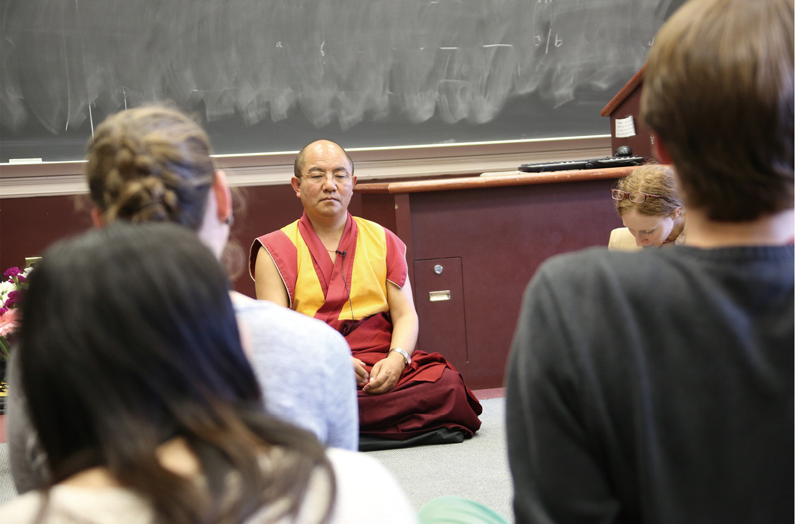
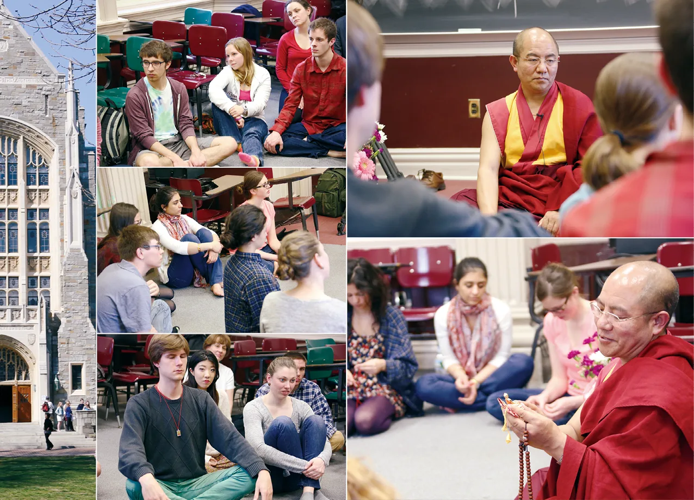

“千年之前的埃及金字塔，

它的形状与禅修的坐式十分相似。”

第52场

美国乔治城大学

Georgetown University

美国·华盛顿

2013 / 4 / 5

## 坐禅的正确方法

## The Way of Meditation

今天能够来到这所大学，与师生们一起交流佛法，我感到非常高兴。为什么呢？因为我从小就对文化、知识很感兴趣，你们都受过高等教育，对此应该也比较有兴趣。虽然相对来说，你们的年龄比较小，我较为年长，但今天我们的目的是一致的。相较于其他环境，我更喜欢有文化氛围的地方，所以很高兴能来到这里与大家一起交流。

## 培养对佛教兴趣的必要性

无论打坐还是禅修，首先要了解佛法中所讲的“暇满难得”——获得人身非常困难，需要具足许多因缘，尤其是要获得诸根具足、值遇正法的人身，则更加困难。若想进一步好好修持，也没有那么简单，因为对于现在的年轻人来说，散乱的因有很多很多，正因为这样，喜欢佛教的人也比较少。

在我看来，无论大家是否皈依佛教，培养对佛教的兴趣、研究佛教，都非常有必要。为什么呢？因为佛教可以解决生活中的许多问题，虽然这些问题，通过科学或其他学科，也可以得到一定程度上的解决，但佛教的解决方式更为直接、有效。比如，生病的时候，佛法可以给我们带来慰藉；当死亡来临的那一天，心中所生的恐惧也可以被佛法遣除。除此之外，佛教还能解决许多其他问题，比如家庭成员、夫妻之间的矛盾，或者难以获得财富的痛苦等等——这些痛苦对于佛教徒来说，都可以通过修行来对治。

## 上师之恩无与伦比

父母和传授知识的老师，对我来说都很有恩德——没有父母就没有我；没有传授知识的老师，就无法获得世间的知识。但谁的恩德最大呢？是为我传授佛法的上师。上师对我的恩德是无与伦比的，原因是什么呢？因为没有什么比佛法更有价值。我去过很多地方，获得了很多人的尊敬，也有机会得到很多财富，但我并不认为它们具有很大的价值和意义。那什么才是最有意义的呢？我认为，今生来世值遇佛法，才是人生中最有意义的事，因此，为我们传授佛法的上师是最具恩德的。我的父亲已经去世了，母亲还健在，父亲去世的时候，我的确很伤心，但并没有流泪，也不会经常感到悲伤。我的根本上师法王如意宝，已经圆寂十年了，但我还是会经常忆念他，独自一人时常常流泪。

我第一次来美国的时候，去过好几个创巴仁波切的佛教中心。虽然当时创巴仁波切已经圆寂了，但他的弟子一提到他的名字，忆念起他的恩德，仍然会泪流满面……可以感受到，这些美国弟子对上师具有稳固的信心，这一方面是因为佛法的力量，另一方面则源于对上师恩德的忆念。而一般世间人不会这样，比如大学生、研究生、博士生等，尽管他们也有很多老师，但在他们当中，一提起老师的名字便流泪的人，却少之又少，可以说这样的人在整个世间都很稀有。所以，佛法的力量和上师的加持，对世间不学佛或不承认佛教的人来说，是难以置信的，但对于佛法已融入于心的人来说，则会有不一样的感受。

在座的各位很年轻，对于老师的恩德，还不一定能完全体会，但以后你们就会知道，只有依靠老师的恩德，我们才能做好方方面面的事情——将来肯定会有这样的认识。

## 学习佛法的两种方式

现今，对于佛法的学习，主要有两种方式，即学术研究与实修。在学术研究领域，主要是以逻辑推理的方式研究历史，比如哪一年发生了什么事件，还有一些是对历史文献本身的研究。对于开展此类研究的学者，我们称其为历史学家，但此类研究并没有超越分别心的境界。另外一种方式，则并非以分别心来研究，而是直接进行实修，以此来了解佛法。

## 智慧与信心缺一不可

无论通过哪种方式学习佛法，都需要智慧，否则，对佛教中的历史事件难以理解。因此，智慧应放在首位，此外还需要具备信心。学修佛法，如果没有智慧，则有困于邪见、误入歧途的危险，所以智慧很重要；而对佛法没有信心也是不行的，就像一些科学家和不学修佛法的人，不承认禅修的感应，不相信咒语的加持力，他们有着诸如此类的“不相信”与“不承认”，但实际上，做任何事情，都需要有信心、信念，没有信念不可能成功。

对大家来说，智慧确实很重要，但我们不仅需要有智慧，更需要有信心。有些大学教授，虽然研究佛法，但没有修行，而实际上，如果没有修持，仅仅局限于学术研究，很多问题都无法解决。因此可以说，在修行佛法时，信心和智慧缺一不可。

## 禅修开示与引导

修行佛法的方式有很多，其中禅修是非常重要的一种方式。而禅修的方式也有很多，其中修持禅定又极为重要。所谓的禅定就是让心平静下来，不被分别念所动摇。我们普通人一般对未来会有很多妄想，见到悦意的对境就生贪心，见到不悦意的对境则生嗔心，还会生起嫉恨、傲慢等许多烦恼，而这些烦恼、分别念对身心健康有很大危害。当抛开所有分别念、令心安住时，便能获得喜悦与宁静，因此，观修对身心等各个方面，都有很大利益。

禅修时，我们的身体应该像佛陀一样，以毗卢七法的坐式来安住。这样的坐式有什么特别的利益呢？科学家们认为，几千年之前的埃及金字塔，它的形状与此坐式十分相似，呈三角形。金字塔中的花草树木可以长时间地存活，不易枯萎，这种现象与金字塔的形状有关，这是很多科学家都认同的。此坐式对身体也有很大的利益，若以此坐式安住，能够增上身心安乐，遣除烦恼妄念——对于这样的特殊力量，很多学者都表示认同。

大家如果有时间，最好早上或晚上，在学校或家里，用一个小时，或者五分钟、十分钟，经常进行禅修，这对我们身心都会有非常大的帮助。当然，刚开始禅修就想达到标准的跏趺坐，不起任何妄念，不是那么容易的。至于其中原因，一个是由于身体还不习惯，另一个是因为我们的心一会儿想这个，一会儿想那个，特别容易受外界的影响。虽然最初会有很多困难，但慢慢地，你的内心会有一些不同的感受——现在确实有很多人，依靠禅修的力量，生起了不一样的觉悟和体验。

那么，禅修能给我们带来什么呢？禅修可以使我们的智慧增上，拥有更加平和的心态，甚至可以说，无论做什么事情，无论从事什么工作，禅修都能给我们带来很大的助益。例如，美国苹果公司的创始人之一乔布斯，在他的传记里说，由他创新的技术能够在全世界普及，主要归功于禅修。他曾去印度学习佛法，并通过禅修增上了智慧，又依靠智慧开发了许多产品，提供了大量工作机会，改变了很多人的命运……如果对这一切追根溯源，其源头可以说是禅修的力量。因此，禅修对于我们的生活，是很有必要的。

禅修的方法有很多，今天我在这里讲的是毗卢七法坐式——双腿金刚跏趺坐，双手结定印，双肩展开稍稍向后，身体坐直，颈部稍稍向前倾，眼睛垂视鼻尖，舌尖轻轻顶上腭。正如前面所讲的，依靠金字塔般的特殊坐式，会让心平静下来。我们可以想象一下，如果身体倾斜或正在行走，是很难做到心平气和的；如果身体姿势正确，心就会平静下来，这是依靠个人感受可以了知的。佛经中也说，除此坐式之外的其他身体姿势，无法让心达到如此平静的状态，而且这种坐式本身也有很大的功德。现在，有很多禅修方法采用的就是毗卢七法坐式，在印度教等宗教的禅修中，也以此坐式安住，可以说这种坐式是最为殊胜的。因此在禅修时，身体姿势要采用毗卢七法坐式，这一点非常重要。

下面请大家跟着我一起做：毗卢七法坐式有七个要点，首先是盘腿，最好是双盘，单盘、散盘也可以；二是手要像这样结定印，左手放在下面，右手放在上面；三是稍微放松双肩，不能太紧绷，也不能太放松；四是要伸直脊柱，背挺直；五是颈部不能太往前，也不能太往后，稍微向前即可；六是眼睛垂视鼻尖；七是舌尖顶上腭——这就是佛陀所宣说的毗卢七法。大家每次禅修的时候，都要尽量做到这七点。有些人眼睛睁得很大，这是不行的；有些人完全闭上眼睛，这也是不行的；要微微睁开双眼，垂视鼻尖。

现在大家坐着不要动，接下来我们讲修心的部分。心的观修方法有很多，第一种方法是什么都不想，当分别念生起的时候，什么都不要去想，如同处于虚空之中，然后慢慢地，所有的分别念都会消失。

其实除了毗卢七法之外，还有另外一种坐式，是将双手放在膝盖上，不用结定印，其他六个要点与毗卢七法一致——我们称之为心性休息的坐式。现在我们一起放平双手，暂时不要想其他事情，稍微静坐一下，观察自己的心……让我们静坐一会儿。（全体静坐）

禅修的修法有很多种，有一种修法能令心平静下来，不散乱于外境；还有一种修法是反观自心，即以自心观察自心——当内心很痛苦的时候，观察痛苦的本性是什么。举例来说，假如我今天心里不高兴，就可以这样来观察自己的心：比如观察自己的心有没有颜色，是白色还是红色？有没有形状，是方形还是圆形？是在身体的上部、下部，还是头部里面？又或者是在哪里……真正这样去观察的时候，就会发现所谓的心，就像虚空一样，怎样都无法成立；如果心不成立，那么痛苦也根本无法立足。

这种修法是非常殊胜的，在生活中遇到一些事情的时候，虽然一开始会觉得心里很痛苦，但这样详细观察之后，就会发现心的本体是不成立的，既然心的本体不成立，那么，所谓由心而生的痛苦也就不成立。任何一位科学家，无论再怎么研究，也无法找到心的本体，所以，佛法里讲“万法皆空”，并不是凭空捏造的，这就是万法的实相。

一般而言，让心平静下来是很困难的，但对于经常观修的人来说，应该也不算困难。如果暂时做不到真正的禅修，就先让自己的身体如是安坐，同时口里念诵经咒，这对内心的安乐会有很大提升，比如可以念增长智慧的文殊心咒“嗡阿Ra巴匝那德”，或者增长悲心的观音心咒“嗡玛呢巴美吽”。念诵之时，痛苦也会渐渐息灭。在藏地，有很多人已经念了数亿遍观音心咒；现在在汉地，也有越来越多的人，包括很多学校的学者，也在念诵观音心咒、金刚萨埵心咒等。

咒语是有加持力的，这种力量就像良药本具的疗效，只为医生所知，难以被其他人知晓。对于念修咒语的力量，佛教中有专门的研究，除此之外，佛法中还宣讲了念诵咒语的诸多功德，今天可能时间不够，无法一一宣说。如同吃药可以治愈身体的疾病，念诵咒语也可以息灭内心的痛苦。

等会儿我们一起念些观音心咒，如果能专心念，当然最好；如果不能专心念，也有功德。有传承会更殊胜，所以我先念几个咒语的传承，请大家跟我一起念。首先念的是莲花生大士的心咒，“嗡啊吽班匝儿格热巴玛色德吽”；之后是释迦牟尼佛的咒语，“嗡牟尼牟尼吗哈牟尼耶索哈”；接着是增上智慧的文殊心咒，“嗡阿Ra巴匝那德”；还有忏悔业障的金刚萨埵心咒，“嗡班匝儿萨埵吽”；最后是使今生和来世福德增上的观音菩萨心咒，“嗡玛呢巴美吽”，念“嗡玛呢巴美吽”或者“嗡玛呢巴美吽舍”都可以，现在我们一起念观音心咒。（全体念诵）

你们有时间的时候，应该多念这些咒语，这样一来，可以使自己的事业顺利，内心安乐，无有病痛。就像现在有很多养生药，对身体是有好处的，医生们也是承认的；同样，密咒也有很大的功德，在未来的生活中，多念咒语，修行佛法，是令内心安乐的殊胜方法。

接下来，无论是关于佛法的问题，还是关于修行的问题，大家都可以探讨，如果你觉得我说得不合理，也可以反驳。

现场互动

问：首先感谢您的到来，这是一堂很精彩的开示，很荣幸能邀请您来到这里。我有个关于成功的问题，您刚刚有几次提到了成功，我想知道对于藏传佛教徒来说，成功的定义是什么？这个定义可能会与我们西方人的定义很不一样。我们在座的大部分人都是西方人，而在我看来，东西方文化存在着很大差异。所以就修行而言，什么是成功？

堪布：对于修行的观点，东西方大致是相同的，比如我们都认为，药应该对身体有益，但并不是所有的药都百分之百有益，应该说对症的药对身体是有益的，这是东西方都承认的。同样，念诵咒语和行善，对做任何事情都会有助益，当然，这其中也会有很多不同的因缘，对于因缘也需要观察。但无论如何，就像对症的药有益于愈病一样，行善、念诵咒语，确实有助于顺利成办任何事情，可以这样去理解。

问：像我这样的人，身体不太灵活，因此以毗卢七法的坐姿进行禅修时，会感觉很不舒服，甚至很痛苦。您有什么其他好的方法或坐姿可以推荐吗？

堪布：无论是谁，无论学什么知识，想一下子就适应是很困难的，所以不管是以毗卢七法坐式安住，还是压伏分别念，最开始都非常困难。但如果能够长期坚持，不断调节自己的身体，毗卢七法也是很容易的。我认识的一些学者，他们起初都反对佛教，但后来通过学习、研究，经过理证、教证的证实，最终都认可了佛教的殊胜性。

修持佛法可以给人体带来殊胜的利益。就顶礼而言，我以前遇到过一个人，他刚开始不愿意顶礼，还说自己不能顶礼；后来，慢慢试着去顶礼，而且于众人中率先完成了十万顶礼。所以说，人与人之间，也有锻炼和不锻炼的差别，如果经常锻炼的话，无论是谁，采用此坐式都不会有很大困难。所以我认为，所谓不能盘腿的人，基本上是没有的。对于身体的坐式，即使在短时间内进行调整，也会有进步，只要坚持下去，就能做得到。

问：在您传授佛法的过程中，您觉得藏族学生与美国学生之间，最大的区别是什么？

堪布：我以前也提到过，藏族人和西方人的性格比较相似，为什么呢？因为藏族人不轻易做出承诺，一旦承诺了就一定会兑现，而且无论如何都会信守承诺。昨天我和一位藏语老师进行交流，她说她认识很多汉族学生，但她觉得汉族人普遍来说比较善变——最初很容易产生认同感，但后来又很容易改变。她教学生们学习藏文，发现很少有汉族学生能坚持学下去，而我看这里的教授们，都能够长期学习和研究藏文。如今在汉族人当中，懂藏文和研究藏文的人非常少，相比之下，西方人就有很多，不但会说藏语，还能阅读藏文。

你的问题是藏族人和西方人之间的区别，其实我觉得两者是比较相似的。藏族人最初不会轻易认同某件事，性格相对来说比较倔强、固执；而一部分汉族人，刚开始时好像很容易认同一件事，会表现得很欢喜，但之后变得也比较快。

虽然藏族人和西方人各自的传统、习俗不同，但大多稳重，诚实，正直，有正义感。虽然一些藏族年轻人在去了城市之后，也发生了一些变化，但一般而言，藏族人的性格跟西方人还是比较相似的。

问：我在打坐的时候，总是会产生各种各样的念头，所以禅修不是很成功。虽然偶尔也会有片刻的安住，能觉察到念头的生起，但在大多数时间里，心还是被各种分别念所占据，比如，“我正在禅修”也是一种分别念。我想请问，您对这种情况有什么建议？

堪布：对于这个问题，我只能以个人学修的经验，稍作回答。

我学习佛法已经有三十多年了，在短暂的人生中，能学到很多佛法知识，我感到非常欢喜。但学习佛法不应局限于理论上的学习，不能仅仅停留在口头上，实地修行更为重要。在禅修方面，我做得不是很好，我经常在想，如果有时间的话，还是打算去闭关禅修。刚才教授说他在打坐的时候，有时得不到觉受……当然这可能是他的自谦，因为他在讲佛法课程时，所体现出的理论素养很不错，我这样说并不是在恭维他——他对佛法确实有很深入的理解。

关于禅修时生起的细微分别念，密宗的实修法中讲了很多。如果不能认识心的本来面目，就会存在能取所取的二取分别念，也就是习气。而如果我们用心去观自己的心，每当生起分别念的时候，就会察觉到，就像海水和波浪一样，分别念在生起的当下，就会立即消失——分别念的生与灭是同时的，这在大圆满的教典中也宣说过。禅修开始时，会有粗大分别念以及细微分别念的产生，若进行对比，两者就像陡坡水与江河水一样，而在禅修的最后，犹如无波的大海，分别念的浪花会逐渐平息下来。观察分别念的本性，是息灭细微分别念的不共殊胜之法，长期如此串习，便能逐渐生起禅修的体会。

我手中拿的是《般若摄颂》挂件，里面装有《般若经》。《般若经》中比较简略的是《心经》，稍广一点的是《般若摄颂》。将般若经典戴在自己身上，有很大的功德，对此你们也许承认，也许不承认。即使不承认佩戴有功德，至少《般若摄颂》归摄了佛法的精华，也算是给大家留个纪念。

这是送给本杰明教授的一尊释迦牟尼佛佛像。这尊佛像是我特意做的，里面有殊胜的装藏，经由两万多名僧众开光。

祝大家扎西德勒，愿佛法在未来能够饶益更多的众生！
