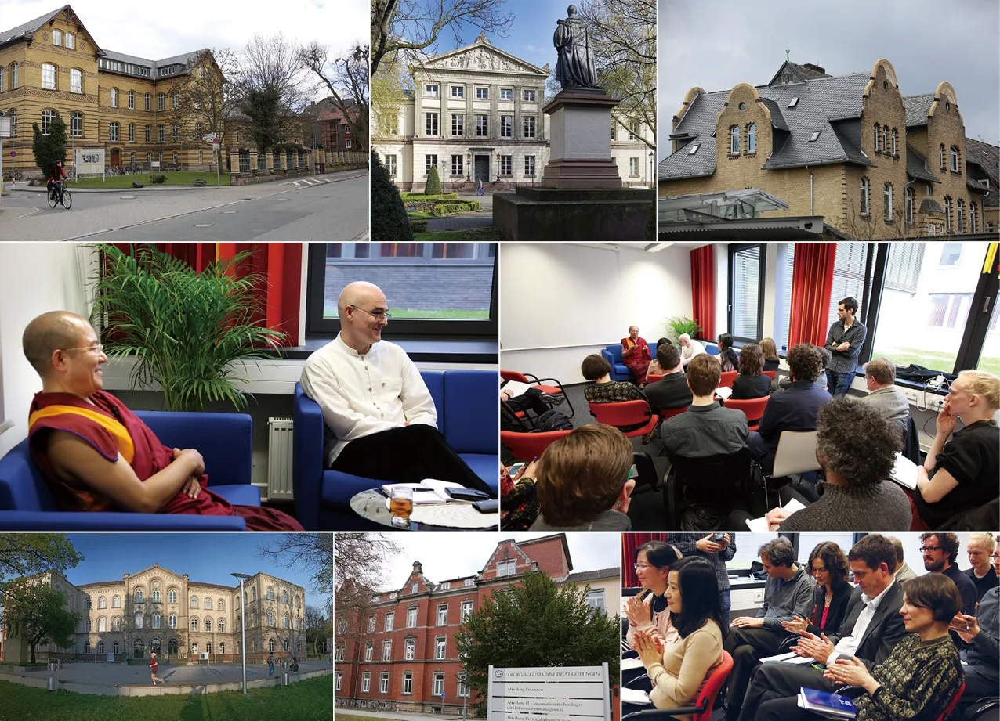

“宗教是为人而有的，

人不是为宗教而存在的。”

第54场

德国哥廷根大学

University of Göttingen

德国·哥廷根

2013 / 4 / 12

## 宗教与现代生活

## Religion and Modernity

今天，和哥廷根大学的老师、学者们一起交流“宗教与现代生活”，我非常开心。

上午，刚和施耐德教授就宗教与现代化的话题进行了探讨，并参观了有400多年历史的哥大图书馆。这次参访哥廷根，让我产生了很强的感受。德国一方面很注重保存传统文化，从建筑、古典图书馆，以及对文化的保护等方面，可以略窥一二；另一方面，德国在现代科技方面也取得了举世瞩目的成就，这的确令人向往。

很早以前，我就听说过哥廷根大学。出于一些原因，我对这所学府产生了浓厚兴趣。

首先是，佛教的缘起性空学说与现代物理学存在诸多相通之处，常有人将二者加以对比。我发现，普朗克、玻恩等量子力学泰斗，都曾在哥廷根大学工作过；甚至相对论的诞生，也和这里密切相关。

当年，爱因斯坦想要在相对论中引入黎曼几何，正当他一筹莫展的时候，在哥廷根大学结识了数学家希尔伯特（David Hilbert, 1862-1943）。在希尔伯特帮助下，他最终推导出了场方程，完成了广义相对论的逻辑构造[^1]。

其次，世界上所有诺贝尔奖得主中，在哥廷根大学读过书、教过课的有45位之多。昨天在和施耐德教授交谈时，我还特意问他，为什么人口这么少的城市，能培养出这么多诺贝尔奖得主。从这一点看，哥廷根大学的确是一个科学人才的宝库。这也使得我对它产生了浓厚兴趣。

还有，众所周知，梵文和佛法有着甚深因缘。中国有一位学者叫季羡林，是著名的梵文专家，曾任北京大学副校长，被中国人誉为“国宝”。季羡林的梵文功底，正是在哥廷根大学造就的，1935年到1945年，他在这里苦学了十年梵文。当时，哥廷根大学拥有全世界顶级的梵文专家，这也让我感觉非常稀有。

接下来，简单谈谈今天的话题——宗教与现代生活。

## 宗教是我们不可缺少的一部分

纵观历史，宗教已成为人们生活中不可缺少的一部分。

美国的一项研究报告指出：“在全球70多亿人中，没有任何宗教信仰者大约为10亿，其余人都有不同程度的宗教信仰。”

而且，这10亿人当中，不少也实际是有信仰的。

我去各地讲学时，经常遇到一些学者和官员，他们虽然笃信宗教，但出于种种原因，表面上并没有显露出来。

因此，对人类来讲，宗教从来没有离开过我们。

宗教不仅是信仰者的精神归宿，还是一种约束内心的智慧体系，具有激发道德向上的作用，对人类社会有着必不可少的意义。

康德（Immanuel Kant, 1724-1804）曾说：“有两样东西，我思考得越是持久和深入，它们在我心中唤起的惊奇与敬畏越是不断增长。这就是我们头顶的星空和内心的道德准则。”

人心自有其内在的道德规律，如果没有遵循道德准则，生活一定会混乱不堪，社会也将难以运转。

这种道德的规范，与宗教息息相关。每一种宗教都对人的行为和道德有着重大影响。

以我熟知的藏地来说，佛教完全成为生活的一部分。一个人降生的时候有佛教的祝福行为；结婚时有相关的佛教仪式；日常生活中，佛教理念及相关行为，一直贯穿始终；到了死亡的时候，更要依靠佛教的护佑。表面上看，很多只是生活中的一种仪式而已，实际上，依靠这些，传递出传统文化内在的一种智慧。形式与智慧是相连的。

## 佛教对现代生活很有帮助

佛教在东西方已经形成了极其兴盛的信仰潮流，越来越多的人开始学习佛法。

佛教的世界观，与人类的传统观念以及其他宗教理念有很多不同，对现代世界非常有帮助。

我就此作一点分析。

### 1．平等

佛教对平等的认识，与世间不同。世间所提倡的平等仅限于人类。比如，历史上北美曾流行过种族歧视，黑人被白人奴役，后来由于文明的进步，黑人和白人已实现了平等。但是佛教的平等观更加广阔，不仅人类之间要平等，一切众生都要平等，因为没有谁不会感受苦乐，没有谁不会求生畏死。

这个世界上，人对动物毫无顾忌的虐待和杀害，是最大的不平等。我听说在你们德国，杀动物前要求先施麻醉，不能直接杀害。这种做法考虑到动物的感受，好于漫无边际的杀戮。但是，杀生终究是非常严重的不善，应该尽量制止。

人类一方面倡导平等，另一方面却在亲手制造不平，这是非常讽刺的。第二次世界大战期间，生命被任意践踏，不平等的现象人人皆知。而现在，人依靠自己的权力和力量，随意杀害其他动物，这又岂能说是平等？

有些地区闹禽流感，为防止疫情扩散，成千上万的飞禽被杀害。这种行为，我非常不赞同，这是非常愚痴的。

佛教的平等观，非常值得大家深思。虽然社会存在着种种不平等的观念，但这些之所以存在，与教育有一定关系，与生存环境和因缘有一定关系。到底哪种观念才合理，最好大家能仔细观察。

### 2．和平

和平，是现代人一直关心的话题。如果从政治、环境、文化等各个角度分析，可以知道，地球上的所有生命都需要和平，这是和平的最究竟理念。

这种理念，依靠佛教可以实现。因为，佛教认为所有罪业中，杀生的过患最大。如果这种认识深入人心，两次世界大战就不会发生。现在，个别国家用核武器威胁其他国家，搞得人心惶惶，这也是没有真正的和平观所导致。

仅仅开几次会，做几次讲座，领导经常互访，并不能完全实现世界和平。真正的和平应该如佛教一般，从内心开始落实。佛教最基本的五戒里有一条不杀生，从原则上已禁止杀害。因此，如果从佛教的不杀开始做起，世界和平指日可待。

### 3．幸福

世人都想幸福地生活。但是观念错了，也会南辕北辙。

芸芸众生，烦恼无尽。有些人要买车，买房子，买保险，各种压力不断；有人婚姻家庭、人际关系出现问题，心烦意乱；还有人或因能力不够，或因职称评不上，攀比之心无法满足，各种痛苦层出不穷。

要解决这些烦恼，佛教并不提倡把一切追求全部放弃，而是劝大家不要过于攀比，生活在虚荣心之中。所以，要观察生活的真实面目，以智慧去面对。

佛教给我们的，就是智慧。有些人没有学佛之前，和家人、外人之间，关系极为紧张；学了佛以后，心慢慢获得一种安乐，即使生活出现一些痛苦，也有能力面对。因为他拥有了完全不同的幸福观，这用多少金钱都无法买到。有了这种智慧，谁都可以幸福，穷人也可以，富人也可以。

佛教对待生活，有些观念非常简单，却很有意义。前几天我引用了一个故事，讲的是一个人不会游泳，掉进了河里，由于恐惧拼命地挣扎，越挣扎越向下沉。最后他完全绝望了，想着死就死吧，身体放松下来，反而浮了上来。

生活也是如此。有人拼命地追求名声地位，越追求越得不到；有人迷恋感情，越执著，对方跑得越远；有人耽执钱财，越贪求，反而越贫穷。这时，如果你放下执著，不去强求——得到很好，得不到也随缘，很多机缘反而会不求自得。

其实，人活着，应懂得知足，不要整天需要这个、需要那个……欲望如同无底洞，永远无法填满，到一定时候，应当适可而止。若能如此，身心自然健康，家庭也会和乐。

不过，即便因知足而感到幸福，痛苦还是会不期而至。因此，幸福的更深意义，是如何正确面对痛苦。

当痛苦出现的时候，不要特别执著它。要知道，痛苦不一定是坏事，反而可能是好事，应从痛苦中发现人生的真相，让它产生正面的作用。比如，事业一时不顺，也许正是日后事业趋于完善的基石。

藏传佛教中，修行人往往能把痛苦视为财富，把痛苦当作最重要的修行。这种方法非常殊胜，值得大家好好学习。

### 4．生命

在座每个人，哪怕拥有多么卓越的学问、多么高贵的地位、多么出众的相貌，最后这一切全都会失去，无论你愿不愿意，死亡终要来临，这在佛教称为无常观。

不过，世人大多没有这种意识，总以为自己能活千年万年，每天计划着做不完的事，一旦死亡降临，就手忙脚乱、措手不及。他们从不愿意提死亡，认为这不吉利，干脆不要想。实际上这非常不好。

甚至很多学者，对死亡也没有任何准备，到了死时十分可怜。在我们佛教徒看来，觉得非常可惜。其实，无论你这辈子再怎么成功，也逃避不了这个归宿，所以，对于死亡，不能只是简单地回避。

当然，这也是社会教育所致。在面对死亡这一点上，包括古人也会忽视。孔子曾说：“未知生，焉知死？”意思是，你连生都不知道，怎么能知道死呢？不过，他并没有说，死亡之后生命不存在。可惜的是，后人笼统地理解这句话，从而对死亡完全漠视。

人死之后，实际上灵魂会继续存在。基督教、佛教和伊斯兰教对此都有宣说，都承认人死之后，可能上天堂也可能下地狱。古希腊哲学家柏拉图还说，人死后要么变成动物，要么变成其他众生，要么再生为人……

尤其在佛教里，特别详细地描述了人如何转生后世。转生时的情况、转生后的状况、转生的原因，都讲得特别清楚。

前后世是否真的存在，这是与我们最直接相关的问题。如果科学家们几十年一直研究外部世界，对这个问题却毫无所知，那即使取得一点科学成果，我本人认为，也没有根本性的意义。

当然，有些科学家对身体以外存在灵魂的问题，也有过研究。比如瑞士心理学家荣格，在他的回忆录中，就讲了这方面的亲身体验。比较典型的案例是：1944年，他曾有过一次濒死体验。当时，他心脏病发作，心识离开了身体，越过大海，途经斯里兰卡、印度等，去了很多地方，最后又回到身体里。他非常肯定，在这个身体之外，确实还有灵魂存在。但由于当时科学的局限，他在心灵领域的这些研究，西方科学界只当作是神秘主义，并没有给予很高的认可。他自己也认为，在他死后50年，人们才能逐渐发现他的思想对人类是有利的。

我去过很多学校，在与知识分子交流的过程中，发现很多人对前生后世的存在，一点都不知道。对此，我感到有点悲伤。当然，他们所做的科研成果，对世界是有利的。但是，作为一个科学工作者，除了研究自然科学和社会科学，也要了解前后世的道理，这一点非常重要。假如后世真的存在，佛教里讲的善恶因果就是最重要的课题，每个人若能明白这一点，也会重新审视自己的人生。

## 未来需要对心灵的认识

最后我想说，21世纪，越来越多的人已认识到，依靠科学不可能解决所有问题，观照内心的知识更加需要。现在一些年轻人提倡时尚，心一直随着外境转，对心灵的认识非常欠缺，这是相当遗憾的。

宗教，实际上是一门心灵科学，与每个人的生活密切相关，并能起到至关重要的作用。

日本学者池田大作（Daisaku Ikeda, 1928-）说：“宗教是‘为人而有’的，而人不是‘为宗教’而存在的。”

因此，现代生活与宗教不可分割，各位学者很有必要把宗教研究放在首位。

现场互动

问：您刚才提到了人和动物的平等，反对禽流感时对飞禽的扑杀。但如果要维护平等，不扑杀，那应该怎么处理这个问题？有没有更好的方法？

堪布：如果在人的眼里，所有生命都很可贵，包括动物也是如此，这个问题就不难解决。

试问，人若是得了禽流感，为防止传染扩散，把其中一拨人杀掉，这合理吗？

从生命的价值来看，动物跟人完全一样。为了保护人的生命，把动物的生命不当回事，显然有点说不过去。

当然，只站在人的角度，把动物看作是低等生物，那就不同了。

问：您谈到佛教是关于心智的宗教，但人都是有色身的，佛教对维护身体健康有何帮助？

堪布：佛教认为，维护健康有两种途径。一种不符合自然规律和道德，另一种则符合这些。

佛教同样注重身体健康。尤其在显宗的一些经典里，常会提到白天要如何饮食，晚上要如何睡眠……关于健康的行为和疾病的疗法，讲得相当细致。

不过，佛教更加强调，自己的快乐不能建立在众生的痛苦之上。否则，通过杀生来滋养身体，依靠因果的反射，到头来，自己也不一定能获得健康。

问：现代有些科技不需要伤害别的生命，就可以让人活到八九十甚至一百岁。只不过在生命最后阶段，许多人身心越来越衰弱，并不快乐。对这种纯粹依靠高科技延长生命的办法，佛教如何看待？

堪布：只要不伤害众生，佛教并不反对这种做法。每个人都希望活得长一点，这无可厚非，佛教也有关于健康长寿的祈愿词。

不过，我觉得，这方面不能过于依赖科技。科技虽能暂时解决问题，但副作用非常大，从长远看是有害的。比如，现在许多人喜欢整容，虽然能变得好看，但会影响健康和寿命。所以，科技的运用要有个“度”，不能为了一时利益而付出长远代价。

问：您刚才提到，东西方的宗教有许多共同点。不过最近二三十年，越来越多的西方人却开始信仰佛教。您如何解释这种现象？

堪布：的确，无论在西方还是东方，如今藏传佛教越来越兴盛。以前信众多是老年人，而现在，年轻人尤其知识水平高的人比较多，还有社会上的成功人士，如明星、企业家等，也不乏其数。

原因可能是，其他有些宗教比较简单，只有仪式、概念、故事或行为要求等，缺乏相关的理性分析。现在的人，追求真理的心很切，如果只讲那些，他们不一定能信服。

对年轻人而言，喜欢仪式的比较少，喜欢研究的相当多。为什么佛教对他们有吸引力？除了少数人是因为一时热情，更多人则是源于对佛教智慧的认可。

尤其是学藏传佛教，必须通过长时间辩论，提出各种尖锐问题，不断地探索，才能得出可以说服自己的结论。这种寻求真理的方式，很多年轻人特别喜欢。佛教中有极为丰富的教理，这方面也有各种文字记录，通过深入了解，人们会发现佛教并不是一种传说，也不单单是一种信仰。

信仰如果只是简单的信心，很容易变质，但若能涉及智慧，谁也不得不接受。这样的信仰一旦建立起来，什么时候都不容易动摇。所以，很多人对佛教的信仰，应该来自对真理的抉择。

像哥廷根大学的学者们，爱好哲学，爱思考探索，思维方式相当严谨，这与藏传佛教的很多大德有相似之处。比如，学过因明逻辑的人，思维就非常深细，哪怕是一个小问题，也可以挖出来甚深道理，最终令对方折服。佛教中运用的，就是这种智慧。

问：为什么佛教一谈到幸福，就一定要谈死亡？苏格拉底认为，所谓的幸福只是某一阶段的体验。还有些观点认为，感受快乐的当下即是幸福，之后再遇到什么都无关紧要。为什么幸福不能只涉及当下，还必须考虑将来的死亡？

堪布：按照佛教观点，我们的幸福观需要观察。

现在这个时代，人人每天上班、努力工作，就是为了幸福。但如果不知道人身存在的意义，苦苦追求今生的名利，不一定能得到幸福，甚至后世可能更加痛苦。

比如，很多人在追求幸福时，没有满足感，要求不断攀升，一直达不到自己最满意的状态，就痛苦万分。而佛教告诉我们，该争取的可以争取，但没必要过于贪求，追求自己力量以外的东西。

我本人来说，对每天的生活都很知足。知足不是懈怠和消极，而是在努力的同时，对结果并不强求，有一种满足。若能如此，每个人都能得到幸福。要知道，幸福就是内心的满足。

与此同时，幸福又不得不谈到死亡。因为人都会死，对于死，几乎没有一个人不怕。如果提前知道死是怎么回事，就会早做准备，死亡来时也能从容面对。如同军人先要操练，上了战场，才能游刃有余地面对敌人。

遗憾的是，许多人对死亡不仅没有准备，反而掩耳盗铃，一听到“死”就不高兴。前不久有个96岁的老人，医生说“你可能不行了”，他火冒三丈去打医生，嫌他说话不吉利。

回避死亡，其实没有任何意义。有生必有死，对死应该有个正确态度，尤其要明白死亡并不意味着终结，它只是今生的结束，却是来世的开始。

基于这一点，佛教在谈论幸福，尤其是来世的长远幸福时，不得不谈到死亡。

问：在21世纪的今天，佛教会面临什么挑战或者机遇？比如，佛教在传播过程中，不可避免地要以现代语言进行诠释，也不可避免地要借助高科技设备，这对佛教有何影响？

堪布：这个问题很好。佛教需要面对时代，既要保持传统，也要与时俱进，这是任何一种古文化都面临的问题。在我来看，二者并不矛盾。

佛教的个别内容，如出家人的戒律、仪式，以及密法中仪轨、法义等，不能因为要迎合时代，就轻易外传或随便更改，否则，如同古建筑全部毁掉，代以高楼大厦一般，虽然漂亮，但已不是原来的东西了。所以，这些法应该保持传统风格，让它原汁原味地存在。

那是不是佛教就不能与时俱进呢？不是。佛教是心灵的科学，非常博大精深，并不是仅限于寺院的小文化。

我今天参观了哥廷根历史图书馆，据说大概有800万册图书。而佛教的书籍，在美国图书馆收藏了不少，藏地印经院等也保存了很多。这其中蕴藏的甚深智慧，超越了种族、国界和历史，能让天下一切众生得到利益。

佛教本质上是一种智慧，适用于东西方任何领域，非常有必要广泛传播和弘扬，在此过程中，一定要用到高科技。尤其到了21世纪，任何文化都与互联网相连，有份报道说：“未来的强势文化，其强势主要体现在互联网上。如果能在互联网立足，才有生存的机会，一旦在互联网上没有生存空间，这种文化就会消亡。”

因此，佛教也要利用网络来传播，对此不必有太多顾虑。不过，部分思想与行为最好不要完全世俗化，假如一味迎合世间人，佛教的本义就全变了。

总之，佛教对于传统和现代，两方面都要考虑。若失去一者，会非常可惜。

问：藏传佛教有独具特色的医学传统，这在现代社会能否传播开？

堪布：医学是藏传佛教的“五明”（即五种学问）之一。藏医有独特的理念和治疗手段，临床效果也非常好。虽然历经沧桑，可是它的传统不仅没断，反而日益兴盛。

在许多寺院、民间甚至高校，藏医都在不断传播。如今的藏医不仅继承了古代传承，还有不少创新，许多成果在国际上都得过奖。现今藏医已走向世界，不仅在雪域高原，在东西方国家，也受到普遍欢迎。

对于藏医的未来，我持乐观态度。

[^1]: 虽然希尔伯特对广义相对论也有贡献，不过他谦虚地说，在哥廷根大街上随便找个人，就能对爱因斯坦提供同样的数学支持，所以广义相对论应当归功于爱因斯坦。
