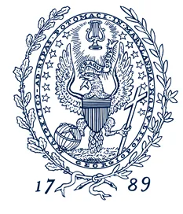
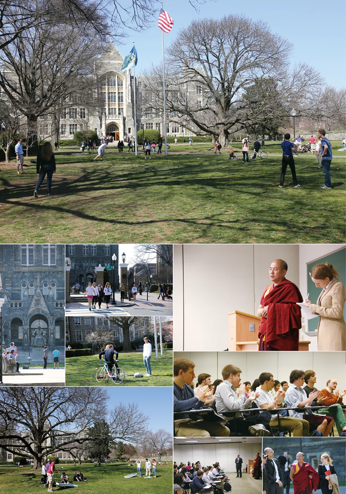
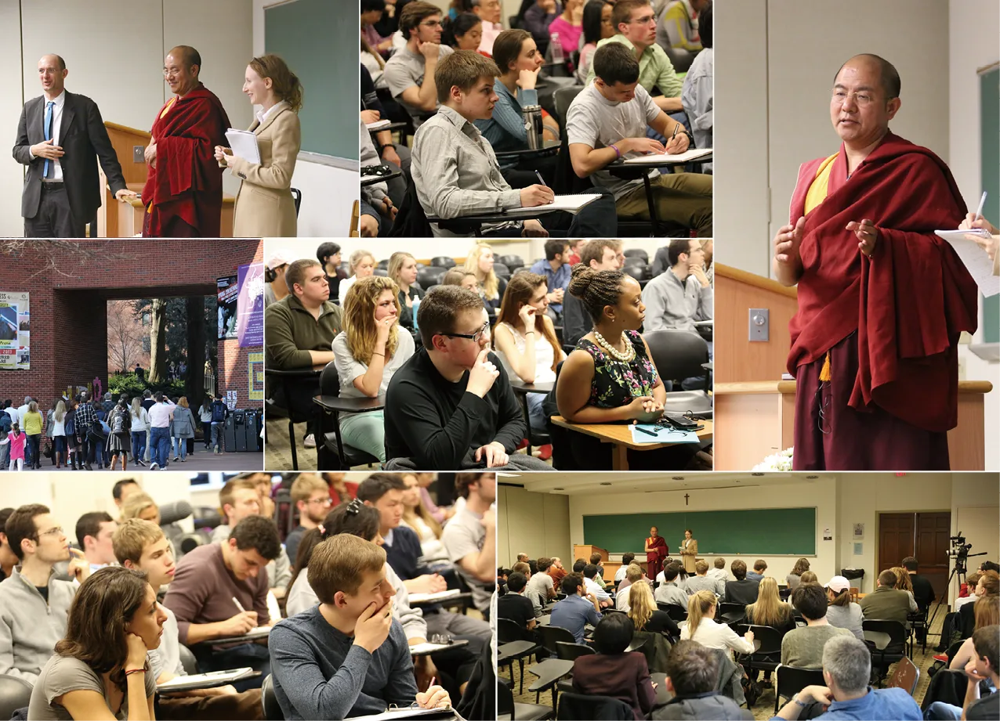
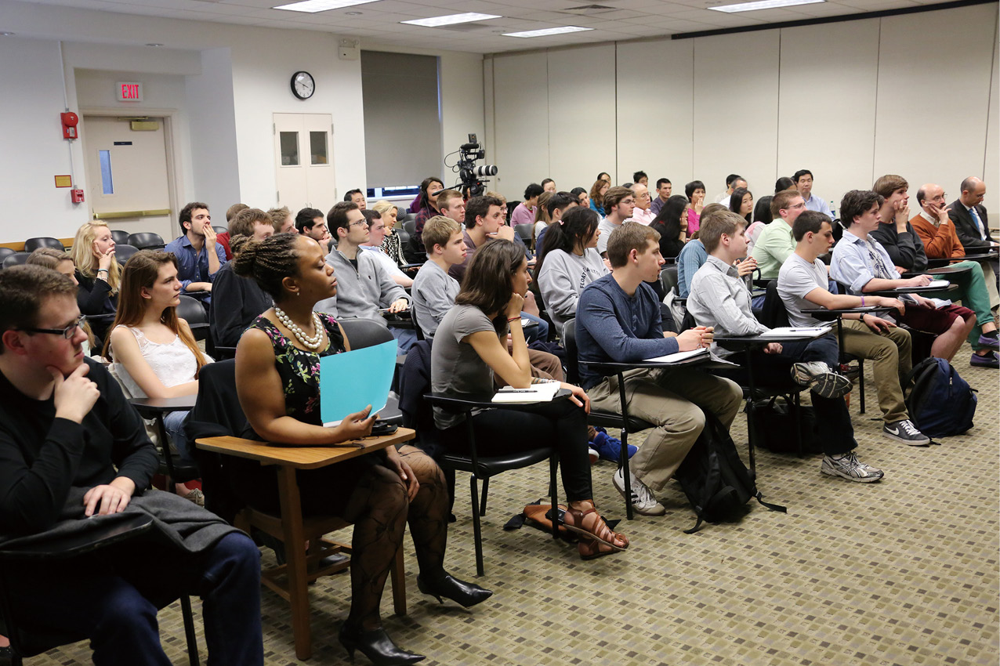
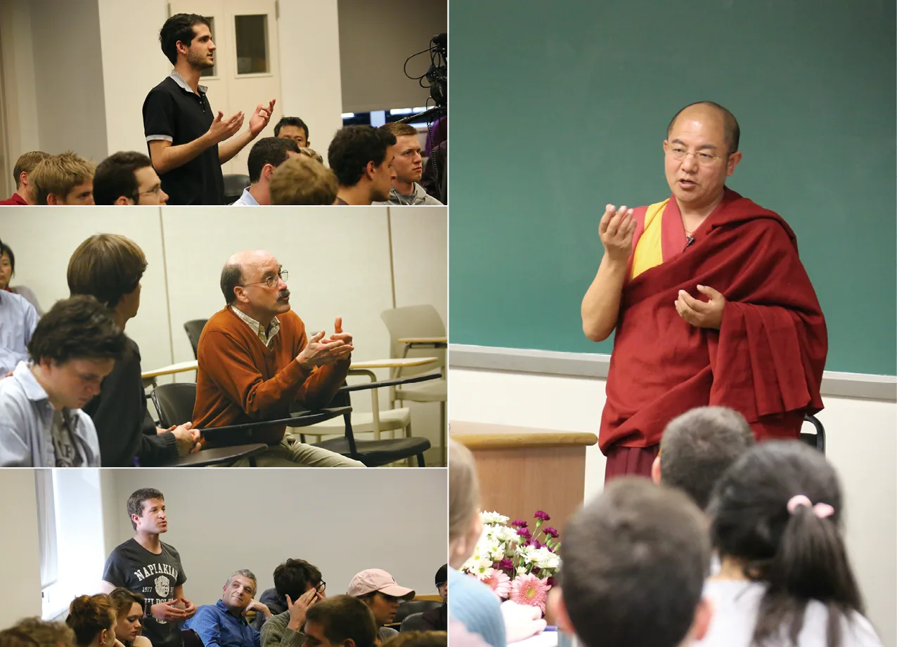

所谓的佛法，

并不像现在有些人认为的那么肤浅，

也不是一种单纯的信仰，

而是一门生命的哲学。

第51场

美国乔治城大学

Georgetown University

美国·华盛顿

2013 / 4 / 5

## 展望藏传佛教 21世纪在全球的传播

## Tibetan Buddhism in 21st Century China and Beyond

神学系本杰明•伯根教授（Prof. Benjamin Bogin）：

我不想占用大家太多时间，但还是要首先简单地介绍一下索达吉堪布，藉以表达我的感恩之情。

首先特别感谢来自德国马普研究所的郁丹教授，是他筹备了堪布的这次访问。另外，我还要感谢安吉拉为此做出的所有努力。同时，也要感谢现场的翻译，你们将会非常惊叹并感恩她能以精湛的翻译技巧，将藏文精确地译成英文。

作为一位老师，我想先解释一下索达吉堪布的名字。以便让大家通过堪布的名字，而对堪布有所了解。

“堪布”并非名字，而是一种称谓。在藏传佛教中，这是对一种学位的称呼，代表了闻思佛法的最高水平。索达吉堪布在喇荣五明佛学院多年学修佛法，已被公认为是藏地最杰出的学者之一。他在佛法学修领域，有着卓尔不凡的影响力。堪布不仅把藏文经论译成中文，还为论典广作注疏，如寂天菩萨的《入行论》等等。参加《佛教基础知识》这门课的同学，以后会读到这本书，你们将从中感知到堪布对这部论典的无比精通与甚深感悟。

堪布不仅对《入行论》做了非常广博的讲解，更围绕传统佛教主题，作了大量著述。学过藏传佛教课的同学，已经学习过喇荣五明佛学院的历史，熟知堪布的上师晋美彭措法王，知道佛学院是真正建立在行为清净的理念之上，并如实呈现了这一美德的高风亮节之处的佛教高等学府。作为一位出家人，堪布身体力行地引导大众实践佛法的学修传统，堪称真正的典范。

“索达吉”中的“索”字，是藏语“索朗”的简称，意即“福德”，可见堪布是一位很有福德的智者。堪布名字的后半部分是“达吉”，意为弘扬、旺盛、增长、兴盛。从这个角度来说，堪布早已肩负起广泛弘扬佛法的重任，令佛法出现了前所未有的兴盛。

堪布利用种种现代科技为大众广泛宣讲佛法，包括大众媒体。你们很多人应该知道微博，它相当于中国版的推特（Twitter）。堪布的微博粉丝有上百万人，相当于Jay-Z（Shawn Corey Carter, 1969-）在推特上的粉丝数量，其影响力可想而知。堪布不仅担负着弘扬佛法的重任，利生事业是如此广大，而且在众多领域，也是博学多闻。从堪布身上，我们能真切地看到佛法的功德。

像堪布这样一位非常了不起的上师能够光临此地，是我们的无上荣幸。对于堪布仁波切的到来，我感到非常高兴。同时我相信，你们也一定能从堪布的演讲与交流中，了解藏传佛教，并获得令人惊喜的受益。下面，让我们一起欢迎堪布！

非常感谢本杰明教授的邀请，让我来到这里跟大家一起交流。我认为，这是一次很好的机会。二十年前我来美国时，虽然也很想与学校的教授、学生、学者们彼此学习，但那一次我们针对的主要是佛教中心，都是与佛教徒一起交流，除此之外没有去过高等学府。

乔治城大学是举世闻名的大学，也是美国一流学府之一。美国前总统克林顿，菲律宾前总统阿罗约，以及许多为世界做出过卓越贡献的知名人士，都毕业于这所学校。贵校的本杰明等很多教授，倾注全力弘扬和发展以藏传佛教为主的佛教理念，付出了极大支持和关心。我在此向你们表示真诚的感谢！

## 佛法可以带给你新的认识

我去过很多学校演讲，到了美国才明显感到，东西方的思维方式和学习方法差异很大。不管怎么样，对每个人而言，无论是学习法律、建筑、商业等哪个专业，了解和学习宗教都是必要而且重要的。虽然信不信仰宗教、选择什么宗教是自由的，但宗教本身，实际上是一门学问。

当然，除了学习宗教的理论，实践、修持也不可缺少。如果缺乏这些，追寻真理的路上将有诸多缺憾。

我自己从小深信藏传佛教，也学过很多佛法教理。出家多年以来，更是一直致力于闻思修，大部分时间是在佛法阳光的沐浴下度过的。通过学修，我深深感觉到，藏传佛教确实是个取之不尽的智慧宝库。

在座各位都聪慧非凡、学识渊博，你们应对佛教有一些研学和践行。无论智慧何等锐利的人，在甚深广大的佛法面前，一定会有新的认识。

以前我在读书时，对生物、语文等学科不是很重视，认为这些比较简单，直到遇到了佛教的空性、因明并深入学习之后，才真正体会到其智慧深不可测。所谓的佛法，并不像现在有些人认为的那么肤浅，也不是一种单纯的信仰，而是一门生命的哲学。它超越了人生中一切的价值，是深邃无比的大智慧、大学问。

## 未来更应关注心灵的需求

你们能考上乔治城大学，有机会在这里学习，并得到许多优秀教授的指导，我认为很有福报。刚才教授提到我有“福德”，但我很清楚，自己只是名义上有福德，并不是真实意义上有福德。而你们能在位于华盛顿的这所学校里学习，并不是名义上的福德，是真实意义上的福德。

在藏地，不要说像这样各方面条件非常优越、令人十分向往的学校，连一般城市里的大学，很多人也没有能力去读。你们学校无论是外在的建筑，还是学生的整体素质，都充满了朝气，十分令人渴慕。尽管我人生已过了一半，但内心深处仍有这样的感慨：若真能回到二十多岁，能在这样的学校学习知识，该有多好！

不过我也知道，尽管你们现在的条件比较悦意，但将来从学校毕业后，在生活、婚姻、工作等各方面，仍会面对各种压力。到了那时，佛教的见修会显得格外重要。

其实，财富、权势等外在条件，除了能满足欲望之外，不可能让人得到真实的利益和快乐。在21世纪，大家更应关注心灵的需求。关于遣除心灵痛苦方面，佛法在人类历史上扮演着十分重要的角色。如果年轻人能接触一些佛法，对解决以后的烦恼会有极大帮助。

从1987年至今，我讲经说法已有二十多年，起初以讲法为主，过了10年左右，开始一边传法一边翻译佛教经论。从我的所见所闻来看，如今信仰、研习佛教，尤其是藏传佛教的人越来越多，并呈几何倍数增加。无论是哪个阶层、哪个行业，都有很多佛教徒。佛教理论广大甚深，并有汉传、藏传、南传等各大传承。其中藏传佛教，更有着完整的显密教法。译师们对经论的翻译，十分精准合理，这是依靠前辈智慧卓越的成就者与传承上师，将这种翻译方式从未间断地一代代传承下来的。他们所拥有的智慧，远远超过了现在的大学教授。

虽然美国大学的意识极为超前，但从学习方式和内容来讲，若能与藏传佛教的寺院互相学习，彼此间有利而无害。在交流的过程中，你可以发现藏传佛教的不同寻常之处。像已圆寂的敦珠法王（Dudjom Rinpoche, 1904-1987）、顶果钦哲仁波切（Dilgo Khyentse Rinpoche, 1910-1991）、创巴仁波切（Chögyam Trungpa Rinpoche, 1939-1987）、贝诺法王（Penor Rinpoche, 1932-2009）等前辈大德，以及如今国内外很多藏传佛教大德们，能让无数人趋入佛法、获得快乐。在我们藏地，晋美彭措法王以及十世班禅大师住世期间，每天摸顶的信众有成千上万。得到摸顶以后，这些人的内心多多少少会有一些改变。用佛法术语讲，这就是一种加持；用科学用语讲，这里面有一种特殊的力量。无论如何称呼，这都是真实存在的。

我并非因为是佛教徒就自卖自夸。我自己将大部分时间用在修行上，品尝到了佛法的殊胜利益。如同遇到了美味营养的佳肴，会忍不住推荐给别人一样，我也很希望能把对身心有利的佛法推荐给你们。

所谓令众生趋入佛法，并不是以宗教来占领、统治，而唯是以佛法来利益众生。利益众生，是每个修行人的目标。如果能以佛法的理念来思考问题，内心就会生起信心与勇气，能够更好地生活。

借此机会，我向大家提出两点希望：

第一，佛教既能百分之百与科学相适应，又不会被科学所驳倒。在这个科技时代，希望大家一定要尽量利用网络科技途径，让佛法更普遍有效地利益世人，让全世界都能了知佛法的珍贵并受益。

第二，现在佛教与东方传统文化正面临着衰落的趋势。而在近代，西方一些开明的智者，已经认识到东方文化和大乘佛教具有极为殊胜的价值，提倡人们关注东方文化。如今西方又出现了很多智者，不断努力学习、研究和保护藏文化。我希望你们将来也能关注、重视和保护佛教，尤其是藏传佛教。西方人性情稳重，会用一生时间去研究一件事情，这非常让人羡慕。以此品行，相信你们一定会令佛教的真实价值昭于世界。当任何一个优秀文化面临衰败的危险时，每个人都应该像保护如意宝一样去爱护它，这对整个人类有着重大意义。

本杰明·伯根教授：

哪怕再听几小时堪布仁波切的演讲，也会让我们觉得精彩无比。但为了留给大家和仁波切互动交流的机会，很抱歉我在此冒昧打断。

堪布非常想聆听你们的问题，所以如果有任何问题，不管是有关堪布的演讲，还是你们自己的问题，都可以提出来。

现场互动

问：在来之前，对您作了一些了解。似乎您目前所了知的一切，都源于那些渊博多学的前辈上师。但不幸的是，他们大多已经圆寂。既然您已是当代最了不起的上师，那么，在没有人教授的情况下，您个人如何继续自己的学修呢？

堪布：按照佛教传统，首先依止上师，上师能解答你的疑问。我依止法王如意宝19年，他是位非常了不起的上师。当然，也不是所有的问题，都必须直接问上师。在经过辩论和研讨以后，如果还有疑问，才可以去问。

本来我读书毕业后要当老师，后来没当老师就出家了。出家以后，起初不问世事，每天都在精进学修。虽然也有过很多问题和疑惑，但在这几十年里，通过学修佛教的显密教理，已经解决了大部分。即使还有一些，一方面可以翻阅上师的教言，同时还可以借鉴其他上师的论典。

刚开始学习时，都要先听闻，然后思维、提问和辩论，之后是修行。虽然我修得不怎么好，但通过多年的闻思，我已没有什么可担忧的了。

问：关于环境保护，佛教一定程度上也在实践这种理念。在您看来，未来会怎么样？

堪布：目前，有些国家有很强的保护意识，而有些国家却明显存在着不足。据科学研究得知，再过若干年，地球上的所有资源都会耗尽，随着人口不断增长，人类的生活也会日益艰难。如果真有那么一天，仅仅靠开几个研讨会，是很难解决问题的。

未来会怎么样，我不懂预言更无法预知，但如果每个人——无论你有没有信仰，都能共同肩负起保护地球、保护环境的责任，尽己所能地节约资源，地球的寿命一定会延长，也不会出现很大的危机。

这一点，现在已有越来越多的人开始意识到了。

问：在美国，佛教和天主教之间有很多交流，都是由天主教委员会赞助。期间，各教修行人围绕宗教话题展开对话。其实，研究寺院生活，非常有助于人们面对痛苦、暴力、生态环境等问题。我想知道，您是否参加过佛教与天主教、基督教之间的对话？您如何看待佛教和天主教、基督教之间的关系？

堪布：今年七月，我将在香港举办第三届世界青年佛学研讨会。届时，佛教、基督教、伊斯兰教等八大宗教的信众都会参加。各宗教的代表们也会就一些热门话题，以及与人类利益息息相关的问题，发表各自的看法。其目的是为了促进团结，各宗教之间互相学习。

地球上所有的宗教都应该团结，无论你信仰什么，都应学习一些其他对人类有利的思想。只要是正信的宗教，都有超越人类思维的深邃思想与不可思议的特殊能力。作为信徒，每个人首先要以自己的宗教为根本，然后在此基础上，还应借鉴其他宗教的优点，这样不但能更好地为社会服务，还能促进世界发展与内心安乐，对各方面的提升都会有很大帮助。

如果宗教之间经常明争暗斗，只关心弘扬自己的宗教，对其他宗教一律否定，这只会伤及自他。虽然基督教的教典我看得不多，但知道里面也有一些爱的理念，鼓励信众多做慈善。特别是诺贝尔和平奖获得者特蕾莎修女，我特别赞叹、推崇，经常让大家向她学习。

问：您认为汉传佛教和藏传佛教主要有哪些区别？您有很多汉族弟子，如果他们在学佛过程中二者之间发生抵触，您会建议他们怎么做？

堪布：佛教分为汉传、藏传、南传，现在还有了西方佛教这一分支。准确地说，佛教属于心灵教育，是真正能让人离苦得乐的宗教。汉传佛教和藏传佛教之间，没有什么明显差别。汉族弟子学修藏传佛教，一般也不会与汉传佛教发生抵触。

当年，印度传来的佛教，结合汉地传统形成了汉传佛教，结合藏地传统形成了藏传佛教。而佛法教义是一致的，都不离心地善良、利他菩提心，或不杀生、不偷盗、不妄语等，这是人人都应具备的素质，也是东西方公认的美德。若立足于这方面传播佛法，一般不会遇到太大困难。

汉地虽然也有佛法，但传法的上师明显供不应求。而藏传佛教通过辩经等方式，源源不断地培养了一大批智者，在实修方面，契合内心的圣者窍诀也不胜枚举。所以，现在很多汉族人喜欢学习藏传佛教，据我所知，有些城市修学藏传佛教的人数大概有五六千，这是已经登记的数字，没有登记的还有很多。

他们最需要的，是对身心和生活的正确指导。释迦牟尼佛说过，佛法如水，任何人都可以饮用。学佛没有年龄、民族、国家的限制，希望离苦得乐的人，都可以通过修学获得这样的智慧。

本杰明·伯根教授：

时间不多了，恐怕今天的提问只能到此为止。

刚忘记说明，是阿维夫教授组织了堪布昨晚的公开演讲。对于堪布的演讲，我们学校与乔治华盛顿大学都感到非常荣幸，特别是能成为堪布仁波切在美国巡讲第一站的华盛顿大学，更是荣幸万分。

这次只是我们两所大学和佛学院之间长远交流的一个开端。今天时间很短暂，但希望我们以后会有更多的交流。最后，请大家和我一起感恩堪布的演讲！
