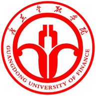
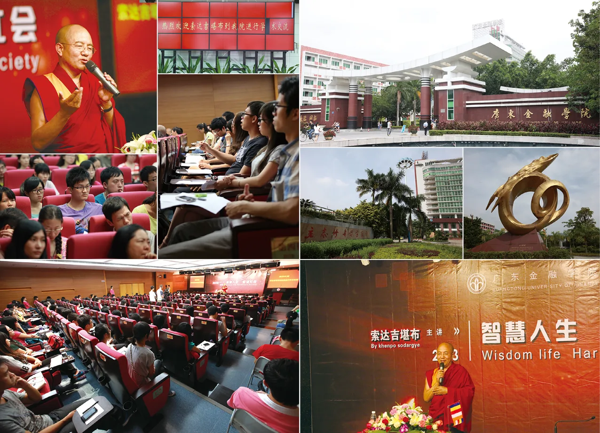
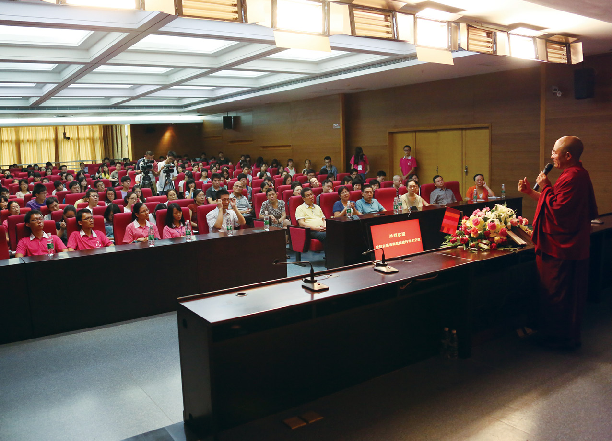
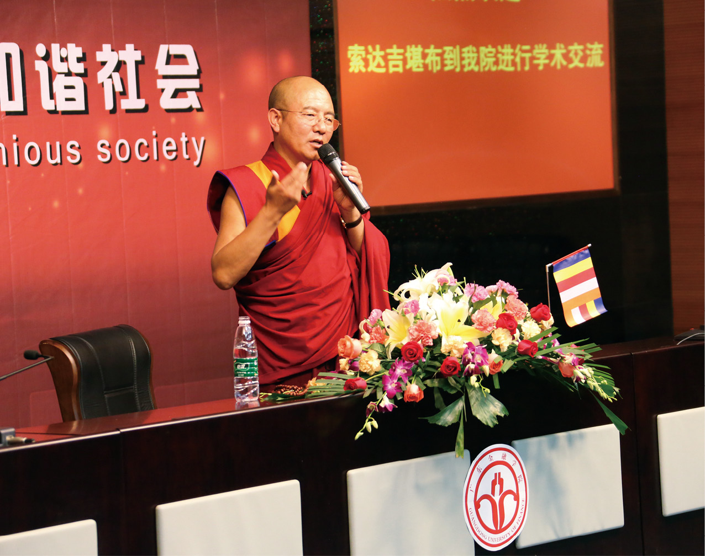
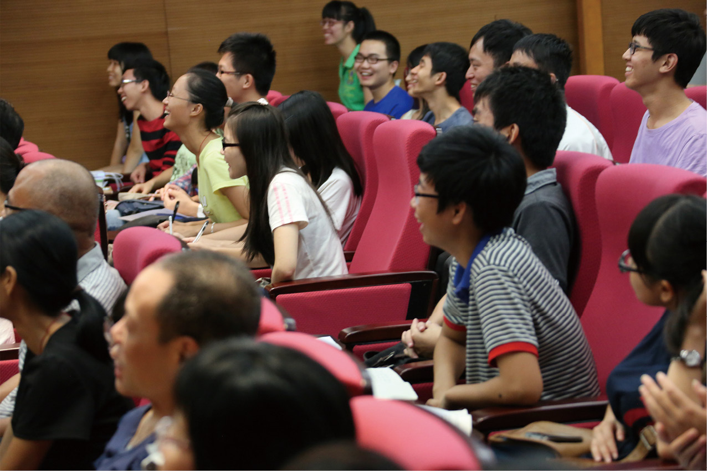
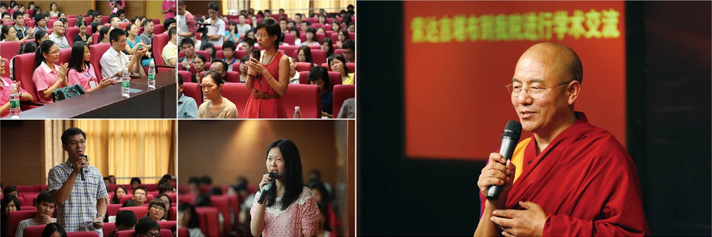

幸福人生，

总是和善良以及完善的人格连在一起。

第60场

广东金融学院

Guangdong University of Finance

中国·广州

2013 / 9 / 28

## 智慧人生 和谐社会

## Wisdom in Life, Harmony in Society

主持人：

请全体起立，以热烈掌声欢迎索达吉堪布来我校讲学！

谢谢！请坐。

尊敬的索达吉堪布来自喇荣五明佛学院，依止法王如意宝晋美彭措为根本上师。他怀着仁心善念，为汉地僧众译经讲学，不辞辛劳；他著作等身、方便说法、度人无数；他捐资助学、慰问灾区，扶危济困、广施慈悲；他到过欧美、东南亚等许多国家和地区弘法讲学；他曾经与北大、清华、人大、浙大、复旦等高校学子欢聚一堂，帮助大学人探索智慧的源头、浇灌心灵的花卉，在国内外产生了极大的影响。

今天，广东金融学院迎来这位高僧大德，这是一个难得的机缘。因为产业升级的广东，同样需要文化升级；作为支柱产业的金融行业，同样需要精神文化的建构；广东金融学院的莘莘学子，更需要安身立命、完善自我的大智慧。

好，闲话少说，有请尊敬的索达吉堪布为我们开示——

各位下午好。今天有这个机会跟金融学院的老师和同学一起学习“智慧人生、和谐社会”，我很珍惜，也很欢喜。

## 利他的智慧

我所理解的智慧人生，就是具有利他智慧的人生。有了利他的智慧，你自己会幸福；有了利他的智慧，你会给身边的人带来快乐；有了利他的智慧，你的前途光明无限。

我们都希望有智慧，但智慧要跟利他心相连，才是佛教所谓的智悲双运、古人所谓的德才兼备，是大智慧；否则很可能成为害人害己的小聪明。《资治通鉴》就德与才的有无多寡，分出了四种人：德才完美具足的，是圣人；德和才一样没有，是愚人；德胜过才称君子；才胜过德叫小人。

这种分析很有启迪性。在座的学的都是金融，很明白什么是金钱的诱惑，因而更要注意德行的培养。

最高尚的德行就是利他。像我们身着袈裟的人，佛教里称沙门，应以慈悲为怀，但没有利他心的话，和尚也好、尼姑也好，都算不上合格的佛教徒。世间的领导、精英们也一样，没有利他心，再成功也掩饰不了自私的面目。相反，有了利他心，不论你的身份如何，都是高尚的、快乐的。

因此，利他的心不仅是一颗好心，也是一种人生的智慧和态度。如果每个人都能关心他人、关心社会，那么天下也就太平了，诚如清末小说家刘鹗在《老残游记》中所说：“人人好公，则天下太平；人人营私，则天下大乱。”

希望大家常常思索这种道理。

刚才在和老师们聊天时，我明显感觉这里的氛围跟其他大学不同，有相当的自由空间，心态很开放。可能是受这种氛围影响，老师们大都有一种长远眼光，尽心尽力想为大家打造一条光明的人生之路。这样思考是有前瞻性的，我也希望在老师们的精心培育下，同学们都能有个好的前途。

不过说到前途，我想提醒一点，就是要相信业因果。

## 相信业因果

刚才一位老师说：“每个人都有自己的命运。”

命运在佛教认识里，就是业的呈现，《百业经》等经典中都说：业如同广大无边的网，覆盖整个世界。这张网比因特网大得多，也复杂得多，一般人无法想象，也无法通达其中的深细道理。不过，因为一辈子研究这些，我常会善意地告诉大家：要相信善有善报、恶有恶报，它确实存在。

有些同学心地很善良，但却不相信有业。眼前不相信也不要紧，我希望当你对人生有了更多体会，比如发现有些事不是想做就能成功，而有些事不努力也能成办的时候，可以回头想想，这背后是否有种力量？其实就是业。业都是自己造的，上一辈子、再上一辈子乃至无量生世当中，我们在阿赖耶识里播下或善或恶的种子，今生，它们结果了。

命运就是这么来的。看看周围，同样读金融、同时毕业的两个同学，一个非常成功，一个倒霉透顶，什么原因？他们的业不同。同一家庭的两个孩子，一个又聪明又漂亮，而且成功，另一个既笨又丑，还受社会歧视，为什么呢？还是业的问题。业很复杂，但佛教里确实有清晰的解释。

一说到业，我总要澄清一点，就是业对命运的影响，不能简单理解为“宿命论”——完全取决于前世，这不是对业的正确认识。真实的情况是：我们今天所感受到的一切，有一部分的确是前世的业导致的，但也有一部分跟今生的因缘有关。了解到这点，你就明白断恶修善的意义了。

说得明确一点，相信业因果，也是一种智慧。

我常常觉得，学习是一件乐事，尤其是学习利他。佛教认为，对他众有利的知识，是高尚人学的；对自己有利的知识，是中等人学的；而对自他无利甚至有害的知识，只有下等人才会学。因此，要学就学对自他有利的知识。

金融可以说是这种知识，既可赖以谋生，也可服务他人，但每个人的前途如何，还得靠自己努力。努力学知识是一方面，但想有所作为，还要提升利他心。利他心是在任何环境生存和发展的基础。只要你相信因果、践行利他，保持一份纯洁和高尚，有些事会不期而至，超乎你的想象。

## 绽放心中的水仙花

讲个故事吧。1950年，美国哥伦比亚大学商学院入学考试有这么一道题目：“假如你有两块面包，你会怎么做？”

本杰明·格雷厄姆（Benjamin Graham, 1894-1976）教授参加了阅卷，答案各种各样。有的学生说，我会留一块作为晚餐。教授批注道：你很节俭。有的学生说，我会送一块给乞丐。教授批注道：你很善良。有的干脆说“统统吃掉”。教授笑了笑，批道：你真可爱，我的孩子。忽然，有一个答案吸引了他，上面写的是：假如我有两块面包，我会用其中一块去换一朵水仙花。

本杰明教授在卷末为他批了几行字：世人都知道面包的好，却不知道一朵水仙花的妙……我可爱的孩子，你小小年纪已经领略到人生的真谛，不为物质所累，堪成大器。

这名学生就是沃伦·巴菲特（Warren Buffett, 1930-），当年刚刚20岁。

后来本杰明教授一直对他非常关注，并将自己的所有知识和窍诀传授给他。1957年，巴菲特筹集了30万美元，进入股市炒股，从此就像滚雪球一样越滚越大，到2005年，他的个人资产达到440亿美元，仅次于首富比尔·盖茨（Bill Gates, 1955-）。

2006年6月25日，巴菲特宣布，捐出总价达300多亿美元的私人财富，投入慈善事业。这时人们才发现，他的“水仙花”开得如此美丽。2008年，他以620亿美元的总资产超越比尔·盖茨，成为新的世界首富。

谁都知道，不是每个人都可以成为巴菲特的，但像他年轻时那样，我们也可以在心里发一些利他的宏愿，并让这种强大力量推动我们尽可能多修些善法。其实行善不仅是高尚的，也是有智慧的，诚如《正法念处经》里所说：“一切时一心，常勤修善业，舍离不善者，此是智慧相。”

有了这样的智慧，身语意常常保持善良，那我相信，终有一天，我们也可以绽放心中的水仙花。

## 生生世世的智慧

除了今生的智慧，我们还要有生生世世的智慧。

蚊子落到手上，你是“啪”一声打死它，还是放了？我的话，就把它放了。为什么？因为它是生命。凡是生命，不论大小，都有一种对自我的认同，既然如此，我们就应该像对待自己一样，尊重其他的所有生命。

这就是平等的生命价值观。是否具有这一观念，将对我们的思想产生深刻影响，并体现为截然不同的行为方式。更重要的是，我们今天的心态和行为是有果的，它必将在未来的生生世世，成为自己如何投生以及受苦受乐的因。

在座的有些人可能承认前世后世，因为他觉得，不承认，很多现象和道理就说不清楚；而有些人也不想太多，反正接受不了这种观点。这两种态度都有些感性，如果你往理性方向迈一步，问问自己：我有没有理由否认它？那你会得出和我一样的结论：没有理由。我在多年研究佛学、哲学、心理学等知识的过程中，确实没有发现这种理由。

如果你没有否认的理由，而佛教中有建立它的理论，科学中有证实它的案例，为什么说不存在呢？一定存在。

既然存在，我们就要注意自己今天的行为了，因为它是来世的因，严重的，今生就会成熟果报。人生的境遇有顺有逆，身处其中，应该尽量保持善行、止息恶行，否则恶就是恶，有报应。你做了，也许暂时看不到，“哪有报应？”但过不了多久，在你的身上或心里，在你的家庭或工作上，很可能会出现不顺和痛苦，那时就后悔莫及了。所谓“欢欢喜喜造恶，哭哭啼啼受苦”。今生都如此，更何况来世？

## 培养完善的人格

可能是受环境或是急功近利的教育影响，不说来世，就是这一世的人格或人生意义，也很少有人理会。现在多数人是只顾眼前的，就盯着钱，不顾道德，不顾生命价值，甚至都不知道孝顺和感恩，不知道要尊重有德的人，心里只想着自己的那点快乐，其他的什么都顾不上。

人要现实一点，这个我理解。读书期间想着毕业后怎么成家立业，怎么买房买车，赚大笔大笔的钱，我也理解。不过，值得注意的是，最好不要落入偏执的心态当中。

有些过于悲观的人，白天晚上担心前面的压力，学业、工作、生活，人生的路还没真正开始，就被想象的障碍压垮了，“像我这样的人，怎么会成功、幸福呢？”

而有些人也太乐观了，认为毕业后的生活一定比校园里幸福。实际未必，或者说，正好相反。中午我接到一个老师的电话，他说：“我现在太想读书了，真想回到学生时代，但我已经成家，时光不能倒流……生活怎么这么难？”

因此，我们不必太悲观，也不要太乐观，我的建议是，好好享受眼前的读书生活，单纯、快乐、无忧无虑。如果你真为将来着想，那就好好培养自己的人格和善心，具备了这些，你就可以面对压力，也就有可能迎来真正的幸福人生。

幸福人生总是和善良以及完善的人格连在一起。

我们现在学的多数是知识、是技术，不是道德。我们可以用它去完成一件事情，却不知道如何沟通，所以很多人一进入社会，想怎么做就怎么做，“我有道理就可以啊……”实际上不是这样。我们还要看别人是怎么想的。社会很复杂，人的想法也不一样，所以要为别人想，这才能沟通。

毕业证上看不出这种能力。你学历再高，如果对上不懂得尊重领导，对平等者不会谦让合作，对下面的人不知道慈悲爱护，工作起来一定会受挫的。加之承受能力又差，领导批评一句也耿耿于怀，那就前途堪忧了。

这些很重要，老师们要常常提醒。从长远看，人格教育不亚于一般的知识和技术，把这些放空、不重视，是很难真正关心到学生的。你们也知道，在过去的传统里，父母在家庭教育中都会教孩子洒扫应对、待人接物，做人的一套从小就教好了。但80、90甚至70后的父母，自己都不懂，更谈不上教了。父母不教，到了学校老师也不教，从小学到大学都没人教，一二十年读下来只会考试，那这些怎么办呢？

希望老师们经常讲讲自己的经验，讲讲这些道理。

## “罗斯顿醒悟得太迟了”

我总认为，知识分子身上有一份责任，以慈悲心维护社会的责任，所以不应该把目光老放在钱上，这不会给你带来真正的前途。不要忘了那朵“水仙花”，要早点醒悟。

20世纪初有一位好莱坞影星利奥·罗斯顿，他超级肥胖，体重达170公斤，走几步路都气喘吁吁。他因肥胖出名，也有才华，但爱钱如命。医生曾多次劝他节食，减少演出，否则将危及生命，但他不听，他说：“人来到世界只有短暂的几十年，我虽然有很多钱，但我还要拼命地继续挣下去。因为，我太喜欢钱了。”就这样，他马不停蹄地去各国演出。

终于，1936年在英国表演时，他因心力衰竭倒在舞台上，被送进医院。医院用尽当时最好的药物和医疗器械，但还是不能挽留他的生命。弥留之际，罗斯顿绝望地喃喃自语：“你的身躯很庞大，但你的生命需要的仅仅是一颗心！”

急救中心院长哈登黯然垂泪：“罗斯顿醒悟得太迟了。”为警示后人，哈登把罗斯顿的这句临终遗言，镌刻在了医院接待中心最醒目的地方。它也确实起到了警示作用。

47年过去了，美国石油大亨默尔来英国谈一项大生意，突然病发，倒在谈判桌上，被送进这家医院急救，检查结果也是心力衰竭。但为了不影响生意，他包了一层楼当作办公场所，安上电话和传真机，一边治疗，一边工作。医生劝他安心静养，他不听，依然我行我素，医生也无可奈何。

有一天，默尔散步来到接待大厅，见到了那句警示语，不禁停下脚步，静静地默念起来。当从医生那里得知整个事件的来龙去脉，他顿时陷入沉思，又在那条警示语前驻留了一个多小时，才缓缓离开。

回到房间，他撤掉了电话和传真，并要求自己的财务部门一个月之内把所有账目都算好，说过段时间他有一个重大的决策。接下来，他专心养病，等待手术。手术成功了，默尔出院。出院的第一件事，他就把公司卖了，住进苏格兰的乡下别墅，过起了逍遥自在的生活。

他为什么这么做？人们从他传记里发现一句话：富裕和肥胖没什么两样，也不过是获得超过自己需要的东西罢了。

默尔那时就醒悟了。他知道生命很脆弱，不应该为了一些多余的东西，在不断忙碌中不知不觉失去它。

## 愚痴无智慧，贪苦中妄乐

罗斯顿醒悟得太迟了，而现在很多人也差不多，脑袋里想的都是快乐，忙着赚更多的钱、爬上更高的位置，以为这样就能快乐。但人生不是很长的，我们想过没有，那些快乐真实吗？当你要离开时，会相信它吗？你会相信什么？

有位科学家说：“浅薄的知识使人远离上帝，渊博的知识使人亲近上帝。”我的理解是，当我们觉得上帝、佛陀或真理离我们很遥远的时候，说明我们的知识还很浅薄，等到各类知识、智慧积累到一定程度，便会规规矩矩来到真理身边，但那个时候，如果生命到了尽头，你会是个什么心态呢？

会不会后悔？因为一个“贪”字，人生空过了。

佛陀曾经教诫说：“愚痴无智慧，贪苦中妄乐。”没有智慧的人，总是把他所贪执的幻象误以为快乐，就像人喝醉了以后，迷迷糊糊的，还觉得很快乐，完全不知道自己已经变成什么样子了。我听说有些娱乐场合的情形更加疯狂。

古训认为，贪心太大会影响心术。所以康熙皇帝说：“观人必先心术，次才学。心术不善，纵有才学何用？”其实很多领导也这么看人，看你心地善良，才会委以重任，否则他们也害怕。所以，以后进了银行或证券公司，要格外警惕自己的心，不要因为贪心增上，毁掉一生的前途。

有人不理解佛教为什么要断贪，其实佛教所谓断贪，并不是排斥那种正常需要的心态，我们要大家提防的，是这种过了头的贪。这种贪，往大了说，伤命伤德，往小了说，日常生活里不懂得节制，也会伤害自己的身心。

比如贪睡，该睡的时候可以睡，不该睡的时候也睡，会导致整个身心的气脉紊乱。再比如贪吃，正常饮食对身体是好的，但整天吃吃喝喝，除此之外没有其他的生存意义，那不仅对健康有害，人生也没有价值。还有贪玩，贪玩的人不好好学习工作，不做有意义的事，每日打牌游耍，虚度时光而已。最不好的，就是看一些色情的电影电视，染污心灵。

## 有利他心，才有和谐社会

因此，年轻时要多学习，而且要学到正确的知识——包含利他与慈悲的真理。不管你是学生、企业家或艺术家，都应该追求这种不需要狭隘的宗教或思想包袱的真理。

佛教提倡慈悲心，但这个慈悲心，不仅佛教徒在修行时需要它，凡是人类，不论你生存在世界的哪个角落里，都需要它。一旦人类离开了慈悲心，谁都不肯真正关心他人的时候，人与人的关系就会僵化，家庭和社会无法和谐，那时候，恐怕我们只能看着世界变得越来越恶浊了。

你们不一定要信仰佛教，但对佛教所阐释的真理，如果不去了解、不多少学习一些，我觉得，来一趟人间还是挺可惜的。你们不妨去寺院走走，到了寺院，你会感受到一种无形的力量。这是蕴含慈悲与智慧的力量，它会从内心深处启发人的爱心，让你了解万法真相。你们也可以看看古书，古人把思想都留在那里，超越现在的认识，对心灵有益。

现在人强调自我，也学习以自我为中心的思想，这对自我提升是有好处，可以让个人、民族和国家形成强大的意志力，但如果能像考虑自己那样为他人着想，在利他心、慈悲心基础上建立一种智慧，那整个社会自然就和谐了。

爱因斯坦曾说：“人只有献身社会，才能找到那短暂而有风险的生命的意义。”请大家想想他说的道理。

现场互动

问：请问阿难活佛的转世是谁？我的师兄说他的根本上师就是这一位。

堪布：我不认识阿难，更不知道他的转世是谁。

问：请问什么是“究竟”？

堪布：对于究竟，应该有很多理解方式，但在佛教的观察里，万法皆空就是究竟。

当量子力学研究者看到，他们的发现与2500多年前佛陀用实证智慧揭示的真理那么一致时，感到异常惊讶：原来在东方思想中，早就出现了对真理成熟而准确的认识！

如果你问的是这个方面，就是空性：万法的本体是空性，空性的自现是光明——现空无二，万事万物的本基。

问：我是财经传媒系的学生，请问怎么去除或减轻我执？明明知道这只是一道伤口，但还是会疼。

堪布：去除或减轻我执的确不容易，但确实有必要。当你要开始这种修行时，一定要先了解“无我”。平时不观察的时候，我们都认为有个“我”存在，“我的身体、我的头……”但一观察，“我”到底藏在哪儿？身体里？头里？心脏里？还是别的什么地方——都没有，没有“我”这个主人。

所以佛教认为，“我”是在五蕴假合上建立的。蕴是聚合的意思，有“色、受、想、行、识”五个蕴，就是这个身心五蕴的和合状态，我们称之为“我”。就像我们说这是“瓶子”，说可以这么说，但如果要你找出一个“瓶子”来，它在瓶底、瓶口？还是瓶内、瓶外？就找不到了。所谓“瓶子”，不过是对这个假合事物的描述而已。

这就是佛教的超胜之处。我和很多科学家辩论过，他们认为有“我”，我就问他：“你的这个‘我’，到底在哪儿？”

他说：“我的身体就是‘我’。”

“身体是身体，不是‘我’。‘我’在哪里？”

这时候有的说“我”在心脏里，有的说在大脑里。那我就继续追问：“你的这个‘我’，以什么方式存在呢？是以意识的方式存在，还是以肉体的方式存在？或是以分子等微粒的方式存在？”这么一说，谁都没有概念了。

这就是佛教为什么说“无我”的原因。

无我分人无我和法无我。人无我，就是我们对自己的执著，认为有我，这个不成立。而法无我是指，在“我的”房子、“我的”轿车、“我的”花朵，这些“我所”的事物上面，也没有“我”——这个法它没有自性，就是“法无我”。

因此，认为有“我”，只是我们的执著而已。

当然，了解了“无我”还要修行，修行后才能逐渐减轻甚至断除我执，这是一个漫长的过程，不是想断就断，马上没有“我”了。理论上了解还比较容易，修行要难得多。真正证悟无我，没有了私心，那是一种很深奥的境界。

问：烦恼起的时候明知是烦恼，但自己无法从中抽离，有时候甚至越陷越深，烦恼更大，请问这是怎么回事？

堪布：懂得对治就不会这样，除非你的方法错了。

首先要认识烦恼。认识烦恼跟认识我执一样，它一生起来，你就要认识它，知道这是贪、嗔、痴、慢、嫉或其他什么烦恼。其实烦恼就是执著，了解以后进行对治。

你可以转化它。比如嗔恨，当你对某人起了嗔恨心，这时要用爱心转化它，就像特蕾莎修女说的：“如果我爱我的敌人，敌人会变成朋友。”一般人对敌人只能恨，爱不起来，但有境界的人可以转化心态。

进一步来说，恨和爱都是分别念，如果你会观心，当你正吵架时，也可以观察：这个烦恼到底在哪里？外面、里面还是中间？只要正确了解它的体性，它就不会增长了。

问：法师刚才讲到利他的智慧很重要，但我们怎么才能真正认识到自他无二？

堪布：佛教中讲现相和实相，在现相层面，自他并不是无二的：我有我的空间，他有他的空间，自他有别。但只要你能从自身的感受去理解自他平等，所谓“己所不欲，勿施于人”，他人也一样重要，那么利他也就容易了。所以《正法念处经》里说：“当以智慧，饶益一切世间。”

利他的人，暂时也许别人不理解、不知道，但是渐渐地，你的行为会受到社会的赞扬和认可，会有成功的一天。

而从实相角度讲，自他本来就是无二的，自即是他、他即是自，一即是多、多即是一，法和法没有区别。

问：请问时间的本质是什么？在我们的感受中，时间是不可逆的，过去、现在、未来，然而生命有限，请问怎样才能在心理上不感受到时间的压迫？

堪布：在显现层面，过去是历史，现在是现实，未来是梦想，三时存在。然而在佛教看来，这种存在是假立的，爱因斯坦也说，时空是人类的错觉。因此，时间只是一种概念而已；三时无实，没有真实体性，是空性的、等性的。

不过，虽然是错觉，它却有自己的规律，就像你说的“不可逆”，既然如此，我们就应该遵循时间的规律，借鉴过去，珍惜当下，规划未来，这也是一种智慧。

问：我是这里的老师。很多临毕业的同学都会面临种种选择，是就业、考研，还是出国？他们一般都会很迷茫，有压力，请问这时该如何选择？

堪布：选择是需要智慧的。有智慧的人懂得取舍，一般来说，他不会因为眼前的蝇头小利，妨碍长远发展。

因此我觉得，有因缘的话，先出国去看看很好。一毕业就做事、成家，暂时可以得到一些稳定的利益，但从长远看，年轻人去香港或国外长长见识，了解一下世界，对将来是有很大好处的。广州一带比较开放，这个道理应该好懂。当然，如果没有这种因缘，考研或者读博士也挺好。

总之，以我个人的理解，除了特殊情况，有条件的，最好是趁着年轻多学一点，多到远处看一看。

问：请您解读一下“人人平等”的意义。

堪布：从某些权益和义务上看，是人人平等，但现实中我们的命运并不平等，因为每个人的业不同。就是这些不同的业让我们各自拥有了不同的长相、智慧、悲心、财富、权力、地位。如果这些都一样，世界就不是五颜六色了，但事实是，就是双胞胎也有不一样的苦乐，一个幸福，一个不幸。

所以，我深信业的存在。如果不从业上理解，世间正存在着的一切不平等现象，以及那些抱怨，就不好解释了。

问：您对江本胜博士的《水知道答案》怎么理解？

堪布：这位日本科学家通过长期实验发现，水对各类语言可以呈现不同的结晶形式。有人在对植物、水果等实验中也得出了同样结论：贴上赞美的话，它就长得好；贴上咒骂的语言，它长得不好。由此有人认为：人体内70%是水，难怪心对身有那么大影响，惯于忧愁、爱发脾气的人老得快、活不长，心情开朗的人健康长寿，这些都可以解释了。

而佛教更认为，如果一个人有了痛苦不是很在意，起了烦恼也不是老纠缠它，跟家人、朋友、同事不吵架，有点什么也都能修安忍，这种人的相貌会变得美妙、庄严。

江本胜博士（Masaru Emoto, 1943-2014）从水中看到了善和恶的力量，从而相信，善就像妙药一样，可以给人带来吉祥和治疗；恶则如毒药一般，对自他只有损害。实验结果就摆在那儿，事实也确实如此，不论你相信与否，这两种作用是谁都不能改变的。

由此我们可以理解，佛教里教导修十善、断十不善，不只是一种说法，而完全是基于对自然规律的认识和遵循。

这些道理，你们不妨研究一下。

问：我是市场营销专业的大四学生，正准备考哲学专业的研究生。现在很多人赞同因果，也相信善有善报、恶有恶报，但看到现实中有道德的人并不幸福，没有道德的人反而挺快乐，就让人费解，请问如何看待这个问题？

堪布：“善有善报、恶有恶报”，陈毅元帅也引用过。

你说的这种现象，并不表示善没有善报、恶没有恶报，是“时候不到”而已。行善的人不快乐，是因为他的果还没有成熟，就像种庄稼，播种时不可能收获。而今生享乐的人，说明他曾经修过善法，现在时候到了，正在感受。

那么，善人今生里的厄运是哪里来的呢？有两种可能：一种是，因为他现在行善的因缘，将来要受的苦果快速而轻微地现前了；还有一种就是前世的恶业导致的。

因此，因果不虚，但不是同时的，就像春种秋收。误解因果的人往往困惑在这里，他以为看到因就要看到果，看到行善的人受苦，就怀疑因果。其实不必。如果我问你：“你在读金融，为什么没有钱？学的时候，不就该有吗？”你怎么回答？这就是把果放到因上衡量了，但果都是在后面的。

问：我觉得，一切烦恼从本质上说就是欲望没得到满足，所以要把欲望控制在适度范围内，但这个度该如何把握？

堪布：这个度就是知足少欲。

佛教认为，欲望如同喝盐水一样，越喝越渴。叔本华也说：“财富就像海水，饮得越多，渴得越厉害；名望实际上也是如此。”了解到这点你就明白，为什么人越贪越空虚、越不知满足，有了一套房子，要两套；有了一辆车，要两辆；一栋别墅不够，要十套、百套……

那该怎么控制欲望呢？

很简单，有基本的衣食住行，能保障适当的生活，就可以了。标准不要太高，不管是什么身份。有钱的人基本需要也就那些，你把标准一提再提，也得不到更多快乐，而且你老想提高，就会有不满足的苦。而没有钱的人标准高了也没用，不如随缘，“够了、可以了”“比上不足、比下有余”……这种满足感很难得，放松、自在，也不用攀比。

我发现德国人不爱比，挺好，你有房有车是你的，别人不比。但我们喜欢比，“你的车多少钱，你的房多少钱……”每天说这些、比这些，这样比只会增加不必要不合理的竞争。在知识和道德上争是合理竞争，有必要，而不合理的竞争只会带来压力和痛苦，最好不要有。

问：请问多闻和智慧有必然联系吗？

堪布：多闻是智慧的源泉。在学校里，如果学生不听闻老师们讲课，就无法提升知识、智慧和技能。可以说，除了极个别的天才外，世上所有智者的智慧都源于老师。

我对我的每一位老师永远怀着说不尽的感恩之情，因为我知道，我心里这些少少的知识全都来自他们。读小学、中学、师范时有世间的老师，出家后有佛教的老师，他们为我传讲了各类知识，让我有多闻的机会，没有他们，我不可能有一点一滴的智慧。所以，我总是默默感恩我的老师。希望同学们也是，永远不要忘了你的老师，要知道感恩。

我在藏地我办的学校里，要求每个月都要做一次感恩活动，以培养学生的感恩心，同时也鼓励老师好好教学。老师教不好，将来学生不会理你的。我遇着过这样的老师，很伤心，“那些学生不理我……”我想，这一方面可能是学生的素质问题，但另一方面，也许老师当时也没尽什么心吧。

问：慈悲为什么可以利他利己？

堪布：大乘佛教的慈悲，是缘着天下无边一切众生兴起的，这种慈悲也许我们很难想象，但只要你心存善良，尊重身边的每一个人和动物，就是慈悲了。没有慈悲，当面对金钱的诱惑时，可能有人为了自己杀害他人，也在所不惜。

所以，在价值观方面，我最重视智慧和慈悲。

人要有智慧，也要有慈悲，有智慧而无慈悲的人，一般都只顾自己不顾他人；有慈悲而无智慧的人，想帮助谁也帮不了，因为你没有能力。打个比方，智慧和慈悲如同一双翅膀，有了这双翅膀，你就可以在人间的天空自由翱翔了。

问：我是一个珠宝首饰商，我们做生意总要追求利润最大化，请问这是不是就是佛教里讲的贪心？

堪布：这有两种情况：一种是只为自己，一辈子追逐最大最多，一味积累，没有为社会做什么；几十年赚来的钱离世后又被“五家所共”，由家人、亲戚、朋友互相争夺。这在佛教看来就是被贪心蒙蔽了，不明智，但很多生意人是这样。

还有一种是，在自我发展的同时，也为员工谋福利、为社会做贡献，这就不是纯粹的“贪”或自利了，里面有利他。在今天，竞争是难免的，不竞争很快会被淘汰，而在这个过程中，很多企业家做得很好，不仅自己成功了，还创造了大量就业机会，做慈善帮助弱势群体，这都是社会效益。

所以，只为自己就不太好，能够利他及服务社会就好。

问：请问藏传佛教跟汉传佛教的不同在哪里？

堪布：二者有很多不同，比如寺院的建筑、修行的传承、念诵经文的方式等，这些都不同。但有一点相同，都是先发菩提心，中间积累资粮，最后成佛度化众生。藏传、汉传都是大乘佛教，大乘佛教的目标就是利益众生。

不同的是形式，区别不大，但内容是相同的。比如，广东金融学院跟其他金融学院相比，管理方式上也许不同，标志也不同——这里是“融通天下”，别处是另外的写法，但所有金融院校的教育宗旨应该差不多，教学内容也差不多。

问：我对将来没有一个明确的职业目标，请问现在该不该确定一种专业，然后在上面努力？还是怎么样？

堪布：你自己都没有目标，让我说，就更不好说了。

人生无法预料。有些人辛辛苦苦在一个专业上努力了很久，却没有结果。我认识一个人，他本来学医，也想行医，后来做了老师。他觉得很意外，也很无奈，但现实往往这样，你认定的专业，不一定就成为你的职业。

所以，我的建议是：学习在何时何地都保持善良，学习过一种对得起别人、也对得起自己的人生。如果你把这个当作你的“专业”，以后肯定用得上，而且会非常有价值。

问：我家那边有一座寺庙，寺庙里有一位师父，五十多岁了，我经常去跟他聊一些问题。有一天我到那边，正好遇见他家里来人，说他父亲去世了。他哭了，我第一次见他哭得那么伤心。第二天，他跟一个老师父说自己想家了，然后离开了那个寺庙，从此再没有回去过。我想不明白，不是说做了和尚就出世了，为什么他会那么伤心？父亲去世了，正好了无牵挂地修行，为什么还要回去？

堪布：这是那个和尚的问题，你应该问他，我父亲死的时候，我没有离开寺院，也没有哭。那是1995年，18年前了。但是我的上师圆寂时，我哭了，而且哭得很伤心，因为他带给我的智慧，比父母的养育之情更让我感恩和怀念。

至于那位师父，他一去不回，也是两说。一种情况是，剃了头住进寺院，不代表什么都看破了，就像教授，有名副其实的，也有名不副实的。同样，有的出家人表面上是出世间形象，但心里还是充满世间的牵挂和痛苦。所以我们不能认为，形象是那样，智慧和境界也是那样。不一定的。

还有一种情况，也许他是很痛苦，回去了，但之后可能又去了其他寺院，在那里开心地修行。很难说。

问：我是保险系的学生。保险里有句话，“众人为一，一为众人”，我的理解是：我现在帮助他人，日后遇到困难了，他人也会帮助我。但以这种目的行善，是否就成了伪善？是否不是您所说的利他，最后得到的只是一种利己思想？

堪布：这是利他。以前有一位上师说过，就算你想得到自己的利益，暂时也要去行持利他，这是殊胜窍诀。

举个例子，你想在学校成名，怎么做？去利益别人。虽然你有私心，但你所做的毕竟是利他，不管怎么说，都是自我提升。到了社会也一样，只要你去做，刚开始也许是为自己，没有那么强的利他心，但做着做着心态就变了，你的利他心会越来越真实，你的言谈举止、你的付出会感动别人、感动社会，那时候，你也就被认可了。

这不是伪善，为自己的心谁都有，这总比你为了自己去欺骗别人、跟人吵架打架，让自己的形象在别人眼里一落千丈，要好得多吧。为了自己也要利他，记住这个窍诀！

问：信仰可以带给我们什么？

堪布：有没有信仰本来是自由的，然而，我们的环境确实导致了很多人没有信仰，而且排斥有信仰的人，认为这种人有精神问题，这就不是一种开放的态度了。

前两天我看到一份报告，说现在全世界88%的人都有宗教信仰，尤其是苏联解体后，有信仰的人数大大增加。值得一提的是，那10亿左右没有信仰的人，62%是在中国。从这个数字我就明白，为什么大家普遍认为没有信仰正常，有信仰反而有问题，甚至排斥这些人，认为他们迷信。

但宗教真的迷信吗？美国那么发达，却有95%以上的人信仰宗教，德国、英国也不少。现在全世界信仰人数最多的是基督教、伊斯兰教、印度教，然后是佛教和其他宗教，这么多人带着信仰生活在这个地球上，难道都是迷信吗？

信仰可以带给我们很多，即便有人不了解那是什么，也最好不要把它当作迷信，更不要诽谤它。

正如莎士比亚说过的：“千万不可评论你所不知道的道理，否则，你可能会用生命的代价来补偿你所犯的过失。”

问：刚刚您讲到利他的智慧，我的理解是，要有足够的智慧去做善良的事。但有时我们会好心办坏事，或受到冤枉，或者有善心却帮不了别人，怎么办？

堪布：利他是需要智慧，但两者相比，利他的心态是根本，有了利他心，你的智慧不成熟也没关系。

比如，在你小的时候，玩耍时也不伤害玩伴，这就是有利他心；等你长大了，不管和谁、和什么群体打交道，都能凭良心做事，不害人，这就是有利他心。当你怀着利他心去做好事，别人不敢扶的你扶，受了冤枉，值不值呢？当然值了，否则你会有愧疚的，受到良心谴责。

因此，在真正的利他哲学看来，别人认不认可不重要，最重要的是自己问心无愧。我们记住，“我要帮助别人、帮助众生”这样一颗心，永远都会闪闪发光的。也许我们听到一些不同的说法，但事实上，只要是在人类社会里，在众生世界里，利他心永远不会有过失，永远不会失去价值。

没有利他心，你的地位再高，对别人也没有利益；有了利他心，即便你没什么地位，也会让周围的人感觉温暖。

问：我感觉现在的人很功利化，有事相求的时候，跟你唱红脸，没有利用价值了，就唱白脸，所以我心里很不舒服，也渴望能有一颗平和的心，请您指点。

堪布：社会有点功利化是正常的，随着个人因缘不同，每个人都会表现出不同的价值观和行为方式，要能理解。我们不必过高地要求这个世界，我们要提升自己，要寻求一种清净的智慧，当你有了一定的智慧境界再来看时，不论什么样的颜色和形状，都是清净、美妙和令人快乐的。

因为心态改变了，世界也呈现了另一番景象。

我经常觉得，我们的心太浮躁，才会感觉压力大。考大学压力大，考上了压力也大；找工作压力大，工作了压力更大……人生就是这样，因为你总在追求，“我要提工资、我要好的住处……”所以会有压力。如果得多得少都能随缘，心态自然会比较平和，否则，就只有抱怨了。

要抱怨的话，我们可以抱怨整个社会。在学校抱怨学校，在企业抱怨企业，你可以说同事讨厌、领导讨厌，你也可以抱怨住得不好、吃得不好、穿得不好……但与其每天这样活在一种怨气里，不如静下来想想：我现在的这个状态、我的环境，是不是真的像佛教里讲的，是我自己前世的业、今生的因缘导致的？如果是的话，那这就是我的世界了。如果是我的世界，苦也好、乐也好，有什么可抱怨的呢？

我们应该接受甚至享受这一切。

假如我是学生，我会觉得读书是我的福报，开开心心读书；假如我是老师，我会感激学校所提供的教学环境，尽心尽力教书育人。事实上我是出家人，那我也很满意自己的生活，不论到哪里演讲，都不会抱怨这个地方以及这个地方的任何一个人，因为我觉得，和大家交流是我的福分。

请记住，我们看到的世界，就是我们的世界，只要调整好心态，何时何地都可以过得开心快乐、自在洒脱。
