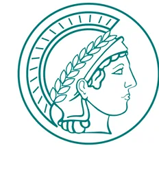
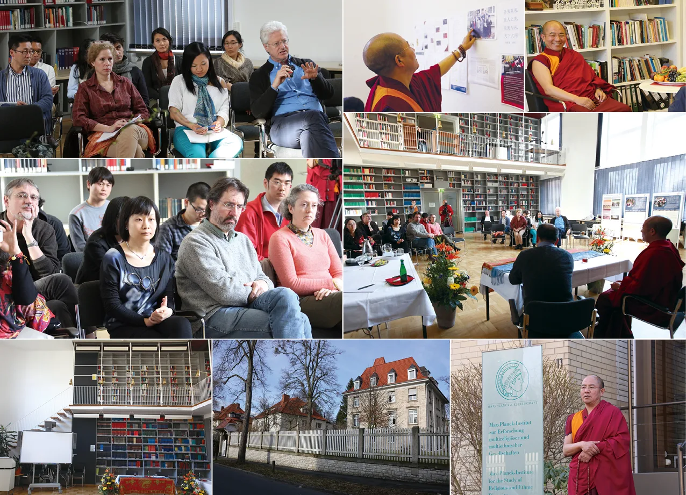

藏传佛教历来强调以智慧辨别真假，

从来不以教主所说作为根据，

要求人被动信受僵硬的教条。

第53场

德国马普研究所

Max Planck Institute

德国·哥廷根

2013 / 4 / 11

## 藏传佛教 在中国的现代表述

## Making Tibetan Buddhism Modern in China

范彼得教授（Peter van der Veer）：

索达吉堪布来自中国四川，是现代人间佛教的代表人物。今天早晨，我和堪布讨论了很久，因为内容太多，在这里就不重复了。我们谈到了常见的问题和争论，比如遵循佛教的经典教义和保持传统修行，与适应现代化社会的需求之间的矛盾等等。堪布认为，文化和社会在发展变迁，但佛教的宗旨没有改变，人们可以从佛法中找到解决现代问题的真正答案，这也正是我们应该去做的。

堪布并不是一位否定一切新事物的保守主义者，也不参与任何政治活动，更没有为了自己的快乐在山洞里静坐。堪布是入世的，但他的入世绝对以深入通达佛教教义为前提。

毫无疑问，堪布这种理念与独特的弘法模式取得了巨大成功。他在中国有上百万粉丝。我不确定这代表什么，因为在中国，人总是那么多，那里的一百万人肯定有别于这里的一百万人。但事实是他的确有许许多多追随者。

从这次到访你们也能看出，堪布非常亲切随和，所有人都会被他的魅力打动。我很高兴堪布的到访，并期待聆听他的见解！

首先，感谢范彼得教授及在座各位学者，让我有机会和大家探讨藏传佛教在现代中国这个话题，我感觉非常开心。

虽然我是一个藏族出家人，二十多年来主要研究藏传佛教和汉传佛教，但是对自然科学和社会科学，我始终抱有极大兴趣，经常涉猎相关著作，热情未曾少减。同时，对于和平问题、生命问题等关系人类命运的各种主题，我也不断地在关注和思考，并于不同场合，和各种学者做过一些交流。

此次来到西方，我的主要目的就是学术交流，一方面希望学习了解科学家的理论与思想，另一方面也想把自己对佛法的点滴领悟与大家分享。

今天上午，范彼得教授与我分别站在西方科学和东方宗教的立场进行了开放的交流。其中，有些问题还有待于今后进一步探讨。不过，对我个人而言，的确受益匪浅，在此再次表示感谢。

德国是一个智者辈出的文化大国，而来到德意志文化圣地——哥廷根，更让人有种别样的感受。令人极为惊讶的是，一个人口12万人的小城，居然涌现出45位诺贝尔奖得主，非常稀有！当然，一方面可以说，是由于德国人严谨理性的性格，造就了其卓越的科学成就。另一方面，这里地域的特殊性也是一个不能忽略的因素，如果用藏传佛教的观点来讲，这里堪称一个“圣地”。

记得范彼得教授曾提到，有一本书叫《论神圣》（The Idea of the Holy），里面所讲的神圣性的道理，与藏传佛教中神山的观念颇有相通之处。

有些特定的地域，常常呈现出特殊的神圣性。

我相信未来之时，此地将不断涌现更多对人类社会具有重大意义、富有创造力的科学工作者。

在藏传佛教起源之地青藏高原，也涌现过无数的智者，如宁玛派的龙钦巴尊者、格鲁派的宗喀巴大师、萨迦派的萨迦班智达、觉囊派的多罗那他、噶举派的噶玛巴。这些智者的广大慈悲心和刻求实证的态度，与德国学者的人文情怀以及严谨求真的精神正好相映成趣。

## 藏传佛教在现代中国

自1987年起，依靠一系列缘起，我开始为汉族佛教徒宣讲佛法，至今已有二十多年。这二十多年，也是藏传佛教在汉地逐渐广为传播的时期。目前，有非常多汉族人在系统地学习藏传佛教，甚至出现了“藏传佛教热”。

更明显的是，不仅广大信众对藏传佛教满怀热忱，许多知识分子也对藏传佛教非常感兴趣。

从2010年开始，我陆续前往大陆多所高校作学术交流，目前已经去过40所高校。据我所知，许多学校的老师和学生都很想了解藏传佛教。

当然也有个别学校，对藏传佛教有些排斥。但我想慢慢随着思想的开放，这种情况迟早会改变，对知识的渴求一定会让人突破思想藩篱，以包容心接纳真理。

## “藏传佛教热”背后之谜

为什么这么多人对藏传佛教感兴趣？不难推断，藏传佛教及其弘扬方法一定存在某些不共的优点。下面就我个人的观察做一点介绍。

### 1．弘法方式受人喜爱

首先，藏传佛教的弘传方法，特别适合现代人的心理。

21世纪，人心已被网络、手机所占领。藏传佛教在弘扬过程中，非常重视时代特征，高僧大德尽量利用流行的传播手段，信众也经常通过网络和电视接触并学习佛法，这种现象越来越普遍。

本月7号，我从法兰克福前往哥廷根的路上，发了一条微博，引述了一则藏传佛教的公案。昨天我查了一下，阅读量多达1480万，转发次数6万，评论1万多条。

这说明，通过这些现代途径，藏传佛教为更多人提供了了解佛法的机会，许多人也的确以此而接受了这些思想。

### 2．让迷茫不再迷茫

现在很多人非常现实，大多对理论知识不感兴趣，没有多少追求真理的愿望，最重视的只是自己立刻能得到什么。

10年前，我对中国的125位大学生做过一次采访，调查他们信仰的动机是什么，为什么要学习藏传佛教。后来写成《智海浪花》[^1]这本书，共五十多万字。之后，我又采访了20位博士，根据他们的学佛经历，编成了《博士访谈录》，大概五万多字。

通过这些经历，我看到，现代人并没有从物质中找到实质性的快乐，许多人很迷茫，非常需要直达内心的宗教，来解决心灵的痛苦。出于这个目的，他们求助于藏传佛教。当然，通过不断学习实践，很多人的确找到了心灵的安宁和幸福。

藏传佛教带给人的实际利益有目共睹，而且藏传佛教还有非常多窍诀，具有立竿见影的功效。

当前社会生活节奏太快，德国还算比较清闲。在中国，人们每天都在拼命工作，有些甚至超过十几个小时，甚至还要加班，身心异常疲惫；内心又充满了各种困惑，没有机会化解，许多人患上了精神疾病。在这种情况下，藏传佛教给他们带来了甘露一般的妙药，可以快速化解压力和烦恼，自然受到众人青睐。

还有些年轻人去喇荣佛学院参访后，当下对人生有了新的思考，他们发现除了金钱、名声和地位，还存在着另一种心灵的富足。有些人，在很短的时间中就感受到了发自内心的喜乐。这也是藏传佛教给人提供的快速而直接的利益。

### 3．以智慧代替迷信

藏传佛教历来强调以智慧辨别真假，从来不以教主所说作为根据，要求人被动信受僵硬的教条，而是引导人通过探讨和辩论抉择真理。

古印度一位佛教大师曾说：“我既不贪执佛陀，也不嗔恨外道导师，谁的语言符合正理，我就承认他是本师。”

按照藏传佛教的传统，无论在辩论场或者其他地点，从来没有人害怕问难，只要对方说的合理，就会欣然接受，如果不合理也会以正理驳斥。这种开放求真的精神，一直在藏传佛教的体系中不断流传。现在许多自认为客观公正的知识分子，也并不一定具足这种包容的心态。

出于对真理的崇尚，加上具有严谨完备的理论体系，藏传佛教自古以来培养出许多高层次人才，至今一直延续不绝。在藏地的正规寺院，那些经过十年、二十年的精进学修，通过严格考核的僧人，最后会获得格西或堪布学位，担负着弘法利生的责任。这种智慧特征，与其他建立在简单信心和形式上的宗教完全不同，这也是藏传佛教在东西方广受欢迎的一个重要原因。

如此培养出的人才，既有深广透彻的智慧，也有怜悯一切众生的慈悲心，还有对整个世界勇于担当的态度。以此为根本因缘，导致其传承和教法被世界广为接受。

因此，藏传佛教的兴起并不是暂时的热潮，它并非如气功一般，只是吸引人的好奇心，热闹一时就消失了。实际上，许多人皈依藏传佛教，根本上是出于对真理的渴求，从这一点来看，藏传佛教的未来应该是可以期待的。

### 4．回归心灵深处

藏传佛教在全世界的弘扬过程中，没有受到任何阻碍。在西方没有受到基督教的阻碍，在汉地也没有受到儒教和道教的阻碍，藏传佛教跟其他任何宗教都相处得非常融洽。这种宗教的团结和合，也正是世界发展的一个趋势。

现代世界，不但需要科学发现与技术发明，更需要宗教信仰和心灵的开发。否则，完全依靠科学，路可能越走越窄。几百年来，人类以为物质最重要，结果问题却层出不穷，最后不得不回到宗教、回到信仰，这也是一个必然规律。

在重新发现心灵、探索心灵的过程中，许多科学家发现，藏传佛教其实是一门高深的心灵科学。

荣格（Carl Jung, 1875-1961）曾深有体会地说：“自从《中阴得度》（The Tibetan Book of the Dead, 又译为《西藏度亡经》）出版以来，它一直是我常年不变的伴侣。我不但从此书中接受了相当多的激励与新知，而且我许多根本性的洞见也承自此书。”

总体来讲，无论东方人还是西方人，都很需要心灵教育。这种心灵的知识体系，在以往的科学领域中很难找到。因为，几百年来，科学一直依靠仪器不断向外探索，对物质的研究非常深入，取得了充满世界的显著成果。然而，对内心的研究，科学却无法找到根基。一旦涉及心灵的构造，生命的前生后世，以及解决心灵烦恼和痛苦方面，最后没办法不转向宗教。

因此，我们的生活不能仅仅依靠传统科学，还要纳入宗教的成分，需要心灵科学的培训、心灵素养的提升，这些才是更为重要的。

比如，在藏地，佛教完全融入民间生活，成为生活中不可分离的一部分，这种经验很值得借鉴。

藏传佛教是一种特别甚深的知识体系。许多知识分子在不断深入研究的时候，又不断发现还有更深的内容等待去挖掘。这种内科学非常深广，与西方流传的外科学有很大不同，东西方学者有必要对此不断进行探讨和交流。

## 这不是藏传佛教的问题

藏传佛教在世界上广泛传播的同时，也存在着一些令人不太愉快的现象。在汉地，有些人打着藏传佛教的旗号，冒充是上师、活佛，到处招摇撞骗。在香港和美国，我也看到过，有些人穿的是藏传佛教的衣服，传播的却根本不是藏传佛教。

当然，这些并不是藏传佛教本身的过失，而是个别人的过失。个别人做的坏事，不应当归咎于藏传佛教。

实际上，类似现象无法彻底避免，科学领域中同样存在相同的状况。

当年，爱因斯坦（Albert Einstein, 1879-1955）揭示了质能互换原理。有人以此为基础，在第二次世界大战时发明了核武器，给人类造成了极其巨大的伤害。爱因斯坦本来没有这样的目的，所以他后来特别后悔。但公正来看，这其实是当时某些人的过失，并不是爱因斯坦和科学本身的过失。

## 科学与古老文明应融合

最后我想说一点。

在这个世界上，无论在个人的主观经验里，还是在众所周知的外在客观事实上，的确都存在着大量的神秘事件。这些事件用科学非常难以解释，然而在各个宗教里，却早有明确的描述与说明，尤其在佛教里，更有非常完整的解答。

因此，对生命这件事，我们应该以公正的态度来观察，以求真的精神去研究。不能一提到宗教就认为是迷信，是过时淘汰的，没有道理。如果事实已经摆在面前，仍然固执成见而拒绝接受，那早已背离了真正的科学精神。

在这个特殊时代，一方面，人类不应当抛弃自己传承了上千年的古老文明。因为，每一个民族的传统文化背后，都有它关于道德与品行的甚深道理，对人类的行为及心灵，都有良好的约束与养护作用。德国有德国的古老文明，中国有中国的传统文化，有良知的人应该去继承而不是抛弃。

另一方面，人类也不能一味拒绝新事物，不能否认科学。否则，在21世纪的今天，恐怕只能闭着眼睛、捂着耳朵生活了。

如果能坚持古代文明与现代科技相互结合，东方文化与西方文化不断交流，相信人类将会走向更加光明的大道。

此时，每一位宗教人士和科学工作者，都肩负着无法推卸的责任。希望我们每个人都能勇敢面对，发挥出属于自己的那一份力量，共同创造人类更加美好的未来！

现场互动

问：首先非常感谢您的演讲！您提到了教育，您也非常包容，对科学同样有兴趣。我想知道，在您的佛学院中，藏族年轻僧人除了修学佛法之外，是否也学习数理化？换句话说，在藏传佛教的僧侣教育体系中，佛法和世间知识有怎样的关系？

堪布：在佛学院，佛学相当于大学的专业课程，一般来讲，正式入佛学院学习之前，需要打好一定的文化基础。所以，我们会提倡他们掌握一些世间知识。

那么，佛学院有没有传授这些呢？有些所传授的佛学课程中也包含了部分世间学科，如天文历算、逻辑等。至于物理、化学等，并没有直接开设相关知识的课程，但这些学科背后的道理，个别法师也在研究，并邀请过这方面的学者进行交流。

问：我对藏传佛教不是很了解，但今天有了一点感悟。同时也很高兴听到，越来越多的中国人对藏传佛教感兴趣。

在中国，经济的过度发展使许多人感到精神空虚，快餐式的生活也让人们承受着巨大压力，由此许多人皈依藏传佛教。这也引出一个问题：您的追随者是否主要是有钱人？因为他们才能“奢侈”地意识到：生活不仅仅是钱。而穷人只看到一日三餐，没有条件思考自己还需要温饱之外更有意义的生活。我的推论正确吗？

堪布：依我的了解，在中国，学习藏传佛教的有各个阶层的人：老年人关心如何应对死亡；年轻人想探索更高深的智慧；穷人想找到消除烦恼的办法；富人想积累各种功德和福报……

更重要的是，佛教可以有效地解决人的痛苦。只要是人，不管什么身份，都会遇到痛苦。很多人害怕痛苦，但学了藏传佛教之后，慢慢知道人有痛苦很正常，在痛苦中也可以找到归宿。

有些人以前或者无聊，或者不开心，后来通过学习藏传佛教，知道人生中遇到的一切，都是因缘所生，明白了人生的真相，无论遇到什么，都能够坦然接受，勇敢面对。

这也是他们得到的最直接的利益。

问：我也非常关注大众对佛教的兴趣日益增长这一现象，特别是藏传佛教在中国成为热潮。其中一个原因或许来自于我们都生存在快餐文化的环境下——当然，是西方创造了快餐文化——也许现在大家对这种生活方式越来越不满足。

但是，另一方面，我在美国加州待过，发现许多人对佛教非常感兴趣，然而，那种方式有点像“快餐佛教”——只尝试一点点，就可以立刻得到满足。您认为这是好事吗？毕竟这能带来一点利益。抑或是件坏事？因为这让人只追求当下的满足感，对佛教会造成极大误解。

堪布：关于“快餐佛教”，首先不得不承认，它能满足一些人当下的心理。因为现在人们特别忙碌，如果听很长的大经大论，恐怕他们不会有兴趣，甚至听着听着就睡着了。只有那些很快用得上的教言，他们才乐意接受。

“快餐文化”这个词本身，也能让人了知它的部分价值。

以前有位西方的科学家跟我说：很多人遇到一些上师时，刚开始比较冲动，但随着时间推移，享受到一点利益以后，激情就消退了；也有一部分人，不断地深入到佛法的教理之中，最后成为真正的佛教徒。

就像享受“快餐”的人，有一部分很快就消失了，另一部分，不但当时吃饱了，还继续发掘，找到了长期滋养生命的营养，最后生活也以此而完全改变。

其实，学佛不只是有个皈依就行了，也不是在寺院烧香拜佛就够了，这些只是形式。佛法的核心实际上是其中深不可测的智慧，一定要掌握这些，才能成就真实的信仰。

问：特别感谢您启发了我们！我对跨宗教对话或宗教间的竞争很感兴趣。您非常重视学生和知识分子的信仰，在传法过程中，您是否遇到过困难？譬如，是否有来自基督教传教士的对立？您如何面对跨宗教甚至是佛教内部不同派别的竞争？

堪布：我想不起来遇到过来自其他宗教的障碍，记忆中确实没有这样的事。

中国的传统文化是儒释道，在历史上，宗教之间曾有过激烈辩论，不过现在情况已经不同了。许多道教徒对佛教非常认可，佛教徒对一些道教经典也能接受，儒教经典也得到了佛教和道教的赞叹。几年前，我就翻阅过《道德经》，还把《弟子规》译成了藏文。

在佛教内部，我拜访过不少汉传佛教的祖庭、寺院，那些寺院的大德也非常赞同藏传佛教。

过去宗教间存在一些冲突，但现在是思想开放的时代，人们比较有包容心，尤其年轻人乐于接受新事物，所以我认为，宗教团结和合应该是未来的趋势。

问：您讲到痛苦是生命的一部分，需要接受，这符合佛教的传统思维模式。我曾调研过一些现代化的新型佛教，他们不是强调接受痛苦，而是鼓励人成为胜利者，要具有征服精神。这种现代诠释吸引了大量的年轻人，但与传统佛教对痛苦的理解不同，您如何看待这件事？

堪布：佛教对痛苦的研究相当多，由于所接引的众生根基不同，方法也呈现各种各样。小乘和大乘、显宗和密宗，都有各自应对痛苦的窍诀。

人人想寻求快乐，而实际上总会遇到各种不快乐。在大乘佛教来讲，面对不快乐，可以有两种方式来接纳。一种方式是，寻找痛苦在哪里，去找感到痛苦的这颗心——它有颜色吗？有形状吗？到底是什么？科学家说在大脑当中，但其实这是没办法知道的。这样用心观察自己的心，最后痛苦的心根本找不到。这是比较深的观察方法。

还有一种观察方法，要认识到我们所遇到的压力，实际上是生活的本质，并不是不幸。现在有些年轻人遇到痛苦，就想不开，或自杀等等。其实，在人生之路上，这完全不必要。任何事情，感情也好，压力也好，事情本身并没有痛苦的自性，所谓“特别痛苦”，只不过是对它特别执著导致的。如果真正知道了痛苦并不值得痛苦，痛苦自然就消失了。

总之，如果有较高的智慧，就观察痛苦的心在哪里，找着找着，最后痛苦的心都没有了；如果没有这种境界，要了解痛苦的来源和对境的自性。真正懂得了，执著就会慢慢减少，痛苦也会消失。

无论如何，遇到痛苦的时候，不能逃避，也不能用其他的方式来转移，因为，一切痛苦的来源，根本是无明，只有智慧才能彻底解决。

佛教面对痛苦的方法是接受，接受是依靠智慧。

问：非常感谢堪布这次讲座！我在北大研究宗教社会学，藏传佛教在内地的影响比较广，您如何看待这种现象？在此过程中，汉传佛教扮演了什么角色？

堪布：这个问题比较简单，藏传佛教并没有想征服谁的企图。在世间，有些团体为了私利，通过各种手段壮大自己的队伍。我个人也好，藏传佛教也好，没有丝毫这样的目的。

我们之所以传播藏传佛教，只是觉得它的智慧和慈悲是人类需要的殊胜的精神财富，希望更多人消除对它的误解，不要把它当落后、封闭、形象化的东西。如果藏传佛教对人类、对世界确实有利，那这种思想和教育，值得更多人去了解和接受。

藏族和汉族虽然在习俗、文化、理念方面存在许多差异，但因为佛教的思想包容一切，完全超越了民族差异，所以从佛教本身的层面而言，汉传、藏传之间并没有什么障碍。

在弘扬的过程中，我不仅没有发现阻碍，而且看到互相都很愿意接受。事实上，我也经常学习汉传佛教的法，甚至学习其他宗教和一些世间知识。我始终认为，文化间的互动交流，是非常有必要的。

[^1]: 《智海浪花》上下二册内容现收录于《没什么放不下》《有什么舍不得》《幸好有烦恼》。
