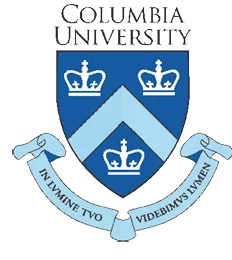
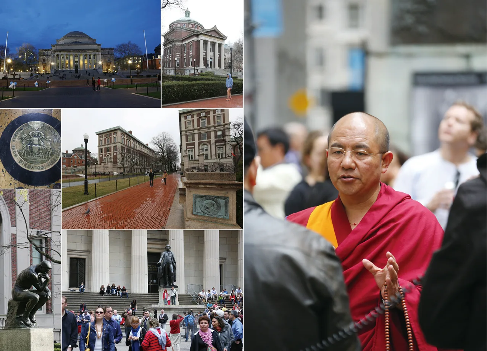
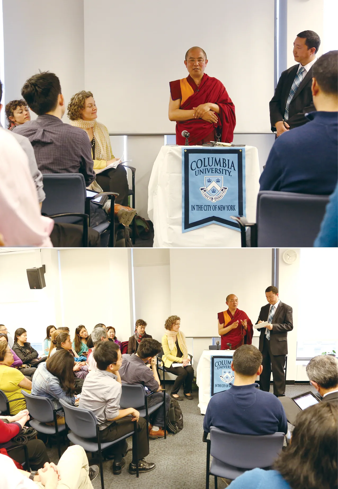
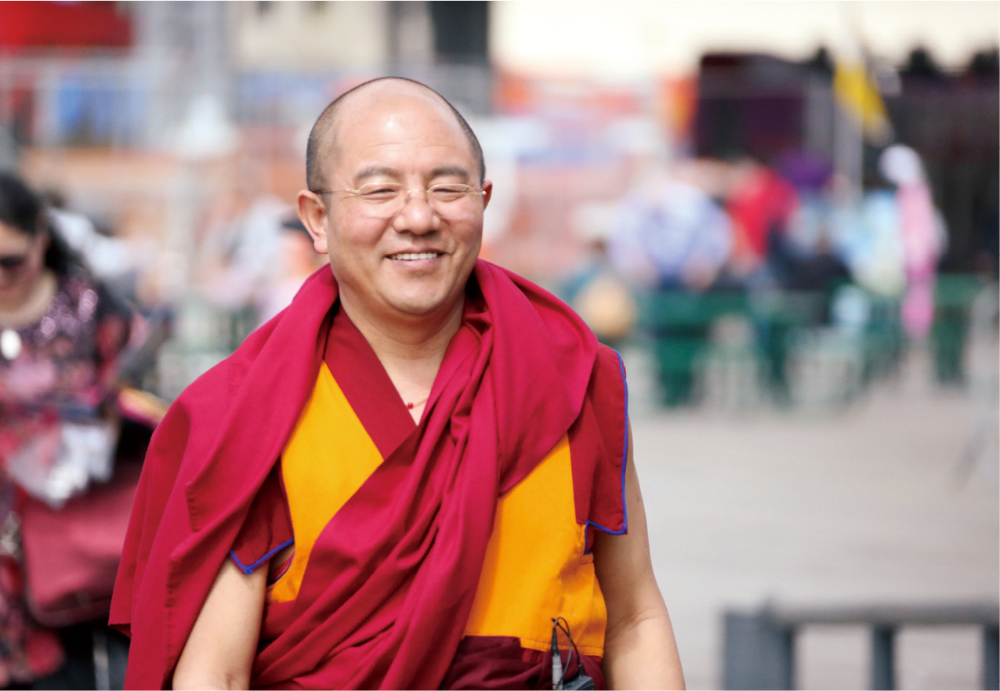

各派的佛法显现上有差别，

但究竟密意别无二致。

第56场

美国哥伦比亚大学

Columbia University

美国·纽约

2013 / 4 / 19

## 藏传佛教的包容性

## A Contemporary Rime Movement Among Tibetan Buddhists

主持人：

我叫安娜贝拉·皮特金，是巴纳德学院亚洲和中东文化系客座助理教授。我主要研究的是19与20世纪的西藏思想史。今天感到非常兴奋，因为邀请到了当代藏传佛教一位非常著名和重要的人物。让我们一起欢迎索达吉堪布来到哥伦比亚大学！

很早以前，哥伦比亚大学就开始了对藏文化的研究。不仅在宗教系建立了相关的研究课题组，同时还设立了现代西藏研究项目。这在当今，也属于最前沿的研究。我们拥有第一个现代西藏研究所以及第一个研究现代西藏的教授席位，我们非常热衷于西藏研究。今天能有如此尊贵的嘉宾到访，我们感到无比的欢喜与荣幸。

索达吉堪布是复兴藏传佛教的领军人物之一，他生于1962年，出生地为康区。1985年剃度出家，先后翻译、撰写了一百多部佛教著作，中文微博粉丝有一百多万。堪布非常热衷于慈善事业和学术研究，他常住于喇荣五明佛学院。在复兴藏传佛教的过程中，喇荣五明佛学院发挥着举足轻重且鼓舞人心的作用。特别让人欣喜的是，那里有很多不同背景的学生。堪布既是学者也是修行者，聆听他这样伟大上师的演讲，是个难得的机会。不多说了，有请索达吉堪布！

今天能在哥伦比亚大学，与来自各国的教授、学生以及长期研究、关注藏文化与藏传佛教的学者们一起，就藏传佛教的利美思想进行探讨，我感到很高兴。

虽然我20年前来过纽约，但来哥伦比亚大学还是第一次。这次和这里的教授一起，参观了校园，当然还有图书馆。看到很多国家和民族的教授、学生们能在这么好的环境里，自由、精勤地工作和学习，我感到由衷的高兴。这里的教职员和历届毕业生中，获得诺贝尔奖的人数高达九十多位，仅仅这一点，就显示出该校的无与伦比。我认为，能和大家一起共同学习，是一个很好的机会，我也十分珍惜。

言归正传，今天要讲的是“藏传佛教的利美思想”。所谓“利美”，是藏语发音，翻译过来是无偏堕之意。哪方面无偏堕呢？首先，藏传佛教各教派之间无有偏堕；其次，藏传佛教与其他佛教宗派之间无有偏堕；其三，藏传佛教与任何宗教之间均无有偏堕。下面就以上三点，与大家进行交流。

## 藏传佛教各教派之间无有偏堕

藏传佛教有很多教派及分支——宁玛、萨迦、噶举、格鲁、觉囊等。

大概在19世纪末，由宁玛派的蒋扬钦则旺波、萨迦派的蒋扬洛德旺波、噶举派的蒋贡康楚、格鲁派的美亚·更松秋扎等人为首的很多藏地智者倡导，发起了利美运动，并得到各大教派的广泛响应。虽然各派都有各自的见解，但大家一致认为，弘扬利美思想很重要。虽然各个教派的上师显现不同，但大多是同一本体的不同化身。

比如，大智者班禅罗桑曲嘉（第四世班禅大师）曾说过：“大智成就莲花生，化身具德燃灯尊（阿底峡），又化乐桑扎巴华（宗喀巴），我无其余皈依境。”首先是前译宁玛派的创始人莲花生大士；然后在后弘时期，藏传佛教又由无等阿底峡尊者重新弘扬光大；之后，再由宗喀巴大师将其广弘于十方。显现上是三位不同的上师，实际上是一个本体。其他很多智者也认为，藏地众多教派的上师们，都是一个本体的不同化现。这样承许是有理由的，此处因时间关系，暂不详述。

此外，不同教派所阐述的佛法，究竟密意也没有差别。比如，若仔细去了解宁玛派的《大圆满心性休息》，格鲁派的《菩提道次第广论》《密宗道次第广论》，噶举派的《解脱庄严宝论》，萨迦派的《三显三续引导文》，以及觉囊派的《山法了义海论》等论典，就会发现，各派的佛法虽然显现上有差别，但究竟密意别无二致。我经过多年的学习，对此已生起很深的定解。

你们当中有学习宁玛派的，也有学习其他教派的，希望大家不要互相排斥。佛弟子之间的互相排斥、诋毁和攻击，不但会给佛教带来危害，也会成为自己修行的障碍。我们应该对所有教派观清净心，对佛陀无垢的密意生起信解，这种认识是不可缺少的。

虽然在有些人群中，各教派还有另一种名字——宁玛派是红教，格鲁派是黄教，萨迦派是花教，噶举派是白教，等等，但这与其本身的特色毫不相关。

以前华智仁波切到一个寺院，有个喇嘛问他：“你是什么教的？”他回答：“佛教。”喇嘛生气了：“我问的不是这个，问你是戴黄帽子的还是红帽子的（意为是黄教还是红教）？”华智仁波切心平气和地从怀里掏出一顶破烂的灰色羊皮帽，说道：“我没有红、黄帽子，只有这顶灰帽子。”他含蓄地表示，自己不偏堕于任何教派。

在佛教兴盛的藏地，大德们一致认为，利美思想非常重要。宗喀巴大师曾讲：“通达一切圣教无违殊胜，一切圣言现为教授殊胜，易于获得胜者密意殊胜，极大恶行自趣消灭殊胜。”这是非常甚深的窍诀。

当然，研究藏传佛教固然重要，但也不能仅停留在研究上。藏传佛教有很多实修窍诀，只有将实修和研究相结合，才能证悟万法实相。单纯的研究，根本无法趣入佛法的甚深见解，也无法对其中的甚深密意、殊胜行为生起信解。

如今，欧美有许多人藏语学得很好，修学藏传佛教的人也很多。作为一个修学藏传佛教的人，我对此感到非常高兴。学习藏传佛教这么多年，我虽然不是大智者，但确实受益匪浅。我也真诚地希望你们能同样受益。现代生活很复杂，藏传佛教的传承和加持，一定能给你们带来巨大的利益。

## 藏传佛教与其他佛教宗派之间无有偏堕

佛教起源于印度，传到藏地、汉地和其他地区后，佛经分别被译成不同文字。其中，被翻译成藏语的，称为藏传佛教，流传于藏地以及蒙古等地区；翻译为汉语的另一系，则传到汉地和日本、韩国等地，成为北传佛教的传承；依据巴利文原典传承下来的支系，则成为南传佛教，广泛流传于泰国、缅甸等很多国家。

无论学南传佛教、北传佛教还是藏传佛教，我们都应保持不偏不倚的态度。近代很多高僧大德，对此相当重视，一直着力弘扬利美精神。我们作为后学者，应该继承。当然，口是心非是不行的。只是口头上说不偏堕，实际行为却并非如此——宗派之间互相排斥，寺院之间互相诋毁，这不太合理。

我所在的色达喇荣五明佛学院，法王如意宝一直提倡宗派和合。早在十几年前，就在学院的坛城，设立了以南传、北传、藏传三大传承为主的十多个经堂。南传佛教的经堂里，供奉了小乘佛像与声闻阿罗汉的塑像。北传佛教的经堂里，供奉了济公和尚、弥勒佛等塑像。藏传佛教的经堂里，供奉了八大教派的祖师像。虽然关于苯教有很多争议，但坛城也供奉了苯教祖师辛绕米沃的塑像。佛学院的利美思想，不是停留在口头上，而是实实在在地设立了经堂，供大家供奉、转绕、礼拜，而且，不同宗派的论典，都在平等传授。我认为，这就是真正的利美精神。

关于佛教，正如佛陀在经中所说：“诸恶莫作，诸善奉行，自净其意，是诸佛教。”所以，只要是佛陀的教法，就会让人断除一切恶行，行持所有善法，调伏自心令其清净。佛教既是宗教，也是教育，它的任何教法都能利益众生。《四十二章经》中以蜂蜜比喻佛法中边皆甜，《贤愚经》则以水来比喻佛法是任何人都需要的。有些人认为，佛法是少部分人的信仰。这是很狭隘的想法。

虽然三大传承各有不共的特点——汉传佛教提倡吃素，要求佛教徒对众生有慈悲心；南传佛教以出离心为基础守持清净戒律；藏传佛教则是讲、辩、著，但所有这些都对众生有利。我常将佛法比喻成药，西方的药、东方的药、藏地的药、印度的药等等，药虽不同，但对身体都有治疗作用；同样，不同传承的佛法，也可以治疗不同众生内心的疾病。

所以，佛教的利美思想，非常合理，值得大家认真思考。

## 藏传佛教与任何宗教之间均无有偏堕

如果坚持利美精神，藏传佛教与其他宗教之间，也可以此而圆融。

如今，基督教、天主教在西方很兴盛，而有些国家则伊斯兰教或印度教很兴盛，有些国家佛教很兴盛。无论如何，正信的宗教都能利益人心。

像美国，是一个有信仰的国家，大部分人信仰上帝，无论国家总统还是平民百姓，都非常虔诚。这一点，我很赞叹。

对于佛教以外的其他宗教，藏传佛教绝不允许排斥。密宗十四条根本誓言中的第六条就规定：不得诽谤他宗，否则违犯密乘根本戒。

各宗教之间互相团结，是非常重要的。在我看来，每个宗教都有优点。没有宗教信仰的人，往往会缺乏约束，所作所为毫无顾忌，甚至认为造恶理所当然。有信仰的人则与之不同，无论信仰什么，大多会心存敬畏，并趋向善法，自觉约束自己的言行。

在21世纪的今天，所有宗教都应提倡利美，各宗教的领袖学者一定要互相学习、借鉴，对其他宗教的圣地、庙宇、供奉的主尊以及教典也要有所了解。如此，在借鉴别人的过程中，还能提升、充实自己。

藏传佛教甚至认为，对没有信仰的人，也应以利美精神和平共处，不能强迫他们信仰你的宗教。依照佛陀的观点，一切众生都有如来藏，未来皆可成佛。因此，不仅仅是佛教徒，任何众生将来都有学习佛法的机缘。

若想利益这些众生，必须依靠慈悲心。慈悲心不能以宗教来分，错误地定义为佛教的慈悲、基督教的慈悲等，这样太狭隘。只有不分宗教的慈悲心，才能利益所有众生。如果能将这种慈悲心的教育，与从小学到大学的教育体系相结合，那将是具有划时代意义的伟大行为。

人都有自私自利心，这点可以理解，但若只承认自己宗派的见解，未来的生存空间就会越来越小。所以，不管你信仰什么，都应为利益众生而努力奋斗，这也是佛教的根本教义。

最后我要说的，在哈佛大学也说过，今天还要再说一次。那就是，无论学者、教授还是学生，最重要的是要有利他心。如果没有利他心，哪怕学富五车、技术超群，也不可能真正利益自他。有了利他之心，又能在这样充满智慧的学校中学习，未来一定会广泛地利益众生。因此，努力将学习与利他心相结合，是我最大的希望。

今天来了很多我以前认识的教授、学生，这次演讲的主办方，以及很多热爱藏文化、重视藏传佛教的学者，都是放下了很多工作来到现场，在此感谢大家！扎西德勒！

主持人：

非常感谢堪布妙趣横生又发人深省的演讲。听完之后，我的内心浮现出很多问题，想必大家也和我一样。

下面进入提问时间。请大家在提问时，尽量简短扼要，因为有很多人想提问。

现场互动

问：您刚才提到培养慈悲心的重要性，我很受启发。您能就此举一个案例吗？

堪布：新加坡有一位极为普通的妇女，她用自己的一生，书写了帮助痛苦众生的伟大篇章。她的名字叫许哲，活了113岁。她说过，地球是我的家，帮助无依无怙的众生是我的使命。她只是一名普通妇女，说的话却震撼人心。

慈悲心和利他心，是一种心理活动，是要对地球上的所有众生给予帮助。无论是人还是其他众生，都想离苦得乐，所以，具有利他心非常重要。

问：您所在的色达喇荣，其中有多少修行人是甘孜州的，又有多少修行人来自其他地方？

堪布：我们没有正式统计过喇荣的人数。按照政府统计的数字，现今喇荣的喇嘛觉姆大概有6000多。因为流动性很强，一些来自其他地方的修行人还没有被计算在内。特别是在举行法会时，更是会聚集来自四面八方的很多人。

问：佛教刚传到藏地时，并没有分教派，在一千五百多年后的今天，却派生出很多派别。现在依靠利美运动，令佛法广弘全球。但我有点不明白的是，该如何按照利美的观点，来理解您刚刚说的四大教派以及苯教？因为苯教又不是佛教。

堪布：所谓的“利美”，并不是说宁玛派与格鲁派一样，这个教派和那个教派一样。“利美”的意思是指，格鲁派仍应坚持格鲁派的见解，其他教派也都应坚持各自的见解，但各教派之间不应互相争论、排斥。每个教派都有各自的优势、特点，如果掌握了这些，对藏传内部的团结也有很大必要。

至于苯教是不是佛教，历史上有很多争议。从佛教的角度来讲，判断是不是佛教徒的标准，主要看有没有皈依。皈依释迦牟尼佛的，就是佛教徒；不皈依的，就不是佛教徒。苯波的教义非常甚深广大，而且在各方面也有很多成就。

问：我知道您的微博在中国有非常多的粉丝，请问，您有这么多粉丝的原因是什么？

堪布：“粉丝”这个词，本是源自英文。我以前也说过，微博上的粉丝数有很多虚假成分，具体怎么样我也不清楚，但我个人认为，作假大可不必，自己也不会为此花一分钱。

我发的一些微博，确实有很多人在看。前几天我去德国时，发了一位藏族人的故事，居然点击量有一千四百多万，我也不知道为什么会有这么多人关注。但利用网络科技来弘扬如此珍贵的文化，是非常有必要的。

主持人：

太了不起了，这也是今晚演讲打动人的一个原因。我们正处于崭新的媒体时代，堪布正致力于探索现代媒体如何服务于两千多年前的智慧，这是很有意义的历史时机。有这样一个机会能与堪布交流，的确机会难得。感谢您的提问，非常有意义的问题！

问：欢迎您来到这里为我们演讲！我听说喇荣有很多堪布，譬如像您和慈诚罗珠堪布，都花了很多精力来保护和发展藏文化，非常了不起！感恩您们！

堪布刚刚提到，佛教徒对其他宗派不能诽谤和排斥。佛教也没有提倡，一定要将其他人引入佛教，但其他宗教不是如此。我们的传统信仰是藏传佛教，可现在有很多藏族人已被其他宗教同化，海内外都有这种现象，您对此如何看待？

堪布：一方面，我们应了解世界发展趋势以及宗教和非宗教的文化，包容的心态非常重要。另一方面，我刚才也说了，宗教最好不要拉拢信众。就像灌顶时是用撒花来决定本尊一样，自己选择信仰什么，这都是因缘。

藏族年轻人应继承本民族的语言、文字、服饰、习俗，不能让这些传统被同化、异化，持守自道是很重要的。法王如意宝晋美彭措曾说：“莫舍己道，勿扰他心。”这是非常甚深的教言。如果知道藏文化的珍贵以及藏传佛教的价值，并能深入研究学习，我想永远也不可能被同化。

否则，即使现在没有被同化，将来也会面临同化的结局。这里有些藏族人一直坚守传统文化，有些人则丢失了自己，甚至包括语言、文化，都跟别人如出一辙了。

问：您谈到佛教的世俗价值，比如慈悲心，这看起来是很个人的修行，实际上却对整个社会功不可没。

我特别想问一下关于利美运动的问题，因为它蕴含着丰富的历史，着重强调了相互理解与展开对话。我在想，这是否也能成为藏传佛教对现代社会的贡献。在解决世界上的一些战争、政治之类非常棘手的问题时，您认为我们能从利美运动中学到什么吗？不一定是佛教方面的内容，可以是促进世界相互理解方面。谢谢！

堪布：现今这个时代是地球村，经济、政治基本上已经全球化。佛教徒并不是要炫耀自己的修证，而是要利用各种方式更广泛地学习，这才是真正的“利美”。如果能这样，就不会有矛盾争执，就能一起成办更多有意义的事情，给人们带来暂时、究竟的安乐。这也可以成为各国处理一些问题的借鉴。

我认为，未来22、23世纪，“利美”在世界上会有更广泛的影响。

问：也许是因为信仰或其他原因，我听说现在藏地无论是农民还是牧民，都十分提倡不杀生、不吃肉。我们也是从藏地来的，对那里高寒环境很了解。我有点担心，如果不吃肉，对健康是有利还是有害？

另外，就算我们不杀生，那只会给周边其他民族提供赚钱的机会。他们肯定会从我们手里买牛羊，再把肉高价卖给藏人。如果这种状况持续下去，对我们未来的发展是有利还是有害？

堪布：世界上也有很多没有信仰的人为了健康而不吃肉。不吃肉不但对健康无损，反而能使身体更健康。

通过吃肉，容易感染动物身上的各种疾病，这是很多医生研究得出的结论。所以我认为，不吃肉不会对健康有害，反而可以强身健体。这方面，现在医学中也讲了很多。

不管对藏地的出家人还是在家人而言，不杀生都是佛教徒的殊胜之处。要知道，众生被夺取生命的痛苦是难以堪忍的，杀生的场面也惨不忍睹。想一想，如果被杀的是我们自己，就很容易理解，杀生绝对是最严重的恶业。

同时我认为，不杀生也不会对经济产生影响。比如说，如果把自家的四五十头牛装在车里一口气卖掉，很多牧民反而会变得很贫穷、很可怜，既没有田又没有牛。如果不杀生而畜养，还可以很好地维持生活。

总之，杀生会招来很大的危害，不杀生反而对生存有利。

问：您刚才讲到“利美”的发展以及宗派的分歧，是藏地一直存在的问题。在这两个问题上，各宗派的上师活佛们支持吗？一般的藏族人如何看待？利美见解对藏传佛教的未来会有怎样影响？

堪布：康巴和安多大部分寺院的僧人、上师、活佛普遍认为，利美运动对现今时代有着深远意义。

如今在康巴等地，萨迦派、宁玛派、噶举派以及苯教等寺院的僧众每年都会集中在一起，研讨如何学习、弘扬佛教与藏文化。四五年中举办了很多次圆桌会议，大家都是本着“利美”的心态来互相探讨，所以每次会议都很成功。

一般来说，藏区每一座寺院的周围，都有很多藏民。依照传统，上师僧众支持的，大多数藏民也会支持，所以不会有争议。

大多数人认为，振兴藏民族的语言、文字、文化刻不容缓。当然，也有少部分人会发出不同的声音，这是不可避免的。

虽然不知道未来会怎样，但根据世界发展趋势来看，如果利美思想没有广加弘扬，藏传佛教只是局限于藏地一个个小山谷里，就会面临被其他民族、文化、宗教所同化的局面。我们应该守持自道，并且互相学习。现在整个世界都很开放，藏族也应该与时俱进。

主持人：

到此，我们的盛会就要圆满结束了，请暂且保留你们的掌声。我想请求大家，在结束之后，在原位稍等片刻，请堪布先行离开。堪布今天非常辛苦，为我们站了这么久，请堪布先离开也是表示一种尊敬。感谢每一位为此次活动付出的人，我想我们学到了很多，这是一次非常有意义的交流。

最后让我们所有人一起来感谢堪布：非常感谢您来到这里，实在是太好了！
