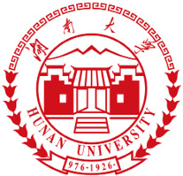
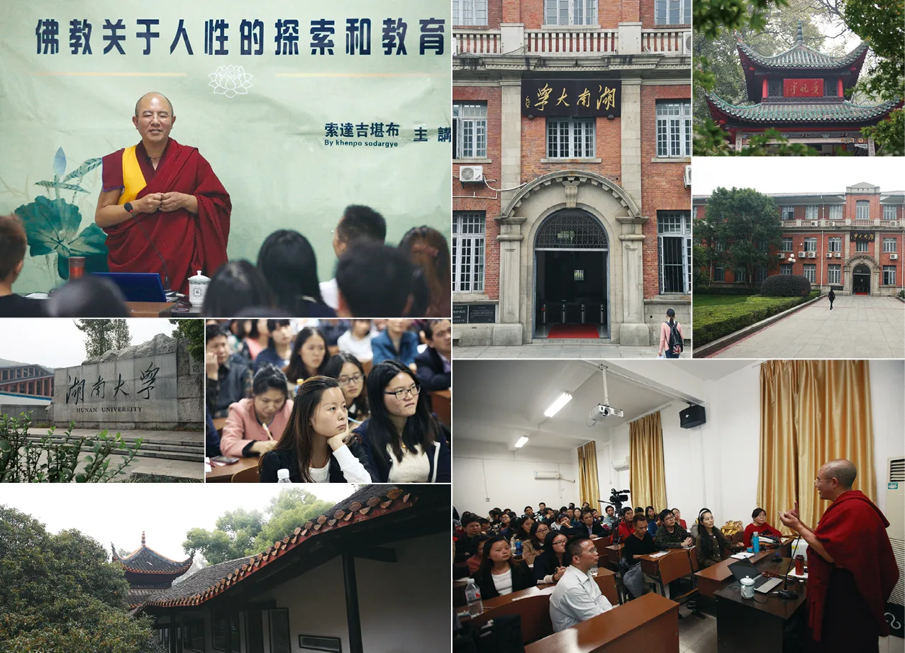
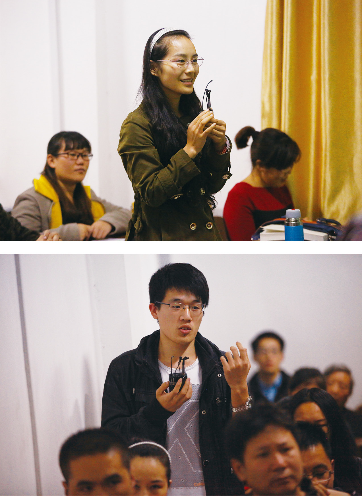

佛教认为，

人性远离善恶等一切戏论。

第64场

湖南大学

Hunan University

中国·长沙

2013 / 10 / 31

## 佛教关于人性的探索和教育

## A Buddhist Exploration on Human Nature

主持人：

“堪布”这个词是教授的意思。索达吉堪布就是一位大教授。今天，他将为我们带来主题为“佛教关于人性的探索和教育”的讲座，堪布对此有深入的研究。相关道理，他不仅亲身实践过，还去过很多地方进行宣讲。所以我们很高兴在这个金秋时节，请堪布到我们湖南大学马克思主义学院为大家做精彩的讲座。好，我们热烈欢迎堪布——

今天很高兴利用这个时间，和诸位老师、研究生一起交流“佛教关于人性的探索和教育”。

现代社会，人心非常开放，如何在这样的环境中理解人性呢？我想，应该回到传统文化，尤其是汉地、藏地的传统文化中去找答案。

## 人性之辩

汉地历来对人性有不同的说法。

战国时期的告子认为，人性本无。就像湍急的水，可以往东流，也可以往西流，同样，人依靠种种因缘，可以变成善，也可以变成恶。

荀子认为，人性本恶。尧舜跟桀纣一样，君子与小人一样，都是天生性恶。贤劣的差别，只是后天环境对人性的改造。

汉代思想家扬雄认为，人性本是善恶混合，修善则成为善人，修恶则成为恶人。

这三种观点，如果以智慧来分析，都不太合理。为什么呢？首先，用水来证明人没有本性，这个比喻很难成立。因为水向东或向西流淌，只是在讲一种现象，而不是本质。本性应该是像火的热性、水的湿性一样，是一种本质的东西，所以水流的比喻不太合理。

第二种认为人性恶，但可以变成善，这种说法也不对。所谓“本性”，应该是没办法改变的实体，如果真的是恶，又怎么可能变成善？灌输再良好的教育，也不可能变成善人。

第三种认为，人性是善恶混合的。那么这种混合，是水乳交融变成一体呢，还是各自分开的？如果是分开的，就不叫混合；如果是一体的，本性怎么可能在同一时间又是善又是恶？变成善人的时候，恶的成分到哪里去了？变成恶人的时候，善的本性又去了什么地方？

通过以上分析，说人性本无、本恶、善恶混合都不合理。合理的观点应该是，孟子提出的人性本善，用《三字经》来讲就是：“人之初，性本善，性相近，习相远。”人性本来是善的，但因为受环境等影响，表现出来的习气各不相同。

孟子说过：“恻隐之心，人皆有之；羞恶之心，人皆有之；恭敬之心，人皆有之；是非之心，人皆有之。”恻隐之心是“仁”，羞恶之心是“义”，恭敬之心是“礼”，是非之心是“智”。而这些仁义礼智，“非由外铄我也，我固有之也”，不是从外面来的，是每个人与生俱来的。

就好比“恻隐之心”，你我都有，看见众生特别悲惨，自然会生起一种悲悯。“羞恶之心”就是知惭有愧，虽然环境的影响让有些人不懂惭愧，但只要是人，在某方面还是有底线的，跟动物不一样。“恭敬之心”，不管是什么人，都有自己的崇拜对象。“是非之心”就是明了利害，懂得取舍。所以，仁义礼智，人人天生都有，并不是外境强加于我们的。

## 没有人是坏人

其实，每个人今生有不同的习气，这不是无缘无故的，而是前世带来的。（有些人没学过相关知识，也从来没有研究过这个问题，不一定知道，他们只是简单地认为，人不过是物质的产物，突然来到这个世界而已。）

尽管习气不同，但每个人本性都是善的。这方面，佛教与孟子的说法比较相似。《华严经》说，一切众生皆具如来智慧德相，但因妄想执著，而不证得。这是佛教对人性的描述，也就是说，每个众生本具佛陀的一切功德，但因为被各种客尘污染了，所以没办法现前。

佛教认为，人的本性中没有争论、欲望等，更深一层的话，人性远离善恶等一切戏论。但暂时来讲，要承认人的本性是善——你们也许没有特别关注过佛教，如果关注了，应该有不同的体会。我刚才跟有些老师说，佛教讲的中观、如来藏和因明辩论，与现代社会最顶峰的理论可以互相印证，而且在对比的过程中，你会发现它的优胜之处。

也许有人问：“既然究竟来讲人性远离一切言思，超越一切概念，那能不能感受到呢？”实际上，通过修证是完全可以的。但这个层面很高，今天暂且不谈，我们要讲的是人性本善这一面。

可能又有人问：“如果人性是善的，就不可能变成恶了，刚才你对荀子的驳斥，会不会也落到自己头上？”其实不会。因为我所讲的本性善，只是从暂时层面讲的。

美国有位著名的魏斯（Brian Weiss, 1944-）医生，出过《前世今生》（Many Lives, Many Masters）等畅销书。他在《来自神灵的讯息》（Messages from the Masters）中，也揭示了人的本性是平等的、善的。书中有这样一段对话，魏斯医生问：“如果人性是完全平等的，为什么有些人心地好、长相好、智慧好，而有些人什么都不好，又坏又穷又难看？”神灵用比喻解释说：“就像一颗钻石，本身蕴含七彩光芒，但如果蒙上灰尘，光就不明显了。人表面不平等，就如同钻石上的灰尘厚薄不一样，但本心就像钻石能放光一样，是平等、相同的。”

在座的每一个人，本性中都有慈悲、智慧的一面，但因为后天教育、环境等影响，这种善可能被覆盖了，以至于有些人很愚痴，有些人很迷茫，有些人非常不成功。如果把每个人的本性真正开发出来，那“善”完全可以显露。

唐太宗就证明过这一点。当年他在执政期间，有一次问390个死囚有什么心愿，死囚们都说，很想回家看望一次父母妻儿。出于怜悯，唐太宗决定放他们回家，不受任何约束地与亲人团聚，但必须遵守一个约定：来年九月初四准时自行返狱伏法。

听了这个决定，有大臣忍不住提醒：“他们都是罪大恶极之人，如果放虎归山，有去无回怎么办？”但唐太宗仍坚持这个决定，将390人全都放了。

让人想不到的是，到了约定的期限，所有死囚一个都没有逃跑，真的全部回来了。作为奖励，唐太宗赦免了他们的死罪。

可见，大恶之人也有善的一面，只要因缘具足，这种善就可以显露出来。所以，我们也要挖掘出自己潜在的善念。

## 善在我手

不管在什么环境中，善的力量都很需要。

现在这个社会，物质进步非常明显，但在内心提升方面，却是比较失败的。很多人没有满足感，也没有幸福感，每天活得很苦很累，口头禅常常是“压力太大”“好烦”……幸福、开心、感恩等，不管在语言上还是行为上，出现得越来越少，这在新闻、影视中也不难发现。

随着负面信息越来越多，有些人虽然本来善良，但慢慢学会了很多不好的习惯。所以，我们一定要提倡正能量。

“正能量”这一概念的创始者是卡耐基（Dale Carnegie, 1888-1955），他被称为成功学大师。他说：“一切让人积极向上和充满希望、促使人不断追求成功、让生活变得圆满幸福的动力和感情，都是正能量。”可见，这与佛教讲的“善”也能对应——语言要真实、身体不能杀盗、内心不能贪嗔等，这些都是正能量。

当然，要想提升正能量，必须具备一些方法：

首先，自己要不断地学习，在任何时间、任何环境，都要有一种不满足的心。对物质，我们可以知足少欲，但对学习，千万不能如此。现在很多大学生，包括有些老师，觉得完成学业就可以了，不用再学了。其实不应该这样，学无止境，要活到老、学到老。

而且，我们要随时调整自己，保持乐观积极的心态。否则，有些人因为不会调心，无端增添了很多烦恼。一个悲观的人和一个乐观的人，对事物的判断完全不同。比如，天气稍冷的时候，乐观的人会觉得舒服、很清凉，而悲观的人则会抱怨：“太冷了，这个世界好苦！”或者，面对半杯水，乐观的人会觉得很好，还有半杯水可以喝，而悲观的人会觉得一半的水都没有了，可能不够喝。因此，面对同样的外境，心态不同，苦乐也不一样。

尤其是现在的年轻人，应注重培养自己的“逆商”，也就是面对逆境的力量。很多学校缺乏这种教育，因此，有些学生，甚至是一些成年人，遇到一点微不足道的挫折，就承受不了，做出特别不明智的行为，这是非常遗憾的。

所以，我们要弘扬正能量，在人生中要学会勇敢。当然，这种勇敢不是要你冲锋陷阵，而是要懂得人生如此广阔，遇到一点点违缘，并不值得痛不欲生；世上还有那么多更痛苦的人，相比之下，自己的苦算不了什么。

听说你们不少大学生，都活得不快乐，觉得压力太大。小时候，以为考上大学就上了天堂，而上了大学后，发现烦恼竟然更多。其实在人生中，如果你不满足，永远都会痛苦——找到工作，对工作不喜欢；建立家庭，对家庭不满意……这样活在负能量当中，做什么都很痛苦，甚至没有一刻欢喜，有什么必要呢？

## 近墨者黑

除了自己心态的调整，依靠环境和朋友等外缘来培养正能量，也非常需要。

现在有些人痛苦、堕落，主要是环境和朋友所致。佛教讲，依靠善知识，功德像上弦月一样越来越增上；依靠恶知识，即使有慈悲、智慧等功德，慢慢也会荡然无存。有些年轻人不懂这个道理，整天泡在网络上，把各种无聊的，甚至暴力、极端的知识，不断输入脑海中。这对自他没有利益，而且极其可怕。

我们应该用智慧去观察网络。一方面，它让整个世界缩小了，需要任何信息，基本都可以得到，确实很便利。但有些人日日夜夜沉迷在虚幻世界中，对工作、家庭，以及有意义的事情都没有兴趣，甚至连饭也不想吃，最后人不像人、鬼不像鬼，这也不好。古人讲“近朱者赤，近墨者黑”，我们很需要一种善的力量来保护自己。

《诸法集要经》中说：犹如鲜花在哪儿都会散发芬芳，善无论在任何环境中，都能给人带来快乐。《大宝积经》也说：“为善常安乐。”这就是善的能量。

我希望大家从正面了解这些，无论它是否属于宗教。要知道，凡是能给身心带来快乐的力量，凡是能带来正面结果的行为和教育，都需要接受。少了它，想远离痛苦非常困难。所以，我们需要这种力量。

否则，你只喜欢接触行为不端的人，一段时间后，品行也会迅速变坏。藏地有句俗话是“向上三年，向下一日”，还有种说法是“一百个人向上拉，不如一个人向下拉的力量大”。学生时代是个转变期，也是思想形成的关键期，所以，这方面一定要引起重视。

现在有些学校，老师不怎么管，于是学生整天放逸。不像美国的很多大学，入学容易、毕业难，因此很多学生废寝忘食地学习，基本看不到上网闲聊的人。而我们有些学生，上了大学以后，大部分时间都用在没有意义的事情上，再加上生理、年龄等原因，心态各方面都复杂起来，真正专注知识的人非常少。其实，年轻时光非常珍贵，乐于学习对你们真的特别重要。

## 信仰之善

第三，若要增上正能量，最好有一种信仰。当然，信仰有很多种，你可以信仰金钱，也可以信仰宗教。我要说的主要是后者，这对解决心灵问题有非常大的作用。

人来到这世上，一生遇到的问题，是否都能靠钱来解决呢？并非如此。大多数人的心灵困惑，在延续千年的宗教中才有解决之道。尤其面对生死时，宗教看得更远，分析更透，涉入更深。而其他世间学说，没有这样悠久的历史，也没有这样深远的智慧，所以，宗教历久不衰，自有其原因所在。

有一次，英国BBC的记者问我：“现在中国为什么掀起了一股藏传佛教热？”我说：“藏传佛教很早以前就有，只不过现在很多人面对压力和困惑时，重新发现了它，从中找到了心灵归宿。藏传佛教不像个别产品，两三天很受欢迎，之后一下子就消失了。它的生命力是恒久的。”所以，我们每个人应该去探索宗教存在的意义。

## 马克思与宗教鸦片

刚才和几位老师交流时，我提到了自己对马克思宗教观比较感兴趣，很想知道你们马克思主义学院对此是如何研究的。上学时，我看过马克思的一些观点，包括辩证唯物主义、道德理论、政治经济学等。出家后，对马克思的宗教观也做过分析。他的观点，本来不用我在这里说，你们应该更权威。但以我了解的情况看，大家所学的马克思主义，也许与其本意有一点出入。

上半年，我受邀去了德国的马普研究所和哥廷根大学。在跟一些教授交流时，他们说：“无神论的观点非常不好。”我说：“这不是源于你们德国的马克思吗？”他们说：“马克思真正的思想不是这样……”然后我们聊了很长时间。最后发现，马克思的思想传到中国之后，确实有了一些变化。

为什么这么讲呢？马克思6岁受洗，从小就是基督教徒，结婚也是在教堂里举行的。很多学者认为，他虽然没有当众表明自己是信徒，但实际上，他没有被教会开除，也没有主动退教。

马克思的生平比较悲惨。他因为自己的学说和思想，被德国驱逐。之后流亡到比利时，又被驱逐。到了法国，也遭到驱逐。最后跑到英国，在那里的几年，是他最苦的岁月，七个孩子有三个死去。但也是在那个时候，他写下了《资本论》。

马克思的宗教观，有一句话比较出名：“宗教是人民的鸦片。”这最早出现在《〈黑格尔法哲学批判〉导言》中，但后来列宁（Vladimir Lenin, 1870-1924）加了两个字，变成：宗教是“麻醉”人民的鸦片。

列宁为什么这样做呢？因为俄国十月革命时，东正教跟反革命分子一起反抗他。为了政治需要，他加上“麻醉”两个字，说宗教是阶级剥削的一种手段，是压迫人民的一种工具，以此来推翻东正教。但十月革命胜利后，列宁也没有规定宗教信徒不能加入他的党，还是照样恢复了宗教信仰。

但我们现在学习时，如果不了解情况，看到这句话就会对宗教产生误解，以为它只有欺骗性。

其实，在马克思的时代，欧洲对鸦片的认识与现代不同。当时鸦片是一种昂贵的镇静剂，没有贬义的意思，只是形容宗教有抚慰人心的力量。而且马克思在其他书中，对宗教也有很多正面描述，如“所谓宗教是来世的智慧”“彼岸世界的理论即宗教”等。

但在中国，1840年爆发了鸦片战争，很多人就觉得鸦片是毒药，祸国殃民。所以，当宗教跟“鸦片”挂钩时，自然变成了值得唾弃的对象。很多人对宗教的反感也由此而来。

其实，前苏联看似反对宗教，但它解体之后，大多数俄罗斯人仍信仰宗教，总统普京也不例外。前些天，普京代替去年的奥巴马，被评为今年“全世界最有影响力的人”。他信仰的东正教，是基督教的一个分支，很早就成为俄罗斯的国教。因此，列宁对宗教的否定，也只是当时政治需要。如果你现在仍认为马克思对宗教是批判的，那可能已经落伍了。

记得我以前读师范学校时，老师经常引用马克思这句话，对宗教极度排斥。虽然我当时不了解欧洲哲学的背景，但总觉得一种思想可以流传下来，应该是人类智慧的结晶，马克思对很多问题都判断得比较精确，怎么会对宗教如此否定？后来才发现，果然他的原意并非如此。

我希望各位也能对宗教有一种正确认识，这对你的人生会有正面作用。21世纪是个开放的世纪，我们的思想需要提升。如果永远抱着固有的框架，用狭窄的心态面对未知世界，即使物质上什么都不缺，精神上也始终是一个囚徒，自己把自己束缚在网里，无法接纳更有价值的东西。

现在有不少年轻人，一听到宗教就嗤之以鼻，“这是迷信，是旧社会的糟粕”，有各种贬低的语气。其实，爱因斯坦、牛顿等很多科学家，对宗教的态度截然相反，是非常赞叹的，宗教给他们的一生，也带来了非常大的利益。所以，宗教的真相到底是什么，大家应该好好思考。如果有一些不同观点，我们可以公开交流，用开放、自由、包容的心去分析。在此过程中，应该凭客观事实说话，不能太固执己见，带有主观情绪。

总之，人性应该是善的。要想回到这种本性，需要“诸恶莫作，诸善奉行，自净其意”，这就是佛教的宗旨。“诸恶莫作”，是不做负能量的事；“诸善奉行”，要尽量提升正能量；其中的关键，就是要“自净其意”，净化心灵。这样的理念，对现代社会也不可缺少。

以上只是抛砖引玉，我将自己的一些想法，坦率地跟大家分享，尽管研究得也不太深。你们如果在人性善恶、马克思宗教观等方面有什么不同观点，都可以直言不讳地讲出来。

现场互动

问：我是马院2013级马哲专业的。我很认可您所说的“人的本性是充满正能量的”，但在现实中，我常常困惑、看不清方向，这应该不是真正的我。想请教您，该如何回到我的本性，寻求到我的正能量？

堪布：不一定每个人马上就能认识本性。但如果在生活中经常接触善的理念，最终一定能找到自己的真实面目。

《弟子规》说，道人善，即是善；扬人恶，即是恶。常赞叹别人的功德，就是行善；总指责别人的缺点，即在作恶。佛教也讲，若是坏人，喜欢讲别人的坏话；若是好人，就爱讲别人的好话。

也许我们平时没有注意这些，但古人非常关心。实际上，爱说过失，经常传递一种负能量，这很不好。即使我们遇到不好的现象，也尽量少说一点，要把正的一面挖掘出来，这样，会离善的本性越来越近。

我经常提醒自己，尽量提倡善的一面。虽然会看到一些不好的现象，但会尽量克制，不说很多坏话。如果你能这样做，慢慢就会找到自己。

问：我是2013级研一的学生，学的是马克思主义中国化。我们学习马克思的人，普遍认为世界的本质是物质，物质决定意识。但我看一些课外书中讲到人有轮回，比如明代哲学家王阳明，前世是一名僧人，圆寂前在墙上写下：“五十年后王守仁，开门即是闭门人。”这一世，王阳明去寺院时，莫名其妙来到前世圆寂的那个房间，揭开了他转世的秘密，而且回忆起前世的很多事。这是野史里记载的。我想请教您，人是否真有轮回？

堪布：“六道轮回”是事实，如果真要推翻，不要说马克思，世间任何一种学说都难以做到。

你讲的这个故事，我以前讲课也引用过，这不是传说，也不是野史，而是一段真实的经历。

我刚才提到一位魏斯医生，钟茂森博士在美国德州大学任教时，曾给他打过电话，当时魏斯医生已收集了两万多个通过催眠忆起前世的案例；美国还有一位塔克博士，最近也将回忆前世的很多案例编辑成书，其中一部分我们正在翻译。

如果有人认为，意识是由物质决定的，有些现象恐怕很难解释。比如，有些没有大脑的人或动物，为什么仍可以正常生活？

除了王阳明，这世上还有千千万万的类似事例，我以前也收集过。这些现象，用马克思主义来解释恐怕行不通。

所以，物质与意识的关系，我希望大家看看佛教怎么说——不是让你去信仰它，只是单纯了解一下。佛教的《释量论》，专门讲了物质（身）跟意识（心）之间的关系，它不是灌输一种教条让你无条件信奉，而是通过辩论让你用智慧分析：如果心是从身体中产生的，会有怎样的漏洞难以自圆其说。我曾讲过这部论典，大家如果有兴趣，可以去查阅。

作为年轻人，如果不知道身心关系、前世后世，可能是比较可惜的。

问：我是马克思主义学院2011级科学哲学专业的。我个人觉得，人性应该是善恶共有的。正如西方宗教学里说，人生下来就是带罪的，有七宗罪。这七种欲望是每一个人从小没有学任何东西以前，潜意识中就存在的。如果您说人性是善的，那么把这七种欲望归结为善，还是恶？

堪布：基督教认为人有原罪，一生下来就要受洗，也是这个原因。他们的这种说法，我们很尊重，只是有些地方不太理解。比如，所有人既然都是上帝所造，自然也包括恶人，那上帝为什么造恶人？如果有人说，上帝并没有造恶人，只是亚当受蛇的诱惑才产生恶，那就说明善是上帝造的，恶不是，而且上帝也没法保证他造的善人不被恶染污，所以上帝不是万能的造物主，诸如此类有很多矛盾。

其次，佛教讲人性本善，并不是说人一生下来就没有任何罪，而是说人在很久很久以前，最初的本性是善，后来暂时被恶染污了，就像镜子被灰尘覆盖了一样。而且恶人可以断恶向善，也是因为本性是善的，才可能变成善人。

不知道你看过《六祖坛经》没有？书中讲“烦恼即菩提”，这个观点很重要。你刚才提到的七宗罪或七种欲望，佛教认为在实相中，它的本性是一种善，不是恶。为什么？因为欲望本性皆空，若能认识这一点，欲望就不再是欲望，而是清净的菩提。当然，没有认识的话，欲望确实是恶，能给你带来各种痛苦。

总之，清净的善虽然是我们本性，但需要一些方法来认识。一旦通过努力认识了它，就不会再被迷惑了。

问：我是2013级研一思想政治教育专业的学生。您刚才说我们人性是善的，但由于外界的诱惑而被恶染污。我想问一下，这个“恶”是从哪里来的？

堪布：很好！就像天空本来是清净的，乌云是偶尔来的，同样，我们的心也是清净的，恶是依靠外缘偶然产生的。

拿贪欲来说，如果你周围有很多人都在不择手段地赚钱，这种环境就会给你带来影响。但你若是住在寺院里，可能就不会有什么贪念。所以，依靠环境、朋友等因缘，可以让你生起恶心。犹如乌云暂时会障蔽虚空，同样，以因缘产生的恶，也会暂时障蔽我们的本性。

问：您刚说“向上要三年，向下只要一日”，既然人性本是善的，为什么向下只要一日，向善反而要三年呢？

堪布：这是一种规律。就像做任何一件事，进步都很难，退步很容易，但不能因为难易不同，就认定我们本性不善。其实，恶习的养成并非一朝一夕，要遣除它，也需要一定的时间。就像戒掉烟瘾一样，虽然吸烟容易、戒烟难，但不能因此就说吸烟是人的本性。

我们之所以向恶容易、向善难，一方面是因为现在是五浊恶世，众生福报浅薄，烦恼炽盛，恶的力量比较强。这是总的因缘。

另一方面，从当下的因缘看，大多数人喜恶厌善，对行持善法没有兴趣，新闻媒体为了吸引大众的注意，每天也大多宣扬贪嗔痴等内容，不愿意传播善的理念，怕没人爱看。这就导致现在恶行泛滥，改起来非常难。

但即便如此，也不能证明人本性是恶的。就像虚空中的乌云虽然多，但不能代表虚空的本性不清净。

问：我是2013级科哲专业的学生。想请教您一些问题：第一，有人因压力很大，在上班高峰期跳进地铁，卧轨自杀了。开车司机虽然无意识，但还是杀了人。那他是受害者，还是害人者？

第二，有些小孩受大孩子的教唆指使，被迫去欺负更小的小孩。那他是受害者，还是害人者？

第三，一个城管因为跟小贩发生冲突，被小贩一刀捅死。那小贩是受害者，还是害人者？

您曾说，一个人是善是恶，受自己主观意识的影响。但前两者好像都是被迫的，特别是那个司机，并不想把人撞死。这种现象，他们本人应该如何理解，如何释怀？

堪布：你提的这三种现象，应该是不同的情况。马克思也讲“具体问题具体分析”，所以不能一概而论。

按照佛教观点，如果是杀人，要具足四个条件才能成立。第一，有杀别人的心。第二，不能把对象弄错，不能想杀张三却错杀了李四。第三，要有实际杀害的行动。第四，已经断了对方的命。

刚才的三个案例，你可依此具体分析，如果满足这四个条件，就构成杀人罪，不管是杀自己还是杀别人。但如果其中一个条件不具足，即使参与了杀人的部分环节，也不构成真正的杀人罪。

法律上进行分析时，与佛教观点也比较相似，要看这个人的动机、行为、结果，以及当时的参与程度等。

问：按照佛教的理念，如何面对或处置杀人犯？如果不是站在佛教的立场，从您个人的角度，怎样处置杀人犯？

堪布：按照佛教的理念，杀人犯需不需要惩罚？需要。在古印度，很多国王执政时也都有杀人犯。对于杀人犯的处置，佛教认为可以终身监禁，但最好不要处死。

现在的杀人犯，有些是故意行凶，手段残忍，有些则是无意中杀人。无论如何，他们都需要接受惩罚。但在惩罚的方式上，最好能让他们有赎罪的机会。不要因为他杀了人，我们就杀他，毕竟他的生命也很宝贵。佛教认为生命最可贵，不管恶人还是善人都是如此。他们一时冲动杀了人，清醒后也会后悔的。

所以，无论站在佛教的立场，还是我个人的角度，都是这个观点：杀人需要惩罚，但最好不要以杀止杀。

问：佛教云：“造善得乐。”但在现实生活中，有时候我们做了好事，不但不开心，反而深受其害。比如说我扶起老人，却被倒打一耙。遇到这种情况，该怎么办呢？

堪布：做善事时，你会很快乐，但有时也会带来一些麻烦，尤其在当今这个社会。不过，这些烦恼应该跟一些因缘有关，并不是善业本身造成的。

你今天扶老人或做好事，将来一定会有好报，这种因果不会错乱。只不过佛教讲的善有善报，并不都是现世现报。有些业，可能在你晚年时会报，有些则会到下一世。就像种庄稼，并不是种子一下去，马上就能见到果实。

善恶因果非常复杂，但做善事确实是快乐之因。

问：我是2012级的硕士研究生。请问，您如何看待入世和出世之间的关系？社会上有一种误解，说出家是一种逃避现实的表现，您如何看待这个问题？

堪布：六祖在《坛经》中讲过，真正的佛教离不开世间。而且，在世间的任何角落，都可以找到慈悲和智慧的佛教理念。因此，佛教没有离开世间，出家也不是逃避。

有些人认为出家是逃避，只是小说、影视的一种误导。上世纪七八十年代的电影里，一个人走投无路了，往往就会选择出家，甚至自杀。这样的宣传，不但让大众误解了佛教，也让很多人学会了以逃避、自杀来面对逆境的方法。

其实，出家人对社会的关心和贡献，自古以来非常多。十年前我写过一本《佛教科学论》，专门有一篇讲了历史上的很多高僧大德，对社会有过什么样的贡献。所以，出家并不是在逃避社会，相反，他们对社会有更强的责任感，像在藏地，就有很多出家人以办校、助学等方式回报社会。

而且，出家人生活了无牵挂，可以放下自己，全心全意去帮助他人。相比之下，很多在家人既要考虑乌纱帽，又要考虑家庭、生活，本来可以做的事情，因为有各种顾虑，可能难以施展开。这种现象不在少数。

当然，也不排除有个别出家人确实是在社会混不下去，或者受到一些刺激，然后选择了出家。但大多数出家人，应该不是这样。

问：现在社会上，对佛教和佛教徒有一些不太认同的地方。想问一下大师，作为佛教徒，怎样在平常的生活中做得更好？怎样更好地把正能量传递给别人？

堪布：作为佛教徒，若想把正能量传递出去，可能需要注意两点：

第一，自己要适应现在的社会。有些佛教徒学佛之后，好像成了废人一样，不愿意上班，不愿意跟人交往，甚至整天不修边幅，这是不对的。为了利益众生，我们需要随顺世间，应该像其他人一样，该做的事情要去做。只有做得比他们更好、更积极、更阳光，别人才会接受你，你才有机会传递正能量。

第二，帮助别人不是件容易的事，尤其在当今时代，人的怀疑心非常重，自私心特别强，要想传递善的力量，肯定要面对各种挑战。这个时候，你要不怕困难、不怕诽谤，要有一定的智慧和慈悲。否则，没有智慧，就不懂善巧方便，只能碰一鼻子灰；没有慈悲，也很难坚持，遇到打击容易退心。只有兼顾了智慧和慈悲，才能将这种正能量传播得越来越远，越来越有力量，最后一定会开花结果。

问：我们都说人性本善，还通过各种教育使人向善，但是教育了几千年，还是很多人作恶，社会环境很差，这该怎么理解？佛教能否做得更好一些，改变这个现状？

堪布：虽然人性本善，但要现前这一本来面目，需要经过漫长的时间。佛教有个名词叫“三大阿僧祇劫”，这是一个形容时间很长的单位，长到我们无法想象。为什么需要这么长呢？因为我们沉溺在轮回中的时间太久了，想恢复成原来的样子，不可能一蹴而就。所以，在佛教眼里，几百年、几千年应该不算长。

而且，因为各个时代不同——佛教将其分为果法、像法、末法时期，众生的根基也不同。如今我们处于末法时期，要用佛教理念转变所有人都行善，不太可能。但很久以后弥勒佛会出世，那时是果法时期，佛陀一讲法就会有很多人得果，或者现前本来面目。而现在跟佛法结过缘的众生，到了那时，智慧很快就会得到开发。

这个浊世，人心虽然有点恶，可佛法的真理一旦有人懂得，就有了开发本性的能力，这也是佛教所起的作用。

问：修行佛法与追求物质如何共存？毕竟人的精力有限，要做好一样，必须放下另一样。

堪布：应该可以同时进行，就像我们可以一边吃菜一边吃饭。

修行佛法是符合道德的行为，可以让人变得快乐；追求物质也能让人生更加灿烂。如果你对这两者都有兴趣，可以同时追求。人生并不是一条单行线，只能追求一个，其他都不能有。

只不过，对物质的追求不能过于贪婪。如果贪得无厌，快乐慢慢就会无影无踪，有这种危险。所以，若能对物质适度追求，同时就可以修行。

问：刚有两个同学讲到杀人，您从佛学的角度，觉得最好是判无期徒刑，不要有死刑。但现实生活中，这会不会纵容人行恶呢？

堪布：一个人是否杀人，跟判刑没有必然关系。很多人不杀人，也不是因为害怕死刑，而是他有道德约束。

对杀人犯来讲，无论判死刑还是无期徒刑，都非常痛苦。“因为不会被判死刑，我就要杀很多人”，这种想法谁都不会有；而且即使有死刑，现在杀人案仍在不断发生。

所以，废除死刑不一定会纵人造恶。
