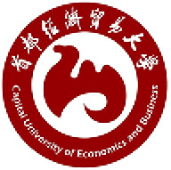
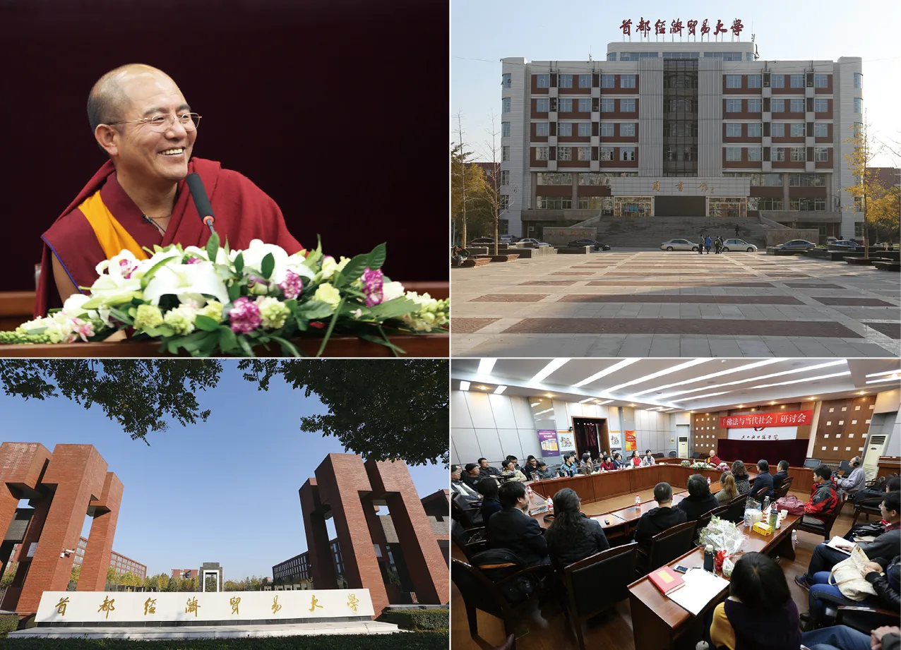
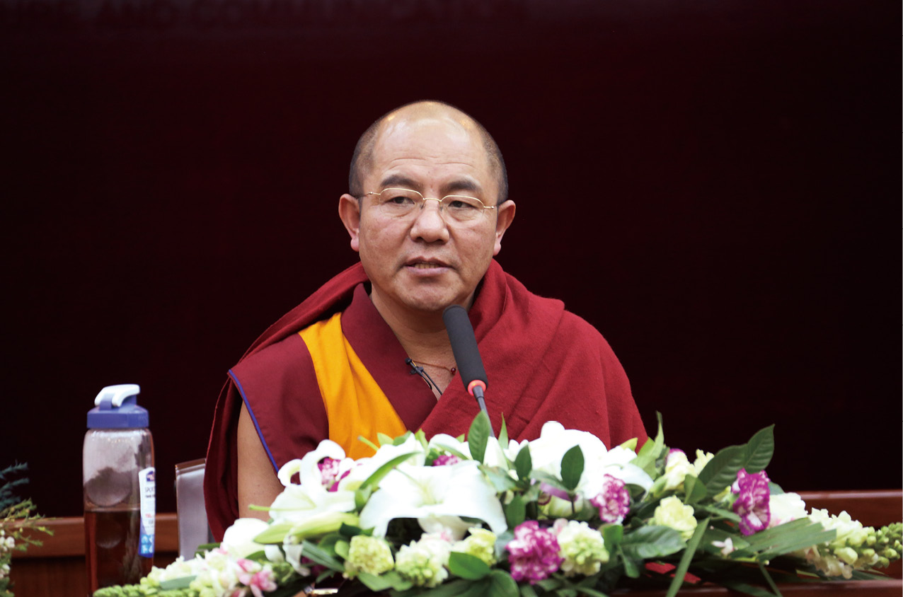
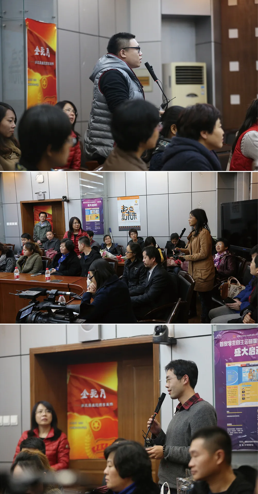

心的本来面目是空性，

也是光明。

在空性和光明的融合当中，

没有痛苦，

没有烦恼，

没有忧愁。

第67场

首都经济贸易大学

Capital University of Economics and Business

中国·北京

2013 / 11 / 7

## 佛法与当代社会

## Ancient Wisdom of Buddhism in Contemporary Society

主持人：

今天的研讨会，主要分两个部分。第一部分，请堪布为我们开示，主题为“佛法与当代社会”；第二个部分将进行一个小时的互动答疑。

首先，介绍一下索达吉堪布：堪布是当今非常著名的一位上师，他悲智双运、显密兼通。理论上，堪布通达藏传与汉传、显宗和密宗。行为上，堪布一方面做了很多利乐有情的功德，比如赞助小学、资助大学生等；另一方面，也进行了广泛的弘法工作，特别是最近几年，在国内外一些著名高校，像北大、清华、复旦、北师大、人大等，做了很多讲座。

所以今天非常有幸请堪布来与我们交流。现在就请堪布为我们开示，欢迎——

很高兴和大家一起探讨“佛法与当代社会”。前两天我刚得知这个题目，但最近有很多事，也没有想到什么有价值的内容。不过，我可以抛砖引玉，讲一下“佛法与当代社会”值得关注的几个问题，然后大家畅所欲言，一起交流探讨。

无论你们有什么想法，包括对佛法的一些怀疑、看法，都可以直接说出来。我们讲座的主要目的，就是为了遣除疑惑、了解真相。这非常符合世间的辩证法，也极其相合于佛教的辩论方法。今天在座的都是科学工作者，因此，我很希望大家用科学的态度来分析问题。

## 智慧藏在这里

两千五百多年前，释迦牟尼佛广开八万四千法门，流传到现在，形成了南传、北传、藏传三大佛教体系。南传佛教主要分布在缅甸、斯里兰卡、泰国。北传佛教在中国、日本以及东南亚的一些国家相当兴盛。藏传佛教最初由印度传入藏地，如今又传到欧美等几十个国家。两千五百多年以来，佛教的传播范围非常广泛。

不仅如此，佛教的智慧体系也相当博大，其内容都保存在《大藏经》里。比如在藏传佛教中，释迦牟尼佛宣说的经典有一百多本，每一本都特别厚，完整地保存在寺院中，而且很多老师一直在研究并传承着这些智慧。在藏地，寺院相当于是大大小小的学校，主要作用就是研究佛经。当然，不仅是藏传佛教，汉传佛教、南传佛教也同样以其不同传承，传递着佛法的智慧。

值得一提的是，藏传佛教中有翻译自印度的大量论著，比汉传佛教要多很多。以前我大概对比过，发现汉传佛教的《大藏经》里，除了佛陀的语言和印度大德的开示，还有很多汉地大德的著作。而藏传佛教的《大藏经》分《甘珠尔》《丹珠尔》两部分，其中《甘珠尔》全是佛的语言，《丹珠尔》大部分是龙猛、陈那、法称等印度大德的著作，共两百多函；藏地大德的著作，大多并没有收入《丹珠尔》中。这些藏经的雕刻版，在德格印经院保存得非常完好，“文革”期间也没有受到损害。

我本人从小就信仰佛教，大概23岁时出家，接近三十年里一直在佛学院学习。早年在学校读书时，我对心理学、辩证法、数理化等很有兴趣，但好多问题一直找不到答案，直到后来学了佛法，把现代知识与佛经进行对比后，才深深感到佛经的确不可思议。

以前，鲁迅先生曾用非常敬仰的心情，高度赞叹佛经，说它高深莫测。我也有这样的感觉，所以不管到哪里，都想劝大家多看一下佛经。

蕅益大师有一部《阅藏知津》，专门记录了每一部佛经的概要。南怀瑾先生在峨眉山的时候，也曾用三年时间阅藏。在藏地，有许多大德不仅修证境界高，精通天文、地理、历算等世间学问，更是一生潜心研究《大藏经》。比如一百多年前，藏地有位大德叫贡智·云丹嘉措，他总结各经论的要义和闻思修方法，并将宁玛派、格鲁派、萨迦派等藏地各派所有传承的教言、修行窍诀、历史、天文、地理、医学、文学等全部汇集起来，编辑成书。此书分为五大部，共九十余册，被称为《五宝藏》。如今在许多藏传文化典籍中，都收存了这部巨著。

这种对教言和文化的收集与保护，在藏地实际上非常普遍。前段时间，美国哈佛大学有一位老先生离开了世间。他生前用五十年时间，在藏地各个地方收集经论以及各个时代高僧大德们的教言，并用数字化的方式保存在硬盘里，我看了之后非常惊讶。这只是个简单的例子，类似的情况还有很多。

也许有人认为，佛教是一种古老陈旧的文化，早已过时，跟不上现代的科学文明。

其实这种说法需要观察，为什么呢？因为现代科学在心灵研究上还一片空白。而调整心灵对每个人都必不可少，比如，我们在生活中有贪心、嗔心、痴心等烦恼需要解决，有大悲心、出离心、信心、智慧等善心需要养护，那如何对治负能量、提升正能量，这方面佛教就有很殊胜的方法。

如今欧美很多大学，都设有佛教的研究机构和禅修中心。尤其是禅修，对人体调整、潜能开发有非常大的作用。要知道，我们在生活中所发挥的能力，还不到潜能的百分之十，即使是顶尖级科学人士，其智慧也没有被完全开发。而这种智慧，佛教认为，就藏在我们的如来藏中，人人都拥有，如果因缘具足，完全可以被挖掘出来。到那时，你不单单可以懂英语，懂阿拉伯语，还可以慈悲对待一切生命，拥有很多超胜能力。这方面依靠现代科学很难达到，最好的方式就是通过佛教的禅修，来认识心性、认识自我。

## 不变的真相——四法印

佛教的根本教义是“四法印”，有人说，这些理念是佛教和非佛教的最大区别。即使你没有听过“四法印”，用现代理念来观察，这些道理也不得不承认。

四法印，就是诸行无常，有漏皆苦，诸法无我，涅槃寂静。

### １．诸行无常

我们很多人没有太多无常观，用一辈子的时间筹划着买房子、做事业……其实人生不过几十年，长也不过一百多岁，我们总以为自己还要活很长时间，丝毫没有意识到这些终将失去，这是相当遗憾的。万法每个瞬间都在变化，春夏秋冬在变化，整个宇宙在变化，我们的内心、家庭、父母、感情、生活等也都在变化，可我们却视而不见。

其实，了解无常，并不会让人消极，反而会让人变得坚强。我经常对一些人讲，即使你不学佛，也要懂得无常，若能如此，以后无论工作、名声、地位还是财富上发生变故，都会有一定的准备。乔布斯生前把每一天都当作最后一天过，死亡来临的时候，他有很强大的心力去面对。在座的人也应该这样观察：我的寿命还剩多少时间？

我们每个人无论年龄大小、学不学佛、有什么样的价值观，都有一个共同点——迟早要面对无常。由于对无常没有一些认知，当变故来临时，很多人都没有准备，尤其是当感情出问题，或者亲人去世时，甚至生活都难以为继。

有时候我会想：无常清晰得如在眼前，世人却将一切执为常有，太可怜了！如果认识到万法确实如佛教所说，没有一个是恒常不变的，对人生会带来非常大的利益。

### ２．有漏皆苦

很多人认为：“世界很美好、很幸福，佛教却说三界犹如火宅，讲厌离，不承认快乐，太悲观了！”

其实不是这样。佛陀也承认生活中有暂时的快乐和幸福，但在此基础上，又进一步讲了厌离心和出离心，这是一种面对现实的智慧。

要知道，人生有生老病死等各种痛苦，每个人若总结自己的一生就会发现苦多乐少，什么样的人都不例外。以前藏地一位著名学者说过：“富人在富贵的生活中哀号，穷人在贫穷的生活中烦恼。”确实，如果你留意观察就可以看到，没钱人有没钱的痛苦，有钱人有有钱的痛苦。所以，懂得有漏皆苦，这非常重要。

### ３．诸法无我

现实中的这个“我”，佛教也是承认的，但用智慧去剖析，它又确实不存在。大多数人认为“我”就是现在的我，这只是未经观察的说法而已，真正去观察的话，身体是“我”？语言是“我”？还是心是“我”？

如果说身体是“我”，那身体和“我”是一体还是他体？若是一体，那么身体残缺的人，比如没手、没脚、没眼睛，是不是他的“我”也缺了一块？肯定谁也不承认。如果二者是他体，那除了身体，还应该有一个“我”，可这怎么找也找不到。

“我”跟心、语言的关系，用同样的推理也可以了知。

或者，还可以用另一种方式来观察：如果“我”是由地、水、火、风组成，那么四大元素合起来是“我”，还是分开来是“我”？如果分开来是“我”，那地大、火大等每一个元素就都成了“我”，如此一来，不小心吐个口水，“我”也会少了一块……

这样观察就会明白，所谓的“我”，只是身体、语言、心识假合的一个东西。就像这个茶杯，是由很多粒子组成的，除此之外，实有的茶杯根本不存在。所以，佛教说无我，并不是不承认“我”的显现，而是不承认“我”的真实。

### ４．涅槃寂静

有了这样的认知后，通过修行证悟无我，不单单是痛苦，包括烦恼障、习气障等阻碍我们彻证万法的一切障碍，都会全部消失。这种解脱的境界，就叫涅槃寂静。

对于佛教的“四法印”，两千五百多年来，有智慧的人不得不承认，即使科学也没办法推翻。

大家都知道，科学不管是天文、地理、物理等，一般都是后人不断推翻前人的理论，然后建立新的观点。但佛教思想到目前为止，没有任何人能够推翻。为什么呢？是因为没有找到它的过失，还是它的确符合真理？这值得每个人深思。

比如，对人类心理的剖析，很多西方学者认为，佛教在两千多年前就已经有了非常成熟的理论，现在的人也不得不沿着这条路走。

从19世纪到21世纪，全球在各个方面发生了翻天覆地的变化，但对内心的认知，人类似乎没有太大进步，连孔孟、老庄时代的传统思想都比不上。

当然，传统文化虽好，也不是方方面面都要继承。好比佛教的有些仪式或者繁杂要求，佛陀开许在未来时代可以适当调整，但其中非常科学的部分，则必须一直保留下来。比如因明辩论，这在藏地寺院十分常见，很多人通过面对面的辩论、探讨，最后可以获得正确的见解，并且这种正见经得起检验，不会轻易改变。

佛教所包含的一些真理，其实与科学也并不相悖。杨振宁是一个科学家，也是一个佛教徒，他在不同的场合中说过：“科学跟宗教息息相关。科学是有限的，而宗教是无限的。”所以，宗教纵然经历了久远时间，但能一直生存不灭。而且很多宗教一直致力于人类智慧和爱心的开发，不断发挥着积极的作用。所以，希望大家在研究科学的同时，也应该了解一些宗教的观点，借鉴他们的思维方式。

现在有些老师在教学上，思维方式不太开放。其实，如果老师讲什么，学生就要接受什么，这不一定很好。应该培养学生自己的思辨能力，给学生留下一定的思考空间，甚至可以让他驳斥老师的观点。这样，老师会有很大的进步，学生也能拓展自己的见识和能力。

## 调伏你的心

佛教非常提倡和平，但它不认为和平依赖外在，而是强调内心的和平。佛教认为，首先要消除内心的杂念和负面情绪，这些被净化后显露的真心，才是真正的和平。这种心的状态，对在家人来说特别重要。否则，永远随着社会潮流，随着别人的分别念和脚步，活着就会非常累、非常苦。

如果我们内心有一种主宰，有佛教所谓的正知正念，就可以依此观察自己的情绪。当你过于浮躁时，可以提起智慧，用心来观察心。这时你会发现，心的本来面目其实是空性，也是光明。在空性和光明的融合当中，没有痛苦，没有烦恼，没有忧愁。这一点，每个人都可以认识到。在认识的当下，所有烦恼会消失无余。

比如，我们有时候非常烦躁，无缘无故跟别人发脾气，事后自己也很难受。这种情绪，在佛教中称为嗔恨心。但嗔恨心的本体是什么呢？就是菩提，是智慧。《六祖坛经》也讲：“烦恼即菩提。”如果你没有认识嗔恨心的本来面目，它就是烦恼，给你带来无量痛苦；但当你认识到了之后，它不但对你没有丝毫障碍，反而会成为智慧的助伴。

在生活中，我们每个人都可以这样修行。

没有它的话，有些人遇到一点点事情，心情马上不好了，好像心里装了一块石头，甚至因为没必要的小事吵架。那天新闻里讲，有两个接近一百岁的老人，老头子向外看，有一些女孩在笑，老太太就骂他：“你看什么呢！”然后两人开始吵架……这就是嗔恨心。

按照佛教的观点，不论年轻人、老年人，都会有嗔恨心等负面情绪，不过，佛法可以有很多途径去化解。那是不是学佛后就没有烦恼了呢？也不是。烦恼照样有，但自己有对治和抵抗的能力。

我经常想，现在每年有二十多万人自杀，非常可怜。包括有些大学生，遇到一点小事，动不动就要跳楼。前段时间我去一个学校，听说在短短的时间里，就有五六个学生接连自杀。什么原因呢？就是因为很多人没有信仰。一提到信仰，他们总是很排斥，甚至说“学佛是神经病”，结果自己遇到逆境时，一点抵抗能力也没有。这是他们的一种悲哀。

其实，佛教提倡的很多道理，包括非暴力、慈悲，对当前来讲非常需要，对世界和平、世间和谐也有不共的意义。因为佛教的教义是“诸恶莫作、诸善奉行”，危害自他的行为要制止，一切善法都要奉行，而佛教徒则要将其付诸行动，给世间带来一种正面的能量。所以，即使人心浮躁、充满戾气，学佛也会让这世间变得平和。

当然，要想做到这一点，寺院等佛教团体有重要的责任。不过，现在很多寺院已变成了旅游场所，或成了一种商业工具。尽管这不是佛教徒愿意的，很多事情自己也无可奈何，但大家还是要认清真正的佛教，学习和了解佛教的真正理念。

## 生活的主题

佛教有一个根本法义，叫利他心。在大乘佛教中，利他心又称为菩提心，它是最核心的思想，依此可以成就佛果。

菩提心有愿菩提心、行菩提心两种。如果心里发愿：“我要度化天边无际的一切众生”，这就叫愿菩提心。这种发愿通常需要一个殊胜的对境，如果没有，也可以在佛像前或者寺院里发。

而行菩提心，不但要发愿，更要在实际行动中去度众生。度众生包括六度万行，即布施、持戒、安忍、精进、禅定、智慧，这六种修行也叫六度，它涵摄大乘佛教的全部行为。这种行为与世间道德极其相应，若以六度作为自己的人生准则，完全可以成为一个高尚的人。

### １．布施

即要慷慨给予。如果你承认因果就会明白，今生的财富源于前世的布施，所以，单从获得世间利益而言，人也应该有一种舍心。然而，可怕的是，现在很多人给别人一点东西也不愿意，不管房屋还是其他财物，什么都要自己霸占，自私心越来越强，而帮助别人的理念、行为越来越少。这样下去，周围就会充满尔虞我诈、勾心斗角，慢慢地，人也没有了安全感。

### ２．持戒

其实这一点很重要。有人可能认为，佛教要守这个戒、那个戒，很多条条框框，太死板。实际上，人追求的层次越高，要守的戒律越多。就拿学校、企业来说，约束人的条例也不少。更何况，佛教最基础的五戒——不杀人、不妄语、不邪淫、不偷盗等，应该是社会的底线。如果你杀盗淫妄都不做，无论当公务员还是老师，都是一个非常好的人。

### ３．安忍

关于怎么样修忍，你们有兴趣的话，可以学学《入菩萨行论》的“安忍品”。现在很多人脾气不好，什么事都忍不了。听到一些很好的道理，忍不了就开始诽谤；发现别人损害、诽谤、欺负自己，忍不了就有各种抱怨。其实面对这些，我们应该培养一种忍耐之心。

### ４．精进

不管学出世间法还是世间知识，都离不开勤奋，否则什么也做不成。正在学知识的学生，肯定要勤奋。但作为老师，也不能懈怠，永远停留在自己以前所学的知识上。有一位学者说：“如果你没有每天学习，大脑就会停止。”所以，任何人都要不断地学习。

我看过一篇文章，说是现在很多人不爱看书，经常聊天、打麻将、看电视，上网看些乱七八糟的信息，久而久之，心灵就变得很空虚贫乏。其实，只看一些简单的碎片信息，根本没办法完善自己的智慧。我们应该系统地学习知识，包括传统文化和现代科技，不仅要学，还要去思维，这样才能真正充实自己。

精进不仅是菩萨的行为，也是每个人都需要的品德。听说有些老师和学生，平时只把专业知识稍微学一下，其他时间都忙于赚钱，愿意搞科研的越来越少。如果我们的价值观全部建立在金钱上，没有科研精神，也没有宗教意识，把安逸和享乐当作生活本身，那就成了爱因斯坦所说的“猪栏理想”[^1]。

遗憾的是，很多人都喜欢这种生活，要么整天跟人闲聊，要么在无意义中打发时间，这样的人生实在没有意义。所以，我们一定要精进，要多学习。像德国人，哪怕坐地铁都捧着书，几天就看完一本，我们如果也能这样，对各方面素质提升有非常大的帮助。

藏地有一句格言：即使明早就死去，今天也要认真学习各种知识，哪怕今生当不成智者，也要为来世积累智慧。[^2]这种精神非常值得借鉴。曾有一位藏传大德，去北京一所医院看病。医生给他发了病危通知，说最多还有两三天时间，但他毫不在乎，一直在看书。他说：“死亡很正常，只不过是换个身体，没什么可怕。但看书、学习不能放下，这是更重要的事。”

试想，如果是我们，明天就要离开人间，今天还有兴趣看书吗？恐怕很难做到，而会一直惶惶不安。但有境界的人不会如此。所以，对于学习，我们要养成一种精进的习惯。

### ５．禅定

禅定是让心安住下来。我们早上起床后、晚上睡觉前，都应该修一下禅定。汉传佛教中，禅的思想至今都非常兴盛。以前有位禅师在屋里写着“关上门即禅堂”，我们平时也可以这样，把手机、房门一关，当下就是禅堂，让自己好好安住，静一静。否则，整天活在忙忙碌碌中，也许到死那一天才能彻底休息，之前连喘口气的时间都没有。

佛教的生活非常寂静。或许你们对此也有体会，去寺院时，身心一下子就放松了。这种寂静和轻松，我们可以创造，禅修就是办法。不管你有没有信仰，都可以通过坐禅调养身心，这对智慧也有帮助。佛教讲“因戒生定，因定生慧”，依靠禅定可以产生智慧。

现在许多人很浮躁，整天想这想那，晚上睡觉也不安稳，连个好梦都没有。早上一起来就要上班，白天连个好心情都没有，这是很普遍的现象。

作为在家人，虽不可能像古大德一样，一直如如不动地打坐，但你们有空的时候，可以去汉地的一些寺院打禅七，在七天中把所有通信设备关掉，然后安住下来。不过，可能有些人连这也做不到，他们会想：“如果跟世间隔离了，那家人找不到我怎么办？”“一个小时不开机的话，我好像少了什么。”这种手机强迫症，或信息综合症，其实给我们带来很多问题，甚至会直接影响我们的记忆和寿命，但很多人却浑然不觉。所以，学会静下来非常重要。

### ６．智慧

佛教的智慧有两部分，一部分是观察万事万物的现象，一部分是观察现象背后的本质，当然后者更重要。比如我手里这个话筒，它的结构和作用是什么样，佛教对此也认可，但它的本体到底如何，佛教则更关心。或者，还可以对当下这颗心进行观察：过去的心已灭，不可得；未来的心还没产生，不可得；现在的心没有本体，也不可得。正如《金刚经》所说：“过去心不可得，现在心不可得，未来心不可得。”

也许有人会想：“怎么不可得了？我正在起心动念的，不就是这个心吗？”

其实，这只是现象而已。佛教说的“不可得”，并没有否定这种现象，而是通过过去、现在、未来三个角度，分析心的本体是空性。

还有些人可能认为：“过去心和未来心不可得，这个我承认，但现在心怎么会不存在呢？”

我们就来观察一下，假设所谓的“现在”是一秒钟，而这一秒可分成一万份，那现在心在哪一份上面？如果说确实在其中一份上面，这万分之一秒还可以再分……一直这样分下去，最后这颗心到底在哪里呢？恐怕任何科学家也找不到。

如此剖析，我们就会知道，外在的山河大地、万事万物都是空性，内在的一切起心动念也是空性。这种观察方法非常科学，不需要依靠仪器和实验室，通过智慧完全可以抉择。

总之，佛教的智慧，不但包含世间智慧，也有出世间智慧。这种智慧非常久远，来自两千五百多年前，不像物理学等知识只是近代才出现的。所以，希望大家有机会应该了解一下。

## 心病的药在哪里买

当今，很多人都有心理问题，靠金钱地位不一定能解决，靠科技知识也不一定能解决，而佛教对此却轻而易举。其实人出问题，主要是心态问题，就像汽车的发动机出了故障一样，一切都会被打乱，在最好的环境中也感觉不舒服。反之，内心健康的话，在最恶劣的环境里也会活得很快乐。所以，不管是什么人，哪怕地位再高、钱财再多，也要懂得调心，否则，成功也没什么意义。

有时看新闻，我常会发出感慨：“那么成功的人，为什么要自杀？面对痛苦时，他怎么那么脆弱？”所以，内心健康非常重要，我们应该掌握正确的调心方法。

当然，这次时间太短，没办法介绍佛教的修心方法。但通过我的抛砖引玉，你们也可以自己去找。不管你现在对它有好感还是有怀疑，我相信，你最终都会获得真实的利益。

总之，希望大家用一种包容的心态来了解佛教，观察它与世间理念是否相合。其实在我看来，这个时代非常需要佛教，有了这种智慧，人们会生活得很快乐。不仅是今生，来世也快乐。

现场互动

问：我妹妹今年17岁，要参加高考，她的心特别浮躁，很简单的题都会做错，不知道有什么方法能让她的心稳定下来，踏踏实实地做题？

堪布：我以前每次考试，都会先祈祷，让心静下来。一般在考前五分钟，自己对自己作个调节。这种方法，在我的学生时代，包括以后的人生中，都非常管用。

现在藏地有些学生为了考试圆满，到寺院去请僧众祈祷、念经保佑，这也是一种方法。

还有一种方法，我经常跟有些学生讲：如果对考试非常执著，就会过于紧张，心也会乱。前段时间有一则新闻，有位学生犯了错，老师要求他要么做好作业，要么接受其他惩罚。后来他留言：“老师，这两个我都做不到。”然后就自杀了。

这种情况是什么引起的呢？就是执著。如果我们对考试特别特别执著，很可能会考不好，甚至还会做出其他选择。如果你保持一种心态：“考好也很好，考不好也没事，随缘吧”，反而会有一种好结果。佛教里讲“随缘”，我自己在人生中，对任何事情也是这样：“不要太执著了。如果做得好，是我尽力了；如果做不好，我也尽了力，就随缘吧。”有这种心态，有时候反而事情办得很圆满。否则，越来越执著，可能会适得其反。

问：我有一种心态：我不会因为一个人是尊贵的老师、另一个人是无名的扫地阿姨而有区别，会同样尊重他们，甚至帮助乞丐时，也会注意不要有一种施舍的态度。但是我不能够忍受那些有权有势又自以为是的人，不愿与他们接触。在生活中我应该怎样处理好这种分别心，令自己的心更平和，就像您所讲的“无我”境界？

堪布：我刚才讲的无我，是一个很高的层次，真要达到这种境界并不容易，首先要在理论上领悟，再进行训练和修行，最后才能真正达到无我。理论上剖析很容易，只要有智慧，再依靠佛教的一些方法去观察，每个人都会说，“我”确实不存在。但在日常生活中，我们的“我执”经常会冒出来，这是正常的现象，还需要不断地努力修行。

第二点，你刚才所说的心态是，对比较可怜的人，像乞丐、残疾人，经常能生悲悯之心；对一些成功、傲慢的人，虽然也会尊重，但并没有像对乞丐那样好。这一方面是很好，因为现在很多人是相反的：对乞丐和可怜人很蔑视；而对领导、上司，尤其是跟自己前途有关的人，即使明明不喜欢，表面上也会笑着打招呼，或者以各种方式假意奉承。所以在这个时代中，你的心态是很好的，我很随喜。我们很缺少这种帮助可怜人的心态。

另一方面，你的这种分别念也可以慢慢平息。怎么做呢？其实不管是有钱的人还是有权的人，都是生命，都想求乐避苦。我们作为旁观者，在有能力的时候，应该尽量给予爱，减少他们的痛苦，这就是最有意义的行为。比较难做的是对可怜人生悲心，如果这种悲心你生起来了，要平息其他的分别心，应该不困难。

问：我最近两年经历了两位亲人的离世，偶然间看过索甲仁波切的《西藏生死书》。但我不知道，当亲人离去时，如何实际地帮助他们解脱痛苦？我还搜索了颇瓦法，据说普通人在没有上师的引导下没法自己修行。那么我应该怎么做？如何摆脱亲人离世的痛苦？

堪布：索甲仁波切（Sogyal Rinpoche, 1947-2019）的《西藏生死书》（The Tibetan Book of Living and Dying），很多人学习后的确很受益。里面有些内容，是根据《西藏度亡经》（The Tibetan Book of the Dead）的道理撰写的——《西藏度亡经》译成英文以后，在欧美受到极大欢迎，包括心理学家荣格，也非常乐意接受这本书。索甲仁波切通过自己的智慧，把这些古代思想跟西方生活相结合，指导人们如何解除死亡和疾病等痛苦，对很多西方人起到了非常大的作用。

这本书最主要的内容，讲的是要正确面对临终和死亡。大家知道，很多人不敢提“死”，一提起来就想回避。包括有些老年人，本来离死不远，但却不想提，只是一直等死。然而这样等着，死亡还是不得不面对。这是一条必经之路，是一定会发生的。年轻人也不一定不会死，从一些死亡统计来看，他们的死亡率也非常高。因此，面对死亡是人生中的一件大事。很多人说，结婚是“人生大事”，其实死亡是更大的事。因为死时的痛苦，对来世有一定的影响。

针对死亡，索甲仁波切在书中讲了很多非常有效的教言。而且，郑振煌教授翻译的文句非常优美。我觉得这本书很值得看，里面既有一些学术理念，又有实践指导。通过学习，既可以了解藏传佛教，又能明白现代人如何运用藏传佛教找到面对死亡和人生的态度。

你刚才提的颇瓦法，为什么相关资料讲没有上师不能修呢？因为它是一种具体的实修，如果没有上师引导，光是自己修，有时候可能会出问题。就像开车，没有培训，光看个说明书就上路，行不行呢？表面上似乎也可以，但实际上真这样做的话，可能会出事故。如果经过培训，有经验的人把一些窍诀教给你，得到驾照以后再开的话，会更有把握一些。

佛教的修行也是这样——经过上师的传讲之后，才可以去修行。因为上师修过，有经验：在修行过程中，万一出现问题怎么样应对，怎么样遣除不必要的歧途，这些上师都知道。

所以，如果你有兴趣修，应该在有传承的上师面前，了解修行方法以后再去修。当然，根据书籍直接修也可以，但佛教的修行并非那么简单，自己修的话，你走的道路和获得的感应可能完全不同。

问：我前几年接触佛法时年龄比较小，接触的都是因果、福报、功德这些观念。说人不止一世，前世做的好事和坏事都会带到下一世，这一世的福祸由前世决定。这给我带来一定的压力，我每次做事前都会顾虑，这件事会增加还是会减少我的功德福报？我应当怎样正确面对“福报”的问题？

堪布：佛教重视因果观念，而客观规律其实也是善有善报、恶有恶报，因果丝毫不爽。以前没有研究宗教、在这方面没有思考的人，不一定很相信，甚至有人觉得奇怪。但实际不是他们想的那样。

其实，即使是一对双胞胎，福报也是不同的。同一个班里毕业的人，二十年后，有些升官发财，有些锒铛入狱，结果也不一样。这其中，确确实实有一个我们看不见的因缘，这一点很多人需要深思。

当然，你若想得到福报，比如钱财、地位，也是人之常情，这种想法并不会损害你未来的福报。《地藏经》中说，如果想求子，祈祷地藏菩萨就会得子；如果想发财，祈祷就会得财。通过这种善的力量和因缘求一些福报，将来也会有所获得。

但不要认为做善事马上就能得善果，这种想法不符合规律。有些善因是在很短的时间就得果，而有些则需要很长时间。今生做善事，不一定马上就有福报，因为前世的恶果或许会提前成熟。所以，因果是非常复杂的，看看《业报差别经》和《百业经》就会知道。我们不能一概而论，“这个人做善事怎么没有好报？他应该马上快乐”，不能想得那么简单。

问：我遇到害怕的事，或者晚上走夜路的时候，就默念“大慈大悲观世音菩萨”“南无地藏王菩萨”。这算是一种宗教信仰，还是一种信念的支撑？

堪布：你平时祈祷观音菩萨、地藏王菩萨，如果有信仰，依靠信心来祈祷更灵验，会获得更大的加持；但如果没有信仰，仅仅把这当作一种药或力量，也是可以的。

很多人一帆风顺的时候，不会想到祈祷、保佑，只有当遇到比较大的灾难，或者生命出现重大违缘时，才会临时抱佛脚，到寺院去求保佑。甚至有些贪官犯了错，也去寺院里求法师，做功德。其实，做了太大的坏事，诸佛菩萨不一定能救。不过人的本性就是这样。

当然，祈祷诸佛菩萨，加持确实不可思议。我本人也是，哪怕做个噩梦，也会祈祷莲花生大士、观音菩萨；路途比较危险，坐飞机比较颠簸，就马上祈祷上师。我在生活中是这样做的，也认为非常有必要，但有人可能不相信。就好比有些药的功效，有些人不相信，这是他自己的事，并不是药的问题。同样，诸佛菩萨的名号，无论你信不信都有加持。

问：我了解到国内的一些高级学者，在晚年的时候，都会去研究佛学，比如国学大师季羡林等；而且一些国外的科学家，他们研究得越深入越会发现——其实宗教、佛法才是最应该去研究的，甚至他们会推翻自己以前的研究成果。这是怎么回事呢？我们这些年轻的学生，阅历尚浅，应该怎样对待佛法呢？

堪布：的确如此，很多国学大师、科学家晚年会学佛，因为人到垂暮之年，很多阅历让自己知道什么最重要，进而选择一条智慧之路。

我特别喜欢跟大学师生交流。有些人就像佛教里讲的，有善根，稍微点一下，就能明白人生的很多道理。其实，如果一辈子把佛教、宗教看作迷信，一直诽谤，到发白齿落或临死之时才反省的话，可能已经来不及了。不如年轻的时候，对佛教有个公正的态度。

我曾看过季羡林的一些著作。他的恭敬心很大，五十多岁时，有一次礼拜母亲，把额头都磕烂了。前段时间我去德国哥廷根大学，看他当时念书的房子还在，那时他研究的是梵文——大家都知道，印度是佛教的来源，而佛教就是依靠梵文来传播的。通过学习梵文，他发现原来佛教如此深奥，后来用很多言辞来赞叹佛教。这一点在他晚年的书里写得很清楚。

我也特别希望，年轻人先有一个正确的认识。有没有信仰，这要看你自己。但不能把没有信仰当作是最伟大、最正常、最科学、最聪明的；有信仰当作是最糊涂、最散乱、最有问题的，这样判断确实不合理。

前两天，我跟中国科技大学前校长朱清时教授面对面讨论过。他有一句话，我觉得很好。他说：“马克思（Karl Marx, 1818-1883）那个时代，科学没那么进步，量子力学等都还没出现。如果马克思出生在今天，他的有些观点不得不改变，不得不与时俱进，否则，有些现象根本说不清楚。”这句话，我很认可。我们不能一直以18、19世纪的思想，作为自己的依处。科学在不断创新，不断发现过去的很多问题。但人生问题、生命问题，只有从宗教中才能找到答案。西方科学出现的时间距今非常短暂，尤其是欧洲工业革命结束时，我们这边还是农业社会。所以，我们所理解的科学，只是一种短暂性的成果，要以它来推翻人类文明中几千年的心灵科学，恐怕非常困难。

许多学者认为，古老的印度文明、中国文明和希腊文明中，印度文明是心智科学，比如佛教；希腊文明与自然科学息息相关；中国文明就是儒教和道教的思想，对应于现在的人文科学。这样划分三大文明，与以前四大文明古国的说法有点不同，这方面我们很需要研究。汤因比博士也说过：“只有回溯到两千多年前的孔孟文化，才能拯救我们人类。”这个观点非常重要。

问：我是统计学院的老师，每年都做社会经济生活指标，一共有八个，第一个就是幸福指数。幸福指数是三十多年前不丹国王提出来的，这是他们从佛法里获得的益处。我们做的时候，觉得幸福感完全依赖个人感受，很难有一个量化标准。那从佛法的角度，怎么看待幸福？

堪布：现在全世界人都追求幸福，但有时候越追求，却越痛苦。过去每个人都觉得科技发达会带来快乐，但结果是，人的贪欲越来越多，一直赶不上前方的目标，因此，压力、忧愁、焦虑不断增强。

1990年我去不丹时，整个国家好像只有两架飞机，车也非常少，但那里的人都有一种满足感。到现在他们仍然不愿意开放，不希望大自然被过多破坏，也不想完全成为商业化社会。

不丹人幸福的最主要原因，国外很多专家也研究过。实际上，不丹是一个佛教王国，基本全民都信仰藏传佛教。藏传佛教有八大教派，在不丹主要是宁玛派和噶举派。前一段时间，我一个同学从不丹过来。我也问他这个问题：“现在全世界都很羡慕不丹，不丹人的心态真的那么幸福吗？”他通过多方面了解证实，不丹确实与其他地方不同，他们好像没有过多的压力。现在城市里的人，很多都没有安全感，上上下下都感到压力山大。但不丹人不会，他们知足少欲，每个人的口头禅里，经常出现的是“感恩、快乐、幸福、好的、对的”这种词汇，不像我们，经常有不必要的担心。

你刚才提到，幸福感到底是什么？按照佛教的意义来说，有两种衡量的方法。按照小乘的理念，只要自己快乐，内心没有痛苦，就叫做幸福，这是比较低的标准；再高一些，按照大乘佛教来说，是“不为自己求安乐，但愿众生得离苦”，哪怕自己身体不好，或有其他损失，也无所谓，只要众生快乐就好。就像慈母，她的幸福，来源于孩子的快乐。同样，大乘佛教里，真正境界高的人，只要众生快乐，他就很幸福。

问：我有一位朋友得了癌症，后悔以前追逐名利，一无所获。皈依以后，很坚强地面对癌症，还写了本书叫《活着就是幸福》。现在他经常讲，喜欢什么就去做，不要积蓄外在财物。但是他遇到喜欢的人就在一起，不高兴就离开，想吃什么就吃什么，他认为这就是活在当下。您觉得这种观点对吗？

堪布：他这种“活在当下”的观念，也有好的地方，因为看得比较淡，不会特别去执著；也有一些比较消极的“无所谓”的态度。

我经常觉得，很多人今天虽然有很多抱怨，这个不对，那个不对，很痛苦，但当自己生病的时候，比如脚不太好，看到其他人脚很好，就会很羡慕；眼睛不太好，看到别人眼睛很好也会很羡慕；一旦得了癌症，看到没有得癌症的人，会觉得不管怎么样他很快乐。所以，人的幸福，有时候是比出来的。

前段时间，我正在走路时，看见前面有一个人脚不太好，一拐一拐的，就不敢走在他前面，免得他不舒服，所以干脆在后面慢慢踱步。当然，他不一定会产生这样的想法，但我还是有这种担忧。

南非总统曼德拉（Nelson Mandela, 1918-2013）在监狱里关了27年，他说：“每天有半个小时晒太阳，就是我最大的幸福。”海伦·凯勒（Helen Keller, 1880-1968）是位盲人，她说：“只要给我三天光明，就很幸福。”所以，每个人幸福的标准都不同。

你这位朋友真要离开的时候，会觉得只要能活着，什么都没有也可以。每一个人都会这样，当得知死讯时会感觉到：“其实人间是很好的，我不想离开。”

所以我们很需要无常观，要知道生命是无常的。佛教有这方面的教育，让我们提前做好准备。就像开车，首先要知道遇到危险应该怎么开，如果是经验丰富的人，会提前准备。我们人生中，也会遇到重病和死亡这样的危机，这时只有自己去承受，别人没办法代替。到那时，你可能会有不同的感慨。

因此，他当时会那样说——不仅仅是他，我们在座的人，如果只能活几天，也会想“只要活着就可以”。

问：我是一个母亲，孩子半岁了。我一直在想如何给予孩子更多正能量，让他身心健康地成长。最近在考虑上怎样的幼儿园，是去老师比较亲切慈爱的普通幼儿园，还是去注重才能培养的幼儿园？父母应该怎么做，才能给予孩子更好的教育？

堪布：有一种说法——母亲是人生的第一位老师。第一位老师有这样的想法，我相信他会越来越好。

父母给孩子的教育非常重要。现在很多人从小给孩子传递一种自私的教育。有专家曾观察，发现很多父母常这样教育孩子：“你不能让别人，别人打你，要打回去。”虽然不同的地方，具体的表达不同，但这样教育对孩子是有害的。我们应该通过各种方式，教他智慧、慈悲和爱心。

很多信息表明，人在六七岁到十六岁之间受到的影响，会成为他一辈子的价值观。那时父母做什么，他就会做什么。信仰问题也是这样，很多人二十岁之前，因为家庭和教育的关系，从小就没有任何信仰；如果孩子耳边听到的，除了追求金钱、地位这些，没有其他价值观的话，那他长大之后，也会变成这样。

所以，我很希望父母一定要重视教育。许多父母把责任交给老师，包括幼儿园、学前班、小学的老师。有些老师非常有德行，不但传授知识，还教导更重要的做人道理；而有些学校只培养知识和技能，并没有讲做人和道德。孩子大部分时间是在学校里成长，如果学校缺乏做人的教育，到一定时候，孩子们可能只有一些知识，最重要的却缺失了。

有一位大师曾说：“教育就是你将学校里所学的知识全部忘掉以后剩下的东西。”可是，很多学生把知识全部忘掉以后，也许就没留下什么了。我们十几、二十几年中一直在学校里学习，但当真正要为人处世的时候，可能出现严重问题。听说现在很多企业面临员工不会做人的问题，收一百个人，可能五十人要被解聘，因为他们的人际关系等方面很差，虽然业务水平不错，但是人格不好。

因此，我们的教育应该与古圣先贤的智慧结合起来，要传递慈悲和爱。这对父母来讲，应该是最重要的。

至于具体方式，你应该跟相关人员商量以后，再给他上课。但孩子现在才半岁，太早了，不要逼得太急。有的家庭为了将来，把所有希望都寄托在孩子身上。他本来就有学知识等各种压力，再一直这样，压力就更大了。所以，父母还是要注意分寸。

问：我觉得，一个人信佛，应该是智慧地信，应该从心里认为佛教是科学的，而不仅仅是一种信仰。请问大师，应从哪几个方面来说明佛教是科学的？

堪布：科学界有这方面的判断很重要。比如爱因斯坦认为，宗教情感也是科学创造的来源，佛教与科学精神是一致的。

前段时间，我跟朱清时教授讨论过这个问题。我说：“你当了十年的中国科技大学校长，也是中国最早的高级院士。你在《物理学步入禅境》一文中，非常感慨地说：‘科学家千辛万苦爬到山顶的时候，佛教大师早已在此等候多时。’作为一位对人类贡献很大的化学家，你的判断不可能是一种迷信。你是在什么背景下说出这些话的？”

他说自己一方面跟南怀瑾老师学了很多佛法，如《瑜伽师地论》《楞严经》《楞伽经》《成唯识论》等，同时在量子力学方面也有研究。按照量子力学的观点，宇宙中的一切到最后不存在任何有形有相的物质，可以说是空，而在这个空当中还有场或弦的力量。佛教也说一切万法本来即空，空中有不可思议的妙力存在，能显现万法。所以他说作为一个科学家，公正地来看，佛教是很深妙的。

他还引用《楞严经》的“随众生心，应所知量，循业发现”，认为佛教所讲的事物，不仅仅是单独的客观存在，一定是随众生的业力熏习而现前。也就是阿赖耶识显现世界，或空中显现一切，色不异空，空不异色。这些道理，他以科学与佛教相结合的方式来说明。

你的这个问题，也是现在很多知识分子的问题。前段时间，我在一个学校里讲过，学马克思主义宗教观，要了解其本义，不要把宗教当作精神的麻醉剂，否则会毁坏自己，这没有必要。

佛教不但是一种科学，更是一种多元文化，甚至可以说是最多元的。比如，佛教分人天佛教、小乘佛教和大乘佛教，可以适合不同根性的众生。

而且从内容和范围上说，佛教包罗一切，对现代人非常适合。其他宗教，有些对老年人适合，而爱研究的年轻人就不一定喜欢。但佛教不是，你既可以实修，又可以研究理论，从天文地理、宏观宇宙到微观粒子，佛教都有相应的体系；甚至人体的寄生虫、医学的很多问题，佛教也讲得很清楚。一旦打开佛经，常会发出感叹：“啊，这个也已经说到了。”现在科学家认为很惊人的发明，原来佛教里都有。

因此，新闻说有什么惊人发现时，我一点都不觉得稀有，马上会想：“这个在佛经里说过，那个在佛经里也有，没有什么惊人的。”

朱清时教授作为科学家，是通过智慧来信佛的。正像你刚才所说，谁都不喜欢迷信，包括我，如果只靠信心来崇拜佛，那我也不愿意。但是佛教对真相的认识如此透彻，白纸黑字地留在那里，一直没有改变，有什么理由不接受呢？如果很多年轻人多学一学，恐怕会恍然大悟，原来在东方文化中，还存在如此珍贵的智慧精髓。只不过很多人从没有学过就开始诽谤，说它是迷信，如果我们能以另一种方式来了解，也许更有意义。

问：祈请上师对放生进行开示。怎么样让它和社会融合得更好？如何让大家更好地理解它的功德？

堪布：放生是佛教一个非常重要的行为，它的理念主要是为了保护生命。龙猛菩萨在《大智度论》中讲过：一切罪业中，杀生的罪业最大。

人的生命很珍贵，动物的生命也同样如此，只不过我们没有去思考而已。我上午跟一个学者探讨时，在这个观点上有些冲突。他认为猪、牛、羊都该杀。我说，你只不过是还没有懂得生命的价值，如果真正懂得，或者你把自己换位成一只羊、一头猪，就会明白生命的可贵。

在某种意义上，我们的有些想法比较落后。人类都知道生命可贵，那动物的生命为什么没有价值？如果只因为动物不会说话，就可以把它杀掉、吃掉，这可能有点说不过去。

所以，放生是为了保护生命，不管怎样都值得提倡。西方很多国家为了保护生命，经常有一些裸体示威，甚至反对穿戴皮草。这些行为实际上有甚深意义。

我本人十多年来对放生很感兴趣，也特别希望大家以后用爱来对待周围的生命。

[^1]: 爱因斯坦在《我的世界观》里说：“我从来不把安逸和享乐看作生活目的本身——我把这种伦理基础叫做猪栏理想。”
[^2]: 《格言宝藏论》云：“即使明早要死亡，亦应学习诸知识，今生虽不成智者，来世如自取储存。”
