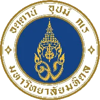
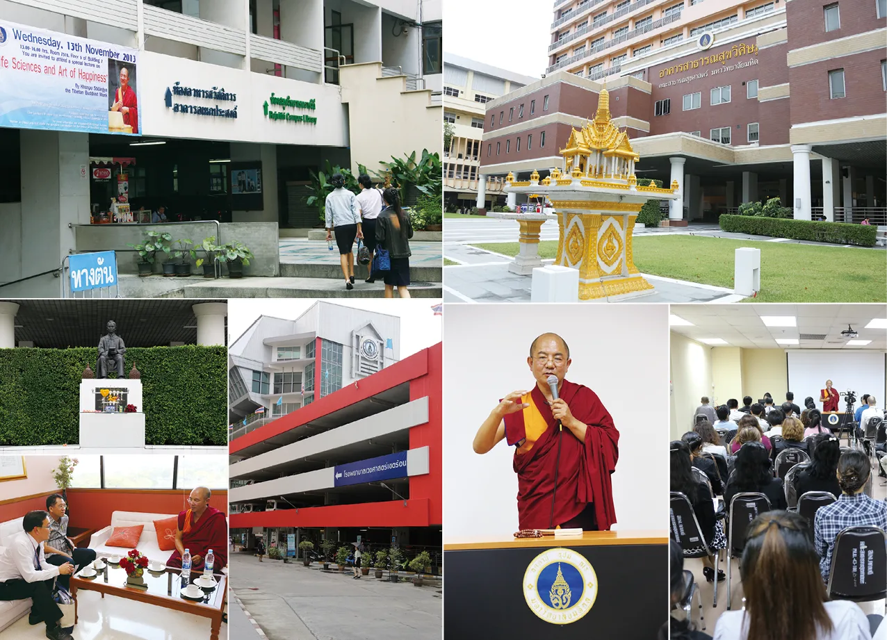
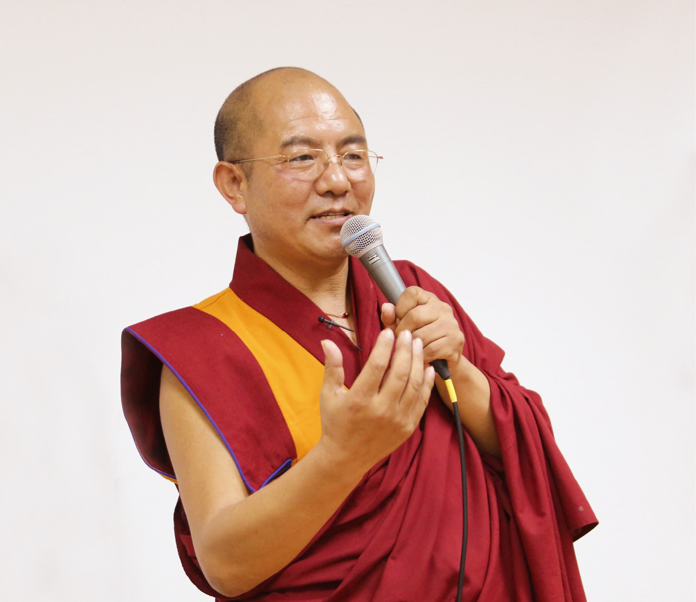
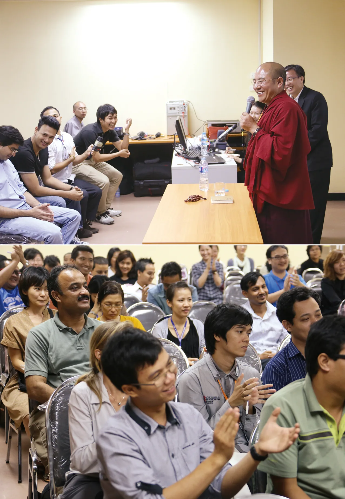
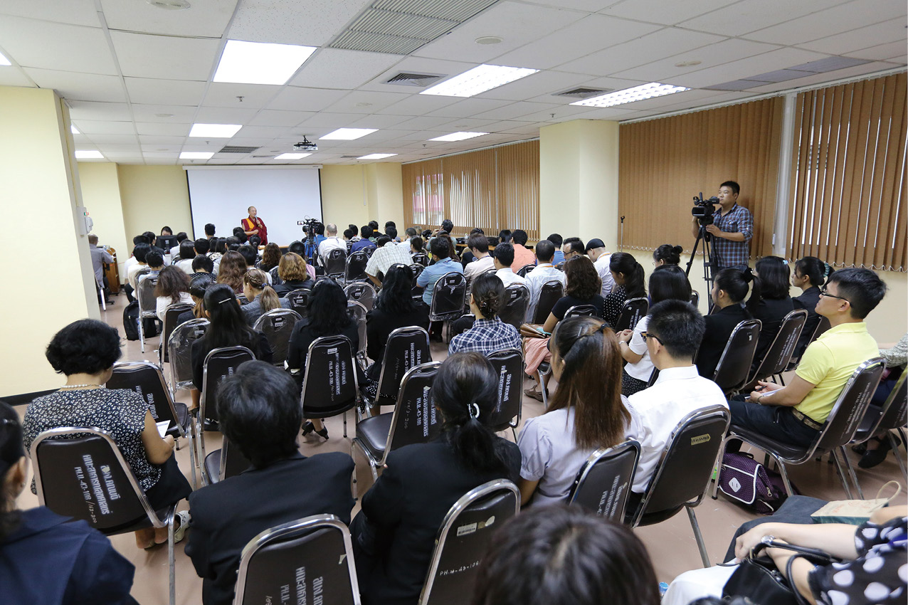
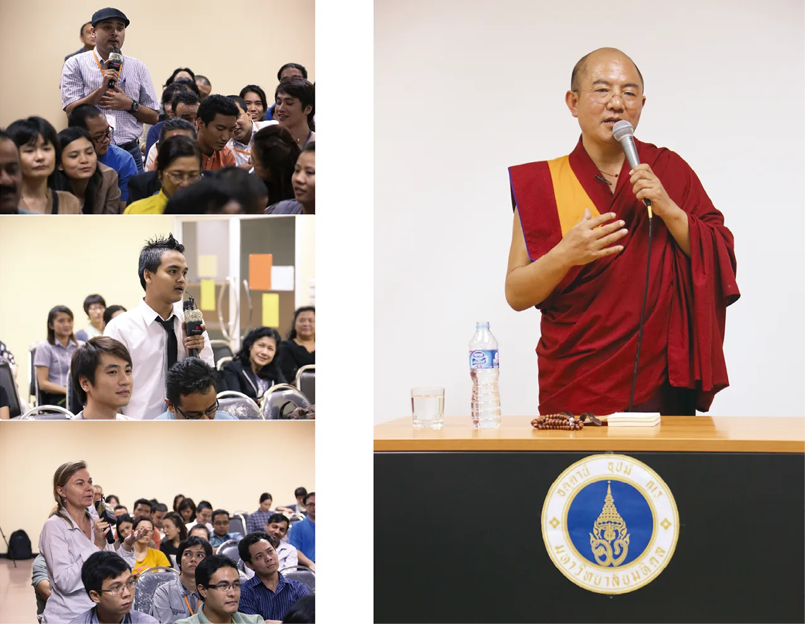

心很小，

虽然有大学文凭，

但内心只是“小”学生。

第69场

泰国国立玛希隆大学

Mahidol University

泰国·曼谷

2013 / 11 / 13

## 信仰与时代

## Spirituality in Our Time

很高兴能在国际学院跟老师、教授们交流。我听说这里有来自十多个国家的学生，大家有着不同的信仰。对我来讲，能在这样一种包容、开放的环境中与大家交流，是一件很幸福的事。

每个人都想要获得幸福。人们从早到晚，从出生到死亡间，一直都在追求幸福。我也不例外。不过大家追求幸福的方法各有不同。有些人想依靠物质而获得幸福，有些人想依靠艺术而获得幸福，还有些人则依靠信仰而获得幸福。我是依靠藏传佛教而获得了幸福。

在座的各位，除了佛教徒以外，有些人来自基督教、伊斯兰教等，也有些人没有任何宗教信仰，但每个人都在追求人生中最有意义、最美好的事。不论是否有信仰，大家都应该互相尊重、交流学习，用一种包容的心态看待世界。

## 经济发展可能带来信仰危机

我十四年前来过泰国，当时觉得这里很清净。但我现在觉得，商业浪潮可能冲淡了泰国人的幸福感。泰国被称作“微笑的国家”，这跟我们藏地很相似。东西方都认为，藏族人很快乐，脸上经常带有笑容。我以前也常在人们的脸上看到笑容，但现在却没有那种感觉了。

我来自藏地，泰国湄公河的源头就在藏地的青海玉树，这个流域分布着很多文化，其中既有相同之处，又有很多值得互相学习的地方。其实印度、中国以及亚洲其他一些国家的很多河流，都源自青藏高原。现在湄公河被城市污水以及工厂废水污染了，不能直接饮用。而对藏地的很多河流来讲，虽然目前水质还可以，但以后也许也无法饮用。

从世界各地来泰国旅游的人越来越多，同样的，藏地的蓝天白云也吸引着很多人去旅游。因此，泰国和藏地都面临着同样的处境。一方面，越来越多的游客，可以带动地方经济，改善人们生活的物质条件；但同时，这也为我们内心的信仰带来一些挑战。比如，现在很多年轻人都认为信仰没有意义，反而渴求媒体所宣传的内容。

泰国跟藏地有很多相似之处。比如说，泰国人出生后，一般由出家人或者佛教徒取名字、念经祝福。藏地的孩子也从小就受到这样的耳濡目染，任何重大的仪式都会由出家人或者佛教徒来主持。但将来的年轻人还会不会遵循这样的传统呢？这值得思考。

在泰国，基本上每一个乡镇都能看到佛塔、寺院。藏地也是如此。比如说，我所在的县城，大概有十六个乡，其中有二十多所寺院。但现在越来越多的年轻人觉得，不管是佛教，还是其他宗教，都不如钱有用。这是一种错误的观念。还有些年轻人觉得，他们是在科学发展背景下成长起来的新一代，而古老的宗教传统已经过时了。但实际上，有这些想法，恰恰说明他们还没有真正了解宗教。

## 科学也会引发悲剧

很多人认为，科学是先进的，能为人们带来很大利益。这一点我并不否认。科学发展确实改变了我们出行、沟通的方式，改善了我们的生活条件。但是不是人类所有的问题都可以依赖科学解决呢？不一定。在人类漫长的历史中，有很多古老的信仰是千万不能舍弃的。一味地相信科学能解决一切问题，是一种错误的观念。即使是科学家，有时也会因为自己的发明而后悔。

英国科学家马丁·赖尔，以其在射电望远镜领域的成就而获得了1974年的诺贝尔物理学奖，是世界上第一个以天文学研究而获得诺奖的科学家。但后来，他发现自己的技术被运用在军事领域，并且在战争中伤害了很多人。因此，他很后悔当科学家，甚至在临终时说，如果当年选择做一个农民就好了。虽然他临终时表达了这样的意愿，但为时已晚。同样，在第二次世界大战中，爱因斯坦参与发明的原子弹也夺去了很多人的生命。虽然他曾多次劝说美国总统不要使用原子弹，但无济于事，对此他也十分后悔。

有资料显示，在有记载的五千年人类历史上，大约发生过一万五千次战争，共有几十亿人丧生。尤其是在20世纪的一百年中，几十个国家卷入战争，近2亿人因战争而死亡。为什么在20世纪的战争中，有这么多人死亡呢？原因就是科学的发展。科学越来越发达的同时，各个国家之间最好能和平相处，因为一旦发生冲突，依靠科学发明的武器会让每个国家的人都面临危险，而制造这些武器的恰恰就是人类自己。从某种意义上看，我们就是毁灭自己武器的制造者。因此我们要提倡和平、非暴力、平等。

## 和平应该是每一个人的目标

世界上大多数的宗教都提倡善、正能量，佛教也是这样。当年，印度的阿阇世王与波斯匿王之间发生了战争，释迦牟尼佛对此开示说，如果战胜，会为自己树立更多的敌人；如果战败，自己心里又不舒服，所以，应该用和平的方式来解决争端[^1]。

也许在当前的因缘下，人们尚不能接受宗教的和平观，但因缘成熟时会接受的。比如，缅甸的昂山素季所提倡的和平、非暴力的观念，起初并不被人们接受，但后来大家意识到，这其实是人类生存不可缺少的因素。法国导演吕克·贝松甚至将她的故事拍成了电影《The Lady》。在电影中，她面对着枪口，为了民主、自由、和平，甚至愿意付出自己最宝贵的生命。实际上，和平应该是我们每一个人都应追求的目标。

一听到和道德有关的道理，很多人就觉得这与自己无关，不想听，更不想学。但是，道德对我们每个人都至关重要。听说这里国际研究中心的学生，将来会回到各自的祖国工作，但不论去哪个国家，都应该有善良的心和高尚的行为，否则，即使将来成为领导，恐怕也不一定是一名好领导。

很多人只对钱财、爱情感兴趣，对其他的话题则一点兴趣都没有。古人云“对牛弹琴”，意思就是说，悦耳动听的音乐不能引起牛的丝毫兴趣，它只关心吃草、喝水。我去过一些学校，发现大家都非常关心就业以及家庭问题，仅此而已，好像没有人关心如何做一个好人。我对泰国的学生还不是很了解，但可能也会如此。我认为，善良的人格和乐于助人的心态，是年轻人不可缺少的品质。

在当今这个时代，很多人对信仰的了解比较肤浅。实际上，在生活当中，尤其是经济波动、社会动荡时，有信仰的人，心态更加平稳，可以面对任何灾难。在过去的几百年中，科学的贡献无法替代宗教几千年来的价值。印度的前总理尼赫鲁是一位非常伟大的政治家。他说，在充满动荡、冲突的世界中，佛教就像耀眼的太阳。他还说，在这个充斥着原子弹和氢弹的世界中，没有任何东西像佛教的教理那么重要，在过去的两千五百多年里，只是进一步验证了它的持久性和重要性。佛教的确是这样，当然，其他宗教也有其存在的价值和贡献。

当今时代不但充满了各种新发明，而且深受商业浪潮的影响，人们逐渐忘记了珍贵的信仰和德行。现在虽然有人信仰科学，也有人信仰宗教，但却普遍比较迷信。如果信仰科学，你应该认真地思考，为什么信仰科学；如果信仰某一宗教，你也应该认真地思考，为什么信仰这个宗教。原来有一位哲学家叫贝克莱，他说，当我闭上眼睛的时候，世界上所有的悬崖都不存在了。[^2]很多人都认为他疯了，悬崖怎么会因为我们闭上眼睛就不存在了呢？但实际上，他讲的是宗教的力量，以及事物、感知和上帝的关系。

## 丢了信仰，有了钱又如何？

人们对科学的盲目崇拜，以及社会上的各种宣传，会对信仰产生冲击。一百年后，可能泰国、藏地的佛教传统，都只剩下一个形象。这也许是杞人忧天，但我认为年轻人的确需要关注这个问题。如果我们没有信仰所带来的心灵安适，即便物质生活再富足，也不一定会幸福。比如，我常看到身处高级宾馆的人，脸上没有微笑，但身处寂静寺院的人，却时常带有笑容。

很多年轻人认为，只要赚到很多钱，就一定会很开心。但也许你赚得越多，痛苦越大。近几年，美国有很多调查结果都显示，钱越来越多的时候，幸福指数却可能会越来越低。很多年轻人的眼里只有金钱、地位、名声，他们认为，只有这些才会使人生有意义。但事实并非如此。有修养、道德、利他心的人生，才更加完美。

可能很多人认为，电影《泰囧》带动了泰国的旅游业，带来了经济利益，因此，全国上下都应该感谢这部电影。但这样的因缘很难说是好还是坏。我担心有一天会出现一部《藏囧》。如果藏地也一味地开发旅游、发展经济，最后可能会面临文化丢失的局面。目前在青藏高原还有广阔、平坦的草原，还有森林、矿产等丰富的资源，最重要的是，人们的脸上还带有微笑，心中还依然有信仰；但如果过分地开发旅游，也许人们手里的钱会越来越多，但内心不一定会更快乐。这样的话，有钱又有什么用呢？

我们已经被卷入了商业浪潮里，即使少数人发现了这个问题，也不一定有能力阻止。新事物也许是不可缺少的，但传统却更有意义；外在的财物也许很有用，但内心的安宁更重要；科技发明也许很便利，但宗教信仰更有意义。新的事物、外在的财物、科技发明为我们带来的快乐是暂时的，而我们的传统、内心安宁、宗教信仰为我们带来的快乐却是长久的，对我们的利益更大。

每一个人都在寻找自己的快乐，每个人也都需要照顾家庭、积累财产、赢得一定的社会地位。但同时，我们也应该利益身边的众生。因为人生短暂，所以每一个人都应该在自己的一生中做些有意义的事。我们不会像难民一样缺少粮食，但却有可能缺少“精神食粮”。有些人虽然口袋里的钱越来越多，但内心却越来越贫寒。我们需要物质与精神的平衡。

有时候我在飞机上看下面的城市，觉得其实人类跟蚂蚁没有太大差别。蚂蚁也像人一样忙碌，也像人一样有自己的生活规律，每天要劳作，就像人每天要上班一样；而蚂蚁中也有不需要体力劳动的，就像是人类中的脑力工作者。

如果我们只关心自己的生活，完全不想帮助别人，这种心态是很狭隘的。现在的大学生，虽然被称作大学生，但是心很小，虽然有大学文凭，但内心却只是“小学生”。这样的话，不但自己没办法处理好人际关系，同时也为自他带来痛苦。

当我们遇到痛苦时，一定要有勇气和远见。其他国家的大学生，在感情或生活中遇到痛苦时，可能会选择自杀。但我觉得，泰国的大学生可能不会选择自杀，因为这里大多数的人都有信仰。

在痛苦面前，我们可能会觉得走投无路，但只要还能在缝隙中看见一丝光明，就要继续前进。因为人生中的黑暗是暂时的，就像黑夜一样，只要你有耐心、有勇气，就会走出当前的黑暗，看到第二天的阳光。很多被生活打败的人，往往都是在黑暗中迷失了方向，没有耐心和勇气等到黎明。

人生需要耐心，需要勇气，希望大家微笑长存。

现场互动

问：我来自巴基斯坦俾路支省，是玛希隆大学公共卫生学院的硕士生。我认为快乐源于自己，而非宗教。请问您是如何看待快乐和信仰的关系呢？

堪布：有些人认为，快乐来源于自身，对此，我并不完全否认。但这种快乐无法与信仰所带来的快乐相比。前一段时间，我在哈佛大学交流，有一个人对我讲，他以前认为，快乐是依靠自己获得的，但后来却发现，信仰所带来的快乐，远远超出自己所获得的快乐。我觉得，你可能还要再观察一下信仰所带来的宁静喜悦，与其他快乐的不同。

问：您如何看待极端的宗教信仰所引发的战争，比如中东地区的冲突等？

堪布：有些人认为，宗教信仰会引发战争，但我觉得这还需要深入分析。政治是一件很残酷的事情，而任何一个国家、集团都会利用各种手段为自己谋取利益，甚至是利用宗教。一些中东地区的宗教领袖在接受采访时都说，他们的教义中没有战争、恐怖袭击等主张，只是有人利用了他们的宗教而已。

我想真正的宗教提倡的是善，它不会发动战争，或者去恐吓、杀害别人。

问：从佛教观点来看，什么样的修行能给我们带来快乐？

堪布：佛教中有很多修行方法都可以带来快乐。比如说，南传佛教通过修白骨观，或者观十二缘起而获得快乐。我以前也去过泰国很多修白骨观的道场。此外，大乘佛教也有可以获得快乐的修法，如自他交换、发菩提心等。通过发菩提心，发愿度化天下一切众生，最后可以获得菩萨、佛的果位，那时我们应该是最快乐的。

总的来讲，佛教中有些修法可以令自己快乐，有些可以令自他都快乐，通过不同的修法，能获得各自不同的解脱和快乐。

问：通常人们知道何时需要“物质食粮”，却不知道何时需要“精神食粮”，但后者往往对获得快乐更加重要。我们该如何为别人带去“精神食粮”呢？

堪布：从物质上讲，自己喜欢的衣服、车子，在合适的时候，可以推荐给别人，希望别人也能享受。精神上也是这样。当自己从传统文化、道德修养中体验到了快乐后，你就可以把这种精神的“美味佳肴”推荐给别人。

在城市里，很多人以前没有信仰，但有了信仰之后，人生中确实获得了很多快乐。很多人都将这样的快乐，不断地传播出去，让其他人也通过宗教而获得这份快乐。所以，如果我们可以像推荐“物质食粮”一样地推荐“精神食粮”，身边的人就会获得真实利益。

问：我是一位钢琴老师，我“对牛弹琴”。但同时我也是一名教授，我的职责是要把“牛”变成人。我觉得它们虽然在看，却看不到；它们虽然在听，却听不到；它们虽然也在思考，却没条理。请问您是怎么看待“牛”的呢？

堪布：“对牛弹琴”可以从不同的角度理解。从“牛”的角度来讲，它们有自己的爱好，喜欢“吃草”“喝水”。在这样的生活里，它们没有什么烦恼，但除此之外，也没有其他的追求。但从人的角度来讲，我们需要更高层次的追求。

当然，当我们真正去观察的时候，发现原来都是人，没有“牛”，只不过在商业浪潮和金钱的影响下，人迷失了方向。所以，当“牛”转过身后，就会发现，原来自己是人，老师也会发现，自己其实是在“对人弹琴”。

问：您谈到宗教能带给人们幸福。我也相信，如果一个人能依照宗教去修持，就可以获得精神上的快乐。但有些人只是了解宗教，并没有真正地去修持。那我们该如何通过佛教的修持来获得快乐呢？

堪布：佛教的教义非常深奥，修行有一定的次第。首先，我们要从理论上明白佛教的道理。其次，光是理解还不够，还要进一步地思考。在思考的过程中，会产生很多怀疑，觉得这里不对，那里说不通。这个时候就需要通过辩论、探讨去通达。当所有的怀疑都被遣除之后，再开始进行修持。

我们常用“如人饮水，冷暖自知”来形容修行的感受。也就是说，通过修持，自己能清楚地知道其中的快乐。当然，这种快乐是内心的感受，很难给别人讲清楚。但如果自己内心有一定的修行境界，就会慢慢地影响身边的人。

问：在这个强调物质享受的社会中，精神上的快乐和宗教已经退居其次。我认为只要努力做到最好，让自己有满足感，并且能帮助别人，就可以获得快乐。您是否认为，人必须信仰宗教才能获得真正的快乐？

堪布：从我自身来讲，最大的快乐来自佛教。如果有人觉得，没有宗教，自己依然可以很快乐，依然乐于助人的话，这也很好。两千多年前，佛陀在转法轮时，也没有强制人们皈依。我想其他宗教应该也是这样。我认为，宗教与非宗教之间有一个共同点，那就是要让人们做好人。因此，我想并不是每一个人都必须信仰宗教。

问：如果不需要宗教也能获得快乐，那您能告诉我们一些在宗教之外获得快乐的窍诀吗？

堪布：有两种方法。一个是自己的内心要平静，减少贪欲心、嗔恨心。这样内心自然而然就会产生快乐。还有一种方法就是，经常用一种忘我的精神去帮助别人。有些人，虽然没有宗教信仰，但却经常帮助别人，所以自己生活得也非常快乐。因此，我觉得内心平静，不要有贪、嗔的烦恼，还有乐于助人的心态，都是非常好的窍诀。

问：如何创造内心的快乐？

堪布：对于年轻人来讲，载歌载舞，或者穿衣打扮都会为他们带来快乐，但这种快乐只是暂时的。如果你想要长久的快乐，最好在寺院里面安坐，然后观想佛陀，或者观察自心，这样你就会自然而然地快乐起来，而且这种快乐不会消失。

问：请问宗教领袖是否应该参与政治活动？

堪布：不论是宗教领袖，还是宗教徒，如果对这个世界有利益，就可以参与到政治活动中，但如果对这个世界没有利益，那就不一定需要了。

问：几个世纪以来人们不断强调身体的物质享受，导致消费主义日益增长，但同时，在精神层面却极为空白。您能提一些建议，改变这种“身心失衡”的状态吗？

堪布：我去过一些欧美国家，发现很多人对奢侈品或者虚构的内容，比如电影、动漫等特别贪求。但实际上，这些都没有实在意义。

其实，心和身体是分开的。身体的享乐是暂时的，而内心的安乐才是长久的。当我们只重视身体享乐时，很难建立真正的快乐，而一旦开始重视内心的安乐，那快乐就唾手可得。但如果没有关注过内心安乐，一味追求身体享乐的话，恐怕会与安乐越来越远。

问：我是来自印度的在读博士生。您提到，内在的快乐比外在享受更加重要，那获得内在快乐的最简单的方法是什么？

堪布：虽然喝美酒或者和朋友到酒吧里跳舞，很容易让人快乐起来，但这种快乐却很短暂，还可能对身体有负面影响。所以，我建议通过调心来获得快乐。

通过佛教的调心方法来获得快乐，这虽然在快节奏的生活中有一定的困难，但是会有效果。除此之外，在佛教的发源地——印度，也有很多调心的方法。现在世界各地的人，都喜欢到印度去学习佛教、学习瑜伽的知识，并借此获得了快乐。我相信，你们在印度也应该会获得快乐。

在藏地，虽然有很多年轻人也想获得快乐，但却怎么也快乐不起来，而外面的人来到藏地之后却都很快乐。

提问者：那我一定要去西藏。

问：您可以介绍一下禅修的方法吗？

堪布：修行与读大学有很多相似之处。在大学里，学生需要经过长期学习才能获得大学文凭。同样，修行人也需要一步一步地修前行、正行、后行。对于禅修来讲，方法有很多，其中最好的方法是毗卢七法。

以毗卢七法禅修时，身体端直，眼睛直视前面的空间，颈部稍向前倾，两手结定印[^3]，两胳膊稍向后展，双足金刚跏趺坐[^4]，整个身体有点像金字塔的形状。以这种身式禅修的话，心就会自然而然地调整。

想要心中获得快乐，一两天的禅修不一定起作用，但如果坚持长期修行，身体就会寂静下来，心也会随之安静，进而从中体会到很多胜妙的地方。所以，闭着眼睛会得到意想不到的快乐。

问：您提到，现在有些藏族年轻人对佛教不太感兴趣，那佛教应该怎样吸引年轻人呢？

堪布：现在很多年轻人，喜欢整容、穿名牌衣服，喜欢看电影、打篮球，喜欢谈将来怎样赚钱，怎样买房、买车等等。但其实，他们老了之后就会发现，自己年轻时所追求的大多是没有意义的事。

宗教并不是要控制大家，或者强迫大家必须要信仰它。但对于现代社会中的人来讲，如果舍弃了自己的宗教传统，那一生的辛苦，到头来不过是一场空。

对于现在的年轻人，可以通过一些善巧方便，让他们明白自己最需要什么。当然，这需要时间和努力。我很想帮助他们，但是能力有限，所以我也很着急。我们现在会通过互联网，讲一些关于信仰的必要性、传统文化以及宗教知识等内容，尤其是佛教的一些理论。其实，对于年轻人来讲，如果理论上明白了，他们会更容易接受。所以，最好的方法就是依靠网络等手段，多宣传佛教的理论，比如智慧和慈悲。

问：我是一名来自马尔代夫的穆斯林。我读过一些探讨科学与宗教的文章，其中有谈到，禅修以及睡眠好的人，会比一般人更加快乐。请问您一般睡几个小时？

堪布：依靠足够的食物、营养以及睡眠等，一般可以保持身体健康。我最近看到一份美国的医学资料中说，六个小时左右的睡眠比较合适，如果睡眠超过八个小时，则容易患癌症。

我刚出家的时候非常精进，经常只睡两三个小时，现在经常要睡五六个小时，特别累的时候，甚至要睡七八个小时。我从小睡眠就比较少，在学校里读书的时候，我是全班睡眠最少的，出家后，我睡的也比其他人稍微少一点，但还是需要一定的睡眠。

[^1]: 《杂阿含经》卷四十六记载，摩竭陀国阿阇世王与憍萨弥罗国波斯匿王之间发生战争，佛陀开示：“战胜增怨敌，战败卧不安；胜败两俱舍，卧觉寂静乐。”
[^2]: 乔治·贝克莱（George Berkeley, 1685-1753），爱尔兰著名哲学家、主教。原文是：“只要我闭上眼睛，世界就没有什么悬崖，但上帝能够感知”。
[^3]: 右手在上，左手在下，两拇指相触，放在脐下。
[^4]: 即双盘。
