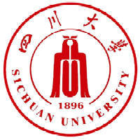
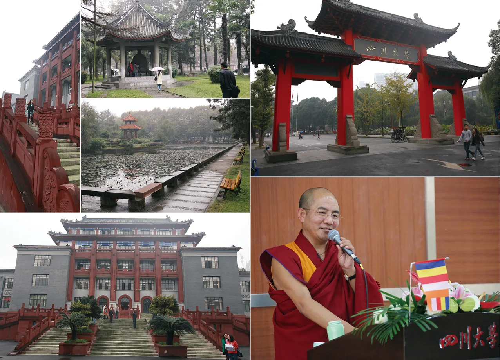
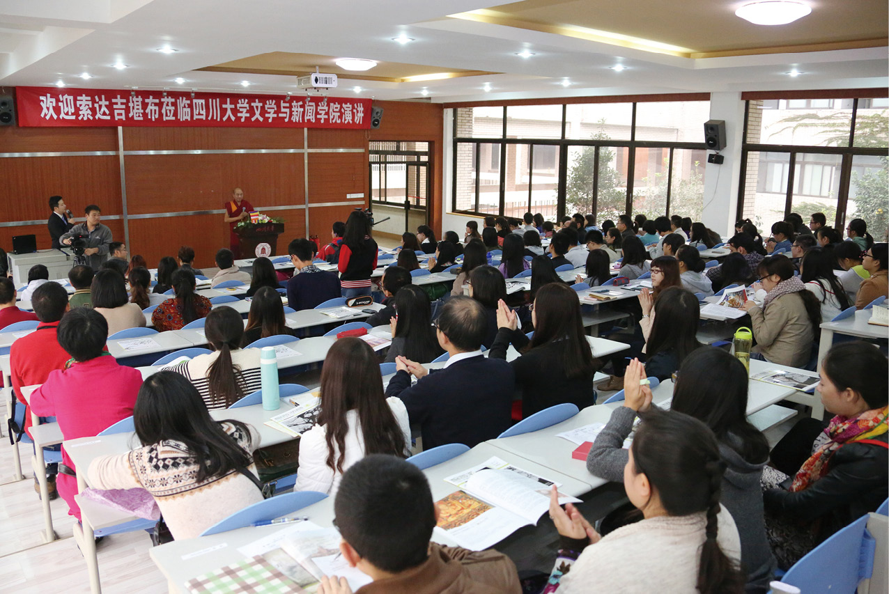
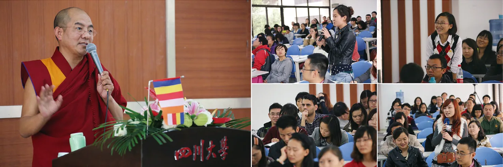
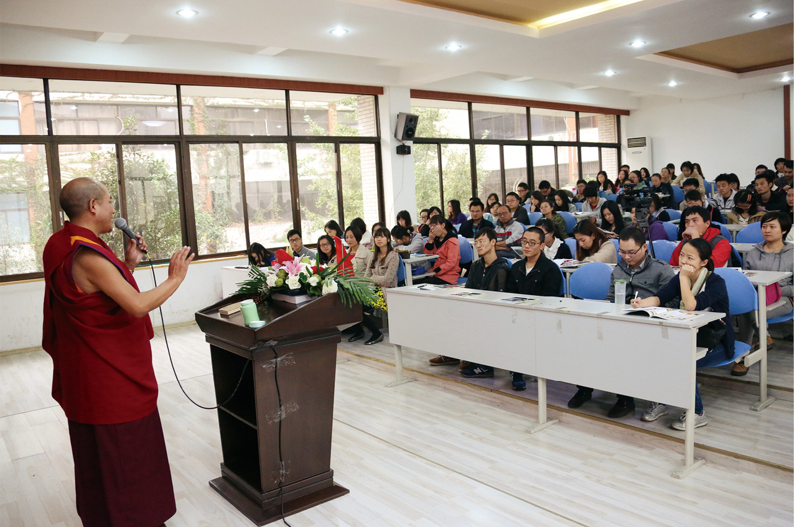

压力大多是源于自私心，

源于保护自我的心。

第63场

四川大学

Sichuan University

中国·成都

2013 / 10 / 29

## 大学生如何面对心理压力

## Stress Management Techniques for University Students

文新学院罗书记：

同学们，今天我们非常荣幸地邀请到索达吉堪布来文新学院作演讲。索达吉堪布是世界上著名的色达喇荣五明佛学院的大堪布。近几年来，堪布受邀到海内外各大高校演讲，其中有哈佛大学、哥伦比亚大学、香港大学、北京大学、清华大学等等。大师深邃的思想受到了大学生们的热烈欢迎，其本人也被誉为当代年轻人的心灵导师。现在由我们学院的学生代表，为尊敬的堪布献上一束美丽的鲜花，表达对堪布仁波切的深深敬意。

接下来让我们掌声有请堪布带来精彩的演讲——

谢谢罗书记，也非常感谢大家。我是第二次来川大，第一次是上半年在法学院做讲座。

这次到文学和新闻学院，跟大家一起探讨“如何面对心理压力”的话题，我个人对此很感兴趣，因为总是听到很多人说：“压力好大，压力山大……”

实际上古人不会说“压力大”，即使是我很小的时候，在人群中也基本上听不到这种声音。“压力大”是当前很多人口中出现的一个词。

去年有所大学做了一个统计，发现大多数大学生的口头禅都是一些负面、消极和痛苦的词语，比如“压力大”“心好烦”等等。这些生活中的声音，并不是幸福和感恩，由此也表明了现在很多人的困惑和苦恼。

21世纪可以说是人类历史上物质最丰富的一个时代——楼房越来越气派、轿车越来越豪华、衣着越来越高档，但是人们却体会不到幸福，反而感觉到压力，这是为什么呢？实际上，幸福并非源于外在，而是来自内心。如果内心缺乏平和与安宁，快乐也是无处寻觅。

按照佛教的观点，压力是一种痛苦，欲望带来的痛苦。佛教中有个专业名词——求不得苦，是说如果对地位、财富、名声、感情等非常希求，但却一直得不到，此时就会引发痛苦。这种求不得苦和压力非常类似。

## 大学生所面临的压力

最近一些学校对大学生面临的压力作了分析，结果发现大多数学生的压力源自以下几个方面：

### 1．家庭

很多家庭对学生的期望非常高，把父母的养老乃至家庭的维系都寄托在这个学生身上，由此给他造成很大的压力。

### ２．学业

在现在的信息时代，需要学习很多课程、掌握很多知识技能，所以学习的压力也在不断增加。小学、中学、高中以及大学，乃至研究生，不论是哪个阶段的学生，都背负着很大的学业压力。

### ３．情感

还有一部分压力源于情感。很多大学生对情感很执著，而一旦对方有所变化，立刻就陷入痛苦之中。

### ４．就业

大学生更多的压力来自就业。现在各个大学都在扩招，毕业生也越来越多，而社会岗位却逐渐减少，由此导致供需极不平衡，就业成了一个问题。

另外，现在的学生好不容易考上大学，一开始就像到了天堂一样，但是慢慢地又堕入困惑之中。因为上大学之前按照父母和老师的指导，自己心中有个明确的目标——考上大学，而一旦进入大学就好像到了终点，未来要做什么？心中一片迷茫，这也导致了很多大学生内心的痛苦。

所以，家庭、学业、情感、就业是大学生压力的几个主要来源。这几方面可以说是造成大学生心理压力的外缘。不仅是大学生，包括社会上的很多年轻人，也会面临这些方面的压力。

## 应对压力的方法

### １．不要贪婪

如果内心很贪婪，压力会非常大。

著名哲学家柏拉图（Plato, 公元前427-前347）说：“贪婪是最真实的贫穷，满足是最真实的财富。”对于这句话，我还是很赞叹的。如果一个人贪心很大，不知满足，就会始终处于压力和痛苦之中，幸福和快乐也会远离。

佛经中也说贪欲重者无有安乐，因为欲壑难平。为了满足贪欲而享受，终究如同饮用盐水越喝越渴一般，无有平息之时，最后可能也是在欲望中终了此生。

曾经我跟以前的一些同学聚会，在聚会中，我发现自己的生活是最自在的。刚开始我出家时，老师和同学都非常关心我，担心我出了家就没有前途了，也许会饿死。但现在看来，我的生活反而是最洒脱的，没有什么压力。这是什么原因呢？这就跟欲望的大小有关系。作为出家人的身份，本身就容易舍去很多的贪欲。

所以不要贪得无厌，而应少欲知足，这样处在何种环境中都不会有压力。

### ２．学会坚强

不论面临怎样的境遇，都应该坚强。

人生之路本不平坦，在座的年轻人应该做好思想准备。现在的很多知识分子虽然懂得很多技术知识，但是不会为人处世，尤其80、90后的独生子，一直被父母师长呵护着、随顺着。但是一旦进入社会，社会上的人可能比较冷漠，不会去照顾着你的情绪，也许让你遭遇许多障碍和违缘，这时你要有一颗坚强的心。如果内心不坚强，可能别人稍微碰一下、说一下，就难以承受。

前段时间有个报道说，一个人在车上连杀了好几个人。最后警方审讯时发现，这个人处在一种对自他和社会都丧失希望的心态中。英国哲学家培根（Francis Bacon, 1561-1626）说过：“灰心生失望，失望生动摇，动摇生失败。”一些人本来很正常，但是慢慢地觉得生活没有意义，随之产生失望，之后变成绝望，最后导致整个人生一败涂地。对这个道理，在座的人一定要引起重视。

一些年轻人遇到感情或生活上的一点点挫折，马上就想自杀或杀人，这是非常可怕的。世界上最宝贵的就是生命，一个人再怎么痛苦和伤心，也不应当结束自己或他人的生命。

我看过一些世界成功人士的传记，比如美国总统奥巴马（Barack Obama, 1961-），他小时候的境遇比现在一般的大学生糟糕很多；比尔·盖茨（Bill Gates, 1955-）的妻子曾叙述过自己的一些痛苦经历，这些也是现在很多大学生不曾有过的。所以一开始可能你不一定能得到想要的，但还是要坚强地努力下去，最后可能会如一句俗语所说：“十年寒窗无人问，一举成名天下知。”

### ３．明白无常

前段时间一位学者告诉我，他的哥哥在哥伦比亚大学读博士时，因为情感问题自杀了。因为他哥哥的自杀，他的家人也感悟到人生的无常。

其实如果他的哥哥从小接受过无常的教育，那么即便很痛苦，也不会走上绝路。因为知道一切都会变化，人的心态也不例外，她今天喜欢你，明天就不一定。别人的心态是这样，自己的也是如此。

对于高校的年轻人，情感问题可能是最严重的一个问题了。而如果知道情感本就无常，无常的东西总会结束，对这种无常提前有心理准备，到时就不会特别痛苦。

我以前听一个大学教授讲：谈恋爱的大学生中，90%会分手；没有分手结婚了的，以后大多也会离婚。这是一个自然规律，并不是某个人的不幸。

### ４．换种思维

我们小的时候得到一件新衣服、一块糖，都会开心很久；现在很多人吃什么样的糖也没有甜味，穿怎样的衣服也高兴不起来。虽然现在的人和老一辈相比应该是很幸福的，但事实上他们却并不觉得快乐。

而如果能换一种思维方式，就会很容易快乐起来。比如想到自己还活着、没得绝症、没当乞丐，应该还是很幸福的。

其实在座的能考上这样的高校，比起很多人还是幸运的。但是高校中自杀的人反而越来越多，什么原因呢？原因不在于外境，而在于缺乏内心的调整。

看到有些人很痛苦，我就劝他们学习佛法。这并不是因为我是佛教徒就想让别人全部都学佛、出家，我是发自内心地想帮助他们。因为如果能通过学习佛法而掌握了调心的方法，就能去除心中的很多痛苦。有时佛法中的一句话，也能让一个人最烦心的问题迎刃而解。

### ５．培养利他心

很多人希求名声、地位、财富，但是这些能否真正带来幸福呢？

佛教历史上有位了不起的成就者，叫无德禅师。一次三个年轻人来到他面前，他们说：“我们现在不快乐。”

禅师问：那么你们自己觉得怎样才能获得快乐？

一个人说：“有了名声就可以快乐。”

另一个人说：“有了爱情就可以快乐。”

最后一个人说：“有了钱财就可以快乐。”

禅师说：“也不一定吧。有名声的人中有很多也很痛苦，有爱情的人中也有很多不快乐，有了钱财的人也是同样。”

三个年轻人听了之后无言以对。

在生活中我们也会发现，很多人对于没有的东西，拼命想得到，而一旦拥有也不一定快乐。比如，没有钱的时候，觉得有了钱肯定很快乐，但是真的成了富豪反而更加痛苦，很多麻烦接踵而至。名声和爱情也是如此。

后来三个年轻人问：“怎样做才会快乐呢？”

禅师说：“有了名声，就用名声服务于社会；有了爱情，就要学会奉献和忍让；有了钱财，就用它来布施众生。这样才能快乐。”

现在很多大学里面，富裕的同学有花不完的钱，但是没有帮助别人的习惯。而贫穷的同学生活非常困难，每天用两个馒头充饥，常常不敢跟其他人一起吃饭，内心也很痛苦。其实在学校中特别浪费的人，到了社会上不一定有出息。所以要学会布施，这样对于自己的人生也有益。

很多成功人士都是通过布施而获得快乐的。上个世纪美国石油大王洛克菲勒（John D. Rockefeller, 1839-1937），刚开始也很贫穷，34岁时他开始建立公司，创业过程中他除了赚钱以外很少与人接触。53岁时他拥有的钱财已经很丰裕了，但是身体健康也变得一塌糊涂。医生告诉他，如果再这样下去，他的生命可能不会超过一年。那个时候他就开始反思：我一辈子赚这么多钱到底为了什么？我一个人用得完吗？

这样思考之后，他就有了转变：一方面开始跟人接触——跟友人一起聊天、打球、喝茶、唱歌等等；另一方面，他拿出部分钱财作布施，著名的芝加哥大学就是他一手创立的，后来他还创办了基金会来帮助文盲和贫穷人。

出乎意料的是，后来他的寿命延长了45年，享寿98岁。

虽然我们没有他那样的财富，但是也可以像他那样通过转变观念而改造命运。如何改变观念呢？就是把自私心转成利他心，多考虑别人。

现代社会普遍存在的一个问题，就是人人都很自私，只顾自己不顾他人。如果这样，这个世界表面看似精彩，实际上也不一定美好。为什么自杀事件时有发生？都是自私心太重所致。如果能够有一点点利他心，自己也不会那么痛苦，对他人乃至整个社会也有利。

而压力大多也是源于自私心，源于保护自我的心。如果有一颗利他心，自身会散发出善良和温暖的气息，压力自然会消除。如果人人都有利他心，整个社会就会非常和谐。

所以希望在座的各位一定要培养一颗利他心，这很重要。

最后，再给同学们一个建议：要学会节约。不论穿衣吃饭，都不要浪费和奢侈。比如，一套衣服至少可以穿10到20年，不要几个月就换一套；如果非要换，那么你应当把旧衣服送给贫穷人，让它们继续发挥作用。吃饭也不要浪费，因为如今这个世界上有很多饥饿和贫穷的人，包括身边有些同学也有吃不起饭的，浪费粮食很不应该。而且如果生活奢侈，所学的知识也不会很踏实和深入。

哈佛大学令人钦佩的一点，就是学生在物质上从不攀比，比如他们的穿着都很简朴，而他们学习都非常勤奋，废寝忘食。作为学生，这种精神非常宝贵。

不管怎样，勤奋学习对于年轻或年长的人都不可缺少。只有学习，人生才有光明；只有学习，人生才有意义。

现场互动

问：有的人做了违背良心的事，于是信佛，以此求得心安。请问佛祖会救赎他吗？

堪布：佛教中有句话：“罪业没有功德，但让你懂得忏悔，就是它的功德。”一个人因为无知或其他原因而做了错事，后来知道错了而心生后悔，这在佛教看来也是一件好事。

在佛教中，不做任何坏事的上等人，被称为高举佛幢者；虽犯过失而能改正的中等人，被称为摧毁魔幢者。《地藏十轮经》里通过比喻对这两种人做了说明。

你提到的就属于后者。这种人不能做到十全十美、永远清净，但是能够发现自己的错误并勇于改正，这也是智者的行为。

世间中一个人犯了错，之后作了认罪，法律也会予以宽恕。所以无论就世间还是出世间的角度，知错能改、忏悔过恶都是非常好的。

那么如何忏悔呢？首先要对所做的错事感到内疚和后悔，同时在十方三世诸佛面前发露自己的过失。这样佛陀就会予以救赎。

问：对于他人恶意的指责和非难，应当如何化解？

堪布：其实，压力有时候会变成动力。如果没有折磨或伤害，你内在的潜力不一定能开发出来。喷泉为什么如是美丽？因为有水的压力；瀑布为什么如此壮观？因为有水的落差。

所以，对于坚强的人，人生中的各种不平和压力反而更能激发他的潜力，提升他的慈悲和智慧。而对于脆弱的人，不平等的遭遇只会令他一蹶不振。

因此，越是遇到挫折和非难，我们的内心越要强大，这样就可以转痛苦为力量、化障碍成顺缘。这在佛教中叫做“违缘转为道用”，这也是世间中化解逆境的最有效方法。

问：人的存在方式是什么？

堪布：人的存在方式有两种：

一种是如梦如幻的方式。每个人都在做梦，正如世人常说的“人生是一场梦”；人生又像彩虹般虚幻，看起来很绚丽，但是很快就消失无踪，只剩下回忆。

另一种是实实在在的方式。在还没懂得如梦如幻时，我们的生活又是实实在在的，因此为了离苦得乐需要勤奋努力。

对于人的存在方式，自古以来的智者说法不一。但我认为，一种是如梦如幻的方式，一种是实实在在的方式。选择哪一种生存方式，则要看自己的境界。

问：如果家里有身患重病的长辈，病人自己应该怎样调节内心？周围的亲人又该怎样给他精神上的支持？

堪布：患者如果有信仰，最好是自己祈祷。在藏地，一些病人知道是自己前世杀生才导致今世的疾病，所以也不会很伤心，反而会修持佛教中的自他交换等修法，这样就很好。

作为家人，要尽量护持患者的心并且尽力照顾他。虽然世间有种说法“久病床前无孝子”，但是印度著名的世亲论师说：“如果能够照顾久病的患者和自己的父母，就像承侍菩萨一样功德巨大。”所以对于病人要尽力去照顾。

另外，现在很多人有种习气：只关心家里的病人，而不关心其他陌生的患者。其实这从良心上也说不过去。应当一视同仁地关心每个病人，这也是人类的一种高尚品德。

问：大学生进入社会后，应当如何面对现实与理想的落差？

堪布：很多步入社会的大学生困惑于理想与现实的冲突：理想很美好——希望自己有钱有权、生活顺顺利利、身体健健康康；现实很残酷——很多目标无法实现。此时要知道这是因缘不具足所致，比如自己的福报和能力不够等。

有人觉得，有了学问就一定可以成功。这不一定，比如川大毕业的人是否都会成功呢？不一定。北大毕业的是不是都会成功？哈佛大学毕业的呢？都不一定。这其中还是有很奇妙的因缘，这一点不得不承认。

佛教中说“种善因，方能得乐果”。比如，阳光、水土都具足，但如果没有种子也长不出苗芽。同样，你的人脉关系、经济条件都很好，但是为什么没能获得成功呢？这跟最根本的因——前世的业力有关系。如果之前没有播下一颗好种子，其他的努力都将无济于事。

若不懂得这一点，事与愿违时可能就会抱怨“为什么我这么有才的人无法实现抱负？为什么社会不需要我？”但如果懂得凡事必有其因缘，就会怀有一颗包容和积极的心，进行合理的反思：“可能我在哪个环节出了问题。”这时就会去寻找其他的路，不至于想不开而走入极端。

问：学习知识会带来痛苦和压力吗？尤其现在大学生有取得学位等的要求。

堪布：学习知识是痛苦还是快乐，主要观待两方面的因素：

一是所学的内容。如果所学对生活不仅无益反而不利，那么这种学习恐怕不但会造成压力，还会招致伤害。就好比，制造出原子弹并没有给人类带来安乐，反而毁坏了很多人的幸福。

另一个因素是学习的心态。这也是最关键的，如果以一种利他且平静的心态来学习，那么学知识是人生中最快乐的事。知识学得越多，生活就会越充实。而且运用知识帮助身边人的过程中，自己的心灵也会得以提升。因此这种求知是人生中最有意义的事。

我个人最热衷的事是什么呢？就是一边喝咖啡一边看书。20年前是这样，现在依然如此。我对其他事没有很大的乐趣，唯独对于学知识最有兴致。

另外要补充一句，学习世间的知识固然重要，但是知识分子拥有信仰也很重要。否则，知识再多也不一定对你有利。

昨天中午我看到一则新闻，有一个跳海的人，最后被抢救过来了。这个人是一名大学老师，日本东京大学的博士。

看到这个新闻我心里就想：如果是其他学问浅、地位低的一个人想不开，也情有可原，但是日本东京大学的博士想不开要自杀，这说明什么呢？说明世间的知识要依靠一种方法往善的方面引导，才会对自己有利。

很多朋友现在不一定有信仰，但是我特别希望你们不要把信仰当作迷信。其实信仰对人生的帮助很大。

问：在男女情感方面，如何才能真正看得开、放得下？

堪布：关于如何看待男女的情感，佛教里有很多殊胜的教言，比如有句话说“恩爱如过电，幻化不真正”，意思是说，男女之间的感情如闪电般无常，是不真实的。所以不能认为“你以前爱过我，现在也必须爱”，其实人的心态跟闪电一样，不论自己抑或他人的心态都会变化。看看现在不论东方人还是西方人的高离婚率，就知道感情的无常性了。

明白了无常的道理，就不会过于执著。不过于执著，并不是强制规定你不能执著，而是你明白了感情的本质，自然就不会很执著。一旦对方的心态发生了变化，因为你已经知道它不会永久不变，这时也不会难以接受。

所以，认清一个事物的本质很重要，否则就会始终陷于错误的观念中。

为什么现在的高校中出现很多自杀的现象呢？大多是对感情缺乏正确的认知所致。如果知道其无常的本质，出现问题时心里会痛苦，但不至于走上自杀之路。而且世界上不是除了某个人之外就没有其他人了，还是有很多适合你的人。有时稍微调整一下心态，问题就会得以解决。

问：我外婆信奉基督教，她希望家里的人都信奉基督教。但是我自己对佛学更感兴趣。请问应当如何选择？是应当以孝为先，还是随顺自己的喜好？

堪布：其实信仰基督教也比没有信仰好，思想有个归宿很重要。

现在有些人认为自己没有信仰很好。我并不这样认为，我觉得人有信仰更好。一方面，有了信仰，精神才有依托；另一方面，依靠信仰，生活中的很多难题可以迎刃而解，否则很多问题都会难以应对。当然，信仰应该自己来选择。

另外，佛教其实不仅仅是一种信仰，她还有智慧的层面，这一点是其他宗教无法比拟的。在这个问题上，我也跟其他宗教的很多人士面对面地探讨过。

佛教所揭示的宇宙人生真理，其他任何的宗教或学说都未曾宣说；佛教无条件帮助一切众生的利他心，其他任何的思想都无法与之比拟。佛教的思想不但对全人类有益，而且对所有生命有利，这种思想永远不会过时，也不会被淘汰。

这并不是因为我穿着僧衣、信仰佛教就这样来赞叹。我是站在一个非常公正的立场，以智慧分析、用良心作证而做出评价的。而且凭我多年的观察也发现，确实很多人有了佛教的信仰后过得更好。

我经常会劝别人学佛，这不是想要壮大佛教的队伍，我丝毫没有这样的心。我的发心是什么呢？是一种无私的利他心——这个人如果在生活中遇到了困难，最好自己能在佛教中找到解决的方法。我经常是用这种发心来劝别人学佛。当然，最终的选择权还是掌握在你自己的手里。

问：有的理想，自己努力追求了很久，却始终未能实现。此时应该怎么办？

堪布：任何人都会有追求，有些追求会如愿以偿，有些不但不能如愿，反而事与愿违。按照佛教的观点，这跟前世的业力有关，也有可能是今生的一些外缘所致。但是不管怎样，我们还是要不断地努力，争取让它实现。

如果最终实在一无所得，也不要伤心。世界上有很多人，人人都会有很多的愿望，这些愿望到最后也并没有一一实现。而且愿望多实现的也不一定多。

所以不管怎样，首先有一个理想，为了实现它不断努力是极为重要的。

问：如果自己有亲人不得不面临死亡，该如何帮助他？

堪布：对于死亡，很多年轻人可能提都不想提，一提了马上要转移话题。其实这是不合理的。人在活着时最好要考虑死亡的问题，因为这是不论年轻或年老的人都要面对的。

对于没有信仰的人，死亡是一件很恐怖的事。我今年写了一本书《做才是得到》，书中也讲了如何安慰临终者。

如果临终者自己能念佛，就让他念阿弥陀佛或观音心咒。佛号和咒语的加持不可思议，会对他有非常大的帮助。

如果他实在跟佛没有什么缘分，那么亲朋好友也可以为他进行助念。这样一方面能减轻他的病苦，另一方面也可以消除他的恐惧，而且他死后神识随业漂泊时，也会得受诸佛菩萨的直接加持。

主持人：

说到死亡，这里有堪布的一段语录跟大家分享一下：知道自己迟早会死，这是没有用的。怎样才叫有用呢？随时为死亡做准备，这才是最积极的人生。假如说死亡明天就会降临，那请问今天你会做什么呢？还会因为一些小事耿耿于怀吗？还会去争名夺利吗？所以只有明白了什么对自己是最重要的，才会把那些生活中原本并不重要但现在却看得很重的东西，从内心剔除掉。

问：有时自己忽然之间就会陷入很孤独和失落的情绪中，请问如何才能保持快乐的心情？

堪布：有些年轻人很少跟朋友沟通，也没有兄弟姊妹，导致内心越来越封闭。

现在最可怕的一种社会现象是什么呢？就是两个人各自玩手机，互不理睬。其实没必要沉溺于微博或微信等虚幻的世界中，应该对自己眼前最放心的人倾诉心中的痛苦。

因此，经常跟朋友来往、交流，这样对保持内心快乐应该会有帮助。

问：我总觉得人来到世界上就一定要为社会做出一些有价值的事。因为这个想法，有时也使得自己特别痛苦，比如在做不到的时候。请问，人是否一定要创造出什么才有意义？

堪布：人来到这个世界上，不一定非要做出尽人皆知的大事，但是至少一年当中要做一件有意义的事。什么算是有意义的事呢？就是帮助别人的事。哪怕给别人一个微笑、对别人说一句“感恩”或者“谢谢”等，这也非常好。

如果可以做出很大的事情而帮助到很多人，当然更好。但如果做不到，那么定位低一点，即使是路上搀扶一下行走困难的人也是具有意义的。这个要求并不高，每个人都可以做到。

问：怎样才能看破情感、财富、名利而放下贪执？

堪布：你的这个问题，我刚才引用的无德禅师的公案中已经给出答案了。

其实大家现在不需要完全放下，佛教也并没有这样要求。

有人说佛教要看破放下，但其实这是很高的层次了，就像《金刚经》中所说的“凡所有相，皆是虚妄”。还没有达到这个境界时不需要全部放下，该争取的要争取，可以按照正常世间人的做法去做，这在佛教中也是开许的。但是在争取的过程中不能过于贪执，否则对自他、对社会都会带来危害。

所以有一种适度的生活很重要，不要过于贪执，也不必彻底放下。

另外，佛教也不是有些人所认为的“什么事情都不做”，佛教有很积极的一面。在有些事情上，佛教徒比一般的世间人更加积极、更加具有正能量。

问：前后世真的存在吗？

堪布：我听说，你们川大有一位教授公开承认自己前世是一个非常著名的古人。所以你们的老师中也有人可以给你答案。

其实对于前后世的存在，只不过是大家从小的教育导致不相信，除此之外并没有其他合理的理由。而现在很多科学研究已经完全证实了前后世的存在，而且只有承认前后世，现实生活中很多的难题才能得以解释。

关于这个问题，我以前在不同的学校和不同的书里讲得也比较多。有一本书叫《前世今生论》，是我翻译的，希望你在网上看看。还有我在西北大学等学校做的讲座中，也引用了很多资料说明前后世的存在，这些也可以查一下。

问：依靠催眠术可以知道自己的前世吗？

堪布：依靠催眠术的确能知道自己的前世。在美国、日本和中国，都有很多通过催眠术忆起前世的例子。

有一本书叫做《催眠术》，这本书中讲了很多道理。实际上其中所讲的有些道理，与莲花生大士《中阴窍诀》中的有些修法也比较相似。

我想如果有兴趣，通过催眠的方式来了知前世，也非常有必要。

问：我身边的一些朋友进入社会后，看到有的人因为家境好、有背景，就可以轻松地拥有财富，而这些对于自己，则要奋斗很多年才能达到，心里就觉得不平衡。请问该如何化解？

堪布：这种心理不平衡是嫉妒心所致。看到别人的荣耀富贵就无法容忍，这是嫉妒心。只有调整心态，才能去除内心的不平衡和苦恼。

问：一个人的信仰会受时代、环境影响吧？

堪布：信仰确实跟生活环境、所处的时代有一定的关系。

在我的出生地藏地，佛教非常兴盛，我的父母以及亲朋好友都信仰佛教。我来到这个世界睁开眼睛时，看到的都是佛教画像。虽然那时是20世纪60年代，对宗教信仰有所控制，但是在老百姓当中还是听得到佛号。所以我的信仰是从小就熏习下的，非常坚固。

而在汉地，80、90后的年轻人可能稍微好一点，而“文革”期间的那代人思想是非常空虚的，因为当时儒教、道教和佛教的思想都被摧毁了。

唐朝、明朝和元朝的时候，大多数汉族人都有信仰。尤其唐朝时，佛教是国教，大概90%以上的汉族人都信仰佛教，那时大家会对有信仰的人恭敬有加，而对没有信仰的人则会侧目而视。现在刚好反过来了，对于有信仰的人，人们会认为这个人是精神有问题或者遭受什么挫折了。

所以信仰跟生活环境、时代背景有一定的关系。

而实际上，有信仰是非常重要的。最近美国的一个统计发现，世界七十多亿人中有五十多亿是有信仰的。所以我也希望越来越多的人能够拥有信仰。

问：很多人学佛是为了心情平静、快乐，这样做是否合理？

堪布：有些人信佛是为了身体健康；有些人是为了全家平安；有些人是为了心灵快乐；有些人是想学到一些真理，因为在佛教当中，确实有很多天文地理知识以及做人的道理等。每个人学佛的目的都不同，可以说有不同的层次，但是这些都是允许的。

不过我还是希望大家能够系统地学习，这样才能真正地了解佛教。

现在很多知识分子所认为的佛教，跟真实的佛教相去甚远，比如认为佛教就是磕磕头、拜拜佛求个平安。而现在一些媒体中对佛教的宣传，则完全是对佛教的玷污。

其实佛教中有很崇高的思想境界。对于这种境界，现在的很多科学家也正在探求之中。因此希望以后电视、电影、网络等媒体如果想要介绍、报道、评价佛教，那么应当先了解佛教。

在座的同学很多是学新闻专业的，以后你们到了工作岗位要宣传和报道佛教时，我希望你们也是先了解佛教，否则所做的报道可能只是误导他人。而如果能真正地了解佛教，不论何种身份的人都会从中受益。

主持人：

今天非常难得，在四川大学文新学院索达吉堪布跟我们分享了他三十多年修行的宝贵精神财富，也解答了我们的一些疑惑。朋友们，让我们再一次把热烈的掌声送给索达吉堪布！
