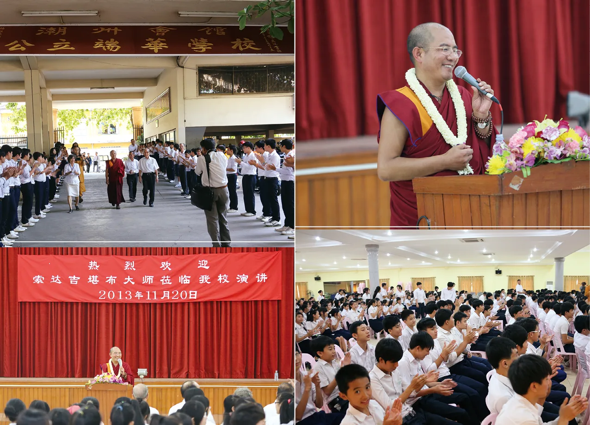
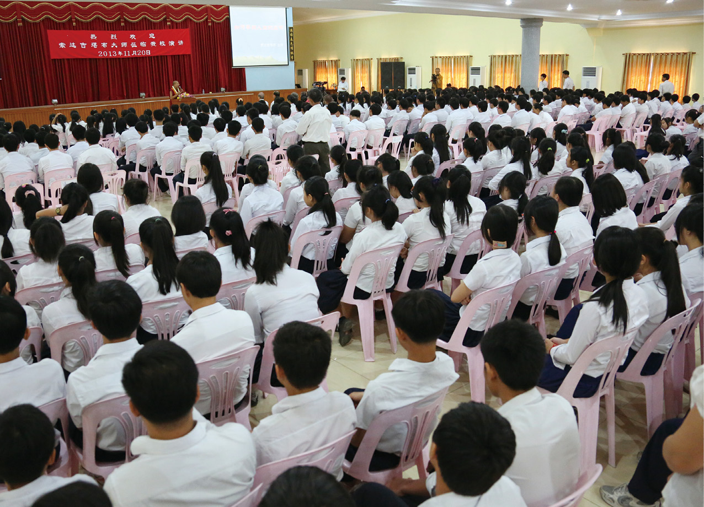
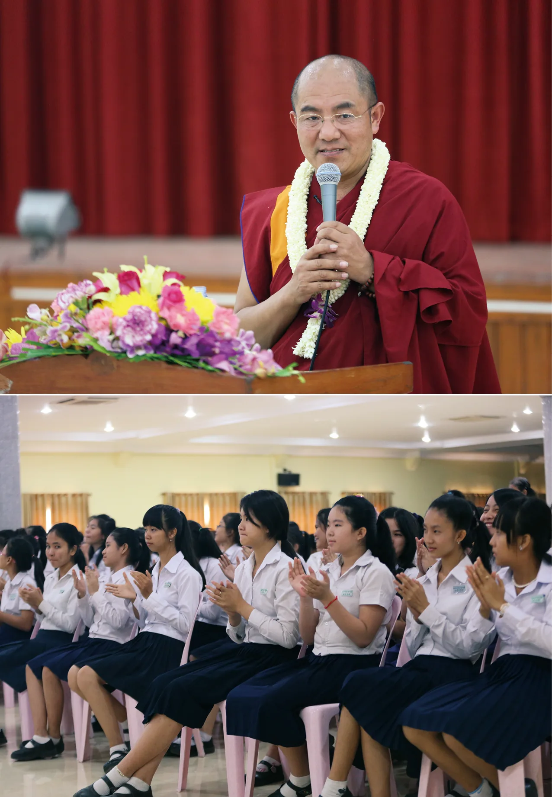

你拥有的只是知识，

而不是智慧，

所以你依然会经常烦恼。

第70场

柬埔寨金边端华学校

Tuan Hua Chinese School

柬埔寨·金边

2013 / 11 / 20

## 如何寻找人生的坐标

## Five Keys to Finding Your Coordinates in Life

这是我第一次来到柬埔寨，感觉这里佛缘殊胜。今天也很高兴可以与金边大学、端华中学，以及其他高校的师生们一起探讨“如何寻找人生的坐标”。

我相信每个人都有自己的人生坐标和方向。作为一名穿着藏传佛教僧衣的人来讲，我也很关心这个问题。人是不可能无缘无故来到这个世界的。人活在这个世界上，也不可能没有任何方向和价值观，而当我们离开这个世界时，是否会对这一生的坐标和方向满意呢？今天，我会用“德、智、悲、力、信”这五个字，和大家一起探讨这个问题。我觉得缺少了这五个字的人生，不一定非常有意义。

## 道德

任何人都不能缺少道德。如果一个人缺少了道德，即使他很漂亮、很富裕、地位很高，但却没有灵魂。在21世纪，人们一味追求物质上的财富，却不追求心中的道德，因此，这也是一个道德下滑的时代。我们应该用智慧来观察当今社会的状况。

如果我们心中没有良好的道德，即使外表再美好，也没有太大的意义。《玉耶经》中提到，给孤独长者的儿媳妇玉耶，长得非常漂亮，像天女一样。她也觉得自己很漂亮，于是特别傲慢，认为世界上没有人比得上她。有一次，给孤独长者迎请佛陀到家里来应供，玉耶觉得佛陀配不上她们家，于是躲在一旁，没有出来迎接佛陀。当僧众应供时，她偷偷地看了一下，结果发现佛陀相好庄严，极其美妙，远远超过了自己的容貌。于是她便走出来，在佛陀的足下顶礼。佛陀告诉她，人的美，不仅在于外表，更重要的是心中的善良、正直、慈悲。如果能做到这几点，那才是真的美。玉耶听到佛陀的教言后，原本傲慢的心态全部不见了，当下生起了清净心。

现在的年轻人都很重视长相的美丑，甚至愿意花很多钱去整容。但其实，一个人不管再怎么美，几年以后，脸上都会因为岁月而留下皱纹，而且会越来越多，头发很快就会花白，牙齿也会一颗颗掉下来。谁也没有办法阻止岁月的流逝，但心中的德行却永远也不会消失。

哲学家康德（Immanuel Kant, 1724-1804）说过，世界上有两样东西让人敬仰，一个是我们头上灿烂的星空，还有一个就是人类的高尚美德。苏格拉底（Socrates, 公元前470-前399）也说，人类最大的幸福就是每天都可以谈论道德的事，人如果没有道德，就相当于失去了灵魂，无法有利于社会。

在当前社会的每一个角落里，人们都在盲目、高速地积累着财富。在这种环境下，我们心中的道德就显得更加重要。无论是佛教、儒教，还是其他宗教思想所提倡的道德，都有不可估量的力量，这种力量一定要熏习到我们的心里。佛陀在《楞伽经》中讲到“不思议熏、不思议变”，也就是说，所谓的业力，会不可思议地熏习到我们的心上。当一个人的心中种下了善业，那无论他到哪里去，都会有一种善的力量影响他。

## 智慧

大家每天都花费大量的时间在希求智慧上，比如学习语文、数学、物理、化学等各门学科，如果没有这种智慧，恐怕我们很难在这个世界上生活。大家能在这样一所很好的学校里学习，是一件值得自豪的事，但同时，你们不能因此而满足，还要更加努力地去追求智慧。其实在世间中，智慧无法被人夺走，是我们一生当中最有价值、最有力量的品质。

大家都知道，在第二次世界大战中，希特勒（Adolf Hitler, 1889-1945）想要灭绝犹太民族，但犹太人不但没有被灭绝，现在反而遍布全世界。在犹太人的价值观当中，钱财、地位并不是最重要的，最重要的是智慧。犹太父母会经常教育孩子，钱财并不是最可靠的财富，他们应该更多地依靠自己的智慧，因为智慧才是世界上最有意义、最有价值的东西。因此，犹太人的孩子从小就知道要好好学习。也正因为这样，犹太人中出现过一些很伟大的知识分子，比如爱因斯坦、弗洛伊德等等。

藏地也有类似的教育。在孩子学习知识的时候，父母会教育他要努力学习，因为学习知识是一生当中最有意义的事情。藏地也有很多关于学习的比喻，比如把教育比喻成给孩子送黄金，而老师就是无条件地送黄金的人。

是不是因为老师要求严格，你们就觉得老师很讨厌？不要这样想。俗话说“严师出高徒”，严格的老师会教出很多高才生。如果老师对工作不认真，上课讲故事应付，不重视学生的话，虽然课堂上很轻松，但这不一定是一件好事。

我以前读书的时候，也很喜欢轻松的课堂，讨厌特别严格的老师。但后来回想起来才意识到，原来严格的老师会在我们今后的人生当中留下许多珍贵的东西。所以，老师是非常伟大的。

这里有几位教授，从战争时期就开始做老师，培养学生，已经坚持了三四十年，很不容易。有些出家人说，与佛教事业最接近的职业就是老师和医生。这一点我很赞同。释迦牟尼佛的传记中说，佛陀在因地时很想找到一个生活有意义的在家人，结果发现，只有老师和医生的生活才比较有意义。可能有些学生以后也会当老师、医生，有些会从事其他的职业，无论怎样，除了我们所学习的知识以外，我们还需要有一种让自己和他人都快乐的智慧，而千万不能有损害自己或别人的智慧。

从柬埔寨的历史上可以看到，很多的“智慧”实际上都是非常不明智、反人类的，如今反省起来，就会发现那些“智慧”非常可怕。就拿“万人坑”和“罪恶馆”的历史来讲，在那段特殊时期里，很多人死于非命。我到“万人坑”的时候，看到很多人被埋在一起的痕迹，觉得特别恐怖。也许是历史的原因，当时的人们有一种很不好的“智慧”，杀害了很多人。

我们很幸运地没有出生在充满饥饿、战争的年代。今天可以无忧无虑地在校园里共同学习，应该说是很快乐的。大家不要因为现在有学习的压力，将来会有家庭的压力，于是就整天愁眉苦脸。其实，我们现在是很幸运的。

智慧，是要帮助我们获得快乐的。人生的确有很多痛苦，一些表面上看起来很有智慧的人，心里可能会很痛苦。有人曾请教一位大德：“我了知世间所有的学问，但心里的烦恼却越来越多，这是为什么呢？”大德回答：“你拥有的只是知识，而不是智慧，所以你依然会经常烦恼。但如果你获得了真正的智慧，那一切事情都会豁然开朗的。”

希望大家不仅追求学问，还要追求真正的智慧。这种智慧一定是内在的智慧，而不是把自己打扮成知识分子的模样。现在很多人只注重外在形象的包装，而内在什么都没有，这样的形象不是很重要。

有了智慧，很多事情就不会再让你烦恼。很多人心胸特别狭隘、斤斤计较，会因为一点小小的事情而烦恼，这就是没有智慧的缘故。如果有智慧的话，不管是在任何环境中，你都会很快乐，无论学任何专业，只要你投入时间和精力去专注，最后获得的结果也会是非常满意的。所以我希望大家在希求智慧的时候，不要只追求学问，也一定要追求正确、清净的智慧。

## 悲心

一个人能不能只有道德和智慧，而没有悲心呢？恐怕不行。我们不仅仅是独自活在这个世界上，我们的身边还有很多与我们有关联的生命。到了柬埔寨之后，我去探望了五所孤儿院，见到了很多孤儿，内心当中有了一些新的感受。我希望各位同学，不要只待在漂亮、舒适的环境中，否则你不会知道，其实还有很多众生正在承受苦难。你需要多走一点路，多看一点书，多说一些话，有必要去了解一下社会各阶层人们的生活。

我在孤儿院见到了一个孤儿，问了一下他的情况，他说他很自卑，父亲和母亲外出打鱼时不幸去世，他现在跟奶奶一起生活，基本上没有生活保障。虽然现在还能在学校里吃到一顿饭，但不知道以后的人生要怎么办。后来孤儿院的人合唱了一首歌，不仅打动了我，也打动了在场的很多人，包括我们的导游。我们的导游见多识广，但当时他也被感动得一直流泪。

同学们，你们不要只关注阳光，有时候也应该关注一下黑暗，看一看黑暗的背后，阳光是如何出现的，而在阳光的背后，又还有多少黑暗等待被驱散。其实我们身边有很多苦难的众生。比如在一些农村，人们日常生活中的卫生条件非常差。柬埔寨的周围还有一些水上难民，他们逃离家乡的战乱，来到了柬埔寨，但因为没有合法的身份，所以没办法在地面上定居。同时，他们也没有越南的身份，所以也没办法回去。因为战争，他们现在一无所有，只能生活在水上。目前世界上大约有4520万难民。这些人没有身份，没有自由，更没有家庭，生活没有任何保障。有时候，我们有必要去了解一下难民的生活状况，比如阿富汗、非洲等地的难民。

我们在日常生活中很挑剔，有时候觉得菜不好吃，有时候又觉得衣服不好看，但其实我们身边还有很多人，连基本的生活保障也没有，甚至在战争中被夺去生命。多了解一下他们的生活，我们就会生起悲心。

## 力量

我们还需要一种心灵的力量，一种能够让自己坚强，同时也能帮助别人的力量。如果没有这种力量，那生存在这个世界上可能会有一定的困难。比如，老师没有这种心灵的力量，面对繁重的工作，可能会想要辞职；出家人没有这种心灵的力量，修行有可能会半途而废；而学生没有这种心灵的力量，可能无法顺利完成中学、大学，一直到硕士生、博士生的学业。

世界上的一些故事，可以激发我们这种心灵的力量。比如，2008年“5.12”地震中廖智老师的故事。她原本是一位舞蹈老师，但在地震中失去了孩子和婆婆，而且在被救出后，不得不自己签字，同意截去自己的双腿，保住性命。但后来，她依靠自己内心的力量又走上了舞台，用装着假肢的腿表演。

依靠这种内心的力量，可以让一个人完成这么困难的事情。我们可以想一想，如果是自己遇到苦难，又会怎样面对呢？所以，不论是谁，做任何事情时，心中都要有这样一种力量，没有它，人生会困难重重。

## 信仰

在柬埔寨，几乎人人都有信仰，这是非常难得的事。虽然从历史上看，这里也曾发生过战乱，不论是给家庭，还是国家，都带来过极大的痛苦。但如今，柬埔寨90%以上的人都信仰佛教，佛教已经成了人们生活的支撑。能够从小生长在这样的环境当中，是非常快乐的事。

藏族人有很多习惯都跟柬埔寨人相似。比如说，藏族人见到出家人时会摘下帽子，恭敬合掌。柬埔寨人也这样做，西哈努克（Norodom Sihanouk, 1922-2012）和西哈莫尼（Norodom Sihamoni, 1953-）两位国王甚至曾在寺院中出家。因为国王信仰佛教，所以，所有的民众，包括知识分子，至少也会对佛教有所了解，而不会像其他地方一样，认为佛教只是一种迷信。我在电视上看到，柬埔寨的国王也拜僧王、拜出家人，所有的大臣，包括国家最高层的领导人，也会到寺院里面供养僧众、参加佛事活动。我感觉柬埔寨的人民有信仰的支撑，应该是非常快乐的。

有位老师跟我讲，人非常需要信仰，因为在各种各样的痛苦面前，其他知识都无能为力，只有信仰才能很好地帮助人们面对。我觉得这句话非常有意义。如果同学们信仰佛教的话，那不要仅仅停留在表面，要进一步地去学习佛教三藏十二部中所宣讲的教义，学校也应该把佛教教义当作一种知识去传授。

从1947年开始，佛教就成为了柬埔寨的国教。我记得洪森首相说过，只依靠电台、电视宣传佛教是不够的，佛教的宣传要与时俱进，比如通过网络等手段来传播佛教教育。我也觉得这非常有必要。大家不论是从事医生、老师，还是其他工作，都非常好，但我们不能失去佛教的信仰。也许年轻时感受不到佛教为我们带来的快乐，但随着年龄的增长，就会逐渐明白它的价值。

可能有些人会有疑问，既然佛教在柬埔寨如此兴盛，那为什么这里还是会经历战争，经济落后呢？其实，战争和经济的落后跟佛教信仰没有关系。如果把佛教当作发财工具的话，那你可能就会觉得，信仰佛教的地方，经济肯定很发达。也正因为我们只关注金钱，所以才会提出这样的问题。但佛教阐述的是真理，不论社会生产力水平如何，真理都可以存在，包括战争频发、经济落后的地方也会有佛教。

一些柬埔寨的大学生告诉我，这里很少有学生自杀。但是在一些富裕的国家里，物质水平虽然很不错，但是却有很多大学生自杀。柬埔寨人还告诉我，这里的离婚率也非常低。而2013年的统计结果显示，北京的离婚率甚至高于结婚率，高达39%，美国的离婚率几乎达到50%，英国也有42%。那是不是经济越发达，离婚率就会越高？人们是因为生活快乐而离婚，还是痛苦而离婚呢？他们应该是很不快乐，所以才离婚的吧。很多同学都没有经历过离婚，所以可能感受不到离婚的痛苦，我作为出家人也感受不到，但当我们去了解的时候，这个现实的确让人很难过。

在战争年代，柬埔寨的佛教经历过灭顶之灾，整个国家几乎都没有寺院，除了几个僧人以外，也没有僧团。但如今，柬埔寨有这么多的佛教寺院，而且不论国王，还是国家领导人、民众，看见三宝时都很欢喜，甚至宾馆里面的服务员，对出家人的态度也与其他地方完全不同。在有信仰的国家里，人们对他人的恭敬心和态度都是发自内心的，他们的笑容并不是刻意的，而是真诚的。所以，年轻人应该要有信仰。我尊重没有信仰的人，但是我并不赞叹这样的智慧。因为没有信仰的人在痛苦面前很脆弱，而有信仰的人则会很坚强，并且会用恰当的方式去面对痛苦。

在柬埔寨，学生们可以自由地学习任何宗教的知识，但同时，学习佛教知识也很重要。当然这种学习，不要只停留在信仰表面。佛教并不是只依赖信仰而安立的，它是一种有智慧的信仰，而没有智慧的信仰是迷信。所以，我们一定要通过学习佛教的知识来赞叹佛教。

以前在柬埔寨，藏传佛教并不是很兴盛，这次我特意从藏地带了一尊莲花生大士像，安放在柬埔寨，希望依靠这种缘起，南传佛教、藏传佛教，还有汉传佛教都可以在这里兴盛，而且并不是仅仅停留在形象上，而是真正地闻思修行三藏十二部。这样的话，不仅在僧团中会有智慧现前，甚至在家人的群体，比如知识分子的群体当中，也会有一种智慧现前。

我用德、智、悲、力、信五个字和大家做了一个简单的交流，希望大家可以记住其中的一些道理，并依靠它们找到“人生的坐标”。

现场互动

问：当我们处在人生的十字路口时，应该怎样抉择人生？

堪布：我们都会站在人生的十字路口，面临一些选择，到时候可能一边是光明，一边则是黑暗。如果自己有智慧，可以自己选择该走的道路，但如果自己找不到方向，就一定要问过来人的意见，比如老师、父母、长辈的意见。我跟这里的老师们交流过，实际上，他们经历过人生的风风雨雨，知道你要走的路是什么样的。所以，当你处在人生的十字路口时，可以请他们为你指点迷津。

还有一种方法，那就是多看一些圣贤书。圣贤给我们指的路是很好的。你们千万不要整天看电视，看色情、暴力的节目，或者看一些漫画、动画。你们最喜欢看的这些东西，并不会为你们指明人生的道路。而当你们六七十岁时，可能才会意识到，原来这些内容对人生没有利益。你们最喜欢的，不一定是好的，而你们不喜欢的，也许对人生很有帮助。比如，学习知识很难，但这却是一件很好的事情。又比如，你们现在对佛教还没有信心，但实际上，信仰佛教也是一件很好的事情。所以，有时看似宽敞的路，走上去不一定舒服，而看似狭窄的路，其实只要穿过去，就会通向光明大道。

问：您认为生活的意义是什么？

堪布：对每个人来讲，生活的意义都不相同。如果你是医生，生活的意义就是治病；如果你是老师，生活的意义就是教书育人；如果你是农民，生活的意义就是种好庄稼。当我看到难民时，我觉得生活的意义就是健康自由地活着。

如果你想要生活有更高层次的意义，那就需要一个高尚的信仰。有了信仰以后，世间当中的很多烦恼、痛苦、焦虑都会迎刃而解。相反，如果没有高尚的信仰，即使你有很多钱，但当它被耗尽时，心里也会很痛苦的。

所以，我觉得生活的意义可以从不同的角度来判断，每个角度的判断都不相同。

问：我该如何对待自己的兄弟姐妹和朋友？

堪布：不要和他们吵架，要经常善待他们，也就是用一颗善良的心对待他人。

问：当朋友不和时，我们该如何去调解呢？

堪布：人与人之间的习气、烦恼，包括善根和因缘都不相同，所以在很多环境中都会有不和的情况，而最好的调解方法就是谅解。因为我们有了谅解，才可以理解别人，我们能理解别人，就会原谅别人。当我们看见身边人的不和时，要尽量地去帮助他们和睦相处；如果我们自己与别人不和时，就要用比较宽容的心去理解别人的行为。

其实人的不和，主要是因为心态没有调整好。如果我们心态调整得很好，很多问题就很容易解决。甚至包括很多国与国之间、民族与民族之间的冲突，都是因为贪心、嗔心而引起的，而这些都可以通过调整心态来解决。

问：我们要如何对待自己的亲人，比如父亲母亲？

堪布：我们可以遵循传统文化来对待亲人。在中国的传统文化中，最重要的就是孝文化，不知道柬埔寨这边是不是也提倡孝文化。如果我们用一种利他、孝顺、尊重的心态去对待亲人，这样事情就会变得非常容易。

问：是什么样的力量让您放下自己的利益，进而在世界各地演讲、弘扬佛法的呢？

堪布：实际上我也没有完全放下自己。

我喜欢跟大家一起交流，在交流的过程中，能学到很多知识。我去了很多地方，接触过很多人，因为每个人的智慧都不同，所以我从每个人的身上都学到了对我的人生、修行有利的知识。在跟学生交流的过程中，他们提出的一些问题也会启发我的思考。

我遇到过一些老师，他们的慈悲心，还有他们多年来与学生们的交往，也会让我有一些反思。有一次，我想我讲课二十多年了，应该休息了，但我遇到了一些老师，他们三四十年间都在不断地讲课，这让我自己的心里也有了一种勇气。

有时候，多接触一些人是很重要的，但接触的过程当中，我们不能学坏，否则对自己的生活没有任何意义。我在遇到“坏人”时，会加倍谨慎，遇到好人时，则会更加努力。我们生活在一个全球性、开放性的世界中，同学们的心态也要开放，但也不能没有底线。所以，我们要在掌握分寸的基础上，懂得跟人交流。

在跟老师和同学交流的过程中，我每天都会学到很多知识，遇到老师和同学提出的问题，我也会记录下来。这个过程中，我也可以为自己定位，并找到自己的“人生坐标”。

问：佛教对社会的发展起到什么作用？

堪布：有些人认为，佛教对社会发展不一定有很大的帮助。但事实并非如此。我认为，社会的发展不仅仅是GDP的增长，也不仅仅是外在物质的发展。有些国家的高楼大厦越修越高，但实际上，人们内心的快乐却越来越少，幸福指数越来越低，那这样的社会是在发展还是在退后呢？

佛教讲物质的发展需要与内心的发展平衡，如果我们内心没有发展，那物质发展反而会为人们带来很大的痛苦。比如，历史上的一些国家和君主，虽然当时物质生活水平很高，但他们依赖自己的权力，对人们有一定的剥削和压迫。

佛教中包含了很多发展内心的方法，而在科学中，几乎没有对内心的研究。这是因为科学是最近两三百年间才发展起来的，还来不及对内心进行探讨。而当你需要寻求内心发展的时候，只有在拥有两千五百多年历史的佛教中才能找到。所以大家千万不要认为，社会进步就是钱越来越多、车越来越好、房子越来越大，这并不是对文明的定义。如果内心的发展没有跟上，即使你开再好的车，内心当中也会很痛苦，即使银行里面的存款再多，也不一定能为大家带来利益。世界上有些人拥有很多的财富，但如果不能为人们带来利益，那这就仅仅是个人的发展，不会成为社会的发展。而腐败等等不好的社会现象的发生，正是因为我们内心没有发展、没有调节好，物质发展跟内心发展失衡所导致的。这是一个全球性的问题。

佛教在这个问题上提供了很好的调节方法。我在演讲中提到过，柬埔寨的同学们可能没有过自杀的念头，这就是佛教调节的结果。如果没有信仰的话，人在面对困难时，很可能会选择自杀，到时即使钱再多，也没有用处，生命才是最珍贵的。所以在某种意义上，我觉得佛教的发展，实际上就是社会的发展，如果没有佛教智慧的话，即使物质生活发展得再好，也不值得羡慕。

问：您认为什么样的人才算是成功人士呢？

堪布：很多人认为，所谓的成功人士一定是领导或者有钱的企业家。但我认为，成功人士应该是能帮助别人，同时自己很快乐，也能为家庭带来快乐的人。这样的人，家里不会成天吵架，自己也不会整天愁眉苦脸，他对生活中的任何事情，都有勇气去面对。哪怕身边有成百上千个人需要帮助，他都会用一种利他、真诚的心去帮助他们。他甚至可以将这种利他心发扬得更广大，去爱护动物、爱护世界上所有的可怜众生。这才是成功人士的标准。

所以，我并不认为，成功人士就要有钱、长得很漂亮、地位很高，这些其实都是暂时的。实际上，这些人在痛苦面前可能非常脆弱。而真正的成功人士应该是有智慧，并且能够帮助他人的人。

问：为什么我们需要有宗教信仰？

堪布：信仰有各种各样的，比如佛教信仰、基督教信仰、伊斯兰教信仰。现在甚至有人说，金钱信仰，有些人只信钱，不信其他的。我觉得宗教信仰有一种力量，它可以在社会生活当中体现它的价值。因此我认为，人们从小就要有一种信仰。这种信仰并不是通过传教得来的，最好是从小在父母、老师，或者在社会群体当中受到一些耳濡目染，这些影响对我们非常有价值。

当然，有些人可能没有信仰，我对此也非常尊重，即使是释迦牟尼佛在世时，印度也有很多人没有信仰。在柬埔寨，人们也可以学习其他宗教的知识，这里是很开放的。我也非常赞叹与其他宗教对话、互相学习。

但是我还是希望大家能了解一下佛教的教义。有一次，我在一所学校里面，有一个学生跟我说他很了不起，因为他没有信仰。我对他说，你可能要再仔细观察一下这种选择。后来，他经过一段时间的思考以后，皈依了佛教。因此，我特别希望同学们能够了解信仰的力量，准确地懂得其中的意义。

问：人从何处来，死后又归何处呢？

堪布：你们学习佛法后，一定会明白这个问题。就像《楞严经》当中讲，人不是无缘无故从天上降下来的，也不是无缘无故从地上长出来的，人是依靠业的牵引而来到这个世界的。因此，从佛教教义来讲，人是依靠我执、烦恼、业而来到这个世界，最后也会依靠业而离开。届时，如果行持的是善法，你会获得快乐，如果行持的是恶法，你会承受痛苦。《因果经》中说：“欲知前世因，今生受者是。欲知后世果，今生作者是。”所以，你要想知道人生的前因后果，就要懂得佛教中所讲的道理。

问：是什么让您成功？您又是如何保持成功的呢？

堪布：我觉得，成为一个出家人，这一点让我很“成功”。同时，我还穿着出家人的衣服来保护自己，所以还可以继续保持“成功”。
