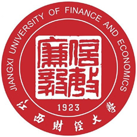
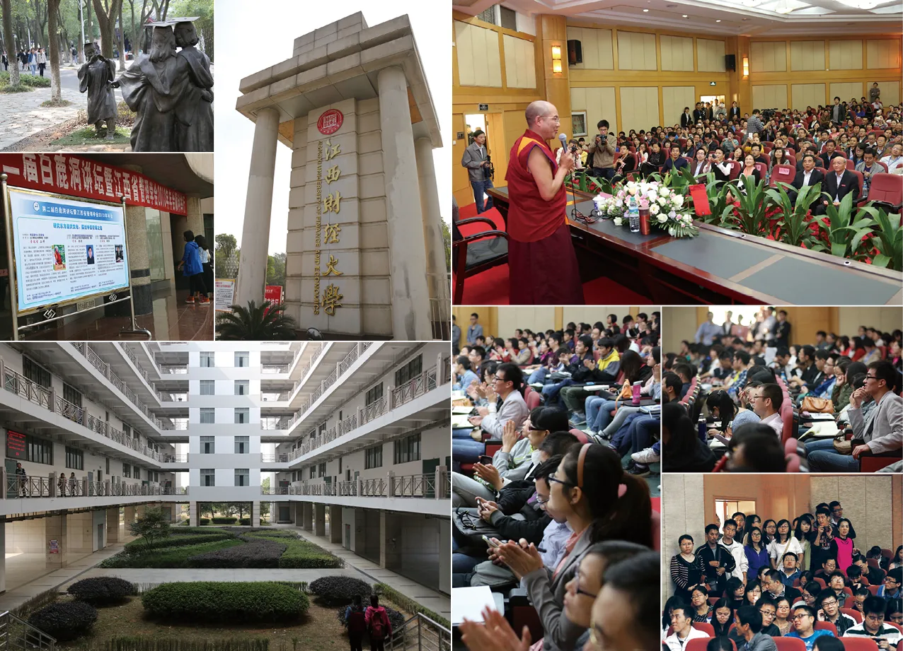
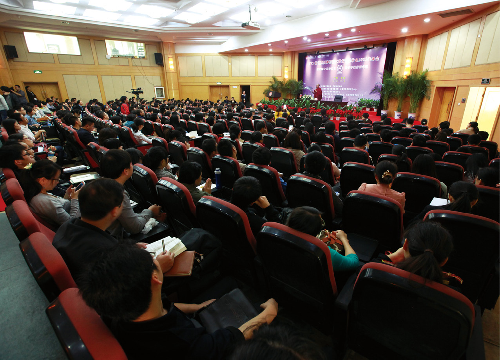
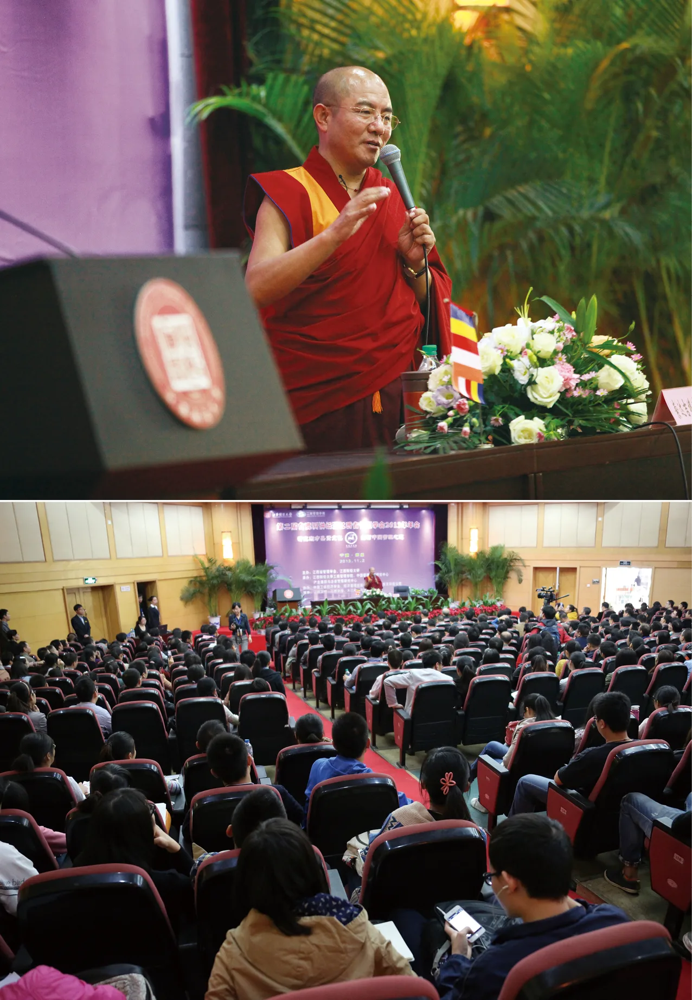
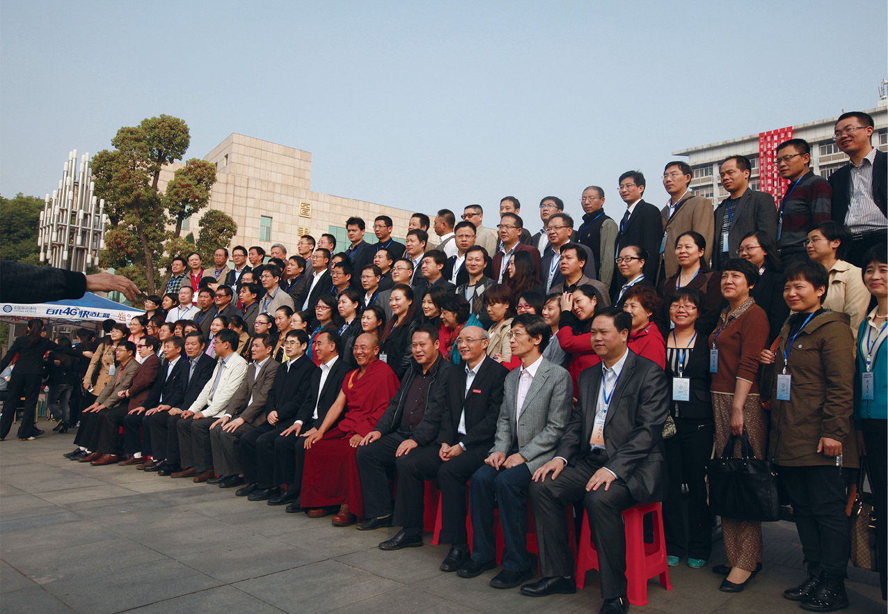

“少年戒色，

壮年戒斗，

老年戒得。”

第65场

江西财经大学

Jiangxi University of Finance and Economics

中国·南昌

2013 / 11 / 2

## 戒定慧与人生幸福

## Transforming Your Life with the Three Practices

主持人：

非常荣幸能受命主持第二届白鹿洞讲坛暨江西省管理学会2013年年会的第一场主题演讲。举办这个讲坛的目的，是为了弘扬白鹿洞书院不懈追求真理、鼓励学术争鸣的人文精神，弘扬中华传统文化，进而在管理学界发出中国人自己的声音。

接下来，我非常荣幸地给大家介绍今天的主讲嘉宾，上海慈慧公益基金会名誉理事长、国际著名的慈善理论家和翻译家索达吉堪布。

堪布生于1962年，年长之后依止法王如意宝晋美彭措，目前驻锡于世界最大的佛教大学喇荣五明佛学院。堪布多年来日不缺讲、夜不乏译，不仅将数以百计的藏文经典论著译成汉文，而且将汉文典籍《弟子规》等译成藏文发行、传讲，使更多的人不因语言障碍而错失珍贵的人类文化精髓。

自90年代起，堪布应邀前往北京大学、清华大学、香港大学、香港中文大学、哈佛大学、哥伦比亚大学、华盛顿大学等世界著名学府，进行演讲、交流，与诸多海内外科学家等，就宏观微观的生命科学以及环保、和平、道德等方面的理念，进行深入探讨，希望提升一切生命的福祉。

古往今来，人类不停地在追求幸福。但什么是真正的幸福？什么样的幸福最有可持续性——能做到今年幸福、明年幸福、后年依然幸福？什么样的幸福能够保证自己幸福的同时，家人也会因为您的幸福而幸福，亲朋好友、单位同事、社会大众都会因为您的幸福而感到幸福？

总之，什么样的幸福是能够一时幸福而且长久幸福，自己幸福的同时也带给别人幸福？又如何实现这样的可持续幸福？

让我们一起聆听世界著名佛学家索达吉堪布即将发表的演讲——戒定慧与人生幸福！

尊敬的校长、学院的院长，以及来自全国各地的院长、专家、老师和同学们，大家好。很荣幸今天能够跟大家一起参加江西财经大学白鹿洞讲坛以及管理学会2013年的年会，共同学习和探讨传统文化。

举办此次活动的目的，主要是为了继承和弘扬东方古圣先贤文化中一些有价值的真理。我本人对此十分感兴趣。因为中华传统文化中，确实蕴含着很多宝贵的人生道理。

如今韩国、日本、新加坡等很多国家和民族的人们，都在学习中国的传统文化，并且已经运用在了生活中。中国古人的智慧在国外已经成了奢侈品——珍贵的“进口思想”。但是反观国内，很多人却把这份智慧财富遗忘和舍弃了，仍然感受着思想的贫穷，这非常可惜。

大家都知道，21世纪在物质文明上已经到达一个巅峰，高楼大厦、豪华轿车以及丰裕的财富，胜过了以往的任何时代。可是人们精神上的匮乏也是前所未有的。以往任何一个时代的人，都不会有现代人这样的空虚、虚荣和愚昧。所以，人们在拥有越来越丰富的物质的同时，却在失去最珍贵的心灵宝藏——真理。

因此我非常希望通过学术研讨等平台，唤起更多年轻人尤其是知识分子对于这种现象的深思。

今天我要跟大家分享的是“戒定慧与人生幸福”的话题。

## 一、戒定慧，是佛法的全部

对于“戒定慧”，有些人可能感觉比较陌生。但实际上，这三者可以与现代管理、现代文化完美融合。

两千五百多年前，释迦牟尼佛在印度转了三次法轮，宣讲了八万四千法门。八万四千法门归集起来就是三藏十二部，三藏十二部再归纳就是戒定慧三学。可以说，戒律、禅定、智慧就是佛法的全部。

今天短暂的时间中，要把戒定慧的所有道理介绍给大家是不可能的，但是我可以就其中的部分内容跟大家做一些探讨。

## 二、戒律是安乐的保障

现在很多人说“不能进入佛教，不能皈依佛教，因为佛教有很多条条框框的死板戒条”。他们觉得佛教的戒律是一种约束，让人失去了自由。其实这种观念并不正确，为什么呢？下面就让我们先来了解一下戒律。

所谓的戒律，用现在的语言来讲，就是法律、法规。每个国家都有法律，每个企业也都有各自的规章，这些都可以说是一种戒律。

### １．佛教的三乘戒律

戒律，就比较高的层次而言，有佛教中的密乘戒、菩萨戒和别解脱戒。

#### 第一，密乘戒

密乘戒，是一个人在短暂的一生中获得超胜境界的一种殊胜方便。

一般而言，密乘戒有十四条根本戒。如果按照《大幻化网》所说，则有五根本戒和十支分戒。五根本戒分别是：不舍无上、恭敬上师、慈愍金刚道友、不舍弃手印和咒语，以及不泄露秘密。可能这些和在座的比较遥远，我就不再深入地介绍。

#### 第二，菩萨戒

这也是层次比较高的一种戒律。菩萨戒包含严禁恶行戒、摄集善法戒和饶益众生戒。菩萨戒中最根本的一条就是不舍愿菩提心，或者说不舍弃任何有情。

按照宗喀巴大师和全知无垢光尊者的分析方法，菩萨戒可以有随龙猛菩萨和随无著菩萨的两种安立方式。对于菩萨戒，我也暂时不讲。

#### 第三，别解脱戒

这是一般人能够受持的一种戒律，因为其中的戒条是有自利心、求自我解脱的人可以做得到的。

别解脱戒可以分为出家戒和在家戒。出家戒中有比丘戒、比丘尼戒、沙弥戒、沙弥尼戒等。今天在座的除我之外都不是出家人，所以出家戒也暂时不讲。下面主要讲在家戒。

### ２．在家五戒

在家戒主要是五戒。

有的人可能觉得：“佛教的戒律应该只是佛教徒要遵守的规范，跟其他人无关。”但其实在21世纪的今天，我愈加发现佛陀两千五百多年前制定的戒律，散发着无比的魅力和活力。为什么这么讲呢？因为实际上，每个人都需要有人生的规范。

在家五戒是不杀生、不偷盗、不邪淫、不妄语、不饮酒。这五戒是佛教戒律中要求最低的，但对于现代人可能属于一种高要求了。而实际上，作为一个高尚的人应该做到这几条戒。

#### 第一，不杀人

任何一个国家的法律都明文规定：如果杀害他人，就要受到一定的惩罚，乃至被判处死刑。所以五戒中的第一条——不能杀人，实际上是每个公民都应该遵守的。

佛教戒律中进一步规定：不仅不能杀大人，也不能杀胎儿，即不能堕胎。这其实是一种爱的体现。而且最好也不要杀害其他类的生命，比如牛羊等动物。这一点和国际上爱护动物的理念也非常相合。

所以对于这条“不杀生”戒，人人都会认同，至少会认可不应当杀人。

如今汉地的很多城市中，经常出现歹徒动辄用刀杀人的现象，而这种劣行，佛陀在戒律中早就予以遮止了。

#### 第二，不偷盗

偷盗是指把别人的东西占为己有。

严格来讲，贪污受贿、偷税漏税都属于偷盗，所以这条戒律与反腐倡廉的理念是完全一致的。

如果能做到不偷盗，内心会很清净，而且一生都会很快乐。因此这条戒对于现代人非常重要。

#### 第三，不邪淫

不邪淫，是指不与自己配偶之外的人发生不正当的关系。另外，即便对境是自己的妻子，如果是非时非处等情形也属于邪淫。

现在的离婚率越来越高，什么原因呢？就是邪淫所致。

如今很多家庭妇女对丈夫不放心，尤其如果他是领导，更是时刻要“保护”着他。这是为什么？因为她的丈夫没有守持此处的戒律。如果他受了不邪淫戒，自己就会约束自己，家人自然能放心，家庭也很容易和谐。

家庭和谐与否关乎着世界能否和平，如果每个家庭都能很和睦，社会自然能和谐，最终也可以实现世界的和平。

所以第三条戒也是世界和平的根本因素之一。

#### 第四，不妄语

不妄语，就是不用语言等方式欺骗他人。

如今的人吃饭都会担忧：这里面会不会有很多激素啊？穿衣、吃药等也是顾虑重重。造成这种现象的原因之一就是现代人说妄语太严重了。

比如很多广告把不能养生的说成是上等补品，这就是在说妄语。而且这种妄语经由媒体的宣传，其影响力会瞬间扩大，导致无数人上当，这就成了“扩大的妄语”。在古代，一个人即便说妄语，通常也只是面对一个人或少数人，影响范围不大。所以，不妄语在现代社会中也非常重要。

#### 第五，不饮酒

现在的很多人有饮酒的习气，觉得“无酒不成席”。这很不好，因为人一旦喝了酒，整个身态、心态都会变得面目全非。而且喝酒对身体健康有极大的损害，很多肝癌是饮酒导致的。所以，如果能做到不饮酒，对于身心都会有益。

### ３．人有约束，才会幸福

大家不要认为守了戒就不自由了，其实人有约束很重要。

孔子说：“君子有三戒——少年戒色、壮年戒斗、老年戒得。”意思是，一个人想要成功，就要警觉三条：少年人容易贪恋美色，对此要警觉；壮年人容易争强好斗，对此要警觉；老年人最后在愚痴心中会贪得无厌，对此要警觉。

现在有的人触犯法律或者痛苦失败，大多是没有以戒律约束自己所致。家庭不快乐、社会不安定也是很多人缺乏行为规范、丧失道德底线的结果。一个人如果无视道德伦理、内心无惭无愧，就已经入于禽兽之列。孟子也说：“无羞恶之心，非人也。”人没有羞愧心就不能做人了，已经跟畜生没有差别。

今天在座的有管理学院的领导，我特别希望你们重视人心的教育。如果不重视教育人心，很多孩子内心非常脆弱，那么即便为他设计了很美好的蓝图，也终究难以实现，因为他没有足够的心力去完成。而教育人心的道理在传统文化中珍藏着，所以如果把传统文化锁着、藏着，害怕拿出来，就无法从中汲取到营养。而且处于这种思想保守的状态，也始终无法跟国际接轨，单单物质的开放是没有用的。所以，将传统文化传递给下一代非常有必要。

具足戒律的约束，人生才会过得很幸福。古人也说：腹满诗书，自会才华流露；不具规矩，必会无恶不作。所以，戒律非常重要。

## 三、禅定可以安养身心

佛陀说仅仅受持戒律还不足够，还需要修习禅定。为什么呢？因为禅修对于身心都有益处。

### １．禅修可以安心

当今大城市里的很多人，内心总是充斥着浮躁、焦虑、伤感、不安的情绪，所以很有必要修持禅定，以此能够让心静下来，也会过得快乐些。

在藏地，人们虽然没有丰富的物质，但是却有纯净的信仰，所以内心也很祥和快乐。他们的这种快乐并不是假装的，而是发自内心的一种满足；他们的笑容也不是虚伪的，而是自然流露的一种幸福。所以通过佛法来安养内心，确实人生会很快乐。

禅修是以寂静的方式来调心，如果心得以寂静，智慧也很容易得以提升。正是佛教中所讲的：以戒生定、以定生慧——首先行为合乎规范，这是具足戒；以此心很容易静下来，这是具足定；之后，智慧就很容易显发。相反，如果最初不具足戒律，那么后后的禅定和智慧也难以获得。

现在美国、德国等国家中非常成功的管理学院，都在不同程度地开展禅修活动。李嘉诚、乔布斯的传记中也记载了他们是如何禅修的，他们所取得的巨大成功也跟禅修有一定关系。

### ２．禅修可以养身

现代科学证明，禅修对身体健康也非常有益。

美国有一所大学的科学家们，对40名学生进行禅修方面的实验。最后发现：如果每天禅修5到10分钟，可以使大脑的消耗量降低15%，这相当于一个成年人深睡7个小时的作用。

很多人说：“为了身体健康，要睡7到8个小时。”其实如果你早上起来或晚上入睡前，能禅修5到10分钟，对身体健康和体力恢复都会很有帮助，身体中一种叫做疲劳素的物质也会自然降低。所以现在哈佛大学、耶鲁大学，以及清华、北大、复旦等很多大学都建立了禅修中心。

清末学者梁廷灿，写了一本书叫《历代名人生卒年表》。书中统计了从公元232年到1884年，长达1652年间的重要历史人物的生卒年份。然后他把其中的高僧大德和历代皇帝的寿命做了一个比较，结果发现：571位高僧大德的平均寿命是76.4岁，比历代皇帝高36.1岁。这样算下来，历代皇帝的平均寿命大概是40岁左右。

为什么会这样呢？因为长寿与否跟心态有很密切的关系。高僧大德们因为心态调整得好，自然容易长寿。像清定上人、广钦老和尚，还有南怀瑾、李炳南、赵朴初，都活到90岁以上，虚云老和尚活到120岁。

五台山有一位梦参老和尚，今年刚好100岁，他在接近100岁时，还每天给别人讲课。凤凰卫视采访他时，他回答提问的思路都非常清楚，没有丝毫迷惑，如果是其他老人可能很难做到。

而很多官员整天抽烟、喝酒，做很多不利身体健康之事，所以寿命不一定很长。

我并不是因为自己是佛教徒就这样赞叹。这些现象你们也可以观察得到。

虚云老和尚有一个弟子妙智法师，他活到了116岁。大概2000年时有报道说，他是中国最高寿的一个。他离开后，很多人都想了解他长寿的秘诀。后来发现，他的长寿其实跟佛教的戒定慧很有关系。

他长寿的秘诀是什么呢？就是三勤、三静、三淡、三乐。

首先是“三勤”——脑勤、脚勤、手勤。

就是说，要多动脑筋、多活动手脚。

首先要多动脑、多思维。前两天，我看到一个72岁的藏族老人，他可以背很多文章。我说：“你七十多岁还要背书，精神可嘉。”很多人觉得五六十岁就该退休了，不必活动头脑了，开始吃喝玩乐。这是不合理的，应该人越老越有智慧。

另外，也要多运动身体，否则一直不活动对身体会非常不利。

然后是“三静”——心清静、气清静、行为清静。

心清净，是说要经常坐禅保持内心寂静。现在很多人天天拿着手机打电话或看电影，内心浮躁而散乱。这不是很好。其实人需要动也需要静，所以有时候要让心静下来。

气清净是指气脉明点清静。心静下来时，气脉明点也会随之静下来，慢慢复原。

行为清净，是说身体该运动时可以活动，不该动时就安住下来，像很多禅师那样。现在美国大学中的很多人都在禅修，每次一两个小时，这样非常好。我们即便不能坐一两个小时，5到20分钟也可以。如果能够早晚都禅修一下，对身体会很有益处。

还有“三淡”——看淡钱财、看淡权力、看淡年岁。

应该看淡钱财，因为钱财终会消散。前几天有个报道说，巴西一个拥有大约300亿美元资产的最大的富翁，一夜间变成身无分文。所以钱财是无常的。而且，即便这些钱财今生中没有耗散掉，死亡时也带不走一分一厘。

也应该看淡权力，因为权力也终将失去。有的人一直想往上爬，最后可能爬到国家首脑的位子，还想当联合国秘书长，这没有意义。即使再高的地位也是无常的本性，所以应该断除贪执。

当然，佛教也并没有说要抛弃一切，该争取的还是要争取，这也是佛教很积极的一面。但是在争取的过程中不能太贪执。

更重要的是看淡年岁。很多人年纪高了就很伤心，天天数岁数，这也没有必要。

还有“三乐”——助人为乐、知足常乐、自得其乐。

这三个可以说是人生快乐的正因。当我们帮助别人时、内心知足时、自得其乐时，幸福就会出现。

其实，短暂的幸福不是真正的幸福。真正的幸福是长久的幸福——活着时幸福、死的时候也幸福。如果懂得了很多佛教中的真理，那么乃至生生世世都会幸福。

### ３．禅修的方法

修持禅定有两种方法。

一种是心安住于万缘放下、无有执著的状态中。

一种是心专注于佛像等对境上。不论你是否有信仰，都可以在面前放一尊佛像——阿弥陀佛或释迦牟尼佛的像，然后心一直专注在上面，保持一会儿。如果你其他什么都不会，就可以这样修。之所以如此，是因为依靠佛的手印、身相能达到安定身心的作用。

总之，如果能以上面两种方式禅修，对身心都会有利。

## 四、智慧能够遣除迷茫

三学中的最后一个是智慧，依靠智慧可以遣除很多人心中的迷茫。

佛教里讲，智慧包括两种：世间智慧和出世间智慧。对于世间智慧，在座的应该是很精通的，你们从小到大一直学习的各种知识技能就是世间智慧，但其实出世间智慧是我们更需要的。

出世间智慧包括闻慧、思慧、修慧。

闻慧，是通过在具功德的老师面前听闻教义后生起的智慧。一般人通常只能看到现相，难以洞察实相，这时就需要寻求老师的教授。如果没师传，即便再有世智辩聪也无法通达甚深的真理。所以，最初的听闻很重要。

听闻之后要思维，依靠思维获得的智慧是思慧。藏传佛教中有很多的辩论、提问等学习方式，这是产生智慧的殊胜方法。通过这种途径产生的智慧都属于思慧。

最后是修慧，这是经由修行产生的智慧。听闻和思维的道理不能落于口头上，而要付诸行动。现在很多人讲起来天花乱坠，但是讲完后不见任何行动，这种空谈没有丝毫意义。听闻和思维之后要身体力行，这样才能获得修慧。

有了修慧，就可以认识人生最根本的真理——心的本性。这是万物的真相，在佛教里也称之为空性、无我等。

在座的人也不要担心证悟无我就失去我了，或者担心所有人都证悟空性没人搞管理了。其实证悟无我是不容易的，历代高僧大德都是饱尝艰辛后才证悟的，而他们所证悟的这种无我境界确实也非常精彩。

## 结语

我非常希望在座的人不要把佛教当做迷信或神话。

前两天我在马克思学院也讲，我最近去德国了解了一些马克思的思想，其实我们崇奉的有些理念，在德国可能并不存在。比如，“宗教是麻醉人的鸦片”，很多人认为这是马克思对于宗教的看法。其实在德文、英文文献中原汁原味保存着的马克思著作里，并没有这种观点。这种观点最初是恩格斯和列宁为了制伏东正教战争而要诋毁宗教，从而故意宣扬的。

马克思当时说的是“宗教是人民的鸦片”，后来列宁加了“麻醉”两个字，改成“麻醉人民的鸦片”，这种词传达出“只要学宗教就完了”的意味。其实鸦片在当时的西方是很昂贵的，是解除苦难、安慰心灵的妙药。所以鸦片实际上是“除苦”的一种比喻，不是贬义词，信仰宗教也并不可怕。

我遇到过一些人，他们本分守法，可是因为有信仰，旁边的人就开始“讨伐”：“哇，他搞迷信，是不是精神有问题？”父母也排斥他，其他人也冷落他。这种现象在如今很多社会团体中都有。而有些西方国家则刚好相反，大家看到一个人有信仰，都会觉得很好，因为至少他有个精神归宿。

汉地的儒家等思想文化非常宝贵，很多国家和民族的人一直在学习，并且已经得到了受用，而国内有些人却把它当作封建迷信而抛弃，这不是很可惜吗？就像我经常跟藏族人说：“藏地有很多非常珍贵的真理，一些藏地年轻人将它抛弃了，而来藏地求学的人却学到了。”

所以，我特别希望大家能认真学习传统文化，并且在生活中运用。同时也希望大家利用种种平台来保护和弘扬传统文化，因为依靠这种珍贵而高尚的文化可以利益所有的生命！

主持人：

刚才上师用很短的时间为我们做了精彩的演讲，讲述了戒定慧三学与人生幸福的关系。

上师特别强调：我们总感觉戒律是对人的约束，但实际上对于在家人而言，五大戒律——不杀生、不偷盗、不邪淫、不妄语、不饮酒，都是提升自我的一种方法。而有了戒律，心也可以慢慢静下来，从而能获得禅定。禅定对身体健康、心灵安乐以及事业的成功都非常有益。为什么呢？因为它能出生智慧。智慧有闻慧、思慧和修慧。有了智慧，人生就能幸福，不仅现在幸福，而且未来更加幸福。

刚才的演讲非常精彩，我提议大家再次用掌声表示感谢！

现场互动

问：现代社会人心浮躁，高校学生也往往无法潜心学习。请问，作为学生，该如何训练定力？

堪布：我刚才讲的禅定就是定力。定力对于学生，乃至各行各业的人都很重要。没有定力的人遭遇一点违缘或非议就会动摇，以此错失许多机遇。

如何训练定力呢？就是要遵守戒律。有了戒律就会引发定力；有了定力，自然会开启智慧。这是一个规律。

学生的戒律就是学习。而且作为学生，家里供给学费、学校提供资源，这些都不容易，努力学习才是最好的回报。

可是现在有些大学生不珍惜学习的机会，不是读大学，而是混大学——整天看各种电影电视，到了考试就临时抱佛脚。其实知识是需要日积月累的，并不是一两天的事情。如果四年都混过去，什么都没学到，到了工作岗位无法胜任就只能被辞退。

问：在当今时代，要从哪些方面开展儿童的德育工作？

堪布：现在很多学校没有真正的道德教育，大多都是应试教育。这种教育传授的，可能不是人生当中最需要的知识。人生中最需要的是为人处世的道理，而它的根本是具有善心。

这种善心，在孩童或少年时期，就要慢慢培养出来。因此对于儿童的道德培养，首先家庭教育是很重要的，其次老师的引导也非常关键。

问：什么都在变，唯一不变的就是变。请问应当如何调整内心，来应对这个变化多端的世界？

堪布：佛教里讲“诸行无常”，就是说任何法都在刹那刹那间变化，领导也在变化、学生也在变化，乃至教育体制也在不断地变。

我们要如何面对无常变迁呢？就是要对无常有充分的思想准备，要常常观修无常。这也是佛教所有修行中最重要的一个。

感情是无常的。一些人不了解这一点，当对方稍有变化，就开始怨恨：“你原来对我是这样说的，现在怎么变了呢？”其实万法都在变化，对方的心在变，你的心也在变。

生命也是无常的。今天有个教授说他去了藏地的天葬台，发现人到最后也就仅此而已。确实如此，你一辈子都在盲目地往前奔，最后死亡时身体也不过是灰飞烟灭的结局。如果你承认来世，那么依靠善业还可以继续过幸福的生活；如果你连来世都不承认，那么一个人的生命就是彻底断灭了。

总而言之，常常观修无常才能很好地应对万法的变化。

那么观了无常，会不会变得消极悲观呢？不会的。很多人认为佛教的思想是教导人逃离或不负责任的，这其实是一种误解。就大乘佛教的理念而言，尤为倡导大家积极地利人利己，这种理念体现在其智悲观中。

问：最近发生的地沟油、毒奶粉等事件，说明中国很多企业缺失道德。我们的社会需要有道德仁义、有责任感的企业家。请问，对此宗教能发挥怎样的作用？

堪布：你提的问题非常好，值得大家深思。

最近出现的地沟油、毒奶粉以及各种假劣产品，危害着人们的健康和生命，也使得人们越来越发现良心的重要性。现在德国、美国等国家，禁止其他许多国家的产品尤其是食品输入本国。对于其中的原因，大家也应该思考。

国外的一些企业家，比如稻盛和夫，是将宗教信仰用于企业管理中。信仰可以提升人的道德，这样自然可以在企业内外营造一种安全感。

世界上很多高端科学家也都是有信仰的。诺贝尔奖获得者的300个人中，没有任何信仰的只有21个。

大家多方面观察就会发现，信仰对提升人的综合素质有非常大的作用。

当然，对于信仰，佛教提倡的是正信，而反对迷信。正信会让人们具有责任感，懂得换位思考。所以，拥有正信对于企业家，乃至行政领导、科学家等各行各业的人都非常有必要。

问：现在有些企业，确实在运用宗教理念管理企业；有些国家，也采取宗教和政权结合的方式来管理社会。在这个过程中，有些宗教能够起到良性作用；而有些宗教不但没有起到帮助作用，反而起了反作用。请问，怎样才能让宗教很好地为企业以及社会服务？

堪布：现在世界上有两千多个宗教，每一个宗教都有自己的思想。

我信仰的是大乘佛教，大乘佛教的理念就是利他。过去人们常讲要“毫不利己、专门利人”“全心全意为人民服务”，这些理念也是大乘佛教所提倡的，只不过大乘佛教又做了一些扩展——不仅为“人民”，而且为所有的众生服务。

当然，宗教里也有比较极端、比较消极的，不但对众生不利，甚至可能造成很大的危害。而佛教强调的是智慧、大悲和善巧方便，这种理念应该说特别适合现在的社会和企业管理。

问：佛教中讲“好人有好报”，那乔布斯作为一个大慈善家，为什么会英年早逝？

堪布：乔布斯已经改变了世界，这也是他的愿望。愿望实现就足够了。

乔布斯曾去印度、英国求学，目的就是想为人类创造一个美好的生活。确实，他创立的苹果公司，改善了人们的生活方式。如果他没有完成心愿就离开了，可能有点可惜。但是他刚好完成所有的事业，给世界提供了一份美好，之后才离开，这应该是一件很好的事。

而且乔布斯不贪执寿命，他把每一天都当作最后一天。其实，佛教也并没有说寿命长就一定好。很多历史人物，或好或坏，寿命也有长有短。一个人寿命的长短，一方面与今生的修行有关，另一方面也源自前世的因缘。

问：现代的社会充斥着杀、盗、淫、妄、酒。请问，如何在这样的环境中守持清净的戒律？

堪布：现在确实是一个比较特殊的时代。在这样的时代中，如果缺乏自省，到底走的是一条什么路也很难说。

藏传佛教中有句格言：即使时代再恶劣、环境再糟糕，我们自己也要秉持高尚的行为。

即便你做不到所有的五戒——不杀、不盗、不淫、不妄、不饮酒，也要能做多少就多少。即使只做到其中一分，比如不杀或不盗，在佛教中这也算守持了清净的戒律。总之，向好的方向前进，总比在不好的环境中裹足不前要好。

问：菩提心是大乘佛法的核心。我们也有想利益他人的心，但是当利他和自利发生冲突时，应该如何取舍？比如做企业时，也会有企业与员工、企业与社会、企业与家庭的利益冲突。

堪布：菩提心是大乘佛教的一个名词，意思是没有一点自私心，全心全意为大家服务。

菩提心不仅是佛教的精髓，也是人类最珍贵的精神财富。要完全做到，确实比较难。但是这种善心对如今的世界太重要了，因为如果人人都有利他心，人与人之间会更加信赖，很多产品也会让人放心，社会也会更加安全。

可是现在很多人自私心太强、利他心太弱，导致人们相互之间难以有信任，乃至家人之间都互相戒备。比如很多家庭里，一个人的银行卡都不让另一个人知道，或者房产证上只写自己的名字，不愿意写对方的。

当然，自己跟他人有一些利益冲突，或者企业与员工、社会有利益冲突，这也是很正常的。这时应该懂得利他心的重要性，要多考虑别人，不能完全为自己。若能如此，你的企业会发展得很好，毕竟人都是很聪明的，自私的企业，最后一定会被他人抛弃。所以，要坚持利他。

问：有时我们虽然在帮助别人，但是对方不一定感到快乐。请问，有没有一种善巧的方法，使得我们在利他时也让对方感到愉快？

堪布：在利他的过程中，确实会出现不同的情况。

有时我们的帮助会让对方很高兴，比如我给一些大学生学费的时候，他们都很开心；有时候我们的帮助反而导致对方不悦，比如有些学生犯了错误，我就开始批评和惩罚他，这时他会很不开心，而我也很难有办法让他马上高兴起来。

但是如果一方面我们的发心是想帮助对方，另一方面确实对他有暂时和究竟的利益，那么佛教里讲，不论采用怎样的方法都是可以的。

问：在您的心目中，最信的是什么？

堪布：我最信释迦牟尼佛。为什么呢？因为他讲的是真理。
